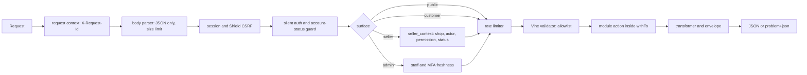
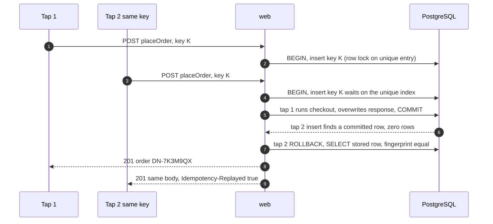
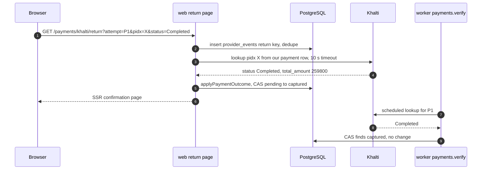

# DripNepal API Design

Status: Draft v1 (2026-09-26)

Reviewed: 2026-09-26 · consistency review 2026-09-30 to 2026-10-04

This document is the contract for every HTTP interface DripNepal exposes: the JSON API under `/api/v1`, how it relates to Inertia page routes, and the provider return and webhook routes. It owns the API conventions (casing, envelopes, errors, pagination, idempotency, concurrency, limits, versioning, request IDs) and the endpoint catalogue. The machine-readable contract is [openapi.yaml](openapi.yaml); where the two differ, this document states intent and `openapi.yaml` must be corrected in the same PR. `openapi.yaml` starts as a foundation [Confirmed, product owner 2026-09-26]: all shared components (security, problem responses and the full code enum, money, pagination meta, headers, state enums) plus the operations of the §14 worked examples, listed in its `x-foundation-scope`. Every other operation in §13 is listed in `x-pending-operations` and is added to `openapi.yaml` in the PR that implements it; T-API-001 fails for any `/api/v1` response whose operation is not yet specified.

It does not own: state machines, transition preconditions and job schedules ([05](05-order-payment-and-inventory-lifecycles.md)); table, column, constraint and settings names ([04a](04a-data-dictionary-tables.md)); permission slugs, role maps, threats and privacy rules ([07](07-security-threat-model-and-permissions.md)); UI behaviour ([08](08-ui-ux-and-design-system.md)); code layout ([09](09-code-structure-and-engineering-standards.md)); the test registry ([10](10-testing-and-quality-gates.md)); job operations ([11](11-deployment-and-operations.md)); milestones and traceability ([12](12-roadmap-and-backlog.md)).

---

## 1. Reading guide

### 1.1 Labels

- **[Confirmed]** product-owner answer; **[Verified-repo]** file:line in the repository or its installed `node_modules`; **[Verified-doc]** official documentation with URL, accessed 2026-09-25; **[Assumption]** reversible default; **[Open OD-xx]**; **[Verify-external VX-xx]**.
- **(proposed)** marks an operation, route, error code, permission, limiter or filter that a reviewed document introduced and the product owner has not approved yet. It is specified here so it can be built. Where it departs from another document, the text names the decision in the [risks register](risks-and-open-decisions.md#22-decision-table) (for example OD-48). Nothing marked this way is silently renamed or dropped.
- Test IDs are the ones registered in [10 §6](10-testing-and-quality-gates.md#6-test-id-registry), base IDs (10 §6.1) included, and are cited plainly. A test ID that 10 has not registered yet is marked (proposed).
- Symbols: ⚷ `Idempotency-Key` required; ⟳ `If-Match` required.

### 1.2 Versions the examples are checked against

`@adonisjs/core` 7.3.4 (7.7.0 since 2026-11-20, note 48), `@adonisjs/http-transformers` 2.3.1, `@adonisjs/bodyparser` 11.0.4, `@vinejs/vine` 4.4.0 (compiler 4.1.3), `@adonisjs/shield` 9.0.0, `@adonisjs/session` 8.1.0, `@adonisjs/auth` 10.1.0, `@adonisjs/inertia` 4.2.0 (5.0.5 since 2026-11-20, note 48), `@tuyau/core` 1.2.2 [Verified-repo, `package.json` and `node_modules/.pnpm`]. `@adonisjs/limiter` 3.0.1 is **not installed yet**; its API is taken from [research: adonis-stack](research/adonis-stack.md) (source <https://registry.npmjs.org/@adonisjs/limiter/-/limiter-3.0.1.tgz>, accessed 2026-09-25) and every limiter snippet is labelled pseudocode. Code blocks are "design sketch" (shapes verified, not compiled) or "pseudocode".

---

## 2. API surfaces and Inertia page routes

### 2.1 Reads are props, writes are JSON (ADR-0004)

[ADR-0004](adr/0004-inertia-reads-json-api-writes.md) fixes the split: page controllers load data through module queries and transformers and render Inertia props; every state change goes through `/api/v1` via the Tuyau client; after success the page calls `router.reload({ only: [...] })` ([03 §6.5](03-system-architecture.md#65-reads-through-inertia-props-writes-through-apiv1-adr-0004)). The rule for reads:

| Read                                                                                                                                 | Delivered as                                                                | Why                                                                                                                                  |
| ------------------------------------------------------------------------------------------------------------------------------------ | --------------------------------------------------------------------------- | ------------------------------------------------------------------------------------------------------------------------------------ |
| Initial data of any page (listing, PDP, account, seller and admin screens)                                                           | Inertia props (SSR for storefront, CSR for dashboards, ADR-0003)            | One round trip on slow networks (NFR-NET-003); SEO data in server HTML                                                               |
| Listing filter, sort and page changes                                                                                                | Inertia partial reload (`only: ['products','facets']`), state in the URL    | AC-FR-SRCH-001-4                                                                                                                     |
| Seller new-order count (FR-NOT-003)                                                                                                  | Inertia `usePoll` partial reload of one prop                                | No extra endpoint ([03 §6.3](03-system-architecture.md#63-dashboards-assessment-seller-and-admin))                                   |
| Location cascade (district after province), cart drawer, checkout quote, upload handshake, the seller's courier booking options (M6) | JSON `GET`/`POST` under `/api/v1`                                           | Interactive widgets inside a page that must not re-render the page                                                                   |
| Public catalog reads (`listProducts`, `getProduct`, `listCategories`, `getPublicShop`)                                               | JSON as well as props; the page controller and the endpoint share one query | Contract for the R3 app and a possible separate storefront ([03 §6.4](03-system-architecture.md#64-why-inertia-and-when-to-revisit)) |
| Seller and admin list endpoints (`listShopOrders`, `adminListOrders`, …)                                                             | JSON, and the same query feeds the page prop                                | Contract tests (T-API-001) and "load more" without a page visit                                                                      |

The same module query and transformer produce the page prop and the JSON body, so the two cannot drift; the JSON endpoint adds the envelope of §3.4.

### 2.2 Surfaces

| Surface               | Base path                                                                                              | Authentication                                                             | Extra gates                                                                                                                 | CSRF                       | Cache                            |
| --------------------- | ------------------------------------------------------------------------------------------------------ | -------------------------------------------------------------------------- | --------------------------------------------------------------------------------------------------------------------------- | -------------------------- | -------------------------------- |
| Public                | `/api/v1/catalog`, `/api/v1/shops`, `/api/v1/locations`, `/api/v1/seller-agreements/current`           | None (a session, if present, is ignored for authorization)                 | Rate limit per IP (§9)                                                                                                      | GET only                   | `private, no-store` in R1 (§3.8) |
| Auth and self         | `/api/v1/auth`, `/api/v1/me`                                                                           | Session, except `signUp`, `logIn`, password reset and email confirmation   | Account-status middleware (§4.2)                                                                                            | Required on unsafe methods | `no-store`                       |
| Customer              | `/api/v1/me/*`, `/api/v1/cart`, `/api/v1/checkout`, `/api/v1/invitations`                              | Session; cart also works for guests (guest token cookie, AC-FR-CART-001-1) | `active` or `pending_verification`; `EMAIL_NOT_VERIFIED` for checkout, shop application and invitation acceptance (§4.2)    | Required                   | `no-store`                       |
| Seller                | `/api/v1/seller/shops/{shopSlug}`                                                                      | Session                                                                    | Verified email (`EMAIL_NOT_VERIFIED`, §4.2), then `seller_context` resolution: membership → permission → shop status (§4.4) | Required                   | `no-store`                       |
| Admin                 | `/api/v1/admin`                                                                                        | Session of a `platform_staff` user                                         | `mfa_verified_at` within 12 h (§4.3), `platform.*` permission                                                               | Required                   | `no-store`                       |
| Webhooks              | `/api/v1/webhooks/payments/{provider}`; from M6 `/api/v1/webhooks/couriers/{providerCode}/{accountId}` | None; provider scheme (§12)                                                | Signature if the provider signs, then lookup; for couriers the URL token, then a history read (§12.6)                       | **Exempt by exact route**  | `no-store`                       |
| Provider return pages | `/payments/{provider}/return` (Inertia GET)                                                            | None required (customer may return on another device)                      | Lookup before rendering (§12.2)                                                                                             | GET                        | `no-store`                       |
| Health                | `/health/live`, `/health/ready`                                                                        | None                                                                       | Not cached                                                                                                                  | GET                        | `no-store`                       |

CORS: same-origin only. `config/cors.ts` allows only the origin of `APP_URL`, with `credentials: true`, in every environment (RF-43; built 2026-11-20, note 47, `T-SEC-042`), so no other origin gets `Access-Control-Allow-Origin`. Vite runs as middleware on the same origin, so development needs no other entry. Token authentication for non-browser clients is R3 ([ADR-0004](adr/0004-inertia-reads-json-api-writes.md) decision 5).

### 2.3 Page routes this document adds

[03 §6.1](03-system-architecture.md#61-surfaces-and-rendering-modes) lists the route prefixes of each surface, including navigation entries (`/men/t-shirts`), `/grievance` and `/payments/{provider}/return`; [08 §2](08-ui-ux-and-design-system.md#2-route-map-and-information-architecture) lists the pages. The pages below are needed by FR-ADM-009, FR-ADM-011, FR-RET-006 and J-19/J-20 and are proposed consistently with 03 §6.1 and [02 note 2](02-user-journeys-and-acceptance-criteria.md#8-consistency-notes-for-editor):

| Route                                                           | Surface, rendering | Reads (props)                                         | Writes (operations)                                                                                                                                                                                          | Status                |
| --------------------------------------------------------------- | ------------------ | ----------------------------------------------------- | ------------------------------------------------------------------------------------------------------------------------------------------------------------------------------------------------------------ | --------------------- |
| `/grievance`                                                    | Storefront, SSR    | `platform_legal_disclosures.grievance_officer`        | none                                                                                                                                                                                                         | In 03 §6.1 (proposed) |
| `/legal`                                                        | Storefront, SSR    | `platform_legal_disclosures` (FR-ADM-011)             | none                                                                                                                                                                                                         | (proposed)            |
| `/men/{navSlug}`, `/women/{navSlug}` (fixed list, no catch-all) | Storefront, SSR    | listing props                                         | none                                                                                                                                                                                                         | In 03 §6.1 (proposed) |
| `/account/support`, `/account/support/{caseNumber}`             | Account, CSR       | my cases, thread                                      | `openSupportCase`, `replyToMySupportCase`                                                                                                                                                                    | (proposed)            |
| `/seller/{shopSlug}/returns`                                    | Seller, CSR        | shop returns                                          | `recordReturnReceived` ⚷, `markReturnInTransit` ⚷                                                                                                                                                            | (proposed)            |
| `/seller/{shopSlug}/support-cases`                              | Seller, CSR        | shop cases (shop-visible messages only)               | `replyToShopSupportCase`                                                                                                                                                                                     | (proposed)            |
| `/admin/support-cases`, `/admin/support-cases/{caseNumber}`     | Admin, CSR         | case register by `due_at`                             | `updateSupportCase` (⟳ proposed), `addSupportCaseMessage`                                                                                                                                                    | (proposed)            |
| `/admin/returns`                                                | Admin, CSR         | returns queue                                         | return operations, `createRefund` ⚷                                                                                                                                                                          | (proposed)            |
| `/admin/logistics`                                              | Admin, CSR         | courier accounts (`adminListLogisticsAccounts`)       | `adminCreateLogisticsAccount` ⚷, `adminRekeyLogisticsAccount` ⟳, `adminAllowShopOnLogisticsAccount`, `adminRemoveShopFromLogisticsAccount`, `adminSetLogisticsAccountStatus`, `adminSetShopLogisticsEnabled` | (proposed, M6)        |
| `/admin/logistics/branches`                                     | Admin, CSR         | courier branches (`adminListLogisticsBranches`)       | `adminSyncLogisticsBranches`, `adminUpdateLogisticsBranch`                                                                                                                                                   | (proposed, M6)        |
| `/admin/courier-bookings`                                       | Admin, CSR         | bookings that need staff (`adminListCourierBookings`) | `adminResolveCourierBooking` ⚷, `adminRefreshCourierStatus`                                                                                                                                                  | (proposed, M6)        |
| `/admin/courier-events`                                         | Admin, CSR         | held courier updates (`adminListCourierEvents`)       | `adminResolveCourierEvent`                                                                                                                                                                                   | (proposed, M6)        |
| `/admin/settings`                                               | Admin, CSR         | settings                                              | `updatePlatformSetting`                                                                                                                                                                                      | (proposed)            |

The Writes column marks ⚷ and ⟳ as §1.1 does; [§7.7](#77-operations-that-require-a-key-) and [§8](#8-concurrent-edits-etag-and-if-match) are the complete lists.

### 2.4 Request pipeline per surface



The webhook routes skip the CSRF check (exact-route exemptions, §12.4 and §12.6) and the account guard. Order matters: the rate limiter runs after authentication so authenticated limits key on the user ID, but login and signup limiters run before credential checks by design (§9). As built (M1 part 6a), `api_user` and `api_staff` (§9.1) run in the router stack right after the account-status guard, before `seller_context` and the staff check, so a seller or admin call those refuse has still taken its point; each operation's own limiter runs inside its action, except `catalog_ip`, which the same middleware charges on the client network for the location cascades (M1 part 6b) and the category and attribute reads (R1-S part 3a) instead of `api_user`.

---

## 3. Conventions

### 3.1 URLs and resource naming

- Plural, kebab-case collection nouns: `/me/support-cases`, `/fulfillment-events`. Path parameters are camelCase in docs and route definitions (`{shopOrderNumber}`), as in the §13 catalogue and `openapi.yaml`.
- Resources are addressed by their public identifier: orders by `number` (`DN-XXXXXXX`), shop orders by `DN-XXXXXXX-n`, returns `RT-XXXXXXX`, support cases `SC-XXXXXXX` ([04a §11.1, §11.7, §14.1](04a-data-dictionary-tables.md)), storefront products by `public_id`, seller and admin resources by UUID. Numbers and public IDs are matched case-insensitively; Crockford aliases (`o`→`0`, `i`/`l`→`1`) are normalised for `public_id` ([ADR-0017](adr/0017-product-urls-public-id.md)).
- State transitions that are not plain field edits are **action sub-resources** with `POST` (`/accept`, `/reject`, `/submit`, `/approve`, `/mark-succeeded`), each mapping to exactly one action and one row of a [05](05-order-payment-and-inventory-lifecycles.md) transition table. `PATCH` never changes a `status` column.
- Whole-set replacements use `PUT` (`replaceProductVariants`, `replaceProductMedia`, `replaceShopShipping`, `replacePayoutAccount`).
- `{shopSlug}` accepts a retired slug through `slug_redirects` without redirecting; API responses always carry the current slug ([ADR-0017](adr/0017-product-urls-public-id.md)). Pages answer 301.

### 3.2 JSON casing (OD-13)

`snake_case` for every JSON key in request bodies, response bodies, query parameters and problem extension members, and for Inertia props and `openapi.yaml` (OD-13, decided 2026-09-30). Transformers build every shape explicitly, so the casing is a transformer concern, not an automatic mapping. T-API-001 enforces it. RFC 9457 members (`type`, `title`, `status`, `detail`) keep their RFC names.

### 3.3 Money, time, identifiers, enums

| Kind                | Wire format                                                                                                                 | Rule                                                                                                                                                                                                                                                                                                                                                                                                                                                                                                                                                                                           |
| ------------------- | --------------------------------------------------------------------------------------------------------------------------- | ---------------------------------------------------------------------------------------------------------------------------------------------------------------------------------------------------------------------------------------------------------------------------------------------------------------------------------------------------------------------------------------------------------------------------------------------------------------------------------------------------------------------------------------------------------------------------------------------- |
| Money               | `{ "amount_minor": 129900, "currency": "NPR" }`                                                                             | Integer paisa ([ADR-0007](adr/0007-money-integer-minor-units.md), [04 §18](04-domain-model-and-data-dictionary.md#18-money-representation-rounding-and-allocation)). Never a float or a decimal string. Display formatting ("Rs 1,299.00" vs "Rs.") is a client concern and undecided under [Verify-external VX-12]; no data field is ever a formatted string. Human-readable problem `detail` text may quote an amount through the shared server formatter (same provisional "Rs" format as 04 §18.1); clients act on the machine member (for example `refundable_minor`), never on `detail`. |
| Money in requests   | a bare integer field ending in `_minor` (`delta` is a quantity, not money)                                                  | Only where the actor legitimately chooses an amount: `price_minor`, `compare_at_price_minor`, `expected_grand_total_minor`, refund `amount_minor`, remittance, adjustment, payout. Currency is implied NPR; a `currency` other than `NPR` is 422.                                                                                                                                                                                                                                                                                                                                              |
| Money bigger values | JSON number                                                                                                                 | Safe below `Number.MAX_SAFE_INTEGER` paisa; the server's guarded parser rejects anything else ([05 §9.6](05-order-payment-and-inventory-lifecycles.md#96-other-rules-that-keep-these-lifecycles-correct)).                                                                                                                                                                                                                                                                                                                                                                                     |
| Timestamps          | RFC 3339 UTC with `Z`, millisecond precision: `"2026-10-02T08:15:30.120Z"`                                                  | Clients display Asia/Kathmandu. Date-only filters (`from`, `to`) are `YYYY-MM-DD` interpreted in Asia/Kathmandu and converted to a UTC half-open range.                                                                                                                                                                                                                                                                                                                                                                                                                                        |
| IDs                 | UUID strings (v7 from `uuidv7()`, [04 §2.1](04-domain-model-and-data-dictionary.md#21-identifiers)); human numbers as above | `audit_logs.id` is internal and never exposed.                                                                                                                                                                                                                                                                                                                                                                                                                                                                                                                                                 |
| Enums               | lower `snake_case` strings exactly as the 04a CHECK lists                                                                   | Clients must tolerate unknown enum values in responses (additive change, §10).                                                                                                                                                                                                                                                                                                                                                                                                                                                                                                                 |
| Absent vs null      | Every documented field is always present; unknown values are `null`                                                         | Makes Tuyau and OpenAPI types exact. Omitted fields in `PATCH` bodies mean "unchanged"; `null` means "clear" where the column allows it.                                                                                                                                                                                                                                                                                                                                                                                                                                                       |
| Masked values       | Suffix-only strings: `"phone_masked": "******4321"`                                                                         | Masked and unmasked values use different keys (§3.6), so a client never mistakes one for the other.                                                                                                                                                                                                                                                                                                                                                                                                                                                                                            |

### 3.4 Envelopes and the existing `ApiSerializer`

Success bodies are `{ "data": … }` for one resource and `{ "data": [...], "meta": {...} }` for lists, except a bounded list, which has no `meta` ([§6.2](#62-cursors-everything-else) "Bounded lists", added 2026-11-23, note 61). `204 No Content` is used only for `DELETE` endpoints and `logOut`.

The repository already registers `ctx.serialize()` through `ApiSerializer` in `providers/api_provider.ts` [Verified-repo `providers/api_provider.ts:10-35`]. Two findings from the installed source decide how it is reused:

1. `BaseSerializer.serialize` of `@adonisjs/http-transformers` 2.3.1 wraps items and collections under `wrap` (`data`), but for a `Paginator` it always emits the key **`metadata`**, not `meta` [Verified-repo `node_modules/.pnpm/@adonisjs+http-transformers@2.3.1…/build/index.js:66-72`].
2. The current `definePaginationMetaData` throws unless it receives Lucid's paginator keys (`total`, `perPage`, `currentPage`, `lastPage`, `firstPageUrl`, …) [Verified-repo `providers/api_provider.ts:26-33`]. Those keys are camelCase, include URLs, and need an uncapped `count(*)`, which fits neither cursor lists nor the capped catalog count.

**Decision.** Keep `ApiSerializer` and change it in M1: `definePaginationMetaData` accepts exactly the two DripNepal meta shapes below (and throws on anything else, which keeps its guard role), and `ctx.serialize` renames the top-level `metadata` key to `meta` in one place. Controllers never call Lucid's `paginate()`; they call `XTransformer.paginate(rows, meta)` (signature `static paginate(data, metaData: Record<string, any>, ...rest)` [Verified-repo `…/build/src/base_transformer.d.ts:120-122`]). Trade-off: a five-line rename instead of adopting the library's `metadata` key; the benefit is that this document, Tuyau types and `openapi.yaml` all say `meta`. Verified by T-API-001 and T-API-008 on every list response.

```ts
// design sketch — providers/api_provider.ts after M1 (shapes checked against http-transformers 2.3.1)
type PageMeta = {
  page: number
  per_page: number
  total: number
  total_is_capped: boolean
  has_more: boolean
}
type CursorMeta = { limit: number; next_cursor: string | null }

class ApiSerializer extends BaseSerializer<{
  Wrap: 'data'
  PaginationMetaData: PageMeta | CursorMeta
}> {
  wrap: 'data' = 'data'
  definePaginationMetaData(meta: unknown): PageMeta | CursorMeta {
    if (isPageMeta(meta) || isCursorMeta(meta)) return meta
    throw new Error('Pagination meta must be PageMeta or CursorMeta') // never Lucid paginator meta
  }
}
// ctx.serialize(result) then maps { data, metadata } → { data, meta } for paginator results only
```

`meta` shapes: page lists `{ page, per_page, total, total_is_capped, has_more }` (§6.1); cursor lists `{ limit, next_cursor }` (§6.2). Mutation responses carry no `meta`; an idempotent replay is marked by a header, not by the body, so the replayed body stays byte-identical (§7.5).

### 3.5 Input: validators are allowlists

- Every endpoint has one Vine validator created with `vine.create(...)` (`vine.compile` is deprecated in 4.4.0 [Verified-doc, [research: adonis-stack](research/adonis-stack.md)]); controllers read only `await request.validateUsing(validator, { meta })`. `request.all()`, `request.body()` and spreading validated objects into `Model.create`/`merge` are banned; actions receive typed commands and assign columns one by one (RF-36). A lint rule enforces the ban ([09](09-code-structure-and-engineering-standards.md)).
- **Unknown fields are rejected, not stripped.** Vine 4.4.0 _strips_ properties not in the schema unless `allowUnknownProperties()` is used [Verified-repo `@vinejs/compiler` 4.1.3 `build/index.js:392-393`: unknown keys are only copied when `allowUnknownProperties` is set]. DripNepal adds a shared `rejectUnknownFields` step that compares the raw JSON keys (recursively, arrays included) with the schema's declared keys and answers 422 `VALIDATION_FAILED` with `errors[].code = "unknown_field"` for each extra key.
  - Why reject: stripping would silently accept `{ "shop_id": …, "price_minor": 1 }` on `placeOrder`, hiding both client bugs and mass-assignment probes; rejection makes T-SEC-003 assertable as "422 naming the field" and matches [05 §4.1](05-order-payment-and-inventory-lifecycles.md#41-inputs-preconditions-and-the-quote) ("Unknown fields are rejected").
  - Cost: a client built against a newer server cannot send a field the older server does not know. With one deployable and Inertia's asset-version reload (409 on stale assets) this only affects the R3 app, whose requests §10 keeps additive on the server side.
  - Verified by T-SEC-003 and T-API-002: every mutation rejects an extra top-level and an extra nested key.
- Server-owned fields are never in any validator: `shop_id`, `status`, `version`, totals, `commission_*`, `number`, `public_id`, `created_by`, `approved_by`. Authorization identifiers come from the path and the session only.
- Strings are trimmed; empty strings become `null` (`convertEmptyStringsToNull: true` [Verified-repo `config/bodyparser.ts`]); emails are lower-cased, and an email in the reserved top-level domain `.invalid` (RFC 2606), which includes `anonymized.invalid`, is refused with 422 `VALIDATION_FAILED` on `email` (`signUp` and any future email-change operation), so no live account can hold an anonymisation placeholder or a seed address (decided 2026-11-11, note 46) ([04a §5.1](04a-data-dictionary-tables.md#51-users) `users_anonymized_check`); phones must match `^9[678]\d{8}$` and are stored E.164 ([04 §2.8](04-domain-model-and-data-dictionary.md#28-text-normalisation-and-lengths); [research: nepal-regulatory-locale](research/nepal-regulatory-locale.md)).
- Only `application/json` bodies are accepted on `/api/v1` unsafe methods. Other content types get 400 `MALFORMED_REQUEST` (proposed); until adopted, 422 `VALIDATION_FAILED` with `errors[0].code = "unsupported_media_type"`. Since M0 (E7) a multipart body gets this answer on every route (§9.2); the other types are not checked yet (note 45).

### 3.6 Output: transformers, never models

Every response body and every Inertia prop is produced by a transformer (`BaseTransformer.pick`/`omit`, variants via `useVariant`) from `@adonisjs/core/transformers` [Verified-doc, [research: adonis-stack](research/adonis-stack.md); http-transformers 2.3.1]. Returning a Lucid model, `model.serialize()` or `toJSON()` from a controller fails the architecture test T-ARCH-001 (rule added by [09](09-code-structure-and-engineering-standards.md)).

Transformer rules:

- One transformer per audience where visibility differs: `OrderCustomerTransformer`, `ShopOrderSellerTransformer`, `OrderAdminTransformer`. Seller variants never include customer email, account ID or other orders ([07 §5.2](07-security-threat-model-and-permissions.md#52-vendor-visibility-of-customer-contact-data) rule 3).
- Customer contact on seller views follows [07 §5.2](07-security-threat-model-and-permissions.md#52-vendor-visibility-of-customer-contact-data) rules 0–2, which [01 FR-ORD-008](01-product-requirements.md#fr-ord-008-vendor-view-of-customer-contact-on-shop-orders) restates [Assumption; Open OD-17]: a shop order that never reached `awaiting_acceptance` is left out of every seller list and count, and `getShopOrder` answers 404 `NOT_FOUND` for it. The recipient name, phone and address are returned unmasked only on `getShopOrder`, with `shop.customer_contact.view`, while the shop order is `awaiting_acceptance` or `accepted`, while any return request on it is open, and for 30 days after it becomes terminal (`completed`, `cancelled` or `rejected`); otherwise `getShopOrder` returns `recipient: null`, and `recipient_masked` holds the name initial, district and phone last four digits (07 §5.2 rule 2, as in 02 AC-J12-02). `listShopOrders` rows have no `recipient` field, only `recipient_masked`, for every role (07 §5.2 rule 1). `viewer` staff always get the masked form.
- Encrypted columns (`*_enc`) are decrypted only in the transformers on the 07 allowlist; everything else exposes `*_last4` ([04 §2.9](04-domain-model-and-data-dictionary.md#29-sensitive-column-encryption-and-blind-indexes)).
- Versioned resources include `"version": 7` in the body and the strong tag `ETag: "7"` in the header (§8).
- Each page controller declares, for every prop, the transformer and audience variant that builds it. T-SEC-036 compares the prop key sets of each audience with those transformers, so a page cannot pass a wider shape than its audience may see.

### 3.7 Status codes on success

| Case                                                                                                    | Status                                                                                                                                                                                                                                                                                                                                                   |
| ------------------------------------------------------------------------------------------------------- | -------------------------------------------------------------------------------------------------------------------------------------------------------------------------------------------------------------------------------------------------------------------------------------------------------------------------------------------------------- |
| Read                                                                                                    | 200                                                                                                                                                                                                                                                                                                                                                      |
| Create (`createProduct`, `placeOrder`, `createRefund`…)                                                 | 201; `Location` of the new resource only when a read operation serves it (`createProduct` → `getShopProduct`, `placeOrder` → `getMyOrder`, `openSupportCase` → `getMySupportCase`); otherwise no `Location`, for example on `createRefund`, `createPayout`, `createReturnRequest`, `createLedgerAdjustment`, `recordVendorRemittance` and `inviteMember` |
| Transition or edit returning the resource                                                               | 200                                                                                                                                                                                                                                                                                                                                                      |
| Accepted for asynchronous work (`requestPasswordReset`, `resendEmailVerification`, `revokeAllSessions`) | 202 with a neutral body (no account enumeration, RF-38)                                                                                                                                                                                                                                                                                                  |
| Delete, logout                                                                                          | 204                                                                                                                                                                                                                                                                                                                                                      |
| Idempotent replay                                                                                       | the stored status (201 stays 201)                                                                                                                                                                                                                                                                                                                        |

### 3.8 Caching headers

All `/api/v1` responses send `Cache-Control: private, no-store` in R1, including public catalog reads, because they pass through the session and Shield middleware and may set cookies ([03 §12.5](03-system-architecture.md#125-caching)). Edge caching of public reads is an evolution item with the preconditions listed there.

---

## 4. Authentication, CSRF and authorization

### 4.1 Session and CSRF

- Session guard `web`, database session store, cookie `dripnepal_session`, `HttpOnly; Secure; SameSite=Lax; Path=/` ([ADR-0005](adr/0005-session-auth-server-side-revocation.md); built in M0, E7, note 45). `Secure` is set in staging and production, which are served over HTTPS ([07 §3.1](07-security-threat-model-and-permissions.md#31-guard-store-and-cookie)).
- Shield CSRF protects `POST`, `PUT`, `PATCH`, `DELETE` [Verified-repo `config/shield.ts`, `methods`]. With `enableXsrfCookie: true` (already set) Shield sets a JavaScript-readable encrypted `XSRF-TOKEN` cookie and accepts the `x-xsrf-token` header [Verified-doc: shield 9.0.0 source, [research: adonis-stack](research/adonis-stack.md)]. Tuyau 1.2.2 copies the cookie into `X-XSRF-TOKEN` automatically, and Inertia's axios does the same [Verified-doc, [research: adonis-stack](research/adonis-stack.md); <https://inertiajs.com/docs/v2/security/csrf-protection>]. No client code handles tokens.
- A CSRF failure throws `E_BAD_CSRF_TOKEN` (403), whose default handler flashes and redirects. For `/api/*` the exception handler renders problem+json in one of two ways ([07 §3.3](07-security-threat-model-and-permissions.md#33-the-per-request-account-check-and-the-suspension-decision)):
  - 401 `UNAUTHENTICATED` when the session holds no `auth_web` and the matched route runs the `auth` middleware. This is the case of a session that expired or was destroyed by `identity.revoke_sessions`: Shield finds no CSRF secret, mints a new one and rejects the token made from the old one (§4.2 row 2).
  - Otherwise 403 `FORBIDDEN` with `detail` "Your session expired. Reload the page and try again." (07 TM-10): on routes a guest may call (`logIn`, `signUp`, password reset, the guest cart), and when a signed-in session fails the check.
  - Clients handle the 401 like any other (visit `/login`, §5.4). A 403 `FORBIDDEN` on the first unsafe call after a long idle means "reload once"; on a protected route an expired session gets the 401 instead.
- Exemption: only `POST /api/v1/webhooks/payments/{provider}` and, from M6, `POST /api/v1/webhooks/couriers/{providerCode}/{accountId}` (§12.6, proposed), through the function form of `exceptRoutes` matching the exact route pattern (`exceptRoutes?: string[] | ((ctx) => boolean)` [Verified-doc, [research: adonis-stack](research/adonis-stack.md), shield 9.0.0 `CsrfOptions`]). Each is matched by its exact route pattern; a prefix match such as `/api/v1/webhooks/*` is not allowed.
- `logOut` calls `auth.use('web').logout()`, `session.untag()`, `session.clear()` and `session.regenerate()` ([ADR-0005](adr/0005-session-auth-server-side-revocation.md) decision 5, [07 §3.11](07-security-threat-model-and-permissions.md#311-logout-and-inertia-history)), because the guard's logout only forgets `auth_web` and does not regenerate the session [Verified-doc, [research: adonis-stack](research/adonis-stack.md), auth 10.1.0], and `regenerate()` carries every remaining key, such as `mfa_verified_at`, to the new ID. The server clears and destroys the session; it does not clear browser history, because `inertia.clearHistory()` has no effect on the JSON `204` of `logOut` (edited 2026-11-21: in adapter 5 it also writes a session key the next render pulls, which M1 weighs, [07 §3.11](07-security-threat-model-and-permissions.md#311-logout-and-inertia-history)). The client's `logOut` success handler calls `router.clearHistory()`, and the next `/login` render clears history again (07 §3.11). Built in M1 part 3: `logOut` writes no history key, so the cleared session stays empty and its row is deleted; the backstop is that every page rendered without a signed-in user renders with `clearHistory` (07 §3.11).

### 4.2 Account status, security stamp and suspension

The account-status middleware runs after silent auth on every request that has a session ([03 §7.7](03-system-architecture.md#77-suspension-taking-effect-on-an-existing-session-j-17-fr-iam-006-t-sec-010)). `@adonisjs/auth` re-queries the user on every authenticated request [Verified-doc, [research: adonis-stack](research/adonis-stack.md)], so status is always fresh. The exact API behaviour, as decided in [07 §3.3](07-security-threat-model-and-permissions.md#33-the-per-request-account-check-and-the-suspension-decision):

| #   | Situation on the request                                                                                                                                                          | Session exists? | API response                                                                                                                                                                                                                                                                                                                                                                                                                                                       | Page response                                                                                                                  |
| --- | --------------------------------------------------------------------------------------------------------------------------------------------------------------------------------- | --------------- | ------------------------------------------------------------------------------------------------------------------------------------------------------------------------------------------------------------------------------------------------------------------------------------------------------------------------------------------------------------------------------------------------------------------------------------------------------------------ | ------------------------------------------------------------------------------------------------------------------------------ |
| 1   | User `suspended`, `deactivated` or `anonymized` (checked first, before the stamp)                                                                                                 | yes             | 403 `ACCOUNT_SUSPENDED`; the middleware logs out, untags, clears and regenerates the session                                                                                                                                                                                                                                                                                                                                                                       | redirect `/login` with a notice                                                                                                |
| 2   | Same user, after `identity.revoke_sessions` destroyed the session                                                                                                                 | no (guest)      | Protected endpoint: 401 `UNAUTHENTICATED` for every method, an unsafe call's CSRF failure included (§4.1). Public endpoint: served as a guest                                                                                                                                                                                                                                                                                                                      | redirect `/login`                                                                                                              |
| 3   | User `active` or `pending_verification`, session stamp differs from `users.security_stamp` (password changed or "revoke all" elsewhere, role change)                              | yes             | 401 `UNAUTHENTICATED`; the middleware logs out, untags, clears and regenerates the session. Exception: on `/verify-email`, `/forgot-password`, `/reset-password`, `confirmEmail`, `requestPasswordReset` and `resetPassword`, the middleware ends the stale session (keeping Shield's CSRF secret) and serves the request as a guest's ([07 §3.3](07-security-threat-model-and-permissions.md#33-the-per-request-account-check-and-the-suspension-decision) row 3) | redirect `/login`; on the token pages above, the page itself as a guest, and no redirect ever carries their URL as `return_to` |
| 4   | Suspended user tries `logIn` with the correct password                                                                                                                            | —               | 403 `ACCOUNT_SUSPENDED`, no session created (AC-FR-IAM-003-4); anonymized accounts get the generic credential failure                                                                                                                                                                                                                                                                                                                                              | —                                                                                                                              |
| 5   | `pending_verification` user calls checkout, shop application, invitation acceptance or any seller route ([07 §4.4](07-security-threat-model-and-permissions.md#44-status-gating)) | yes             | 403 `EMAIL_NOT_VERIFIED`                                                                                                                                                                                                                                                                                                                                                                                                                                           | page shows the verify prompt                                                                                                   |

Why row 1 wins over row 3 even though suspension also rotates the stamp: the status check runs first, so a suspended user who still has a session always learns why. Row 2 is unavoidable: after the session row is deleted the server cannot tell who the cookie belonged to.

The 07 §3.3 table also covers timeouts: a session past its idle or absolute limit gets 401 `UNAUTHENTICATED` (admin idle: 401 `MFA_REQUIRED`, §4.3); the limits are in [07 §3.4](07-security-threat-model-and-permissions.md#34-idle-and-absolute-timeouts-per-surface).

**Suspension response (decided in [07 §3.3](07-security-threat-model-and-permissions.md#33-the-per-request-account-check-and-the-suspension-decision)).** A suspended, deactivated or anonymized user gets 403 `ACCOUNT_SUSPENDED` while the session row exists (row 1) and 401 `UNAUTHENTICATED` once `identity.revoke_sessions` has destroyed it (row 2); a stamp-only mismatch is 401 (row 3); the answer is never 2xx. T-SEC-010 asserts both paths deterministically (worker stopped: 403; after running the job: 401). ADR-0005 splits the stamp-only case into 401. [01](01-product-requirements.md) AC-FR-IAM-006-2 says the same: "rejected with 403 `ACCOUNT_SUSPENDED` while the session exists, or 401 `UNAUTHENTICATED` once it has been revoked; never a 2xx", and [03 §7.7](03-system-architecture.md#77-suspension-taking-effect-on-an-existing-session-j-17-fr-iam-006-t-sec-010) gives the stamp-only case 401.

### 4.3 Admin MFA gating

Every `/api/v1/admin/*` route requires: an authenticated `platform_staff` row with `revoked_at IS NULL`, TOTP enrolled, and session `mfa_verified_at` within 12 hours ([07 §4.2](07-security-threat-model-and-permissions.md#42-platform-roles-and-permissions), [07 §3.4](07-security-threat-model-and-permissions.md#34-idle-and-absolute-timeouts-per-surface); [ADR-0005](adr/0005-session-auth-server-side-revocation.md) decision 6). The MFA proof counts only when the `user_id` stored with it equals the signed-in user and it is not older than `authenticated_at` ([07 §3.2](07-security-threat-model-and-permissions.md#32-what-a-session-may-contain)), so one staff member's TOTP check never unlocks another account in the same browser. Failures, in the order they are checked ([07 §4.8](07-security-threat-model-and-permissions.md#48-how-policies-are-implemented)):

- Guest: 401 `UNAUTHENTICATED` from the `auth` middleware; a page redirects to `/login`.
- Signed in, but without an active `platform_staff` row, or with an account that is not `active` (a `pending_verification` user included): 404 `NOT_FOUND`, so the admin API does not advertise itself to customers.
- Staff session past the 7-day staff absolute limit (proposed, 07 §3.4): the session is destroyed, 401 `UNAUTHENTICATED`.
- Staff idle beyond 2 h, without TOTP enrolled, or with verification older than 12 h: 401 `MFA_REQUIRED` with extension `"mfa": "enrollment_required"` or `"verification_required"`; the client routes to `/mfa`.
- Staff lacking the operation's permission: 403 `FORBIDDEN`.
- **Step-up:** every operation the [07 §3.10](07-security-threat-model-and-permissions.md#310-step-up-for-money-staff-and-sensitive-settings) table marks Yes needs `mfa_verified_at` within 15 minutes (proposed; the value is an [Assumption]). Otherwise it answers 401 `MFA_REQUIRED` with `verification_required`; the client runs `verifyMfaChallenge` and retries with the same `Idempotency-Key`. It covers money approvals, transfers and their outcomes, manual ledger entries, payout-account verification and reveals, staff changes and sensitive settings; among them are `retryRefund`, `markPayoutFailed`, `resolvePaymentReview` and `resolveRefundReview` (both proposed), and `adminUpdateShop` when `commission_rate_bp` or `product_review_mode` changes, with a mandatory `reason` and an audit row that keeps the old and new values (a `slug`-only change needs no step-up). The 07 §3.10 table is the complete list.
- Built in M1 part 5 (note 59) in `app/middleware/platform_staff_middleware.ts`, in the order above: the 404 needs an unrevoked staff row and an `active` account, enrolled or not, so a staff member without TOTP gets `enrollment_required` (the `/admin` enrolment gate of [09 §9.1](09-code-structure-and-engineering-standards.md#91-node-ace-platformcreate-admin)); the 7-day limit ends the session; admin idle forgets `mfa_verified_at`; a request that passes refreshes `admin_seen_at` when the user started it. The step-up check (`assertStepUp`) reads the same `{ user_id, at }` proof.
- A self-approval under `single_operator_mode` (OD-14) of `approveRefund`, `approvePayout` or the proposed `approveLedgerAdjustment` ([05 §7.8](05-order-payment-and-inventory-lifecycles.md#78-adjustments)) requires a TOTP code in the request body (`totp_code`), even inside the 12 h window ([07 §4.7](07-security-threat-model-and-permissions.md#47-maker-checker-and-single-operator-mode)); a valid code also satisfies the step-up. A wrong code is 422 `VALIDATION_FAILED` on `totp_code` and counts toward the `mfa_user` and `mfa` limiters (§9.1). §7.2 and §7.3 say how the code behaves on an idempotent retry.
- **OD-44's own-shop check** (decided 2026-11-23, option (b) with the `single_operator_mode` exception; built 2026-11-24 in R1-S part 1c-ii, [07 §4.1](07-security-threat-model-and-permissions.md#41-principles) item 4): an admin write on a shop the staff member owns or works in (`shops.owner_user_id`, or an `active` `shop_memberships` row), or on an order with a shop order of such a shop, answers 403 `FORBIDDEN` while `single_operator_mode` is `false`. Under the mode it needs `totp_code` in the body, checked inside the action's transaction as the self-approval's code is (§7.3 step 3): none is 422 `VALIDATION_FAILED` on `totp_code` (`required`), a wrong or replayed one 422 on `totp_code` (`code_incorrect`), counted by the `mfa_user` and `mfa` limiters; the change's audit row carries `{"flags":["single_operator"]}`. The operations are the §13.8 rows that name the check (2026-11-24); reads and `adminRefreshCourierStatus`, which changes nothing staff choose, are not covered. On a step-up operation a valid code in the body also stands in for a stale step-up, on any shop, and refreshes the session's MFA time without a new session ID ([07 §3.10](07-security-threat-model-and-permissions.md#310-step-up-for-money-staff-and-sensitive-settings)); on another shop without step-up a code sent anyway is not checked.

### 4.4 Seller authorization algorithm

Every route under `/api/v1/seller/shops/{shopSlug}` runs the `seller_context` middleware ([ADR-0006](adr/0006-authorization-platform-roles-shop-memberships.md) decision 3, [07 §4.8](07-security-threat-model-and-permissions.md#48-how-policies-are-implemented)):

1. **Resolve** `{shopSlug}` case-insensitively against `shops.slug`, then `slug_redirects`. No row: 404 `NOT_FOUND`.
2. **Actor:** owner if `shops.owner_user_id = auth.user.id`; else an `active` `shop_memberships` row for (`shop_id`, `user_id`); else 404 `NOT_FOUND` — identical body to step 1, so a slug cannot be probed (AC-FR-SHOP-006-3, T-SEC-001).
3. **Permission:** the route declares one access requirement (catalogue §13.5; the kinds are in 07 §4.8): a `shop.*` slug, which most routes declare; `shop.member` (the owner or any active member); `shop.owner` (the owner only); or `mediaByKind` (`createMediaUpload`, `completeMediaUpload`), where the middleware checks membership only and the action applies the requirement of the validated `kind`, or of the stored asset, and the status gate after validation. Missing: 403 `FORBIDDEN`. The member already knows the shop exists, so 403 leaks nothing.
4. **Status gate** (after permission, [07 §4.4](07-security-threat-model-and-permissions.md#44-status-gating)): keyed by operationId (`assertShopGate(shop, actor, operationId)`), not by the permission slug alone, so the exceptions the table below names by operation apply. Refused: 403 `SHOP_NOT_ACTIVE` with extension `"shop_status"` and `"suspension_mode"`.
5. **Scope:** set `ctx.shop`; every query and every compare-and-set includes `shop_id = ctx.shop.id`. A nested resource (`{productId}`, `{shopOrderNumber}`, `{variantId}`, `{membershipId}`, `{invitationId}`, `{returnNumber}`, `{caseNumber}`, `{mediaAssetId}`) not found **within** the shop is 404 `NOT_FOUND`, never 403 (T-SEC-001).
6. **Never trust client shop IDs:** `shop_id` is not in any seller validator, so sending it is 422 `unknown_field` (§3.5). Composite foreign keys make a cross-shop link impossible even if code forgot the scope ([04 §2.5](04-domain-model-and-data-dictionary.md#25-tenant-isolation-with-composite-foreign-keys)).

| Shop status                                       | Allowed                                                                                                                                                                                                                                                                                                                                                                                                                            | Everything else                                                                                               |
| ------------------------------------------------- | ---------------------------------------------------------------------------------------------------------------------------------------------------------------------------------------------------------------------------------------------------------------------------------------------------------------------------------------------------------------------------------------------------------------------------------- | ------------------------------------------------------------------------------------------------------------- |
| `pending_review`, `rejected`                      | Owner only: `getSellerShop`, `updateShopProfile`, `createMediaUpload`/`completeMediaUpload` with `kind = kyc_document`, or with `kind = shop_logo` or `shop_banner` under `shop.profile.manage` (product owner decision 2026-10-01), because `updateShopProfile` takes the logo and banner media IDs; `getShopShipping` and `replaceShopShipping` (OD-47, decided 2026-10-01), because approval needs delivery coverage with rates | `SHOP_NOT_ACTIVE`                                                                                             |
| `active`                                          | all                                                                                                                                                                                                                                                                                                                                                                                                                                | —                                                                                                             |
| `suspended`, `suspension_mode = fulfill_existing` | `shop.products.view`, `shop.orders.view`, `shop.customer_contact.view`, `shop.orders.process` (existing orders), `shop.finance.view`; `getSellerShop` and `getShopShipping` (`shop.member`, proposed, OD-48); the owner's `listMembers`, `removeMember` and `revokeInvitation` (proposed, OD-48)                                                                                                                                   | `SHOP_NOT_ACTIVE`, including `inviteMember`, `changeMemberRole` and `getPayoutAccount`                        |
| `suspended`, `suspension_mode = frozen`           | `shop.products.view`, `shop.orders.view` and `shop.customer_contact.view` (reads), `shop.finance.view`; `getSellerShop` and `getShopShipping` (`shop.member`, proposed, OD-48); the owner's `listMembers`, `removeMember` and `revokeInvitation` (proposed, OD-48). Open orders are handled by admin (`adminRecordFulfillmentEvent`, proposed)                                                                                     | `SHOP_NOT_ACTIVE`, including `shop.orders.process`, `inviteMember`, `changeMemberRole` and `getPayoutAccount` |
| `closed`                                          | `shop.finance.view`                                                                                                                                                                                                                                                                                                                                                                                                                | `SHOP_NOT_ACTIVE`                                                                                             |

The table follows [07 §4.4](07-security-threat-model-and-permissions.md#44-status-gating), which owns the gate. The suspended rows let a suspended shop cut off a staff member it suspects; `listMembers` is the only operation that returns the `membershipId` and `invitationId` the other two take, and suspension has already revoked every open invitation, so a suspended shop gains no staff. The owner's `acceptSellerAgreement` (proposed in [07 §4.5](07-security-threat-model-and-permissions.md#45-operation--permission-condensed)) is allowed in every status except `closed` (OD-48). `listMyShops` (`GET /api/v1/seller/shops`) runs outside `seller_context`, so no shop status gate applies to it.

### 4.5 Customer ownership

Customer resources are fetched with the owner in the query ([07 §4.6](07-security-threat-model-and-permissions.md#46-resource-ownership-rules-customers) owns the rules): `orders.customer_user_id = auth.user.id`, `user_addresses.user_id = auth.user.id AND archived_at IS NULL`, `support_cases.customer_user_id = auth.user.id`, and the active cart by user or guest token hash, with cart lines looked up only inside that cart. A miss is 404 `NOT_FOUND` (T-SEC-002 for orders; T-SEC-006 for addresses, including a foreign or archived `address_id` in `quoteCheckout` and `placeOrder`, support cases and cart lines; both in [07 §4.9](07-security-threat-model-and-permissions.md#49-how-authorization-is-tested)); there is no "load then check" code path.

---

## 5. Error contract

### 5.1 Shape

Every 4xx and 5xx under `/api/` is RFC 9457 `application/problem+json` with `Cache-Control: no-store` [Verified-doc <https://www.rfc-editor.org/rfc/rfc9457.html>, accessed 2026-09-25; [ADR-0018](adr/0018-error-contract-problem-details.md)]:

```json
{
  "type": "https://dripnepal.com/problems/out-of-stock",
  "title": "Out of stock",
  "status": 409,
  "detail": "1 item in your cart is no longer available in the quantity you chose.",
  "code": "OUT_OF_STOCK",
  "request_id": "01929a4e-7c1b-7d3e-9f10-5b2c8e4a1d20",
  "errors": [
    { "field": "lines.0", "code": "insufficient_stock", "message": "Only 1 left.", "available": 1 }
  ]
}
```

- `code` is the stable machine key; `type` is `https://dripnepal.com/problems/<kebab-code>` [Assumption: production domain]; `title` is fixed per code; `detail` is safe for end users and never built from an exception message; `request_id` equals the `X-Request-Id` header.
- `errors[]` appears on `VALIDATION_FAILED`, and on `INVALID_QUERY_PARAMETER`, `OUT_OF_STOCK`, `CART_CHANGED`, `DELIVERY_NOT_AVAILABLE` and `CONFLICT`, where 01 AC-FR-INV-003-1/2 and 05 §4.3 return per-line reasons ([ADR-0018](adr/0018-error-contract-problem-details.md) decision 1). Its items are `{ field, code, message }` plus optional code-specific members: `available`, `on_hand` and `reserved` (stock reasons); `cart_item_id` (the cart line a checkout reason is about, §14.4 example A); and the three members of a `below_reserved` item (next bullet). `field` is a dotted path (`variants.2.sku`, `lines.0`) or `null` for a non-field reason.
- A `below_reserved` item (409 `CONFLICT` from `adjustInventory` or `stocktakeInventory`) splits the current `reserved` in two ([05 §8.13](05-order-payment-and-inventory-lifecycles.md#813-stock-adjusted-below-reserved), AC-FR-INV-003-2). `reserved_committed` counts the units reserved for shop orders the vendor can act on (`awaiting_acceptance`, or `accepted` before shipment), and `committed_shop_orders` (proposed) lists the numbers of those shop orders, which the client links to their order pages. `reserved_held` counts the units held for gateway payments still in progress (R1.1) and comes with no order number and no release time, because a vendor never sees an `awaiting_payment` shop order ([07 §5.2](07-security-threat-model-and-permissions.md#52-vendor-visibility-of-customer-contact-data) rule 0). `committed_shop_orders` holds at most 20 numbers, oldest first (built 2026-11-24, R1-S part 2c, note 69).
- An `upload_missing` item (409 `CONFLICT` from `completeMediaUpload`, `field` `null`): no object is at the upload key yet, nothing was written, and the seller may PUT again while the URL lasts and finish once more (built 2026-11-24, R1-S part 2d-i, note 70).
- Code-specific extension members (always `snake_case`): `current` (the current representation, for `VERSION_CONFLICT`), `quote` (for `PRICE_CHANGED`), `retry_after_seconds` (mirrors `Retry-After`), `shop_status`, `suspension_mode`, `mfa`, `refundable_minor`, `current_status` and `allowed_events` (for `INVALID_STATE_TRANSITION`: the resource's state now and the events or actions it still accepts, from the [05](05-order-payment-and-inventory-lifecycles.md) table), and `next_action` (for the 409 `CONFLICT` of `startOrderPayment` whose attempt can be resumed: that attempt's stored redirect, §7.8, 02 AC-J06-08). No other top-level members are sent; a new member is an additive change (§10).

### 5.2 Codes

This table is the list of problem codes, including the additions used by 01, 02 and 05; `openapi.yaml` carries the same enum, and T-API-011 checks the code registry against both. "Retry?" means "the same request may succeed later without change".

| Status | `code`                         | When                                                                                                                                                                                                                                                                                                                                                                                                                                                                                                                                                                                                                                                                                                                                                 | Retry?                                                                          | Client action                                                                                                                                                   |
| ------ | ------------------------------ | ---------------------------------------------------------------------------------------------------------------------------------------------------------------------------------------------------------------------------------------------------------------------------------------------------------------------------------------------------------------------------------------------------------------------------------------------------------------------------------------------------------------------------------------------------------------------------------------------------------------------------------------------------------------------------------------------------------------------------------------------------- | ------------------------------------------------------------------------------- | --------------------------------------------------------------------------------------------------------------------------------------------------------------- |
| 400    | `INVALID_QUERY_PARAMETER`      | Unknown, malformed or out-of-range query parameter or cursor                                                                                                                                                                                                                                                                                                                                                                                                                                                                                                                                                                                                                                                                                         | no                                                                              | Drop the parameter; pages canonical-redirect instead (AC-FR-SRCH-001-3)                                                                                         |
| 400    | `IDEMPOTENCY_KEY_REQUIRED`     | ⚷ operation without a valid `Idempotency-Key` (**400**, not 428; Consistency note 1)                                                                                                                                                                                                                                                                                                                                                                                                                                                                                                                                                                                                                                                                 | no                                                                              | Bug: generate a key per intent (§7.1)                                                                                                                           |
| 400    | `MALFORMED_REQUEST` (proposed) | Unparseable JSON or non-JSON content type. Until adopted: 422 `VALIDATION_FAILED`                                                                                                                                                                                                                                                                                                                                                                                                                                                                                                                                                                                                                                                                    | no                                                                              | Bug report with `request_id`                                                                                                                                    |
| 401    | `UNAUTHENTICATED`              | No session, destroyed session, stamp mismatch, timeout (§4.2); a CSRF failure on a protected route without a signed-in session (§4.1); a webhook whose signature (§12.4) or courier URL token (§12.6) fails                                                                                                                                                                                                                                                                                                                                                                                                                                                                                                                                          | after login                                                                     | Visit `/login` with a validated return URL (RF-37)                                                                                                              |
| 401    | `MFA_REQUIRED`                 | Admin API without fresh MFA, or a step-up operation without MFA in the last 15 minutes (§4.3)                                                                                                                                                                                                                                                                                                                                                                                                                                                                                                                                                                                                                                                        | after MFA                                                                       | Visit `/mfa`                                                                                                                                                    |
| 403    | `FORBIDDEN`                    | In-scope actor lacks the permission; a CSRF failure on a route a guest may call or with a signed-in session (§4.1)                                                                                                                                                                                                                                                                                                                                                                                                                                                                                                                                                                                                                                   | no                                                                              | Hide the action; on CSRF reload once                                                                                                                            |
| 403    | `ACCOUNT_SUSPENDED`            | User `suspended`, `deactivated` or `anonymized` (§4.2 rows 1 and 4)                                                                                                                                                                                                                                                                                                                                                                                                                                                                                                                                                                                                                                                                                  | no                                                                              | Show the suspension notice and support contact, worded for a suspended and a closed account alike (`detail` "This account is suspended or closed.", M1 part 6a) |
| 403    | `SHOP_NOT_ACTIVE`              | Shop status gate (§4.4)                                                                                                                                                                                                                                                                                                                                                                                                                                                                                                                                                                                                                                                                                                                              | no                                                                              | Show shop status banner                                                                                                                                         |
| 403    | `EMAIL_NOT_VERIFIED`           | Checkout, shop application, invitation acceptance or any seller route by a `pending_verification` user (§4.2 row 5)                                                                                                                                                                                                                                                                                                                                                                                                                                                                                                                                                                                                                                  | after verifying                                                                 | Offer `resendEmailVerification`                                                                                                                                 |
| 404    | `NOT_FOUND`                    | Missing, **or in another shop's or customer's scope**, or unknown route                                                                                                                                                                                                                                                                                                                                                                                                                                                                                                                                                                                                                                                                              | no                                                                              | Show "not found"; never distinguish                                                                                                                             |
| 409    | `CONFLICT`                     | Generic business conflict: stock adjustment below reserved, stocktake changed, a payment attempt still being prepared or processed (§7.8), checkout lock timeout, an open payout on `createPayout`, a stale draft on `approvePayout` (`errors[0].code` `payout_stale`, proposed: a new hold, a debt or a replaced payout account since drafting, [05 §7.6](05-order-payment-and-inventory-lifecycles.md#76-payouts-and-netting-r11), [04a §6.7](04a-data-dictionary-tables.md#67-shop_payout_accounts)), a frozen shop on `createPayout` or `approvePayout` (`errors[0].code` `shop_frozen`, proposed, [05 §8.10](05-order-payment-and-inventory-lifecycles.md#810-shop-suspension-while-orders-remain-open)), a signed-in caller on `logIn` (§13.3) | sometimes (`Retry-After` when transient)                                        | Read `errors[].code`; reload the resource                                                                                                                       |
| 409    | `IDEMPOTENCY_IN_PROGRESS`      | Same key still running past the 5 s lock wait (§7.4)                                                                                                                                                                                                                                                                                                                                                                                                                                                                                                                                                                                                                                                                                                 | yes, `Retry-After: 2`                                                           | Retry with the **same** key                                                                                                                                     |
| 409    | `OUT_OF_STOCK`                 | Conditional stock update failed at `placeOrder` step 8; `addCartItem` of a variant with no available stock (`errors[0].code` `insufficient_stock` with `available`, 02 AC-J02-05)                                                                                                                                                                                                                                                                                                                                                                                                                                                                                                                                                                    | no                                                                              | Reload cart; `errors[]` lists available quantities                                                                                                              |
| 409    | `PRICE_CHANGED`                | Server total differs from `expected_grand_total_minor`                                                                                                                                                                                                                                                                                                                                                                                                                                                                                                                                                                                                                                                                                               | no                                                                              | Show `quote`, ask to confirm, resend with the new total and a **new** key                                                                                       |
| 409    | `CART_CHANGED`                 | `cart_version` mismatch, no active cart, or unavailable lines                                                                                                                                                                                                                                                                                                                                                                                                                                                                                                                                                                                                                                                                                        | no                                                                              | Reload cart and quote                                                                                                                                           |
| 409    | `INVALID_STATE_TRANSITION`     | The resource's current state does not allow the action ([05](05-order-payment-and-inventory-lifecycles.md) tables); also a `reattempt` when the shipment's `attempt_count` is already 3, which would be a 4th delivery attempt ([05 §6.3](05-order-payment-and-inventory-lifecycles.md#63-shipment-fulfillment), [04a §11.5](04a-data-dictionary-tables.md#115-shipments); 02 §8 item 14)                                                                                                                                                                                                                                                                                                                                                            | no                                                                              | Reload; show current state (`allowed_events` extension where useful)                                                                                            |
| 412    | `VERSION_CONFLICT`             | `If-Match` does not match the current version                                                                                                                                                                                                                                                                                                                                                                                                                                                                                                                                                                                                                                                                                                        | no                                                                              | Show `current`, let the user reapply                                                                                                                            |
| 413    | `PAYLOAD_TOO_LARGE`            | Body over the route limit (§9.2)                                                                                                                                                                                                                                                                                                                                                                                                                                                                                                                                                                                                                                                                                                                     | no                                                                              | Split or shrink                                                                                                                                                 |
| 422    | `VALIDATION_FAILED`            | Schema, rule or unknown-field failure; business validation such as a payout blocked by [Open OD-27] (AC-J15-16) or a remittance above the amount owed (AC-J15-13) (02 §8 item 14)                                                                                                                                                                                                                                                                                                                                                                                                                                                                                                                                                                    | no                                                                              | Map `errors[]` to fields                                                                                                                                        |
| 422    | `IDEMPOTENCY_KEY_REUSED`       | Same key, different fingerprint                                                                                                                                                                                                                                                                                                                                                                                                                                                                                                                                                                                                                                                                                                                      | no                                                                              | Bug: new intent needs a new key                                                                                                                                 |
| 422    | `DELIVERY_NOT_AVAILABLE`       | `placeOrder`: the address district is not covered by a shop in the cart ([05 §4.3](05-order-payment-and-inventory-lifecycles.md#43-step-by-step) step 5). `quoteCheckout` answers 200 instead, with a `delivery_not_available` problem naming the shop (§13.4)                                                                                                                                                                                                                                                                                                                                                                                                                                                                                       | no                                                                              | Change address or remove that shop's items                                                                                                                      |
| 422    | `COD_LIMIT_EXCEEDED`           | COD value or open-order limit ([Open OD-18])                                                                                                                                                                                                                                                                                                                                                                                                                                                                                                                                                                                                                                                                                                         | no                                                                              | Reduce the order or wait for open orders                                                                                                                        |
| 422    | `REFUND_EXCEEDS_REFUNDABLE`    | Refund amount above refundable, a shipping part that would take the shipping refunded on the shop order's allocation above `shipping_fee_minor`, or a refund total below the server-computed item amounts, which would leave a negative shipping part (T-SEC-004; [05 §3.3](05-order-payment-and-inventory-lifecycles.md#33-shipping-fee-per-shop-order), [§6.7](05-order-payment-and-inventory-lifecycles.md#67-refund))                                                                                                                                                                                                                                                                                                                            | no                                                                              | Show `refundable_minor`                                                                                                                                         |
| 428    | `PRECONDITION_REQUIRED`        | ⟳ operation without `If-Match`                                                                                                                                                                                                                                                                                                                                                                                                                                                                                                                                                                                                                                                                                                                       | no                                                                              | Bug: send the ETag read with the resource                                                                                                                       |
| 429    | `RATE_LIMITED`                 | Limiter exceeded (§9.1)                                                                                                                                                                                                                                                                                                                                                                                                                                                                                                                                                                                                                                                                                                                              | yes, `Retry-After`                                                              | Disable the action until `Retry-After`                                                                                                                          |
| 500    | `INTERNAL`                     | Anything unmapped; constraint violation outside the allowlist                                                                                                                                                                                                                                                                                                                                                                                                                                                                                                                                                                                                                                                                                        | maybe                                                                           | Generic message with `request_id`                                                                                                                               |
| 503    | `PROVIDER_UNAVAILABLE`         | Gateway breaker open or provider down; **kill switch** (`checkout_enabled = false`, 05 §4.1) on checkout, gateway payment starts and payouts (below)                                                                                                                                                                                                                                                                                                                                                                                                                                                                                                                                                                                                 | yes (`Retry-After: 30`) for a provider outage; none for the kill switch (below) | Show maintenance banner; offer COD when only the gateway is down                                                                                                |
| 503    | `CHECKOUT_DISABLED` (proposed) | Would replace `PROVIDER_UNAVAILABLE` for the kill switch only, so clients can tell an incident stop from a provider outage                                                                                                                                                                                                                                                                                                                                                                                                                                                                                                                                                                                                                           | no                                                                              | Show `maintenance_banner`                                                                                                                                       |
| 503    | `SERVICE_BUSY` (proposed)      | Two causes on the storefront listing and search read of `listProducts`, proposed together with the catalog-read cap and the 2 s read limit ([07 TM-24](07-security-threat-model-and-permissions.md#tm-24-resource-exhaustion-and-expensive-queries)): the read waited more than 1 s for a slot under the cap, or it was cancelled by the 2 s limit, which gives this 503 and never 500 `INTERNAL` (§5.3); a query cancelled on any other path stays 500. The listing and search pages that share the query render the error page instead (§5.4). `PROVIDER_UNAVAILABLE` would wrongly suggest a payment provider outage                                                                                                                              | yes, `Retry-After`                                                              | Show "busy, try again"; retry after `Retry-After`                                                                                                               |

**Current kill-switch behaviour** (until the product owner adopts `CHECKOUT_DISABLED`): while `checkout_enabled` is false, `quoteCheckout`, `placeOrder`, `startOrderPayment` and the payout operations `approvePayout`, `markPayoutPaid` and `revealPayoutAccount` (proposed in [07 §5.5](07-security-threat-model-and-permissions.md#55-encryption), OD-49; its [§13.8](#138-proposed-operations) row) return 503 `PROVIDER_UNAVAILABLE` with `detail` = the `maintenance_banner` text and no `Retry-After`. The payout operations follow AC-FR-ADM-010-2 [Assumption] and REG-15, which block payouts, not only their approval ([07 §6.3](07-security-threat-model-and-permissions.md#63-first-hour-checklist-sev-1) step 2, [§6.4](07-security-threat-model-and-permissions.md#64-the-kill-switch-and-directive-2082-s82)). `markPayoutFailed` and `cancelPayout` (proposed in [05 §6.8](05-order-payment-and-inventory-lifecycles.md#68-payout-and-settlement-r11); its [§13.8](#138-proposed-operations) row) stay available, so finance can end an open payout during an incident.

### 5.3 Domain errors to HTTP

Domain code throws `DomainError(code, { detail?, errors?, extensions? })`; the registry maps code → status and title ([ADR-0018](adr/0018-error-contract-problem-details.md) decision 4). The exception handler maps framework and database errors:

| Source                                                                                                                                                                                                                                                                                                                                                                                                                                                                   | Problem                                                                                                                                                                                                                                                                                                                                                                                                                                                                                              |
| ------------------------------------------------------------------------------------------------------------------------------------------------------------------------------------------------------------------------------------------------------------------------------------------------------------------------------------------------------------------------------------------------------------------------------------------------------------------------ | ---------------------------------------------------------------------------------------------------------------------------------------------------------------------------------------------------------------------------------------------------------------------------------------------------------------------------------------------------------------------------------------------------------------------------------------------------------------------------------------------------- |
| Vine `E_VALIDATION_ERROR`; `rejectUnknownFields`                                                                                                                                                                                                                                                                                                                                                                                                                         | 422 `VALIDATION_FAILED`, `errors[]` with rule names in snake case as `code` (`required`, `regex`, `min_length` from Vine's `minLength`, `unknown_field`)                                                                                                                                                                                                                                                                                                                                             |
| Auth guard `E_UNAUTHORIZED_ACCESS`                                                                                                                                                                                                                                                                                                                                                                                                                                       | 401 `UNAUTHENTICATED`                                                                                                                                                                                                                                                                                                                                                                                                                                                                                |
| Shield `E_BAD_CSRF_TOKEN`                                                                                                                                                                                                                                                                                                                                                                                                                                                | 401 `UNAUTHENTICATED` when the session holds no `auth_web` and the route runs the `auth` middleware; otherwise 403 `FORBIDDEN` (§4.1)                                                                                                                                                                                                                                                                                                                                                                |
| Route not found, method not allowed                                                                                                                                                                                                                                                                                                                                                                                                                                      | 404 `NOT_FOUND`                                                                                                                                                                                                                                                                                                                                                                                                                                                                                      |
| Body parser size error                                                                                                                                                                                                                                                                                                                                                                                                                                                   | 413 `PAYLOAD_TOO_LARGE`                                                                                                                                                                                                                                                                                                                                                                                                                                                                              |
| Body parser JSON syntax error                                                                                                                                                                                                                                                                                                                                                                                                                                            | 400 `MALFORMED_REQUEST` (proposed), else 422 `VALIDATION_FAILED`                                                                                                                                                                                                                                                                                                                                                                                                                                     |
| Body parser: a body cut off, a broken multipart stream, a wrong `Content-Length`, a compressed body that does not decompress, or an unknown `Content-Encoding`                                                                                                                                                                                                                                                                                                           | 422 `VALIDATION_FAILED` with one `field: null` item, `malformed_body` or `unsupported_media_type` (item codes proposed in [09 §5.4](09-code-structure-and-engineering-standards.md#54-the-exception-handler)); never 500                                                                                                                                                                                                                                                                             |
| `InvalidStateTransition` from `assertTransition`, or a CAS that changed zero rows because the status moved                                                                                                                                                                                                                                                                                                                                                               | 409 `INVALID_STATE_TRANSITION`                                                                                                                                                                                                                                                                                                                                                                                                                                                                       |
| Version CAS zero rows on an `If-Match` request                                                                                                                                                                                                                                                                                                                                                                                                                           | 412 `VERSION_CONFLICT` with `current`                                                                                                                                                                                                                                                                                                                                                                                                                                                                |
| SQLSTATE 23505 on an allow-listed unique constraint (`shops_slug_key` → `slug`, `product_variants_shop_sku_key` and `product_variants_product_signature_key` → `variants`, `vendor_remittances_reference_key` → `reference`, …)                                                                                                                                                                                                                                          | 422 `VALIDATION_FAILED` on the mapped field, item code `unique`. The two `product_variants_*` keys are only a backstop: their error carries no row index, so they answer field `variants`, and the variant actions pre-check duplicates and answer `variants.N.sku` or `variants.N.option_value_codes` (code `unique`) themselves ([04 §16.5](04-domain-model-and-data-dictionary.md#165-when-a-backstop-fires), [09 §5.4](09-code-structure-and-engineering-standards.md#54-the-exception-handler)) |
| SQLSTATE 23514 on an allow-listed CHECK (`platform_settings_value_check`, `refunds_amount_check`, `products_title_check`, `products_country_check`, `products_description_check`, `products_manufacturer_name_check`, `products_warranty_text_check`, `products_care_and_precautions_check`, `payments_refunded_le_captured_check`)                                                                                                                                      | 422 `VALIDATION_FAILED` (settings, refund amount ≤ 0, a blank or over-long product disclosure, a title outside 3–120 characters or an inconsistent country of origin, on the matching field, [04a §7.6](04a-data-dictionary-tables.md#76-products)); 422 `REFUND_EXCEEDS_REFUNDABLE` for `payments_refunded_le_captured_check` (the T-SEC-004 backstop)                                                                                                                                              |
| SQLSTATE 22001 (value too long), on any column                                                                                                                                                                                                                                                                                                                                                                                                                           | 422 `VALIDATION_FAILED` with one `errors[]` item whose `field` is `null`, logged at `warn` as validator drift. A 22001 carries no constraint name, so it cannot be mapped per constraint; validators mirror every length CHECK (§9.2), so it means a validator has drifted (tech lead decision, 2026-10-01; [09 §5.4](09-code-structure-and-engineering-standards.md#54-the-exception-handler))                                                                                                      |
| SQLSTATE 55P03 (lock timeout) in the idempotency-key insert of any ⚷ operation (`withIdempotency`, §7.3)                                                                                                                                                                                                                                                                                                                                                                 | 409 `IDEMPOTENCY_IN_PROGRESS`, `Retry-After: 2`                                                                                                                                                                                                                                                                                                                                                                                                                                                      |
| SQLSTATE 55P03 elsewhere                                                                                                                                                                                                                                                                                                                                                                                                                                                 | 409 `CONFLICT`, `Retry-After: 2`                                                                                                                                                                                                                                                                                                                                                                                                                                                                     |
| SQLSTATE 40P01 (deadlock) after the single retry in `withTx`                                                                                                                                                                                                                                                                                                                                                                                                             | 500 `INTERNAL` (a lock-order bug; alert)                                                                                                                                                                                                                                                                                                                                                                                                                                                             |
| `ProviderUnavailableError`, breaker open                                                                                                                                                                                                                                                                                                                                                                                                                                 | 503 `PROVIDER_UNAVAILABLE`, `Retry-After: 30`                                                                                                                                                                                                                                                                                                                                                                                                                                                        |
| Storefront catalog listing or search read that waits more than 1 s for a slot under the catalog-read cap, or that the 2 s read limit cancels (knex `KnexTimeoutError` from the query timeout, or SQLSTATE 57014 `query_canceled`), caught inside that query only ([07 TM-24](07-security-threat-model-and-permissions.md#tm-24-resource-exhaustion-and-expensive-queries), proposed; [09 §5.4](09-code-structure-and-engineering-standards.md#54-the-exception-handler)) | 503 `SERVICE_BUSY` (proposed), `Retry-After`. A `KnexTimeoutError` or 57014 from any other path, such as the 10 s `statement_timeout` of a request transaction, is 500 `INTERNAL`                                                                                                                                                                                                                                                                                                                    |
| Anything else                                                                                                                                                                                                                                                                                                                                                                                                                                                            | 500 `INTERNAL`, generic `detail`; the error only in logs, with the same `request_id`, its `detail` redacted and a data exception (SQLSTATE class 22) reduced ([09 §5.4](09-code-structure-and-engineering-standards.md#54-the-exception-handler)) (RF-36)                                                                                                                                                                                                                                            |

The constraint allowlist lives next to the code registry; a constraint not on it becomes `INTERNAL`, so a database message never reaches a client.

### 5.4 How Inertia pages consume errors

Pages call the API through a thin `apiCall()`/`useApiMutation` wrapper that catches `TuyauHTTPError`, parses the typed `Problem`, and applies the defaults of [ADR-0018](adr/0018-error-contract-problem-details.md) decision 6: `errors[]` → TanStack Form field messages (several per field allowed), `OUT_OF_STOCK`/`CART_CHANGED`/`PRICE_CHANGED` → partial reload of cart or quote props, `VERSION_CONFLICT` → reload offer, `UNAUTHENTICATED`/`MFA_REQUIRED` → visit, `RATE_LIMITED` → disable until `Retry-After`, unknown codes → fallback by status class with `request_id`. Tuyau 1.2.2 adds a `422 { errors: SimpleError[] }` variant to each route's error type and lets `validationErrorType` replace it [Verified-doc, [research: adonis-stack](research/adonis-stack.md)]; M0 checks that the `Problem` type fits there, otherwise the wrapper narrows it. Page visits (GET) never render problem+json: they render `errors/not_found` or `errors/server_error` with the request ID.

The wrapper's other defaults are [Assumption] values that [08 §8.3](08-ui-ux-and-design-system.md#83-errors) and [§8.4](08-ui-ux-and-design-system.md#84-offline-and-slow-network) set: a client timeout of 15 s for reads and 30 s for writes, after which the page keeps the form and offers a retry, which for a ⚷ operation reuses the intent's `Idempotency-Key` (§7.1); and up to 3 automatic retries with the same key after `Retry-After` for 409 `IDEMPOTENCY_IN_PROGRESS` and for the "Your payment is being prepared" 409 `CONFLICT` of `startOrderPayment` (§7.8). No other write is retried automatically.

---

## 6. Pagination, filtering and sorting

### 6.1 Page numbers: public catalog only

`listProducts` and the storefront pages use `page` (1–100, default 1) and `per_page` (1–48, default 24) (AC-FR-SRCH-001-3). Ordering is always deterministic: the chosen sort key, then `product_id` as the tie-breaker (AC-FR-SRCH-001-2), served by `product_listings_category_idx`/`product_listings_shop_idx` ([04a §7.12](04a-data-dictionary-tables.md#712-product_listings-read-model)).

`meta = { page, per_page, total, total_is_capped, has_more }`. `total` is a capped count, `SELECT count(*) FROM (SELECT 1 … LIMIT 10001) t`, so a broad query never counts the whole table; above 10,000 it reports 10,000 with `total_is_capped: true` [Assumption]. `has_more` comes from fetching `per_page + 1` rows. OFFSET cost is bounded because `page × per_page ≤ 4,800`. A page beyond the last returns an empty `data` with 200, not 404.

### 6.2 Cursors: everything else

All other lists take `cursor` (opaque) and `limit` (1–100, default 25 [Assumption]); `meta = { limit, next_cursor }`, where `next_cursor` is `null` on the last page.

**Bounded lists** (added 2026-11-23, M1 part 6b, note 61). A list whose length has a small fixed upper bound answers every row at once as `{ "data": [...] }`, with no `meta`, and takes no `cursor` or `limit`; its closed parameter list (§6.3) still applies. The bounded lists are the location cascades (`listProvinces`, 7 rows; `listDistricts`, a province's districts; `listLocalLevels`, a district's local levels) and the address book (`listAddresses`, at most 10 active addresses, AC-FR-IAM-012-4). A list joins them only through this paragraph, with its bound; a list whose bound is a setting or can grow with data takes a cursor. `listCategories` and `listAttributes` (added 2026-11-26, R1-S part 3a, note 73) join: the category tree is reference data of about 100 rows (04a §7.1) and the filterable attributes about 10 with their values (04a §7.2, §7.3), changed only by the reference seeders [Assumption]. `listMyShops` (added 2026-11-23, R1-S part 1a, note 63) joins with a fixed bound of 20 rows, the first by name [Assumption A-63]: its rows are those of the `seller_shops` shared prop, which every page sends whole ([03 §6.3](03-system-architecture.md#63-dashboards-assessment-seller-and-admin)), so the query itself is capped and the operation and the prop share the cap.

- **Encoding:** base64url (no padding) of compact JSON `{"v":1,"s":"<sort>","k":[<sort value>,"<id>"],"f":"<8 hex>"}`. `k` is the last row's sort value (timestamps as RFC 3339 strings) and ID; `f` is the first 8 hex digits of SHA-256 of the canonical filter set.
- **Query:** keyset seek with a row comparison matching the index order, for example `WHERE shop_id = :shop AND (created_at, id) < (:k0, :k1) ORDER BY created_at DESC, id DESC LIMIT :limit + 1`.
- **Validation:** a cursor that does not decode, has another `v` or `s`, or whose `f` does not match the request's filters is 400 `INVALID_QUERY_PARAMETER`. Cursors are not signed: forging one only moves the start position inside a query that is already scoped to the actor, so it cannot reveal other tenants' data. T-API-003 tampers with a cursor on a seller list and expects either 400 or rows of the same shop only.
- Ascending queues (moderation, refunds by `due_at`, cases by `due_at`, the seller new-orders tab by `acceptance_due_at`) use `>` instead of `<`.

### 6.3 Filter and sort allowlists

Every list has a closed parameter list; anything else is 400 `INVALID_QUERY_PARAMETER`. Multi-value filters repeat the parameter (`apparel_size=m&apparel_size=l`, at most 20 values). The index column names the pattern in [04 §17.2](04-domain-model-and-data-dictionary.md#172-pattern-catalogue).

| Operation                                                                                        | Filters                                                                                                                                                                                                                                                                                        | Sorts (default first)                                                                     | Tie-breaker, index                                                                                                                                                                                                                    |
| ------------------------------------------------------------------------------------------------ | ---------------------------------------------------------------------------------------------------------------------------------------------------------------------------------------------------------------------------------------------------------------------------------------------- | ----------------------------------------------------------------------------------------- | ------------------------------------------------------------------------------------------------------------------------------------------------------------------------------------------------------------------------------------- |
| `listProducts`                                                                                   | `category` (slug, subtree), `nav` (navigation entry), attribute filters named by the filterable attribute's code with value codes (`audience`, `apparel_size`, `shoe_size_eu`, `waist_size_in`, `color`), `brand`, `shop`, `price_min_minor`, `price_max_minor`, `in_stock`, `q` (2–100 chars) | `newest`, `price_asc`, `price_desc`, `relevance` (only with `q`, default then)            | `product_id`; `product_listings_*_idx`, GIN search                                                                                                                                                                                    |
| `listShopProducts`                                                                               | `status`, `q` (title or SKU prefix, at most 100 characters)                                                                                                                                                                                                                                    | `updated_desc`                                                                            | product `id`, descending (cursor `(updated_at, id) < (:k0, :k1)`); `products_seller_list_idx`                                                                                                                                         |
| `listInventory`                                                                                  | `status` (product), `low_stock` (R2), `q` (title or SKU prefix, at most 100 characters)                                                                                                                                                                                                        | `updated_desc`                                                                            | product `id`, descending; pages by product (the product's `(updated_at, id)`), each row carrying all of that product's active variants ([04a §8.1](04a-data-dictionary-tables.md#81-inventory_items)); via `products_seller_list_idx` |
| `listShopOrders`                                                                                 | `status` (`awaiting_payment` matches nothing: a seller never sees a shop order before `awaiting_acceptance`, [07 §5.2](07-security-threat-model-and-permissions.md#52-vendor-visibility-of-customer-contact-data) rule 0), `from`, `to`, `late` (bool)                                         | `created_desc`; `due_asc` only with `status=awaiting_acceptance`, where it is the default | `id` (`due_asc`: cursor key `[acceptance_due_at, id]`, ascending); `shop_orders_seller_list_idx` (partial; `due_asc` reads its `(shop_id, status)` prefix and sorts in memory)/`shop_orders_seller_all_idx`                           |
| `listShopReturns`                                                                                | `status`                                                                                                                                                                                                                                                                                       | `created_desc`                                                                            | `id`; `return_requests_seller_list_idx`                                                                                                                                                                                               |
| `listShopSupportCases`, `listMySupportCases`                                                     | `status`                                                                                                                                                                                                                                                                                       | `created_desc`                                                                            | `id`; `support_cases_shop_idx`/`support_cases_customer_idx`                                                                                                                                                                           |
| `listShopLedgerEntries`                                                                          | `entry_type`, `from`, `to`                                                                                                                                                                                                                                                                     | `created_desc`                                                                            | `id`; `ledger_entries_shop_statement_idx`                                                                                                                                                                                             |
| `listShopPayouts`, `listPayouts`                                                                 | `status` (admin also `shop`)                                                                                                                                                                                                                                                                   | `created_desc`                                                                            | `id`; `payouts_shop_idx`/`payouts_admin_status_idx`                                                                                                                                                                                   |
| `listMyOrders`                                                                                   | none                                                                                                                                                                                                                                                                                           | `placed_desc`                                                                             | `id`; `orders_customer_list_idx`                                                                                                                                                                                                      |
| `adminListOrders`                                                                                | `status`, `payment_status` (incl. `needs_review`), `shop`, `from`, `to`, `number` (exact)                                                                                                                                                                                                      | `placed_desc`                                                                             | `id`; `orders_admin_status_idx`/`orders_admin_recent_idx`                                                                                                                                                                             |
| `listModerationQueue`                                                                            | `shop`                                                                                                                                                                                                                                                                                         | `submitted_asc`                                                                           | `id`; `products_moderation_queue_idx`                                                                                                                                                                                                 |
| `listShopApplications`, `listShops`                                                              | `status`, `q` (name or slug prefix, at most 100 characters)                                                                                                                                                                                                                                    | `created_desc` (applications `created_asc`)                                               | `id`                                                                                                                                                                                                                                  |
| `listUsers`                                                                                      | `status`, `email` (exact, normalised), `phone_last4` with `phone` exact via blind index                                                                                                                                                                                                        | `created_desc`                                                                            | `id`; `users_email_key`, `users_phone_hash_idx`                                                                                                                                                                                       |
| `adminListLedgerEntries`                                                                         | `shop`, `entry_type`, `from`, `to`                                                                                                                                                                                                                                                             | `created_desc`                                                                            | `id`; `ledger_entries_recent_idx` without `shop`, `ledger_entries_shop_statement_idx` with it                                                                                                                                         |
| `listAuditLogs`                                                                                  | `subject_type`+`subject_id`, `actor`, `shop`, `action`, `from`, `to` (at most one of the first four)                                                                                                                                                                                           | `id_desc`                                                                                 | `id`; `audit_logs_*_idx`, `audit_logs_occurred_at_idx` for ranges                                                                                                                                                                     |
| `listSupportCases`                                                                               | `status`, `category`, `shop`, `overdue`                                                                                                                                                                                                                                                        | `due_asc`                                                                                 | `id`; `support_cases_open_due_idx`                                                                                                                                                                                                    |
| `adminListLogisticsAccounts` (M6)                                                                | `owner_type`, `status`                                                                                                                                                                                                                                                                         | `created_asc`                                                                             | `id`; primary key (a short table)                                                                                                                                                                                                     |
| `adminListLogisticsBranches` (M6)                                                                | `provider_code` (default `ncm`), `is_active`, `unmapped` (`true` or `false`)                                                                                                                                                                                                                   | `name_asc`                                                                                | `id`; `logistics_branches_name_key`                                                                                                                                                                                                   |
| `adminListCourierBookings` (M6)                                                                  | `queue` (`needs_reconciliation` default, `cancel_requested`)                                                                                                                                                                                                                                   | `updated_asc`                                                                             | `id`; `shipments_booking_unresolved_idx`                                                                                                                                                                                              |
| `adminListCourierEvents` (M6)                                                                    | `processing_status`, `shipment_id`                                                                                                                                                                                                                                                             | `received_desc`                                                                           | `id`; `courier_events_held_idx`, `courier_events_shipment_idx`                                                                                                                                                                        |
| Refund queue: page prop of `/admin/refunds` only (the §13 catalogue has no refund list endpoint) | `status`                                                                                                                                                                                                                                                                                       | `due_asc`                                                                                 | `id`; `refunds_queue_idx`                                                                                                                                                                                                             |

Free-text `q` on seller and admin lists is a prefix match on indexed columns only, at most 100 characters [Assumption] (longer is 400 `INVALID_QUERY_PARAMETER`); there is no `ILIKE '%…%'` over personal data.

---

## 7. Idempotency

This section owns the platform idempotency contract that [ADR-0004](adr/0004-inertia-reads-json-api-writes.md) decision 4 and [05 §4.6](05-order-payment-and-inventory-lifecycles.md#46-idempotency-handling) refer to. The table is `idempotency_keys` ([04a §15.2](04a-data-dictionary-tables.md#152-idempotency_keys)).

### 7.1 The key

- Header `Idempotency-Key`, 16–64 characters of `[A-Za-z0-9_-]` (the `idempotency_keys_key_check` CHECK). Clients send a UUIDv4 from `crypto.randomUUID()` (36 characters).
- Missing or malformed on a ⚷ operation: 400 `IDEMPOTENCY_KEY_REQUIRED`, before any transaction. On an operation without ⚷ the header is ignored.
- **One key per user intent.** The client creates the key when the intent starts (the checkout review screen mounts, the "Accept order" dialog opens) and reuses it for every retry of that intent, including after a network timeout or a 5xx (AC-FR-CHK-003-4, NFR-NET-002). It creates a new key after a success, and whenever the body changes. Disabling the button is a courtesy, not the protection.

### 7.2 Scope and fingerprint

- **Scope:** UNIQUE (`actor_scope`, `operation`, `key`). `actor_scope` is the authenticated user's UUID (customers, shop members and staff alike), `provider:<name>` for provider-originated operations, or `system` for jobs. `operation` is the operationId. The same key string used by two users, or by one user on two operations, never collides.
- **Fingerprint:** `SHA-256(method + "\n" + route pattern + "\n" + canonical(path params) + "\n" + canonical(validated body) + "\n" + (If-Match or ""))`, stored as 32 bytes. The route pattern (`/api/v1/seller/shops/:shopSlug/orders/:shopOrderNumber/accept`) and the **resolved** path parameters (shop UUID, not the slug, so a slug rename does not change the fingerprint) are included, so a key replayed against another shop order is a different fingerprint.
- **Canonical JSON:** object keys sorted by UTF-16 code unit, no insignificant whitespace, strings escaped as `JSON.stringify` does, integers only (the API has no floating-point fields), arrays in given order, `null` kept. The **validated** body is hashed, after trimming and lower-casing rules, so `" cod "` and `"cod"` are one intent. This is the key-ordering part of JSON Canonicalization Scheme RFC 8785 without its number rules [Assumption; the API sends no non-integer numbers].
- **`totp_code` is not part of the fingerprint.** For `approveRefund`, `approvePayout`, the proposed `approveLedgerAdjustment` ([05 §7.8](05-order-payment-and-inventory-lifecycles.md#78-adjustments)) and every operation that takes it under OD-44's own-shop check (§4.3; `adminResolveCourierBooking` is the ⚷ one, 2026-11-24), `totp_code` is removed from the validated body before hashing ([07 §3.10](07-security-threat-model-and-permissions.md#310-step-up-for-money-staff-and-sensitive-settings)). A TOTP code changes every 30 seconds, so an approver whose response was lost can retry with the same key and a fresh code and still get the stored response, not `IDEMPOTENCY_KEY_REUSED`.

### 7.3 Persistence and transaction placement

Every ⚷ action runs through one helper, `withIdempotency(ctx, operation, retention, fn)`, inside `withTx` ([03 §8.3](03-system-architecture.md#83-operations-that-must-not-hold-a-transaction)):

1. `SET LOCAL lock_timeout = '5s'`, then **the first statement** of the business transaction inserts the key row with a placeholder response (`response_status = 500`, `response_body = '{}'`), `ON CONFLICT (actor_scope, operation, key) DO NOTHING RETURNING id` (the SQL is in [05 §4.6](05-order-payment-and-inventory-lifecycles.md#46-idempotency-handling)).
2. Zero rows returned: roll back the empty transaction, read the committed row, compare fingerprints, and replay or refuse (§7.4).
3. One row: run the action. For an operation that accepts `totp_code` (§7.2), the code is checked here, after the key insert and inside the transaction: the `mfa_user` and `mfa` limiter checks (§9.1), then the `mfa_last_used_step` compare-and-set ([07 §3.10](07-security-threat-model-and-permissions.md#310-step-up-for-money-staff-and-sensitive-settings)). A wrong or replayed code rolls the transaction back, so the key stays free for a retry with a new code, and the limiter point, taken before the check on the limiter's own connection, stays counted. The 15-minute step-up check (§4.3) lets a request that carries `totp_code` through to the action instead of answering 401, and a replayed key (step 2) returns the stored response without checking the code. Just before `COMMIT`, overwrite `response_status`, `response_body`, `resource_type` and `resource_id` with the real transformed response.
4. `COMMIT` makes the key and the business rows visible together. A stored response therefore always describes rows that exist, and every created order has its key row.



`idempotency_keys.status` is always `completed` in R1, because the row only becomes visible when the operation commits; the column exists for a future operation that cannot run in one transaction ([04a §15.2](04a-data-dictionary-tables.md#152-idempotency_keys)).

### 7.4 Outcomes

| Situation                                                                                                         | Response                                                                                                                                                        | Stored?                                                  |
| ----------------------------------------------------------------------------------------------------------------- | --------------------------------------------------------------------------------------------------------------------------------------------------------------- | -------------------------------------------------------- |
| New key, success                                                                                                  | The real status and body                                                                                                                                        | yes                                                      |
| New key, business failure inside the transaction (`OUT_OF_STOCK`, `PRICE_CHANGED`, `INVALID_STATE_TRANSITION`, …) | The problem response                                                                                                                                            | **no**: rollback removes the key; a retry executes again |
| New key, failure before the transaction (validation, auth, rate limit)                                            | The problem response                                                                                                                                            | no                                                       |
| Same key, same fingerprint, first request committed                                                               | The stored status and body, plus header `Idempotency-Replayed: true`                                                                                            | —                                                        |
| Same key, different fingerprint                                                                                   | 422 `IDEMPOTENCY_KEY_REUSED`                                                                                                                                    | —                                                        |
| Same key while the first request is still running                                                                 | Waits on the unique index; when the first commits → replay; when it rolls back → executes as new                                                                | —                                                        |
| Same key, first request still running after `lock_timeout` (5 s)                                                  | 409 `IDEMPOTENCY_IN_PROGRESS`, `Retry-After: 2`                                                                                                                 | —                                                        |
| Same key after `expires_at` and the purge                                                                         | Executes as a new request. The domain's own guards (cart `converted` → 409 `CART_CHANGED`, status CAS → 409 `INVALID_STATE_TRANSITION`) stop a duplicate effect | yes (new row)                                            |
| Missing or malformed key                                                                                          | 400 `IDEMPOTENCY_KEY_REQUIRED`                                                                                                                                  | —                                                        |

Replays are checked against the key only, not against current authorization or a `totp_code` in the body (§7.3): the stored body was produced for this same actor, and it carries no data the actor could not see then. A suspended actor is stopped earlier by §4.2.

### 7.5 What is stored and replayed

`response_status` and the transformed `response_body` only. Never secrets, tokens, `Set-Cookie`, or a payment redirect (`next_action` for a gateway, [05 §4.6](05-order-payment-and-inventory-lifecycles.md#46-idempotency-handling)). On replay the server rebuilds `Location` from `resource_type` and `resource_id` when the first response sent one (§3.7), sets a fresh `X-Request-Id`, and adds `Idempotency-Replayed: true`. `ETag` is not replayed; clients re-read a resource before editing it. The body can be personal data (an order), which is why 04a classes the table Personal and keeps it for at most 72 hours.

### 7.6 Expiry and purge

`expires_at = created_at + 24 h`, or `+ 72 h` for `placeOrder` [Assumption A-32]; the table CHECK caps any key at 72 hours. `platform.purge_idempotency_keys` runs hourly at :05 and deletes expired rows in batches of 1,000 ([03 §9](03-system-architecture.md#9-asynchronous-work)); deleting a `placeOrder` key sets `orders.idempotency_key_id` to null through `ON DELETE SET NULL`. `orders_idempotency_key_key` (partial UNIQUE on `orders.idempotency_key_id`, [04a §11.1](04a-data-dictionary-tables.md#111-orders)) is the database backstop for "one order per key" (INV-22).

### 7.7 Operations that require a key (⚷)

Operations of §13.2–§13.7: `placeOrder`, `cancelMyShopOrder`, `startOrderPayment` (R1.1), `createProduct`, `adjustInventory`, `stocktakeInventory`, `acceptShopOrder`, `rejectShopOrder`, `recordFulfillmentEvent`, `recordCodCollection`, `recordReturnReceived`, `adminCancelShopOrder`, `createRefund`, `approveRefund`, `markRefundSucceeded`, `retryRefund`, `createLedgerAdjustment`, `recordVendorRemittance`, `createPayout`, `approvePayout`, `markPayoutPaid`, `markPayoutFailed`, `createReturnRequest`, `adminRecordReturnReceived`.

Proposed operations with ⚷ (§13.8): `adminRecordCodCollection`, `adminRecordFulfillmentEvent`, `startRefundTransfer`, `markReturnInTransit`, `adminMarkReturnInTransit`, `closeReturnRequest`, `cancelRefund`, `resolvePaymentReview`, `resolveRefundReview`, `approveLedgerAdjustment` and `cancelLedgerAdjustment` (proposed in [05 §7.8](05-order-payment-and-inventory-lifecycles.md#78-adjustments)), and `cancelPayout` (proposed in [05 §6.8](05-order-payment-and-inventory-lifecycles.md#68-payout-and-settlement-r11)). The tracking-correction variant of `recordFulfillmentEvent` inherits its ⚷. From M6 (OD-56, OD-57, proposed): `createShopCourierAccount`, `bookCourierShipment`, `cancelCourierBooking`, `adminCreateLogisticsAccount` and `adminResolveCourierBooking`; the two re-key operations are ⟳ edits instead.

Not ⚷, with the reason: `updateMe` (a repeat sets the same values: absent members keep their columns, and a consent already held keeps its time) and `requestAccountDeletion` (a status compare-and-set: the account is no longer `active` or `pending_verification` after the first, and the session it came from has ended, so a repeat changes nothing); cart operations (a duplicate `addCartItem` is visible, bounded to 10 units per line and revalidated at the review step; `updateCartItem` sets an absolute quantity); ⟳ edits (the version check already rejects a second apply); `approveReturnRequest` and `rejectReturnRequest` (a status CAS makes the second call 409, and they move no money or stock); the proposed staff reveals `revealPayoutAccount`, `revealPayoutAccountForVerification` and `revealRefundRecipient` (§13.8, OD-49), whose response is a full account number or recipient details, and `revealUserContact` (proposed, §13.8), whose response is a user's phone and address-book entries: without a key, that plaintext never reaches `idempotency_keys` ([07 §5.5](07-security-threat-model-and-permissions.md#55-encryption)). NFR-NET-002 lists "orders, stock or money", which the ⚷ list covers.

### 7.8 Provider-side idempotency

Our keys protect our API; provider calls need their own ([05 §9.3](05-order-payment-and-inventory-lifecycles.md#93-provider-idempotency-keys)):

| Call                  | Provider field                              | DripNepal value                                                                                      | Protection                                                                                                                           |
| --------------------- | ------------------------------------------- | ---------------------------------------------------------------------------------------------------- | ------------------------------------------------------------------------------------------------------------------------------------ |
| Khalti initiate       | `purchase_order_id`                         | `payments.id` (one per attempt)                                                                      | Duplicate handling is undocumented [Verified-doc <https://docs.khalti.com/khalti-epayment/>]; a retry is a new attempt with a new ID |
| eSewa ePay form       | `transaction_uuid` (alphanumerics, hyphens) | `payments.id`                                                                                        | Must be unique per request [Verified-doc <https://developer.esewa.com.np/pages/Epay>]                                                |
| Khalti refund         | none documented                             | `refunds.provider_idempotency_key = refunds.id`, sent in any free-text field [Verify-external VX-07] | Never re-sent after a timeout without a lookup (T-PAY-008)                                                                           |
| eSewa refund (manual) | none                                        | `refunds.id` quoted in the portal request                                                            | Operator and status check match on it                                                                                                |

`startOrderPayment` is idempotent twice over ([05 §4.8](05-order-payment-and-inventory-lifecycles.md#48-gateway-initiation-after-commit-r11)): our key replays the same attempt, and the parent `orders` lock, taken again after any provider lookup, makes a parallel retry with a different key wait. When it gets the lock it acts on the order's latest attempt (05 §4.8 has every case); three cases answer 409 instead of a new attempt:

- An attempt still being initiated (`initiated` with no provider reference, in flight until `payments.created_at + 15 s`): 409 `CONFLICT` with `Retry-After: 2` and detail "Your payment is being prepared"; nothing changes.
- A `pending` or `needs_review` attempt that the lookup does not settle: 409 `CONFLICT` with detail "Your previous payment is still being processed". When Khalti still reports `Initiated` and the attempt's `expires_at` has not passed, the body also carries the attempt's stored redirect as `next_action`, so a customer who lost the payment page resumes the same attempt (02 AC-J06-08).
- The order's holds are already past `expires_at`: no attempt is created and the request transaction rolls back, so the key is not stored. A separate transaction cancels the shop orders with `payment_expired`, and the answer is 409 `INVALID_STATE_TRANSITION` with `current_status` `cancelled`; a retry with the same key gets the same 409.

The partial unique index "one live gateway attempt per order" is only a backstop: a 23505 on it means a code path skipped that lock, and it answers 500 `INTERNAL` with an alert ([§5.3](#53-domain-errors-to-http), [04 §16.5](04-domain-model-and-data-dictionary.md#165-when-a-backstop-fires)).

### 7.9 Sketch

```ts
// design sketch — Lucid 22.4.2 transaction client; withTx and DomainError are DripNepal helpers (09)
export async function withIdempotency<T>(
  trx: TransactionClientContract,
  scope: {
    actorScope: string
    operation: string
    key: string
    fingerprint: Buffer
    ttlHours: 24 | 72
  },
  run: () => Promise<{ status: number; body: T; resource?: { type: string; id: string } }>
) {
  const inserted = await trx.rawQuery(
    `INSERT INTO idempotency_keys (actor_scope, operation, key, fingerprint, status,
       response_status, response_body, created_at, expires_at)
     VALUES (?, ?, ?, ?, 'completed', 500, '{}'::jsonb, now(), now() + make_interval(hours => ?))
     ON CONFLICT (actor_scope, operation, key) DO NOTHING RETURNING id`,
    [scope.actorScope, scope.operation, scope.key, scope.fingerprint, scope.ttlHours] // id: column default uuidv7()
  )
  if (inserted.rows.length === 0) throw new ReplayRequested(scope) // caller rolls back, then reads and replays
  const result = await run()
  await trx.rawQuery(
    `UPDATE idempotency_keys SET response_status = ?, response_body = ?, resource_type = ?, resource_id = ?
     WHERE id = ?`,
    [
      result.status,
      JSON.stringify(result.body),
      result.resource?.type ?? null,
      result.resource?.id ?? null,
      inserted.rows[0].id,
    ]
  )
  return result
}
```

`rawQuery` with positional bindings and `rows` on the PostgreSQL result are Lucid/Knex behaviour to confirm in M0 (pseudocode for the result shape). `ReplayRequested` is a DripNepal error class ([09](09-code-structure-and-engineering-standards.md)); `id` comes from the column default `uuidv7()` ([04a §15.2](04a-data-dictionary-tables.md#152-idempotency_keys)).

---

## 8. Concurrent edits: ETag and If-Match

Resources with a `version` column ([04 §2.10](04-domain-model-and-data-dictionary.md#210-optimistic-concurrency)) return the strong tag `ETag: "<version>"` (no `W/` prefix) and `"version"` in the body. Edits marked ⟳ require `If-Match`:

| Operation                                                            | Version checked                                                                                        | ETag source (read)                                                        |
| -------------------------------------------------------------------- | ------------------------------------------------------------------------------------------------------ | ------------------------------------------------------------------------- |
| `updateShopProfile` ⟳                                                | `shops.version`                                                                                        | `getSellerShop`                                                           |
| `replaceShopShipping` ⟳                                              | `shops.version` (04a §9.6)                                                                             | `getShopShipping`                                                         |
| `updateProduct` ⟳                                                    | `products.version`                                                                                     | `getShopProduct`                                                          |
| `replaceProductVariants` ⟳                                           | `products.version`; bumps it and each changed variant's `version`                                      | `getShopProduct`                                                          |
| `replaceProductMedia` ⟳                                              | `products.version`                                                                                     | `getShopProduct`                                                          |
| `approveShopApplication` ⟳                                           | `shops.version` (decided 2026-10-04, see the rules below)                                              | `listShopApplications` item (`version`) / `/admin/shop-applications` page |
| `rejectShopApplication` ⟳                                            | `shops.version` (decided 2026-10-04, see the rules below)                                              | `listShopApplications` item (`version`) / `/admin/shop-applications` page |
| `adminUpdateShop` (⟳ proposed)                                       | `shops.version`                                                                                        | `listShops` item / admin shop page                                        |
| `updateSupportCase` (⟳ proposed)                                     | `support_cases.version`                                                                                | `adminGetSupportCase`                                                     |
| `replaceLogisticsSettings` (⟳ proposed)                              | `shop_logistics_settings.version`; a shop with no row sends `"0"`                                      | `getLogisticsSettings`                                                    |
| `rekeyShopCourierAccount`, `adminRekeyLogisticsAccount` (⟳ proposed) | `logistics_accounts.version`. Status changes of an account are CAS transitions, not ⟳ (the rule below) | `getLogisticsSettings` account / `adminListLogisticsAccounts` item        |

Rules:

- Missing `If-Match` on ⟳: 428 `PRECONDITION_REQUIRED`. `If-Match: *` or a list of several tags: 428 as well.
- `If-Match` uses strong comparison ([RFC 9110 §13.1.1](https://www.rfc-editor.org/rfc/rfc9110#section-13.1.1)): only `"<version>"` equal to the current version passes. A stale version, a weak tag such as `W/"7"`, or any other value is 412 `VERSION_CONFLICT`; the body includes `current` (the current representation through the same transformer) so the UI can show what changed (AC-FR-CAT-011-1). Nothing is written.
- Implementation: `UPDATE … SET …, version = version + 1 WHERE id = :id AND shop_id = :shop AND version = :expected`; zero rows → re-read → 404 if gone, else 412. A weak tag or any value that is not a quoted version reaches the action as an expected version that never matches, so it takes the same path ([09 §4.1](09-code-structure-and-engineering-standards.md#41-transformer-rules) rule 7).
- The version is treated as a strong validator of the resource's editable state, although the seller, admin and storefront transformers produce different bodies for one version [Assumption]. Decided 2026-10-01 (tech lead): strong tags replace the weak `W/"<version>"` tags and the earlier rule that accepted `W/"7"` or `"7"` (Consistency note 11).
- State transitions (`accept`, `submit`, `approve`) do not take `If-Match`: they compare-and-set the status and answer 409 `INVALID_STATE_TRANSITION` ([05 §9.2](05-order-payment-and-inventory-lifecycles.md#92-compare-and-set-status-updates)). Stocktake uses `expected_on_hand` instead of a version (§14.3).
- Exception: the shop-application decisions `approveShopApplication` and `rejectShopApplication` are ⟳ on `shops.version` (product owner and tech lead decision, 2026-10-04). While the shop is `pending_review`, its owner may still change the profile, shipping, logo and banner the reviewer checks (§4.4), and each of these edits bumps `shops.version`. The reviewer reads `version` from the `listShopApplications` item (or the ETag of the review page) and sends it as `If-Match: "<version>"`. The decision compare-and-sets `WHERE id = :id AND status = 'pending_review' AND version = :expected` ([04a §6.1](04a-data-dictionary-tables.md#61-shops)). Zero rows → re-read: a status that is no longer `pending_review` answers 409 `INVALID_STATE_TRANSITION`, so two reviewers deciding at once still get one success and one 409 (AC-FR-SHOP-002-5); the same status with a changed version answers 412 `VERSION_CONFLICT` with `current`, the application as `listShopApplications` shows it, and the reviewer reviews again ([05 §6.10](05-order-payment-and-inventory-lifecycles.md#610-product-and-shop-lifecycles-summary)).

---

## 9. Rate limits and request size limits

### 9.1 Rate limits

`@adonisjs/limiter` 3.0.1 with `stores.database` on the `rate_limits` table ([04a §15.4](04a-data-dictionary-tables.md#154-rate_limits-limiter-store); OD-10 resolved). The identifying part of every key is a hex HMAC-SHA256 with a server secret, so the table holds no email, IP or user ID and keys never exceed 255 characters (T-SEC-101). Values are initial values [Assumption; tuned from metrics, owner of values: this document].

**Client network.** The `ip` in every key (`login:acct_ip`, `login:ip`, `mfa:user_ip`, `signup:ip`, `pwreset:ip`, `public:ip`, `payret:ip`, `webhook:ip`) is the normalised client network of [07 §3.6](07-security-threat-model-and-permissions.md#36-login-throttling-and-generic-errors), computed by one shared helper from `request.ip()` before hashing (`clientNetwork` in `app/modules/platform/rate_limits.ts`, built in M0, note 45): an IPv4 address as is, an IPv4-mapped IPv6 address (`::ffff:a.b.c.d`) as that IPv4 address, and any other IPv6 address as its /64 prefix. One host with a routed /64 therefore shares one bucket instead of getting a fresh one per address; T-SEC-011 checks the grouping. Whether `logIn` also gets an account-keyed limiter is [Open OD-39].

| Limiter                           | Applies to                                                                                                                                                                                                                                                                                     | Key (identifying part HMAC-hashed)                            | Limit [Assumption]                                                               | Notes                                                                                                                                                                                                                                                                                                                                                                                                                                                                                                                                                                                                                                                                                                                                                                                                                                                                                                                                                                                                                                                 |
| --------------------------------- | ---------------------------------------------------------------------------------------------------------------------------------------------------------------------------------------------------------------------------------------------------------------------------------------------- | ------------------------------------------------------------- | -------------------------------------------------------------------------------- | ----------------------------------------------------------------------------------------------------------------------------------------------------------------------------------------------------------------------------------------------------------------------------------------------------------------------------------------------------------------------------------------------------------------------------------------------------------------------------------------------------------------------------------------------------------------------------------------------------------------------------------------------------------------------------------------------------------------------------------------------------------------------------------------------------------------------------------------------------------------------------------------------------------------------------------------------------------------------------------------------------------------------------------------------------- |
| `login_acct_ip`                   | `logIn`; wrong passwords in `changePassword` also count (AC-FR-IAM-005-1)                                                                                                                                                                                                                      | `login:acct_ip:<hmac(email \| ip)>`                           | 5 per minute                                                                     | Charged before the check, kept on failure only (AC-FR-IAM-003-3; below). A wrong password in `changePassword` adds its point with `increment()` after the check, which never refuses: `reauth` gates that operation (built in M1 part 4)                                                                                                                                                                                                                                                                                                                                                                                                                                                                                                                                                                                                                                                                                                                                                                                                              |
| `login_ip`                        | `logIn`                                                                                                                                                                                                                                                                                        | `login:ip:<hmac(ip)>`                                         | 20 per minute                                                                    | Checked before credentials                                                                                                                                                                                                                                                                                                                                                                                                                                                                                                                                                                                                                                                                                                                                                                                                                                                                                                                                                                                                                            |
| `reauth`                          | Password re-entry inside a session: `changePassword`, `replacePayoutAccount`, `requestAccountDeletion`, a staff member's `startTotpEnrollment`, and from M6 the shop courier-account operations (`createShopCourierAccount`, `rekeyShopCourierAccount`, `disableShopCourierAccount`, proposed) | `reauth:user:<hmac(user)>` and `reauth:user_day:<hmac(user)>` | 5 wrong passwords per 15 minutes, and 10 per 24 h (proposed)                     | Both keys checked **before** the password is hashed and both charged before the check, the points kept by a wrong password (below); each wrong password writes `auth.reauth_failed` (proposed). Past 5 in 15 minutes: 429 without hashing and one email to the account holder. The 10th wrong password in 24 h also rotates `security_stamp`, sends `identity.revoke_sessions`, ending every session of the user, and the "sessions revoked" email ([07 §3.6](07-security-threat-model-and-permissions.md#36-login-throttling-and-generic-errors)). Built in M1 part 4 for `changePassword` and the courier operations (`reauthenticate`, `app/modules/identity/internal/reauth.ts`), and in M1 part 6a for `requestAccountDeletion`: a right password gives its points back; the email after the 5th is not sent yet: it needs a template in 01 AC-FR-NOT-001-1 and a dedupe rule, and is left to M1 part 8 ([12 §5.1](12-roadmap-and-backlog.md#51-m1-identity--accounts-r1))                                                                       |
| `mfa_user`                        | `verifyMfaChallenge`, `confirmTotpEnrollment` and every `totp_code` body check                                                                                                                                                                                                                 | `mfa:user:<hmac(user)>`                                       | 5 wrong codes per 5 minutes, then blocked 15 minutes (OD-50, decided 2026-11-22) | Per account, whatever the session or IP ([07 §3.9](07-security-threat-model-and-permissions.md#39-mfa-totp-for-platform-staff)); charged before the check, kept on a wrong code (below); after 5 wrong codes in the window, the next attempt is refused unchecked, whether its code is right or wrong, and starts the block, as for `reauth`; while blocked, a right code is refused too; `auth.mfa_locked` audit row (proposed) and the `mfa_lockout` alert, written once per block by the attempt that crosses the limit; an attempt that fails for another reason than a wrong code (a secret that does not decrypt, a changed enrolment state) gives its points back; built in M1 part 5 with `blockDuration` (`throttledTotpCheck`, `app/modules/identity/internal/mfa_throttle.ts`)                                                                                                                                                                                                                                                             |
| `mfa`                             | The same operations as `mfa_user`                                                                                                                                                                                                                                                              | `mfa:user_ip:<hmac(user \| ip)>`                              | 5 per minute (proposed)                                                          | Charged before the check, kept on a wrong code (below); the per-source second layer behind `mfa_user` that 07 §3.9 keeps. With both limits at 5 and `mfa_user` charged first, it can refuse only after a right code from another network has cleared the account's key while this network's count stands; built in M1 part 5                                                                                                                                                                                                                                                                                                                                                                                                                                                                                                                                                                                                                                                                                                                          |
| `signup_ip`                       | `signUp`                                                                                                                                                                                                                                                                                       | `signup:ip:<hmac(ip)>`                                        | 5 per hour                                                                       | Same neutral response for known emails (RF-38). Charged on every valid request, before the password is hashed, so a blocked network costs no hash; built in M1 part 2a                                                                                                                                                                                                                                                                                                                                                                                                                                                                                                                                                                                                                                                                                                                                                                                                                                                                                |
| `pwreset_email`                   | `requestPasswordReset`                                                                                                                                                                                                                                                                         | `pwreset:email:<hmac(email)>`                                 | 3 per hour                                                                       | 202 either way: charged on every valid request before the lookup, known email or not, so the 4th request in an hour is 429 for any address (AC-J18-01); built in M1 part 4                                                                                                                                                                                                                                                                                                                                                                                                                                                                                                                                                                                                                                                                                                                                                                                                                                                                            |
| `pwreset_ip`                      | `requestPasswordReset`                                                                                                                                                                                                                                                                         | `pwreset:ip:<hmac(ip)>`                                       | 10 per hour                                                                      | Charged before `pwreset_email`; built in M1 part 4                                                                                                                                                                                                                                                                                                                                                                                                                                                                                                                                                                                                                                                                                                                                                                                                                                                                                                                                                                                                    |
| `pwreset_token` (proposed)        | `resetPassword`                                                                                                                                                                                                                                                                                | `pwreset:token:<hmac(token hash)>`                            | 5 per live token per hour (proposed)                                             | Charged after the lookup has found a live token and before the new password is hashed, so requests carrying one live token reach the hasher at most 5 times however many arrive at once; an unknown, spent or expired token is refused by the lookup first, costs no hash and writes no limiter row. Built in M1 part 4                                                                                                                                                                                                                                                                                                                                                                                                                                                                                                                                                                                                                                                                                                                               |
| `password_change` (proposed)      | `changePassword`, on a right current password                                                                                                                                                                                                                                                  | `pwchange:user:<hmac(user)>`                                  | 5 per hour (proposed)                                                            | Charged after `reauth` has passed the current password and before anything is written: `reauth` gives a right password's points back, and each change queues the "password changed" email to an address that may be unverified ([07 TM-09](07-security-threat-model-and-permissions.md#tm-09-account-recovery-abuse-and-enumeration)); past it, 429 with nothing written. Built in M1 part 4                                                                                                                                                                                                                                                                                                                                                                                                                                                                                                                                                                                                                                                          |
| `totp_start` (proposed)           | `startTotpEnrollment`, on a right password                                                                                                                                                                                                                                                     | `totp_start:user:<hmac(user)>`                                | 5 per hour (proposed)                                                            | Charged after `reauth` has passed the password and before anything is written: `reauth` gives a right password's points back, and each start costs a hash and an `auth.mfa_enrollment_start` row; past it, 429 with nothing written. Built in M1 part 5 (note 59)                                                                                                                                                                                                                                                                                                                                                                                                                                                                                                                                                                                                                                                                                                                                                                                     |
| `revoke_all` (proposed)           | `revokeAllSessions`                                                                                                                                                                                                                                                                            | `revoke_all:user:<hmac(user)>`                                | 5 per hour (proposed)                                                            | Charged on every call before the transaction: each call queues the "sessions revoked" email and the acting session survives to call again, so one session could otherwise send an email per request (07 TM-09); past it, 429 with nothing written. Built in M1 part 4                                                                                                                                                                                                                                                                                                                                                                                                                                                                                                                                                                                                                                                                                                                                                                                 |
| `profile_update` (proposed)       | `updateMe`                                                                                                                                                                                                                                                                                     | `profile:user:<hmac(user)>`                                   | 20 per hour (proposed)                                                           | Charged on every call before the transaction: each consent change adds a `user.consent_change` row to the insert-only `audit_logs`, kept 7 years, and `api_user` alone would let one account add thousands an hour; 20 leaves room for the profile form, "Remove my number" and the checkout's phone (02 J-04 step 7); past it, 429 with nothing written. Built in M1 part 6a (note 60)                                                                                                                                                                                                                                                                                                                                                                                                                                                                                                                                                                                                                                                               |
| `shop_profile_update` (proposed)  | `updateShopProfile`                                                                                                                                                                                                                                                                            | `shop_profile:user:<hmac(user)>`                              | 20 per hour (proposed)                                                           | Charged on every call by a signed-in user, in the API limits middleware (`USER_LIMIT_OPERATIONS`) before the route's middleware and every check, so a refused call (403, 404, 422, 428) takes a point too and `api_user` does not charge it: each change adds a `shop.profile_update` row to the insert-only `audit_logs`, kept 7 years, and `api_user` alone would let one member add thousands an hour; 20 leaves room for setting a shop up; past it, 429 with nothing written. Built in R1-S part 1b (note 64; charged first since the round-2 review)                                                                                                                                                                                                                                                                                                                                                                                                                                                                                            |
| `courier_callback` (proposed, M6) | `receiveCourierCallback`                                                                                                                                                                                                                                                                       | `courier_callback:<hmac(account id)>`                         | 120 callbacks with a valid token per account per minute [Assumption A-57]        | Counted after the URL token verifies and before the insert, duplicates included; past the limit the callback is answered 429 and not stored, so a leaked URL cannot spend the courier's daily read quota on history reads ([04a §9.14](04a-data-dictionary-tables.md#914-courier_events)). The tracking poll still finds what was missed                                                                                                                                                                                                                                                                                                                                                                                                                                                                                                                                                                                                                                                                                                              |
| `verify_resend`                   | `resendEmailVerification`                                                                                                                                                                                                                                                                      | `verify:user:<hmac(user)>`                                    | 3 per hour                                                                       | Charged before anything is issued, so the 4th request in an hour queues no email (AC-J04-10); built in M1 part 2a                                                                                                                                                                                                                                                                                                                                                                                                                                                                                                                                                                                                                                                                                                                                                                                                                                                                                                                                     |
| `place_order`                     | `placeOrder`                                                                                                                                                                                                                                                                                   | `checkout:user:<hmac(user)>`                                  | 10 per minute                                                                    | An idempotent replay still consumes a point                                                                                                                                                                                                                                                                                                                                                                                                                                                                                                                                                                                                                                                                                                                                                                                                                                                                                                                                                                                                           |
| `cart_add`                        | `addCartItem`                                                                                                                                                                                                                                                                                  | `cart:actor:<hmac(user or guest token)>`                      | 60 per minute                                                                    | AC-FR-CART-001-4                                                                                                                                                                                                                                                                                                                                                                                                                                                                                                                                                                                                                                                                                                                                                                                                                                                                                                                                                                                                                                      |
| `media_upload`                    | `createMediaUpload`                                                                                                                                                                                                                                                                            | `media:shop:<hmac(shop)>`                                     | 120 per hour                                                                     | Per shop, not per member                                                                                                                                                                                                                                                                                                                                                                                                                                                                                                                                                                                                                                                                                                                                                                                                                                                                                                                                                                                                                              |
| `api_user`                        | every other authenticated `/api/v1` call                                                                                                                                                                                                                                                       | `api:user:<hmac(user)>`                                       | 300 per minute                                                                   | Admin calls use `api_staff` instead. Built in M1 part 6a as the router-stack middleware `api_limits_middleware.ts`, right after the account check: every `/api/v1` request whose session has a signed-in user takes one point, except the webhooks and the operations another row names (`OWN_LIMIT_OPERATIONS` in `app/modules/platform/rate_limits.ts`; the same middleware charges the user-keyed rows of `USER_LIMIT_OPERATIONS`, since R1-S part 1b `shop_profile_update`, in its place), so nothing is charged twice, and `logOut`, so a session can always end; past it, 429 before the route's own middleware and controller run (note 60)                                                                                                                                                                                                                                                                                                                                                                                                    |
| `api_staff`                       | `/api/v1/admin/*`                                                                                                                                                                                                                                                                              | `admin:user:<hmac(user)>`                                     | 600 per minute                                                                   | Built in M1 part 6a in the same middleware as `api_user`, for the admin paths (note 60)                                                                                                                                                                                                                                                                                                                                                                                                                                                                                                                                                                                                                                                                                                                                                                                                                                                                                                                                                               |
| `catalog_ip`                      | public catalog, shops, locations                                                                                                                                                                                                                                                               | `public:ip:<hmac(ip)>`                                        | 120 per minute                                                                   | Page visits of the storefront are not limited in R1; Cloudflare WAF is the outer layer [Verify-external VX-15]. Storefront listing and search reads (`listProducts` and the pages that share its query) are also cancelled after 2 s, and at most 4 of the web process's 8 connections run them at once (both proposed, [07 TM-24](07-security-threat-model-and-permissions.md#tm-24-resource-exhaustion-and-expensive-queries)) [Assumption]; a read that waits more than 1 s for a slot, or that the 2 s limit cancels, gets 503 `SERVICE_BUSY` (proposed) with `Retry-After`, never 500 `INTERNAL` (§5.2, §5.3). Built in M1 part 6b for the location cascades (`listProvinces`, `listDistricts`, `listLocalLevels`) in the middleware of `api_user`, which charges them on the client network whether or not a user is signed in (`IP_LIMIT_OPERATIONS` in `app/modules/platform/rate_limits.ts`) and not on `api_user`; `listCategories` and `listAttributes` joined in R1-S part 3a (note 73); the product and shop reads join with their parts |
| `payment_return`                  | `/payments/{provider}/return` lookups                                                                                                                                                                                                                                                          | `payret:payment:<hmac(payment)>`                              | 1 lookup per 10 s per payment (proposed)                                         | Reloads re-render from the stored state instead of calling the provider                                                                                                                                                                                                                                                                                                                                                                                                                                                                                                                                                                                                                                                                                                                                                                                                                                                                                                                                                                               |
| `payment_return_ip`               | `/payments/{provider}/return` page requests, the 5 s poll included                                                                                                                                                                                                                             | `payret:ip:<hmac(ip)>`                                        | 120 per minute (proposed)                                                        | The `catalog_ip` value, which leaves room for the page's poll behind shared mobile IPs ([07 TM-17](07-security-threat-model-and-permissions.md#tm-17-payment-spoofing-through-provider-redirects-r11))                                                                                                                                                                                                                                                                                                                                                                                                                                                                                                                                                                                                                                                                                                                                                                                                                                                |
| `webhook_ip`                      | `receivePaymentWebhook`; from M6 `receiveCourierCallback`, before its token is checked                                                                                                                                                                                                         | `webhook:ip:<hmac(ip)>`                                       | 600 per minute (proposed)                                                        | Caps requests per IP; forged or unmatched messages are not stored ([07 TM-18](07-security-threat-model-and-permissions.md#tm-18-provider-event-replay-and-forged-callbacks-r11))                                                                                                                                                                                                                                                                                                                                                                                                                                                                                                                                                                                                                                                                                                                                                                                                                                                                      |

`hmac(a | b)` means hex HMAC-SHA256 over the JSON array of the parts, `["a","b"]` (the 04a §15.4 key rule), so no two lists of parts hash the same input.

**Charged before the check.** A limiter that counts failures (`login_acct_ip`, `reauth`, `mfa_user`, `mfa`) takes its point with `consume()` before the check runs. In the database store `consume()` is one atomic upsert (rate-limiter-flexible 9.1.1, `INSERT … ON CONFLICT DO UPDATE … RETURNING`) [Verified-repo installed source], so attempts sent at once reach the check at most `limit` times per window. A failed check keeps the point; a success deletes the key, so only failures count. The package's `penalize()` is not used: it reads the key, runs the check and only then increments, so parallel attempts all reach the check (`T-SEC-011`'s parallel case; found in the E7 review, note 45). Exceeding a limit: 429 `RATE_LIMITED` with `Retry-After` in seconds and `retry_after_seconds` in the body. No other rate-limit headers are promised in R1. `request.ip()` is correct only with `trustProxy` set to the reverse proxy and Cloudflare ranges ([03 §12.2](03-system-architecture.md#122-authentication-and-sessions-adr-0005)); T-SEC-101 also checks that a spoofed `X-Forwarded-For` from outside the trusted ranges is ignored.

Built in M0 (E7, 2026-11-11, note 45). `rateLimitKey(name, ...parts)` and `rateLimiter(name)` in `app/modules/platform/rate_limits.ts` build every key and limiter from this table, so no caller writes a key by hand; each row joins `RATE_LIMITS` with its operation (`signup_ip` and `verify_resend` with M1 part 2a, note 56; `pwreset_email`, `pwreset_ip`, `pwreset_token`, `password_change` and `revoke_all` with M1 part 4, note 58; `mfa_user`, `mfa` and `totp_start` with M1 part 5, note 59; `profile_update`, `api_user` and `api_staff` with M1 part 6a, note 60; `catalog_ip` with M1 part 6b for the location cascades, note 61, and for `listCategories` and `listAttributes` with R1-S part 3a, note 73; `shop_profile_update` with R1-S part 1b, note 64). The login limiters run as `throttledLogin` (`app/modules/identity/internal/login_throttle.ts`), which the `logIn` action (`app/modules/identity/actions/log_in.ts`, M1 part 3) calls around the credential check and the status check, so a suspended account with the right password also keeps its point; a request refused by either limiter reaches no check and writes no audit row ([04a §15.3](04a-data-dictionary-tables.md#153-audit_logs)). As built, shortened:

```ts
const network = clientNetwork(attempt.ip) // 07 §3.6
await rateLimiter('login_ip').consume(rateLimitKey('login_ip', network)) // before any credential work
const email = attempt.email.trim().toLowerCase()
const account = rateLimiter('login_acct_ip')
const key = rateLimitKey('login_acct_ip', email, network) // login:acct_ip:<hmac(email | ip)>
await account.consume(key) // atomic; past 5: E_TOO_MANY_REQUESTS, 429 RATE_LIMITED (§5.3)
const user = await verify() // a wrong password keeps the point and is rethrown
await account.delete(key) // a success clears the key
```

### 9.2 Request size and shape limits

| Limit                     | Value [Assumption]                                                                                                                    | Mechanism                                                                                                                                                                                                                                                                                                                                                                                                                                                                                                                                                                     |
| ------------------------- | ------------------------------------------------------------------------------------------------------------------------------------- | ----------------------------------------------------------------------------------------------------------------------------------------------------------------------------------------------------------------------------------------------------------------------------------------------------------------------------------------------------------------------------------------------------------------------------------------------------------------------------------------------------------------------------------------------------------------------------- |
| JSON body, default        | 256 KB                                                                                                                                | Global body parser `json.limit`, `form.limit` and `raw.limit` (`text/*`) set to `512kb`, so a larger body is refused from its `Content-Length` before it is read, plus the `request_body` middleware in the router stack, after the body parser and before the session, which rejects a `request.raw()` longer than 256 KB with 413 `PAYLOAD_TOO_LARGE` (built in M0, E7, note 45; `T-API-013`)                                                                                                                                                                               |
| JSON body, catalog writes | 512 KB for `createProduct`, `updateProduct`, `replaceProductVariants`                                                                 | The same middleware, by route name (`BODY_LIMIT_BYTES_BY_OPERATION`)                                                                                                                                                                                                                                                                                                                                                                                                                                                                                                          |
| Webhook body              | 64 KB (proposed), for both webhook routes                                                                                             | Route middleware                                                                                                                                                                                                                                                                                                                                                                                                                                                                                                                                                              |
| Multipart                 | **Disabled on every route in R1**                                                                                                     | `multipart.autoProcess: false`, and the `request_body` middleware refuses any `multipart/*` body on every route, API or page, before the session and CSRF checks: 400 `MALFORMED_REQUEST` (proposed), until adopted 422 `VALIDATION_FAILED` with `unsupported_media_type` (built in M0, E7, note 45; RF-35, `T-MED-002`). A form body on `/api/v1` is not refused yet (§3.5)                                                                                                                                                                                                  |
| Images                    | at most 10 MB and 40 megapixels                                                                                                       | Uploaded directly to storage with a presigned URL; size is declared in `createMediaUpload` and re-checked by `media.process_upload` ([ADR-0013](adr/0013-media-direct-upload-async-processing.md)): `completeMediaUpload` checks the object with a `HEAD` and stores its ETag and size (`upload_etag`, `upload_bytes`, [04a §7.13](04a-data-dictionary-tables.md#713-media_assets)), and the worker reads it with `If-Match` on that ETag, through a read capped at 10 MB ([07 TM-15](07-security-threat-model-and-permissions.md#tm-15-unsafe-uploads-and-image-processing)) |
| Arrays in bodies          | Cart 50 lines; variants 100 per product; media 12 per product; refund items 50                                                        | Validator `maxLength`; 422                                                                                                                                                                                                                                                                                                                                                                                                                                                                                                                                                    |
| Query string              | 4 KB; at most 20 values per repeated parameter                                                                                        | Middleware; 400 `INVALID_QUERY_PARAMETER`                                                                                                                                                                                                                                                                                                                                                                                                                                                                                                                                     |
| Strings                   | Per column CHECK lengths ([04 §2.8](04-domain-model-and-data-dictionary.md#28-text-normalisation-and-lengths)) mirrored in validators | 422, never a 500 from SQLSTATE 22001 (RF-22; the 22001 row of §5.3)                                                                                                                                                                                                                                                                                                                                                                                                                                                                                                           |

---

## 10. Versioning and compatibility

- The version is in the path: `/api/v1`. Provider return pages and webhooks are versioned with the API.
- **Additive (allowed within v1):** new endpoints, new optional request fields, new response fields, new enum values in responses, new error codes in the documented status classes, new optional query parameters. Clients must ignore unknown response fields and tolerate unknown enum values and codes (fall back by status class, §5.4).
- **Breaking (needs v2 once external clients exist):** removing or renaming a field or endpoint, changing a type or unit, making an optional request field required, changing a code's meaning, changing pagination style.
- **Until external clients exist (R1, R1.1)** the only client ships in the same deploy, so a breaking change inside v1 is allowed if the web client, `openapi.yaml` and the Inertia asset version change in the same PR (T-API-001 fails otherwise). This ends when the first external client (the R3 app or a partner) is registered.
- **After that:** a breaking change ships as `/api/v2` next to v1 for at least 6 months. Deprecated v1 operations send `Deprecation` and `Sunset` headers and a `Link` to the migration note [Assumption: header syntax per RFC 9745 and RFC 8594 to be confirmed when first used; not covered by the [research notes](research/README.md)]. Usage of deprecated operations is logged per client.
- The `operationId` of an operation never changes; Tuyau route names equal operationIds [Assumption; naming owned by 09] ([03 §6.5](03-system-architecture.md#65-reads-through-inertia-props-writes-through-apiv1-adr-0004)).

---

## 11. Correlation and request IDs

- The request-context middleware accepts an incoming `X-Request-Id` only if it matches `^[A-Za-z0-9-]{8,64}$`; otherwise it generates one (`generateRequestId: true` [Verified-repo `config/app.ts:20`]). The ID is echoed in the `X-Request-Id` response header of every response, including 304-free errors and replays.
- The same value is written to every log line, `problem.request_id`, `audit_logs.request_id`, `inventory_movements.request_id`, `orders.request_id`, `provider_events.request_id`, job payloads sent in the request's transaction, and outbound provider call logs ([03 §12.1](03-system-architecture.md#121-request-ids-and-logging)). Cloudflare's `CF-Ray` is logged alongside.
- A client-supplied ID is for correlation only: it is never trusted for security, deduplication or idempotency, and the character allowlist keeps it out of log-injection territory.
- Support quotes the ID from the error screen; the admin audit viewer can filter by it (`listAuditLogs?request_id=`, proposed filter).

---

## 12. Provider returns and webhooks (R1.1)

### 12.1 What the providers offer

eSewa ePay v2 and Khalti KPG-2 web checkout document **no server-to-server webhook**: eSewa notifies merchants by email/SMS and tells them to use the status-check API if no response arrives within five minutes [Verified-doc <https://developer.esewa.com.np/pages/Epay>]; Khalti confirms only through the `return_url` redirect plus the lookup API [Verified-doc <https://docs.khalti.com/khalti-epayment/>]. The confirmation path is therefore the return page plus a server-to-server lookup, backed by `payments.verify` (every minute for 30 minutes after redirect, every 5 minutes to 2 hours, every 30 minutes to 24 hours, then `needs_review`, [05 §9.4](05-order-payment-and-inventory-lifecycles.md#94-reconciliation-schedule)). The webhook route is reserved for a provider that does notify, such as the eSewa Intent callback, and is trusted only after a lookup ([ADR-0012](adr/0012-payment-provider-isolation-verify-by-lookup.md)). Every provider fact here stays [Verify-external VX-06, VX-07] until the M8 sandbox confirms it.

### 12.2 Return route contract: `GET /payments/{provider}/return`

An Inertia SSR page, not a JSON endpoint ([ADR-0004](adr/0004-inertia-reads-json-api-writes.md) exception). `{provider}` ∈ `khalti`, `esewa`; anything else is 404. It needs no session: the customer may come back on another device or after the session expired ([03 §12.3](03-system-architecture.md#123-csrf)). We set the return URLs at initiate time and add our own attempt ID, so an unsigned or parameter-less redirect still identifies which payment to look up; the attempt ID only selects **our** payment and is never evidence of payment.

| Step | Khalti KPG-2                                                                                                                                                                                                                                                                                                                                                                                                                                                                                                                                                                                                                                                                                                                                                                                                                           | eSewa ePay v2                                                                                                                                                                                                                                                                                                                                                                                                    |
| ---- | -------------------------------------------------------------------------------------------------------------------------------------------------------------------------------------------------------------------------------------------------------------------------------------------------------------------------------------------------------------------------------------------------------------------------------------------------------------------------------------------------------------------------------------------------------------------------------------------------------------------------------------------------------------------------------------------------------------------------------------------------------------------------------------------------------------------------------------- | ---------------------------------------------------------------------------------------------------------------------------------------------------------------------------------------------------------------------------------------------------------------------------------------------------------------------------------------------------------------------------------------------------------------- |
| 1    | `return_url` = `https://<host>/payments/khalti/return?attempt=<payments.id>`; Khalti appends `pidx`, `status`, `transaction_id`, `tidx`, `amount`, `mobile`, `purchase_order_id`, `purchase_order_name`, `total_amount`, **unsigned** [Verified-doc Khalti]                                                                                                                                                                                                                                                                                                                                                                                                                                                                                                                                                                            | `success_url` = `…/payments/esewa/return?attempt=<payments.id>&result=success`, `failure_url` = `…&result=failure`. Success carries a Base64 JSON payload (`transaction_code`, `status`, `total_amount`, `transaction_uuid`, `product_code`, `signed_field_names`, `signature`); the query parameter name is undocumented [Verify-external VX-06]. Failure carries no documented parameters [Verified-doc eSewa] |
| 2    | Load the payment by `attempt`; require `provider_payment_id = pidx` and `purchase_order_id = payments.id`; a mismatch is recorded and treated as "unknown"                                                                                                                                                                                                                                                                                                                                                                                                                                                                                                                                                                                                                                                                             | Decode the payload, recompute HMAC-SHA256 (Base64) over `signed_field_names` as `name=value` pairs joined by commas, compare in constant time [Verified-doc eSewa]; require `transaction_uuid = payments.id`                                                                                                                                                                                                     |
| 3    | Only when `attempt` resolves to a gateway payment of `khalti`: insert `provider_events` (`kind = 'return'`, key `return:<attempt key>:<provider status>` with the status mapped to Khalti's documented statuses and anything else to `unknown`, `signature_valid = null` because Khalti never signs a return, redacted payload, `raw_body_sha256` of the query string) `ON CONFLICT DO NOTHING`. An unmatched return is not stored: it leaves one `provider.message_rejected` log line (provider, kind, reason, SHA-256 of the body) and changes nothing                                                                                                                                                                                                                                                                               | Same rule, key and log line, with eSewa's documented statuses; `signature_valid` true or false, and a return whose signature is missing is stored with `signature_valid = false`, like an invalid one. An invalid or missing signature stops here: the page shows "We could not confirm this payment yet" and `payments.verify` continues                                                                        |
| 4    | Lookup `POST …/epayment/lookup/` with the **stored** `pidx`, 10 s timeout [Assumption, 05 §9.1], outside any transaction                                                                                                                                                                                                                                                                                                                                                                                                                                                                                                                                                                                                                                                                                                               | Status check `GET …/api/epay/transaction/status/` with **stored** `product_code`, `total_amount`, `transaction_uuid`, 10 s timeout                                                                                                                                                                                                                                                                               |
| 5    | Apply the mapped outcome with `orders.applyPaymentOutcome` (forward-only CAS, [05 §6.4](05-order-payment-and-inventory-lifecycles.md#64-payment-gateway-r11)): only `Completed` with the stored amount captures                                                                                                                                                                                                                                                                                                                                                                                                                                                                                                                                                                                                                        | `COMPLETE` with the stored amount captures; `PENDING`/`AMBIGUOUS` keep verifying; `NOT_FOUND` expires; `CANCELED` fails (05 §6.4)                                                                                                                                                                                                                                                                                |
| 6    | Render from the payment's **current** state: `captured` → confirmation; still pending or lookup timed out → "Confirming your payment" with a 5 s `usePoll` of `payment_status` for up to 2 minutes [Assumption] (NFR-NET-003); a `failed`, `cancelled` or `expired` attempt → "Nothing was charged", with a "Pay again" button (`startOrderPayment`) only while the order is still `awaiting_payment` with its holds before `expires_at`, because a failed attempt alone does not cancel the order ([05 §4.8](05-order-payment-and-inventory-lifecycles.md#48-gateway-initiation-after-commit-r11), [§6.4](05-order-payment-and-inventory-lifecycles.md#64-payment-gateway-r11)). Once the holds are past `expires_at`, the page shows the cancelled order (`payment_expired`), and a retry gets 409 `INVALID_STATE_TRANSITION` (§7.8) | same                                                                                                                                                                                                                                                                                                                                                                                                             |

Parameters in the redirect (`status`, `amount`, `total_amount`) are logged as evidence and **never** used for state (T-PAY-001). A reload of the page re-renders from stored state; a new lookup happens at most once per 10 s per payment, and page requests per IP are capped by `payment_return_ip` (§9.1). Unmatched returns create no rows, and random `status` values on one payment add at most one row per documented status plus `unknown` (T-SEC-021, [07 TM-17](07-security-threat-model-and-permissions.md#tm-17-payment-spoofing-through-provider-redirects-r11)). The page is `Cache-Control: no-store` and shows no personal data beyond the order number and amount.

The Khalti happy path of this table, with the verification job arriving second:



### 12.3 Deduplication, ordering and replay

- `provider_events` UNIQUE (`provider`, `provider_event_key`) with the 04a keys: `return:<attempt key>:<provider status>`, `lookup:<payment id>:<provider status>`; webhook: a signing provider's event id after its signature verifies (else `webhook:<sha256 of the verified body>`), an unsigned provider's `webhook:<payment id>:<provider status>` (proposed); return and unsigned-webhook statuses are mapped to the provider's documented statuses, anything else to `unknown` ([04a §12.3](04a-data-dictionary-tables.md#123-provider_events)). 04a owns the column, and [05 §8.6](05-order-payment-and-inventory-lifecycles.md#86-duplicate-and-out-of-order-provider-events-returns-webhooks-lookups) uses the same keys (Consistency note 8).
- **Duplicates** (reloads, double redirects, concurrent return and `payments.verify`): the insert does nothing; both paths may look up (harmless); both try the CAS `pending → captured`; one wins, the other finds `captured` and stops. One state change, one set of side effects (T-PAY-005).
- **Out of order:** a Khalti `User canceled` return after capture looks up `Completed` and changes nothing; an eSewa failure redirect after capture is ignored; a late success for an `expired`, `failed` or `cancelled` attempt follows the late-capture row of [05 §6.4](05-order-payment-and-inventory-lifecycles.md#64-payment-gateway-r11): the order's latest attempt, while its shop orders are still `awaiting_payment`, pays the order (through [05 §8.4](05-order-payment-and-inventory-lifecycles.md#84-payment-success-after-reservation-expiry-r11) if its holds were released); any other attempt is a superseded late capture and gets one `late_capture` refund per allocation.
- **Replay** of an old redirect or webhook body: deduplicated by key, and even a fresh key only triggers a lookup of our own stored reference, which cannot move money backwards.

### 12.4 Webhook contract (reserved): `POST /api/v1/webhooks/payments/{provider}`

1. CSRF-exempt by exact route (§4.1); no session; `webhook_ip` limiter; body ≤ 64 KB; JSON only.
2. Read the raw body (`request.raw()`, retained by body parser 11.0.4 through `updateRawBody` [Verified-repo `bodyparser_middleware-*.js:1127`]) and hash it into `raw_body_sha256`.
3. Verify the signature where the provider signs. The eSewa Intent callback is HMAC-SHA256 over `product_code,amount,reference_code,correlation_id,status` [Verified-doc <https://developer.esewa.com.np/pages/Intent>]. A missing or invalid signature is answered 401 `UNAUTHENTICATED` and not stored (only a `provider.message_rejected` log line, [07 TM-18](07-security-threat-model-and-permissions.md#tm-18-provider-event-replay-and-forged-callbacks-r11)). An unsigned provider's body is used only to find the payment, and its callback is stored only when its reference matches a gateway payment of that provider.
4. In one short transaction: insert `provider_events` (`kind = 'webhook'`, `processing_status = 'pending'`) `ON CONFLICT DO NOTHING`, and send `payments.process_provider_event` in the same transaction ([03 §9](03-system-architecture.md#9-asynchronous-work)). Duplicate: no job.
5. Answer `200 { "data": { "received": true } }` within about 2 s [Assumption]; no provider lookup inline. The job looks up and applies the outcome exactly like §12.2 steps 4–5.

### 12.5 Outbound webhooks

None in R1 or R1.1. Vendors learn about orders through email and the dashboard poll (FR-NOT-002/003). An outbound webhook would need its own ADR (signing, retries, secrets per shop).

---

### 12.6 Courier callbacks (proposed, M6): `POST /api/v1/webhooks/couriers/{providerCode}/{accountId}`

The route of `receiveCourierCallback`, for a courier that notifies us of status changes (OD-56, [04a §9.14](04a-data-dictionary-tables.md#914-courier_events), [05 §6.3](05-order-payment-and-inventory-lifecycles.md#63-shipment-fulfillment)).

1. CSRF-exempt by exact route (§4.1); no session; `webhook_ip` limiter before anything else; body ≤ 64 KB; JSON only. Edited 2026-11-21: "before anything else" means before the token check; the server-wide body parser and its 256 KB check (§9.2) run first, and a multipart body gets their 422. A body that is not JSON is answered 200 and not stored (logged as `unreadable`), so the courier learns nothing.
2. Check the `token` query parameter against `HMAC-SHA256(courier callback key, account id)` in constant time, accepting the previous key's value during a key rotation; an unknown account, a provider that is not the account's, or a wrong token is answered 401 `UNAUTHENTICATED` with a `logistics.callback_rejected` log line and nothing stored. The query string never reaches an access log ([09 §7.4](09-code-structure-and-engineering-standards.md#74-request-id-propagation)).
3. The `courier_callback` limiter, per account.
4. Read the raw body, hash it, and parse it with the courier's adapter. A test event, a comment, a body the adapter cannot read, a parcel that matches no shipment of the account, or a `disabled` account: answer 200 and store nothing (a log line for the unmatched and the unreadable).
5. In one short transaction: insert one `courier_events` row per parcel `ON CONFLICT DO NOTHING`, and send `orders.process_courier_event` in the same transaction. Duplicate: no job.
6. Answer `200 { "data": { "received": true } }`. No courier call inline: for a courier without `signed_callback` the job reads the parcel's history and applies that (05 §6.3).

T-FUL-110 and T-FUL-112 (proposed) test it.

## 13. Endpoint catalogue

### 13.1 Legend

- **Paths.** §13.2–§13.4 paths are relative to `/api/v1`. §13.5 seller paths are relative to `/api/v1/seller/shops/{shopSlug}` (shown as `…`). §13.6 admin paths are relative to `/api/v1/admin`. §13.7 and §13.8 show full paths, except the §13.8 seller rows, which use `…` as §13.5 does.
- **Actor/permission.** Seller slugs omit the `shop.` prefix (`orders.process` = `shop.orders.process`); admin slugs omit `platform.`. [07 §4.5](07-security-threat-model-and-permissions.md#45-operation--permission-condensed) owns the access requirement of each operation; the slugs and role maps are in 07 §4.2 and §4.3.
- **Scope.** `SC` = seller resolution steps 1–5 of §4.4, nested resources looked up inside the shop, 404 otherwise. `Own` = owner condition inside the query (§4.5). `Staff` = §4.3 gates.
- **Errors.** Only the operation-specific codes are listed. Every operation can also return its surface defaults: 401 `UNAUTHENTICATED` (and on admin routes 401 `MFA_REQUIRED`, §4.3), 403 `ACCOUNT_SUSPENDED`/`FORBIDDEN`/`SHOP_NOT_ACTIVE`/`EMAIL_NOT_VERIFIED` as applicable, 404 `NOT_FOUND`, 422 `VALIDATION_FAILED`, 429 `RATE_LIMITED`, 500 `INTERNAL`. In the rows, `MFA_REQUIRED` (step-up) names the operations that need step-up under the [07 §3.10](07-security-threat-model-and-permissions.md#310-step-up-for-money-staff-and-sensitive-settings) table, which is the complete list: they answer 401 `MFA_REQUIRED` with `verification_required` when the last MFA check is older than 15 minutes (§4.3).
- **Transaction & idempotency.** `Read` = no write transaction. `Tx` = one request transaction (05 lock order). `⚷24`/`⚷72` = idempotency key and its retention in hours. `⟳` = `If-Match`. `CAS` = status compare-and-set per the named 05 table.
- **Release.** Release ([01 §5.1](01-product-requirements.md#51-release-phases)) and milestone ([12](12-roadmap-and-backlog.md#3-releases-and-milestones-at-a-glance), which owns milestones).

### 13.2 Public

| Method | Path                           | operationId                 | Purpose                       | Actor/permission | Ownership & shop-scope checks                                              | Input (key fields)                                                     | Output                                                                                                                                                                                                                                                                                                                                                                                                                                                                                                                                                                                                                                                                  | Important errors                                                                           | Side effects                                                                                                                                                                                                                                                                                                                                                                                                                                                                                   | Transaction & idempotency | Release |
| ------ | ------------------------------ | --------------------------- | ----------------------------- | ---------------- | -------------------------------------------------------------------------- | ---------------------------------------------------------------------- | ----------------------------------------------------------------------------------------------------------------------------------------------------------------------------------------------------------------------------------------------------------------------------------------------------------------------------------------------------------------------------------------------------------------------------------------------------------------------------------------------------------------------------------------------------------------------------------------------------------------------------------------------------------------------- | ------------------------------------------------------------------------------------------ | ---------------------------------------------------------------------------------------------------------------------------------------------------------------------------------------------------------------------------------------------------------------------------------------------------------------------------------------------------------------------------------------------------------------------------------------------------------------------------------------------- | ------------------------- | ------- |
| GET    | `/catalog/products`            | `listProducts`              | Storefront listing and search | Anyone           | Only `product_listings` rows (published product, active shop, ready image) | §6.3 filters, `sort`, `page`, `per_page`                               | Page list of listing cards: `public_id`, `slug`, `title`, `shop`, `brand` (`{slug, name}`, or `null` for own label), `price_min`, `price_max`, `compare_at`, `in_stock`, `image` (`alt`, `srcset_keys`), `published_at`. Every field comes from a `product_listings` column, the image alt text and the brand slug from the derived `primary_image_alt` and `brand_slug` columns (cross-doc check decision, 2026-10-01; [04a §7.12](04a-data-dictionary-tables.md#712-product_listings-read-model)), so the read needs no join                                                                                                                                          | `INVALID_QUERY_PARAMETER`                                                                  | none                                                                                                                                                                                                                                                                                                                                                                                                                                                                                           | Read                      | R1·M4   |
| GET    | `/catalog/products/{publicId}` | `getProduct`                | Product detail                | Anyone           | Visible only if published and shop `active`, else 404                      | —                                                                      | Product with its option axes and variants: `option_values` (axis code → value code, the shape of the `replaceProductVariants` `option_value_codes`; the `option_signature` column of [04a §7.9](04a-data-dictionary-tables.md#79-product_variants) is internal and not sent), `price`, `in_stock`, and `available_capped` (proposed: the available quantity capped at 10 [Assumption], so exact stock is not published, for the "Only 2 left" badge and the quantity limit of [08 §11.2](08-ui-ux-and-design-system.md#112-product-variant-selection-and-unavailable-combinations)); media, E-Commerce Act s6 disclosures (FR-CAT-012), shop summary, delivery estimate | `NOT_FOUND`                                                                                | none                                                                                                                                                                                                                                                                                                                                                                                                                                                                                           | Read                      | R1·M4   |
| GET    | `/catalog/categories`          | `listCategories`            | Category tree                 | Anyone           | Active categories                                                          | —                                                                      | Tree `{id, slug, name, children}`                                                                                                                                                                                                                                                                                                                                                                                                                                                                                                                                                                                                                                       | `INVALID_QUERY_PARAMETER` (any query parameter)                                            | none; built 2026-11-26 (R1-S part 3a): an active category under an inactive parent is left out with its subtree; siblings by `position`, then name; a bounded list, `{data}` without `meta` (§6.2); `catalog_ip` (§9.1)                                                                                                                                                                                                                                                                        | Read                      | R1·M3   |
| GET    | `/catalog/attributes`          | `listAttributes`            | Filterable attributes         | Anyone           | —                                                                          | `category` (slug; the filters of its ancestors and its listed subtree) | Attributes with values and swatches                                                                                                                                                                                                                                                                                                                                                                                                                                                                                                                                                                                                                                     | `INVALID_QUERY_PARAMETER` (any other parameter, a repeated `category` or a malformed slug) | none; built 2026-11-26 (R1-S part 3a): the attributes with `is_filterable`, each `{code, name, input, values}` with its active values `{code, label, swatch_hex}`; with `category`, those a rule on the category, an ancestor or a listed descendant names (the filters a product listed under it can match, since the listing shows the subtree, §6.3; a hidden subtree adds none); a well-formed slug of no listed category answers `{data: []}`; a bounded list (§6.2); `catalog_ip` (§9.1) | Read                      | R1·M3   |
| GET    | `/shops/{shopSlug}`            | `getPublicShop`             | Public shop profile           | Anyone           | Shop `active` only; follows `slug_redirects`                               | —                                                                      | Name, slug, logo, banner, description, return policy, public seller disclosures; never owner ID or personal contact (AC-FR-SHOP-003-3). When it leaves `x-pending-operations`, `openapi.yaml` specifies it as a closed schema (`additionalProperties: false`), so T-API-001 enforces this ([07 TM-29](07-security-threat-model-and-permissions.md#tm-29-catalog-and-contact-scraping), [TM-06](07-security-threat-model-and-permissions.md#tm-06-mass-assignment-and-excessive-data-exposure))                                                                                                                                                                          | `NOT_FOUND`                                                                                | none                                                                                                                                                                                                                                                                                                                                                                                                                                                                                           | Read                      | R1·M4   |
| GET    | `/locations/provinces`         | `listProvinces`             | Address cascade               | Anyone           | —                                                                          | —                                                                      | `{code, name}` × 7                                                                                                                                                                                                                                                                                                                                                                                                                                                                                                                                                                                                                                                      | —                                                                                          | none. Built in M1 part 6b                                                                                                                                                                                                                                                                                                                                                                                                                                                                      | Read                      | R1·M1   |
| GET    | `/locations/districts`         | `listDistricts`             | Address cascade               | Anyone           | —                                                                          | `province` (required)                                                  | `{code, name}`                                                                                                                                                                                                                                                                                                                                                                                                                                                                                                                                                                                                                                                          | `INVALID_QUERY_PARAMETER`                                                                  | none. Built in M1 part 6b                                                                                                                                                                                                                                                                                                                                                                                                                                                                      | Read                      | R1·M1   |
| GET    | `/locations/local-levels`      | `listLocalLevels`           | Address cascade               | Anyone           | —                                                                          | `district` (required)                                                  | `{code, name, ward_count}`                                                                                                                                                                                                                                                                                                                                                                                                                                                                                                                                                                                                                                              | `INVALID_QUERY_PARAMETER`                                                                  | none. Built in M1 part 6b                                                                                                                                                                                                                                                                                                                                                                                                                                                                      | Read                      | R1·M1   |
| GET    | `/seller-agreements/current`   | `getCurrentSellerAgreement` | Agreement text to accept      | Anyone           | —                                                                          | —                                                                      | `version`, `effective_at`, `text_url`, `is_final` (false while OD-04/05/11 are open, risks §5 M2)                                                                                                                                                                                                                                                                                                                                                                                                                                                                                                                                                                       | —                                                                                          | none                                                                                                                                                                                                                                                                                                                                                                                                                                                                                           | Read                      | R1·M2   |

### 13.3 Auth and self

| Method | Path                               | operationId               | Purpose                | Actor/permission                                                                                                                        | Ownership & shop-scope checks | Input (key fields)                                                                                                                                                                                                                                                                                                                                                                                                                                                                                                                                                                                                                                                                                                                                           | Output                                                                                                                                                                                                                                                                                                                                                                                                                                                                                                                                                                                                                                                                                                | Important errors                                                                                                                                                                                                                                                                                                                                                                                                                                                                                                                                           | Side effects                                                                                                                                                                                                                                                                                                                                                                                                                                                                                                                                                                                                                                                                                                                                                                                                                                                                                                                                                                                                                                        | Transaction & idempotency | Release |
| ------ | ---------------------------------- | ------------------------- | ---------------------- | --------------------------------------------------------------------------------------------------------------------------------------- | ----------------------------- | ------------------------------------------------------------------------------------------------------------------------------------------------------------------------------------------------------------------------------------------------------------------------------------------------------------------------------------------------------------------------------------------------------------------------------------------------------------------------------------------------------------------------------------------------------------------------------------------------------------------------------------------------------------------------------------------------------------------------------------------------------------ | ----------------------------------------------------------------------------------------------------------------------------------------------------------------------------------------------------------------------------------------------------------------------------------------------------------------------------------------------------------------------------------------------------------------------------------------------------------------------------------------------------------------------------------------------------------------------------------------------------------------------------------------------------------------------------------------------------- | ---------------------------------------------------------------------------------------------------------------------------------------------------------------------------------------------------------------------------------------------------------------------------------------------------------------------------------------------------------------------------------------------------------------------------------------------------------------------------------------------------------------------------------------------------------- | --------------------------------------------------------------------------------------------------------------------------------------------------------------------------------------------------------------------------------------------------------------------------------------------------------------------------------------------------------------------------------------------------------------------------------------------------------------------------------------------------------------------------------------------------------------------------------------------------------------------------------------------------------------------------------------------------------------------------------------------------------------------------------------------------------------------------------------------------------------------------------------------------------------------------------------------------------------------------------------------------------------------------------------------------- | ------------------------- | ------- |
| POST   | `/auth/signup`                     | `signUp`                  | Create account         | Guest                                                                                                                                   | —                             | `email`, `password`, `full_name` (NFC, then 1–100 code points), `phone?` (a Nepali mobile number, stored E.164, encrypted with its blind index, [04 §2.9](04-domain-model-and-data-dictionary.md#29-sensitive-column-encryption-and-blind-indexes)), `age_confirmed` (the JSON `true` only; OD-24), `marketing_email_consent`, `marketing_sms_consent` (booleans); any other member 422 `unknown_field` (T-SEC-003)                                                                                                                                                                                                                                                                                                                                          | 202 neutral `{data: {status: "verification_email_sent"}}`, the same status and body for a known email (AC-FR-IAM-001-2); no session                                                                                                                                                                                                                                                                                                                                                                                                                                                                                                                                                                   | `RATE_LIMITED` (`signup_ip`, §9.1), `VALIDATION_FAILED` (`email` in the reserved `.invalid` TLD, §3.5)                                                                                                                                                                                                                                                                                                                                                                                                                                                     | The password is hashed before the email is looked up, so both branches spend one hash ([07 TM-09](07-security-threat-model-and-permissions.md#tm-09-account-recovery-abuse-and-enumeration)). A new email: user `pending_verification`, inserted `ON CONFLICT (email) DO NOTHING`, whose arbiter is `users_email_key`, its `email_verification` token and email via `notifications.dispatch`, audit `user.signup` (consents by name, legal-document versions, AC-FR-IAM-001-6). A known email: only the event `user.signup_attempted`, whose email tells the holder an account exists. Built in M1 part 2a                                                                                                                                                                                                                                                                                                                                                                                                                                          | Tx                        | R1·M1   |
| POST   | `/auth/session`                    | `logIn`                   | Sign in                | Guest (runs behind the `guest` middleware, [07 §3.2](07-security-threat-model-and-permissions.md#32-what-a-session-may-contain))        | Status check before `login()` | `email`, `password`, `return_to?` (checked by the validation helper of [07 TM-14](07-security-threat-model-and-permissions.md#tm-14-unsafe-redirects-and-return-urls); a rejected value becomes `/`)                                                                                                                                                                                                                                                                                                                                                                                                                                                                                                                                                         | 200 `{data: {user, redirect_to}}` (`user` = `id`, `email`, `full_name`, `status`; `redirect_to` = the validated `return_to`, default `/`; a value over 2,048 characters counts as rejected; for an `active` account with an unrevoked `platform_staff` row, `/mfa`, carrying that path as its `return_to` unless it is `/`, because staff go to the TOTP challenge or enrolment next (01 AC-FR-IAM-007-1, 02 J-04 step 6; M1 part 5)); the controller's `startSession` forgets `mfa_verified_at`, `seller_seen_at`, `admin_seen_at`, `authenticated_at` and `security_stamp` before `login()`, then stores the stamp the action returns and the login times; session regenerated and tagged (07 §3.2) | `ACCOUNT_SUSPENDED` (`suspended` or `deactivated` with the right password, no session), `RATE_LIMITED` (`login_ip`, `login_acct_ip`, §9.1), same `UNAUTHENTICATED` and `detail` for wrong password and unknown email (an anonymized account counts as unknown); 409 `CONFLICT` with detail "You are already signed in" for a signed-in caller, who must log out first [Assumption]: the `guest` middleware answers pages with a 302 to `/account` (`/` until M1 part 6a) and `/api/v1` with this 409 (built in M1 part 3), and the client reloads the page | `last_login_at` by a compare-and-set on what the check read: a signed-in status and the same `security_stamp`, and the same `password_hash` when a hash made with older scrypt parameters is replaced (07 §3.7), so a password reset or change or a "sign out everywhere" that commits in between leaves no session holding the new stamp and no rehash over the new hash; a miss answers 403 `ACCOUNT_SUSPENDED` if the status changed, else the generic 401, with no session; audit `auth.login`; each refusal after the check `auth.login_failed` (04a §15.3); a 429 writes no row. Staff sign in the same way and the admin surface answers 401 `MFA_REQUIRED` until `verifyMfaChallenge` (§4.3). Built in M1 part 3; the staff `redirect_to` in M1 part 5                                                                                                                                                                                                                                                                                      | Tx                        | R1·M1   |
| DELETE | `/auth/session`                    | `logOut`                  | Sign out               | Session                                                                                                                                 | —                             | —                                                                                                                                                                                                                                                                                                                                                                                                                                                                                                                                                                                                                                                                                                                                                            | 204                                                                                                                                                                                                                                                                                                                                                                                                                                                                                                                                                                                                                                                                                                   | —                                                                                                                                                                                                                                                                                                                                                                                                                                                                                                                                                          | Session logged out, untagged, cleared and regenerated (§4.1), so its row is deleted; the client clears history with `router.clearHistory()` before it visits `/login` ([07 §3.11](07-security-threat-model-and-permissions.md#311-logout-and-inertia-history)). Built in M1 part 3                                                                                                                                                                                                                                                                                                                                                                                                                                                                                                                                                                                                                                                                                                                                                                  | Tx                        | R1·M1   |
| POST   | `/auth/mfa/challenge`              | `verifyMfaChallenge`      | Verify TOTP            | Staff session (`auth`): an `active` account with an unrevoked `platform_staff` row, else 403 `FORBIDDEN`                                | —                             | `code` (six digits after trimming), `return_to?` (as `logIn`)                                                                                                                                                                                                                                                                                                                                                                                                                                                                                                                                                                                                                                                                                                | 200 `{data: {redirect_to}}` (default `/`); `mfa_verified_at` set as `{ user_id, at }`, `admin_seen_at` put, session ID rotated and re-tagged (`rotateSessionId`, [07 §3.9](07-security-threat-model-and-permissions.md#39-mfa-totp-for-platform-staff))                                                                                                                                                                                                                                                                                                                                                                                                                                               | `VALIDATION_FAILED` (`code`: malformed; or `code_incorrect` for a wrong, replayed or older code, which keeps the limiter points), `FORBIDDEN` (not active staff; nothing charged), `CONFLICT` (TOTP not enrolled; nothing charged), `RATE_LIMITED` (`mfa_user` and `mfa` limiters, §9.1: after 5 wrong codes in 5 minutes the next attempt is refused unchecked, right or wrong, and the account's codes are blocked for 15 minutes, OD-50, decided 2026-11-22)                                                                                            | `mfa_last_used_step` by a compare-and-set on the secret checked and a step later than the one recorded, so of two requests carrying one code one passes (AC-FR-IAM-007-3); audit `auth.mfa_verify`, a wrong code `auth.mfa_failed`, the attempt that starts a block `auth.mfa_locked` and the `mfa_lockout` alert (all proposed, [04a §15.3](04a-data-dictionary-tables.md#153-audit_logs)). Built in M1 part 5                                                                                                                                                                                                                                                                                                                                                                                                                                                                                                                                                                                                                                     | Tx                        | R1·M1   |
| POST   | `/auth/email-verification`         | `resendEmailVerification` | Resend link            | Session (`auth`), `pending_verification`; a user already `active` gets 403 `FORBIDDEN`                                                  | Own                           | — (an empty body; any member 422 `unknown_field`)                                                                                                                                                                                                                                                                                                                                                                                                                                                                                                                                                                                                                                                                                                            | 202 `{data: {status: "verification_email_sent"}}`                                                                                                                                                                                                                                                                                                                                                                                                                                                                                                                                                                                                                                                     | `RATE_LIMITED` (`verify_resend`, §9.1), `FORBIDDEN` (already verified)                                                                                                                                                                                                                                                                                                                                                                                                                                                                                     | Earlier tokens invalidated, a new token and its email (`issueUserToken`, [04a §5.2](04a-data-dictionary-tables.md#52-user_tokens)). Built in M1 part 2a                                                                                                                                                                                                                                                                                                                                                                                                                                                                                                                                                                                                                                                                                                                                                                                                                                                                                             | Tx                        | R1·M1   |
| POST   | `/auth/email-verification/confirm` | `confirmEmail`            | Consume link           | Anyone holding the token                                                                                                                | Token hash lookup             | `token`                                                                                                                                                                                                                                                                                                                                                                                                                                                                                                                                                                                                                                                                                                                                                      | 200 `{data: {status: "active"}}`, also for a link of an account that is already `active`, such as the same link again (AC-J04-06); no session                                                                                                                                                                                                                                                                                                                                                                                                                                                                                                                                                         | `VALIDATION_FAILED` (`token` unknown, expired, replaced, of another purpose, or of a suspended or deactivated account: one item code `token_invalid`, no account data; a missing, non-string or over-256-character `token` gets the validator's `required`, `string` or `max_length`)                                                                                                                                                                                                                                                                      | `email_verified_at`, `status = active` (compare-and-set, [07 §3.12](07-security-threat-model-and-permissions.md#312-user-status-transitions)), token consumed, audit `user.email_verify`. Built in M1 part 2a                                                                                                                                                                                                                                                                                                                                                                                                                                                                                                                                                                                                                                                                                                                                                                                                                                       | Tx                        | R1·M1   |
| POST   | `/auth/password-reset`             | `requestPasswordReset`    | Request reset          | Guest (anyone; no `guest` middleware, like `signUp`)                                                                                    | —                             | `email` (trimmed and lower-cased; not refused in `.invalid`, as at sign-in); any other member 422 `unknown_field`                                                                                                                                                                                                                                                                                                                                                                                                                                                                                                                                                                                                                                            | 202 neutral `{data: {status: "reset_email_sent"}}`, the same status and body for an unknown email and for an account in any status (AC-FR-IAM-004-1)                                                                                                                                                                                                                                                                                                                                                                                                                                                                                                                                                  | `RATE_LIMITED` (`pwreset_ip`, then `pwreset_email`, §9.1; charged before the lookup for known and unknown emails alike)                                                                                                                                                                                                                                                                                                                                                                                                                                    | Only an `active` or `pending_verification` account, locked `FOR NO KEY UPDATE`: its earlier live reset token consumed, a new `password_reset` token (60 minutes, [07 §3.8](07-security-threat-model-and-permissions.md#38-email-verification-reset-and-invitation-tokens)) and its email (`issueUserToken`); a suspended, deactivated, anonymised or unknown account gets nothing; no audit row. Built in M1 part 4                                                                                                                                                                                                                                                                                                                                                                                                                                                                                                                                                                                                                                 | Tx                        | R1·M1   |
| POST   | `/auth/password-reset/confirm`     | `resetPassword`           | Set new password       | Token holder                                                                                                                            | Token hash lookup             | `token`, `password` (10–128, [07 §3.7](07-security-threat-model-and-permissions.md#37-password-policy-and-storage)); any other member 422 `unknown_field`                                                                                                                                                                                                                                                                                                                                                                                                                                                                                                                                                                                                    | 200 `{data: {status: "password_reset"}}`; not signed in (AC-FR-IAM-004-4)                                                                                                                                                                                                                                                                                                                                                                                                                                                                                                                                                                                                                             | `VALIDATION_FAILED` (`token` unknown, used, replaced, expired, of another purpose, or of an account that may not sign in: one item code `token_invalid`, no account data; `password` out of range), `RATE_LIMITED` (`pwreset_token`, proposed, §9.1)                                                                                                                                                                                                                                                                                                       | The live token looked up first (an unknown or spent one costs no hash), then the `pwreset_token` limiter charged before the hash; then, with the user row locked, the token redeemed in one statement, the new hash and a new `security_stamp`, a `pending_verification` account made `active` with `email_verified_at` (02 J-18 step 3 [Assumption]; [07 §3.12](07-security-threat-model-and-permissions.md#312-user-status-transitions)), the other live `password_reset` tokens consumed and a live `mfa_enrollment` token kept while TOTP is not enrolled (OD-60), `identity.revoke_sessions` at once, the "password changed" email (`user.password_changed`), audit `auth.password_reset`. Built in M1 part 4                                                                                                                                                                                                                                                                                                                                  | Tx                        | R1·M1   |
| GET    | `/me`                              | `getMe`                   | Current user           | Session                                                                                                                                 | Self                          | —                                                                                                                                                                                                                                                                                                                                                                                                                                                                                                                                                                                                                                                                                                                                                            | `{data: {id, email, full_name, status, phone_last4, marketing_email_consent, marketing_sms_consent, staff_role, shops}}`: the consents as booleans, the role of an unrevoked `platform_staff` row, and each shop the user owns or is an `active` member of as `{slug, name, status, role}`; never a hash, the stamp, a secret or the encrypted phone. Built in M1 part 3                                                                                                                                                                                                                                                                                                                              | —                                                                                                                                                                                                                                                                                                                                                                                                                                                                                                                                                          | none                                                                                                                                                                                                                                                                                                                                                                                                                                                                                                                                                                                                                                                                                                                                                                                                                                                                                                                                                                                                                                                | Read                      | R1·M1   |
| PATCH  | `/me`                              | `updateMe`                | Edit profile, consents | Session (`auth`), `pending_verification` included (AC-FR-IAM-002-2)                                                                     | Self                          | `full_name?` (NFC, then 1–100 code points), `phone?` (a Nepali mobile number, stored E.164, encrypted with its blind index, [04 §2.9](04-domain-model-and-data-dictionary.md#29-sensitive-column-encryption-and-blind-indexes); `null` removes it, and so does `""`, which the body parser turns into `null` and which cannot be told apart from it), `marketing_email_consent?`, `marketing_sms_consent?` (booleans); `full_name` and the consents may be left out but not sent as `null` or `""` (422 `required`); an empty body changes nothing; any other member, `email` included, 422 `unknown_field` (T-SEC-003): no R1 operation changes the login email ([11 §14.6](11-deployment-and-operations.md#146-recovery-procedures-that-need-host-access)) | 200 `{data: …}`, the account as `getMe` answers it                                                                                                                                                                                                                                                                                                                                                                                                                                                                                                                                                                                                                                                    | `VALIDATION_FAILED` (`full_name`, `phone`: `nepal_mobile`, a null member: `required`), `RATE_LIMITED` (`profile_update`, proposed, §9.1), 401 `UNAUTHENTICATED` or 403 `ACCOUNT_SUSPENDED` when the compare-and-set misses                                                                                                                                                                                                                                                                                                                                 | The `profile_update` limiter takes a point first, on every call; then the row locked `FOR NO KEY UPDATE`, and a compare-and-set on a signed-in status and the acting session's stamp, so a suspension, deletion request, password change or "sign out everywhere" that committed after the account check wins and nothing is written; a changed or removed phone also clears `phone_verified_at` (always null in R1; FR-IAM-010); a consent set to `true` takes the time only when none is held, `false` clears it at once ([07 §5.3](07-security-threat-model-and-permissions.md#53-consent-and-purpose)); a request that grants or withdraws a consent writes one `user.consent_change` audit row (proposed) with the source `account_page` and the columns by name (AC-FR-IAM-013-4, [04a §15.3](04a-data-dictionary-tables.md#153-audit_logs)); the name and the phone write none; no email. Not ⟳: `users` has no `version` (§8). Built in M1 part 6a                                                                                          | Tx                        | R1·M1   |
| POST   | `/me/password`                     | `changePassword`          | Change password        | Session                                                                                                                                 | Self                          | `current_password` (≤ 128, no minimum), `new_password` (10–128); any other member 422 `unknown_field`                                                                                                                                                                                                                                                                                                                                                                                                                                                                                                                                                                                                                                                        | 200 `{data: {status: "password_changed"}}`; this session keeps working: it receives the new stamp in the same request and is re-tagged under a new ID (`rotateSessionId`), and `identity.revoke_sessions`, whose payload carries the user ID only, spares every session that holds the current stamp ([07 §3.3](07-security-threat-model-and-permissions.md#33-the-per-request-account-check-and-the-suspension-decision))                                                                                                                                                                                                                                                                            | `VALIDATION_FAILED` (`current_password`, item code `password_incorrect`; counts toward `login_acct_ip` and `reauth`), `RATE_LIMITED` (`reauth` limiter, and `password_change` on a right password, proposed, §9.1), 401 `UNAUTHENTICATED` or 403 `ACCOUNT_SUSPENDED` when the compare-and-set misses                                                                                                                                                                                                                                                       | Stamp rotated by a compare-and-set on a signed-in status, the acting session's stamp and the hash the check verified; the live `password_reset` tokens consumed and a live `mfa_enrollment` token kept while TOTP is not enrolled (OD-60); `identity.revoke_sessions` with `startAfter` 10 s, which ends the other sessions; the "password changed" email; audit `auth.password_change`; a wrong current password writes `auth.reauth_failed`. Built in M1 part 4                                                                                                                                                                                                                                                                                                                                                                                                                                                                                                                                                                                   | Tx                        | R1·M1   |
| POST   | `/me/sessions/revoke-all`          | `revokeAllSessions`       | Sign out elsewhere     | Session                                                                                                                                 | Self                          | — (an empty body; any member 422 `unknown_field`)                                                                                                                                                                                                                                                                                                                                                                                                                                                                                                                                                                                                                                                                                                            | 202 `{data: {status: "sessions_revoked"}}`                                                                                                                                                                                                                                                                                                                                                                                                                                                                                                                                                                                                                                                            | `RATE_LIMITED` (`revoke_all`, proposed, §9.1), 401 `UNAUTHENTICATED` or 403 `ACCOUNT_SUSPENDED` when the compare-and-set misses                                                                                                                                                                                                                                                                                                                                                                                                                            | Stamp rotated by a compare-and-set on a signed-in status and the acting session's stamp, and put in this session, `identity.revoke_sessions` with the user ID only and `startAfter` 10 s; the job spares sessions that hold the current stamp, so this one survives ([07 §3.3](07-security-threat-model-and-permissions.md#33-the-per-request-account-check-and-the-suspension-decision)); the "sessions revoked" email (`user.sessions_revoked`, [01 AC-FR-NOT-001-1](01-product-requirements.md#fr-not-001-account-emails)); audit `auth.sessions_revoke`. Built in M1 part 4                                                                                                                                                                                                                                                                                                                                                                                                                                                                     | Tx                        | R1·M1   |
| POST   | `/me/mfa/totp`                     | `startTotpEnrollment`     | Begin TOTP             | Session (`auth`; in R1 an `active` account with an unrevoked `platform_staff` row, else 403 `FORBIDDEN`)                                | Self                          | For a user with a `platform_staff` row: `token` (the live `mfa_enrollment` token issued to this account) and `password` ([07 §3.9](07-security-threat-model-and-permissions.md#39-mfa-totp-for-platform-staff))                                                                                                                                                                                                                                                                                                                                                                                                                                                                                                                                              | 200 `{data: {otpauth_uri, secret}}` (shown once): a 160-bit secret in base32 and its `otpauth://totp/` URI, issuer `DripNepal` (with the environment outside production) and the account's email as the label                                                                                                                                                                                                                                                                                                                                                                                                                                                                                         | `CONFLICT` (already enrolled, or the password changed between the check and the write), `VALIDATION_FAILED` (`token` not a live `mfa_enrollment` token of this account: `token_invalid`; wrong `password`: `password_incorrect`), `FORBIDDEN` (not active staff), `RATE_LIMITED` (`reauth` limiter, and `totp_start`, proposed, on the 6th right password in an hour, §9.1). The staff, enrolment and token checks come first and charge nothing; only a wrong password counts toward `reauth`                                                             | Pending secret stored encrypted (`mfa_totp_secret_enc`) by a compare-and-set on what the checks read (still without TOTP, the password just verified), with `mfa_last_used_step` cleared; the token is checked again under that row lock and is not consumed; may be repeated while the enrolment window is open, and each start replaces the pending secret; audit `auth.mfa_enrollment_start` (proposed). Built in M1 part 5                                                                                                                                                                                                                                                                                                                                                                                                                                                                                                                                                                                                                      | Tx                        | R1·M1   |
| POST   | `/me/mfa/totp/confirm`             | `confirmTotpEnrollment`   | Confirm TOTP           | Session (`auth`; staff in R1, as `startTotpEnrollment`)                                                                                 | Self                          | `code` (six digits); `token` for staff (as above)                                                                                                                                                                                                                                                                                                                                                                                                                                                                                                                                                                                                                                                                                                            | 200 `{data: {status: mfa_enabled}}`; the session is left as it is, so the page asks for the next code (`verifyMfaChallenge`)                                                                                                                                                                                                                                                                                                                                                                                                                                                                                                                                                                          | `VALIDATION_FAILED` (`code_incorrect` on `code`, keeping the limiter points; `token_invalid` on `token`), `CONFLICT` (already enrolled, or no enrolment started), `FORBIDDEN` (not active staff), `RATE_LIMITED` (`mfa_user` and `mfa`, §9.1)                                                                                                                                                                                                                                                                                                              | Under the user's row lock: token consumed (bound to the signed-in user, 07 §3.8), `mfa_enabled_at` and the code's step in `mfa_last_used_step` by a compare-and-set on the pending secret, the "two-step verification turned on" email (`user.mfa_enabled`, one per enrolment window: its event ID is the token's row ID), `staff_privilege_change` alert ([11 §9.7](11-deployment-and-operations.md#97-alert-rules)), audit `platform_staff.mfa_enable` (proposed). Built in M1 part 5                                                                                                                                                                                                                                                                                                                                                                                                                                                                                                                                                             | Tx                        | R1·M1   |
| POST   | `/me/deletion-request`             | `requestAccountDeletion`  | Ask for deletion       | Session (`auth`), `pending_verification` included ([07 §3.12](07-security-threat-model-and-permissions.md#312-user-status-transitions)) | Self                          | `password` (≤ 128, no minimum); any other member, a `reason` included, 422 `unknown_field`: no free text is taken, because the request's only record is an insert-only audit row that outlives anonymisation ([04 §19.2](04-domain-model-and-data-dictionary.md#192-account-deletion-and-anonymisation))                                                                                                                                                                                                                                                                                                                                                                                                                                                     | 202 `{data: {status: "deletion_requested"}}`; this session has ended (as at `logOut`) and the new guest session carries the `notice` flash `/login` shows ([08 §2.3](08-ui-ux-and-design-system.md#23-auth-pages))                                                                                                                                                                                                                                                                                                                                                                                                                                                                                    | `VALIDATION_FAILED` (`password`: `password_incorrect`, counted by `reauth`), `RATE_LIMITED` (`reauth` limiter, §9.1), `CONFLICT` (the caller is the last `platform_admin` whose account is `active`, checked under the lock of `revokePlatformStaff`, [07 §3.12](07-security-threat-model-and-permissions.md#312-user-status-transitions)), 401 `UNAUTHENTICATED` or 403 `ACCOUNT_SUSPENDED` when the compare-and-set misses                                                                                                                               | The password checked through `reauth` first; then, in the lock order of [04a §5.4](04a-data-dictionary-tables.md#54-platform_staff), the admin rows (for a requester who holds an unrevoked `platform_admin` row) and the user's row; a compare-and-set on the status read (`active` or `pending_verification`), the acting session's stamp and the hash the check verified sets `status = deactivated`, `deletion_requested_at` and a new `security_stamp` ([04 §19.2](04-domain-model-and-data-dictionary.md#192-account-deletion-and-anonymisation) step 1); `identity.revoke_sessions` at once; the "deletion request received" email (`user.deletion_requested`, [01 AC-FR-NOT-001-1](01-product-requirements.md#fr-not-001-account-emails)), which needs no limiter of its own because the request succeeds once per deactivation and its session ends with it; audit `user.deletion_request` (proposed) with the transition; the request then waits in the admin deletion queue (`users_deletion_queue_idx`, M1 part 7). Built in M1 part 6a | Tx                        | R1·M1   |

### 13.4 Customer

| Method | Path                                                            | operationId               | Purpose                   | Actor/permission                  | Ownership & shop-scope checks                                                                                                                                                                                                                                                                           | Input (key fields)                                                                                                                                                                                                                                  | Output                                                                                                                                                                                                                                                                                                                                                                                                                                                                                                                                                                                                                                                                                                                                                                                                                                                                                                                                                              | Important errors                                                                                                                                                                                                                                                                                                                                                                                                                                                                                                                                                                                                                                              | Side effects                                                                                                                                                                                                                                                                                                                                                                                            | Transaction & idempotency                                                                                                                     | Release |
| ------ | --------------------------------------------------------------- | ------------------------- | ------------------------- | --------------------------------- | ------------------------------------------------------------------------------------------------------------------------------------------------------------------------------------------------------------------------------------------------------------------------------------------------------- | --------------------------------------------------------------------------------------------------------------------------------------------------------------------------------------------------------------------------------------------------- | ------------------------------------------------------------------------------------------------------------------------------------------------------------------------------------------------------------------------------------------------------------------------------------------------------------------------------------------------------------------------------------------------------------------------------------------------------------------------------------------------------------------------------------------------------------------------------------------------------------------------------------------------------------------------------------------------------------------------------------------------------------------------------------------------------------------------------------------------------------------------------------------------------------------------------------------------------------------- | ------------------------------------------------------------------------------------------------------------------------------------------------------------------------------------------------------------------------------------------------------------------------------------------------------------------------------------------------------------------------------------------------------------------------------------------------------------------------------------------------------------------------------------------------------------------------------------------------------------------------------------------------------------- | ------------------------------------------------------------------------------------------------------------------------------------------------------------------------------------------------------------------------------------------------------------------------------------------------------------------------------------------------------------------------------------------------------- | --------------------------------------------------------------------------------------------------------------------------------------------- | ------- |
| GET    | `/me/addresses`                                                 | `listAddresses`           | Address book              | Customer                          | Own, not archived                                                                                                                                                                                                                                                                                       | —                                                                                                                                                                                                                                                   | Addresses, phone as `recipient_phone_last4`                                                                                                                                                                                                                                                                                                                                                                                                                                                                                                                                                                                                                                                                                                                                                                                                                                                                                                                         | —                                                                                                                                                                                                                                                                                                                                                                                                                                                                                                                                                                                                                                                             | none. Built in M1 part 6b                                                                                                                                                                                                                                                                                                                                                                               | Read                                                                                                                                          | R1·M1   |
| POST   | `/me/addresses`                                                 | `createAddress`           | Add address               | Customer                          | Own                                                                                                                                                                                                                                                                                                     | `label`, `recipient_name`, `recipient_phone`, `province_code`, `district_code`, `local_level_code`, `ward_no`, `area_tole`, `street_landmark`, `is_default`                                                                                         | 201 address                                                                                                                                                                                                                                                                                                                                                                                                                                                                                                                                                                                                                                                                                                                                                                                                                                                                                                                                                         | `VALIDATION_FAILED` (hierarchy, checked by the validator before the insert, so a 23503 from the location foreign keys is only a backstop and answers 500 `INTERNAL`, §5.3; ward range, 10-address cap)                                                                                                                                                                                                                                                                                                                                                                                                                                                        | Encrypted fields; the user's first active address becomes the default. Built in M1 part 6b                                                                                                                                                                                                                                                                                                              | Tx, the user's row locked first ([04a §5.5](04a-data-dictionary-tables.md#55-user_addresses))                                                 | R1·M1   |
| PATCH  | `/me/addresses/{addressId}`                                     | `updateAddress`           | Edit address              | Customer                          | Own                                                                                                                                                                                                                                                                                                     | as create, partial                                                                                                                                                                                                                                  | Address                                                                                                                                                                                                                                                                                                                                                                                                                                                                                                                                                                                                                                                                                                                                                                                                                                                                                                                                                             | `VALIDATION_FAILED` (`is_default` = false on the current default; the default moves only when another address is made the default)                                                                                                                                                                                                                                                                                                                                                                                                                                                                                                                            | Past orders keep snapshots. Built in M1 part 6b                                                                                                                                                                                                                                                                                                                                                         | Tx, the user's row locked first ([04a §5.5](04a-data-dictionary-tables.md#55-user_addresses))                                                 | R1·M1   |
| DELETE | `/me/addresses/{addressId}`                                     | `deleteAddress`           | Archive address           | Customer                          | Own                                                                                                                                                                                                                                                                                                     | —                                                                                                                                                                                                                                                   | 204                                                                                                                                                                                                                                                                                                                                                                                                                                                                                                                                                                                                                                                                                                                                                                                                                                                                                                                                                                 | —                                                                                                                                                                                                                                                                                                                                                                                                                                                                                                                                                                                                                                                             | `archived_at`; archiving the default makes the most recently created remaining active address the default ([04a §5.5](04a-data-dictionary-tables.md#55-user_addresses), AC-FR-IAM-012-4). Built in M1 part 6b                                                                                                                                                                                           | Tx, the user's row locked first ([04a §5.5](04a-data-dictionary-tables.md#55-user_addresses))                                                 | R1·M1   |
| GET    | `/cart`                                                         | `getCart`                 | Cart with notices         | Customer or guest                 | Own cart or guest token hash                                                                                                                                                                                                                                                                            | —                                                                                                                                                                                                                                                   | Lines grouped by shop, `version`, revalidation `notices[]` (FR-CART-002; schema below the table)                                                                                                                                                                                                                                                                                                                                                                                                                                                                                                                                                                                                                                                                                                                                                                                                                                                                    | —                                                                                                                                                                                                                                                                                                                                                                                                                                                                                                                                                                                                                                                             | none                                                                                                                                                                                                                                                                                                                                                                                                    | Read                                                                                                                                          | R1·M5   |
| POST   | `/cart/items`                                                   | `addCartItem`             | Add variant               | Customer or guest                 | Own cart                                                                                                                                                                                                                                                                                                | `variant_id`, `quantity` (1–10)                                                                                                                                                                                                                     | Cart; an add that would take an existing line above 10 units sets it to 10, and the cart's notices then carry a `quantity_capped` notice (proposed) for that line (AC-FR-CART-001-2, [04a §10.2](04a-data-dictionary-tables.md#102-cart_items))                                                                                                                                                                                                                                                                                                                                                                                                                                                                                                                                                                                                                                                                                                                     | `OUT_OF_STOCK` (409; the variant has no available stock, `errors[0].code` `insufficient_stock` with `available` 0; the cart is unchanged, 02 AC-J02-05), `NOT_FOUND` (an unknown or archived variant, or a product the storefront does not show: not `published`, or its shop not `active`, as `getProduct` answers; cross-doc check decision, 2026-10-01), `VALIDATION_FAILED` (50 lines, `quantity` outside 1–10), `RATE_LIMITED`                                                                                                                                                                                                                           | Cart `version + 1`; the upsert of an existing line changes only `quantity` and keeps its `unit_price_minor_at_add`, so a `price_changed` notice stays until `updateCartItem` accepts it or the line is removed ([04a §10.2](04a-data-dictionary-tables.md#102-cart_items))                                                                                                                              | Tx                                                                                                                                            | R1·M5   |
| PATCH  | `/cart/items/{cartItemId}`                                      | `updateCartItem`          | Set quantity              | Customer or guest                 | Own cart; the line is looked up only inside the actor's active cart ([07 §4.6](07-security-threat-model-and-permissions.md#46-resource-ownership-rules-customers))                                                                                                                                      | `quantity`                                                                                                                                                                                                                                          | Cart                                                                                                                                                                                                                                                                                                                                                                                                                                                                                                                                                                                                                                                                                                                                                                                                                                                                                                                                                                | `VALIDATION_FAILED`, `NOT_FOUND` (a line not in the caller's active cart, T-SEC-006)                                                                                                                                                                                                                                                                                                                                                                                                                                                                                                                                                                          | `version + 1`; the line's `unit_price_minor_at_add` is read again from the variant's current `price_minor`, so a call with the unchanged quantity accepts a `price_changed` notice ([04a §10.2](04a-data-dictionary-tables.md#102-cart_items); [05 §8.2](05-order-payment-and-inventory-lifecycles.md#82-price-or-stock-changes-after-add-to-cart): lines are refreshed when the customer acknowledges) | Tx                                                                                                                                            | R1·M5   |
| DELETE | `/cart/items/{cartItemId}`                                      | `removeCartItem`          | Remove line               | Customer or guest                 | Own cart; line looked up as in `updateCartItem`                                                                                                                                                                                                                                                         | —                                                                                                                                                                                                                                                   | Cart (200, the cart is the useful result)                                                                                                                                                                                                                                                                                                                                                                                                                                                                                                                                                                                                                                                                                                                                                                                                                                                                                                                           | `NOT_FOUND` (a line not in the caller's active cart, T-SEC-006)                                                                                                                                                                                                                                                                                                                                                                                                                                                                                                                                                                                               | `version + 1`                                                                                                                                                                                                                                                                                                                                                                                           | Tx                                                                                                                                            | R1·M5   |
| POST   | `/checkout/quote`                                               | `quoteCheckout`           | Price the cart            | Customer, verified                | Own cart and address                                                                                                                                                                                                                                                                                    | `address_id`, `payment_method`                                                                                                                                                                                                                      | Per-shop lines, `shipping_fee`, shop totals, `grand_total`, `cart_version`, `problems[]` (line or shop problems, [05 §4.1](05-order-payment-and-inventory-lifecycles.md#41-inputs-preconditions-and-the-quote)), available methods. A shop that does not deliver to the address district, or has no rate for its zone ([05 §3.3](05-order-payment-and-inventory-lifecycles.md#33-shipping-fee-per-shop-order)), is a `delivery_not_available` problem whose `field` is `shops.N`, the index of that shop's group in `shops[]`, and whose `message` names the shop; the shops that deliver are still priced (cross-doc check decision, 2026-10-01; 02 AC-J05-08). That shop's group stays in `shops[]` with its lines and `items_subtotal`, so the client can mark it, and its `shipping_fee`, `total` and `delivery_estimate_days` are `null`. `grand_total` sums the groups that deliver, which is what the customer pays after removing that shop's lines (§14.4) | `EMAIL_NOT_VERIFIED`, `NOT_FOUND` (foreign or archived `address_id`, [07 §4.6](07-security-threat-model-and-permissions.md#46-resource-ownership-rules-customers), T-SEC-006), 503 kill switch (§5.2); never 422 `DELIVERY_NOT_AVAILABLE`, which only `placeOrder` returns                                                                                                                                                                                                                                                                                                                                                                                    | none (no locks)                                                                                                                                                                                                                                                                                                                                                                                         | Read                                                                                                                                          | R1·M5   |
| POST   | `/checkout/orders`                                              | `placeOrder`              | Place order               | Customer, verified, phone present | Own cart and address; body carries no prices or shop IDs                                                                                                                                                                                                                                                | `address_id`, `payment_method`, `expected_grand_total_minor`, `cart_version`, `customer_note?`                                                                                                                                                      | 201 order with shop orders; gateway: `payment_id`, `next_action`                                                                                                                                                                                                                                                                                                                                                                                                                                                                                                                                                                                                                                                                                                                                                                                                                                                                                                    | `CART_CHANGED`, `OUT_OF_STOCK`, `PRICE_CHANGED`, `DELIVERY_NOT_AVAILABLE`, `COD_LIMIT_EXCEEDED`, `IDEMPOTENCY_*`, `EMAIL_NOT_VERIFIED`, `NOT_FOUND` (foreign or archived `address_id`, [05 §4.1](05-order-payment-and-inventory-lifecycles.md#41-inputs-preconditions-and-the-quote), T-SEC-006), 503                                                                                                                                                                                                                                                                                                                                                         | [05 §4.3](05-order-payment-and-inventory-lifecycles.md#43-step-by-step) steps 2–10; jobs in TX                                                                                                                                                                                                                                                                                                          | Tx ⚷72                                                                                                                                        | R1·M5   |
| GET    | `/me/orders`                                                    | `listMyOrders`            | Order history             | Customer                          | Own                                                                                                                                                                                                                                                                                                     | `cursor`, `limit`                                                                                                                                                                                                                                   | Orders, each with `number`, `placed_at`, `grand_total` (Money) and its shop-order statuses; the checkout recovery of [08 §11.4](08-ui-ux-and-design-system.md#114-checkout-recovery-without-duplicate-orders) finds a just-placed order by these fields, so the operation ships with checkout in M5 (08 note 59)                                                                                                                                                                                                                                                                                                                                                                                                                                                                                                                                                                                                                                                    | `INVALID_QUERY_PARAMETER`                                                                                                                                                                                                                                                                                                                                                                                                                                                                                                                                                                                                                                     | none                                                                                                                                                                                                                                                                                                                                                                                                    | Read                                                                                                                                          | R1·M5   |
| GET    | `/me/orders/{orderNumber}`                                      | `getMyOrder`              | Order detail and tracking | Customer                          | Own                                                                                                                                                                                                                                                                                                     | —                                                                                                                                                                                                                                                   | §14.5; the order-complete page `/checkout/complete/{orderNumber}` reads it from M5 (02 J-05)                                                                                                                                                                                                                                                                                                                                                                                                                                                                                                                                                                                                                                                                                                                                                                                                                                                                        | `NOT_FOUND` (T-SEC-002)                                                                                                                                                                                                                                                                                                                                                                                                                                                                                                                                                                                                                                       | none                                                                                                                                                                                                                                                                                                                                                                                                    | Read                                                                                                                                          | R1·M5   |
| POST   | `/me/orders/{orderNumber}/shop-orders/{shopOrderNumber}/cancel` | `cancelMyShopOrder`       | Cancel before acceptance  | Customer                          | Own; shop order belongs to the order                                                                                                                                                                                                                                                                    | `reason` (`changed_mind`, `ordered_by_mistake`, `found_cheaper`, `delivery_too_slow`, `other`; AC-FR-ORD-002-2), stored in the `shop_order.cancelled` event data as `customer_reason` ([04a §11.4](04a-data-dictionary-tables.md#114-order_events)) | Order                                                                                                                                                                                                                                                                                                                                                                                                                                                                                                                                                                                                                                                                                                                                                                                                                                                                                                                                                               | `INVALID_STATE_TRANSITION`, `CONFLICT` (R1.1, an order `awaiting_payment` with a `pending` attempt whose lookup is inconclusive: "Payment in progress", nothing changes; [05 §6.1](05-order-payment-and-inventory-lifecycles.md#61-shoporder), 02 AC-J06-14, AC-J07-09)                                                                                                                                                                                                                                                                                                                                                                                       | 05 §6.1 cancel rows: reservations released, COD cancelled, emails. R1.1 from `awaiting_payment`: every shop order of the order is cancelled, because they share one payment, the open payment becomes `cancelled` and the held reservations are released                                                                                                                                                | Lookup (R1.1, `pending` attempt) + Tx ⚷24 CAS                                                                                                 | R1·M6   |
| POST   | `/me/orders/{orderNumber}/payments`                             | `startOrderPayment`       | New gateway attempt       | Customer                          | Own; order `awaiting_payment`                                                                                                                                                                                                                                                                           | `payment_method`                                                                                                                                                                                                                                    | 201 attempt with `next_action` (Khalti `payment_url` or eSewa form fields)                                                                                                                                                                                                                                                                                                                                                                                                                                                                                                                                                                                                                                                                                                                                                                                                                                                                                          | 409 `CONFLICT` with `Retry-After: 2` and detail "Your payment is being prepared" while the previous attempt's initiate is in flight; 409 `CONFLICT` for a `pending` or `needs_review` attempt the lookup does not settle, whose body carries the stored Khalti redirect as `next_action` when the attempt can be resumed (02 AC-J06-08); 409 `INVALID_STATE_TRANSITION` with `current_status` `cancelled` when the holds are past `expires_at` (the order is cancelled `payment_expired`; the key is not stored); 503 ([§7.8](#78-provider-side-idempotency), [05 §4.8](05-order-payment-and-inventory-lifecycles.md#48-gateway-initiation-after-commit-r11)) | New `payments` row, allocations, `payments.verify`; initiate after commit                                                                                                                                                                                                                                                                                                                               | Tx ⚷24                                                                                                                                        | R1.1·M8 |
| POST   | `/me/shop-applications`                                         | `applyForShop`            | Apply to open a shop      | Customer, verified                | Owner = caller; `max_shops_per_owner`                                                                                                                                                                                                                                                                   | Shop fields (AC-FR-SHOP-001-3, -013-2) including the pickup address and `shop_category_codes` (1–3 active codes, proposed), `accepted_agreement_version`                                                                                            | 201 shop `pending_review`                                                                                                                                                                                                                                                                                                                                                                                                                                                                                                                                                                                                                                                                                                                                                                                                                                                                                                                                           | `CONFLICT` (shop limit), `VALIDATION_FAILED` (slug taken or reserved, agreement version not current or not final)                                                                                                                                                                                                                                                                                                                                                                                                                                                                                                                                             | `shops`, `shop_agreements`, audit, email                                                                                                                                                                                                                                                                                                                                                                | Tx                                                                                                                                            | R1·M2   |
| GET    | `/me/shop-applications`                                         | `listMyShopApplications`  | My applications           | Customer                          | Own                                                                                                                                                                                                                                                                                                     | —                                                                                                                                                                                                                                                   | Shops with status and rejection reason                                                                                                                                                                                                                                                                                                                                                                                                                                                                                                                                                                                                                                                                                                                                                                                                                                                                                                                              | —                                                                                                                                                                                                                                                                                                                                                                                                                                                                                                                                                                                                                                                             | none                                                                                                                                                                                                                                                                                                                                                                                                    | Read                                                                                                                                          | R1·M2   |
| PATCH  | `/me/shop-applications/{shopId}`                                | `resubmitShopApplication` | Edit and resubmit         | Owner                             | Own; status `rejected` only, so a resubmission never restarts a review in progress (cross-doc check decision, 2026-10-01); an edit the owner makes during review is caught by the version check of `approveShopApplication` and `rejectShopApplication` (§8, decided 2026-10-04); `max_shops_per_owner` | Application fields, including `pickup_address` and `shop_category_codes` (proposed)                                                                                                                                                                 | Shop                                                                                                                                                                                                                                                                                                                                                                                                                                                                                                                                                                                                                                                                                                                                                                                                                                                                                                                                                                | `INVALID_STATE_TRANSITION` (the shop is not `rejected`, a `pending_review` shop included; also when the application's personal data was purged, `personal_data_redacted_at` set, [04a §6.1](04a-data-dictionary-tables.md#61-shops)), `CONFLICT` (shop limit)                                                                                                                                                                                                                                                                                                                                                                                                 | `rejected → pending_review`                                                                                                                                                                                                                                                                                                                                                                             | Tx CAS after the owner's `users` row lock ([04 §3.1](04-domain-model-and-data-dictionary.md#31-one-user-can-own-several-shops-up-to-a-limit)) | R1·M2   |
| POST   | `/invitations/{token}/accept`                                   | `acceptShopInvitation`    | Join a shop               | Verified user whose email matches | Token hash; shop `active`; email matches the verified account; not owner; not already a member ([07 §4.6](07-security-threat-model-and-permissions.md#46-resource-ownership-rules-customers))                                                                                                           | —                                                                                                                                                                                                                                                   | Membership with shop slug                                                                                                                                                                                                                                                                                                                                                                                                                                                                                                                                                                                                                                                                                                                                                                                                                                                                                                                                           | `NOT_FOUND` (unknown, expired, revoked or already-accepted token; shop not `active`), `FORBIDDEN` (email mismatch), `EMAIL_NOT_VERIFIED` (`pending_verification` user, §4.2 row 5), `CONFLICT` (already an active member of that shop; member limit) (07 Consistency note 14)                                                                                                                                                                                                                                                                                                                                                                                 | Membership, audit, email ([03 §7.6](03-system-architecture.md#76-staff-invitation-acceptance-j-09-fr-shop-005))                                                                                                                                                                                                                                                                                         | Tx, shop row locked first (05 §4.4 level 0)                                                                                                   | R1·M2   |
| POST   | `/me/support-cases`                                             | `openSupportCase`         | Complaint or help         | Customer                          | Order (if given) must be own                                                                                                                                                                                                                                                                            | `category`, `order_number?`, `shop_order_number?`, `message`                                                                                                                                                                                        | 201 case with `number`, `due_at` (15 days)                                                                                                                                                                                                                                                                                                                                                                                                                                                                                                                                                                                                                                                                                                                                                                                                                                                                                                                          | `VALIDATION_FAILED`, `NOT_FOUND` (another customer's `order_number` or `shop_order_number`; no case created, [07 §4.6](07-security-threat-model-and-permissions.md#46-resource-ownership-rules-customers), T-SEC-006)                                                                                                                                                                                                                                                                                                                                                                                                                                         | Case, whose `subject` the server derives from the category and the order or shop order number, if one is given; there is no `subject` input (cross-doc check decision, 2026-10-01; [04a §14.1](04a-data-dictionary-tables.md#141-support_cases)); first message; emails (J-19)                                                                                                                          | Tx                                                                                                                                            | R1·M6   |
| GET    | `/me/support-cases`                                             | `listMySupportCases`      | My cases                  | Customer                          | Own                                                                                                                                                                                                                                                                                                     | `status`, `cursor`                                                                                                                                                                                                                                  | Cases                                                                                                                                                                                                                                                                                                                                                                                                                                                                                                                                                                                                                                                                                                                                                                                                                                                                                                                                                               | —                                                                                                                                                                                                                                                                                                                                                                                                                                                                                                                                                                                                                                                             | none                                                                                                                                                                                                                                                                                                                                                                                                    | Read                                                                                                                                          | R1·M6   |
| GET    | `/me/support-cases/{caseNumber}`                                | `getMySupportCase`        | Case thread               | Customer                          | Own; messages with `visibility = customer`                                                                                                                                                                                                                                                              | —                                                                                                                                                                                                                                                   | Case and messages                                                                                                                                                                                                                                                                                                                                                                                                                                                                                                                                                                                                                                                                                                                                                                                                                                                                                                                                                   | `NOT_FOUND` (T-SEC-006)                                                                                                                                                                                                                                                                                                                                                                                                                                                                                                                                                                                                                                       | none                                                                                                                                                                                                                                                                                                                                                                                                    | Read                                                                                                                                          | R1·M6   |
| POST   | `/me/support-cases/{caseNumber}/messages`                       | `replyToMySupportCase`    | Reply                     | Customer                          | Own; case not `closed`                                                                                                                                                                                                                                                                                  | `message`                                                                                                                                                                                                                                           | 201 message                                                                                                                                                                                                                                                                                                                                                                                                                                                                                                                                                                                                                                                                                                                                                                                                                                                                                                                                                         | `INVALID_STATE_TRANSITION`                                                                                                                                                                                                                                                                                                                                                                                                                                                                                                                                                                                                                                    | Status `awaiting_customer → open` where applicable, email                                                                                                                                                                                                                                                                                                                                               | Tx                                                                                                                                            | R1·M6   |

**Cart notices** (proposed; the kinds are those of [08 §11.3](08-ui-ux-and-design-system.md#113-cart-stock-and-price-changes), checked by T-CART-002). The cart that `getCart` and every cart write return carries `notices[]`, each `{ kind, cart_item_id, previous_unit_price, available }`; a member that does not apply is `null` (§3.3). `kind` is one of:

- `price_changed`: the variant's current `price_minor` differs from the line's `unit_price_minor_at_add`, up or down. `previous_unit_price` is the stored price as Money; the line shows the current one. `updateCartItem` with the unchanged quantity accepts the new price.
- `insufficient_stock` (with `available`, above 0 and below the line's quantity) and `out_of_stock` (nothing available).
- `unavailable`: the product is not `published`, the variant is archived, or the shop is not `active`.
- `merge_capped`: the guest-cart merge capped a quantity at 10 or dropped lines over 50 (AC-J03-02); `cart_item_id` is `null` for a dropped line.
- `quantity_capped`: an `addCartItem` that would have taken an existing line above 10 units set it to 10 (AC-FR-CART-001-2).

The first four block checkout until the customer removes or changes the line (AC-FR-CART-002-2); `merge_capped` and `quantity_capped` are information only.

The single-seller launch (R1-S, decided 2026-11-23) adds a guest path to `quoteCheckout` and `placeOrder` (the guest's name, Nepal mobile number, optional email and address in the body instead of `address_id`; the `place_order` limiter keyed by client network for a guest; the delivery fee from Nepal Can Move's live rate) and a public order lookup by order number plus phone (proposed). Their rows and `openapi.yaml` change with launch parts 4 and 5 ([12 §9](12-roadmap-and-backlog.md#9-single-seller-launch-r1-s)); until then the rows above describe the signed-in path, which stays ([01 §4.7](01-product-requirements.md#47-account-required-checkout-and-guest-checkout-from-r1-s)).

Support cases (FR-ADM-009) and support-mediated returns up to receipt (FR-RET-006) are built in M6; `closeReturnRequest`, which restocks and creates the refund, and the settings operations follow in M7 ([12 §5.6](12-roadmap-and-backlog.md#56-m6-order-processing--fulfillment-r1), [§5.7](12-roadmap-and-backlog.md#57-m7-ledger-admin-ops--launch-readiness-r1-launch-gate)).

### 13.5 Seller

`listMyShops` is the one seller route outside `{shopSlug}`. "Any member" means owner or any active role. Status gates are §4.4.

| Method | Path                                            | operationId              | Purpose                  | Actor/permission                                                                                                                                                                                                                                                                                                                                                                                                                                                                | Ownership & shop-scope checks                                                                                                                                                                                  | Input (key fields)                                                                                                                                                                                                                                                                                                                                                                                                                                                                                                                                                                                                                                                                                                                               | Output                                                                                                                                                                                                                                                                                                                                                                                                                                                                                                                                                                                                                                          | Important errors                                                                                                                                                                                                                                                                                                                                                                                                                                                                                                                                                                                                                                                                                                                                                                                                                                                                                                                                                                                                                                                                                                                                                                                           | Side effects                                                                                                                                                                                                                                                                                                                                                                                                                                                                                                                                                                                                                                            | Transaction & idempotency                   | Release                         |
| ------ | ----------------------------------------------- | ------------------------ | ------------------------ | ------------------------------------------------------------------------------------------------------------------------------------------------------------------------------------------------------------------------------------------------------------------------------------------------------------------------------------------------------------------------------------------------------------------------------------------------------------------------------- | -------------------------------------------------------------------------------------------------------------------------------------------------------------------------------------------------------------- | ------------------------------------------------------------------------------------------------------------------------------------------------------------------------------------------------------------------------------------------------------------------------------------------------------------------------------------------------------------------------------------------------------------------------------------------------------------------------------------------------------------------------------------------------------------------------------------------------------------------------------------------------------------------------------------------------------------------------------------------------ | ----------------------------------------------------------------------------------------------------------------------------------------------------------------------------------------------------------------------------------------------------------------------------------------------------------------------------------------------------------------------------------------------------------------------------------------------------------------------------------------------------------------------------------------------------------------------------------------------------------------------------------------------- | ---------------------------------------------------------------------------------------------------------------------------------------------------------------------------------------------------------------------------------------------------------------------------------------------------------------------------------------------------------------------------------------------------------------------------------------------------------------------------------------------------------------------------------------------------------------------------------------------------------------------------------------------------------------------------------------------------------------------------------------------------------------------------------------------------------------------------------------------------------------------------------------------------------------------------------------------------------------------------------------------------------------------------------------------------------------------------------------------------------------------------------------------------------------------------------------------------------- | ------------------------------------------------------------------------------------------------------------------------------------------------------------------------------------------------------------------------------------------------------------------------------------------------------------------------------------------------------------------------------------------------------------------------------------------------------------------------------------------------------------------------------------------------------------------------------------------------------------------------------------------------------- | ------------------------------------------- | ------------------------------- |
| GET    | `/api/v1/seller/shops`                          | `listMyShops`            | Shop switcher            | Session                                                                                                                                                                                                                                                                                                                                                                                                                                                                         | Owned shops plus active memberships                                                                                                                                                                            | —                                                                                                                                                                                                                                                                                                                                                                                                                                                                                                                                                                                                                                                                                                                                                | `{data: [{slug, name, status, role}]}`: the shops the caller owns, in any status, and those they are an `active` member of, by name, at most 20 (A-63); a bounded list (§6.2), no `meta` or cursor                                                                                                                                                                                                                                                                                                                                                                                                                                              | `INVALID_QUERY_PARAMETER` (any query parameter)                                                                                                                                                                                                                                                                                                                                                                                                                                                                                                                                                                                                                                                                                                                                                                                                                                                                                                                                                                                                                                                                                                                                                            | none. Built in R1-S part 1a                                                                                                                                                                                                                                                                                                                                                                                                                                                                                                                                                                                                                             | Read                                        | R1·M2                           |
| GET    | `…`                                             | `getSellerShop`          | Shop settings            | Any member                                                                                                                                                                                                                                                                                                                                                                                                                                                                      | SC                                                                                                                                                                                                             | —                                                                                                                                                                                                                                                                                                                                                                                                                                                                                                                                                                                                                                                                                                                                                | `slug`, `name`, `status`, `suspension_mode`, the public profile (`description`, `contact_email`, `contact_phone`), `agreement` (`version` and `is_final` of the current seller agreement, and `accepted`: the shop holds a row for it), `version`, ETag; `business_details` (the AC-FR-SHOP-013-2 business details: business type, registration number and authority, PAN/VAT number, VAT flag, return policy) and `grievance_contact` (name and phone) for the owner only, `null` for every other member ([07 §5.5](07-security-threat-model-and-permissions.md#55-encryption), 01 AC-FR-SHOP-013-4); the logo and banner join with FR-MED-003 | `SHOP_NOT_ACTIVE` (a `closed` shop, or a member other than the owner while `pending_review` or `rejected`, §4.4), `INVALID_QUERY_PARAMETER`                                                                                                                                                                                                                                                                                                                                                                                                                                                                                                                                                                                                                                                                                                                                                                                                                                                                                                                                                                                                                                                                | none. Built in R1-S part 1a                                                                                                                                                                                                                                                                                                                                                                                                                                                                                                                                                                                                                             | Read                                        | R1·M2                           |
| PATCH  | `…`                                             | `updateShopProfile`      | Edit profile             | `profile.manage`; the business details, the return policy and the grievance contact are owner-only writes (decision of 2026-11-23, note 64); status gate "profile, shipping" (§4.4): owner only while `pending_review` or `rejected`, refused while `suspended` or `closed`                                                                                                                                                                                                     | SC                                                                                                                                                                                                             | `description` (`null` clears it), `contact_email`, `contact_phone` (mobile or landline), and from the owner only `return_policy_text`, `business_type`, `registration_number`, `registration_authority`, `pan_vat_number`, `is_vat_registered`, `grievance_contact_name` and `grievance_contact_phone` (01 AC-FR-SHOP-013-2, -013-4 [Assumption]); each optional, flat and named as `getSellerShop` names it; `If-Match`. Later: the logo and banner media IDs (FR-MED-003), `pickup_address?`, `return_address?` (`null` archives the return address) and `shop_category_codes?` (1–3 active codes) (proposed; [04a §6.6](04a-data-dictionary-tables.md#66-shop_addresses), [§6.9](04a-data-dictionary-tables.md#69-shop_category_assignments)) | The shop as `getSellerShop` shows it to the caller, with the new `version` and ETag                                                                                                                                                                                                                                                                                                                                                                                                                                                                                                                                                             | `VERSION_CONFLICT` (with `current`), `PRECONDITION_REQUIRED`, `FORBIDDEN` (no `profile.manage`, or an owner-only member sent by a member who is not the owner), `SHOP_NOT_ACTIVE`, `VALIDATION_FAILED` (a member out of rule; `unknown_field`; `required` for a `null` where none is allowed and for the identifiers a registered or VAT-registered business needs, [04a §6.1](04a-data-dictionary-tables.md#61-shops)), `RATE_LIMITED` (`shop_profile_update`, §9.1); with FR-MED-003, `NOT_FOUND` (a logo or banner media ID that is not an asset of this shop, T-SEC-001 case (c); the composite foreign keys of 04a §6.1 are the backstop)                                                                                                                                                                                                                                                                                                                                                                                                                                                                                                                                                             | Audit `shop.profile_update` (proposed), none when nothing changes; no listing refresh, because the name is not a member (note 64). Built in R1-S part 1b                                                                                                                                                                                                                                                                                                                                                                                                                                                                                                | Tx ⟳                                        | R1·M2                           |
| GET    | `…/shipping`                                    | `getShopShipping`        | Coverage and rates       | Any member (`shop.member`); the owner only while the shop is `pending_review` or `rejected` (OD-47, decided 2026-10-01, §4.4); open while `suspended`, refused when `closed`                                                                                                                                                                                                                                                                                                    | SC                                                                                                                                                                                                             | —                                                                                                                                                                                                                                                                                                                                                                                                                                                                                                                                                                                                                                                                                                                                                | `coverage` (district codes, in code order), `rates` (one per zone in the editor order: `zone_code`, `fee` as Money, `est_min_days`, `est_max_days`), `configured` (the publish gate's "shipping is configured": at least one covered district and a rate for every covered district's zone, AC-FR-CAT-005-2, AC-FR-SHOP-004-3), `version` (`shops.version`), ETag                                                                                                                                                                                                                                                                               | `SHOP_NOT_ACTIVE` (a `closed` shop, or a member other than the owner while `pending_review` or `rejected`), `INVALID_QUERY_PARAMETER`                                                                                                                                                                                                                                                                                                                                                                                                                                                                                                                                                                                                                                                                                                                                                                                                                                                                                                                                                                                                                                                                      | none. Built in R1-S part 1c (note 65)                                                                                                                                                                                                                                                                                                                                                                                                                                                                                                                                                                                                                   | Read                                        | R1·M2                           |
| PUT    | `…/shipping`                                    | `replaceShopShipping`    | Replace coverage         | `shipping.manage`; status gate "profile, shipping" (§4.4): the owner only while `pending_review` or `rejected` (OD-47, decided 2026-10-01), refused while `suspended` or `closed`                                                                                                                                                                                                                                                                                               | SC                                                                                                                                                                                                             | `coverage[]` district codes and `rates[]` per zone (`zone_code`, `fee_minor`, `est_min_days`, `est_max_days`, estimates 0–30 days), each optional and replaced whole when sent, an absent one kept (note 65); `If-Match`                                                                                                                                                                                                                                                                                                                                                                                                                                                                                                                         | Shipping, as `getShopShipping` shows it, with the new `version` and ETag                                                                                                                                                                                                                                                                                                                                                                                                                                                                                                                                                                        | `VERSION_CONFLICT` (with `current`), `PRECONDITION_REQUIRED`, `FORBIDDEN`, `SHOP_NOT_ACTIVE`, `VALIDATION_FAILED` (a member out of rule; `unknown_field`, also in a rate; `not_offered` for a district or zone that is not active; `range` for a fee above 99,999,999,999 paisa; `less_than_min` for an estimate whose slowest is shorter than its fastest; on the result, `required` for no covered district and `rate_required` for a covered zone without a rate, [04a §9.6](04a-data-dictionary-tables.md#96-shop_delivery_coverage))                                                                                                                                                                                                                                                                                                                                                                                                                                                                                                                                                                                                                                                                  | Each changed set deleted and re-inserted; open orders keep snapshots; audit `shop.shipping_replace` (proposed), none when nothing changes. Built in R1-S part 1c (note 65)                                                                                                                                                                                                                                                                                                                                                                                                                                                                              | Tx ⟳                                        | R1·M2                           |
| GET    | `…/members`                                     | `listMembers`            | Staff and invitations    | `staff.manage` (confirmed in [07 §4.5](07-security-threat-model-and-permissions.md#45-operation--permission-condensed))                                                                                                                                                                                                                                                                                                                                                         | SC                                                                                                                                                                                                             | —                                                                                                                                                                                                                                                                                                                                                                                                                                                                                                                                                                                                                                                                                                                                                | Members and pending invitations                                                                                                                                                                                                                                                                                                                                                                                                                                                                                                                                                                                                                 | —                                                                                                                                                                                                                                                                                                                                                                                                                                                                                                                                                                                                                                                                                                                                                                                                                                                                                                                                                                                                                                                                                                                                                                                                          | none                                                                                                                                                                                                                                                                                                                                                                                                                                                                                                                                                                                                                                                    | Read                                        | R1·M2                           |
| POST   | `…/invitations`                                 | `inviteMember`           | Invite by email          | `staff.manage`                                                                                                                                                                                                                                                                                                                                                                                                                                                                  | SC; not the owner; limits 20/20                                                                                                                                                                                | `email`, `role`                                                                                                                                                                                                                                                                                                                                                                                                                                                                                                                                                                                                                                                                                                                                  | 201 invitation (no token in body)                                                                                                                                                                                                                                                                                                                                                                                                                                                                                                                                                                                                               | `CONFLICT` (limit, already a member or the owner)                                                                                                                                                                                                                                                                                                                                                                                                                                                                                                                                                                                                                                                                                                                                                                                                                                                                                                                                                                                                                                                                                                                                                          | Hashed token, email job, audit                                                                                                                                                                                                                                                                                                                                                                                                                                                                                                                                                                                                                          | Tx, shop row locked first (05 §4.4 level 0) | R1·M2                           |
| DELETE | `…/invitations/{invitationId}`                  | `revokeInvitation`       | Revoke                   | `staff.manage`                                                                                                                                                                                                                                                                                                                                                                                                                                                                  | SC                                                                                                                                                                                                             | —                                                                                                                                                                                                                                                                                                                                                                                                                                                                                                                                                                                                                                                                                                                                                | 204                                                                                                                                                                                                                                                                                                                                                                                                                                                                                                                                                                                                                                             | —                                                                                                                                                                                                                                                                                                                                                                                                                                                                                                                                                                                                                                                                                                                                                                                                                                                                                                                                                                                                                                                                                                                                                                                                          | `revoked_at`, audit                                                                                                                                                                                                                                                                                                                                                                                                                                                                                                                                                                                                                                     | Tx                                          | R1·M2                           |
| PATCH  | `…/members/{membershipId}`                      | `changeMemberRole`       | Change role              | `staff.manage`                                                                                                                                                                                                                                                                                                                                                                                                                                                                  | SC                                                                                                                                                                                                             | `role`                                                                                                                                                                                                                                                                                                                                                                                                                                                                                                                                                                                                                                                                                                                                           | Member                                                                                                                                                                                                                                                                                                                                                                                                                                                                                                                                                                                                                                          | `VALIDATION_FAILED` (`owner` not allowed)                                                                                                                                                                                                                                                                                                                                                                                                                                                                                                                                                                                                                                                                                                                                                                                                                                                                                                                                                                                                                                                                                                                                                                  | Effective next request; audit                                                                                                                                                                                                                                                                                                                                                                                                                                                                                                                                                                                                                           | Tx                                          | R1·M2                           |
| DELETE | `…/members/{membershipId}`                      | `removeMember`           | Remove member            | `staff.manage`                                                                                                                                                                                                                                                                                                                                                                                                                                                                  | SC                                                                                                                                                                                                             | —                                                                                                                                                                                                                                                                                                                                                                                                                                                                                                                                                                                                                                                                                                                                                | 204                                                                                                                                                                                                                                                                                                                                                                                                                                                                                                                                                                                                                                             | —                                                                                                                                                                                                                                                                                                                                                                                                                                                                                                                                                                                                                                                                                                                                                                                                                                                                                                                                                                                                                                                                                                                                                                                                          | `status = removed`; member gets 404 next request                                                                                                                                                                                                                                                                                                                                                                                                                                                                                                                                                                                                        | Tx                                          | R1·M2                           |
| GET    | `…/payout-account`                              | `getPayoutAccount`       | Payout account           | `payout_account.manage` (owner)                                                                                                                                                                                                                                                                                                                                                                                                                                                 | SC                                                                                                                                                                                                             | —                                                                                                                                                                                                                                                                                                                                                                                                                                                                                                                                                                                                                                                                                                                                                | Method, bank or wallet name, `branch_name`, `account_number_last4`, `verified_at`                                                                                                                                                                                                                                                                                                                                                                                                                                                                                                                                                               | —                                                                                                                                                                                                                                                                                                                                                                                                                                                                                                                                                                                                                                                                                                                                                                                                                                                                                                                                                                                                                                                                                                                                                                                                          | none                                                                                                                                                                                                                                                                                                                                                                                                                                                                                                                                                                                                                                                    | Read                                        | R1·M2                           |
| PUT    | `…/payout-account`                              | `replacePayoutAccount`   | Replace account          | `payout_account.manage`                                                                                                                                                                                                                                                                                                                                                                                                                                                         | SC                                                                                                                                                                                                             | `method`, `account_name`, `bank_name`, `branch_name?` (when the bank needs it for transfers, [04a §6.7](04a-data-dictionary-tables.md#67-shop_payout_accounts)), `account_number`, `password` (re-entry [Assumption])                                                                                                                                                                                                                                                                                                                                                                                                                                                                                                                            | Masked account, unverified                                                                                                                                                                                                                                                                                                                                                                                                                                                                                                                                                                                                                      | `VALIDATION_FAILED` (`password`), `RATE_LIMITED` (`reauth` limiter, §9.1)                                                                                                                                                                                                                                                                                                                                                                                                                                                                                                                                                                                                                                                                                                                                                                                                                                                                                                                                                                                                                                                                                                                                  | Old row `replaced_at`; emails owner and shop contact                                                                                                                                                                                                                                                                                                                                                                                                                                                                                                                                                                                                    | Tx, shop row locked first (05 §4.4 level 0) | R1·M2                           |
| GET    | `…/products`                                    | `listShopProducts`       | Product list             | `products.view`                                                                                                                                                                                                                                                                                                                                                                                                                                                                 | SC                                                                                                                                                                                                             | §6.3                                                                                                                                                                                                                                                                                                                                                                                                                                                                                                                                                                                                                                                                                                                                             | Products with status, variant count, `version`; built 2026-11-24 (R1-S part 2a): `id`, `public_id`, `title`, `status`, `version`, `variant_count` (active variants), `updated_at`; default without archived products; `q` a title or SKU prefix                                                                                                                                                                                                                                                                                                                                                                                                 | `INVALID_QUERY_PARAMETER`                                                                                                                                                                                                                                                                                                                                                                                                                                                                                                                                                                                                                                                                                                                                                                                                                                                                                                                                                                                                                                                                                                                                                                                  | none                                                                                                                                                                                                                                                                                                                                                                                                                                                                                                                                                                                                                                                    | Read                                        | R1·M3                           |
| POST   | `…/products`                                    | `createProduct`          | New draft                | `products.edit`                                                                                                                                                                                                                                                                                                                                                                                                                                                                 | SC; `category_id` must be an active leaf                                                                                                                                                                       | `title`, `description`, `category_id`, `brand_id?`, `attributes[]`, s6 fields (`manufacturer_name`, `is_imported`, `country_of_origin`, `warranty_text`, `care_and_precautions`)                                                                                                                                                                                                                                                                                                                                                                                                                                                                                                                                                                 | 201 product `draft`, `version` 1, one default variant, ETag (§14.2)                                                                                                                                                                                                                                                                                                                                                                                                                                                                                                                                                                             | `VALIDATION_FAILED`                                                                                                                                                                                                                                                                                                                                                                                                                                                                                                                                                                                                                                                                                                                                                                                                                                                                                                                                                                                                                                                                                                                                                                                        | Product row and its default variant (`is_default` true, `option_signature` `''`, `price_minor` 0, SKU `DN-<public_id>`, [04a §7.9](04a-data-dictionary-tables.md#79-product_variants)) with its `inventory_items` row at 0, in one transaction ([04 §3.4](04-domain-model-and-data-dictionary.md#34-every-product-has-at-least-one-variant-an-option-less-product-has-one-default-variant), [04a §7.6](04a-data-dictionary-tables.md#76-products)); `catalog.refresh_listing` (09 §12.2 decision 3); audit `product.create` (proposed) with the status and category, never the free text                                                                | Tx ⚷24                                      | R1·M3                           |
| GET    | `…/products/{productId}`                        | `getShopProduct`         | Editor data              | `products.view`                                                                                                                                                                                                                                                                                                                                                                                                                                                                 | SC                                                                                                                                                                                                             | —                                                                                                                                                                                                                                                                                                                                                                                                                                                                                                                                                                                                                                                                                                                                                | Product, axes, variants, media, moderation notes, ETag; built 2026-11-24 (R1-S part 2a) as `SellerProduct`, the shape `createProduct` and `updateProduct` answer                                                                                                                                                                                                                                                                                                                                                                                                                                                                                | —                                                                                                                                                                                                                                                                                                                                                                                                                                                                                                                                                                                                                                                                                                                                                                                                                                                                                                                                                                                                                                                                                                                                                                                                          | none                                                                                                                                                                                                                                                                                                                                                                                                                                                                                                                                                                                                                                                    | Read                                        | R1·M3                           |
| PATCH  | `…/products/{productId}`                        | `updateProduct`          | Edit fields              | `products.edit`                                                                                                                                                                                                                                                                                                                                                                                                                                                                 | SC; not `pending_review`, `archived`, `blocked`                                                                                                                                                                | Fields as create, partial                                                                                                                                                                                                                                                                                                                                                                                                                                                                                                                                                                                                                                                                                                                        | Product; editing a `rejected` product returns it to `draft` ([05 §6.10](05-order-payment-and-inventory-lifecycles.md#610-product-and-shop-lifecycles-summary), AC-FR-CAT-006-2)                                                                                                                                                                                                                                                                                                                                                                                                                                                                 | `INVALID_STATE_TRANSITION` (under review), `VERSION_CONFLICT`, `PRECONDITION_REQUIRED`, `VALIDATION_FAILED` (the rules of `createProduct`; a new category that does not allow the product's option axes, `axes_not_allowed` on `category_id`; a live product missing a disclosure, or, when its attributes or category change, a required attribute (`required`) or a required axis of the new category (`axes_required` on `category_id`); a live product switching to a brand with `requires_moderation`, `moderation_required` on `brand_id`) (2026-11-24)                                                                                                                                                                                                                                                                                                                                                                                                                                                                                                                                                                                                                                              | `version + 1`; status CAS `rejected → draft` when the product was `rejected`; a request that changes nothing writes nothing and keeps the version; audit `product.update` (proposed) names the changed fields; `catalog.refresh_listing` on every write (2026-11-24)                                                                                                                                                                                                                                                                                                                                                                                    | Tx ⟳                                        | R1·M3                           |
| PUT    | `…/products/{productId}/variants`               | `replaceProductVariants` | Set axes and variants    | `products.edit`                                                                                                                                                                                                                                                                                                                                                                                                                                                                 | SC; not `pending_review`, `archived`, `blocked` (cross-doc check decision, 2026-10-01)                                                                                                                         | `option_axes[]` (at most 2, AC-FR-CAT-004-1; the same axes in a new order reorder them in place, [04a §7.8](04a-data-dictionary-tables.md#78-product_option_axes)), `variants[]` (`id?`, `option_value_codes` (axis code → value code), `sku`, `price_minor`, `compare_at_price_minor?`, `weight_grams?`); an entry whose `id` names an archived variant of this product re-activates it                                                                                                                                                                                                                                                                                                                                                         | Product with variants                                                                                                                                                                                                                                                                                                                                                                                                                                                                                                                                                                                                                           | `INVALID_STATE_TRANSITION` (product `pending_review`, `archived` or `blocked`, as `updateProduct`), `VALIDATION_FAILED` (duplicate combination, SKU in use, compare-at ≤ price; no active variant, or `price_minor = 0` on an active variant, of a product in `published` or `unpublished` (AC-FR-CAT-004-3); an archived variant re-activated whose SKU or combination is now taken by an active variant; `is_default` is server-derived: true only for the single option-less variant, [04a §7.9](04a-data-dictionary-tables.md#79-product_variants)), `CONFLICT` (axis set frozen: a variant has an inventory movement or an order line, [04a §7.8](04a-data-dictionary-tables.md#78-product_option_axes)), `NOT_FOUND` (a `variants[].id` that names no variant of this product, such as another shop's variant: T-SEC-001 case (c), as `replaceProductMedia` answers), `VERSION_CONFLICT`; built 2026-11-24 (R1-S part 2b), also `VALIDATION_FAILED` for an axis the category does not offer (`not_allowed` on `option_axes.N`), a live product missing a required axis (`required` on `option_axes`), and a variant with history whose options change (`history` on `variants.N.option_value_codes`) | New variants get `inventory_items` at 0; removed ones archived or deleted if never stocked ([04a §7.9](04a-data-dictionary-tables.md#79-product_variants)); status CAS `rejected → draft` when the product was `rejected`, as `updateProduct` does ([05 §6.10](05-order-payment-and-inventory-lifecycles.md#610-product-and-shop-lifecycles-summary), AC-FR-CAT-006-2); a variant with history (a movement or an order line) keeps its options and is archived, never deleted; a set that changes nothing writes nothing; audit `product.variants_replace` (proposed) with the axes and the counts, never a SKU; `catalog.refresh_listing` (2026-11-24) | Tx ⟳                                        | R1·M3                           |
| POST   | `…/products/{productId}/submit`                 | `submitProductForReview` | Submit                   | `products.edit`                                                                                                                                                                                                                                                                                                                                                                                                                                                                 | SC; shop agreement current                                                                                                                                                                                     | —                                                                                                                                                                                                                                                                                                                                                                                                                                                                                                                                                                                                                                                                                                                                                | Product `pending_review`: in `pre` review mode, or in `post` mode when its brand has `requires_moderation`, whose products always go through moderation ([04 §3.10](04-domain-model-and-data-dictionary.md#310-brands-are-platform-reference-data-empty-means-own-label), [05 §6.10](05-order-payment-and-inventory-lifecycles.md#610-product-and-shop-lifecycles-summary))                                                                                                                                                                                                                                                                     | `INVALID_STATE_TRANSITION` (also in `post` mode for a product whose brand has no `requires_moderation`: `publishProduct` publishes it), `VALIDATION_FAILED` (missing disclosures, no ready image, no active variant)                                                                                                                                                                                                                                                                                                                                                                                                                                                                                                                                                                                                                                                                                                                                                                                                                                                                                                                                                                                       | Moderation queue; audit                                                                                                                                                                                                                                                                                                                                                                                                                                                                                                                                                                                                                                 | Tx CAS                                      | R1·M3                           |
| POST   | `…/products/{productId}/publish`                | `publishProduct`         | Publish or republish     | `products.publish`                                                                                                                                                                                                                                                                                                                                                                                                                                                              | SC                                                                                                                                                                                                             | —                                                                                                                                                                                                                                                                                                                                                                                                                                                                                                                                                                                                                                                                                                                                                | Product                                                                                                                                                                                                                                                                                                                                                                                                                                                                                                                                                                                                                                         | `INVALID_STATE_TRANSITION` (a `draft` product in `pre` mode, AC-J10-07, or a `draft` product whose brand has `requires_moderation`, which goes through `submitProductForReview` in either mode, [05 §6.10](05-order-payment-and-inventory-lifecycles.md#610-product-and-shop-lifecycles-summary)); built 2026-11-26 (R1-S part 2e-ii): the publication gate's 422 `VALIDATION_FAILED` lists every missing item with code `required`: `agreement` (no agreement for a version the platform still accepts: the current one, or an older one up to its `acceptedUntil`, AC-FR-SHOP-013-3), `variants`, `media`, the disclosures, `attributes`, `option_axes`, `shipping`; a rule that fails gives its own code: an origin or attribute rule (an attribute's on `attributes`, without an index, since the request sent none) and, for a draft only, `category_id` or `brand_id` `invalid` (a category no longer an active leaf, a brand no longer `active`; an unpublished product keeps its category and brand, as `updateProduct` does); a draft in `pre` mode or of a watch-listed brand is 409 with `allowed_events: [submit]`, while an unpublished product of a watch-listed brand is republished        | Listing refresh; built 2026-11-26 (R1-S part 2e-ii): compare-and-set on `status` and `version`, the version bumped; a status that does not allow the move is 409 with `allowed_events`; no query parameter (400 `INVALID_QUERY_PARAMETER`) and no body member (422 `unknown_field`); audit `product.publish` (proposed) with the status from and to; `catalog.refresh_listing`; `published_at` now, `first_published_at` kept                                                                                                                                                                                                                           | Tx CAS                                      | R1·M3                           |
| POST   | `…/products/{productId}/unpublish`              | `unpublishProduct`       | Hide                     | `products.publish`                                                                                                                                                                                                                                                                                                                                                                                                                                                              | SC                                                                                                                                                                                                             | —                                                                                                                                                                                                                                                                                                                                                                                                                                                                                                                                                                                                                                                                                                                                                | Product                                                                                                                                                                                                                                                                                                                                                                                                                                                                                                                                                                                                                                         | `INVALID_STATE_TRANSITION`                                                                                                                                                                                                                                                                                                                                                                                                                                                                                                                                                                                                                                                                                                                                                                                                                                                                                                                                                                                                                                                                                                                                                                                 | Listing row removed; built 2026-11-26 (R1-S part 2e-ii): compare-and-set on `status` and `version`, the version bumped; a status that does not allow the move is 409 with `allowed_events`; no query parameter (400 `INVALID_QUERY_PARAMETER`) and no body member (422 `unknown_field`); audit `product.unpublish` (proposed) with the status from and to; `catalog.refresh_listing`                                                                                                                                                                                                                                                                    | Tx CAS                                      | R1·M3                           |
| POST   | `…/products/{productId}/archive`                | `archiveProduct`         | Archive                  | `products.edit`                                                                                                                                                                                                                                                                                                                                                                                                                                                                 | SC                                                                                                                                                                                                             | —                                                                                                                                                                                                                                                                                                                                                                                                                                                                                                                                                                                                                                                                                                                                                | Product                                                                                                                                                                                                                                                                                                                                                                                                                                                                                                                                                                                                                                         | `INVALID_STATE_TRANSITION` (also a `draft`: 05 §6.10 archives only a product that was live)                                                                                                                                                                                                                                                                                                                                                                                                                                                                                                                                                                                                                                                                                                                                                                                                                                                                                                                                                                                                                                                                                                                | Listing removed; every active variant archived, which frees its SKU ([04a §7.6](04a-data-dictionary-tables.md#76-products)); built 2026-11-26 (R1-S part 2e-ii): compare-and-set on `status` and `version`, the version bumped; a status that does not allow the move is 409 with `allowed_events`; no query parameter (400 `INVALID_QUERY_PARAMETER`) and no body member (422 `unknown_field`); audit `product.archive` (proposed) with the status from and to; `catalog.refresh_listing`                                                                                                                                                              | Tx CAS                                      | R1·M3                           |
| POST   | `…/products/{productId}/restore`                | `restoreProduct`         | Back to draft            | `products.edit`                                                                                                                                                                                                                                                                                                                                                                                                                                                                 | SC                                                                                                                                                                                                             | —                                                                                                                                                                                                                                                                                                                                                                                                                                                                                                                                                                                                                                                                                                                                                | Product `draft`                                                                                                                                                                                                                                                                                                                                                                                                                                                                                                                                                                                                                                 | `INVALID_STATE_TRANSITION`                                                                                                                                                                                                                                                                                                                                                                                                                                                                                                                                                                                                                                                                                                                                                                                                                                                                                                                                                                                                                                                                                                                                                                                 | Variants stay archived; re-activate them through `replaceProductVariants` ([04a §7.9](04a-data-dictionary-tables.md#79-product_variants)); built 2026-11-26 (R1-S part 2e-ii): compare-and-set on `status` and `version`, the version bumped; a status that does not allow the move is 409 with `allowed_events`; no query parameter (400 `INVALID_QUERY_PARAMETER`) and no body member (422 `unknown_field`); audit `product.restore` (proposed) with the status from and to; `catalog.refresh_listing`                                                                                                                                                | Tx CAS                                      | R1·M3                           |
| POST   | `…/media/uploads`                               | `createMediaUpload`      | Presigned upload         | `mediaByKind`: `seller_context` checks membership only, and the action applies, after validation, the requirement of the validated `kind`: `products.edit` for `product_image`, `profile.manage` for logo/banner (only the owner while `pending_review`/`rejected`, product owner decision 2026-10-01), owner for `kyc_document` (also while `pending_review`/`rejected`) ([07 §4.8](07-security-threat-model-and-permissions.md#48-how-policies-are-implemented), §4.4 step 3) | SC                                                                                                                                                                                                             | `kind`, `mime`, `bytes` (≤ 10 MB), `document_type?` (R1-S: `product_image` only, no `document_type`, note 70)                                                                                                                                                                                                                                                                                                                                                                                                                                                                                                                                                                                                                                    | 201 `media_asset_id`, `upload_url`, `headers`, `expires_at` (10 min, ADR-0013), `asset`                                                                                                                                                                                                                                                                                                                                                                                                                                                                                                                                                         | `VALIDATION_FAILED`, `RATE_LIMITED`, `PROVIDER_UNAVAILABLE` (nothing written)                                                                                                                                                                                                                                                                                                                                                                                                                                                                                                                                                                                                                                                                                                                                                                                                                                                                                                                                                                                                                                                                                                                              | `media_assets` `pending_upload`                                                                                                                                                                                                                                                                                                                                                                                                                                                                                                                                                                                                                         | Tx                                          | R1·M2 (`product_image` from M3) |
| POST   | `…/media/{mediaAssetId}/complete`               | `completeMediaUpload`    | Upload finished          | `mediaByKind`, with the `kind` of the asset loaded inside the shop (07 §4.8)                                                                                                                                                                                                                                                                                                                                                                                                    | SC; asset `pending_upload`                                                                                                                                                                                     | —                                                                                                                                                                                                                                                                                                                                                                                                                                                                                                                                                                                                                                                                                                                                                | 202 asset `processing`; 200 asset `rejected` with its reason (empty, above 10 MB, another type, an ETag that cannot be stored)                                                                                                                                                                                                                                                                                                                                                                                                                                                                                                                  | `INVALID_STATE_TRANSITION`, `CONFLICT` (`upload_missing`), `PROVIDER_UNAVAILABLE`                                                                                                                                                                                                                                                                                                                                                                                                                                                                                                                                                                                                                                                                                                                                                                                                                                                                                                                                                                                                                                                                                                                          | `media.process_upload` job; for a `kyc_document` of a `pending_review` shop, `shops.version + 1`, so the shop review's If-Match catches it (04a §6.1, decision 2026-10-04)                                                                                                                                                                                                                                                                                                                                                                                                                                                                              | Tx CAS                                      | R1·M2 (`product_image` from M3) |
| PUT    | `…/products/{productId}/media`                  | `replaceProductMedia`    | Order images             | `products.edit`                                                                                                                                                                                                                                                                                                                                                                                                                                                                 | SC; not `pending_review`, `archived`, `blocked` (cross-doc check decision, 2026-10-01); every asset `ready` and in this shop (composite FK)                                                                    | `items[]` (`media_asset_id`, `position` 1–12, `alt_text` (at most 150 characters, or `null`), `color_value_id?`), ≤ 12 ([04a §7.14](04a-data-dictionary-tables.md#714-product_media)); built 2026-11-26: an empty `items` removes every image; `alt_text` is trimmed and NFC-normalised, and a blank one is stored as null                                                                                                                                                                                                                                                                                                                                                                                                                       | Product with media                                                                                                                                                                                                                                                                                                                                                                                                                                                                                                                                                                                                                              | `INVALID_STATE_TRANSITION` (product `pending_review`, `archived` or `blocked`, as `updateProduct`), `NOT_FOUND` (an `items[].media_asset_id` that is not an asset of this shop, as [ADR-0013](adr/0013-media-direct-upload-async-processing.md) and T-SEC-001 case (c) expect), `VALIDATION_FAILED` (an asset of this shop that is not `ready`: `not_ready` on `items.N.media_asset_id`; positions, `alt_text`), `VERSION_CONFLICT`; built 2026-11-26 (R1-S part 2d-iii), also `VALIDATION_FAILED` for positions that are not 1 to n (`positions` on `items`), an asset listed twice (`duplicate`), a colour that is not a `color` value of one of the product's active variants (`not_allowed` on `items.N.color_value_id`) and a live product (`published` or `unpublished`) left with no image (`required` on `items`); a KYC document of the shop is `NOT_FOUND` like another shop's asset                                                                                                                                                                                                                                                                                                             | Listing refresh; status CAS `rejected → draft` when the product was `rejected`, as `updateProduct` does ([05 §6.10](05-order-payment-and-inventory-lifecycles.md#610-product-and-shop-lifecycles-summary), AC-FR-CAT-006-2); built 2026-11-26: a set that changes nothing writes nothing and keeps the version; audit `product.media_replace` (proposed) with the asset IDs before and after and `changed` (what changed: `media_asset_ids`, `alt_text`, `color_value_id`), never the alt text                                                                                                                                                          | Tx ⟳                                        | R1·M3                           |
| GET    | `…/inventory`                                   | `listInventory`          | Stock list               | `products.view`                                                                                                                                                                                                                                                                                                                                                                                                                                                                 | SC                                                                                                                                                                                                             | §6.3                                                                                                                                                                                                                                                                                                                                                                                                                                                                                                                                                                                                                                                                                                                                             | Per product, its active variants with `on_hand`, `reserved`, `available`, `version`                                                                                                                                                                                                                                                                                                                                                                                                                                                                                                                                                             | —                                                                                                                                                                                                                                                                                                                                                                                                                                                                                                                                                                                                                                                                                                                                                                                                                                                                                                                                                                                                                                                                                                                                                                                                          | none                                                                                                                                                                                                                                                                                                                                                                                                                                                                                                                                                                                                                                                    | Read                                        | R1·M3                           |
| POST   | `…/inventory/{variantId}/adjustments`           | `adjustInventory`        | Signed adjustment        | `inventory.adjust`                                                                                                                                                                                                                                                                                                                                                                                                                                                              | SC                                                                                                                                                                                                             | `delta` ≠ 0, `reason_code` (05 §5.2 list), `note?`                                                                                                                                                                                                                                                                                                                                                                                                                                                                                                                                                                                                                                                                                               | 201 item and movement                                                                                                                                                                                                                                                                                                                                                                                                                                                                                                                                                                                                                           | `CONFLICT` (`below_reserved`, with `reserved_committed`, `committed_shop_orders` and `reserved_held`, §5.1), `NOT_FOUND` (a variant that is missing or belongs to another shop, [05 §5.9](05-order-payment-and-inventory-lifecycles.md#59-adjustments-and-stocktake))                                                                                                                                                                                                                                                                                                                                                                                                                                                                                                                                                                                                                                                                                                                                                                                                                                                                                                                                      | Movement, audit, listing refresh                                                                                                                                                                                                                                                                                                                                                                                                                                                                                                                                                                                                                        | Tx ⚷24                                      | R1·M3                           |
| POST   | `…/inventory/{variantId}/stocktake`             | `stocktakeInventory`     | Counted stock            | `inventory.adjust`                                                                                                                                                                                                                                                                                                                                                                                                                                                              | SC                                                                                                                                                                                                             | `counted_quantity`, `expected_on_hand`                                                                                                                                                                                                                                                                                                                                                                                                                                                                                                                                                                                                                                                                                                           | 201 item and movement                                                                                                                                                                                                                                                                                                                                                                                                                                                                                                                                                                                                                           | `CONFLICT` (`stock_changed`; `below_reserved` as `adjustInventory`), `NOT_FOUND` (as `adjustInventory`)                                                                                                                                                                                                                                                                                                                                                                                                                                                                                                                                                                                                                                                                                                                                                                                                                                                                                                                                                                                                                                                                                                    | Movement (delta may be 0), audit                                                                                                                                                                                                                                                                                                                                                                                                                                                                                                                                                                                                                        | Tx ⚷24                                      | R1·M3                           |
| GET    | `…/orders`                                      | `listShopOrders`         | Order queue              | `orders.view`                                                                                                                                                                                                                                                                                                                                                                                                                                                                   | SC                                                                                                                                                                                                             | §6.3                                                                                                                                                                                                                                                                                                                                                                                                                                                                                                                                                                                                                                                                                                                                             | Shop orders with `late` flag; each row carries `recipient_masked` only, never `recipient`, for every role; only shop orders that reached `awaiting_acceptance` ([07 §5.2](07-security-threat-model-and-permissions.md#52-vendor-visibility-of-customer-contact-data) rules 0–1, §3.6)                                                                                                                                                                                                                                                                                                                                                           | —                                                                                                                                                                                                                                                                                                                                                                                                                                                                                                                                                                                                                                                                                                                                                                                                                                                                                                                                                                                                                                                                                                                                                                                                          | none                                                                                                                                                                                                                                                                                                                                                                                                                                                                                                                                                                                                                                                    | Read                                        | R1·M6                           |
| GET    | `…/orders/{shopOrderNumber}`                    | `getShopOrder`           | Order detail             | `orders.view`                                                                                                                                                                                                                                                                                                                                                                                                                                                                   | SC; contact per `customer_contact.view` and OD-17 masking (§3.6)                                                                                                                                               | —                                                                                                                                                                                                                                                                                                                                                                                                                                                                                                                                                                                                                                                                                                                                                | Shop order, items, shipment, COD status, timeline; `recipient` unmasked only as §3.6 allows                                                                                                                                                                                                                                                                                                                                                                                                                                                                                                                                                     | `NOT_FOUND` (also for a shop order with `acceptance_due_at` null, which the shop never sees, 07 §5.2 rule 0, AC-FR-ORD-008-1)                                                                                                                                                                                                                                                                                                                                                                                                                                                                                                                                                                                                                                                                                                                                                                                                                                                                                                                                                                                                                                                                              | none                                                                                                                                                                                                                                                                                                                                                                                                                                                                                                                                                                                                                                                    | Read                                        | R1·M6                           |
| POST   | `…/orders/{shopOrderNumber}/accept`             | `acceptShopOrder`        | Accept                   | `orders.process`                                                                                                                                                                                                                                                                                                                                                                                                                                                                | SC                                                                                                                                                                                                             | —                                                                                                                                                                                                                                                                                                                                                                                                                                                                                                                                                                                                                                                                                                                                                | Shop order `accepted`, shipment `pending`                                                                                                                                                                                                                                                                                                                                                                                                                                                                                                                                                                                                       | `INVALID_STATE_TRANSITION`                                                                                                                                                                                                                                                                                                                                                                                                                                                                                                                                                                                                                                                                                                                                                                                                                                                                                                                                                                                                                                                                                                                                                                                 | Customer email; timeout job no-ops                                                                                                                                                                                                                                                                                                                                                                                                                                                                                                                                                                                                                      | Tx ⚷24 CAS                                  | R1·M6                           |
| POST   | `…/orders/{shopOrderNumber}/reject`             | `rejectShopOrder`        | Reject all or some items | `orders.process`                                                                                                                                                                                                                                                                                                                                                                                                                                                                | SC; items belong to this shop order                                                                                                                                                                            | `scope` (`all`, `items`), `items[]` (`order_item_id`, `quantity`), `reason` (`out_of_stock`, `cannot_fulfil`, `pricing_error`, `other`), `note?`                                                                                                                                                                                                                                                                                                                                                                                                                                                                                                                                                                                                 | Shop order                                                                                                                                                                                                                                                                                                                                                                                                                                                                                                                                                                                                                                      | `INVALID_STATE_TRANSITION`, `VALIDATION_FAILED` (quantity), `NOT_FOUND` (an `items[].order_item_id` that is not a line of this shop order, such as another shop's line, T-SEC-001 case (c))                                                                                                                                                                                                                                                                                                                                                                                                                                                                                                                                                                                                                                                                                                                                                                                                                                                                                                                                                                                                                | Stock released; COD amount reduced or cancelled; system refund for gateway                                                                                                                                                                                                                                                                                                                                                                                                                                                                                                                                                                              | Tx ⚷24 CAS                                  | R1·M6                           |
| POST   | `…/orders/{shopOrderNumber}/fulfillment-events` | `recordFulfillmentEvent` | Shipment event           | `orders.process`                                                                                                                                                                                                                                                                                                                                                                                                                                                                | SC                                                                                                                                                                                                             | `event`, `courier_name`, `tracking_number?`, `tracking_url?` (https), `failure_reason`, `note?`; for `returned_to_origin`, `items[]` (`order_item_id`, `restock_quantity`) covering every line consumed at shipment, with 0 ≤ `restock_quantity` ≤ the units of that line consumed, and a `note` (at most 500 characters, stored in `shipment_events.note`) that is required when any unit is not restocked ([05 §5.8](05-order-payment-and-inventory-lifecycles.md#58-rto-restock), [§6.3](05-order-payment-and-inventory-lifecycles.md#63-shipment-fulfillment))                                                                                                                                                                               | Shipment and shop order                                                                                                                                                                                                                                                                                                                                                                                                                                                                                                                                                                                                                         | `INVALID_STATE_TRANSITION` (incl. a `reattempt` when `attempt_count` is already 3, which would be a 4th delivery attempt; `delivery_failed`, `returning` or `returned_to_origin` while the COD payment is `collected`, 05 §6.3; `shipped`, `delivered`, `delivery_failed`, `reattempt` or `returning` on a shipment with a courier account, which the courier reports, OD-56; `shipped` while the parent order's verification is `review_required` or `failed`, OD-57), `VALIDATION_FAILED` (for `returned_to_origin`: a line missing from `items[]`, a `restock_quantity` out of range, or no `note` when a unit is not restocked), `NOT_FOUND` (a `returned_to_origin` `items[].order_item_id` that is not a line of this shop order, such as another shop's line, T-SEC-001 case (c))                                                                                                                                                                                                                                                                                                                                                                                                                   | Per [05 §6.3](05-order-payment-and-inventory-lifecycles.md#63-shipment-fulfillment): consume stock, ledger posting on `delivered` if paid, RTO restock of the units marked resaleable ([05 §5.8](05-order-payment-and-inventory-lifecycles.md#58-rto-restock))                                                                                                                                                                                                                                                                                                                                                                                          | Tx ⚷24 CAS                                  | R1·M6                           |
| POST   | `…/orders/{shopOrderNumber}/cod-collection`     | `recordCodCollection`    | COD outcome              | `orders.process`                                                                                                                                                                                                                                                                                                                                                                                                                                                                | SC; COD shop order                                                                                                                                                                                             | `outcome` (`collected`, `not_collected`), `amount_minor` (must equal due), `note?`                                                                                                                                                                                                                                                                                                                                                                                                                                                                                                                                                                                                                                                               | Payment                                                                                                                                                                                                                                                                                                                                                                                                                                                                                                                                                                                                                                         | `INVALID_STATE_TRANSITION`, `VALIDATION_FAILED` (amount)                                                                                                                                                                                                                                                                                                                                                                                                                                                                                                                                                                                                                                                                                                                                                                                                                                                                                                                                                                                                                                                                                                                                                   | Delivery ledger posting if delivered; support case on dispute                                                                                                                                                                                                                                                                                                                                                                                                                                                                                                                                                                                           | Tx ⚷24 CAS                                  | R1·M6                           |
| GET    | `…/ledger/entries`                              | `listShopLedgerEntries`  | Statement                | `finance.view`                                                                                                                                                                                                                                                                                                                                                                                                                                                                  | SC                                                                                                                                                                                                             | §6.3                                                                                                                                                                                                                                                                                                                                                                                                                                                                                                                                                                                                                                                                                                                                             | Entries with `amount` (signed money), `available_at`                                                                                                                                                                                                                                                                                                                                                                                                                                                                                                                                                                                            | —                                                                                                                                                                                                                                                                                                                                                                                                                                                                                                                                                                                                                                                                                                                                                                                                                                                                                                                                                                                                                                                                                                                                                                                                          | none                                                                                                                                                                                                                                                                                                                                                                                                                                                                                                                                                                                                                                                    | Read                                        | R1·M7                           |
| GET    | `…/ledger/balance`                              | `getShopBalance`         | Balance                  | `finance.view`                                                                                                                                                                                                                                                                                                                                                                                                                                                                  | SC                                                                                                                                                                                                             | —                                                                                                                                                                                                                                                                                                                                                                                                                                                                                                                                                                                                                                                                                                                                                | Money objects `balance`, `available`, `payable` and `pending` ([05 §7.10](05-order-payment-and-inventory-lifecycles.md#710-balances-availability-and-payable-amount)); no separate "owed" figure: "You owe" is `−balance` when `balance` is negative. `payable` is what a payout created now would pay (payouts start in R1.1)                                                                                                                                                                                                                                                                                                                  | —                                                                                                                                                                                                                                                                                                                                                                                                                                                                                                                                                                                                                                                                                                                                                                                                                                                                                                                                                                                                                                                                                                                                                                                                          | none                                                                                                                                                                                                                                                                                                                                                                                                                                                                                                                                                                                                                                                    | Read                                        | R1·M7                           |
| GET    | `…/payouts`                                     | `listShopPayouts`        | Payout history           | `finance.view`                                                                                                                                                                                                                                                                                                                                                                                                                                                                  | SC                                                                                                                                                                                                             | `status`, `cursor`                                                                                                                                                                                                                                                                                                                                                                                                                                                                                                                                                                                                                                                                                                                               | Payouts                                                                                                                                                                                                                                                                                                                                                                                                                                                                                                                                                                                                                                         | —                                                                                                                                                                                                                                                                                                                                                                                                                                                                                                                                                                                                                                                                                                                                                                                                                                                                                                                                                                                                                                                                                                                                                                                                          | none                                                                                                                                                                                                                                                                                                                                                                                                                                                                                                                                                                                                                                                    | Read                                        | R1.1·M8                         |
| GET    | `…/returns`                                     | `listShopReturns`        | Returns of this shop     | `orders.view`                                                                                                                                                                                                                                                                                                                                                                                                                                                                   | SC                                                                                                                                                                                                             | §6.3                                                                                                                                                                                                                                                                                                                                                                                                                                                                                                                                                                                                                                                                                                                                             | Returns with items                                                                                                                                                                                                                                                                                                                                                                                                                                                                                                                                                                                                                              | —                                                                                                                                                                                                                                                                                                                                                                                                                                                                                                                                                                                                                                                                                                                                                                                                                                                                                                                                                                                                                                                                                                                                                                                                          | none                                                                                                                                                                                                                                                                                                                                                                                                                                                                                                                                                                                                                                                    | Read                                        | R1·M6                           |
| POST   | `…/returns/{returnNumber}/receive`              | `recordReturnReceived`   | Parcel received          | `orders.process`                                                                                                                                                                                                                                                                                                                                                                                                                                                                | SC                                                                                                                                                                                                             | `items[]` (`order_item_id`, `condition_note`)                                                                                                                                                                                                                                                                                                                                                                                                                                                                                                                                                                                                                                                                                                    | Return `received`                                                                                                                                                                                                                                                                                                                                                                                                                                                                                                                                                                                                                               | `INVALID_STATE_TRANSITION`, `NOT_FOUND` (an `items[].order_item_id` that is not an item of this return, such as another shop's line, T-SEC-001 case (c))                                                                                                                                                                                                                                                                                                                                                                                                                                                                                                                                                                                                                                                                                                                                                                                                                                                                                                                                                                                                                                                   | Implicit `in_transit` if still `approved` (05 §6.6); support notified                                                                                                                                                                                                                                                                                                                                                                                                                                                                                                                                                                                   | Tx ⚷24 CAS                                  | R1·M6                           |
| GET    | `…/support-cases`                               | `listShopSupportCases`   | Cases about this shop    | `orders.view`                                                                                                                                                                                                                                                                                                                                                                                                                                                                   | SC; `visibility` `shop` messages only; never links to a shop order with `acceptance_due_at` null ([07 §5.2](07-security-threat-model-and-permissions.md#52-vendor-visibility-of-customer-contact-data) rule 0) | `status`, `cursor`                                                                                                                                                                                                                                                                                                                                                                                                                                                                                                                                                                                                                                                                                                                               | Cases                                                                                                                                                                                                                                                                                                                                                                                                                                                                                                                                                                                                                                           | —                                                                                                                                                                                                                                                                                                                                                                                                                                                                                                                                                                                                                                                                                                                                                                                                                                                                                                                                                                                                                                                                                                                                                                                                          | none                                                                                                                                                                                                                                                                                                                                                                                                                                                                                                                                                                                                                                                    | Read                                        | R1·M6                           |
| POST   | `…/support-cases/{caseNumber}/messages`         | `replyToShopSupportCase` | Reply to platform        | `orders.process` (confirmed in 07 §4.5)                                                                                                                                                                                                                                                                                                                                                                                                                                         | SC; case linked to this shop                                                                                                                                                                                   | `message`                                                                                                                                                                                                                                                                                                                                                                                                                                                                                                                                                                                                                                                                                                                                        | 201 message (`visibility = shop`)                                                                                                                                                                                                                                                                                                                                                                                                                                                                                                                                                                                                               | `INVALID_STATE_TRANSITION` (closed)                                                                                                                                                                                                                                                                                                                                                                                                                                                                                                                                                                                                                                                                                                                                                                                                                                                                                                                                                                                                                                                                                                                                                                        | Staff notified                                                                                                                                                                                                                                                                                                                                                                                                                                                                                                                                                                                                                                          | Tx                                          | R1·M6                           |

Proposed seller operations of this surface are in §13.8: `markReturnInTransit`, `acceptSellerAgreement`, the tracking-correction variant of `recordFulfillmentEvent`, and from M6 the logistics settings, pickup-address, courier-account and courier-booking operations (OD-56).

### 13.6 Admin

All rows need `Staff` gates (§4.3). Admin bodies may name a shop or user by ID because staff act across shops; the ID only selects the target and is validated to exist.

| Method           | Path                                      | operationId                 | Purpose                           | Actor/permission                                                                                                                                                                                                                               | Ownership & shop-scope checks                                                                                                                                                                                                                                                                                                                                                                                                                                                                                                     | Input (key fields)                                                                                                                                                                                                                                                                                                                                                                                                                                                                                                                                                                                                                                                                                                                                                                                                                                                                                                                                                                                                                                                                                                                                                                                                                                                                                                                                                                                                                                                                                                                       | Output                                                                                                                                                                                                                                                                                                                                                                                                                                                                                                                                                                    | Important errors                                                                                                                                                                                                                                                                                                                                                                                                                                                                                                                                                                                                                                                                                                                                                                                                                                                          | Side effects                                                                                                                                                                                                                                                                                                                                                                                                                                                                                                                                                                                                                                                                                                                                                                                                                                                                                                                                                                                                                                                                                                 | Transaction & idempotency                       | Release              |
| ---------------- | ----------------------------------------- | --------------------------- | --------------------------------- | ---------------------------------------------------------------------------------------------------------------------------------------------------------------------------------------------------------------------------------------------- | --------------------------------------------------------------------------------------------------------------------------------------------------------------------------------------------------------------------------------------------------------------------------------------------------------------------------------------------------------------------------------------------------------------------------------------------------------------------------------------------------------------------------------- | ---------------------------------------------------------------------------------------------------------------------------------------------------------------------------------------------------------------------------------------------------------------------------------------------------------------------------------------------------------------------------------------------------------------------------------------------------------------------------------------------------------------------------------------------------------------------------------------------------------------------------------------------------------------------------------------------------------------------------------------------------------------------------------------------------------------------------------------------------------------------------------------------------------------------------------------------------------------------------------------------------------------------------------------------------------------------------------------------------------------------------------------------------------------------------------------------------------------------------------------------------------------------------------------------------------------------------------------------------------------------------------------------------------------------------------------------------------------------------------------------------------------------------------------- | ------------------------------------------------------------------------------------------------------------------------------------------------------------------------------------------------------------------------------------------------------------------------------------------------------------------------------------------------------------------------------------------------------------------------------------------------------------------------------------------------------------------------------------------------------------------------- | ------------------------------------------------------------------------------------------------------------------------------------------------------------------------------------------------------------------------------------------------------------------------------------------------------------------------------------------------------------------------------------------------------------------------------------------------------------------------------------------------------------------------------------------------------------------------------------------------------------------------------------------------------------------------------------------------------------------------------------------------------------------------------------------------------------------------------------------------------------------------- | ------------------------------------------------------------------------------------------------------------------------------------------------------------------------------------------------------------------------------------------------------------------------------------------------------------------------------------------------------------------------------------------------------------------------------------------------------------------------------------------------------------------------------------------------------------------------------------------------------------------------------------------------------------------------------------------------------------------------------------------------------------------------------------------------------------------------------------------------------------------------------------------------------------------------------------------------------------------------------------------------------------------------------------------------------------------------------------------------------------ | ----------------------------------------------- | -------------------- |
| GET              | `/shop-applications`                      | `listShopApplications`      | Review queue                      | `shops.review`                                                                                                                                                                                                                                 | Staff                                                                                                                                                                                                                                                                                                                                                                                                                                                                                                                             | `status`, `cursor`                                                                                                                                                                                                                                                                                                                                                                                                                                                                                                                                                                                                                                                                                                                                                                                                                                                                                                                                                                                                                                                                                                                                                                                                                                                                                                                                                                                                                                                                                                                       | Applications with KYC metadata only (`id`, `document_type`, `mime`, `bytes`; never a URL, documents open through `viewKycDocument`, §13.8); the grievance phone and the shop address fields decrypted for `shops.review` staff while the shop is `pending_review` or `rejected` ([07 §5.5](07-security-threat-model-and-permissions.md#55-encryption)); the repeat-seller matches: shops in any status sharing the owner or an identifier ([04a §6.1](04a-data-dictionary-tables.md#61-shops)); each application's `version`, which the decision sends as `If-Match` (§8) | —                                                                                                                                                                                                                                                                                                                                                                                                                                                                                                                                                                                                                                                                                                                                                                                                                                                                         | none                                                                                                                                                                                                                                                                                                                                                                                                                                                                                                                                                                                                                                                                                                                                                                                                                                                                                                                                                                                                                                                                                                         | Read                                            | R1·M2                |
| POST             | `/shop-applications/{shopId}/approve`     | `approveShopApplication`    | Approve                           | `shops.review`                                                                                                                                                                                                                                 | Staff                                                                                                                                                                                                                                                                                                                                                                                                                                                                                                                             | `note?`, required when the repeat-seller match finds a shop (proposed; kept only in the `shop.approve` audit entry, never in the applicant-visible reason, [04a §6.1](04a-data-dictionary-tables.md#61-shops), [07 TM-31](07-security-threat-model-and-permissions.md#tm-31-fraudulent-vendor-onboarding-and-counterfeit-listings))                                                                                                                                                                                                                                                                                                                                                                                                                                                                                                                                                                                                                                                                                                                                                                                                                                                                                                                                                                                                                                                                                                                                                                                                      | Shop `active`                                                                                                                                                                                                                                                                                                                                                                                                                                                                                                                                                             | `VALIDATION_FAILED` (agreement, KYC, pickup, coverage missing; `note` missing on a repeat-seller match), `INVALID_STATE_TRANSITION`, `VERSION_CONFLICT` (the owner changed the profile, shipping, logo or banner since the reviewer loaded the application; `current` in the body, §8), `PRECONDITION_REQUIRED`                                                                                                                                                                                                                                                                                                                                                                                                                                                                                                                                                           | Review decision, audit, email                                                                                                                                                                                                                                                                                                                                                                                                                                                                                                                                                                                                                                                                                                                                                                                                                                                                                                                                                                                                                                                                                | Tx CAS ⟳                                        | R1·M2                |
| POST             | `/shop-applications/{shopId}/reject`      | `rejectShopApplication`     | Reject                            | `shops.review`                                                                                                                                                                                                                                 | Staff                                                                                                                                                                                                                                                                                                                                                                                                                                                                                                                             | `reason` (20–2,000 chars)                                                                                                                                                                                                                                                                                                                                                                                                                                                                                                                                                                                                                                                                                                                                                                                                                                                                                                                                                                                                                                                                                                                                                                                                                                                                                                                                                                                                                                                                                                                | Shop `rejected`                                                                                                                                                                                                                                                                                                                                                                                                                                                                                                                                                           | `INVALID_STATE_TRANSITION`, `VERSION_CONFLICT` (the owner changed the profile, shipping, logo or banner since the reviewer loaded the application; `current` in the body, §8), `PRECONDITION_REQUIRED`                                                                                                                                                                                                                                                                                                                                                                                                                                                                                                                                                                                                                                                                    | Decision, audit, email                                                                                                                                                                                                                                                                                                                                                                                                                                                                                                                                                                                                                                                                                                                                                                                                                                                                                                                                                                                                                                                                                       | Tx CAS ⟳                                        | R1·M2                |
| GET              | `/shops`                                  | `listShops`                 | Shop admin list                   | any `shops.*`                                                                                                                                                                                                                                  | Staff                                                                                                                                                                                                                                                                                                                                                                                                                                                                                                                             | §6.3                                                                                                                                                                                                                                                                                                                                                                                                                                                                                                                                                                                                                                                                                                                                                                                                                                                                                                                                                                                                                                                                                                                                                                                                                                                                                                                                                                                                                                                                                                                                     | Shops                                                                                                                                                                                                                                                                                                                                                                                                                                                                                                                                                                     | —                                                                                                                                                                                                                                                                                                                                                                                                                                                                                                                                                                                                                                                                                                                                                                                                                                                                         | none                                                                                                                                                                                                                                                                                                                                                                                                                                                                                                                                                                                                                                                                                                                                                                                                                                                                                                                                                                                                                                                                                                         | Read                                            | R1·M2                |
| POST             | `/shops/{shopId}/suspend`                 | `suspendShop`               | Suspend                           | `shops.suspend`                                                                                                                                                                                                                                | Staff                                                                                                                                                                                                                                                                                                                                                                                                                                                                                                                             | `suspension_mode` (`fulfill_existing`, `frozen`; the name of the column and of the `SHOP_NOT_ACTIVE` extension member), `reason` (20–2,000 chars)                                                                                                                                                                                                                                                                                                                                                                                                                                                                                                                                                                                                                                                                                                                                                                                                                                                                                                                                                                                                                                                                                                                                                                                                                                                                                                                                                                                        | Shop                                                                                                                                                                                                                                                                                                                                                                                                                                                                                                                                                                      | `INVALID_STATE_TRANSITION`                                                                                                                                                                                                                                                                                                                                                                                                                                                                                                                                                                                                                                                                                                                                                                                                                                                | `orders.handle_shop_suspension` from M6, which builds that job ([12 §5.6](12-roadmap-and-backlog.md#56-m6-order-processing--fulfillment-r1)); listings hidden, every open invitation revoked (audit `shop_invitation.revoke`, proposed; [04a §6.3](04a-data-dictionary-tables.md#63-shop_invitations)), audit                                                                                                                                                                                                                                                                                                                                                                                                                                                                                                                                                                                                                                                                                                                                                                                                | Tx CAS, shop row locked first (05 §4.4 level 0) | R1·M2                |
| POST             | `/shops/{shopId}/reinstate`               | `reinstateShop`             | Reinstate                         | `shops.suspend`                                                                                                                                                                                                                                | Staff                                                                                                                                                                                                                                                                                                                                                                                                                                                                                                                             | `reason`                                                                                                                                                                                                                                                                                                                                                                                                                                                                                                                                                                                                                                                                                                                                                                                                                                                                                                                                                                                                                                                                                                                                                                                                                                                                                                                                                                                                                                                                                                                                 | Shop `active`                                                                                                                                                                                                                                                                                                                                                                                                                                                                                                                                                             | `INVALID_STATE_TRANSITION`                                                                                                                                                                                                                                                                                                                                                                                                                                                                                                                                                                                                                                                                                                                                                                                                                                                | Listings restored, audit                                                                                                                                                                                                                                                                                                                                                                                                                                                                                                                                                                                                                                                                                                                                                                                                                                                                                                                                                                                                                                                                                     | Tx CAS                                          | R1·M2                |
| PATCH            | `/shops/{shopId}`                         | `adminUpdateShop`           | Slug, commission, review mode     | `shops.update`                                                                                                                                                                                                                                 | Staff                                                                                                                                                                                                                                                                                                                                                                                                                                                                                                                             | `slug?`, `commission_rate_bp?`, `product_review_mode?`, `reason`                                                                                                                                                                                                                                                                                                                                                                                                                                                                                                                                                                                                                                                                                                                                                                                                                                                                                                                                                                                                                                                                                                                                                                                                                                                                                                                                                                                                                                                                         | Shop                                                                                                                                                                                                                                                                                                                                                                                                                                                                                                                                                                      | `VALIDATION_FAILED` (slug held by redirect), `VERSION_CONFLICT` (⟳ proposed), `MFA_REQUIRED` (step-up when `commission_rate_bp` or `product_review_mode` changes; a `slug`-only change is exempt, §4.3)                                                                                                                                                                                                                                                                                                                                                                                                                                                                                                                                                                                                                                                                   | `slug_redirects` row; new rate applies to future orders only; audit with the `reason` and the old and new values                                                                                                                                                                                                                                                                                                                                                                                                                                                                                                                                                                                                                                                                                                                                                                                                                                                                                                                                                                                             | Tx (⟳ proposed)                                 | R1·M2                |
| GET              | `/products/moderation-queue`              | `listModerationQueue`       | Moderation queue                  | `products.moderate`                                                                                                                                                                                                                            | Staff                                                                                                                                                                                                                                                                                                                                                                                                                                                                                                                             | §6.3                                                                                                                                                                                                                                                                                                                                                                                                                                                                                                                                                                                                                                                                                                                                                                                                                                                                                                                                                                                                                                                                                                                                                                                                                                                                                                                                                                                                                                                                                                                                     | Products oldest first                                                                                                                                                                                                                                                                                                                                                                                                                                                                                                                                                     | —                                                                                                                                                                                                                                                                                                                                                                                                                                                                                                                                                                                                                                                                                                                                                                                                                                                                         | none                                                                                                                                                                                                                                                                                                                                                                                                                                                                                                                                                                                                                                                                                                                                                                                                                                                                                                                                                                                                                                                                                                         | Read                                            | R1·M3                |
| POST             | `/products/{productId}/approve`           | `approveProduct`            | Approve                           | `products.moderate`                                                                                                                                                                                                                            | Staff                                                                                                                                                                                                                                                                                                                                                                                                                                                                                                                             | —                                                                                                                                                                                                                                                                                                                                                                                                                                                                                                                                                                                                                                                                                                                                                                                                                                                                                                                                                                                                                                                                                                                                                                                                                                                                                                                                                                                                                                                                                                                                        | Product `published`                                                                                                                                                                                                                                                                                                                                                                                                                                                                                                                                                       | `INVALID_STATE_TRANSITION`                                                                                                                                                                                                                                                                                                                                                                                                                                                                                                                                                                                                                                                                                                                                                                                                                                                | Decision, listing refresh                                                                                                                                                                                                                                                                                                                                                                                                                                                                                                                                                                                                                                                                                                                                                                                                                                                                                                                                                                                                                                                                                    | Tx CAS                                          | R1·M3                |
| POST             | `/products/{productId}/reject`            | `rejectProduct`             | Reject                            | `products.moderate`                                                                                                                                                                                                                            | Staff                                                                                                                                                                                                                                                                                                                                                                                                                                                                                                                             | `reason_code` (one of `counterfeit_suspected`, `misleading_claim`, `prohibited_item`, `missing_disclosure`, `poor_images`, `other`), `note` (10–2,000 chars) ([04a §7.11](04a-data-dictionary-tables.md#711-product_review_decisions), AC-FR-CAT-006-2)                                                                                                                                                                                                                                                                                                                                                                                                                                                                                                                                                                                                                                                                                                                                                                                                                                                                                                                                                                                                                                                                                                                                                                                                                                                                                  | Product `rejected`                                                                                                                                                                                                                                                                                                                                                                                                                                                                                                                                                        | `INVALID_STATE_TRANSITION`                                                                                                                                                                                                                                                                                                                                                                                                                                                                                                                                                                                                                                                                                                                                                                                                                                                | Decision, email                                                                                                                                                                                                                                                                                                                                                                                                                                                                                                                                                                                                                                                                                                                                                                                                                                                                                                                                                                                                                                                                                              | Tx CAS                                          | R1·M3                |
| POST             | `/products/{productId}/block`             | `blockProduct`              | Block                             | `products.moderate`                                                                                                                                                                                                                            | Staff                                                                                                                                                                                                                                                                                                                                                                                                                                                                                                                             | `reason_code` (one of `counterfeit_suspected`, `misleading_claim`, `prohibited_item`, `missing_disclosure`, `poor_images`, `other`), `note` (10–2,000 chars) ([04a §7.11](04a-data-dictionary-tables.md#711-product_review_decisions), AC-FR-CAT-006-2)                                                                                                                                                                                                                                                                                                                                                                                                                                                                                                                                                                                                                                                                                                                                                                                                                                                                                                                                                                                                                                                                                                                                                                                                                                                                                  | Product `blocked`                                                                                                                                                                                                                                                                                                                                                                                                                                                                                                                                                         | —                                                                                                                                                                                                                                                                                                                                                                                                                                                                                                                                                                                                                                                                                                                                                                                                                                                                         | Listing removed, audit                                                                                                                                                                                                                                                                                                                                                                                                                                                                                                                                                                                                                                                                                                                                                                                                                                                                                                                                                                                                                                                                                       | Tx CAS                                          | R1·M3                |
| GET              | `/users`                                  | `listUsers`                 | Find users                        | `users.view`                                                                                                                                                                                                                                   | Staff                                                                                                                                                                                                                                                                                                                                                                                                                                                                                                                             | §6.3                                                                                                                                                                                                                                                                                                                                                                                                                                                                                                                                                                                                                                                                                                                                                                                                                                                                                                                                                                                                                                                                                                                                                                                                                                                                                                                                                                                                                                                                                                                                     | Users (phone last 4 only)                                                                                                                                                                                                                                                                                                                                                                                                                                                                                                                                                 | —                                                                                                                                                                                                                                                                                                                                                                                                                                                                                                                                                                                                                                                                                                                                                                                                                                                                         | none                                                                                                                                                                                                                                                                                                                                                                                                                                                                                                                                                                                                                                                                                                                                                                                                                                                                                                                                                                                                                                                                                                         | Read                                            | R1·M1                |
| GET              | `/users/{userId}`                         | `getUser`                   | User detail                       | `users.view`                                                                                                                                                                                                                                   | Staff                                                                                                                                                                                                                                                                                                                                                                                                                                                                                                                             | —                                                                                                                                                                                                                                                                                                                                                                                                                                                                                                                                                                                                                                                                                                                                                                                                                                                                                                                                                                                                                                                                                                                                                                                                                                                                                                                                                                                                                                                                                                                                        | User, owned shops, open orders, deletion blockers                                                                                                                                                                                                                                                                                                                                                                                                                                                                                                                         | —                                                                                                                                                                                                                                                                                                                                                                                                                                                                                                                                                                                                                                                                                                                                                                                                                                                                         | none                                                                                                                                                                                                                                                                                                                                                                                                                                                                                                                                                                                                                                                                                                                                                                                                                                                                                                                                                                                                                                                                                                         | Read                                            | R1·M1                |
| POST             | `/users/{userId}/suspend`                 | `suspendUser`               | Suspend                           | `users.suspend`                                                                                                                                                                                                                                | Staff; not self                                                                                                                                                                                                                                                                                                                                                                                                                                                                                                                   | `reason` (≥ 10 chars)                                                                                                                                                                                                                                                                                                                                                                                                                                                                                                                                                                                                                                                                                                                                                                                                                                                                                                                                                                                                                                                                                                                                                                                                                                                                                                                                                                                                                                                                                                                    | User `suspended`                                                                                                                                                                                                                                                                                                                                                                                                                                                                                                                                                          | `INVALID_STATE_TRANSITION`, `CONFLICT` (the target holds an active `platform_staff` row: revoke staff access first, [07 §3.12](07-security-threat-model-and-permissions.md#312-user-status-transitions))                                                                                                                                                                                                                                                                                                                                                                                                                                                                                                                                                                                                                                                                  | Stamp rotated, `identity.revoke_sessions`, tokens consumed, audit (§4.2)                                                                                                                                                                                                                                                                                                                                                                                                                                                                                                                                                                                                                                                                                                                                                                                                                                                                                                                                                                                                                                     | Tx CAS                                          | R1·M1                |
| POST             | `/users/{userId}/reinstate`               | `reinstateUser`             | Reinstate                         | `users.suspend`                                                                                                                                                                                                                                | Staff; compare-and-set on the current status (`suspended`, or `deactivated` at the user's request before anonymisation)                                                                                                                                                                                                                                                                                                                                                                                                           | `reason`                                                                                                                                                                                                                                                                                                                                                                                                                                                                                                                                                                                                                                                                                                                                                                                                                                                                                                                                                                                                                                                                                                                                                                                                                                                                                                                                                                                                                                                                                                                                 | User `active`, or `pending_verification` when `email_verified_at` is null ([07 §3.12](07-security-threat-model-and-permissions.md#312-user-status-transitions))                                                                                                                                                                                                                                                                                                                                                                                                           | `INVALID_STATE_TRANSITION`, `CONFLICT` (the target holds an active `platform_staff` row: revoke staff access first)                                                                                                                                                                                                                                                                                                                                                                                                                                                                                                                                                                                                                                                                                                                                                       | Audit; from `deactivated` also clears `deletion_requested_at`                                                                                                                                                                                                                                                                                                                                                                                                                                                                                                                                                                                                                                                                                                                                                                                                                                                                                                                                                                                                                                                | Tx CAS                                          | R1·M1                |
| POST             | `/users/{userId}/anonymize`               | `anonymizeUser`             | Execute deletion                  | `users.anonymize`                                                                                                                                                                                                                              | Staff                                                                                                                                                                                                                                                                                                                                                                                                                                                                                                                             | `reason`                                                                                                                                                                                                                                                                                                                                                                                                                                                                                                                                                                                                                                                                                                                                                                                                                                                                                                                                                                                                                                                                                                                                                                                                                                                                                                                                                                                                                                                                                                                                 | User `anonymized`                                                                                                                                                                                                                                                                                                                                                                                                                                                                                                                                                         | `CONFLICT` (blockers, AC-FR-IAM-009-2)                                                                                                                                                                                                                                                                                                                                                                                                                                                                                                                                                                                                                                                                                                                                                                                                                                    | Personal fields cleared                                                                                                                                                                                                                                                                                                                                                                                                                                                                                                                                                                                                                                                                                                                                                                                                                                                                                                                                                                                                                                                                                      | Tx CAS                                          | R1·M7                |
| GET              | `/orders`                                 | `adminListOrders`           | Order search                      | `orders.view`                                                                                                                                                                                                                                  | Staff                                                                                                                                                                                                                                                                                                                                                                                                                                                                                                                             | §6.3                                                                                                                                                                                                                                                                                                                                                                                                                                                                                                                                                                                                                                                                                                                                                                                                                                                                                                                                                                                                                                                                                                                                                                                                                                                                                                                                                                                                                                                                                                                                     | Orders                                                                                                                                                                                                                                                                                                                                                                                                                                                                                                                                                                    | —                                                                                                                                                                                                                                                                                                                                                                                                                                                                                                                                                                                                                                                                                                                                                                                                                                                                         | none                                                                                                                                                                                                                                                                                                                                                                                                                                                                                                                                                                                                                                                                                                                                                                                                                                                                                                                                                                                                                                                                                                         | Read                                            | R1·M7                |
| GET              | `/orders/{orderNumber}`                   | `adminGetOrder`             | Order detail                      | `orders.view`                                                                                                                                                                                                                                  | Staff                                                                                                                                                                                                                                                                                                                                                                                                                                                                                                                             | —                                                                                                                                                                                                                                                                                                                                                                                                                                                                                                                                                                                                                                                                                                                                                                                                                                                                                                                                                                                                                                                                                                                                                                                                                                                                                                                                                                                                                                                                                                                                        | Order, shop orders, payments, refunds, `provider_events` history, notes                                                                                                                                                                                                                                                                                                                                                                                                                                                                                                   | —                                                                                                                                                                                                                                                                                                                                                                                                                                                                                                                                                                                                                                                                                                                                                                                                                                                                         | none                                                                                                                                                                                                                                                                                                                                                                                                                                                                                                                                                                                                                                                                                                                                                                                                                                                                                                                                                                                                                                                                                                         | Read                                            | R1·M7                |
| POST             | `/shop-orders/{shopOrderNumber}/cancel`   | `adminCancelShopOrder`      | Intervene                         | `orders.intervene`                                                                                                                                                                                                                             | Staff                                                                                                                                                                                                                                                                                                                                                                                                                                                                                                                             | `reason` (`admin_cancelled`, `shop_frozen`), `note`                                                                                                                                                                                                                                                                                                                                                                                                                                                                                                                                                                                                                                                                                                                                                                                                                                                                                                                                                                                                                                                                                                                                                                                                                                                                                                                                                                                                                                                                                      | Shop order (still `accepted` while a courier booking's cancellation awaits the courier, OD-56)                                                                                                                                                                                                                                                                                                                                                                                                                                                                            | `INVALID_STATE_TRANSITION` (shipped; or a courier booking whose outcome is unknown, [05 §6.1](05-order-payment-and-inventory-lifecycles.md#61-shoporder))                                                                                                                                                                                                                                                                                                                                                                                                                                                                                                                                                                                                                                                                                                                 | As customer cancel; system refund if paid                                                                                                                                                                                                                                                                                                                                                                                                                                                                                                                                                                                                                                                                                                                                                                                                                                                                                                                                                                                                                                                                    | Tx ⚷24 CAS                                      | R1·M7                |
| POST             | `/orders/{orderNumber}/notes`             | `addOrderNote`              | Internal note                     | `orders.intervene`                                                                                                                                                                                                                             | Staff                                                                                                                                                                                                                                                                                                                                                                                                                                                                                                                             | `note`                                                                                                                                                                                                                                                                                                                                                                                                                                                                                                                                                                                                                                                                                                                                                                                                                                                                                                                                                                                                                                                                                                                                                                                                                                                                                                                                                                                                                                                                                                                                   | 201 event (`visibility = internal`)                                                                                                                                                                                                                                                                                                                                                                                                                                                                                                                                       | —                                                                                                                                                                                                                                                                                                                                                                                                                                                                                                                                                                                                                                                                                                                                                                                                                                                                         | `order_events`                                                                                                                                                                                                                                                                                                                                                                                                                                                                                                                                                                                                                                                                                                                                                                                                                                                                                                                                                                                                                                                                                               | Tx                                              | R1·M7                |
| POST             | `/refunds`                                | `createRefund`              | Create refund                     | `refunds.create`                                                                                                                                                                                                                               | Staff                                                                                                                                                                                                                                                                                                                                                                                                                                                                                                                             | `shop_order_number`, `amount_minor` (the refund total: the server-computed item amounts plus a shipping part, which is `amount_minor` − Σ item amounts and must be at least 0 and within the shipping cap of [05 §3.3](05-order-payment-and-inventory-lifecycles.md#33-shipping-fee-per-shop-order); an `amount_minor` below Σ item amounts (a negative shipping part) and a shipping part above the cap both answer 422 `REFUND_EXCEEDS_REFUNDABLE`, not `VALIDATION_FAILED`, as 05 §3.3 says), `reason_code`, `items[]` (`order_item_id`, `quantity` only: the server computes each line's amount `A(k + r) − A(k)` and its vendor and commission parts in the create transaction and stores them on `refund_items`, [05 §3.2](05-order-payment-and-inventory-lifecycles.md#32-amounts-as-placed-versus-effective), [§7.4](05-order-payment-and-inventory-lifecycles.md#74-refund-postings-and-commission-reversal); a client never sends a line amount, and a goodwill amount that is not whole units plus shipping cannot be recorded yet, [Open OD-33]; cross-doc check decision, 2026-10-01), `method`, `recipient_details?` (manual; where they come from is [Open OD-38]), `return_number?`, `note?` (internal, at most 2,000 characters, stored in `refunds.note`, [04a §12.4](04a-data-dictionary-tables.md#124-refunds); cross-doc check decision, 2026-10-01), `replaces_refund_id?` (proposed, 05 §8.8: a `cancelled` refund of the same shop order, whose `due_at`, `refund_items` and `affects_vendor_ledger` are copied) | 201 refund `requested`, `due_at`, `affects_vendor_ledger` (proposed; fixed at creation, [05 §7.4](05-order-payment-and-inventory-lifecycles.md#74-refund-postings-and-commission-reversal))                                                                                                                                                                                                                                                                                                                                                                               | `REFUND_EXCEEDS_REFUNDABLE`, `INVALID_STATE_TRANSITION`                                                                                                                                                                                                                                                                                                                                                                                                                                                                                                                                                                                                                                                                                                                                                                                                                   | Audit                                                                                                                                                                                                                                                                                                                                                                                                                                                                                                                                                                                                                                                                                                                                                                                                                                                                                                                                                                                                                                                                                                        | Tx ⚷24                                          | R1·M7                |
| POST             | `/refunds/{refundId}/approve`             | `approveRefund`             | Approve                           | `refunds.approve`, ≠ creator unless `single_operator_mode` + `totp_code`                                                                                                                                                                       | Staff                                                                                                                                                                                                                                                                                                                                                                                                                                                                                                                             | `totp_code?`                                                                                                                                                                                                                                                                                                                                                                                                                                                                                                                                                                                                                                                                                                                                                                                                                                                                                                                                                                                                                                                                                                                                                                                                                                                                                                                                                                                                                                                                                                                             | Refund `approved`                                                                                                                                                                                                                                                                                                                                                                                                                                                                                                                                                         | `FORBIDDEN` (same person), `INVALID_STATE_TRANSITION`, `MFA_REQUIRED` (step-up)                                                                                                                                                                                                                                                                                                                                                                                                                                                                                                                                                                                                                                                                                                                                                                                           | `refunds.execute` for `gateway_api`                                                                                                                                                                                                                                                                                                                                                                                                                                                                                                                                                                                                                                                                                                                                                                                                                                                                                                                                                                                                                                                                          | Tx ⚷24 CAS                                      | R1·M7                |
| POST             | `/refunds/{refundId}/mark-succeeded`      | `markRefundSucceeded`       | Record manual refund              | `refunds.approve` (confirmed in 07 §4.5)                                                                                                                                                                                                       | Staff; refund `approved` or `processing`                                                                                                                                                                                                                                                                                                                                                                                                                                                                                          | `paid_reference`                                                                                                                                                                                                                                                                                                                                                                                                                                                                                                                                                                                                                                                                                                                                                                                                                                                                                                                                                                                                                                                                                                                                                                                                                                                                                                                                                                                                                                                                                                                         | `manual_transfer`: `succeeded` (from `processing`, or from `approved` with both steps in one TX); `gateway_manual`: moves to, or stays in, `processing` with `paid_reference` stored, and a decisive `refunds.verify` check then confirms it ([05 §6.7](05-order-payment-and-inventory-lifecycles.md#67-refund))                                                                                                                                                                                                                                                          | `INVALID_STATE_TRANSITION`, `MFA_REQUIRED` (step-up)                                                                                                                                                                                                                                                                                                                                                                                                                                                                                                                                                                                                                                                                                                                                                                                                                      | Postings on success                                                                                                                                                                                                                                                                                                                                                                                                                                                                                                                                                                                                                                                                                                                                                                                                                                                                                                                                                                                                                                                                                          | Tx ⚷24 CAS                                      | R1·M7                |
| POST             | `/refunds/{refundId}/retry`               | `retryRefund`               | Retry failed                      | `refunds.approve`                                                                                                                                                                                                                              | Staff; refund `failed`; for `gateway_api` the lookup must show the refund did not happen, which it can show only while the payment is still `Completed` and no other `gateway_api` or `gateway_manual` refund of it is `succeeded`, `processing` or `needs_review`; otherwise finance records the provider's per-refund evidence first ([05 §6.7](05-order-payment-and-inventory-lifecycles.md#67-refund), [§8.8](05-order-payment-and-inventory-lifecycles.md#88-refund-failure-and-retry-including-esewa-without-a-refund-api)) | —                                                                                                                                                                                                                                                                                                                                                                                                                                                                                                                                                                                                                                                                                                                                                                                                                                                                                                                                                                                                                                                                                                                                                                                                                                                                                                                                                                                                                                                                                                                                        | Refund `processing`                                                                                                                                                                                                                                                                                                                                                                                                                                                                                                                                                       | `INVALID_STATE_TRANSITION` (also when `attempts` ≥ 4, the first execution plus 3 retries: finance cancels the refund with `cancelRefund`, support or the admin creates the replacement `manual_transfer` refund with `replaces_refund_id` at finance's request, and finance approves it, [07 §4.2](07-security-threat-model-and-permissions.md#42-platform-roles-and-permissions), TM-19), `CONFLICT` (the lookup shows the refund happened, or another `gateway_api` refund of the payment is `processing` or `needs_review`, 05 §8.8), `MFA_REQUIRED` (step-up)                                                                                                                                                                                                                                                                                                         | Lookup first (`gateway_api` only). Then, in the request transaction, the CAS `failed → processing`, `attempts + 1`, `verification_attempts` reset, `refunds.verify`, and, for `gateway_api`, `refunds.execute` carrying the new `attempts` value; the job calls the provider (same `provider_idempotency_key`) only while the refund is `processing` with that `attempts` value, and is a no-op otherwise (cross-doc check decision, 2026-10-01; [05 §6.7](05-order-payment-and-inventory-lifecycles.md#67-refund)). The job is sent with no job-level retry (`retryLimit: 0`), so it runs once, even when its worker dies during the provider call and the job expires; its dead letter is discarded, never redriven. Its refund is already `processing`, and the `refunds.verify` sent in the same transaction resolves a crash by lookup ([03 §9](03-system-architecture.md#9-asynchronous-work), [05 §8.8](05-order-payment-and-inventory-lifecycles.md#88-refund-failure-and-retry-including-esewa-without-a-refund-api), [11 §8.2](11-deployment-and-operations.md#82-dead-letter-handling-per-queue)) | Lookup + Tx ⚷24                                 | R1.1·M8              |
| GET              | `/ledger/entries`                         | `adminListLedgerEntries`    | Ledger                            | `ledger.view`                                                                                                                                                                                                                                  | Staff                                                                                                                                                                                                                                                                                                                                                                                                                                                                                                                             | §6.3                                                                                                                                                                                                                                                                                                                                                                                                                                                                                                                                                                                                                                                                                                                                                                                                                                                                                                                                                                                                                                                                                                                                                                                                                                                                                                                                                                                                                                                                                                                                     | Entries                                                                                                                                                                                                                                                                                                                                                                                                                                                                                                                                                                   | —                                                                                                                                                                                                                                                                                                                                                                                                                                                                                                                                                                                                                                                                                                                                                                                                                                                                         | none                                                                                                                                                                                                                                                                                                                                                                                                                                                                                                                                                                                                                                                                                                                                                                                                                                                                                                                                                                                                                                                                                                         | Read                                            | R1·M7                |
| POST             | `/ledger/adjustments`                     | `createLedgerAdjustment`    | Correction                        | `ledger.adjust`                                                                                                                                                                                                                                | Staff                                                                                                                                                                                                                                                                                                                                                                                                                                                                                                                             | `shop_id`, `amount_minor` (signed, non-zero), `reason` (20–500 characters), `reverses_entry_id?`, `shop_order_id?` (both must belong to `shop_id`, which the composite FKs enforce); no `available_at`: an adjustment is available at once ([05 §7.8](05-order-payment-and-inventory-lifecycles.md#78-adjustments))                                                                                                                                                                                                                                                                                                                                                                                                                                                                                                                                                                                                                                                                                                                                                                                                                                                                                                                                                                                                                                                                                                                                                                                                                      | 201; the body's `kind` tells the two outcomes apart (proposed): `entry`, the posted `adjustment` entry, when \|`amount_minor`\| ≤ 1000000 (Rs 10,000); otherwise `request`, the `ledger_adjustment_requests` row in `requested`, which only `approveLedgerAdjustment` (§13.8) posts [Assumption OD-14]                                                                                                                                                                                                                                                                    | `VALIDATION_FAILED` (`amount_minor` 0, `reason` length, a reference outside `shop_id`), `MFA_REQUIRED` (step-up)                                                                                                                                                                                                                                                                                                                                                                                                                                                                                                                                                                                                                                                                                                                                                          | Audit `ledger.adjust` with the balance before and after, or `ledger.adjust_request` for a request ([04a §13.5](04a-data-dictionary-tables.md#135-ledger_adjustment_requests-proposed))                                                                                                                                                                                                                                                                                                                                                                                                                                                                                                                                                                                                                                                                                                                                                                                                                                                                                                                       | Tx ⚷24                                          | R1·M7                |
| POST             | `/vendor-remittances`                     | `recordVendorRemittance`    | Vendor paid commission            | `ledger.adjust` (02 J-15)                                                                                                                                                                                                                      | Staff                                                                                                                                                                                                                                                                                                                                                                                                                                                                                                                             | `shop_id`, `amount_minor`, `method`, `reference`, `received_at`, `note?` ([04a §13.4](04a-data-dictionary-tables.md#134-vendor_remittances))                                                                                                                                                                                                                                                                                                                                                                                                                                                                                                                                                                                                                                                                                                                                                                                                                                                                                                                                                                                                                                                                                                                                                                                                                                                                                                                                                                                             | 201 remittance                                                                                                                                                                                                                                                                                                                                                                                                                                                                                                                                                            | `VALIDATION_FAILED` (above amount owed, AC-J15-13), `MFA_REQUIRED` (step-up)                                                                                                                                                                                                                                                                                                                                                                                                                                                                                                                                                                                                                                                                                                                                                                                              | Ledger entry                                                                                                                                                                                                                                                                                                                                                                                                                                                                                                                                                                                                                                                                                                                                                                                                                                                                                                                                                                                                                                                                                                 | Tx ⚷24, shop row locked first (05 §4.4 level 0) | R1·M7                |
| GET              | `/payouts`                                | `listPayouts`               | Payouts                           | `payouts.manage`                                                                                                                                                                                                                               | Staff                                                                                                                                                                                                                                                                                                                                                                                                                                                                                                                             | §6.3                                                                                                                                                                                                                                                                                                                                                                                                                                                                                                                                                                                                                                                                                                                                                                                                                                                                                                                                                                                                                                                                                                                                                                                                                                                                                                                                                                                                                                                                                                                                     | Payouts                                                                                                                                                                                                                                                                                                                                                                                                                                                                                                                                                                   | —                                                                                                                                                                                                                                                                                                                                                                                                                                                                                                                                                                                                                                                                                                                                                                                                                                                                         | none                                                                                                                                                                                                                                                                                                                                                                                                                                                                                                                                                                                                                                                                                                                                                                                                                                                                                                                                                                                                                                                                                                         | Read                                            | R1.1·M8              |
| POST             | `/payouts`                                | `createPayout`              | Draft payout                      | `payouts.manage`                                                                                                                                                                                                                               | Staff; the shop has an active, verified payout account ([04a §6.7](04a-data-dictionary-tables.md#67-shop_payout_accounts)); shop row locked first ([05 §7.6](05-order-payment-and-inventory-lifecycles.md#76-payouts-and-netting-r11)); the shop not `suspended` with `suspension_mode = frozen`                                                                                                                                                                                                                                  | `shop_id`                                                                                                                                                                                                                                                                                                                                                                                                                                                                                                                                                                                                                                                                                                                                                                                                                                                                                                                                                                                                                                                                                                                                                                                                                                                                                                                                                                                                                                                                                                                                | 201 draft with entries                                                                                                                                                                                                                                                                                                                                                                                                                                                                                                                                                    | `VALIDATION_FAILED` (no active, verified payout account; or `errors[0].code` = `nothing_to_pay` (proposed) when the shop's available, unsettled, non-held entries sum to ≤ 0, so no payout is created, [05 §6.8](05-order-payment-and-inventory-lifecycles.md#68-payout-and-settlement-r11), [§7.6](05-order-payment-and-inventory-lifecycles.md#76-payouts-and-netting-r11)), `CONFLICT` (the shop already has an open payout, `payouts_one_open_per_shop_key`; or the shop is frozen, `errors[0].code` = `shop_frozen` (proposed), until finance decides how its balance is settled, [05 §8.10](05-order-payment-and-inventory-lifecycles.md#810-shop-suspension-while-orders-remain-open); cross-doc check decision, 2026-10-01)                                                                                                                                       | Payout entries                                                                                                                                                                                                                                                                                                                                                                                                                                                                                                                                                                                                                                                                                                                                                                                                                                                                                                                                                                                                                                                                                               | Tx ⚷24                                          | R1.1·M8              |
| POST             | `/payouts/{payoutId}/approve`             | `approvePayout`             | Approve                           | `payouts.approve`, maker-checker: not the creator and not the verifier of the payout's account, unless `single_operator_mode` + `totp_code` ([07 §4.7](07-security-threat-model-and-permissions.md#47-maker-checker-and-single-operator-mode)) | Staff; shop row, then payout row locked; the eligible entries and the shop's frozen state checked again ([05 §7.6](05-order-payment-and-inventory-lifecycles.md#76-payouts-and-netting-r11))                                                                                                                                                                                                                                                                                                                                      | `totp_code?`                                                                                                                                                                                                                                                                                                                                                                                                                                                                                                                                                                                                                                                                                                                                                                                                                                                                                                                                                                                                                                                                                                                                                                                                                                                                                                                                                                                                                                                                                                                             | Payout `approved`                                                                                                                                                                                                                                                                                                                                                                                                                                                                                                                                                         | `FORBIDDEN` (same person as the creator, or the verifier of the payout's account), `INVALID_STATE_TRANSITION`, 409 `CONFLICT` with `errors[0].code` = `payout_stale` (proposed: a linked entry's shop order became held or a debt was posted after drafting, 05 §7.6, or the payout's account was replaced, [04a §6.7](04a-data-dictionary-tables.md#67-shop_payout_accounts); finance cancels the draft with `cancelPayout`), 409 `CONFLICT` with `errors[0].code` = `shop_frozen` (proposed: the shop was frozen after drafting, as `createPayout`), 422 `VALIDATION_FAILED` (naming the pending advance-tax decision while the [05 §7.9](05-order-payment-and-inventory-lifecycles.md#79-tax_withholding-reserved-pending-od-27) policy is `undecided`, [Open OD-27], AC-J15-16; or the amount after tax is not > 0), `MFA_REQUIRED` (step-up), 503 kill switch (§5.2) | Ledger `payout` entry −`amount_minor` ([05 §6.8](05-order-payment-and-inventory-lifecycles.md#68-payout-and-settlement-r11)); first a `tax_withholding` entry when the policy is `enabled` (05 §7.9); audit                                                                                                                                                                                                                                                                                                                                                                                                                                                                                                                                                                                                                                                                                                                                                                                                                                                                                                  | Tx ⚷24 CAS                                      | R1.1·M8              |
| POST             | `/payouts/{payoutId}/mark-paid`           | `markPayoutPaid`            | Record transfer                   | `payouts.manage`                                                                                                                                                                                                                               | Staff; shop row, then payout row locked (05 §4.4 level 0)                                                                                                                                                                                                                                                                                                                                                                                                                                                                         | `bank_reference`                                                                                                                                                                                                                                                                                                                                                                                                                                                                                                                                                                                                                                                                                                                                                                                                                                                                                                                                                                                                                                                                                                                                                                                                                                                                                                                                                                                                                                                                                                                         | Payout `paid`                                                                                                                                                                                                                                                                                                                                                                                                                                                                                                                                                             | `INVALID_STATE_TRANSITION`, `MFA_REQUIRED` (step-up), 503 kill switch (§5.2)                                                                                                                                                                                                                                                                                                                                                                                                                                                                                                                                                                                                                                                                                                                                                                                              | `paid_at`, `bank_reference`, vendor email with statement link; no ledger entry (posted at approval, [05 §6.8](05-order-payment-and-inventory-lifecycles.md#68-payout-and-settlement-r11))                                                                                                                                                                                                                                                                                                                                                                                                                                                                                                                                                                                                                                                                                                                                                                                                                                                                                                                    | Tx ⚷24 CAS                                      | R1.1·M8              |
| POST             | `/payouts/{payoutId}/mark-failed`         | `markPayoutFailed`          | Record failure                    | `payouts.manage`                                                                                                                                                                                                                               | Staff; shop row, then payout row locked (05 §4.4 level 0); stays available while `checkout_enabled` is false (§5.2)                                                                                                                                                                                                                                                                                                                                                                                                               | `reason` (stored in `failure_reason`)                                                                                                                                                                                                                                                                                                                                                                                                                                                                                                                                                                                                                                                                                                                                                                                                                                                                                                                                                                                                                                                                                                                                                                                                                                                                                                                                                                                                                                                                                                    | Payout `failed`                                                                                                                                                                                                                                                                                                                                                                                                                                                                                                                                                           | `INVALID_STATE_TRANSITION`, `MFA_REQUIRED` (step-up)                                                                                                                                                                                                                                                                                                                                                                                                                                                                                                                                                                                                                                                                                                                                                                                                                      | `failure_reason`; `payout_reversal` entry ([05 §7.7](05-order-payment-and-inventory-lifecycles.md#77-payout-failure-reversal))                                                                                                                                                                                                                                                                                                                                                                                                                                                                                                                                                                                                                                                                                                                                                                                                                                                                                                                                                                               | Tx ⚷24 CAS                                      | R1.1·M8              |
| GET              | `/audit-logs`                             | `listAuditLogs`             | Audit viewer                      | `audit.view`                                                                                                                                                                                                                                   | Staff                                                                                                                                                                                                                                                                                                                                                                                                                                                                                                                             | §6.3                                                                                                                                                                                                                                                                                                                                                                                                                                                                                                                                                                                                                                                                                                                                                                                                                                                                                                                                                                                                                                                                                                                                                                                                                                                                                                                                                                                                                                                                                                                                     | Redacted rows                                                                                                                                                                                                                                                                                                                                                                                                                                                                                                                                                             | `INVALID_QUERY_PARAMETER`                                                                                                                                                                                                                                                                                                                                                                                                                                                                                                                                                                                                                                                                                                                                                                                                                                                 | none                                                                                                                                                                                                                                                                                                                                                                                                                                                                                                                                                                                                                                                                                                                                                                                                                                                                                                                                                                                                                                                                                                         | Read                                            | R1·M7                |
| GET              | `/support-cases`                          | `listSupportCases`          | Case register                     | `support_cases.manage`                                                                                                                                                                                                                         | Staff                                                                                                                                                                                                                                                                                                                                                                                                                                                                                                                             | §6.3                                                                                                                                                                                                                                                                                                                                                                                                                                                                                                                                                                                                                                                                                                                                                                                                                                                                                                                                                                                                                                                                                                                                                                                                                                                                                                                                                                                                                                                                                                                                     | Cases by `due_at`                                                                                                                                                                                                                                                                                                                                                                                                                                                                                                                                                         | —                                                                                                                                                                                                                                                                                                                                                                                                                                                                                                                                                                                                                                                                                                                                                                                                                                                                         | none                                                                                                                                                                                                                                                                                                                                                                                                                                                                                                                                                                                                                                                                                                                                                                                                                                                                                                                                                                                                                                                                                                         | Read                                            | R1·M6                |
| GET              | `/support-cases/{caseNumber}`             | `adminGetSupportCase`       | Case detail                       | `support_cases.manage`                                                                                                                                                                                                                         | Staff                                                                                                                                                                                                                                                                                                                                                                                                                                                                                                                             | —                                                                                                                                                                                                                                                                                                                                                                                                                                                                                                                                                                                                                                                                                                                                                                                                                                                                                                                                                                                                                                                                                                                                                                                                                                                                                                                                                                                                                                                                                                                                        | Case, all messages, ETag                                                                                                                                                                                                                                                                                                                                                                                                                                                                                                                                                  | —                                                                                                                                                                                                                                                                                                                                                                                                                                                                                                                                                                                                                                                                                                                                                                                                                                                                         | none                                                                                                                                                                                                                                                                                                                                                                                                                                                                                                                                                                                                                                                                                                                                                                                                                                                                                                                                                                                                                                                                                                         | Read                                            | R1·M6                |
| PATCH            | `/support-cases/{caseNumber}`             | `updateSupportCase`         | Status, assignee, resolution      | `support_cases.manage`                                                                                                                                                                                                                         | Staff                                                                                                                                                                                                                                                                                                                                                                                                                                                                                                                             | `status?`, `assigned_to_user_id?`, `resolution_summary?` (at most 5,000 characters, shown to the customer; required when `status` becomes `resolved` or `closed`, `support_cases_resolution_check`, [04a §14.1](04a-data-dictionary-tables.md#141-support_cases))                                                                                                                                                                                                                                                                                                                                                                                                                                                                                                                                                                                                                                                                                                                                                                                                                                                                                                                                                                                                                                                                                                                                                                                                                                                                        | Case                                                                                                                                                                                                                                                                                                                                                                                                                                                                                                                                                                      | `VALIDATION_FAILED` (no `resolution_summary` when resolving), `INVALID_STATE_TRANSITION`, `VERSION_CONFLICT` (⟳ proposed)                                                                                                                                                                                                                                                                                                                                                                                                                                                                                                                                                                                                                                                                                                                                                 | Customer email on answer                                                                                                                                                                                                                                                                                                                                                                                                                                                                                                                                                                                                                                                                                                                                                                                                                                                                                                                                                                                                                                                                                     | Tx (⟳ proposed)                                 | R1·M6                |
| POST             | `/support-cases/{caseNumber}/messages`    | `addSupportCaseMessage`     | Message                           | `support_cases.manage`                                                                                                                                                                                                                         | Staff                                                                                                                                                                                                                                                                                                                                                                                                                                                                                                                             | `message`, `visibility` (`customer`, `shop`, `internal`)                                                                                                                                                                                                                                                                                                                                                                                                                                                                                                                                                                                                                                                                                                                                                                                                                                                                                                                                                                                                                                                                                                                                                                                                                                                                                                                                                                                                                                                                                 | 201 message                                                                                                                                                                                                                                                                                                                                                                                                                                                                                                                                                               | —                                                                                                                                                                                                                                                                                                                                                                                                                                                                                                                                                                                                                                                                                                                                                                                                                                                                         | Email to the audience                                                                                                                                                                                                                                                                                                                                                                                                                                                                                                                                                                                                                                                                                                                                                                                                                                                                                                                                                                                                                                                                                        | Tx                                              | R1·M6                |
| POST             | `/returns`                                | `createReturnRequest`       | Open return (FR-RET-006)          | `returns.manage`                                                                                                                                                                                                                               | Staff; `support_case_number` resolved with `customer_user_id` = the order's customer                                                                                                                                                                                                                                                                                                                                                                                                                                              | `shop_order_number`, `items[]`, `reason_code`, `customer_note?`, `support_case_number?`, `override_reason?`                                                                                                                                                                                                                                                                                                                                                                                                                                                                                                                                                                                                                                                                                                                                                                                                                                                                                                                                                                                                                                                                                                                                                                                                                                                                                                                                                                                                                              | 201 return `requested`                                                                                                                                                                                                                                                                                                                                                                                                                                                                                                                                                    | `VALIDATION_FAILED` (window, quantity; `support_case_number` of another customer's case or of a case with no customer, answered before the `return_requests_case_fkey` backstop), `INVALID_STATE_TRANSITION`                                                                                                                                                                                                                                                                                                                                                                                                                                                                                                                                                                                                                                                              | Blocks auto-complete; emails                                                                                                                                                                                                                                                                                                                                                                                                                                                                                                                                                                                                                                                                                                                                                                                                                                                                                                                                                                                                                                                                                 | Tx ⚷24                                          | R1·M6                |
| POST             | `/returns/{returnNumber}/approve`         | `approveReturnRequest`      | Approve                           | `returns.manage`                                                                                                                                                                                                                               | Staff                                                                                                                                                                                                                                                                                                                                                                                                                                                                                                                             | `note?` (staff-only, at most 2,000 characters, kept in the `reason` of the `return_request.approve` audit row, [04a §11.7](04a-data-dictionary-tables.md#117-return_requests), [§15.3](04a-data-dictionary-tables.md#153-audit_logs))                                                                                                                                                                                                                                                                                                                                                                                                                                                                                                                                                                                                                                                                                                                                                                                                                                                                                                                                                                                                                                                                                                                                                                                                                                                                                                    | Return `approved`, `refund_due_at`                                                                                                                                                                                                                                                                                                                                                                                                                                                                                                                                        | `INVALID_STATE_TRANSITION`                                                                                                                                                                                                                                                                                                                                                                                                                                                                                                                                                                                                                                                                                                                                                                                                                                                | Emails                                                                                                                                                                                                                                                                                                                                                                                                                                                                                                                                                                                                                                                                                                                                                                                                                                                                                                                                                                                                                                                                                                       | Tx CAS                                          | R1·M6                |
| POST             | `/returns/{returnNumber}/reject`          | `rejectReturnRequest`       | Reject                            | `returns.manage`                                                                                                                                                                                                                               | Staff                                                                                                                                                                                                                                                                                                                                                                                                                                                                                                                             | `resolution_note` (1–2,000 characters, shown to the customer, stored in `return_requests.resolution_note` in the transition's transaction, [04a §11.7](04a-data-dictionary-tables.md#117-return_requests))                                                                                                                                                                                                                                                                                                                                                                                                                                                                                                                                                                                                                                                                                                                                                                                                                                                                                                                                                                                                                                                                                                                                                                                                                                                                                                                               | Return `rejected`                                                                                                                                                                                                                                                                                                                                                                                                                                                                                                                                                         | `INVALID_STATE_TRANSITION`                                                                                                                                                                                                                                                                                                                                                                                                                                                                                                                                                                                                                                                                                                                                                                                                                                                | Email with the `resolution_note` and the grievance route                                                                                                                                                                                                                                                                                                                                                                                                                                                                                                                                                                                                                                                                                                                                                                                                                                                                                                                                                                                                                                                     | Tx CAS                                          | R1·M6                |
| POST             | `/returns/{returnNumber}/receive`         | `adminRecordReturnReceived` | Receipt by support                | `returns.manage`                                                                                                                                                                                                                               | Staff                                                                                                                                                                                                                                                                                                                                                                                                                                                                                                                             | `items[]` condition notes                                                                                                                                                                                                                                                                                                                                                                                                                                                                                                                                                                                                                                                                                                                                                                                                                                                                                                                                                                                                                                                                                                                                                                                                                                                                                                                                                                                                                                                                                                                | Return `received`                                                                                                                                                                                                                                                                                                                                                                                                                                                                                                                                                         | `INVALID_STATE_TRANSITION`                                                                                                                                                                                                                                                                                                                                                                                                                                                                                                                                                                                                                                                                                                                                                                                                                                                | As seller receipt                                                                                                                                                                                                                                                                                                                                                                                                                                                                                                                                                                                                                                                                                                                                                                                                                                                                                                                                                                                                                                                                                            | Tx ⚷24 CAS                                      | R1·M6                |
| GET              | `/settings`                               | `listPlatformSettings`      | Settings                          | `settings.manage`                                                                                                                                                                                                                              | Staff                                                                                                                                                                                                                                                                                                                                                                                                                                                                                                                             | —                                                                                                                                                                                                                                                                                                                                                                                                                                                                                                                                                                                                                                                                                                                                                                                                                                                                                                                                                                                                                                                                                                                                                                                                                                                                                                                                                                                                                                                                                                                                        | Every [04a §15.1](04a-data-dictionary-tables.md#151-platform_settings) key and value                                                                                                                                                                                                                                                                                                                                                                                                                                                                                      | —                                                                                                                                                                                                                                                                                                                                                                                                                                                                                                                                                                                                                                                                                                                                                                                                                                                                         | none                                                                                                                                                                                                                                                                                                                                                                                                                                                                                                                                                                                                                                                                                                                                                                                                                                                                                                                                                                                                                                                                                                         | Read                                            | R1·M7                |
| PUT              | `/settings/{key}`                         | `updatePlatformSetting`     | Change setting, incl. kill switch | `settings.manage`                                                                                                                                                                                                                              | Staff; key in the closed list                                                                                                                                                                                                                                                                                                                                                                                                                                                                                                     | `value`, `reason`, `totp_code` for `single_operator_mode` and for `checkout_enabled` → `true` [Assumption]; turning `checkout_enabled` off needs no `totp_code` and no step-up, so the kill switch is never slowed down ([07 §3.10](07-security-threat-model-and-permissions.md#310-step-up-for-money-staff-and-sensitive-settings), [§6.3](07-security-threat-model-and-permissions.md#63-first-hour-checklist-sev-1) step 2)                                                                                                                                                                                                                                                                                                                                                                                                                                                                                                                                                                                                                                                                                                                                                                                                                                                                                                                                                                                                                                                                                                           | Setting                                                                                                                                                                                                                                                                                                                                                                                                                                                                                                                                                                   | `VALIDATION_FAILED` (range; `ledger_hold_days ≥ return_window_days`, checked on a change of either key with both rows locked, [04a §15.1](04a-data-dictionary-tables.md#151-platform_settings)), `NOT_FOUND` (unknown key), `MFA_REQUIRED` (step-up for `single_operator_mode`, `default_commission_rate_bp`, `platform_legal_disclosures` and `checkout_enabled` → `true`)                                                                                                                                                                                                                                                                                                                                                                                                                                                                                               | Audit with old and new values; takes effect within 60 s                                                                                                                                                                                                                                                                                                                                                                                                                                                                                                                                                                                                                                                                                                                                                                                                                                                                                                                                                                                                                                                      | Tx                                              | R1·M7                |
| GET              | `/staff`                                  | `listPlatformStaff`         | Staff                             | `staff.manage`                                                                                                                                                                                                                                 | Staff                                                                                                                                                                                                                                                                                                                                                                                                                                                                                                                             | —                                                                                                                                                                                                                                                                                                                                                                                                                                                                                                                                                                                                                                                                                                                                                                                                                                                                                                                                                                                                                                                                                                                                                                                                                                                                                                                                                                                                                                                                                                                                        | Staff with roles, MFA state                                                                                                                                                                                                                                                                                                                                                                                                                                                                                                                                               | —                                                                                                                                                                                                                                                                                                                                                                                                                                                                                                                                                                                                                                                                                                                                                                                                                                                                         | none                                                                                                                                                                                                                                                                                                                                                                                                                                                                                                                                                                                                                                                                                                                                                                                                                                                                                                                                                                                                                                                                                                         | Read                                            | R1·M1                |
| PUT              | `/staff/{userId}`                         | `setPlatformStaffRole`      | Grant or change role              | `staff.manage`                                                                                                                                                                                                                                 | Staff; not self; a change away from `platform_admin` leaves at least one `platform_admin` whose account is `active`, checked under the lock on the active admin rows ([04a §5.4](04a-data-dictionary-tables.md#54-platform_staff), [07 §3.10](07-security-threat-model-and-permissions.md#310-step-up-for-money-staff-and-sensitive-settings))                                                                                                                                                                                    | `role`                                                                                                                                                                                                                                                                                                                                                                                                                                                                                                                                                                                                                                                                                                                                                                                                                                                                                                                                                                                                                                                                                                                                                                                                                                                                                                                                                                                                                                                                                                                                   | Staff row                                                                                                                                                                                                                                                                                                                                                                                                                                                                                                                                                                 | `VALIDATION_FAILED`, `CONFLICT` (last admin), `MFA_REQUIRED` (step-up)                                                                                                                                                                                                                                                                                                                                                                                                                                                                                                                                                                                                                                                                                                                                                                                                    | Target stamp rotated; for an account without `mfa_enabled_at`, a single-use `mfa_enrollment` token (proposed, 24 h) emailed through the token path ([07 §3.8](07-security-threat-model-and-permissions.md#38-email-verification-reset-and-invitation-tokens), [§3.9](07-security-threat-model-and-permissions.md#39-mfa-totp-for-platform-staff), [04a §5.2](04a-data-dictionary-tables.md#52-user_tokens)), without which the new staff member cannot call `startTotpEnrollment`; `staff_privilege_change` alert ([11 §9.7](11-deployment-and-operations.md#97-alert-rules)); audit                                                                                                                                                                                                                                                                                                                                                                                                                                                                                                                         | Tx                                              | R1·M1                |
| DELETE           | `/staff/{userId}`                         | `revokePlatformStaff`       | Revoke                            | `staff.manage`                                                                                                                                                                                                                                 | Staff; at least one `platform_admin` whose account is `active` remains, checked under a lock (07 §3.10)                                                                                                                                                                                                                                                                                                                                                                                                                           | —                                                                                                                                                                                                                                                                                                                                                                                                                                                                                                                                                                                                                                                                                                                                                                                                                                                                                                                                                                                                                                                                                                                                                                                                                                                                                                                                                                                                                                                                                                                                        | 204                                                                                                                                                                                                                                                                                                                                                                                                                                                                                                                                                                       | `CONFLICT` (last admin), `MFA_REQUIRED` (step-up)                                                                                                                                                                                                                                                                                                                                                                                                                                                                                                                                                                                                                                                                                                                                                                                                                         | `revoked_at`, stamp rotated; `staff_privilege_change` alert ([11 §9.7](11-deployment-and-operations.md#97-alert-rules)); audit                                                                                                                                                                                                                                                                                                                                                                                                                                                                                                                                                                                                                                                                                                                                                                                                                                                                                                                                                                               | Tx                                              | R1·M1                |
| GET, POST, PATCH | `/catalog/{categories,attributes,brands}` | `adminListCategories` …     | Reference data                    | `catalog.manage`                                                                                                                                                                                                                               | Staff                                                                                                                                                                                                                                                                                                                                                                                                                                                                                                                             | per resource                                                                                                                                                                                                                                                                                                                                                                                                                                                                                                                                                                                                                                                                                                                                                                                                                                                                                                                                                                                                                                                                                                                                                                                                                                                                                                                                                                                                                                                                                                                             | per resource                                                                                                                                                                                                                                                                                                                                                                                                                                                                                                                                                              | —                                                                                                                                                                                                                                                                                                                                                                                                                                                                                                                                                                                                                                                                                                                                                                                                                                                                         | Listing rebuild                                                                                                                                                                                                                                                                                                                                                                                                                                                                                                                                                                                                                                                                                                                                                                                                                                                                                                                                                                                                                                                                                              | Tx                                              | R2 (R1 uses seeders) |

Proposed admin operations are in §13.8, among them `viewKycDocument`, `cancelPayout`, `approveLedgerAdjustment`, `cancelLedgerAdjustment`, the three staff reveals of [07 §5.5](07-security-threat-model-and-permissions.md#55-encryption) (OD-49) and the user-contact reveal `revealUserContact` of the same section.

No operation resets a lost staff authenticator in R1: the host-access procedure of [11 §14.6](11-deployment-and-operations.md#146-recovery-procedures-that-need-host-access) is the only path, for any number of admins, and an in-app reset can come later (cross-doc check decision, 2026-10-01).

### 13.7 Webhooks and provider returns

| Method | Path                                   | operationId             | Purpose                                        | Actor/permission                 | Ownership & shop-scope checks                      | Input (key fields)        | Output                 | Important errors                                                                       | Side effects                                             | Transaction & idempotency                 | Release                              |
| ------ | -------------------------------------- | ----------------------- | ---------------------------------------------- | -------------------------------- | -------------------------------------------------- | ------------------------- | ---------------------- | -------------------------------------------------------------------------------------- | -------------------------------------------------------- | ----------------------------------------- | ------------------------------------ |
| POST   | `/api/v1/webhooks/payments/{provider}` | `receivePaymentWebhook` | Reserved server-to-server notification (§12.4) | Provider; signature where signed | Payment found only by our stored reference         | Raw provider body         | 200 `{received: true}` | `UNAUTHENTICATED` (bad signature), `NOT_FOUND` (unknown provider), `PAYLOAD_TOO_LARGE` | `provider_events` row, `payments.process_provider_event` | Short Tx; dedupe by `provider_events_key` | R1.1·M8, only if a provider notifies |
| GET    | `/payments/{provider}/return`          | page route              | Customer lands after paying (§12.2)            | Anyone                           | Payment by `attempt` plus provider reference match | Provider query or payload | SSR page               | 404 page                                                                               | `provider_events`, lookup, `applyPaymentOutcome`         | Lookup, then short Tx                     | R1.1·M8                              |

### 13.8 Proposed operations

Each row is needed by a reviewed document; all are (proposed) and wait for the product owner's approval. `openapi.yaml` lists them in `x-pending-operations` until they are specified, then marks them `x-proposed`. Paths follow the conventions of §3.1. A row that departs from another document names the decision in the [risks register](risks-and-open-decisions.md#22-decision-table) (for example OD-49 for the staff reveals).

| Method | Path                                                                                           | operationId                                            | Purpose                                                                                                                                                                                                                                                                                                                              | Actor/permission                                                                                                                                                                                       | Ownership & shop-scope checks                                                                                                                                                                                                                                                               | Input (key fields)                                                                                                                                                                                                                                                                                                                                                                                                                                                                                                                                                                                                                                                                                                                                                                                                                                                                                                                | Output                                                                                                                                                                                                                                                                                                                                                                                                                                                                                                                                                                                                                                          | Important errors                                                                                                                                                                                                                                                                                                                                                                                                                                                                                                                                                                                                                                                                                                                                                                                                                                                  | Side effects                                                                                                                                                                                                                                                                                                  | Transaction & idempotency                                                                                                                                                             | Release                              |
| ------ | ---------------------------------------------------------------------------------------------- | ------------------------------------------------------ | ------------------------------------------------------------------------------------------------------------------------------------------------------------------------------------------------------------------------------------------------------------------------------------------------------------------------------------ | ------------------------------------------------------------------------------------------------------------------------------------------------------------------------------------------------------ | ------------------------------------------------------------------------------------------------------------------------------------------------------------------------------------------------------------------------------------------------------------------------------------------- | --------------------------------------------------------------------------------------------------------------------------------------------------------------------------------------------------------------------------------------------------------------------------------------------------------------------------------------------------------------------------------------------------------------------------------------------------------------------------------------------------------------------------------------------------------------------------------------------------------------------------------------------------------------------------------------------------------------------------------------------------------------------------------------------------------------------------------------------------------------------------------------------------------------------------------- | ----------------------------------------------------------------------------------------------------------------------------------------------------------------------------------------------------------------------------------------------------------------------------------------------------------------------------------------------------------------------------------------------------------------------------------------------------------------------------------------------------------------------------------------------------------------------------------------------------------------------------------------------- | ----------------------------------------------------------------------------------------------------------------------------------------------------------------------------------------------------------------------------------------------------------------------------------------------------------------------------------------------------------------------------------------------------------------------------------------------------------------------------------------------------------------------------------------------------------------------------------------------------------------------------------------------------------------------------------------------------------------------------------------------------------------------------------------------------------------------------------------------------------------- | ------------------------------------------------------------------------------------------------------------------------------------------------------------------------------------------------------------------------------------------------------------------------------------------------------------- | ------------------------------------------------------------------------------------------------------------------------------------------------------------------------------------- | ------------------------------------ |
| POST   | `/api/v1/admin/shop-orders/{shopOrderNumber}/cod-collection`                                   | `adminRecordCodCollection`                             | COD outcome for frozen shops and the `not_collected → collected` correction (05 §6.5, note 3)                                                                                                                                                                                                                                        | `platform.orders.intervene`                                                                                                                                                                            | Staff                                                                                                                                                                                                                                                                                       | `outcome`, `amount_minor`, `evidence_reference`, `support_case_number?`                                                                                                                                                                                                                                                                                                                                                                                                                                                                                                                                                                                                                                                                                                                                                                                                                                                           | Payment                                                                                                                                                                                                                                                                                                                                                                                                                                                                                                                                                                                                                                         | `INVALID_STATE_TRANSITION`                                                                                                                                                                                                                                                                                                                                                                                                                                                                                                                                                                                                                                                                                                                                                                                                                                        | Audit per [05 §6.5](05-order-payment-and-inventory-lifecycles.md#65-payment-cod): `payment.cod_collect`, `payment.cod_not_collected` or, for the correction, `payment.cod_correct`, with actor `platform_staff`; the ledger delivery posting only when the result is `collected` on a `delivered` shipment    | Tx ⚷24 CAS                                                                                                                                                                            | R1·M7                                |
| POST   | `/api/v1/admin/shop-orders/{shopOrderNumber}/fulfillment-events`                               | `adminRecordFulfillmentEvent`                          | Shipment events for frozen shops (05 note 4), and from M6 a courier-path transition the courier stopped reporting (05 §6.3)                                                                                                                                                                                                          | `platform.orders.intervene`                                                                                                                                                                            | Staff                                                                                                                                                                                                                                                                                       | as `recordFulfillmentEvent`, plus `reason`                                                                                                                                                                                                                                                                                                                                                                                                                                                                                                                                                                                                                                                                                                                                                                                                                                                                                        | Shipment                                                                                                                                                                                                                                                                                                                                                                                                                                                                                                                                                                                                                                        | `INVALID_STATE_TRANSITION`                                                                                                                                                                                                                                                                                                                                                                                                                                                                                                                                                                                                                                                                                                                                                                                                                                        | `shipment_events.actor_type = platform_staff`                                                                                                                                                                                                                                                                 | Tx ⚷24 CAS                                                                                                                                                                            | R1·M7                                |
| POST   | `…/orders/{shopOrderNumber}/fulfillment-events` with `event = shipped` on a `shipped` shipment | `recordFulfillmentEvent` (tracking-correction variant) | Correct courier or tracking (05 §6.3)                                                                                                                                                                                                                                                                                                | `shop.orders.process`                                                                                                                                                                                  | SC                                                                                                                                                                                                                                                                                          | `courier_name`, `tracking_number`, `tracking_url`                                                                                                                                                                                                                                                                                                                                                                                                                                                                                                                                                                                                                                                                                                                                                                                                                                                                                 | Shipment                                                                                                                                                                                                                                                                                                                                                                                                                                                                                                                                                                                                                                        | `INVALID_STATE_TRANSITION` after `delivered`                                                                                                                                                                                                                                                                                                                                                                                                                                                                                                                                                                                                                                                                                                                                                                                                                      | Tracking fields only, event row, email, audit `shipment.update_tracking`; identical values → 200 no-op                                                                                                                                                                                                        | Tx ⚷24 CAS                                                                                                                                                                            | R1·M6                                |
| POST   | `/api/v1/admin/refunds/{refundId}/start-transfer`                                              | `startRefundTransfer`                                  | `approved → processing` for `manual_transfer` and `gateway_manual` (05 §6.7, 02 J-14)                                                                                                                                                                                                                                                | `platform.refunds.approve` (confirmed in 07 §4.5)                                                                                                                                                      | Staff                                                                                                                                                                                                                                                                                       | `note?`                                                                                                                                                                                                                                                                                                                                                                                                                                                                                                                                                                                                                                                                                                                                                                                                                                                                                                                           | Refund `processing`                                                                                                                                                                                                                                                                                                                                                                                                                                                                                                                                                                                                                             | `INVALID_STATE_TRANSITION`, `MFA_REQUIRED` (step-up)                                                                                                                                                                                                                                                                                                                                                                                                                                                                                                                                                                                                                                                                                                                                                                                                              | Audit; SLA clock continues                                                                                                                                                                                                                                                                                    | Tx ⚷24 CAS                                                                                                                                                                            | R1·M7                                |
| POST   | `/api/v1/admin/returns/{returnNumber}/in-transit`                                              | `adminMarkReturnInTransit`                             | `approved → in_transit` with courier details (05 §6.6)                                                                                                                                                                                                                                                                               | `platform.returns.manage`                                                                                                                                                                              | Staff                                                                                                                                                                                                                                                                                       | `courier_name?`, `tracking_number?`                                                                                                                                                                                                                                                                                                                                                                                                                                                                                                                                                                                                                                                                                                                                                                                                                                                                                               | Return                                                                                                                                                                                                                                                                                                                                                                                                                                                                                                                                                                                                                                          | `INVALID_STATE_TRANSITION`                                                                                                                                                                                                                                                                                                                                                                                                                                                                                                                                                                                                                                                                                                                                                                                                                                        | Timeline event                                                                                                                                                                                                                                                                                                | Tx ⚷24 CAS                                                                                                                                                                            | R1·M6                                |
| POST   | `…/returns/{returnNumber}/in-transit`                                                          | `markReturnInTransit`                                  | `approved → in_transit` with courier details (05 §6.6)                                                                                                                                                                                                                                                                               | `shop.orders.process`                                                                                                                                                                                  | SC; the return must belong to a shop order of this shop, else 404                                                                                                                                                                                                                           | `courier_name?`, `tracking_number?`                                                                                                                                                                                                                                                                                                                                                                                                                                                                                                                                                                                                                                                                                                                                                                                                                                                                                               | Return                                                                                                                                                                                                                                                                                                                                                                                                                                                                                                                                                                                                                                          | `INVALID_STATE_TRANSITION`                                                                                                                                                                                                                                                                                                                                                                                                                                                                                                                                                                                                                                                                                                                                                                                                                                        | Timeline event                                                                                                                                                                                                                                                                                                | Tx ⚷24 CAS                                                                                                                                                                            | R1·M6                                |
| POST   | `/api/v1/admin/returns/{returnNumber}/close`                                                   | `closeReturnRequest`                                   | Inspection accepted: `received → closed` (05 §6.6)                                                                                                                                                                                                                                                                                   | `platform.returns.manage` (+ `platform.refunds.create` for the refund)                                                                                                                                 | Staff                                                                                                                                                                                                                                                                                       | `items[]` (`order_item_id`, `restock_quantity` from 0 to the line's returned quantity), `refund` (`amount_minor`, `method`, `recipient_details?`, whose source is [Open OD-38]); `refund.amount_minor` is the refund total, and the server computes the item amounts `A(k + r) − A(k)` of the returned units, so the shipping part is `amount_minor` − Σ item amounts, at least 0 and within the cap of [05 §3.3](05-order-payment-and-inventory-lifecycles.md#33-shipping-fee-per-shop-order), else 422 `REFUND_EXCEEDS_REFUNDABLE` (a total below the item amounts included, as for `createRefund`); no line amounts are sent, as for `createRefund`; `recipient_details` uses the `RefundRecipientDetails` schema of `createRefund`, is required when `method = manual_transfer` and is stored encrypted in `refunds.recipient_details_enc` ([04a §12.4](04a-data-dictionary-tables.md#124-refunds) `refunds_recipient_check`) | Return and refund                                                                                                                                                                                                                                                                                                                                                                                                                                                                                                                                                                                                                               | `REFUND_EXCEEDS_REFUNDABLE`, `INVALID_STATE_TRANSITION`, `VALIDATION_FAILED` (`recipient_details` missing for `manual_transfer`, `restock_quantity` out of range)                                                                                                                                                                                                                                                                                                                                                                                                                                                                                                                                                                                                                                                                                                 | `returned_quantity`; `return_items.restock_quantity`, and one `return_restock` movement of that quantity per line where it is above 0 (the other units are written off and the line's `condition_note` says why, 05 §5.7); refund `requested`                                                                 | Tx ⚷24 CAS                                                                                                                                                                            | R1·M7                                |
| POST   | `/api/v1/admin/returns/{returnNumber}/reject-after-inspection`                                 | `rejectReturnAfterInspection`                          | `received → rejected_after_inspection`                                                                                                                                                                                                                                                                                               | `platform.returns.manage`                                                                                                                                                                              | Staff                                                                                                                                                                                                                                                                                       | `resolution_note` (1–2,000 characters, shown to the customer, stored in `return_requests.resolution_note` in the transition's transaction, [04a §11.7](04a-data-dictionary-tables.md#117-return_requests))                                                                                                                                                                                                                                                                                                                                                                                                                                                                                                                                                                                                                                                                                                                        | Return                                                                                                                                                                                                                                                                                                                                                                                                                                                                                                                                                                                                                                          | `INVALID_STATE_TRANSITION`                                                                                                                                                                                                                                                                                                                                                                                                                                                                                                                                                                                                                                                                                                                                                                                                                                        | `resolution_note` stored; customer email; a case note may be written as well                                                                                                                                                                                                                                  | Tx CAS                                                                                                                                                                                | R1·M6                                |
| POST   | `/api/v1/admin/refunds/{refundId}/cancel`                                                      | `cancelRefund`                                         | `requested` or `failed` → `cancelled` (05 §6.7)                                                                                                                                                                                                                                                                                      | `platform.refunds.approve`                                                                                                                                                                             | Staff                                                                                                                                                                                                                                                                                       | `reason`                                                                                                                                                                                                                                                                                                                                                                                                                                                                                                                                                                                                                                                                                                                                                                                                                                                                                                                          | Refund                                                                                                                                                                                                                                                                                                                                                                                                                                                                                                                                                                                                                                          | `INVALID_STATE_TRANSITION`                                                                                                                                                                                                                                                                                                                                                                                                                                                                                                                                                                                                                                                                                                                                                                                                                                        | Refundable amount restored                                                                                                                                                                                                                                                                                    | Tx ⚷24 CAS                                                                                                                                                                            | R1·M7                                |
| POST   | `/api/v1/admin/payments/{paymentId}/resolve-review`                                            | `resolvePaymentReview`                                 | Resolve `needs_review` (05 §9.5)                                                                                                                                                                                                                                                                                                     | `platform.ledger.adjust` today; `platform.payments.review` (proposed, 07 §4.5)                                                                                                                         | Staff                                                                                                                                                                                                                                                                                       | `outcome` (`captured`, `failed`, `expired`), `evidence_reference`, `provider_reference` (required for `captured`)                                                                                                                                                                                                                                                                                                                                                                                                                                                                                                                                                                                                                                                                                                                                                                                                                 | Payment                                                                                                                                                                                                                                                                                                                                                                                                                                                                                                                                                                                                                                         | `INVALID_STATE_TRANSITION`, `VALIDATION_FAILED`, `MFA_REQUIRED` (step-up)                                                                                                                                                                                                                                                                                                                                                                                                                                                                                                                                                                                                                                                                                                                                                                                         | As the matching 05 §6.4 transition; audit `payment.resolve_review`                                                                                                                                                                                                                                            | Tx ⚷24 CAS                                                                                                                                                                            | R1.1·M8                              |
| POST   | `/api/v1/admin/refunds/{refundId}/resolve-review`                                              | `resolveRefundReview`                                  | Resolve refund `needs_review`                                                                                                                                                                                                                                                                                                        | as above                                                                                                                                                                                               | Staff                                                                                                                                                                                                                                                                                       | `outcome` (`succeeded`, `failed`), `evidence_reference`                                                                                                                                                                                                                                                                                                                                                                                                                                                                                                                                                                                                                                                                                                                                                                                                                                                                           | Refund                                                                                                                                                                                                                                                                                                                                                                                                                                                                                                                                                                                                                                          | `INVALID_STATE_TRANSITION`, `MFA_REQUIRED` (step-up)                                                                                                                                                                                                                                                                                                                                                                                                                                                                                                                                                                                                                                                                                                                                                                                                              | Postings on `succeeded`; audit `refund.resolve_review`                                                                                                                                                                                                                                                        | Tx ⚷24 CAS                                                                                                                                                                            | R1.1·M8                              |
| POST   | `/api/v1/admin/payments/{paymentId}/recheck`                                                   | `recheckPayment`                                       | "Check with provider now" (05 §9.5)                                                                                                                                                                                                                                                                                                  | as above                                                                                                                                                                                               | Staff                                                                                                                                                                                                                                                                                       | —                                                                                                                                                                                                                                                                                                                                                                                                                                                                                                                                                                                                                                                                                                                                                                                                                                                                                                                                 | 202                                                                                                                                                                                                                                                                                                                                                                                                                                                                                                                                                                                                                                             | `PROVIDER_UNAVAILABLE`                                                                                                                                                                                                                                                                                                                                                                                                                                                                                                                                                                                                                                                                                                                                                                                                                                            | Immediate `payments.verify` (`singletonKey`)                                                                                                                                                                                                                                                                  | none                                                                                                                                                                                  | R1.1·M8                              |
| POST   | `/api/v1/admin/shops/{shopId}/payout-account/verify`                                           | `verifyPayoutAccount`                                  | AC-FR-SHOP-010-3 verification                                                                                                                                                                                                                                                                                                        | `platform.payouts.approve` (confirmed in 07 §4.5); verifier ≠ submitter                                                                                                                                | Staff                                                                                                                                                                                                                                                                                       | `note?`                                                                                                                                                                                                                                                                                                                                                                                                                                                                                                                                                                                                                                                                                                                                                                                                                                                                                                                           | Masked account                                                                                                                                                                                                                                                                                                                                                                                                                                                                                                                                                                                                                                  | `FORBIDDEN` (same person), `MFA_REQUIRED` (step-up)                                                                                                                                                                                                                                                                                                                                                                                                                                                                                                                                                                                                                                                                                                                                                                                                               | `verified_at`, `verified_by`, audit; the verifier cannot later approve payouts to that account outside `single_operator_mode` ([07 §4.7](07-security-threat-model-and-permissions.md#47-maker-checker-and-single-operator-mode))                                                                              | Tx                                                                                                                                                                                    | R1·M2                                |
| POST   | `/api/v1/admin/products/{productId}/unblock`                                                   | `unblockProduct`                                       | `blocked → draft`, so the product passes the shop's review mode again (product owner decision 2026-09-29; [04a §7.6](04a-data-dictionary-tables.md#76-products))                                                                                                                                                                     | `platform.products.moderate`                                                                                                                                                                           | Staff                                                                                                                                                                                                                                                                                       | `note` (stored in the `unblocked` `product_review_decisions` row and the audit entry)                                                                                                                                                                                                                                                                                                                                                                                                                                                                                                                                                                                                                                                                                                                                                                                                                                             | Product                                                                                                                                                                                                                                                                                                                                                                                                                                                                                                                                                                                                                                         | `INVALID_STATE_TRANSITION`                                                                                                                                                                                                                                                                                                                                                                                                                                                                                                                                                                                                                                                                                                                                                                                                                                        | Decision `unblocked`, audit                                                                                                                                                                                                                                                                                   | Tx CAS                                                                                                                                                                                | R1·M3                                |
| POST   | `/api/v1/admin/shops/{shopId}/close`                                                           | `closeShop`                                            | `active` or `suspended` → `closed` (05 §6.10; admin-only in R1, owner closure FR-SHOP-008 is R2)                                                                                                                                                                                                                                     | `platform.shops.suspend`                                                                                                                                                                               | Staff                                                                                                                                                                                                                                                                                       | `reason`                                                                                                                                                                                                                                                                                                                                                                                                                                                                                                                                                                                                                                                                                                                                                                                                                                                                                                                          | Shop `closed`                                                                                                                                                                                                                                                                                                                                                                                                                                                                                                                                                                                                                                   | `INVALID_STATE_TRANSITION`, `CONFLICT` (non-terminal shop orders, open returns or refunds, or a non-zero balance without a recorded settlement)                                                                                                                                                                                                                                                                                                                                                                                                                                                                                                                                                                                                                                                                                                                   | `closed_at` set, `suspension_mode` cleared, every open invitation revoked (audit `shop_invitation.revoke`, proposed), listings removed, audit `shop.close` (proposed) ([04a §6.1](04a-data-dictionary-tables.md#61-shops))                                                                                    | Tx CAS, shop row locked first                                                                                                                                                         | R1·M2                                |
| POST   | `…/agreement-acceptances`                                                                      | `acceptSellerAgreement`                                | The owner accepts the current seller agreement ([07 §4.5](07-security-threat-model-and-permissions.md#45-operation--permission-condensed))                                                                                                                                                                                           | `shop.owner`                                                                                                                                                                                           | SC; the accepting user is checked against `shops.owner_user_id` inside the transaction; allowed in every shop status except `closed` (§4.4, OD-48)                                                                                                                                          | `agreement_version`: the current version served by `getCurrentSellerAgreement`, with `is_final` true                                                                                                                                                                                                                                                                                                                                                                                                                                                                                                                                                                                                                                                                                                                                                                                                                              | Agreement status                                                                                                                                                                                                                                                                                                                                                                                                                                                                                                                                                                                                                                | `VALIDATION_FAILED` (`agreement_version` not current or not final)                                                                                                                                                                                                                                                                                                                                                                                                                                                                                                                                                                                                                                                                                                                                                                                                | `shop_agreements` row inserted with `ON CONFLICT DO NOTHING` and `ip_hash` ([04a §6.4](04a-data-dictionary-tables.md#64-shop_agreements)); audit `shop.agreement_accept` (proposed)                                                                                                                           | Tx                                                                                                                                                                                    | R1·M2                                |
| POST   | `/api/v1/admin/shop-applications/{shopId}/kyc-documents/{mediaAssetId}/view`                   | `viewKycDocument`                                      | Open one KYC document ([07 TM-16](07-security-threat-model-and-permissions.md#tm-16-unauthorised-access-to-private-media-kyc))                                                                                                                                                                                                       | `platform.shops.review`                                                                                                                                                                                | Staff; 404 unless the asset has `kind = kyc_document` and belongs to that shop                                                                                                                                                                                                              | —                                                                                                                                                                                                                                                                                                                                                                                                                                                                                                                                                                                                                                                                                                                                                                                                                                                                                                                                 | `{url, expires_at}`: a 5-minute presigned GET of that one document, whose response content type is the stored mime and whose disposition follows 07 TM-16; `Cache-Control: no-store`                                                                                                                                                                                                                                                                                                                                                                                                                                                            | `NOT_FOUND`                                                                                                                                                                                                                                                                                                                                                                                                                                                                                                                                                                                                                                                                                                                                                                                                                                                       | One `shop.kyc_view` audit row in the same transaction                                                                                                                                                                                                                                                         | Tx                                                                                                                                                                                    | R1·M2                                |
| POST   | `/api/v1/admin/shops/{shopId}/payout-account/reveal`                                           | `revealPayoutAccountForVerification`                   | Full account number for verification (OD-49, [07 §5.5](07-security-threat-model-and-permissions.md#55-encryption))                                                                                                                                                                                                                   | `platform.payouts.approve`; not the user who entered the account                                                                                                                                       | Staff; the shop's active account while `verified_at` is null                                                                                                                                                                                                                                | —                                                                                                                                                                                                                                                                                                                                                                                                                                                                                                                                                                                                                                                                                                                                                                                                                                                                                                                                 | The full account number of that account; `Cache-Control: no-store`                                                                                                                                                                                                                                                                                                                                                                                                                                                                                                                                                                              | `FORBIDDEN` (the user who entered the account), `INVALID_STATE_TRANSITION` (account verified, replaced or retired; T-SHOP-005), `MFA_REQUIRED` (step-up)                                                                                                                                                                                                                                                                                                                                                                                                                                                                                                                                                                                                                                                                                                          | Audit `shop_payout_account.reveal` (proposed) in the same transaction, with the resource ID, never the value                                                                                                                                                                                                  | Tx; no `Idempotency-Key`, so the plaintext never reaches `idempotency_keys`                                                                                                           | R1·M2                                |
| POST   | `/api/v1/admin/refunds/{refundId}/recipient-reveal`                                            | `revealRefundRecipient`                                | Recipient details for a manual transfer (OD-49, 07 §5.5)                                                                                                                                                                                                                                                                             | `platform.refunds.approve`                                                                                                                                                                             | Staff; a `manual_transfer` refund in `approved` or `processing`                                                                                                                                                                                                                             | —                                                                                                                                                                                                                                                                                                                                                                                                                                                                                                                                                                                                                                                                                                                                                                                                                                                                                                                                 | The refund's recipient details; `Cache-Control: no-store`                                                                                                                                                                                                                                                                                                                                                                                                                                                                                                                                                                                       | `INVALID_STATE_TRANSITION`, `MFA_REQUIRED` (step-up)                                                                                                                                                                                                                                                                                                                                                                                                                                                                                                                                                                                                                                                                                                                                                                                                              | Audit `refund.recipient_reveal` in the same transaction                                                                                                                                                                                                                                                       | Tx; no `Idempotency-Key` (as above)                                                                                                                                                   | R1·M7                                |
| POST   | `/api/v1/admin/ledger/adjustment-requests/{adjustmentRequestId}/approve`                       | `approveLedgerAdjustment`                              | Second approval of an adjustment above Rs 10,000 ([05 §7.8](05-order-payment-and-inventory-lifecycles.md#78-adjustments), [Assumption OD-14])                                                                                                                                                                                        | `platform.ledger.adjust`, ≠ requester unless `single_operator_mode` + `totp_code` ([07 §4.7](07-security-threat-model-and-permissions.md#47-maker-checker-and-single-operator-mode))                   | Staff; request row locked, `status = requested`                                                                                                                                                                                                                                             | `totp_code?`                                                                                                                                                                                                                                                                                                                                                                                                                                                                                                                                                                                                                                                                                                                                                                                                                                                                                                                      | The request `approved`, with its posted `adjustment` entry                                                                                                                                                                                                                                                                                                                                                                                                                                                                                                                                                                                      | `FORBIDDEN` (same person as the requester), `INVALID_STATE_TRANSITION`, `MFA_REQUIRED` (step-up)                                                                                                                                                                                                                                                                                                                                                                                                                                                                                                                                                                                                                                                                                                                                                                  | The `adjustment` entry posted first (`dedupe_key = adjustment:<id>`, `created_by` = the requester), then `approved_by`, `approved_at` and `ledger_entry_id` by compare-and-set; audit `ledger.adjust` ([04a §13.5](04a-data-dictionary-tables.md#135-ledger_adjustment_requests-proposed))                    | Tx ⚷24 CAS                                                                                                                                                                            | R1·M7                                |
| POST   | `/api/v1/admin/ledger/adjustment-requests/{adjustmentRequestId}/cancel`                        | `cancelLedgerAdjustment`                               | `requested → cancelled`; nothing is posted (05 §7.8)                                                                                                                                                                                                                                                                                 | `platform.ledger.adjust` (the requester or another officer)                                                                                                                                            | Staff                                                                                                                                                                                                                                                                                       | `reason` (3–500 characters, stored in `cancel_reason`)                                                                                                                                                                                                                                                                                                                                                                                                                                                                                                                                                                                                                                                                                                                                                                                                                                                                            | The request `cancelled`                                                                                                                                                                                                                                                                                                                                                                                                                                                                                                                                                                                                                         | `INVALID_STATE_TRANSITION`                                                                                                                                                                                                                                                                                                                                                                                                                                                                                                                                                                                                                                                                                                                                                                                                                                        | `cancelled_at`, `cancel_reason`; audit `ledger.adjust_cancel`                                                                                                                                                                                                                                                 | Tx ⚷24 CAS                                                                                                                                                                            | R1·M7                                |
| POST   | `/api/v1/admin/payouts/{payoutId}/cancel`                                                      | `cancelPayout`                                         | Discard a draft: `draft → cancelled` ([05 §6.8](05-order-payment-and-inventory-lifecycles.md#68-payout-and-settlement-r11))                                                                                                                                                                                                          | `platform.payouts.manage`                                                                                                                                                                              | Staff; shop row, then payout row locked; stays available while `checkout_enabled` is false (§5.2)                                                                                                                                                                                           | `reason`                                                                                                                                                                                                                                                                                                                                                                                                                                                                                                                                                                                                                                                                                                                                                                                                                                                                                                                          | Payout `cancelled`                                                                                                                                                                                                                                                                                                                                                                                                                                                                                                                                                                                                                              | `INVALID_STATE_TRANSITION` (not `draft`)                                                                                                                                                                                                                                                                                                                                                                                                                                                                                                                                                                                                                                                                                                                                                                                                                          | `cancelled_at`; the draft's `payout_entries` rows deleted, so its entries are free again; audit `payout.cancel` with the reason                                                                                                                                                                               | Tx ⚷24 CAS `draft → cancelled`                                                                                                                                                        | R1.1·M8                              |
| POST   | `/api/v1/admin/payouts/{payoutId}/account-reveal`                                              | `revealPayoutAccount`                                  | Full account number for the transfer (OD-49, 07 §5.5)                                                                                                                                                                                                                                                                                | `platform.payouts.manage`                                                                                                                                                                              | Staff; payout `approved`; the payout's own `payout_account_id` row, refused once it is replaced or retired                                                                                                                                                                                  | —                                                                                                                                                                                                                                                                                                                                                                                                                                                                                                                                                                                                                                                                                                                                                                                                                                                                                                                                 | The full account number of that row; `Cache-Control: no-store`                                                                                                                                                                                                                                                                                                                                                                                                                                                                                                                                                                                  | `INVALID_STATE_TRANSITION` (payout not `approved`, account replaced or retired; T-SHOP-005), `MFA_REQUIRED` (step-up), 503 kill switch (§5.2)                                                                                                                                                                                                                                                                                                                                                                                                                                                                                                                                                                                                                                                                                                                     | Audit `payout.account_reveal` in the same transaction                                                                                                                                                                                                                                                         | Tx; no `Idempotency-Key` (as above)                                                                                                                                                   | R1.1·M8                              |
| POST   | `/api/v1/admin/users/{userId}/contact-reveal`                                                  | `revealUserContact`                                    | Unmask a user's contact data on the admin user page (AC-FR-ADM-002-1, [07 §5.5](07-security-threat-model-and-permissions.md#55-encryption))                                                                                                                                                                                          | `allOf` of `platform.users.view` and `platform.support_cases.manage` ([07 §4.5](07-security-threat-model-and-permissions.md#45-operation--permission-condensed)): `platform_admin` and `support_agent` | Staff                                                                                                                                                                                                                                                                                       | —                                                                                                                                                                                                                                                                                                                                                                                                                                                                                                                                                                                                                                                                                                                                                                                                                                                                                                                                 | The user's phone and address-book entries; `Cache-Control: no-store`                                                                                                                                                                                                                                                                                                                                                                                                                                                                                                                                                                            | —                                                                                                                                                                                                                                                                                                                                                                                                                                                                                                                                                                                                                                                                                                                                                                                                                                                                 | Audit `user.contact_reveal` (proposed) in the same transaction, with the resource ID, never the value                                                                                                                                                                                                         | Tx; no `Idempotency-Key` (as above); no step-up, because [07 §3.10](07-security-threat-model-and-permissions.md#310-step-up-for-money-staff-and-sensitive-settings) lists none for it | R1·M1                                |
| GET    | `…/logistics`                                                                                  | `getLogisticsSettings`                                 | The shop's fulfilment mode, default courier account and `is_enabled`, the courier accounts it may use, and its active pickup addresses ([04a §9.9–§9.11](04a-data-dictionary-tables.md#99-logistics_accounts), [§6.6](04a-data-dictionary-tables.md#66-shop_addresses))                                                              | `shop.shipping.manage`                                                                                                                                                                                 | SC; accounts through the shop's active `logistics_account_shops` rows                                                                                                                                                                                                                       | —                                                                                                                                                                                                                                                                                                                                                                                                                                                                                                                                                                                                                                                                                                                                                                                                                                                                                                                                 | Settings with `version` (`0` when the shop has no row); each account's `id`, `name`, `provider_code`, `owner_type`, `environment`, `status`, `verified_at`, `disabled_at`, `external_account_ref` and `version`, never `credentials_enc`; disabled accounts are not listed; for the owner only, each shop-owned account's `callback_url`, which carries the URL token the owner registers with the courier (2026-11-21); an `ETag` of the settings version ([07 TM-32](07-security-threat-model-and-permissions.md#tm-32-courier-credential-theft-and-booking-misuse)); pickup addresses with the contact phone in full, as the shop's own data | —                                                                                                                                                                                                                                                                                                                                                                                                                                                                                                                                                                                                                                                                                                                                                                                                                                                                 | —                                                                                                                                                                                                                                                                                                             | Read                                                                                                                                                                                  | R1·M6                                |
| PUT    | `…/logistics`                                                                                  | `replaceLogisticsSettings` ⟳                           | Set `fulfillment_mode` and `default_account_id` (04a §9.11)                                                                                                                                                                                                                                                                          | `shop.shipping.manage`                                                                                                                                                                                 | SC; the account must have an active row for the shop and be `active`, of the owner type the mode names                                                                                                                                                                                      | `fulfillment_mode`, `default_account_id?`                                                                                                                                                                                                                                                                                                                                                                                                                                                                                                                                                                                                                                                                                                                                                                                                                                                                                         | Settings                                                                                                                                                                                                                                                                                                                                                                                                                                                                                                                                                                                                                                        | `VALIDATION_FAILED` (account not usable, mode and owner type differ, `fulfillment_mode` `platform` for a shop with an active account of its own is `own_account_active` (proposed; OD-58, re-decided 2026-11-22); `default_account_id` is `required` for `vendor` and `platform` and `not_allowed` for `manual`), `VERSION_CONFLICT`, `PRECONDITION_REQUIRED`                                                                                                                                                                                                                                                                                                                                                                                                                                                                                                     | Upserts `shop_logistics_settings` (a first save sends `If-Match: "0"`); audit `shop_logistics_settings.update` (proposed). T-SHOP-115 (proposed)                                                                                                                                                              | Tx ⟳ on `shop_logistics_settings.version`                                                                                                                                             | R1·M6                                |
| POST   | `…/pickup-addresses`                                                                           | `createPickupAddress`                                  | Add a pickup address (`purpose = 'pickup'`; several per shop, ADR-0019 decision 4)                                                                                                                                                                                                                                                   | `shop.shipping.manage`                                                                                                                                                                                 | SC                                                                                                                                                                                                                                                                                          | Address fields and contact phone as [04a §6.6](04a-data-dictionary-tables.md#66-shop_addresses), `is_default?` (the shop's first pickup address is the default)                                                                                                                                                                                                                                                                                                                                                                                                                                                                                                                                                                                                                                                                                                                                                                   | Address                                                                                                                                                                                                                                                                                                                                                                                                                                                                                                                                                                                                                                         | `VALIDATION_FAILED`                                                                                                                                                                                                                                                                                                                                                                                                                                                                                                                                                                                                                                                                                                                                                                                                                                               | `shop_addresses` row; a new default clears the old one's flag; audit `shop_address.create` (proposed)                                                                                                                                                                                                         | Tx, shop row locked first (05 §4.4 level 0)                                                                                                                                           | R1·M6                                |
| PATCH  | `…/pickup-addresses/{addressId}`                                                               | `updatePickupAddress`                                  | Edit a pickup address or make it the default. Once a shipment references it, an edit of its fields archives the row and inserts a new one (ADR-0019 decision 4)                                                                                                                                                                      | `shop.shipping.manage`                                                                                                                                                                                 | SC; the address is the shop's, `purpose = 'pickup'` and not archived                                                                                                                                                                                                                        | The seven address fields as one set (`contact_name`, `contact_phone`, `province_code`, `district_code`, `local_level_code`, `ward_no`, `area_tole`), with `label?` and `street_landmark?`, which the edit replaces (a missing one is cleared); or none of them. `is_default?` (2026-11-21)                                                                                                                                                                                                                                                                                                                                                                                                                                                                                                                                                                                                                                        | The address, with a new `id` when it was replaced                                                                                                                                                                                                                                                                                                                                                                                                                                                                                                                                                                                               | `VALIDATION_FAILED` (a partial address, `label` or `street_landmark` alone included; also `is_default: false` on the default: set another as default instead), `INVALID_STATE_TRANSITION` (archived)                                                                                                                                                                                                                                                                                                                                                                                                                                                                                                                                                                                                                                                              | Update in place, or archive and insert, the default flag moving to the new row; audit `shop_address.update` (proposed)                                                                                                                                                                                        | Tx: shop row locked first, then the address row `FOR UPDATE`, so a booking that references it serialises with the "a shipment references it" test; `shop_addresses` has no `version`  | R1·M6                                |
| DELETE | `…/pickup-addresses/{addressId}`                                                               | `archivePickupAddress`                                 | Stop offering a pickup address; shipments keep their reference (04a §6.6)                                                                                                                                                                                                                                                            | `shop.shipping.manage`                                                                                                                                                                                 | SC; as `updatePickupAddress`                                                                                                                                                                                                                                                                | —                                                                                                                                                                                                                                                                                                                                                                                                                                                                                                                                                                                                                                                                                                                                                                                                                                                                                                                                 | 204                                                                                                                                                                                                                                                                                                                                                                                                                                                                                                                                                                                                                                             | `INVALID_STATE_TRANSITION` (already archived, or the default: a shop always keeps one live default pickup address, 04a §6.6, so make another the default first)                                                                                                                                                                                                                                                                                                                                                                                                                                                                                                                                                                                                                                                                                                   | `archived_at`; audit `shop_address.archive` (proposed)                                                                                                                                                                                                                                                        | Tx, as `updatePickupAddress`                                                                                                                                                          | R1·M6                                |
| POST   | `…/courier-accounts`                                                                           | `createShopCourierAccount`                             | Add the shop's own courier account (OD-56, 04a §9.9)                                                                                                                                                                                                                                                                                 | `shop.courier_accounts.manage` (proposed), owner only, with password re-entry                                                                                                                          | SC; `owner_type = 'shop'` for this shop                                                                                                                                                                                                                                                     | `provider_code`, `name`, `environment`, `external_account_ref?`, `credentials` (the courier's documented fields; for NCM a `token` [Verify-external VX-16]), `password`                                                                                                                                                                                                                                                                                                                                                                                                                                                                                                                                                                                                                                                                                                                                                           | Account, `pending`, without credentials                                                                                                                                                                                                                                                                                                                                                                                                                                                                                                                                                                                                         | `VALIDATION_FAILED` (`password`, provider inactive, a `sandbox` account in production, an `external_account_ref` already registered, checked before the insert), `RATE_LIMITED` (`reauth`)                                                                                                                                                                                                                                                                                                                                                                                                                                                                                                                                                                                                                                                                        | `logistics_accounts` row and its owner row in `logistics_account_shops` in one Tx; job `logistics.verify_account` (proposed); audit `logistics_account.create` (proposed), never the credentials                                                                                                              | Tx ⚷24                                                                                                                                                                                | R1·M6                                |
| POST   | `…/courier-accounts/{accountId}/credentials`                                                   | `rekeyShopCourierAccount` ⟳                            | Replace the account's credentials                                                                                                                                                                                                                                                                                                    | As `createShopCourierAccount`                                                                                                                                                                          | SC; the account is the shop's own                                                                                                                                                                                                                                                           | `credentials`, `password`                                                                                                                                                                                                                                                                                                                                                                                                                                                                                                                                                                                                                                                                                                                                                                                                                                                                                                         | Account, `pending`; a `suspended` account stays `suspended`, and no test call is sent, because only staff resume it (2026-11-21)                                                                                                                                                                                                                                                                                                                                                                                                                                                                                                                | `INVALID_STATE_TRANSITION` (`disabled`), `VERSION_CONFLICT`, `VALIDATION_FAILED` (`password`), `RATE_LIMITED` (`reauth`)                                                                                                                                                                                                                                                                                                                                                                                                                                                                                                                                                                                                                                                                                                                                          | New `credentials_enc`; status `pending`; job `logistics.verify_account`; audit `logistics_account.rekey` (proposed)                                                                                                                                                                                           | Tx ⟳ on `logistics_accounts.version`; not ⚷, as other ⟳ edits (§7.7)                                                                                                                  | R1·M6                                |
| POST   | `…/courier-accounts/{accountId}/disable`                                                       | `disableShopCourierAccount`                            | Close the shop's courier account for good                                                                                                                                                                                                                                                                                            | As `createShopCourierAccount`                                                                                                                                                                          | SC; the account is the shop's own                                                                                                                                                                                                                                                           | `password`                                                                                                                                                                                                                                                                                                                                                                                                                                                                                                                                                                                                                                                                                                                                                                                                                                                                                                                        | Account, `disabled`                                                                                                                                                                                                                                                                                                                                                                                                                                                                                                                                                                                                                             | `INVALID_STATE_TRANSITION` (already `disabled`, or a shipment on it is not finished, 04a §9.9), `VALIDATION_FAILED` (`password`), `RATE_LIMITED` (`reauth`)                                                                                                                                                                                                                                                                                                                                                                                                                                                                                                                                                                                                                                                                                                       | Erases `credentials_enc`, deactivates the account's `logistics_account_shops` rows and returns a shop whose default it was to `manual` (04a §9.9); audit `logistics_account.disable` (proposed)                                                                                                               | Tx CAS on `status`, account row locked                                                                                                                                                | R1·M6                                |
| GET    | `…/orders/{shopOrderNumber}/courier-booking-options`                                           | `getCourierBookingOptions`                             | What the booking form offers: usable accounts, pickup addresses, services, the account's assigned origin branches and destination branches suggested from the delivery district ([05 §6.3](05-order-payment-and-inventory-lifecycles.md#63-shipment-fulfillment))                                                                    | `shop.orders.process`                                                                                                                                                                                  | SC; shop order inside the shop                                                                                                                                                                                                                                                              | `account_id?`                                                                                                                                                                                                                                                                                                                                                                                                                                                                                                                                                                                                                                                                                                                                                                                                                                                                                                                     | Options; `assigned_branches_available: false` when the courier did not answer; also the `shipment`, the shop's `settings` and the chosen `account_id`; the accounts offered are the `active` ones of the owner type the shop's mode names: its own in `vendor` mode, the platform-owned accounts it is allowed on in `platform` mode (OD-58, re-decided 2026-11-22), and none in `platform` mode once the shop has an active account of its own                                                                                                                                                                                                 | —                                                                                                                                                                                                                                                                                                                                                                                                                                                                                                                                                                                                                                                                                                                                                                                                                                                                 | Reads the account's assigned branches through the adapter, outside any transaction (03 §11.4), cached per account for 15 minutes [Assumption A-58] so the form does not spend the courier's daily reads; nothing is written                                                                                   | Read                                                                                                                                                                                  | R1·M6                                |
| POST   | `…/orders/{shopOrderNumber}/courier-booking`                                                   | `bookCourierShipment`                                  | Book the parcel with a courier: `pending` or `packed` → `booking_requested` (05 §6.3)                                                                                                                                                                                                                                                | `shop.orders.process`                                                                                                                                                                                  | SC; the shop's mode is `vendor` or `platform` (OD-58, re-decided 2026-11-22) and the account's owner type is the one the mode names; the account usable by the shop and `active`; the pickup address the shop's own, `purpose = 'pickup'`; the branches active and of the account's courier | `account_id`, `pickup_address_id`, `service_code`, `origin_branch_id?`, `destination_branch_id?` (required when the courier has `branches`)                                                                                                                                                                                                                                                                                                                                                                                                                                                                                                                                                                                                                                                                                                                                                                                       | Shipment                                                                                                                                                                                                                                                                                                                                                                                                                                                                                                                                                                                                                                        | `INVALID_STATE_TRANSITION` (state, a shop order not `accepted` or a COD payment not `awaiting_collection` (2026-11-21), dispatch rule of OD-57, `manual` mode or booking disabled for the shop, or a COD shipment on a platform-owned account while `platform_account_cod_enabled` (proposed) is false, `T-FUL-006`), `VALIDATION_FAILED` (decided 2026-11-21: an `account_id` the shop cannot use, another shop's included, is `account_not_usable`; a platform-owned account for a shop with an active account of its own is `own_account_active` (proposed, 2026-11-22); a `pickup_address_id` that is not one of the shop's live pickup addresses is `address_not_usable`; a branch that is inactive or of another courier is `branch_not_usable`; a `sandbox` account in production is `sandbox_account`; the shop order of another shop is 404 `NOT_FOUND`) | As the 05 §6.3 row: booking fields, `shipment_items`, job `orders.book_courier_shipment`; audit `shipment.book_request`. Whether the origin is one of the account's assigned branches is the courier's check: a refusal is `booking_failed` (`invalid_branch`); the form offers only assigned branches        | Tx ⚷24 CAS (05 §6.3)                                                                                                                                                                  | R1·M6                                |
| POST   | `…/orders/{shopOrderNumber}/courier-booking/cancel`                                            | `cancelCourierBooking`                                 | Cancel a booking before pickup (05 §6.3)                                                                                                                                                                                                                                                                                             | `shop.orders.process`                                                                                                                                                                                  | SC                                                                                                                                                                                                                                                                                          | `reason?` (at most 200 characters; stored in the audit row)                                                                                                                                                                                                                                                                                                                                                                                                                                                                                                                                                                                                                                                                                                                                                                                                                                                                       | Shipment; after `booking_failed`, the new `pending` shipment (2026-11-21)                                                                                                                                                                                                                                                                                                                                                                                                                                                                                                                                                                       | `INVALID_STATE_TRANSITION` (picked up, outcome unknown, a cancellation already requested; a courier with `cancellation` until its cancellation job is built, which no R1 courier needs (2026-11-21))                                                                                                                                                                                                                                                                                                                                                                                                                                                                                                                                                                                                                                                              | `booking_failed` → `cancelled` with a new `pending` shipment; `booked` → job `orders.cancel_courier_booking`, or for a courier without `cancellation` `cancel_requested_at` and `cancel_requested_by = 'vendor'` and an admin task (05 §6.3); audit `shipment.cancel` or `shipment.cancel_request` (proposed) | Tx ⚷24 CAS                                                                                                                                                                            | R1·M6                                |
| GET    | `/api/v1/admin/logistics/accounts`                                                             | `adminListLogisticsAccounts`                           | Every courier account, platform- and shop-owned, with its status, `version` and allowed shops                                                                                                                                                                                                                                        | `platform.logistics.manage` (proposed)                                                                                                                                                                 | Staff                                                                                                                                                                                                                                                                                       | `owner_type?`, `status?`, `cursor`                                                                                                                                                                                                                                                                                                                                                                                                                                                                                                                                                                                                                                                                                                                                                                                                                                                                                                | Accounts with `version`, never credentials                                                                                                                                                                                                                                                                                                                                                                                                                                                                                                                                                                                                      | —                                                                                                                                                                                                                                                                                                                                                                                                                                                                                                                                                                                                                                                                                                                                                                                                                                                                 | —                                                                                                                                                                                                                                                                                                             | Read                                                                                                                                                                                  | R1·M6                                |
| POST   | `/api/v1/admin/logistics/accounts`                                                             | `adminCreateLogisticsAccount`                          | Add a platform-owned courier account                                                                                                                                                                                                                                                                                                 | `platform.logistics.manage` (proposed), with step-up                                                                                                                                                   | Staff                                                                                                                                                                                                                                                                                       | `provider_code`, `name`, `environment`, `external_account_ref?`, `credentials`                                                                                                                                                                                                                                                                                                                                                                                                                                                                                                                                                                                                                                                                                                                                                                                                                                                    | Account, `pending`                                                                                                                                                                                                                                                                                                                                                                                                                                                                                                                                                                                                                              | `MFA_REQUIRED` (step-up), `VALIDATION_FAILED` (provider inactive, a `sandbox` account in production, an `external_account_ref` already registered)                                                                                                                                                                                                                                                                                                                                                                                                                                                                                                                                                                                                                                                                                                                | `logistics_accounts` row with `owner_type = 'platform'`; job `logistics.verify_account`; audit `logistics_account.create`                                                                                                                                                                                     | Tx ⚷24                                                                                                                                                                                | R1·M6 (OD-58, re-decided 2026-11-22) |
| POST   | `/api/v1/admin/logistics/accounts/{accountId}/credentials`                                     | `adminRekeyLogisticsAccount` ⟳                         | Replace a platform-owned account's credentials                                                                                                                                                                                                                                                                                       | As `adminCreateLogisticsAccount`                                                                                                                                                                       | Staff; `owner_type = 'platform'`                                                                                                                                                                                                                                                            | `credentials`                                                                                                                                                                                                                                                                                                                                                                                                                                                                                                                                                                                                                                                                                                                                                                                                                                                                                                                     | Account, `pending`                                                                                                                                                                                                                                                                                                                                                                                                                                                                                                                                                                                                                              | `MFA_REQUIRED` (step-up), `INVALID_STATE_TRANSITION` (`disabled`), `VERSION_CONFLICT`                                                                                                                                                                                                                                                                                                                                                                                                                                                                                                                                                                                                                                                                                                                                                                             | As `rekeyShopCourierAccount`                                                                                                                                                                                                                                                                                  | Tx ⟳ on `logistics_accounts.version`                                                                                                                                                  | R1·M6 (OD-58, re-decided 2026-11-22) |
| POST   | `/api/v1/admin/logistics/accounts/{accountId}/status`                                          | `adminSetLogisticsAccountStatus`                       | Suspend any courier account, resume a suspended one (back to `pending`, re-verified), or disable any account ([04a §9.9](04a-data-dictionary-tables.md#99-logistics_accounts))                                                                                                                                                       | `platform.logistics.manage` (proposed), with step-up                                                                                                                                                   | Staff; a shop-owned account is its shop's data for OD-44's check (§4.3); a platform-owned one is nobody's shop.                                                                                                                                                                             | `status` (`suspended`, `pending` or `disabled`), `reason`, `totp_code?` (OD-44's own-shop check, §4.3; 2026-11-24)                                                                                                                                                                                                                                                                                                                                                                                                                                                                                                                                                                                                                                                                                                                                                                                                                | Account                                                                                                                                                                                                                                                                                                                                                                                                                                                                                                                                                                                                                                         | `MFA_REQUIRED` (step-up), `INVALID_STATE_TRANSITION` (no such transition, or disabling while a shipment on it is not finished), `FORBIDDEN` (the staff member's own shop while `single_operator_mode` is off, OD-44, §4.3), `VALIDATION_FAILED` and `RATE_LIMITED` (`totp_code`, §4.3) (2026-11-24)                                                                                                                                                                                                                                                                                                                                                                                                                                                                                                                                                               | Resume sends `logistics.verify_account`; `disabled` as `disableShopCourierAccount`; audit `logistics_account.status_change` (proposed)                                                                                                                                                                        | Tx CAS on `status`                                                                                                                                                                    | R1·M6                                |
| PUT    | `/api/v1/admin/logistics/accounts/{accountId}/shops/{shopId}`                                  | `adminAllowShopOnLogisticsAccount`                     | Let a shop book through a platform-owned account (04a §9.10)                                                                                                                                                                                                                                                                         | `platform.logistics.manage` (proposed), with step-up                                                                                                                                                   | Staff; `owner_type = 'platform'`; the shop exists                                                                                                                                                                                                                                           | `totp_code?` (OD-44's own-shop check, §4.3; 2026-11-24)                                                                                                                                                                                                                                                                                                                                                                                                                                                                                                                                                                                                                                                                                                                                                                                                                                                                           | The `logistics_account_shops` row                                                                                                                                                                                                                                                                                                                                                                                                                                                                                                                                                                                                               | `MFA_REQUIRED` (step-up), `INVALID_STATE_TRANSITION` (account `disabled`), `FORBIDDEN` (the staff member's own shop while `single_operator_mode` is off, OD-44, §4.3), `VALIDATION_FAILED` and `RATE_LIMITED` (`totp_code`, §4.3) (2026-11-24)                                                                                                                                                                                                                                                                                                                                                                                                                                                                                                                                                                                                                    | Inserts or reactivates the row; audit `logistics_account_shop.allow` (proposed)                                                                                                                                                                                                                               | Tx                                                                                                                                                                                    | R1·M6 (OD-58, re-decided 2026-11-22) |
| DELETE | `/api/v1/admin/logistics/accounts/{accountId}/shops/{shopId}`                                  | `adminRemoveShopFromLogisticsAccount`                  | Stop a shop using a platform-owned account                                                                                                                                                                                                                                                                                           | As `adminAllowShopOnLogisticsAccount`                                                                                                                                                                  | Staff; `owner_type = 'platform'`                                                                                                                                                                                                                                                            | `totp_code?` (OD-44's own-shop check, §4.3; 2026-11-24)                                                                                                                                                                                                                                                                                                                                                                                                                                                                                                                                                                                                                                                                                                                                                                                                                                                                           | 204                                                                                                                                                                                                                                                                                                                                                                                                                                                                                                                                                                                                                                             | `MFA_REQUIRED` (step-up), `FORBIDDEN` (the staff member's own shop while `single_operator_mode` is off, OD-44, §4.3), `VALIDATION_FAILED` and `RATE_LIMITED` (`totp_code`, §4.3) (2026-11-24)                                                                                                                                                                                                                                                                                                                                                                                                                                                                                                                                                                                                                                                                     | Deactivates the row; a shop whose default it was returns to `manual`; bookings already made keep it; audit `logistics_account_shop.remove` (proposed)                                                                                                                                                         | Tx                                                                                                                                                                                    | R1·M6 (OD-58, re-decided 2026-11-22) |
| PUT    | `/api/v1/admin/shops/{shopId}/logistics-enabled`                                               | `adminSetShopLogisticsEnabled`                         | Platform switch for a shop's courier bookings (`is_enabled`, 04a §9.11)                                                                                                                                                                                                                                                              | `platform.logistics.manage` (proposed)                                                                                                                                                                 | Staff                                                                                                                                                                                                                                                                                       | `is_enabled`, `reason`, `totp_code?` (OD-44's own-shop check, §4.3; 2026-11-24)                                                                                                                                                                                                                                                                                                                                                                                                                                                                                                                                                                                                                                                                                                                                                                                                                                                   | Settings                                                                                                                                                                                                                                                                                                                                                                                                                                                                                                                                                                                                                                        | `NOT_FOUND` (an unknown shop) (2026-11-21), `FORBIDDEN` (the staff member's own shop while `single_operator_mode` is off, OD-44, §4.3), `VALIDATION_FAILED` and `RATE_LIMITED` (`totp_code`, §4.3) (2026-11-24)                                                                                                                                                                                                                                                                                                                                                                                                                                                                                                                                                                                                                                                   | Upserts `shop_logistics_settings` and bumps its `version`, so a seller edit loaded before it gets 412; audit `shop_logistics_settings.enable` (proposed)                                                                                                                                                      | Tx, settings row locked; idempotent on the value                                                                                                                                      | R1·M6                                |
| GET    | `/api/v1/admin/logistics/branches`                                                             | `adminListLogisticsBranches`                           | A courier's branches with their district mapping ([04a §9.12](04a-data-dictionary-tables.md#912-logistics_branches))                                                                                                                                                                                                                 | `platform.logistics.manage` (proposed)                                                                                                                                                                 | Staff                                                                                                                                                                                                                                                                                       | `provider_code?` (default `ncm`, 2026-11-21), `is_active?`, `unmapped?`, `cursor`                                                                                                                                                                                                                                                                                                                                                                                                                                                                                                                                                                                                                                                                                                                                                                                                                                                 | Branches                                                                                                                                                                                                                                                                                                                                                                                                                                                                                                                                                                                                                                        | —                                                                                                                                                                                                                                                                                                                                                                                                                                                                                                                                                                                                                                                                                                                                                                                                                                                                 | —                                                                                                                                                                                                                                                                                                             | Read                                                                                                                                                                                  | R1·M6                                |
| POST   | `/api/v1/admin/logistics/branches/sync`                                                        | `adminSyncLogisticsBranches`                           | Refresh a courier's branches now                                                                                                                                                                                                                                                                                                     | `platform.logistics.manage` (proposed)                                                                                                                                                                 | Staff                                                                                                                                                                                                                                                                                       | `provider_code`                                                                                                                                                                                                                                                                                                                                                                                                                                                                                                                                                                                                                                                                                                                                                                                                                                                                                                                   | 202                                                                                                                                                                                                                                                                                                                                                                                                                                                                                                                                                                                                                                             | `VALIDATION_FAILED` (courier without `branches`)                                                                                                                                                                                                                                                                                                                                                                                                                                                                                                                                                                                                                                                                                                                                                                                                                  | Sends `logistics.sync_branches` (proposed)                                                                                                                                                                                                                                                                    | Tx (job send)                                                                                                                                                                         | R1·M6                                |
| PATCH  | `/api/v1/admin/logistics/branches/{branchId}`                                                  | `adminUpdateLogisticsBranch`                           | Map a courier branch to a district                                                                                                                                                                                                                                                                                                   | `platform.logistics.manage` (proposed)                                                                                                                                                                 | Staff                                                                                                                                                                                                                                                                                       | `district_code`                                                                                                                                                                                                                                                                                                                                                                                                                                                                                                                                                                                                                                                                                                                                                                                                                                                                                                                   | Branch                                                                                                                                                                                                                                                                                                                                                                                                                                                                                                                                                                                                                                          | `VALIDATION_FAILED`                                                                                                                                                                                                                                                                                                                                                                                                                                                                                                                                                                                                                                                                                                                                                                                                                                               | Audit `logistics_branch.update` (proposed)                                                                                                                                                                                                                                                                    | Tx; last write wins, the audit row keeps both values                                                                                                                                  | R1·M6                                |
| GET    | `/api/v1/admin/courier-bookings`                                                               | `adminListCourierBookings`                             | The admin queue of courier bookings that wait for staff: `needs_reconciliation`, and `booked` with a cancellation requested (`shipments_booking_unresolved_idx` and `shipments_cancel_requested_idx`, 04a §11.5)                                                                                                                     | `platform.orders.intervene`                                                                                                                                                                            | Staff                                                                                                                                                                                                                                                                                       | `queue` (`needs_reconciliation`, `cancel_requested`), `cursor`                                                                                                                                                                                                                                                                                                                                                                                                                                                                                                                                                                                                                                                                                                                                                                                                                                                                    | Shipments with their shop order number, account, attempts (04a §9.13) and request; each shipment carries `courier_reference`, the reference as the courier holds it (`merchant_reference` without hyphens, OD-61), for searching the courier's portal (2026-11-21)                                                                                                                                                                                                                                                                                                                                                                              | —                                                                                                                                                                                                                                                                                                                                                                                                                                                                                                                                                                                                                                                                                                                                                                                                                                                                 | —                                                                                                                                                                                                                                                                                                             | Read                                                                                                                                                                                  | R1·M6                                |
| POST   | `/api/v1/admin/shop-orders/{shopOrderNumber}/courier-booking/resolution`                       | `adminResolveCourierBooking`                           | Record what staff learned from the courier: `needs_reconciliation` → `booked` or `booking_failed`; a requested cancellation made outside the API (`booked` → `cancelled`, a `shop_order` request also cancelling the shop order, 05 §6.1); or a cancellation the courier declined (the request cleared, the shipment stays `booked`) | `platform.orders.intervene`                                                                                                                                                                            | Staff; the shop order's live shipment                                                                                                                                                                                                                                                       | `outcome` (`booked`, `booking_failed`, `cancelled`, `cancel_declined`), `external_shipment_id` (with `booked`), `note`, `totp_code?` (OD-44's own-shop check, §4.3; 2026-11-24)                                                                                                                                                                                                                                                                                                                                                                                                                                                                                                                                                                                                                                                                                                                                                   | Shipment; after `cancelled`, the new `pending` shipment (2026-11-21)                                                                                                                                                                                                                                                                                                                                                                                                                                                                                                                                                                            | `INVALID_STATE_TRANSITION` (also `cancelled` on a `shop_order` request until `adminCancelShopOrder` is built in M7, 2026-11-21), `VALIDATION_FAILED` (`external_shipment_id` already on another shipment of the account, checked before the update), `FORBIDDEN` (the staff member's own shop while `single_operator_mode` is off, OD-44, §4.3), `VALIDATION_FAILED` and `RATE_LIMITED` (`totp_code`, §4.3) (2026-11-24)                                                                                                                                                                                                                                                                                                                                                                                                                                          | As the 05 §6.3 rows; audit `shipment.booking_resolve`, `shipment.cancel` or `shipment.cancel_decline` (proposed), with actor `platform_staff`                                                                                                                                                                 | Tx ⚷24 CAS                                                                                                                                                                            | R1·M6                                |
| POST   | `/api/v1/admin/shop-orders/{shopOrderNumber}/courier-refresh`                                  | `adminRefreshCourierStatus`                            | Read the parcel's status history from the courier now (05 §6.3 "Replaying a status history")                                                                                                                                                                                                                                         | `platform.orders.intervene`                                                                                                                                                                            | Staff; the live shipment has a courier ID                                                                                                                                                                                                                                                   | —                                                                                                                                                                                                                                                                                                                                                                                                                                                                                                                                                                                                                                                                                                                                                                                                                                                                                                                                 | 202                                                                                                                                                                                                                                                                                                                                                                                                                                                                                                                                                                                                                                             | `INVALID_STATE_TRANSITION` (no courier booking)                                                                                                                                                                                                                                                                                                                                                                                                                                                                                                                                                                                                                                                                                                                                                                                                                   | Sends `orders.process_courier_event`; the history's readings are recorded in `courier_events` (04a §9.14), with no trigger row; not under OD-44's own-shop check, because it changes nothing staff choose (§4.3, 2026-11-24)                                                                                  | Tx (job send)                                                                                                                                                                         | R1·M6                                |
| GET    | `/api/v1/admin/courier-events`                                                                 | `adminListCourierEvents`                               | Courier readings by processing status; the held queue ([04a §9.14](04a-data-dictionary-tables.md#914-courier_events))                                                                                                                                                                                                                | `platform.orders.intervene`                                                                                                                                                                            | Staff                                                                                                                                                                                                                                                                                       | `processing_status?`, `shipment_id?`, `cursor`                                                                                                                                                                                                                                                                                                                                                                                                                                                                                                                                                                                                                                                                                                                                                                                                                                                                                    | Events with their redacted payload                                                                                                                                                                                                                                                                                                                                                                                                                                                                                                                                                                                                              | —                                                                                                                                                                                                                                                                                                                                                                                                                                                                                                                                                                                                                                                                                                                                                                                                                                                                 | —                                                                                                                                                                                                                                                                                                             | Read                                                                                                                                                                                  | R1·M6                                |
| POST   | `/api/v1/admin/courier-events/{courierEventId}/resolution`                                     | `adminResolveCourierEvent`                             | Close a held courier reading after acting on it (the shipment change itself goes through `adminRecordFulfillmentEvent` or `adminResolveCourierBooking`)                                                                                                                                                                              | `platform.orders.intervene`                                                                                                                                                                            | Staff                                                                                                                                                                                                                                                                                       | `processing_status` (`applied` or `ignored`), `note`, `totp_code?` (OD-44's own-shop check, §4.3; 2026-11-24)                                                                                                                                                                                                                                                                                                                                                                                                                                                                                                                                                                                                                                                                                                                                                                                                                     | Event                                                                                                                                                                                                                                                                                                                                                                                                                                                                                                                                                                                                                                           | `INVALID_STATE_TRANSITION` (not `held`), `FORBIDDEN` (the staff member's own shop while `single_operator_mode` is off, OD-44, §4.3), `VALIDATION_FAILED` and `RATE_LIMITED` (`totp_code`, §4.3) (2026-11-24)                                                                                                                                                                                                                                                                                                                                                                                                                                                                                                                                                                                                                                                      | Re-sends `orders.process_courier_event`, so a replay that stopped on this row continues; audit `courier_event.resolve` (proposed)                                                                                                                                                                             | Tx CAS from `held`                                                                                                                                                                    | R1·M6                                |
| POST   | `/api/v1/admin/orders/{orderNumber}/verification`                                              | `adminRecordOrderVerification`                         | Record the platform's customer verification (OD-57, FR-ORD-009; [04a §11.1](04a-data-dictionary-tables.md#111-orders))                                                                                                                                                                                                               | `platform.orders.intervene`                                                                                                                                                                            | Staff; an order with a shop order of the staff member's shop is their own (§4.3).                                                                                                                                                                                                           | `verification_status` (`verified`, `review_required`, `failed`), `verification_method` (`phone_call` or `manual`; `sms_otp` is R2, A-55), `verification_notes?`, `totp_code?` (OD-44's own-shop check, §4.3; 2026-11-24)                                                                                                                                                                                                                                                                                                                                                                                                                                                                                                                                                                                                                                                                                                          | Order                                                                                                                                                                                                                                                                                                                                                                                                                                                                                                                                                                                                                                           | `VALIDATION_FAILED`, `NOT_FOUND` (an unknown order number) (2026-11-21), `FORBIDDEN` (the staff member's own shop while `single_operator_mode` is off, OD-44, §4.3), `VALIDATION_FAILED` and `RATE_LIMITED` (`totp_code`, §4.3) (2026-11-24)                                                                                                                                                                                                                                                                                                                                                                                                                                                                                                                                                                                                                      | Sets the verification columns; on `review_required` or `failed` with a parcel already `booked`, the admin alert of 05 §6.3; audit `order.verify` (proposed)                                                                                                                                                   | Tx, `orders` row locked first (05 §4.4 level 3), as every fulfilment action reads it (05 §6.3 dispatch rule); `orders` has no `version`                                               | R1·M6                                |
| POST   | `/api/v1/webhooks/couriers/{providerCode}/{accountId}`                                         | `receiveCourierCallback`                               | A courier's status callback (§12.6, [04a §9.14](04a-data-dictionary-tables.md#914-courier_events))                                                                                                                                                                                                                                   | Courier; the URL's `token` (§12.6)                                                                                                                                                                     | The account named by the path, its provider the path's; parcels matched only inside that account                                                                                                                                                                                            | Raw courier body                                                                                                                                                                                                                                                                                                                                                                                                                                                                                                                                                                                                                                                                                                                                                                                                                                                                                                                  | `200 { "data": { "received": true } }`, also for a test event, a comment, a parcel that matches no shipment, or a `disabled` account                                                                                                                                                                                                                                                                                                                                                                                                                                                                                                            | `UNAUTHENTICATED` (bad or missing token, unknown account), `PAYLOAD_TOO_LARGE`, `RATE_LIMITED` (`webhook_ip`, `courier_callback`)                                                                                                                                                                                                                                                                                                                                                                                                                                                                                                                                                                                                                                                                                                                                 | As §12.6. T-FUL-110, T-FUL-112 (proposed)                                                                                                                                                                                                                                                                     | Tx; dedupe by `(logistics_account_id, event_key)`                                                                                                                                     | R1·M6                                |

Pages for three of these writes ([08 §2.6](08-ui-ux-and-design-system.md#26-admin-admin) owns the pages): `approveLedgerAdjustment` and `cancelLedgerAdjustment` are writes of the `/admin/ledger` page, whose props list the open `ledger_adjustment_requests` under `platform.ledger.adjust`, with no list operation (§2.1); `cancelPayout` is a write of the `/admin/payouts` page (R1.1), which finance uses after a `payout_stale` 409 of `approvePayout`.

No COD-override operation is proposed: the repeat-refuser rule is a rolling window with no admin restore in R1, and it applies only if [Open OD-18] adopts it (05 note 16).

---

## 14. Worked examples

Common to every example: `Host: dripnepal.com` [Assumption], JSON bodies, and on unsafe methods `Cookie: dripnepal_session=…; XSRF-TOKEN=…` plus `X-XSRF-TOKEN: …` (Tuyau copies it). Responses to `/api/v1` carry `Cache-Control: private, no-store` and `X-Request-Id`; only the headers that matter are shown. Amounts are paisa: `129900` is Rs 1,299.00.

### 14.1 Public product listing (`listProducts`)

```http
GET /api/v1/catalog/products?category=t-shirts&audience=men&apparel_size=m&price_max_minor=200000&in_stock=true&sort=price_asc&page=2&per_page=24 HTTP/1.1
X-Request-Id: 7f3c2a9e-listing-0001

HTTP/1.1 200 OK
Content-Type: application/json
X-Request-Id: 7f3c2a9e-listing-0001

{
  "data": [
    {
      "public_id": "7K3M9QXA",
      "slug": "organic-cotton-crew-tee",
      "title": "Organic cotton crew tee",
      "shop": { "slug": "kathmandu-threads", "name": "Kathmandu Threads" },
      "brand": null,
      "price_min": { "amount_minor": 129900, "currency": "NPR" },
      "price_max": { "amount_minor": 139900, "currency": "NPR" },
      "compare_at": { "amount_minor": 159900, "currency": "NPR" },
      "in_stock": true,
      "image": { "alt": "Black crew tee, front", "srcset_keys": { "320": "p/01929a55-3b6c-7d8e-9f01-2a3b4c5d6e7f/9f2c4e1a-320.webp", "640": "p/01929a55-3b6c-7d8e-9f01-2a3b4c5d6e7f/9f2c4e1a-640.webp" } },
      "published_at": "2026-10-01T04:10:00.000Z"
    }
  ],
  "meta": { "page": 2, "per_page": 24, "total": 25, "total_is_capped": false, "has_more": false }
}
```

Ordering is `min_price_minor ASC, product_id ASC`, so page 2 never repeats a page-1 row. The image keys follow the content-addressed layout of [03 §3.5](03-system-architecture.md#35-object-storage-layout), `p/<media_asset_id>/<sha256-prefix>-<width>.webp`. An unknown sort value fails before any query:

```http
GET /api/v1/catalog/products?sort=popular HTTP/1.1

HTTP/1.1 400 Bad Request
Content-Type: application/problem+json

{ "type": "https://dripnepal.com/problems/invalid-query-parameter", "title": "Invalid query parameter", "status": 400,
  "detail": "sort must be one of newest, price_asc, price_desc, relevance.", "code": "INVALID_QUERY_PARAMETER",
  "request_id": "01929a4e-9d02-7a41-8c33-0e5b6f7a8b90",
  "errors": [{ "field": "sort", "code": "enum", "message": "Unsupported sort." }] }
```

### 14.2 Vendor product creation (`createProduct`, then `replaceProductVariants`)

```http
POST /api/v1/seller/shops/kathmandu-threads/products HTTP/1.1
Content-Type: application/json
Idempotency-Key: 5b0e8c1f-3a44-4d7e-9a61-2c9d7f0e4b12
X-Request-Id: sellerweb-2026-10-02-0042

{ "title": "Organic cotton crew tee", "description": "180 gsm, pre-shrunk.", "category_id": "01928f00-1111-7000-8000-00000000a001",
  "brand_id": null, "attributes": [{ "attribute_code": "audience", "value_codes": ["men", "women"] }, { "attribute_code": "material", "value_codes": ["cotton"] }],
  "manufacturer_name": "Kathmandu Threads Pvt. Ltd.", "is_imported": false, "country_of_origin": null,
  "warranty_text": null, "care_and_precautions": "Wash cold, dry in shade." }

HTTP/1.1 201 Created
Location: /api/v1/seller/shops/kathmandu-threads/products/01929a50-2c3d-7e4f-8a90-1b2c3d4e5f60
ETag: "1"

{ "data": { "id": "01929a50-2c3d-7e4f-8a90-1b2c3d4e5f60", "public_id": "7K3M9QXA", "status": "draft", "version": 1,
  "title": "Organic cotton crew tee", "category": { "id": "01928f00-1111-7000-8000-00000000a001", "path": "/clothing/tops/t-shirts/" },
  "variants": [{ "id": "01929a50-2c3d-7e4f-8a90-1b2c3d4e5f61", "sku": "DN-7K3M9QXA", "label": "Default", "price": { "amount_minor": 0, "currency": "NPR" }, "is_default": true, "on_hand": 0 }],
  "media": [], "missing_for_submit": ["variants", "media", "warranty_text"] } }
```

The product starts with its default variant at price 0 and no stock ([04 §3.4](04-domain-model-and-data-dictionary.md#34-every-product-has-at-least-one-variant-an-option-less-product-has-one-default-variant); the SKU `DN-<public_id>` and the label `Default` follow [04a §7.9](04a-data-dictionary-tables.md#79-product_variants)). `missing_for_submit` comes from the check that `submitProductForReview` runs: `variants` because the only active variant has `price_minor = 0`, `media` because no image is `ready`, and `warranty_text` because the request sent it as `null`. Sending `"shop_id"` or `"status": "published"` in that body returns 422 `VALIDATION_FAILED` with `errors[].code = "unknown_field"` (§3.5, T-SEC-003). Variants are then set with the ETag just received:

```http
PUT /api/v1/seller/shops/kathmandu-threads/products/01929a50-2c3d-7e4f-8a90-1b2c3d4e5f60/variants HTTP/1.1
Content-Type: application/json
If-Match: "1"

{ "option_axes": ["apparel_size", "color"],
  "variants": [
    { "option_value_codes": { "apparel_size": "m", "color": "black" }, "sku": "KT-TEE-M-BLK", "price_minor": 129900, "compare_at_price_minor": 159900, "weight_grams": 220 },
    { "option_value_codes": { "apparel_size": "l", "color": "black" }, "sku": "KT-TEE-L-BLK", "price_minor": 139900, "compare_at_price_minor": null, "weight_grams": 240 } ] }

HTTP/1.1 200 OK
ETag: "2"

{ "data": { "id": "01929a50-2c3d-7e4f-8a90-1b2c3d4e5f60", "status": "draft", "version": 2,
  "variants": [
    { "id": "01929a51-0000-7000-8000-0000000000b1", "sku": "KT-TEE-M-BLK", "label": "Size: M / Color: Black", "price": { "amount_minor": 129900, "currency": "NPR" }, "is_default": false, "on_hand": 0 },
    { "id": "01929a51-0000-7000-8000-0000000000b2", "sku": "KT-TEE-L-BLK", "label": "Size: L / Color: Black", "price": { "amount_minor": 139900, "currency": "NPR" }, "is_default": false, "on_hand": 0 } ],
  "media": [], "missing_for_submit": ["media", "warranty_text"] } }
```

The default variant, left out of the new set and never stocked, is deleted with its zero `inventory_items` row ([04a §7.9](04a-data-dictionary-tables.md#79-product_variants)). A second editor who still holds `"1"`:

```http
HTTP/1.1 412 Precondition Failed
Content-Type: application/problem+json

{ "type": "https://dripnepal.com/problems/version-conflict", "title": "Version conflict", "status": 412,
  "detail": "Someone else saved this product. Review their changes and apply yours again.", "code": "VERSION_CONFLICT",
  "request_id": "01929a52-7b1e-7c2d-9e3f-4a5b6c7d8e9f", "current": { "id": "01929a50-2c3d-7e4f-8a90-1b2c3d4e5f60", "version": 2, "variants": ["…as above…"] } }
```

Without `If-Match` the same request is 428 `PRECONDITION_REQUIRED`; with the weak tag `W/"2"` it is 412 `VERSION_CONFLICT` even though 2 is the current version, because `If-Match` uses strong comparison (§8). A duplicate `SKU` is 422 on `variants.1.sku` (code `unique`), answered by the action's pre-check of duplicates. `product_variants_shop_sku_key` is only the backstop for a race: its error carries no row index, so it answers field `variants` (code `unique`, §5.3).

### 14.3 Inventory adjustment and a stocktake conflict

```http
POST /api/v1/seller/shops/kathmandu-threads/inventory/01929a51-0000-7000-8000-0000000000b1/adjustments HTTP/1.1
Idempotency-Key: 9d1f6a2b-8c3e-4f50-a7b1-6e2d0c9f3a54

{ "delta": 20, "reason_code": "received_stock", "note": "Batch from Balaju workshop" }

HTTP/1.1 201 Created

{ "data": { "variant_id": "01929a51-0000-7000-8000-0000000000b1", "on_hand": 32, "reserved": 2, "available": 30, "version": 9,
  "movement": { "id": "01929a60-1f2e-7d3c-8b4a-5968778695a4", "kind": "adjustment", "on_hand_delta": 20, "reserved_delta": 0,
    "reason_code": "received_stock", "created_at": "2026-10-02T05:30:12.004Z" } } }
```

Resending the same key and body within 24 hours returns this 201 again with `Idempotency-Replayed: true`, and stock rises once (AC-FR-INV-001-4). A delta of `-31` would cut `on_hand` below `reserved` and returns 409 `CONFLICT` with `errors[0].code = "below_reserved"`, whose item splits `reserved` into `reserved_committed` with `committed_shop_orders` and `reserved_held` (§5.1).

The vendor counted 32 from a screen that showed `on_hand` 32, but a unit shipped while they counted:

```http
POST /api/v1/seller/shops/kathmandu-threads/inventory/01929a51-0000-7000-8000-0000000000b1/stocktake HTTP/1.1
Idempotency-Key: 2e7c4b90-1d3a-4f8e-b6c5-7a9d0e1f2b3c

{ "counted_quantity": 31, "expected_on_hand": 32 }

HTTP/1.1 409 Conflict
Content-Type: application/problem+json

{ "type": "https://dripnepal.com/problems/conflict", "title": "Conflict", "status": 409,
  "detail": "Stock changed while you were counting. Check the new number and confirm again.", "code": "CONFLICT",
  "request_id": "01929a61-3c4d-7e5f-9a0b-1c2d3e4f5a6b",
  "errors": [{ "field": "expected_on_hand", "code": "stock_changed", "message": "On hand is now 31.", "on_hand": 31, "reserved": 1 }] }
```

Nothing was written and no key was stored, so the vendor confirms with `expected_on_hand: 31` and a new key ([05 §5.9](05-order-payment-and-inventory-lifecycles.md#59-adjustments-and-stocktake)).

### 14.4 Checkout: `quoteCheckout`, then `placeOrder`

```http
POST /api/v1/checkout/quote HTTP/1.1

{ "address_id": "01929a70-aaaa-7bbb-8ccc-000000000001", "payment_method": "cod" }

HTTP/1.1 200 OK

{ "data": { "cart_version": 14, "payment_methods": [{ "method": "cod", "available": true }],
  "shops": [
    { "shop": { "slug": "kathmandu-threads", "name": "Kathmandu Threads" }, "lines": [{ "cart_item_id": "01929a71-0000-7000-8000-000000000011", "title": "Organic cotton crew tee", "variant_label": "Size: M / Color: Black", "quantity": 2, "unit_price": { "amount_minor": 129900, "currency": "NPR" }, "line_total": { "amount_minor": 259800, "currency": "NPR" } }],
      "items_subtotal": { "amount_minor": 259800, "currency": "NPR" }, "shipping_fee": { "amount_minor": 10000, "currency": "NPR" }, "total": { "amount_minor": 269800, "currency": "NPR" }, "delivery_estimate_days": { "min": 2, "max": 4 } },
    { "shop": { "slug": "pokhara-kicks", "name": "Pokhara Kicks" }, "lines": [{ "cart_item_id": "01929a71-0000-7000-8000-000000000012", "title": "Canvas sneaker", "variant_label": "Size: 42", "quantity": 1, "unit_price": { "amount_minor": 350000, "currency": "NPR" }, "line_total": { "amount_minor": 350000, "currency": "NPR" } }],
      "items_subtotal": { "amount_minor": 350000, "currency": "NPR" }, "shipping_fee": { "amount_minor": 15000, "currency": "NPR" }, "total": { "amount_minor": 365000, "currency": "NPR" }, "delivery_estimate_days": { "min": 3, "max": 6 } } ],
  "grand_total": { "amount_minor": 634800, "currency": "NPR" }, "problems": [] } }
```

If Pokhara Kicks did not deliver to the address district (Lalitpur in 02 AC-J05-08), the same quote would still answer 200. Its group keeps its lines and `items_subtotal`, `field` `shops.1` points at it, and `grand_total` counts only the group that delivers (§13.4). `placeOrder` would answer 422 `DELIVERY_NOT_AVAILABLE` until the customer removes those lines or changes the address.

```http
HTTP/1.1 200 OK

{ "data": { "cart_version": 14, "payment_methods": [{ "method": "cod", "available": true }],
  "shops": [
    { "shop": { "slug": "kathmandu-threads", "name": "Kathmandu Threads" }, "…": "lines and amounts as above", "total": { "amount_minor": 269800, "currency": "NPR" } },
    { "shop": { "slug": "pokhara-kicks", "name": "Pokhara Kicks" }, "lines": ["…as above…"],
      "items_subtotal": { "amount_minor": 350000, "currency": "NPR" }, "shipping_fee": null, "total": null, "delivery_estimate_days": null } ],
  "grand_total": { "amount_minor": 269800, "currency": "NPR" },
  "problems": [{ "field": "shops.1", "code": "delivery_not_available", "message": "Pokhara Kicks does not deliver to Lalitpur." }] } }
```

```http
POST /api/v1/checkout/orders HTTP/1.1
Idempotency-Key: c0ffee00-4b1d-4e2a-9f3c-8d7e6f5a4b3c

{ "address_id": "01929a70-aaaa-7bbb-8ccc-000000000001", "payment_method": "cod", "expected_grand_total_minor": 634800, "cart_version": 14, "customer_note": null }

HTTP/1.1 201 Created
Location: /api/v1/me/orders/DN-7K3M9QX

{ "data": { "number": "DN-7K3M9QX", "status": "placed", "payment_method": "cod", "placed_at": "2026-10-02T06:00:01.250Z",
  "grand_total": { "amount_minor": 634800, "currency": "NPR" },
  "shop_orders": [
    { "number": "DN-7K3M9QX-1", "shop": { "slug": "kathmandu-threads", "name": "Kathmandu Threads" }, "status": "awaiting_acceptance", "total": { "amount_minor": 269800, "currency": "NPR" }, "cod_amount_due": { "amount_minor": 269800, "currency": "NPR" } },
    { "number": "DN-7K3M9QX-2", "shop": { "slug": "pokhara-kicks", "name": "Pokhara Kicks" }, "status": "awaiting_acceptance", "total": { "amount_minor": 365000, "currency": "NPR" }, "cod_amount_due": { "amount_minor": 365000, "currency": "NPR" } } ],
  "next_action": { "type": "show_confirmation", "url": "/checkout/complete/DN-7K3M9QX" } } }
```

The four failure variants:

```http
# A. The last sneaker sold between quote and submit (T-INV-003). Nothing stored; a retry re-executes.
HTTP/1.1 409 Conflict
Content-Type: application/problem+json

{ "type": "https://dripnepal.com/problems/out-of-stock", "title": "Out of stock", "status": 409, "code": "OUT_OF_STOCK",
  "detail": "1 item is no longer available in the quantity you chose.", "request_id": "01929a80-0001-7000-8000-000000000001",
  "errors": [{ "field": "lines.1", "code": "insufficient_stock", "message": "Canvas sneaker, Size: 42 is sold out.", "cart_item_id": "01929a71-0000-7000-8000-000000000012", "available": 0 }] }

# B. The vendor raised the tee to 139900 after the quote. The client shows the new quote and resends with a new key.
HTTP/1.1 409 Conflict
Content-Type: application/problem+json

{ "type": "https://dripnepal.com/problems/price-changed", "title": "Price changed", "status": 409, "code": "PRICE_CHANGED",
  "detail": "Prices changed since you reviewed your order. Please check the new total.", "request_id": "01929a80-0002-7000-8000-000000000002",
  "quote": { "cart_version": 14, "grand_total": { "amount_minor": 654800, "currency": "NPR" }, "shops": ["…same shape as quoteCheckout…"] } }

# C. Double tap: the same key and body, sent again after the first committed (or while it ran).
HTTP/1.1 201 Created
Location: /api/v1/me/orders/DN-7K3M9QX
Idempotency-Replayed: true

{ "data": { "number": "DN-7K3M9QX", "…": "byte-identical to the first 201 body" } }

# D. The same key with a different body (a changed customer_note).
HTTP/1.1 422 Unprocessable Content
Content-Type: application/problem+json

{ "type": "https://dripnepal.com/problems/idempotency-key-reused", "title": "Idempotency key reused", "status": 422,
  "code": "IDEMPOTENCY_KEY_REUSED", "detail": "This request key was already used for a different order request.",
  "request_id": "01929a80-0004-7000-8000-000000000004" }
```

With the kill switch on, both calls return 503 `PROVIDER_UNAVAILABLE` whose `detail` is the `maintenance_banner` text, with no `Retry-After` (§5.2). Without `Idempotency-Key`, `placeOrder` returns 400 `IDEMPOTENCY_KEY_REQUIRED` (AC-FR-CHK-003-1).

### 14.5 Customer order retrieval (`getMyOrder`)

```http
GET /api/v1/me/orders/DN-7K3M9QX HTTP/1.1

HTTP/1.1 200 OK

{ "data": {
  "number": "DN-7K3M9QX", "status": "in_progress", "placed_at": "2026-10-02T06:00:01.250Z", "payment_method": "cod",
  "shipping_address": { "recipient_name": "Sita Sharma", "recipient_phone_masked": "******4321", "province": "Bagmati", "district": "Lalitpur",
    "local_level": "Lalitpur Metropolitan City", "ward_no": 5, "area_tole": "Jhamsikhel", "street_landmark": "Near the stupa" },
  "grand_total": { "amount_minor": 634800, "currency": "NPR" },
  "shop_orders": [
    { "number": "DN-7K3M9QX-1", "shop": { "slug": "kathmandu-threads", "name": "Kathmandu Threads" }, "status": "accepted", "late": false,
      "items": [{ "title": "Organic cotton crew tee", "variant_label": "Size: M / Color: Black", "quantity": 2, "rejected_quantity": 0, "unit_price": { "amount_minor": 129900, "currency": "NPR" } }],
      "shipment": { "status": "shipped", "courier_name": "Nepal Can Move", "tracking_number": "NCM123456", "tracking_url": "https://example-courier.com.np/track/NCM123456", "shipped_at": "2026-10-03T09:12:00.000Z", "delivered_at": null },
      "payment": { "method": "cod", "status": "awaiting_collection", "amount_due": { "amount_minor": 269800, "currency": "NPR" } },
      "timeline": [{ "type": "shop_order.accepted", "at": "2026-10-02T10:00:00.000Z" }, { "type": "shipment.shipped", "at": "2026-10-03T09:12:00.000Z" }],
      "can_cancel": false },
    { "number": "DN-7K3M9QX-2", "shop": { "slug": "pokhara-kicks", "name": "Pokhara Kicks" }, "status": "awaiting_acceptance", "late": false,
      "items": [{ "title": "Canvas sneaker", "variant_label": "Size: 42", "quantity": 1, "rejected_quantity": 0, "unit_price": { "amount_minor": 350000, "currency": "NPR" } }],
      "shipment": null, "payment": { "method": "cod", "status": "awaiting_collection", "amount_due": { "amount_minor": 365000, "currency": "NPR" } },
      "timeline": [{ "type": "shop_order.placed", "at": "2026-10-02T06:00:01.250Z" }], "can_cancel": true } ] } }
```

The recipient phone is masked even for its owner because the order page never needs it in full, and the address snapshot is shown as it was at placement. The payload never contains `customer_user_id`, the vendor's commission, internal notes, `shop_id` or provider references. Another customer's number returns the same 404 body as a nonexistent one (T-SEC-002).

### 14.6 Vendor fulfilment (`recordFulfillmentEvent`)

```http
POST /api/v1/seller/shops/kathmandu-threads/orders/DN-7K3M9QX-1/fulfillment-events HTTP/1.1
Idempotency-Key: 4f1a2b3c-5d6e-4f70-8192-a3b4c5d6e7f8

{ "event": "shipped", "courier_name": "Nepal Can Move", "tracking_number": "NCM123456", "tracking_url": "https://example-courier.com.np/track/NCM123456" }

HTTP/1.1 200 OK

{ "data": { "shop_order": { "number": "DN-7K3M9QX-1", "status": "accepted", "version": 4 },
  "shipment": { "status": "shipped", "attempt_count": 1, "shipped_at": "2026-10-03T09:12:00.000Z" } } }
```

Two days later:

```http
POST /api/v1/seller/shops/kathmandu-threads/orders/DN-7K3M9QX-1/fulfillment-events HTTP/1.1
Idempotency-Key: 8a7b6c5d-4e3f-4a1b-9c8d-7e6f5a4b3c2d

{ "event": "delivered" }

HTTP/1.1 200 OK

{ "data": { "shop_order": { "number": "DN-7K3M9QX-1", "status": "accepted", "version": 5 },
  "shipment": { "status": "delivered", "delivered_at": "2026-10-05T11:40:00.000Z", "return_window_ends_at": "2026-10-12T11:40:00.000Z" },
  "next_steps": ["record_cod_collection"] } }
```

`return_window_ends_at` is the stored `shipments.return_window_ends_at` column, set in the `delivered` transaction as `delivered_at` + `return_window_days` and never changed afterwards ([04a §11.5](04a-data-dictionary-tables.md#115-shipments), [05 §9.6](05-order-payment-and-inventory-lifecycles.md#96-other-rules-that-keep-these-lifecycles-correct)), so a later settings change does not move it. The ledger delivery posting waits for `recordCodCollection` `collected` ([05 §7.3](05-order-payment-and-inventory-lifecycles.md#73-delivery-posting)). A later `reattempt` on a delivered shipment:

```http
HTTP/1.1 409 Conflict
Content-Type: application/problem+json

{ "type": "https://dripnepal.com/problems/invalid-state-transition", "title": "Invalid state transition", "status": 409,
  "code": "INVALID_STATE_TRANSITION", "detail": "This parcel is already delivered.", "request_id": "01929a90-0003-7000-8000-000000000003",
  "current_status": "delivered", "allowed_events": [] }
```

Suppose instead that the vendor had recorded the cash (`recordCodCollection` `collected`) while the shipment was still `shipped`, which [05 §6.5](05-order-payment-and-inventory-lifecycles.md#65-payment-cod) allows. Cash recorded at the door means the parcel was handed over, so the shipment can then only move to `delivered`. A `delivery_failed` event is refused and changes nothing (T-FUL-004):

```http
POST /api/v1/seller/shops/kathmandu-threads/orders/DN-7K3M9QX-1/fulfillment-events HTTP/1.1
Idempotency-Key: 3c2d1e0f-9a8b-4c7d-8e6f-5a4b3c2d1e0f

{ "event": "delivery_failed", "failure_reason": "customer_unreachable" }

HTTP/1.1 409 Conflict
Content-Type: application/problem+json

{ "type": "https://dripnepal.com/problems/invalid-state-transition", "title": "Invalid state transition", "status": 409,
  "code": "INVALID_STATE_TRANSITION", "detail": "Cash is recorded as collected for this parcel. Record it as delivered, or contact support if the collection was recorded by mistake.",
  "request_id": "01929a90-0004-7000-8000-000000000004", "current_status": "shipped", "allowed_events": ["delivered", "shipped"] }
```

Here `shipped` in `allowed_events` is the tracking correction below. `returning` and `returned_to_origin` are refused the same way while the COD payment is `collected` ([05 §6.3](05-order-payment-and-inventory-lifecycles.md#63-shipment-fulfillment)).

Sending `shipped` again while the shipment is `shipped`, with a new tracking number, is the tracking correction (§13.8): 200, only the tracking fields change.

### 14.7 Payment return processing (R1.1)

**Khalti.** The customer returns from Khalti:

```http
GET /payments/khalti/return?attempt=01929b00-0000-7000-8000-00000000c001&pidx=bZQLD9wRVWo4CdESSfuSsB&status=Completed&transaction_id=GFq9PFS7b2iYvL8Lir9oXe&tidx=GFq9PFS7b2iYvL8Lir9oXe&amount=634800&total_amount=634800&mobile=98XXXXX903&purchase_order_id=01929b00-0000-7000-8000-00000000c001&purchase_order_name=DN-8P2R4TW HTTP/1.1
```

1. The payment row `01929b00-…c001` has `provider_payment_id = bZQLD9wRVWo4CdESSfuSsB`: match.
2. `provider_events` insert: `(khalti, "return:01929b00-0000-7000-8000-00000000c001:Completed", kind return, signature_valid null)`; `mobile` stored as last four digits.
3. Server-to-server lookup (endpoint, `Authorization: Key` header and response fields [Verified-doc <https://docs.khalti.com/khalti-epayment/>, accessed 2026-09-25]; the 10 s timeout is DripNepal's [Assumption] from 05 §9.1 and 03 §11.4). The production host is shown; the sandbox is `https://dev.khalti.com/api/v2/epayment/lookup/`:

```http
POST https://khalti.com/api/v2/epayment/lookup/ HTTP/1.1
Authorization: Key <live_secret_key>
Content-Type: application/json

{ "pidx": "bZQLD9wRVWo4CdESSfuSsB" }

HTTP/1.1 200 OK

{ "pidx": "bZQLD9wRVWo4CdESSfuSsB", "total_amount": 634800, "status": "Completed", "transaction_id": "GFq9PFS7b2iYvL8Lir9oXe", "fee": 0, "refunded": false }
```

4. `Completed` and `634800 = amount_minor` → one transaction: payment `pending → captured`, reservations `held → committed`, shop orders `awaiting_payment → awaiting_acceptance`, jobs sent. The SSR page renders "Payment received". A forged `status=Completed` on an unpaid order changes nothing, because only this lookup counts.

**eSewa.** The success redirect carries a Base64 payload that decodes to:

```json
{
  "transaction_code": "000AWEO",
  "status": "COMPLETE",
  "total_amount": "6348.00",
  "transaction_uuid": "01929b00-0000-7000-8000-00000000c002",
  "product_code": "EPAYTEST",
  "signed_field_names": "transaction_code,status,total_amount,transaction_uuid,product_code,signed_field_names",
  "signature": "base64-hmac-sha256-value"
}
```

The server recomputes HMAC-SHA256 over `transaction_code=000AWEO,status=COMPLETE,total_amount=6348.00,transaction_uuid=…,product_code=EPAYTEST,signed_field_names=…` with the merchant secret, compares in constant time, and then calls the status API with **its own** stored values: `GET https://rc.esewa.com.np/api/epay/transaction/status/?product_code=EPAYTEST&total_amount=6348.00&transaction_uuid=01929b00-0000-7000-8000-00000000c002` (the UAT host, because `EPAYTEST` is the UAT product code; production uses `https://esewa.com.np/api/epay/transaction/status/` with the merchant's own product code) [Verified-doc <https://developer.esewa.com.np/pages/Epay>, accessed 2026-09-25]. The rupee string `"6348.00"` is produced by the one paisa formatter ([05 §9.6](05-order-payment-and-inventory-lifecycles.md#96-other-rules-that-keep-these-lifecycles-correct)). `{"status":"COMPLETE","total_amount":6348.0,"ref_id":"…"}` captures; `PENDING` or `AMBIGUOUS` renders "Confirming your payment" and leaves the rest to `payments.verify`. A return payload whose signature is missing or invalid, on an attempt that matches an eSewa gateway payment, is stored with `signature_valid = false` and processed no further (§12.2 step 3). A callback to the reserved webhook route (§12.4) is handled differently ([04a §12.3](04a-data-dictionary-tables.md#123-provider_events), [07 TM-18](07-security-threat-model-and-permissions.md#tm-18-provider-event-replay-and-forged-callbacks-r11)): from a provider that signs, a missing or invalid signature is answered 401 `UNAUTHENTICATED` and not stored (only a `provider.message_rejected` log line), and the provider's event id becomes the key only after the signature verifies; from an unsigned provider, the callback is stored only when its reference matches a gateway payment of that provider, keyed `webhook:<payment id>:<provider status>` (proposed), never by the body. The exact payload keys and the `total_amount` type in the status response are [Verify-external VX-06].

**Duplicate delivery.** The customer reloads the Khalti return URL twice and `payments.verify` runs at the same moment. The two reloads hit the `provider_events` unique key (no new row), find the payment `captured`, and render the same page without another provider call (§9.1 `payment_return` limiter); the job's lookup inserts `lookup:<payment id>:Completed` once and its CAS changes zero rows. Result: one capture, one set of emails, one acceptance-timeout job per shop order (T-PAY-005).

### 14.8 Refund: create, approve, timeout, review, reconciled (R1.1, Khalti `gateway_api`)

```http
POST /api/v1/admin/refunds HTTP/1.1
Idempotency-Key: 6c5b4a39-2817-4f06-9e5d-4c3b2a190807

{ "shop_order_number": "DN-8P2R4TW-1", "amount_minor": 139900, "reason_code": "return_accepted", "method": "gateway_api",
  "items": [{ "order_item_id": "01929b10-0000-7000-8000-0000000000d1", "quantity": 1 }], "return_number": "RT-3H8K2MZ" }

HTTP/1.1 201 Created

{ "data": { "id": "01929b20-0000-7000-8000-0000000000e1", "status": "requested", "amount": { "amount_minor": 139900, "currency": "NPR" },
  "method": "gateway_api", "due_at": "2026-10-16T08:00:00.000Z", "affects_vendor_ledger": true, "created_by": "01929000-0000-7000-8000-00000000f001", "version": 1 } }
```

`affects_vendor_ledger` (proposed) is fixed in this create transaction and never changes: it is true here because the reason is `return_accepted` and the shop order's delivery posting already exists ([05 §7.4](05-order-payment-and-inventory-lifecycles.md#74-refund-postings-and-commission-reversal), [04a §12.4](04a-data-dictionary-tables.md#124-refunds)). The request names lines and quantities only: the same transaction computes each line's amount, `A(k + r) − A(k)` = 139900 here, and stores it with the vendor and commission amounts on each `refund_items` row ([05 §3.2](05-order-payment-and-inventory-lifecycles.md#32-amounts-as-placed-versus-effective)). The shipping part is `amount_minor` minus those amounts, 0 here. The 201 has no `Location`, because no read operation serves a single refund (§3.7); the refund appears in `adminGetOrder`.

An amount above what is refundable fails before anything is written:

```http
HTTP/1.1 422 Unprocessable Content
Content-Type: application/problem+json

{ "type": "https://dripnepal.com/problems/refund-exceeds-refundable", "title": "Refund exceeds refundable amount", "status": 422,
  "code": "REFUND_EXCEEDS_REFUNDABLE", "detail": "At most Rs 1,399.00 can still be refunded for this shop order.",
  "request_id": "01929b20-0002-7000-8000-000000000002", "refundable_minor": 139900 }
```

A finance officer approves (`POST /api/v1/admin/refunds/01929b20-…e1/approve`, new key, body `{}`) → 200 `approved` and `refunds.execute` is sent in the same transaction. If the creator tries to approve with `single_operator_mode = false`, the answer is 403 `FORBIDDEN` and the database CHECK is the backstop.

What the worker does next, visible through `adminGetOrder`:

| Time                   | Event                                                                                                                                                                               | Refund status  |
| ---------------------- | ----------------------------------------------------------------------------------------------------------------------------------------------------------------------------------- | -------------- |
| T+0                    | `refunds.execute` commits `approved → processing`, then calls Khalti refund; 10 s timeout fires                                                                                     | `processing`   |
| T+1 min                | `refunds.verify` lookup of the payment: `refunded: false`, status `Completed` (inconclusive)                                                                                        | `processing`   |
| T+5, 15, 60 min, T+2 h | four more inconclusive lookups                                                                                                                                                      | `processing`   |
| T+2 h                  | 5 inconclusive lookups → `needs_review`, finance alerted ([05 §8.8](05-order-payment-and-inventory-lifecycles.md#88-refund-failure-and-retry-including-esewa-without-a-refund-api)) | `needs_review` |
| T+3 h                  | Khalti merchant portal shows the refund; finance resolves with evidence                                                                                                             | `succeeded`    |

The resolution call is the proposed `resolveRefundReview` (§13.8):

```http
POST /api/v1/admin/refunds/01929b20-0000-7000-8000-0000000000e1/resolve-review HTTP/1.1
Idempotency-Key: 0a1b2c3d-4e5f-4a6b-8c7d-9e0f1a2b3c4d

{ "outcome": "succeeded", "evidence_reference": "Khalti portal refund ref RF-99812, screenshot in case SC-4M7N2QA" }

HTTP/1.1 200 OK

{ "data": { "id": "01929b20-0000-7000-8000-0000000000e1", "status": "succeeded", "succeeded_at": "2026-10-09T11:02:00.000Z", "version": 5 } }
```

The success transaction adds `refunded_minor` on the payment and allocation, posts `refund` and `commission_reversal` ledger entries only if the refund has `affects_vendor_ledger` (fixed at creation, [05 §7.4](05-order-payment-and-inventory-lifecycles.md#74-refund-postings-and-commission-reversal)), using the amounts stored on `refund_items`, and emails the customer. `retryRefund` is refused while the refund is `needs_review`, and after a timeout the refund call itself is never re-sent without a lookup, so the customer cannot be paid twice (T-PAY-008). On a `failed` refund, `retryRefund` also answers 409 `CONFLICT` while another `gateway_api` refund of the same payment is `processing` or `needs_review`, and 409 `INVALID_STATE_TRANSITION` once `attempts` reaches 4 (the first execution plus 3 retries). Finance then cancels the refund (`cancelRefund`, proposed), and support or the admin creates, at finance's request, a `manual_transfer` refund that names it in `replaces_refund_id` (proposed), which finance approves, because finance holds no `platform.refunds.create` ([07 §4.2](07-security-threat-model-and-permissions.md#42-platform-roles-and-permissions), TM-19). The replacement copies its `due_at`, `refund_items` and `affects_vendor_ledger` ([05 §8.8](05-order-payment-and-inventory-lifecycles.md#88-refund-failure-and-retry-including-esewa-without-a-refund-api)).

---

## 15. How this contract is verified

| Test                            | What it proves                                                                                                                                                                                                                                                                                                                              |
| ------------------------------- | ------------------------------------------------------------------------------------------------------------------------------------------------------------------------------------------------------------------------------------------------------------------------------------------------------------------------------------------- |
| T-API-001                       | Every response of the functional suite validates against [openapi.yaml](openapi.yaml); every 4xx/5xx is problem+json                                                                                                                                                                                                                        |
| T-API-002                       | Every mutation answers 422 `unknown_field` for an extra top-level and nested key; no validator contains a server-owned field                                                                                                                                                                                                                |
| T-API-003                       | Tampered, foreign-filter and wrong-version cursors give 400 or rows of the caller's own scope only                                                                                                                                                                                                                                          |
| T-API-004                       | Every ⟳ operation: 428 without `If-Match`, 412 with a stale or weak tag and `current` in the body, a strong `ETag` on the read                                                                                                                                                                                                              |
| T-API-005                       | `X-Request-Id` echo and body `request_id` equality; `Retry-After` on 429, 409 `IDEMPOTENCY_IN_PROGRESS`, 503 `SERVICE_BUSY` and a provider-outage 503 `PROVIDER_UNAVAILABLE`; never on the kill-switch 503 (§5.2)                                                                                                                           |
| T-API-006                       | Route rule of ADR-0004: no unsafe method outside `/api/v1`, except the development-only sign-in, which production never registers ([07 §3.13](07-security-threat-model-and-permissions.md#313-development-only-sign-in), `T-UI-026`); CSRF exemption list equals exactly the payment webhook route and, from M6, the courier callback route |
| T-API-007                       | Generic ⚷ suite over the §7.7 list: 400 without key, replay with `Idempotency-Replayed`, 422 on reuse, one effect under concurrency                                                                                                                                                                                                         |
| T-API-008                       | List responses carry `meta` (never `metadata`) in one of the two §3.4 shapes                                                                                                                                                                                                                                                                |
| T-API-009, T-API-010            | [openapi.yaml](openapi.yaml) passes the OpenAPI 3.1 lint; the `/api/v1` routes equal the spec paths plus `x-pending-operations` ([09 §4.5](09-code-structure-and-engineering-standards.md#45-ci-checks-that-keep-the-contracts-in-sync))                                                                                                    |
| T-API-011, T-API-012            | The problem-code registry equals the spec enum and the §5.2 table; `toProblem()` maps every error source to its exact body ([09 §4.5](09-code-structure-and-engineering-standards.md#45-ci-checks-that-keep-the-contracts-in-sync), [§5.4](09-code-structure-and-engineering-standards.md#54-the-exception-handler))                        |
| T-SEC-001, T-SEC-002            | Cross-shop and cross-customer access returns 404 bodies identical to a missing ID                                                                                                                                                                                                                                                           |
| T-SEC-003, T-SEC-004            | Mass assignment rejected; refund above refundable is 422 with the CHECK as backstop                                                                                                                                                                                                                                                         |
| T-SEC-010                       | Suspended user: 403 `ACCOUNT_SUSPENDED` while the session exists, 401 `UNAUTHENTICATED` after revocation (§4.2 rows 1 and 2)                                                                                                                                                                                                                |
| T-SEC-021                       | Provider messages (§12.2–§12.4): a signing provider's callback with a missing or bad signature gets 401 and is not stored; unmatched returns and callbacks create no rows                                                                                                                                                                   |
| T-CHK-004, T-CHK-005, T-INV-003 | Idempotent checkout, key reuse, last-unit race                                                                                                                                                                                                                                                                                              |
| T-PAY-001, T-PAY-005, T-PAY-008 | Forged returns ignored; the same provider event delivered N times, also concurrently, gives one effect; refund timeout never pays twice                                                                                                                                                                                                     |
| T-FUL-004                       | COD delivered and collected in either order post once; after `collected`, a `delivery_failed`, `returning` or `returned_to_origin` event is 409 `INVALID_STATE_TRANSITION` and changes nothing (§14.6)                                                                                                                                      |
| T-SEC-101                       | Limiter keys stay 64-hex under a 254-character email and IPv6; spoofed forwarding headers ignored                                                                                                                                                                                                                                           |
| T-MED-002, T-API-013            | A multipart body is refused on every route; a JSON body over its route's limit (§9.2) gets 413 `PAYLOAD_TOO_LARGE`                                                                                                                                                                                                                          |

---

## Consistency notes for editor

**Decisions taken here where the earlier sources were ambiguous**

1. `IDEMPOTENCY_KEY_REQUIRED` is **400** (§5.2; the early "428? use 400" question is settled as 400), matching 02 AC-J05-04, 05 note 9 and ADR-0004; ADR-0018 decision 2 still quotes the "428?" wording and can drop it. Done in the consistency review, 2026-09-30: [ADR-0018](adr/0018-error-contract-problem-details.md) decision 2 lists `IDEMPOTENCY_KEY_REQUIRED` as "400, not 428".
2. Checkout kill switch: current behaviour is 503 `PROVIDER_UNAVAILABLE` (05 §4.1, 03 §11.4, 02). `CHECKOUT_DISABLED` (503) is listed as (proposed) in §5.2. Applying the switch to `approvePayout` follows AC-FR-ADM-010-2, itself an [Assumption]. Done in the consistency review, 2026-09-30, for the other payout operations: `markPayoutPaid` and `revealPayoutAccount` (proposed, [07 §5.5](07-security-threat-model-and-permissions.md#55-encryption), OD-49) also return 503 `PROVIDER_UNAVAILABLE` while `checkout_enabled` is false, and `markPayoutFailed` and `cancelPayout` (proposed, [05 §6.8](05-order-payment-and-inventory-lifecycles.md#68-payout-and-settlement-r11)) stay available ([07 §6.3](07-security-threat-model-and-permissions.md#63-first-hour-checklist-sev-1) step 2, [§6.4](07-security-threat-model-and-permissions.md#64-the-kill-switch-and-directive-2082-s82)); §5.2 and the §13.6 and §13.8 rows say so. `CHECKOUT_DISABLED` stays proposed.
3. `MALFORMED_REQUEST` (400) is (proposed) in §5.2; until adopted, unparseable or non-JSON bodies map to 422 `VALIDATION_FAILED` as ADR-0018 says.
4. 02 §8 item 14 codes are confirmed: `VALIDATION_FAILED` for the OD-27 payout block and over-remittance, `INVALID_STATE_TRANSITION` for a 4th reattempt. Done in the consistency review, 2026-09-30: the cross-doc check (2026-10-01) words the refused case as a `reattempt` when the shipment's `attempt_count` is already 3, which would be a 4th delivery attempt ([05 §6.3](05-order-payment-and-inventory-lifecycles.md#63-shipment-fulfillment), `shipments_attempt_count_check` in [04a §11.5](04a-data-dictionary-tables.md#115-shipments)), in §5.2 and §13.5; the old wording let a third `reattempt` pass the action and fail the CHECK as a 500.
5. Envelope: §3.4 and `openapi.yaml` say `meta`; `@adonisjs/http-transformers` 2.3.1 hard-codes `metadata` for paginators [Verified-repo]. This document keeps `meta` and requires a small `ApiSerializer` change in M1 (§3.4). The current `definePaginationMetaData` (Lucid meta only) must be replaced.
6. Unknown request fields are **rejected** (422 `unknown_field`), not stripped (Vine's default). This matches 05 §4.1 and is allowed by T-SEC-003, a base ID in [10 §6.4](10-testing-and-quality-gates.md#64-security-and-identity-t-sec-t-iam) ("rejected or ignored"), but 01 AC-FR-IAM-001-4 says role and status fields in the signup body are "ignored" and AC-FR-CHK-002-3 says "ignored or rejected"; 01 should say "rejected with 422". Done in the consistency review, 2026-09-30: [01](01-product-requirements.md) AC-FR-IAM-001-4 and AC-FR-CHK-002-3 reject these fields with 422 `VALIDATION_FAILED` (`unknown_field`), and [10 §6.4](10-testing-and-quality-gates.md#64-security-and-identity-t-sec-t-iam) registers T-SEC-003 as rejected with 422 `unknown_field`, with "or ignored" dropped; the 10 wording quoted above is the old one.

**Disagreements between reviewed documents (owner's value used)**

7. Suspension response (§4.2): 01 AC-FR-IAM-006-1/2 and the first wording of T-SEC-010 expect 403 `ACCOUNT_SUSPENDED`; 03 §7.7 and ADR-0005 destroy sessions asynchronously, after which the answer is 401 `UNAUTHENTICATED`. Stamp mismatch without suspension: ADR-0005 says 401, 03 §7.7 groups it under 403. This document follows ADR-0005 and asks 07 and 01 to adopt the §4.2 wording and a two-path T-SEC-010. Partly done in the consistency review, 2026-09-30: 07 §3.3 decides both paths and 10 §6.4 registers the two-path T-SEC-010, 403 while the session exists and 401 after revocation (note 25). Still open: 01 AC-FR-IAM-006-2 says 403 only, and 03 §7.7 still groups the stamp-only case under 403. Done in the consistency review, 2026-09-30, for the rest: 01 AC-FR-IAM-006-2 reads "403 `ACCOUNT_SUSPENDED` while the session exists, or 401 `UNAUTHENTICATED` once it has been revoked; never a 2xx", and [03 §7.7](03-system-architecture.md#77-suspension-taking-effect-on-an-existing-session-j-17-fr-iam-006-t-sec-010) gives the stamp-only case 401; §4.2 says so.
8. `provider_events` key shapes: 05 §8.6 (`return:<pidx>:<sha256 of query>`, `lookup:<payment_id>:<attempt>`) differs from 04a §12.3 (`return:<attempt key>:<provider status>`, `lookup:<payment id>:<provider status>`). 04a owns the column; §12.3 follows 04a, and 05 §8.6 should be aligned. Done in the consistency review, 2026-09-30: in the cross-doc check (2026-10-01) [05 §8.6](05-order-payment-and-inventory-lifecycles.md#86-duplicate-and-out-of-order-provider-events-returns-webhooks-lookups) takes the 04a §12.3 keys, and §12.3 says so.
9. Tracking number: resolved. The product owner decided on 2026-09-29 that the tracking number and tracking URL are optional in R1 and the courier name stays free text (05 §6.3); 01 AC-FR-FUL-001-1 is aligned to that decision.
10. `errors[]` on non-validation problems (`INVALID_QUERY_PARAMETER`, `OUT_OF_STOCK`, `CART_CHANGED`, `DELIVERY_NOT_AVAILABLE`, `CONFLICT`) is used by 01 AC-FR-INV-003-1/2 and 05 §4.3/§5.9, while ADR-0018 decision 1 limits `errors[]` to `VALIDATION_FAILED`. ADR-0018 should widen the rule. Done in the consistency review, 2026-09-30: ADR-0018 decision 1 allows `errors[]` on these five codes, and §5.1 states the rule without the old caveat.
11. Weak `ETag` with `If-Match`: §8 and ADR-0004 use `W/"<version>"`, but RFC 9110 §13.1.1 requires strong comparison for `If-Match` [Assumption: my reading; not covered by the [research notes](research/README.md)]. The server compares the version number and accepts both forms; the tech lead should decide in ADR-0004 between keeping weak tags knowingly or moving to strong opaque tags (§8). Done in the consistency review, 2026-09-30: decided 2026-10-01 (tech lead). Versioned resources return the strong tag `ETag: "<version>"` (no `W/`); `If-Match` uses strong comparison, so only `"<version>"` equal to the current version passes, a weak tag or any other value is 412 `VERSION_CONFLICT` with `current`, and a missing header, `*` or a list stays 428 `PRECONDITION_REQUIRED`; the version is treated as a strong validator of the editable state [Assumption]. §3.6, §8, §14.2 and the §15 T-API-004 row follow it, as [09 §4.1](09-code-structure-and-engineering-standards.md#41-transformer-rules) rule 7 does. ADR-0004 decision 3 still shows `W/"<version>"` (note 36). Done in the consistency review, 2026-09-30, for ADR-0004: [decision 3](adr/0004-inertia-reads-json-api-writes.md) carries the dated tech lead note on strong tags (2026-10-01).
12. 03 §7.4 still says `gateway_manual` refunds are "confirmed by an operator"; §13.6 follows 05 note 17 (status check confirms). Done in the consistency review, 2026-09-30 (checked in the final review): [03 §7.4](03-system-architecture.md#74-refund-with-provider-timeout-and-unknown-outcome-r11-j-14-fr-ret-003) now confirms a `gateway_manual` refund by the decisive status check of [05 §8.8](05-order-payment-and-inventory-lifecycles.md#88-refund-failure-and-retry-including-esewa-without-a-refund-api).
13. Return window end: resolved. `shipments.return_window_ends_at` is a stored column in [04a §11.5](04a-data-dictionary-tables.md#115-shipments) (added in the A4.2b review), and §14.6 returns it as stored.

**Proposed additions used here (pending the product owner's approval)**

14. Operations (proposed; §13.8): from the reviews `adminRecordCodCollection`, `adminRecordFulfillmentEvent`, `startRefundTransfer`, `markReturnInTransit`, `adminMarkReturnInTransit` (the support route of the same transition, split off because a route declares one requirement, [07 §4.8](07-security-threat-model-and-permissions.md#48-how-policies-are-implemented)) and the `shipped → shipped` tracking-correction variant of `recordFulfillmentEvent`; found necessary while writing the catalogue, because a 05 transition or 01 AC has no operation: `closeReturnRequest` and `rejectReturnAfterInspection` (05 §6.6), `cancelRefund` (05 §6.7), `resolvePaymentReview`, `resolveRefundReview` and `recheckPayment` (05 §9.5), `verifyPayoutAccount` (AC-FR-SHOP-010-3), `unblockProduct` (`blocked → draft`, product owner decision 2026-09-29), `closeShop` (05 §6.10, admin-only closure in R1). No COD-override operation (OD-18, 05 note 16). Done in the consistency review, 2026-09-30, for this pass: §13.8 also lists `acceptSellerAgreement` ([07 §4.5](07-security-threat-model-and-permissions.md#45-operation--permission-condensed)), `viewKycDocument` ([07 TM-16](07-security-threat-model-and-permissions.md#tm-16-unauthorised-access-to-private-media-kyc)), `cancelPayout` ([05 §6.8](05-order-payment-and-inventory-lifecycles.md#68-payout-and-settlement-r11)), `approveLedgerAdjustment` and `cancelLedgerAdjustment` ([05 §7.8](05-order-payment-and-inventory-lifecycles.md#78-adjustments), [04a §13.5](04a-data-dictionary-tables.md#135-ledger_adjustment_requests-proposed)), and `revealPayoutAccount`, `revealPayoutAccountForVerification` and `revealRefundRecipient` ([07 §5.5](07-security-threat-model-and-permissions.md#55-encryption), OD-49). All of them stay proposed until the product owner approves them. `openapi.yaml` lists these eight in `x-pending-operations` too (consistency review, 2026-09-30).
15. Page routes (proposed; §2.3): `/grievance` and navigation entries (already in 03 §6.1), `/legal`, `/account/support`, `/account/support/{caseNumber}`, `/seller/{shopSlug}/returns`, `/seller/{shopSlug}/support-cases`, `/admin/support-cases`, `/admin/support-cases/{caseNumber}`, `/admin/returns`, `/admin/settings`.
16. Permission `platform.payments.review` (proposed; [07 §4.2](07-security-threat-model-and-permissions.md#42-platform-roles-and-permissions) recommends it for `platform_admin` and `finance_officer`) for the review operations; `platform.ledger.adjust` is used until it is approved. Permission choices marked [Assumption; 07] in §13: `markRefundSucceeded` and `startRefundTransfer` → `platform.refunds.approve`; `replyToShopSupportCase` → `shop.orders.process`; `listMembers` → `shop.staff.manage`; `verifyPayoutAccount` → `platform.payouts.approve`; non-staff callers of `/api/v1/admin` get 404. Done in the consistency review, 2026-09-30: [07 §4.5](07-security-threat-model-and-permissions.md#45-operation--permission-condensed) confirms each of these permission choices, and §13 now cites 07 §4.5 for them. For non-staff callers, [07 §4.8](07-security-threat-model-and-permissions.md#48-how-policies-are-implemented) decides that guests get 401 `UNAUTHENTICATED` and a signed-in caller without an active `platform_staff` row, or with an account that is not `active`, gets 404 `NOT_FOUND`; §4.3 follows it. `platform.payments.review` stays proposed (07 §4.5).
17. ⟳ on `adminUpdateShop` and `updateSupportCase`; rate limiters `mfa`, `payment_return`, `webhook_ip`; a 64 KB webhook body limit; `listAuditLogs` filter `request_id`; `is_final` on `getCurrentSellerAgreement` (risks §5 M2 rule); `totp_code` on `updatePlatformSetting` for `single_operator_mode` and for `checkout_enabled` → `true`; turning checkout off needs neither `totp_code` nor step-up ([07 §3.10](07-security-threat-model-and-permissions.md#310-step-up-for-money-staff-and-sensitive-settings), [§6.3](07-security-threat-model-and-permissions.md#63-first-hour-checklist-sev-1) step 2, [07 note 8](07-security-threat-model-and-permissions.md#consistency-notes-for-editor)). The proposals added in the consistency review (the limiters `reauth`, `mfa_user` (OD-50) and `payment_return_ip`, the problem code `SERVICE_BUSY` and the 100-character `q` maximum) are listed in note 29.
18. Journey IDs J-19 and J-20 (01, 02) are cited although [00 §1.3](00-context-assumptions-and-questions.md#13-id-schemes) still lists journeys J-01 to J-18; 02 §1 adds J-19 and J-20, and 00 §1.3 should widen the range. Done in the consistency review, 2026-09-30 (checked in the final review): [00 §1.3](00-context-assumptions-and-questions.md#13-id-schemes) lists journeys J-01…J-20.
19. Test IDs T-API-002 to T-API-008 are proposed for [10](10-testing-and-quality-gates.md). Done in the consistency review, 2026-09-30: [10 §6.3](10-testing-and-quality-gates.md#63-api-contract-t-api) registers T-API-001 to T-API-012, and §1–§12 cite them plainly (§1.1).

**Repository changes this contract implies (M0–M1)**

20. `config/bodyparser.ts`: `multipart.autoProcess: false` (RF-35) and `json.limit: '512kb'`; `config/session.ts` cookie `dripnepal_session`; `config/cors.ts` development origin restricted; `config/shield.ts` `exceptRoutes` function for the webhook route; `providers/api_provider.ts` per §3.4. `@adonisjs/limiter` is not installed yet, so §9.1 code is pseudocode.
21. Money display ("Rs" vs "Rs.") is not an API concern: the API sends only `{amount_minor, currency}`, and VX-12 stays with 08.

**Added by critic pass B1**

22. Idempotency fingerprint (§7.2) adds the `If-Match` value to "method + route pattern + resolved path params + canonical JSON body", which is how the 04a §15.2 `fingerprint` column note defines it. No ⚷ operation takes `If-Match` today, so the two definitions give the same hash in R1; the term is kept so that a future ⚷ + ⟳ operation cannot replay a response produced against another version. 04a's column note should add it, or this document drops it. Done in the consistency review, 2026-09-30 (checked in the final review): the [04a §15.2](04a-data-dictionary-tables.md#152-idempotency_keys) `fingerprint` note includes the `If-Match` value, empty when absent, as §7.2 does.
23. Pagination `meta`: the early shapes were `{ next_cursor }` and `{ page, per_page, total? }`. §3.4 adds `limit` to cursor meta and `total_is_capped`, `has_more` to page meta; the 10,000 cap is an [Assumption]. These are additive. Done in the consistency review, 2026-09-30: §3.4 owns the shapes, `openapi.yaml` carries the same ones, and T-API-008 checks them; no document states the early shapes as current.
24. T-PAY-005: its first name, a base ID (10 §6), was "Same webhook delivered N times", but eSewa ePay and Khalti KPG-2 send no webhooks (§12.1). This document applies it to repeated returns, lookups and the reserved webhook (§12.3, §14.7), as 05 §8.6 and ADR-0012 do; [10](10-testing-and-quality-gates.md) should restate the registered name. Done in the consistency review, 2026-09-30: [10 §6.7](10-testing-and-quality-gates.md#67-payments-refunds-and-ledger-t-pay-t-ret-t-led) and 10 §4 restate T-PAY-005 as the same provider event (return, lookup result or callback) delivered N times, also concurrently, which is how §12.3 uses it (10 note 6).
25. T-SEC-010, a base ID (10 §6), was first worded "API 403 `ACCOUNT_SUSPENDED`". Under §4.2 that holds only while the session row exists; see note 7. Done in the consistency review, 2026-09-30: [07 §3.3](07-security-threat-model-and-permissions.md#33-the-per-request-account-check-and-the-suspension-decision) decides both paths and [10 §6.4](10-testing-and-quality-gates.md#64-security-and-identity-t-sec-t-iam) registers T-SEC-010 as "403 while the session exists, 401 after revocation"; §4.2 cites both. 01 AC-FR-IAM-006-2 still says 403 only (note 7). Done in the consistency review, 2026-09-30, for 01: AC-FR-IAM-006-2 gives both paths (note 7).
26. Email path: resolved. Every document now uses the 03 §9 / 04a §14.3 path (`notifications.dispatch` creates delivery rows, then one `notifications.send_email` per row); 05 §4.3/§4.7 was aligned in the A4.1 review. The API contract does not depend on it.
27. CSRF failure as 403 `FORBIDDEN` (§4.1) is ADR-0018's [Assumption]; 07 must confirm it and the "reload once" client rule. Done in the consistency review, 2026-09-30: [07 §3.3](07-security-threat-model-and-permissions.md#33-the-per-request-account-check-and-the-suspension-decision) decides 401 `UNAUTHENTICATED` when the session holds no `auth_web` on a route that runs `auth`, and 403 `FORBIDDEN` with the "reload once" rule otherwise; §4.1, §5.2 and §5.3 follow it. ADR-0018 can drop its [Assumption]. Done in the consistency review, 2026-09-30, for ADR-0018: its CSRF mapping follows 07 §3.3 and carries no [Assumption].
28. Support-case, return and settings endpoints (FR-ADM-009, FR-RET-006, FR-ADM-010) are marked "R1" without a milestone because the milestone plan did not place them; [12](12-roadmap-and-backlog.md) must assign milestones (the settings endpoints are shown at M7, the "Ledger, admin ops & launch readiness" milestone of [12 §5.7](12-roadmap-and-backlog.md#57-m7-ledger-admin-ops--launch-readiness-r1-launch-gate), because `checkout_enabled` must exist before launch [Assumption]; [12 §5.9](12-roadmap-and-backlog.md#59-m9-returns-reviews-wishlist-coupons-sms-r2) places self-serve returns in M9 (R2), while the support-mediated returns of FR-RET-006 are R1). [12 note 3](12-roadmap-and-backlog.md#consistency-notes-for-editor) has since decided M6 for the support-case operations and for returns up to receipt, and M7 for `closeReturnRequest` and the settings operations. Done in the consistency review, 2026-09-30: §13 follows 12 notes 3 and 4. The support-case and return operations are R1·M6 in §13.4–§13.6 and §13.8, `closeReturnRequest` is R1·M7, the settings operations stay R1·M7, and `createMediaUpload` and `completeMediaUpload` are R1·M2 (`product_image` from M3). The §13.4 paragraph cites [12 §5.6](12-roadmap-and-backlog.md#56-m6-order-processing--fulfillment-r1) and [§5.7](12-roadmap-and-backlog.md#57-m7-ledger-admin-ops--launch-readiness-r1-launch-gate). The `x-release` values in `openapi.yaml` still have to follow. Done in the consistency review, 2026-09-30, for `openapi.yaml`: it carries `x-release` only on the operations it specifies, none of which is a support-case, return, settings or media operation, and their values match §13; a pending operation takes its release from its §13 row when its PR specifies it.

**Added in the consistency review (2026-09-30)**

29. §1–§12 now follow the owners for the Audit 1 (05) and Audit 4 (07) follow-ups. That added proposals that note 17 does not list itself (it points here), pending the product owner's approval: the limiters `reauth` and `payment_return_ip` and the per-account `mfa_user` (OD-50) (§9.1, from 07 §3.6, §3.9 and TM-17); the problem code `SERVICE_BUSY` (503) for the catalog-read cap of [07 TM-24](07-security-threat-model-and-permissions.md#tm-24-resource-exhaustion-and-expensive-queries) (§5.2, §5.3), which `openapi.yaml`, the 09 code registry and 07 TM-24 should add (done for `openapi.yaml` in the consistency review, 2026-09-30: `ProblemCode`, `Problem503`, `ServiceUnavailable` and a 503 on `listProducts`); and a 100-character maximum for the seller and admin `q` parameters [Assumption] (§6.3). One gap stays open: no document says what a storefront read cancelled by the 2 s read limit of 07 TM-24 answers (today it would be 500 `INTERNAL`); 07 TM-24 and 03 §8.2 should decide, for example 503 `SERVICE_BUSY`. Done in the consistency review, 2026-09-30, for that gap: [07 TM-24](07-security-threat-model-and-permissions.md#tm-24-resource-exhaustion-and-expensive-queries), [03 §8.2](03-system-architecture.md#82-operations-that-must-be-one-transaction) and [09 §5.4](09-code-structure-and-engineering-standards.md#54-the-exception-handler) answer a storefront listing or search read cancelled by the 2 s limit with 503 `SERVICE_BUSY` (proposed) and `Retry-After`, never 500, and map the cancellation only inside that query (a query cancelled elsewhere stays 500 `INTERNAL`); §5.2, §5.3 and §9.1 give both causes.
30. §14 and §15 now follow the owners too. §14.6 shows the 409 `INVALID_STATE_TRANSITION` for `delivery_failed` after COD `collected`, with `allowed_events` `delivered` and the `shipped` tracking correction ([05 §6.3](05-order-payment-and-inventory-lifecycles.md#63-shipment-fulfillment), T-FUL-004); the `recordFulfillmentEvent` 409 examples in `openapi.yaml` should add it. §14.7 separates a stored eSewa return with `signature_valid = false` from a webhook callback, which is answered 401 and not stored when its signature is missing or invalid (04a §12.3, 07 TM-18). §14.8 posts refund ledger entries only for a refund with `affects_vendor_ledger`, fixed at creation (05 §7.4), and shows that flag in the admin refund representation (proposed, from the 04a §12.4 column); the §13.6 `createRefund` output and the `openapi.yaml` `Refund` schema, which is closed, should add it. §15 cites the test IDs that [10 §6](10-testing-and-quality-gates.md#6-test-id-registry) registers plainly, and adds T-API-009 to T-API-012, T-SEC-021 and T-FUL-004. §14.8 also gives the two other 409 answers of `retryRefund` (another `gateway_api` refund of the payment in flight; `attempts` at 4, then `cancelRefund` and a replacement `manual_transfer` refund), as the §13.6 row does (05 §8.8). Partly done in the consistency review, 2026-09-30: the §13.6 `createRefund` output now lists `affects_vendor_ledger` (proposed, [05 §7.4](05-order-payment-and-inventory-lifecycles.md#74-refund-postings-and-commission-reversal); note 31); the `openapi.yaml` `Refund` schema still has to add it. Done in the consistency review, 2026-09-30, for `openapi.yaml`: the closed `Refund` schema requires `affects_vendor_ledger` and every refund example sets it, and the `recordFulfillmentEvent` 409 examples add the §14.6 `delivery_failed` refusal.
31. §13 gained further proposals in the consistency review, pending the product owner's approval: the `kind` discriminator (`entry` or `request`) in the 201 of `createLedgerAdjustment`; the paths of `approveLedgerAdjustment` and `cancelLedgerAdjustment` (`/api/v1/admin/ledger/adjustment-requests/{adjustmentRequestId}/approve` and `/cancel`); the detail code `payout_stale` on the 409 of `approvePayout` ([05 §7.6](05-order-payment-and-inventory-lifecycles.md#76-payouts-and-netting-r11), [04a §6.7](04a-data-dictionary-tables.md#67-shop_payout_accounts)); 409 `CONFLICT` from `logIn` for a signed-in caller instead of the `guest` middleware's 302 [Assumption], which needs the M1 change of that middleware for API routes that [09 §3.4](09-code-structure-and-engineering-standards.md#34-middleware) does not list yet; the grievance contact fields of `updateShopProfile` as owner-only writes, 403 `FORBIDDEN` for other members [Assumption], which matches 01 AC-FR-SHOP-013-4 and which [07 §4.5](07-security-threat-model-and-permissions.md#45-operation--permission-condensed) should note; and `affects_vendor_ledger` in the 201 of `createRefund`, fixed at creation ([05 §7.4](05-order-payment-and-inventory-lifecycles.md#74-refund-postings-and-commission-reversal), from the [04a §12.4](04a-data-dictionary-tables.md#124-refunds) column), as §14.8 shows (note 30). §13.1's legend also says now that the §13.8 seller rows use the `…` prefix of §13.5; this clarifies the rows and changes no path.
32. Open: T-SEC-001 case (c) ([07 §4.9](07-security-threat-model-and-permissions.md#49-how-authorization-is-tested)) expects §13.5 to name the error for every body field that carries an ID of the shop. Only `replaceProductMedia` does so today (`items[].media_asset_id` of another shop → 404 `NOT_FOUND`, as ADR-0013 expects). `variants[].id` in `replaceProductVariants`, `items[].order_item_id` in `rejectShopOrder` and `recordReturnReceived`, and the logo and banner media IDs in `updateShopProfile` still need 404 `NOT_FOUND` or 422 `VALIDATION_FAILED` named in their rows. Done in the consistency review, 2026-09-30: the four rows name 404 `NOT_FOUND` for these fields, as `replaceProductMedia` does, and `openapi.yaml` follows for `replaceProductVariants`. Still open: the `returned_to_origin` `items[].order_item_id` of `recordFulfillmentEvent`, added after 07 §4.9 listed the fields, names no error for a line of another shop order. Done in the consistency review, 2026-09-30, for that field: the §13.5 `recordFulfillmentEvent` row names 404 `NOT_FOUND` for a `returned_to_origin` `items[].order_item_id` that is not a line of this shop order, as 07 §4.9 case (c) expects.
33. Open: `rejectReturnAfterInspection` is placed at R1·M6 (§13.8) under the rule of [12 note 3](12-roadmap-and-backlog.md#consistency-notes-for-editor) (return operations in M6, `closeReturnRequest` in M7). It is the other outcome of the same inspection as `closeReturnRequest` (`received` → `rejected_after_inspection` or `closed`, [05 §6.6](05-order-payment-and-inventory-lifecycles.md#66-returnrequest-r1-support-created-r2-self-serve)), so 12 should confirm M6 or move it to M7. Done in the consistency review, 2026-09-30: [12 §5.6](12-roadmap-and-backlog.md#56-m6-order-processing--fulfillment-r1) and 12 note 3 confirm M6, because the rejection changes no stock or money (02 AC-J20-09); `closeReturnRequest` stays M7, so the §13.8 R1·M6 cell is correct.
34. Open: `createPayout` when the shop's eligible entries sum to ≤ 0. [05 §6.8](05-order-payment-and-inventory-lifecycles.md#68-payout-and-settlement-r11) and [§7.6](05-order-payment-and-inventory-lifecycles.md#76-payouts-and-netting-r11) say that no payout is created but name no error, and the §13.6 row lists none. 05 or this document should choose one, for example 422 `VALIDATION_FAILED`. Done in the consistency review, 2026-09-30: 05 §6.8 and §7.6 choose 422 `VALIDATION_FAILED` with `errors[0].code` = `nothing_to_pay` (proposed), and the §13.6 `createPayout` row names it.
35. Open: [07 §4.5](07-security-threat-model-and-permissions.md#45-operation--permission-condensed) and [§5.5](07-security-threat-model-and-permissions.md#55-encryption) define a per-field reveal of a user's contact data (phone, address-book entries) for holders of both `platform.users.view` and `platform.support_cases.manage`, audited `user.contact_reveal` (proposed), and [07 note 24](07-security-threat-model-and-permissions.md#consistency-notes-for-editor) asks this document to name the operation (A4-094). §13.6 and §13.8 have no row for it yet. §13.8 should add a proposed operation, for example `POST /api/v1/admin/users/{userId}/contact-reveal`, with step-up (`MFA_REQUIRED`) only if [07 §3.10](07-security-threat-model-and-permissions.md#310-step-up-for-money-staff-and-sensitive-settings) adds it, and `openapi.yaml` should list it in `x-pending-operations`. Until then, 07 §4.5's "operation not yet named in 06" stays true. Done in the consistency review, 2026-09-30: the cross-doc check (2026-10-01) names the operation `revealUserContact` ([07 §4.5](07-security-threat-model-and-permissions.md#45-operation--permission-condensed)), and [§13.8](#138-proposed-operations) has its proposed row: `POST /api/v1/admin/users/{userId}/contact-reveal`, `allOf` of `platform.users.view` and `platform.support_cases.manage`, the user's phone and address-book entries with `Cache-Control: no-store`, no `Idempotency-Key` (§7.7), audit `user.contact_reveal` (proposed) in the same transaction, no step-up because 07 §3.10 lists none, and R1·M1 with the admin user pages. `openapi.yaml` should list it in `x-pending-operations` (its run follows this one). Done in the consistency review, 2026-09-30: `openapi.yaml` lists it in `x-pending-operations` (its note 41).
36. Leftover follow-ups and the decisions of 2026-10-01, consistency review (2026-09-30). Applied here: §4.4 and §13.5 give OD-47 as decided on 2026-10-01 and let the owner of a `pending_review` or `rejected` shop upload the logo and banner (`kind` `shop_logo` or `shop_banner`, under `shop.profile.manage`; product owner decision 2026-10-01); §2.3 marks ⚷ and ⟳ in its Writes column; §3.6 says that each page controller declares its transformers for T-SEC-036; §4.2 cites 01 and 03 for the two-path suspension answer; §5.1 lists `cart_item_id`, the `below_reserved` members and the `next_action` extension member; §5.3 adds the SQLSTATE 22001 row (tech lead decision, 2026-10-01); §5.4 lists the client defaults of [08 §8.3](08-ui-ux-and-design-system.md#83-errors) and [§8.4](08-ui-ux-and-design-system.md#84-offline-and-slow-network); §8 and §14.2 use strong tags; §13.4 gives the cart notices, `updateCartItem` as the way to accept a new price and the `listMyOrders` fields; §13.5 says that editing a `rejected` product returns it to `draft` and which operation moves a product to `pending_review`; §15 widens T-FUL-004 to the three refused events. Decided here from the owners: `submitProductForReview` gives `pending_review` only, in `pre` mode or for a product whose brand has `requires_moderation` in either mode, and answers 409 `INVALID_STATE_TRANSITION` for other products in `post` mode, which `publishProduct` publishes ([05 §6.10](05-order-payment-and-inventory-lifecycles.md#610-product-and-shop-lifecycles-summary), 02 J-10 step 7); the earlier "or `published` (post)" output is gone. `getProduct` sends `option_values` (axis code → value code) and never the internal `option_signature`. New proposals, pending the product owner's approval: `committed_shop_orders` on a `below_reserved` item (§5.1); the cart `notices[]` schema with the kinds of 08 §11.3 (§13.4); `available_capped` on `getProduct` variants (§13.2). New [Assumption]: `updateCartItem` reads `unit_price_minor_at_add` again (§13.4). Still needed elsewhere: `openapi.yaml` (the strong `ETag` and `If-Match` patterns and examples, so that a weak tag reaches the 412; `reserved_committed`, `committed_shop_orders` and `reserved_held` in `ProblemErrorItem`; the second `SERVICE_BUSY` cause; `nothing_to_pay`); ADR-0004 decision 3 (a dated note on the strong tags); ADR-0018 decision 4 (a dated note on the SQLSTATE 22001 rule) and its 503 row (both `SERVICE_BUSY` causes); 02 J-02 step 2 (`option_values` instead of `option_signature`) and J-10 (strong tags, if any `W/` remains); [04a §10.2](04a-data-dictionary-tables.md#102-cart_items) (`unit_price_minor_at_add` is also read again by `updateCartItem`); 05 §8.13 (the name `committed_shop_orders`); [10 §6.3](10-testing-and-quality-gates.md#63-api-contract-t-api) T-API-004 (the weak-tag case, 412); 02 J-10 step 7 and AC-J10-07 (in `post` mode, a product whose brand has `requires_moderation` still goes through `submitProductForReview`); 08 §11.2, §11.3 and §11.4 and its notes 18, 38, 39 and 50 (the client defaults, the notice schema, the `listMyOrders` fields and the variant availability are now here); the proposed-additions list of 07 (both `SERVICE_BUSY` causes are now in §5.2). Done in the consistency review, 2026-09-30, for part of that list (checked in the cross-doc check, 2026-10-01): `openapi.yaml` sends the strong `ETag` pattern and has an `IfMatch` parameter without a pattern, so a weak tag reaches the 412; its `ProblemErrorItem` has `reserved_committed`, `committed_shop_orders` and `reserved_held`; it gives both `SERVICE_BUSY` causes and `nothing_to_pay`. [ADR-0004](adr/0004-inertia-reads-json-api-writes.md) decision 3 has the dated note on strong tags; [ADR-0018](adr/0018-error-contract-problem-details.md) decision 4 has the dated SQLSTATE 22001 note, and its 503 row gives both `SERVICE_BUSY` causes; [10 §6.3](10-testing-and-quality-gates.md#63-api-contract-t-api) T-API-004 has the weak-tag case. The 02, 04a §10.2, 05 §8.13, 07 and 08 items stay open here; note 37 hands 04a §10.2 to that document. Done in the consistency review, 2026-09-30, for the rest (checked in the final review): 02 J-02 step 2 sends `option_values` and J-10 sends no `W/` tag; 02 J-10 step 7 and AC-J10-07 send a `requires_moderation` brand through `submitProductForReview` in `post` mode; 05 §8.13 names `committed_shop_orders` (proposed); the proposed-additions list of 07 gives both `SERVICE_BUSY` causes; 08 §11.2–§11.4 cite §13.2 and §13.4, and 08 notes 18, 38, 39 and 50 are done; 04a §10.2 as note 37 says. Nothing from this note stays open.
37. Cross-doc check (2026-10-01), consistency review. Applied here from its findings and the decisions of 2026-10-01. §3.7 sends `Location` on a 201 only when a read operation serves the new resource, so §14.8 drops it from `createRefund`. §5.2 gives the 503 `PROVIDER_UNAVAILABLE` `Retry-After: 30` for a provider outage and none for the kill switch, as §14.4 and the §15 T-API-005 row now say; it adds `addCartItem` to `OUT_OF_STOCK`, keeps `DELIVERY_NOT_AVAILABLE` on `placeOrder` only and adds the frozen-shop payout refusal to `CONFLICT`. §5.3 maps a 55P03 in the key insert of any ⚷ operation to 409 `IDEMPOTENCY_IN_PROGRESS`, as §7.4 promises. §13.2 names the listing-card fields and their `product_listings` columns, among them the derived `primary_image_alt` and `brand_slug`. §13.4: `addCartItem` answers 409 `OUT_OF_STOCK` for a variant with no available stock and 404 `NOT_FOUND` for one the storefront does not show; `quoteCheckout` answers 200 with a `delivery_not_available` problem; `getMyOrder` moves to R1·M5 for the order-complete page; `cancelMyShopOrder` gets the R1.1 `awaiting_payment` branch of 05 §6.1 (lookup, 409 `CONFLICT`, every shop order cancelled); `resubmitShopApplication` accepts only a `rejected` application; `openSupportCase` derives `subject` on the server; `createAddress` says that a location-chain 23503 is a backstop 500. §13.5: `createProduct` creates the default variant with its stock row and sends `catalog.refresh_listing` (09 notes 56, 58 and 59); `replaceProductVariants` and `replaceProductMedia` are refused while the product is `pending_review`, `archived` or `blocked`; the payout account takes `branch_name`; §3.6 and `getShopOrder` cite 01 FR-ORD-008. §13.6: `suspendShop` takes `suspension_mode` and sends `orders.handle_shop_suspension` from M6; `createRefund` takes lines and quantities only, because the server computes the line amounts (05 §3.2, §7.4), and an internal `note?`; `retryRefund` also sends `refunds.execute` with the new `attempts` value for a `gateway_api` refund; a replacement refund is created by support or the admin at finance's request; `createPayout` and `approvePayout` refuse a frozen shop; `updateSupportCase` takes `assigned_to_user_id?` and `resolution_summary?` (A2-181); `rejectReturnRequest` takes `resolution_note`; `setPlatformStaffRole` keeps the last active admin under the admin-row lock; no operation resets a lost staff authenticator in R1 (11 §14.6). §13.8: `adminRecordCodCollection` audits per 05 §6.5; `closeReturnRequest` sends no line amounts; `rejectReturnAfterInspection` takes `resolution_note`; both payout-account reveals cite T-SHOP-005. §14.1 uses the content-addressed image keys of 03 §3.5, and §14.2 shows the default variant, whose SKU `DN-<public_id>` and label `Default` 04a §7.9 now owns, and `missing_for_submit` with `warranty_text`. §7.5 rebuilds `Location` on a replay only when the first response sent one, and in §14.8 a finance officer approves the refund, not a second finance officer, because support or the admin creates it. New proposal, pending the product owner's approval: the detail code `shop_frozen` on the 409 of `createPayout` and `approvePayout`. Still needed elsewhere: `openapi.yaml` follows this pass in its own run; [04a §10.2](04a-data-dictionary-tables.md#102-cart_items) should say that `updateCartItem` reads `unit_price_minor_at_add` again (note 36); [12 §5.4](12-roadmap-and-backlog.md#54-m4-storefront-discovery-r1) places `T-API-003` in M4, whose storefront uses page numbers, although the first cursor lists ship in M1 and M2 (§6.2, §13.5, §13.6), and [12 §5.5](12-roadmap-and-backlog.md#55-m5-cart--cod-checkout-r1) should list `getMyOrder` and the order-detail case of T-SEC-002; the OD-48 row of the [risks register](risks-and-open-decisions.md#22-decision-table) should say that §4.4 and 08 §2.5 already carry the rule, labelled (proposed, OD-48), and that approval removes the labels. Done in the consistency review, 2026-09-30: [04a §10.2](04a-data-dictionary-tables.md#102-cart_items) says that `updateCartItem` reads `unit_price_minor_at_add` again and that the `addCartItem` upsert keeps it, so the §13.4 rows say both and `updateCartItem` drops the [Assumption] label of note 36. Done in the consistency review, 2026-09-30, for the rest (checked in the final review): [12 §5.2](12-roadmap-and-backlog.md#52-m2-shop-onboarding--membership-r1) places `T-API-003` with the first cursor lists, [12 §5.5](12-roadmap-and-backlog.md#55-m5-cart--cod-checkout-r1) lists `getMyOrder` and the order-detail case of T-SEC-002, and the OD-48 row of the [risks register](risks-and-open-decisions.md#22-decision-table) says that §4.4 and 08 §2.5 already carry the rule, labelled (proposed, OD-48), and that approval removes the labels. Nothing from this note stays open.
38. Cross-doc check, stage B follow-up (2026-10-01), consistency review. Applied here from the fixes that other documents left for this one: §5.3 lists `product_variants_product_signature_key` next to `product_variants_shop_sku_key` and maps both to field `variants`, item code `unique`, because their error carries no row index, and §14.2 says that `variants.1.sku` comes from the action's pre-check, with the key only a backstop ([04 §16.5](04-domain-model-and-data-dictionary.md#165-when-a-backstop-fires), [09 §5.4](09-code-structure-and-engineering-standards.md#54-the-exception-handler)); `inviteMember` names the owner's email among its `CONFLICT` causes (04 INV-27, [04a §6.2](04a-data-dictionary-tables.md#62-shop_memberships), 02 J-09); §13.8 adds `revealUserContact` (proposed; note 35); `listMyOrders` moves to R1·M5, because the checkout recovery of [08 §11.4](08-ui-ux-and-design-system.md#114-checkout-recovery-without-duplicate-orders) calls it (08 note 59); `quoteCheckout` names the shop of a `delivery_not_available` problem with `field` `shops.N`, keeps that shop's group in `shops[]` with its lines, `items_subtotal` and `null` `shipping_fee`, `total` and `delivery_estimate_days`, and counts only the groups that deliver in `grand_total` (§13.4, §14.4; chosen here, as the owner of the operation shapes, after 02 AC-J05-08, which marks that shop's group); `createRefund`, `closeReturnRequest` and the §5.2 row say that a refund total below the server-computed item amounts, which would leave a negative shipping part, is 422 `REFUND_EXCEEDS_REFUNDABLE`, as [05 §3.3](05-order-payment-and-inventory-lifecycles.md#33-shipping-fee-per-shop-order) says, not `VALIDATION_FAILED`. The default-variant SKU `DN-<public_id>` and label `Default` already cite 04a §7.9 in §13.5 and §14.2. Still needed elsewhere: `openapi.yaml` follows this pass in its own run (the `revealUserContact` entry in `x-pending-operations`, `listMyOrders` at R1·M5, the `shops.N` field and the nullable `QuoteShop` amounts with its note 19, the refund total text, the 23505 text of `replaceProductVariants` and the owner's email on `inviteMember`). Done in the consistency review, 2026-09-30: `openapi.yaml` follows (its note 41). Also still needed elsewhere: [12 §5.5](12-roadmap-and-backlog.md#55-m5-cart--cod-checkout-r1) should list `listMyOrders` in the M5 scope; 07 §5.5 and its notes, 08 §2.6 and its notes 3 and 59, and 01 note 22 still say that `revealUserContact` is not yet a row of §13.8, and 08 note 59 still lists the `listMyOrders` conflict as open; 05 §4.1 and 08 §11.3 should state the quote of a shop that does not deliver (its group kept with `null` fee, total and estimate, and a `grand_total` of the groups that deliver). Done in the consistency review, 2026-09-30, for most of that list: [12 §5.5](12-roadmap-and-backlog.md#55-m5-cart--cod-checkout-r1) ships `listMyOrders` in M5; 01 note 22 records the §13.8 row; [07 §5.5](07-security-threat-model-and-permissions.md#55-encryption) and its notes 16 and 24 and [08 §2.6](08-ui-ux-and-design-system.md#26-admin-admin) and its note 3 no longer say that the row is missing; 08 note 59 closes the `listMyOrders` conflict; [08 §11.3](08-ui-ux-and-design-system.md#113-cart-stock-and-price-changes) and [05 §4.1](05-order-payment-and-inventory-lifecycles.md#41-inputs-preconditions-and-the-quote) (its note 26) state the quote of a shop that does not deliver.
39. Cross-doc check, final follow-up (2026-10-01), consistency review. Applied here from the fixes that other documents left for this one: the §13.4 `addCartItem` row says that the upsert of an existing line changes only `quantity` and keeps its `unit_price_minor_at_add`, so a `price_changed` notice stays until `updateCartItem` accepts it or the line is removed, and the `updateCartItem` row drops its [Assumption] label, both after [04a §10.2](04a-data-dictionary-tables.md#102-cart_items) (note 37); the §13.6 `approveReturnRequest` row says that its `note?` is staff-only, at most 2,000 characters and kept in the `reason` of the `return_request.approve` audit row, not on `return_requests` ([04a §11.7](04a-data-dictionary-tables.md#117-return_requests)); the §13.6 `retryRefund` row says that its `refunds.execute` job is sent with no job-level retry (`retryLimit: 0`), runs once and has its dead letter discarded, never redriven, as [03 §9](03-system-architecture.md#9-asynchronous-work), [05 §8.8](05-order-payment-and-inventory-lifecycles.md#88-refund-failure-and-retry-including-esewa-without-a-refund-api) and [11 §8.2](11-deployment-and-operations.md#82-dead-letter-handling-per-queue) say; note 38 records that `openapi.yaml` follows (its note 41). The four operations are pending in `openapi.yaml`, so the PR that specifies each one takes these rules from its row. Still needed elsewhere: [05 §4.1](05-order-payment-and-inventory-lifecycles.md#41-inputs-preconditions-and-the-quote) could state the quote of a shop that does not deliver as §13.4 gives it (its group kept with `null` fee, total and estimate, and a `grand_total` of the groups that deliver; note 38). Done in the consistency review, 2026-09-30: [05 §4.1](05-order-payment-and-inventory-lifecycles.md#41-inputs-preconditions-and-the-quote) states it (05 note 26).
40. Final review of the consistency review (2026-09-30, with the decisions of 2026-10-04). Applied here from its findings. §8 and the §13.6 rows make `approveShopApplication` and `rejectShopApplication` ⟳ on `shops.version` (product owner and tech lead decision, 2026-10-04): `listShopApplications` returns each application's `version`, the decision sends it as `If-Match`, a shop no longer `pending_review` still answers 409 `INVALID_STATE_TRANSITION` (AC-FR-SHOP-002-5), and a profile, shipping, logo or banner edit by the owner since the reviewer loaded the application answers 412 `VERSION_CONFLICT` with `current`, so the reviewer reviews again; T-API-004 covers both as ⟳ operations. The §13.4 `resubmitShopApplication` row now says that accepting only a `rejected` application keeps a resubmission from restarting a review in progress, and points to that version check. §13.5: `replaceProductVariants` and `replaceProductMedia` return a `rejected` product to `draft`, as `updateProduct` does ([05 §6.10](05-order-payment-and-inventory-lifecycles.md#610-product-and-shop-lifecycles-summary), AC-FR-CAT-006-2), so a vendor who fixes only the images or variants can resubmit; `replacePayoutAccount`, `inviteMember` and the §13.4 `acceptShopInvitation` row lock the shop row first ([05 §4.4](05-order-payment-and-inventory-lifecycles.md#44-global-lock-ordering) level 0), and so do the §13.6 `recordVendorRemittance`, `markPayoutPaid` and `markPayoutFailed` rows, which the same 05 rule names. §13.6: `retryRefund` looks up and sends `refunds.execute` for `gateway_api` only ([05 §6.7](05-order-payment-and-inventory-lifecycles.md#67-refund)), also in note 37; `setPlatformStaffRole` emails a single-use `mfa_enrollment` token to an account without `mfa_enabled_at` ([07 §3.9](07-security-threat-model-and-permissions.md#39-mfa-totp-for-platform-staff), [04a §5.2](04a-data-dictionary-tables.md#52-user_tokens)) and raises `staff_privilege_change` ([11 §9.7](11-deployment-and-operations.md#97-alert-rules)), which `revokePlatformStaff` raises too, with its audit row (01 NFR-OBS-004). §13.8 names the pages that host `approveLedgerAdjustment` and `cancelLedgerAdjustment` (`/admin/ledger`, whose props list the open adjustment requests) and `cancelPayout` (`/admin/payouts`); [08 §2.6](08-ui-ux-and-design-system.md#26-admin-admin) owns the pages. Notes 12, 18, 22, 36 and 37 are closed. Still needed elsewhere: `openapi.yaml` follows this pass in its own run (a note that the pending `approveShopApplication` and `rejectShopApplication` are now ⟳ and `listShopApplications` items carry `version`; the move of a `rejected` product back to `draft` in the `replaceProductVariants` description and in a note for the pending `replaceProductMedia`; the `gateway_api` qualification of the `retryRefund` part of its note 37); 05 §6.10, 04a §6.1, 02 J-08 step 8, 08 (the shop-review page and §2.6), 07 §4.5, 10 (the 412 case of `T-SHOP-110`) and the risks register §2.3 take their parts of the same findings in their own passes. Done in the consistency review, 2026-09-30 (final review): `openapi.yaml` follows; its `x-pending-operations` entries and notes 37 and 42 record that `approveShopApplication` and `rejectShopApplication` are ⟳ on `shops.version` (If-Match; 412 `VERSION_CONFLICT`, 428 `PRECONDITION_REQUIRED`) and that `listShopApplications` items carry `version`, for the PR that specifies them. A `kyc_document` completed while the shop is `pending_review` now also bumps `shops.version` (§13.5 `completeMediaUpload`, 04a §6.1).
41. **Courier path and order verification (2026-11-05).** OD-56 and OD-57 ([risks §2.3](risks-and-open-decisions.md#23-decision-log), [ADR-0019](adr/0019-courier-integration-in-r1.md)): the `shipment.status` of `getShopOrder`, `getMyOrder` and `adminGetOrder` can now take the courier-path values of [04a §11.5](04a-data-dictionary-tables.md#115-shipments) (`booking_requested`, `booked`, `booking_failed`, `needs_reconciliation`, `out_for_delivery`, `cancelled`), and `openapi.yaml` `ShipmentStatus` lists them (its note 43). `recordFulfillmentEvent` keeps its events; its §13.5 row now lists the two new 409 cases, and the §13.6 `adminCancelShopOrder` row the courier-booking case of 05 §6.1: an event the courier reports on a shipment with a courier account, and `shipped` under the dispatch rule of OD-57 ([05 §6.3](05-order-payment-and-inventory-lifecycles.md#63-shipment-fulfillment)). Still open, for M6: the operations for courier booking and cancellation (`shop.orders.process`), courier accounts (`shop.courier_accounts.manage`, `platform.logistics.manage`, both proposed), logistics settings and pickup addresses (`shop.shipping.manage`), and the verification flag (`platform.orders.intervene`), each with its §13 row, idempotency and `If-Match` marks, and its schemas. Until then §13 has no row for them, and 07 §4.5 describes them in words.
42. **M6 courier operations (2026-11-11).** §13.8 proposes the operations note 41 left open: logistics settings and pickup addresses (`shop.shipping.manage`), the shop's courier accounts (`shop.courier_accounts.manage`, with password re-entry and the `reauth` limiter), booking options, booking and cancellation (`shop.orders.process`), the admin courier-account, branch and shop-switch operations (`platform.logistics.manage`, step-up for credentials and status), the booking queue, booking resolution, a courier status refresh, held courier readings and the order verification flag (`platform.orders.intervene`), and the courier callback receiver (§12.6) with its `courier_callback` limiter (§9.1). §4.1, §2.2, §2.4, T-API-006 and 07 TM-07 now name the second CSRF exemption. §7.7 lists the ⚷ operations and §8 the ⟳ ones: only `replaceLogisticsSettings` and the two re-key edits are ⟳; account status changes are CAS transitions; and the operations on tables with no `version` lock their row instead (pickup addresses, `adminRecordOrderVerification`) or let the last write win with an audit row (`adminUpdateLogisticsBranch`). `adminSetShopLogisticsEnabled` is a locked upsert of a table that has a `version`: it bumps it without `If-Match`, so a seller edit loaded before it gets 412. Two unique keys outside the §5.3 allowlist (`logistics_accounts_external_ref_key`, `shipments_external_id_key`) are checked by the action before the write and answer 422. `openapi.yaml` lists the operations in `x-pending-operations`; their schemas come with the M6 code. The seller and admin pages that call them are [08](08-ui-ux-and-design-system.md)'s to add at M6 planning.
43. **The error contract is built (E5, 2026-11-11).** §5 and §11 are implemented as [09 §5](09-code-structure-and-engineering-standards.md#5-error-handling) and [§7.4](09-code-structure-and-engineering-standards.md#74-request-id-propagation) describe (09 note 89). §5.3's Vine row now says the rule names arrive in snake case, because `ProblemErrorItem.code` must match `^[a-z][a-z0-9_]{1,63}$` and Vine names rules in camel case (`minLength`); `openapi.yaml`'s `ProblemErrorItem` says the same. §5.3 also gains a row for the body parser's other failures, which answer 422 instead of 500 (found in the Fable review). No code, status or member changed.
44. **"Full error" wording (2026-11-11).** §5.3's "Anything else" row says what the log holds: the error with its `detail` redacted, and a data exception (SQLSTATE class 22) reduced, as [09 §5.4](09-code-structure-and-engineering-standards.md#54-the-exception-handler) and ADR-0018's dated note of the same day say. No response changed.
45. **Sessions, rate limits and body limits are built (E7, 2026-11-11).** §4.1's session row, §9.1's key helpers and login limiters, and §9.2's JSON default, catalog and multipart rows describe the built code; the §9.1 pseudocode is replaced by the built call. Two mechanisms differ from the earlier text, not the behaviour: the 256 KB check is one middleware in the router stack, with the catalog limits looked up by route name, instead of a route middleware with an option; and multipart is refused by that middleware, because with `autoProcess: false` the body parser only marks the request and the route would run with an empty body. It runs before the session, so a refused request writes no session row and is refused whatever its CSRF token. Still open: the §3.5 check of the other content types on `/api/v1` (a form body is still parsed), and the 64 KB webhook limit, which comes with the webhook routes. `T-API-013` is new in [10 §6](10-testing-and-quality-gates.md#6-test-id-registry). No code, status or member changed, so `openapi.yaml` is unchanged. After the Fable review (2026-11-11): §9.1 no longer prescribes `penalize()`. It reads the key, runs the check and only then increments, so 20 wrong passwords sent at once all reached the check; a limiter that counts failures now takes its point with the atomic `consume()` before the check (the new **Charged before the check** paragraph, applied to the `login_acct_ip`, `reauth`, `mfa_user` and `mfa` rows and to §7.3 step 3). `hmac(a | b)` now hashes the JSON array of the parts, so `a|b`, `c` and `a`, `b|c` differ. §9.2's form and text parsers get the 512 KB limit too: before, they read up to the package's 1 MB.
46. **The `.invalid` TLD (2026-11-11).** §3.5 and the `signUp` row refuse every address in the reserved `.invalid` top-level domain, not only `anonymized.invalid`: the tech lead decided it during the E8 review, because the TLD has no mailbox and the seed-user release check of [09 §9.2](09-code-structure-and-engineering-standards.md#92-no-default-credentials-anywhere) fails on any live `.invalid` account. The rule is built in `app/validators/support/account_email.ts` ([09 note 92](09-code-structure-and-engineering-standards.md#consistency-notes-for-editor)).
47. **CORS (E9, 2026-11-20).** §2.2 said production allowed no origin and development reflected any, with a plan to allow the Vite origin in development. As built for RF-43 ([11 §4.3](11-deployment-and-operations.md#43-development-compose-rf-43-fix-list) note 114), `config/cors.ts` allows only `APP_URL`'s origin in every environment: Vite serves through the app's own origin, so no second entry is needed. `T-SEC-042` covers it.
48. **`@adonisjs/core` 7.7.0 and `@adonisjs/inertia` 5.0.5 (2026-11-20).** The OD-25 upgrade ([ADR-0020](adr/0020-inertia-3-adapter-5.md)) moved `@adonisjs/inertia` from 4.2.0 to 5.0.5 and `@adonisjs/core` from 7.3.4 to 7.7.0, because `@adonisjs/vite` 6 requires 7.5 or later. The versions §1 lists were verified on 7.3.4; the full test suite passes on 7.7.0, and an API this document relies on is re-checked when the code that uses it is built.
49. **History clearing under adapter 5 (2026-11-21).** §4.1's `logOut` bullet points to 07 §3.11 for adapter 5's `clearHistory()` session key, which M1 weighs when it builds `logOut` ([07](07-security-threat-model-and-permissions.md#consistency-notes-for-editor) note 37).
50. **M6 operations (2026-11-21).** `openapi.yaml` specifies the 24 courier operations built with M6 (its note 44). The four platform-owned admin operations stay in `x-pending-operations`, and §13.8 marks them "Not in R1" (OD-58, decided for R1). §13.8 also records what the build settled:
    - `replaceLogisticsSettings` refuses `platform` and states the account rules;
    - `bookCourierShipment` names its 422 codes (another shop's account is 422 `account_not_usable`; another shop's shop order is 404) and its 409 conditions, and drops the OD-58 error;
    - `getLogisticsSettings`, `getCourierBookingOptions`, `updatePickupAddress`, `rekeyShopCourierAccount`, `cancelCourierBooking`, `adminResolveCourierBooking`, `adminListLogisticsBranches`, `adminSetShopLogisticsEnabled` and `adminRecordOrderVerification` now match the code;
    - `adminListCourierBookings` returns `courier_reference` (OD-61).

    §6.3 lists the four admin courier lists. §12.6 says what runs before the token check and how a body that is not JSON is answered. Where the code differed from these documents, the code was corrected: §4.3 (404 for a caller who is not staff, and the `mfa` extension), §6.2 (cursors), §7 (`Idempotency-Replayed`) and 03 §12.5 (`private, no-store`).

51. **OD-58 re-decided (2026-11-22).** §13.8's `replaceLogisticsSettings` row accepts `platform` with a platform-owned `default_account_id` and refuses it for a shop with an active account of its own (`own_account_active`, proposed); `bookCourierShipment` accepts the `platform` mode, refuses a platform-owned account to such a shop, and answers 409 `INVALID_STATE_TRANSITION` to a COD shipment on a platform-owned account while `platform_account_cod_enabled` (proposed) is false. The four platform-owned account operations are built with platform mode in M6, and their release cells say R1·M6; `getCourierBookingOptions` offers the accounts of the owner type the shop's mode names. [openapi.yaml](openapi.yaml) note 45 follows.
52. **Platform mode built (2026-11-22).** The four platform-owned account operations, the `platform` mode of `replaceLogisticsSettings`, `getCourierBookingOptions` and `bookCourierShipment`, the `own_account_active` refusals and the `platform_account_cod_enabled` switch are built ([12 §5.6](12-roadmap-and-backlog.md#56-m6-order-processing--fulfillment-r1)); `getCourierBookingOptions` offers no account in `platform` mode once the shop has an active account of its own. [openapi.yaml](openapi.yaml) note 46 moves the four operations to `paths`.
53. **Courier pages (2026-11-22).** §2.3 adds the four admin courier pages of [08 §2.6](08-ui-ux-and-design-system.md#26-admin-admin) (proposed, M6), whose operations are in §13.8. §2.1's JSON-read row names the seller's courier booking options (`getCourierBookingOptions`): the booking dialog of [08 §4.3](08-ui-ux-and-design-system.md#43-dripnepal-owned-composed-components) reads them when it opens, because they include the courier's assigned branches, read live (A-58), and must not re-render the order page.
54. **Development-only sign-in (2026-11-22).** §15's `T-API-006` row names the one exception to its route rule: the two `POST` routes of the development-only sign-in in `start/routes/dev.ts`, which production never registers ([07 §3.13](07-security-threat-model-and-permissions.md#313-development-only-sign-in); ADR-0004 decision 6, edited 2026-11-22).
55. **`mfa_user` approved (2026-11-22).** The product owner decided OD-50 for the per-account lock ([risks §2.3](risks-and-open-decisions.md#23-decision-log)). §9.1's `mfa_user` row and the `verifyMfaChallenge` row of §13.3 drop "proposed"; of the limiters note 29 lists, `reauth` and `payment_return_ip` still wait for approval. `openapi.yaml`'s header comment says the same.
56. **Sign-up and email verification built (2026-11-23, M1 part 2a).** The `signUp`, `resendEmailVerification` and `confirmEmail` rows of §13.3 are built and leave `x-pending-operations` for `paths` in `openapi.yaml`; §9.1's `signup_ip` and `verify_resend` rows joined `RATE_LIMITS`. Decisions where the rows were short or disagreed with another document: (a) the bodies follow §3.4's envelope, `{data: {status: …}}`, which the rows had shortened to the inner object; (b) `confirmEmail` said "`token` expired or used"; [02 AC-J04-06](02-user-journeys-and-acceptance-criteria.md#j-04-sign-up--verify) and the J-04 concurrency row answer the same link again with 200 "already verified", so any link of an account that is already `active` answers 200 with no write, and an unknown, expired, replaced or other-purpose token answers 422 with the one item code `token_invalid` ([01 AC-FR-IAM-002-4](01-product-requirements.md#fr-iam-002-email-verification-required-for-checkout-and-shop-application) edited to match, 01 note 32); (c) `resendEmailVerification` takes no body, and a signed-in user who is no longer `pending_verification` gets the surface default 403 `FORBIDDEN`; (d) `signUp` inserts `ON CONFLICT (email) DO NOTHING`, whose arbiter is `users_email_key`, so a concurrent signup raises no violation instead of one being caught ([04a §5.1](04a-data-dictionary-tables.md#51-users), 04 note 38). On resending before sign-in, [02 J-04](02-user-journeys-and-acceptance-criteria.md#j-04-sign-up--verify) step 3 put a resend button on `/verify-email` right after `signUp`, which creates no session, while this row keeps resend behind a session; the tech lead ruled the same day that this row stands and the page asks the user to sign in for a new link ([risks §2.3](risks-and-open-decisions.md#23-decision-log), 02 note 27). After the Fable review (2026-11-23): the `signUp` row names the statement that runs, `ON CONFLICT (email) DO NOTHING` with `users_email_key` as its arbiter; `full_name` is normalised to NFC before its length is checked, in code points, because NFC can lengthen Devanagari and the column's CHECK would otherwise answer 500 ([04 §2.8](04-domain-model-and-data-dictionary.md#28-text-normalisation-and-lengths)); `age_confirmed` accepts the JSON `true` only; and `confirmEmail`'s errors name the validator's own items for a missing, non-string or over-long `token`, and `token_invalid` for a suspended or deactivated account's link. Whether verification must also prove the password is [Open OD-62](risks-and-open-decisions.md#22-decision-table).
57. **Sign-in and sign-out built (2026-11-23, M1 part 3).** The `logIn`, `logOut` and `getMe` rows of §13.3 are built and leave `x-pending-operations` for `paths` in `openapi.yaml` (its note 48); §4.1 and §9.1 say how. Decisions where the rows were short or silent: (a) `logIn`'s 200 follows §3.4's envelope, `{data: {user, redirect_to}}`, with `user` the shared `user` prop's members plus `status`; (b) the `guest` middleware answers `/api/v1` with 409 `CONFLICT` "You are already signed in" and a page with a 302 to `/` that no longer forwards the visited query ([07 TM-14](07-security-threat-model-and-permissions.md#tm-14-unsafe-redirects-and-return-urls), [09 §3.4](09-code-structure-and-engineering-standards.md#34-middleware) row 3); (c) the row was silent on staff before the TOTP challenge exists (part 5): a staff member's password sign-in answers as a customer's, with no extra session key, and because the session holds no `mfa_verified_at` the admin surface answers 401 `MFA_REQUIRED` (§4.3) and its pages redirect to `/mfa`, which part 5 builds; 02 J-04 step 6 ("sent to `/mfa` next") holds through that redirect, and in development the development sign-in stays the way into the admin pages ([07 §3.13](07-security-threat-model-and-permissions.md#313-development-only-sign-in)); (d) the status check runs inside the limiter's check, so a suspended or deactivated account keeps its `login_acct_ip` point, and the success that deletes the key is a sign-in; (e) a request a login limiter refuses writes no `auth.login_failed` row ([04 note 39](04-domain-model-and-data-dictionary.md#consistency-notes-for-editor)); (f) `getMe` names its members: the consents as booleans, as `updateMe` takes them, the role of an unrevoked `platform_staff` row whether or not TOTP is enrolled, and the shops the user owns or is an `active` member of as `{slug, name, status, role}`, which the controller reads from the shops module; (g) `return_to` must be a string or null (422 otherwise), and a rejected value becomes `/` as the row says, with a log line that leaves the value out, since it may carry a token. After the Fable review (2026-11-23): the `logIn` row's compare-and-set also requires the `security_stamp` the check read and, on a rehash, the same `password_hash`, and a miss answers 403 or the generic 401 with no session, where the row said it was "on a signed-in status, returning the stamp"; a `return_to` over 2,048 characters becomes `/` ([07 note 50](07-security-threat-model-and-permissions.md#consistency-notes-for-editor)). Tests: `T-IAM-003` and `T-IAM-004` (new) and the sign-in parts of `T-SEC-009`, `T-SEC-011`, `T-SEC-012`, `T-SEC-013`, `T-SEC-017`, `T-SEC-043`, `T-SEC-101` and `T-API-002` ([10 note 76](10-testing-and-quality-gates.md#consistency-notes-for-editor)).
58. **Password reset and change, and revoking sessions, built (2026-11-23, M1 part 4).** The `requestPasswordReset`, `resetPassword`, `changePassword` and `revokeAllSessions` rows of §13.3 are built and leave `x-pending-operations` for `paths` in `openapi.yaml`; §9.1's `pwreset_email` and `pwreset_ip` rows joined `RATE_LIMITS`, and the `reauth` row is built for `changePassword` and the courier operations. Decisions where the rows were short or silent: (a) the bodies follow §3.4's envelope: `requestPasswordReset` answers 202 `{data: {status: "reset_email_sent"}}`, `resetPassword` 200 `{data: {status: "password_reset"}}`, `changePassword` 200 `{data: {status: "password_changed"}}` and `revokeAllSessions` 202 `{data: {status: "sessions_revoked"}}`; (b) `requestPasswordReset` and `resetPassword` run without the `guest` middleware, as `signUp` and `confirmEmail` do, because the emailed link may be opened in a browser that is signed in; (c) a 429 from `pwreset_email` says nothing about an account because both limiters are charged before the lookup for every valid request, so "202 either way" in §9.1 means the answer does not depend on the account, not that the limiter never refuses (AC-J18-01 asks for the 429); (d) `resetPassword` looks the live token up before it hashes the new password, so an unknown or spent token costs no scrypt hash, and answers one `token_invalid` for every refusal, a suspended account's token included, like `confirmEmail`; (e) the `changePassword` and `revokeAllSessions` rows were silent on a concurrent change: both rotate the stamp by a compare-and-set on a signed-in status and the acting session's stamp (and, for a change, the hash the check verified), so a stale session cannot take the new stamp and survive the job, and a miss answers 401 `UNAUTHENTICATED`, or 403 `ACCOUNT_SUSPENDED` after a suspension; (f) a wrong current password adds its `login_acct_ip` point with `increment()` after the check rather than charging it first: `reauth` is the gate of `changePassword`, so a sign-in burst from the same network does not block a password change; (g) the audit actions are `auth.password_reset`, `auth.password_change` and `auth.sessions_revoke`, by the user as `customer`, or as `platform_staff` with the role ([04a §15.3](04a-data-dictionary-tables.md#153-audit_logs), [04 note 40](04-domain-model-and-data-dictionary.md#consistency-notes-for-editor)); `requestPasswordReset` writes none, as its row lists none. Conflicts, settled by the owners: [02 J-18](02-user-journeys-and-acceptance-criteria.md#j-18-password-reset) step 3 marks a `pending_verification` account verified on a reset [Assumption], where [07 §3.12](07-security-threat-model-and-permissions.md#312-user-status-transitions) listed only `confirmEmail` for that transition; the reset proves the mailbox as well as setting the password, so 07 §3.12 gains the row and the `resetPassword` row says so ([07 note 51](07-security-threat-model-and-permissions.md#consistency-notes-for-editor)). [01 AC-FR-NOT-001-1](01-product-requirements.md#fr-not-001-account-emails) lists a "sessions revoked" template that no row of §13.3 sent; after the Fable review it is built and `revokeAllSessions` sends it, because it is the one operation whose whole effect is that, and a stolen session could otherwise sign the holder out everywhere unnoticed; the `reauth` lockout, which signs every device out, sends the same notice. After the Fable review (2026-11-23): `resetPassword` charges the proposed `pwreset_token` limiter (5 per live token per hour) after the lookup and before the hash, so a burst carrying one live token reaches the hasher at most 5 times; §4.2 row 3 gains the guest token routes' exception, so a stale session that opens a reset or verification link is served as a guest instead of being redirected with the token in `return_to` ([07 note 51](07-security-threat-model-and-permissions.md#consistency-notes-for-editor)). In review round 2: a signed-in account, even an unverified one under someone else's address, could queue one email per request through `revokeAllSessions` (no limiter, and the session survives) and through successful `changePassword` calls (`reauth` gives a right password's points back), because `api_user` is not built; §9.1 gains `password_change` and `revoke_all` (5 per hour per user each, proposed), charged before anything is written, and both rows answer `RATE_LIMITED`. Tests: `T-IAM-005`, `T-IAM-006` (new), `T-IAM-105`, `T-IAM-109`, `T-SEC-009`, `T-SEC-010`, `T-SEC-011`, `T-SEC-012`, `T-NOT-101` and `T-API-002` ([10 note 77](10-testing-and-quality-gates.md#consistency-notes-for-editor)).
59. **Staff MFA built (2026-11-23, M1 part 5).** The `verifyMfaChallenge`, `startTotpEnrollment` and `confirmTotpEnrollment` rows of §13.3 are built and leave `x-pending-operations` for `paths` in `openapi.yaml`; §4.3's gates and §9.1's `mfa_user` and `mfa` rows are built. Decisions where the rows were short or silent, each following its owner: (a) the bodies follow §3.4's envelope: `{data: {otpauth_uri, secret}}`, `{data: {status: mfa_enabled}}` and `{data: {redirect_to}}`; (b) in R1 only staff have TOTP ([01 FR-IAM-007](01-product-requirements.md#fr-iam-007-totp-mfa-mandatory-for-platform-staff); owner MFA is R2), so a caller without an unrevoked staff row or an `active` account gets 403 `FORBIDDEN` from all three, before any limiter, and the rows list it; (c) the checks that need no secret come first and charge nothing: a challenge before enrolment and a confirmation without a started enrolment are 409 `CONFLICT`, and a token that is not the caller's live `mfa_enrollment` token is 422 `token_invalid` before the password is hashed, so only a wrong password counts toward `reauth` and only a wrong code toward `mfa_user` and `mfa`, as the `T-SEC-008` row of [07 §4.9](07-security-threat-model-and-permissions.md#49-how-authorization-is-tested) reads; (d) `confirmTotpEnrollment` does not write `mfa_verified_at`, because [07 §3.2](07-security-threat-model-and-permissions.md#32-what-a-session-may-contain) names only `verifyMfaChallenge` and a `totp_code` approval as its writers; it records the code's step, so the page asks for the next code; (e) `logIn` sends an active staff member to `/mfa`, carrying the checked destination as `return_to`, because [01 AC-FR-IAM-007-1](01-product-requirements.md#fr-iam-007-totp-mfa-mandatory-for-platform-staff) and [02 J-04](02-user-journeys-and-acceptance-criteria.md#j-04-sign-up--verify) step 6 send staff to enrolment or the challenge after sign-in, which the row's "`redirect_to` = the validated `return_to`" did not say; (f) the "two-step verification turned on" email of [07 §3.9](07-security-threat-model-and-permissions.md#39-mfa-totp-for-platform-staff) gets its event ID from the consumed token, one email per enrolment window, and its template joins [01 AC-FR-NOT-001-1](01-product-requirements.md#fr-not-001-account-emails) ([01 note 34](01-product-requirements.md#consistency-notes-for-editor)); (g) the audit actions `auth.mfa_enrollment_start`, `auth.mfa_verify`, `auth.mfa_failed` and `platform_staff.mfa_enable` are proposed in [04a §15.3](04a-data-dictionary-tables.md#153-audit_logs), next to the proposed `auth.mfa_locked`. After the Fable review (2026-11-23): the `mfa_user` row and the `verifyMfaChallenge` row say exactly what the limiter does: after 5 wrong codes the next attempt is refused unchecked, right or wrong, and starts the block, the reading [07 §3.9](07-security-threat-model-and-permissions.md#39-mfa-totp-for-platform-staff) and [01 note 35](01-product-requirements.md#consistency-notes-for-editor) record for AC-FR-IAM-007-4; an attempt that fails on a data fault gives its points back; the `mfa` row says when it can act; and `totp_start` (proposed) bounds right-password starts, as `password_change` bounds changes.
60. **The profile and the deletion request built (2026-11-23, M1 part 6a).** The `updateMe` and `requestAccountDeletion` rows of §13.3 are built and leave `x-pending-operations` for `paths` in `openapi.yaml` (its note 51); §9.1's `reauth` row is built for `requestAccountDeletion` too. Decisions where the rows were short or silent, each following its owner: (a) `updateMe`'s "Profile" output is the account as `getMe` answers it, `{data: …}` under §3.4's envelope, and `requestAccountDeletion` answers 202 `{data: {status: "deletion_requested"}}`; (b) every `updateMe` member is optional, `phone: null` removes the number (all three columns, `users_phone_parts_check`), and `email` is an unknown member, because [11 §14.6](11-deployment-and-operations.md#146-recovery-procedures-that-need-host-access) says no R1 operation changes the login email; (c) neither is ⟳, because `users` has no `version` ([04 §2.10](04-domain-model-and-data-dictionary.md#210-optimistic-concurrency) does not list it), nor ⚷ (§7.7); both guard their write with a compare-and-set on what the account check and the row lock read, a signed-in status and the acting session's stamp, and `requestAccountDeletion` also the hash the password check verified, so a stale session never writes over a suspension, a password change or "sign out everywhere" (401 or 403, as for `changePassword`); (d) the consent audit row is one `user.consent_change` per request that grants or withdraws, with `granted` and `withdrawn` naming the columns and the source `account_page` (AC-FR-IAM-013-4), and none for the name or the phone, which the row named "Audit for consent changes" only; a repeated `true` keeps the first opt-in time; (e) as first built, the deletion request took an optional free-text `reason` into its audit row; the Fable review removed it (below); (f) the live tokens of a closed account stay, because no operation redeems a token of an account that may not sign in ([07 §3.8](07-security-threat-model-and-permissions.md#38-email-verification-reset-and-invitation-tokens)), and its marketing consents stay until anonymisation clears them (AC-FR-IAM-009-3); (g) the controller ends the acting session itself, as `logOut` does, and flashes `notice = deletion_requested` into the guest session it leaves, so the `/login` visit that follows says the account is closed ([08 note 83](08-ui-ux-and-design-system.md#consistency-notes-for-editor)); a flash is allowed session state ([07 §3.2](07-security-threat-model-and-permissions.md#32-what-a-session-may-contain)). Limiters: `requestAccountDeletion` needs no row of its own for its email: it succeeds once per deactivation and the session it came from ends with it, so a second email needs a staff reinstatement, and its wrong passwords are bounded by `reauth`. Tests: `T-IAM-007` and `T-IAM-008` (new), `T-IAM-103`, `T-IAM-110`, `T-SEC-003`, `T-SEC-010`, `T-SEC-011`, `T-SEC-102` and `T-NOT-101` ([10 note 79](10-testing-and-quality-gates.md#consistency-notes-for-editor)). After the Fable review (2026-11-23): (1) `updateMe` was bounded by nothing, and each consent toggle adds a row to the insert-only `audit_logs`; it now takes a point of `profile_update` (20 per hour per user, proposed) on every call, and `api_user` and `api_staff` are built as the router-stack middleware `api_limits_middleware.ts`, which charges every other authenticated `/api/v1` call and skips the operations another row names and `logOut` (§9.1); (2) the free-text `reason` is gone: 01 FR-IAM-009 and 02 ask for none, and a reason typed into an insert-only audit row, which outlives anonymisation and which no role can delete, could hold a name, an address or a number the writer's masking does not catch, so the request now takes the password only and `reason` is an unknown member; (3) `full_name` and both consents sent as `null` (or `""`, which the body parser makes `null`) answer 422 `required`, because VineJS's `optional()` reads `null` as missing; `phone: ""` removes the number, as `null` does, since the two cannot be told apart once parsed; (4) the 403 `ACCOUNT_SUSPENDED` `detail` reads "This account is suspended or closed." (§5.2), because a closed account gets the same code (AC-FR-IAM-003-4); (5) a changed or removed phone clears `phone_verified_at`; (6) §7.7 says why neither operation is ⚷.
61. **The address book and the location cascades built (2026-11-23, M1 part 6b).** The `listProvinces`, `listDistricts` and `listLocalLevels` rows of §13.2 and the `listAddresses`, `createAddress`, `updateAddress` and `deleteAddress` rows of §13.4 are built and leave `x-pending-operations` for `paths` in `openapi.yaml` (its note 52); §9.1's `catalog_ip` row is built for the cascades, and §2.4 says where it runs. Decisions where the rows were short or silent, each following its owner: (a) the single-address bodies follow §3.4's envelope: `createAddress` answers 201 `{data: …}` without `Location`, because no read operation serves one address (§3.7), and `updateAddress` 200 `{data: …}`; (b) an address is the transformer's 15 members: `id`, `label`, `recipient_name`, `recipient_phone_last4`, each of the three codes with the English name of the saved unit from the reference data, active or not ([04a §9](04a-data-dictionary-tables.md#9-logistics-and-locations) "Changes"; the code stands in for a name the data does not have), `ward_no`, `area_tole`, `street_landmark`, the generated `postal_code` and `is_default`; the phone is its last four digits after a write too, as in the list (AC-FR-IAM-012-5), and only the customer address transformer of [07 §5.5](07-security-threat-model-and-permissions.md#55-encryption) decrypts the rest; (c) `updateAddress` takes every member as optional: `label` and `street_landmark` may be `null`, which clears them, and the others answer 422 `required` when sent as `null` or `""`, as `updateMe` does; the place members sent are laid over the saved ones and the whole chain is checked again with its ward, while an edit without a place member keeps a saved unit that has since become inactive (04a §9 "Changes"); `is_default: false` on an address that is not the default changes nothing; (d) the 422 item codes are `location_mismatch` on `local_level_code`, `ward_out_of_range` on `ward_no` and `default_required` on `is_default`, the codes the §13.8 pickup-address rows already use, and `address_limit` with `field` `null` for the 10-address cap [Assumption, AC-FR-IAM-012-4], checked after the place; §5.1 names item codes by example only, so the operations in `openapi.yaml` name these four; (e) `deleteAddress` takes no body member (`unknown_field`), and a repeat answers 404; (f) neither write is ⟳, because `user_addresses` has no `version` ([04 §2.10](04-domain-model-and-data-dictionary.md#210-optimistic-concurrency)), nor ⚷, since §7.7 does not list them: a repeated create adds a second address the user can remove, and a repeated edit sets the same values; each write locks the user's row first ([04a §5.5](04a-data-dictionary-tables.md#55-user_addresses)) and compares the status and stamp read under the lock with what the account check compared, so a suspension or stamp rotation that committed after the check wins (403 `ACCOUNT_SUSPENDED`, else 401 `UNAUTHENTICATED`), as for `updateMe`; no write has an audit row, because [04a §15.3](04a-data-dictionary-tables.md#153-audit_logs) lists no address action; (g) another user's, an archived or a missing address answers the same 404, and so does an `addressId` that is not a UUID, which no route matches (T-SEC-006); (h) the cascades offer only active units, provinces by code and districts and local levels by English name; a missing, repeated or malformed code, or any other parameter, is 400 `INVALID_QUERY_PARAMETER` with one `invalid` item (§6.3), and a well-formed code that names no active unit answers 200 with an empty list; (i) the cascades are charged `catalog_ip` per client network whether or not a user is signed in, and not `api_user`, because a per-user key would not bound guests; the address operations are charged `api_user`. Two points where the code and this document differed, settled by the tech lead on 2026-11-23: the four lists answer `{data: [...]}` without `meta` and take no `cursor` or `limit`, because each is bounded (7 provinces, a province's districts, a district's local levels, 10 addresses), so §6.2 gains "Bounded lists", which names them, and §3.4 points to it, where both had given every list a `meta` and a cursor (`T-API-008` checks the paged lists, [10](10-testing-and-quality-gates.md#6-test-id-registry)); and `listAddresses`, which read no query parameter, now refuses any with 400 `INVALID_QUERY_PARAMETER`, as §6.3 asks. After the Fable review, the three writes refuse any query parameter the same way, because their validator reads the body and the query merged, so a member could otherwise arrive in the query string; and a guest's `updateAddress` or `deleteAddress` with an `addressId` that is not a UUID answers 404 before the 401, because no route matches it.
62. **Single-seller launch (2026-11-23).** §13.4 says, after its table, what the product owner's decisions for R1-S change ([risks §2.3](risks-and-open-decisions.md#23-decision-log)): a guest path for `quoteCheckout` and `placeOrder`, a guest key for the `place_order` limiter, the live NCM rate as the delivery fee, and a public order lookup (proposed). No row or schema changes here, so `openapi.yaml` is unchanged; both change together with launch parts 4 and 5 ([12 §9](12-roadmap-and-backlog.md#9-single-seller-launch-r1-s)).
63. **The seller's shop reads built (2026-11-23, R1-S part 1a).** The `listMyShops` and `getSellerShop` rows of §13.5 are built and leave `x-pending-operations` for `paths` in `openapi.yaml` (its note 53). Decisions where the rows were short or silent, each following its owner: (a) `listMyShops` answers `{data: [...]}` by shop name, each row `slug`, `name`, `status` and the caller's `role`, the rows `getMe` already lists and the `seller_shops` shared prop sends ([03 §6.3](03-system-architecture.md#63-dashboards-assessment-seller-and-admin)); owned shops in every status, memberships only while `active`; no shop ID. It has no `meta` or cursor: §6.2 "Bounded lists" names it, with a bound of 20 rows (A-63). (b) `getSellerShop` answers `{data: {...}}` with a closed member list: the profile columns of [04a §6.1](04a-data-dictionary-tables.md#61-shops) that exist today, the contact phone in E.164, and `agreement` (`version`, `is_final`, `accepted`), which is how the row's "agreement status" is built: whether the shop holds a [04a §6.4](04a-data-dictionary-tables.md#64-shop_agreements) row for the current version. The logo and banner members come with FR-MED-003 (launch part 2). (c) The row named only the grievance contact as owner-only; 01 AC-FR-SHOP-013-4, which owns the rule, makes every business detail of AC-FR-SHOP-013-2 visible to the owner and reviewing staff only, so the business type, the registration number and authority, the PAN/VAT number, the VAT flag and the return policy travel in `business_details`, which is `null` for every member but the owner, like `grievance_contact`. (d) The status gate is the `shop.member` rule of [07 §4.4](07-security-threat-model-and-permissions.md#44-status-gating) (proposed, OD-48): open in `active` and both suspension modes, owner only in `pending_review` and `rejected`, refused in `closed` with 403 `SHOP_NOT_ACTIVE`; the error column says so. (e) Both refuse any query parameter (§6.3) and are charged to `api_user`. Tests: `T-SHOP-008` (new), `T-SEC-001`, `T-SEC-031` and `T-SEC-034` ([10 §6](10-testing-and-quality-gates.md#6-test-id-registry)). After the Fable review (round 2): (c) first kept the business type, the VAT flag and the return policy visible to members, narrowing AC-FR-SHOP-013-4; following its owner, all six are now in `business_details`, and [12 §9](12-roadmap-and-backlog.md#9-single-seller-launch-r1-s) part 3 reconciles the return policy's public display (FR-SHOP-003, FR-CAT-012) with the rule; `listMyShops` is capped at 20 rows (A-63) instead of being an exception to the bounded-list rule.
64. **The shop profile edit built (2026-11-23, R1-S part 1b).** The `updateShopProfile` row of §13.5 is built and leaves `x-pending-operations` for `paths` in `openapi.yaml` (its note 54); §9.1 adds the `shop_profile_update` limiter (proposed). Decisions where the row was short or silent, each following its owner: (a) **Owner-only members** (decided 2026-11-23 for R1-S part 1b). 01 AC-FR-SHOP-013-4 shows every business detail of AC-FR-SHOP-013-2 to the owner and reviewing staff only, and `getSellerShop` gives them to the owner only (note 63 (c)), so the business type, the registration number and authority, the PAN/VAT number, the VAT flag and the return policy are written by the owner only, like the grievance contact the row already named. A member with `profile.manage` who is not the owner edits the description and the shop's contact; an owner-only member from them answers 403 `FORBIDDEN` and nothing is written. In R1-S the owner is the only member (staff invitations wait), so this restricts nobody yet; whether storefront pages show the return policy stays the part 3 question of [12 §9](12-roadmap-and-backlog.md#9-single-seller-launch-r1-s). (b) **Members.** Flat and named as `getSellerShop` names them (`registration_number`, not the column's `business_registration_number`; the grievance contact as `grievance_contact_name` and `grievance_contact_phone`), each optional; an absent member keeps its column. `null` (or `""`, which the body parser reads as `null`) clears the description, the registration number and authority and the PAN/VAT number within the rules of (c), and is 422 `required` for every other member. The rules are those of `platform:create-shop` ([09 §9.8](09-code-structure-and-engineering-standards.md#98-the-owners-shop-node-ace-platformcreate-shop-proposed)): both numbers a Nepali mobile or landline stored in E.164 (AC-FR-SHOP-001-3), the account email rule, lengths in code points after NFC, the PAN/VAT number as 9 digits (VX-05). (c) **Business details on an approved shop.** [12 §9](12-roadmap-and-backlog.md#9-single-seller-launch-r1-s) part 1 enters the AC-FR-SHOP-013-2 details in the profile, while the multi-vendor flow takes them at application, where staff review them (TM-31), and AC-FR-SHOP-003-1 does not list them. In R1-S the owner changes them directly in every status the gate allows, audited, and the CHECKs of [04a §6.1](04a-data-dictionary-tables.md#61-shops) are checked on the result before the database would refuse it: a `registered_business` needs its registration number, registering authority and PAN/VAT number, and a VAT-registered shop its PAN/VAT number, else 422 `required` on the missing member; an individual's PAN/VAT number is neither required nor refused while OD-16 and VX-05 are open. Whether an approved vendor may change them the same way, or only through review or staff, is the new [OD-64](risks-and-open-decisions.md#22-decision-table), which blocks M2 code and not R1-S. (d) **No listing refresh.** No member changes the shop's name: AC-FR-SHOP-003-1 does not list it, 04a §6.1 sets it when the shop is created, and staff change only the slug (FR-SHOP-012). The row's side effect "listing refresh if name changes" could never fire and is removed; an operation that renames a shop, if one is added, sends `catalog.refresh_listing` for the shop's products, which launch part 2 builds. (e) **Order of the checks.** The permission, the status gate (the "profile, shipping" column of 07 §4.4, `shopGateAllows(shop, 'profile')`), the members (an unknown one 422 `unknown_field`, an owner-only one from a non-owner 403, a forbidden `null` 422), the validator, then `If-Match` (428). The action locks the shop row `FOR NO KEY UPDATE` (level 0 of [05 §4.4](05-order-payment-and-inventory-lifecycles.md#44-global-lock-ordering)), checks the gate again on the locked status, so a suspension committed after `seller_context` read the shop wins with 403, then the version (412 with `current` through `getSellerShop`'s transformer for the caller, so a manager's `current` has no business details), then the rules of (c). The write is a compare-and-set on `version` and the locked status. A request that changes nothing writes nothing and keeps the version and ETag; the grievance phone counts as changed whenever it is sent, because the action is not on the decryption allowlist of [07 §5.5](07-security-threat-model-and-permissions.md#55-encryption). (f) **Audit and encryption.** One `shop.profile_update` row (proposed, [04a §15.3](04a-data-dictionary-tables.md#153-audit_logs)) for each request that changes something: `changed` names the written columns, and only `business_type` and `is_vat_registered` carry their from and to values. Every other column goes by name only: the grievance contact and an individual's identifiers are personal, and the audit writer refuses any string that holds an email address or a mobile number, which the shop's public contact, the description and the return policy may hold (T-SEC-102). The grievance phone is encrypted before the transaction with the AAD `shops.grievance_contact_phone_enc`; 04a §6.1 gives it no blind index, so none is written. (g) **Limiter.** `shop_profile_update` (proposed), 20 per hour per user, as `profile_update` is for `updateMe`, because each change adds an audit row kept 7 years. (h) **Out of 1b.** The logo and banner media IDs (FR-MED-003, with launch part 2's media pipeline), `pickup_address` and `return_address` (pickup addresses have their own operations since the courier work, and 1c shows them on `/shipping`) and `shop_category_codes` (the owner's shop has no category assignment, and nothing reads one before the public shop page, FR-SRCH-003, which waits) stay in the row as later members; sending one now answers 422 `unknown_field`. Tests: `T-SHOP-009` (new), `T-API-004`, `T-SEC-001`, `T-SEC-003`, `T-SEC-011`, `T-SEC-030`, `T-SEC-031`, `T-SEC-034` and `T-SEC-102` ([10 §6](10-testing-and-quality-gates.md#6-test-id-registry)). After the Fable review (round 2): (g) the limiter is charged first, in the API limits middleware (`USER_LIMIT_OPERATIONS`), before the route's middleware and every check, so a refused call (403, 404, 422, 428) takes a point and a loop of them meets 429, as the login limiters charge before their check (§9.1); follow-up: `updateMe`'s `profile_update` is still taken inside its action, after the validator, so its refused calls may cost nothing, and it can move to the same map. (b) A value of spaces clears `description`, `registration_number`, `registration_authority` and `pan_vat_number` as `""` does (§3.5: strings are trimmed and an empty string becomes `null`) instead of answering `min_length`; the address book's optional members still refuse it. `openapi.yaml` gains the validator's `minLength` on the registration number and authority. The settings page moves focus to the conflict panel when a 412 shows it and to the save button when it closes, restarts the form from the 200 body (so a failed props reload cannot leave a stale version) and lists a 422 on a field it does not show in the error summary (08 note 87).
65. **The shop's shipping built (2026-11-23, R1-S part 1c).** The `getShopShipping` and `replaceShopShipping` rows of §13.5 are built and leave `x-pending-operations` for `paths` in `openapi.yaml` (its note 55). Decisions where the rows were short, each following its owner: (a) **Shape.** `getShopShipping` answers `{data: {coverage, rates, configured, version}}` (§3.4): the covered district codes, one rate per zone with the fee as Money (§3.3) and the delivery estimate, `configured`, the publish gate's "shipping is configured" condition (01 AC-FR-CAT-005-2, AC-FR-SHOP-004-3), so part 2's gate and the overview's "Shipping zones and rates set" item read one rule (`shippingConfigured` in `app/modules/logistics/queries.ts`), and `version`, `shops.version`, as §8 names it. Both operations refuse a query parameter (400). (b) **Each set replaced whole, an absent one kept.** The row named `coverage[]` and `rates[]` without saying whether both are required. The `PUT` replaces each set it carries whole and keeps an absent one, so the shipping form sends only the set it changed (08 §7.1) and a "Keep my changes" after a 412 cannot overwrite the other set unseen; it is still a whole-set replacement in the sense of §3.1, per set. A request that changes nothing writes nothing and keeps the version. (c) **Rules.** From 01 AC-FR-SHOP-004-1 and 04a §9.6, §9.7: at least one covered district; a fee of 0 or more paisa, a JSON integer; estimates of whole days from 0 to 30 with the fastest no longer than the slowest; on the result, every covered district's zone has a rate (05 §3.3 item 3, `T-SHOP-109`). A rate for a zone the shop does not cover is kept, because it prices nothing until the shop covers a district there and the zone rate is A-61's fallback fee. A district or zone that is not active answers 422 `not_offered` (proposed item code), an estimate out of order `less_than_min` and a covered zone without a rate `rate_required` (both proposed), naming the zone. (d) **Gate and concurrency.** The read follows the `shop.member` rule of §4.4 (open while suspended), the write the "profile, shipping" column (OD-47); the write locks the shop row, checks the gate and the version again on it, as `updateShopProfile` does, and both move `shops.version`, so a shipping save after a profile save is stale (412) and the reverse too. (e) **Audit.** One `shop.shipping_replace` row (proposed, [04a §15.3](04a-data-dictionary-tables.md#153-audit_logs)) with the from and to values of each set written: district and zone codes, fees in paisa and day counts, none of them personal. (f) **Limiter.** §9.1 gives neither operation a row, so both are charged to `api_user`. Follow-up: unlike the profile edit, whose `shop_profile_update` (20 an hour) bounds the audit rows it adds, a shipping save that changes something is bounded only by `api_user` (300 a minute), as the pickup-address writes are; whether they need a row of their own is not decided here. Tests: `T-SHOP-010` (new), `T-SHOP-109`, `T-API-004`, `T-SEC-001`, `T-SEC-003`, `T-SEC-030` and `T-SEC-031` ([10 §6](10-testing-and-quality-gates.md#6-test-id-registry)). After the Fable review (round 2): the rate rule and `configured` read only the covered districts the editor offers (active district, province and zone), so a saved district that is no longer offered stays in `coverage` until the next coverage save, which must leave it out (`not_offered`), and needs no rate, as a saved address keeps a retired place until it is changed ([04a §9](04a-data-dictionary-tables.md#9-logistics-and-locations) "Changes"); otherwise a zone made inactive would ask for a rate no request may send. `fee_minor` is at most 99,999,999,999 paisa (`SHIPPING_LIMITS.feeMinor`), the most the form's rupee field reads, so every saved fee loads back into the form.
66. **OD-44's own-shop check built (2026-11-24, R1-S part 1c-ii).** §4.3 adds the check the product owner decided on 2026-11-23 ([risks §2.3](risks-and-open-decisions.md#23-decision-log), [07 §4.1](07-security-threat-model-and-permissions.md#41-principles) item 4), and seven §13.8 rows name it: `adminSetLogisticsAccountStatus` (a shop-owned account only), `adminAllowShopOnLogisticsAccount`, `adminRemoveShopFromLogisticsAccount`, `adminSetShopLogisticsEnabled`, `adminResolveCourierBooking`, `adminResolveCourierEvent` and `adminRecordOrderVerification`. Each takes an optional `totp_code` and may answer 403 `FORBIDDEN`, 422 on `totp_code` and 429 `RATE_LIMITED`; `openapi.yaml` adds `OwnShopTotpCode` and `OwnShopCodeRequest` (its note 56). Decisions where the owners were silent: (a) **Which shops are their own.** The owner, or an `active` membership, in any shop status, read in the action's transaction. (b) **Which operations.** Every admin write that changes a shop's data or its orders by staff's choice. Reads, which show the owner nothing their seller area does not, and `adminRefreshCourierStatus`, which only asks the courier again as `recheckPayment` asks the provider, are not refused. A platform-owned account and a courier reading that matched no shipment are nobody's shop. (c) **No code** under the mode is 422 on `totp_code` (`required`), not 403, so a dialog can ask for the field. (d) **Order of checks.** 404 first, then the own-shop check, then the state checks, all after an idempotency key's insert: with the mode off the refusal comes before any code is read, so it charges no limiter and spends no code. (e) **The step-up operations** (`adminSetLogisticsAccountStatus` and the allow and remove pair) accept the body's code in place of a stale step-up, as §4.3's self-approval code does, on any shop; on an operation without step-up a code sent for another shop is ignored. (f) The DELETE of `adminRemoveShopFromLogisticsAccount` takes an optional JSON body with only `totp_code`. Tests: `T-SEC-045` (new, [10 §6](10-testing-and-quality-gates.md#6-test-id-registry)).
67. **The product drafts built (2026-11-24, R1-S part 2a).** The `createProduct`, `getShopProduct`, `listShopProducts` and `updateProduct` rows of §13.5 are built; the last three leave `x-pending-operations` for `paths` in `openapi.yaml` (its note 57). Decisions where the rows were short or silent: (a) **One editor shape.** `SellerProduct` gains the editor fields (`description`, `brand`, `attributes`, the disclosures, `rejection_reason`, `option_axes`, `updated_at`) and `SellerVariant` gains `status`, `compare_at_price` and `weight_grams`, so the create, read and edit answers and the editor page share one transformer, as [09 §12.9](09-code-structure-and-engineering-standards.md#129-transformer) intends. A variant's `label` is `Default`, or `Attribute: Value` per axis joined by `/`, as §14.2 shows. (b) **`updateProduct`** is partial: a member left out keeps its value, `null` clears a nullable one, and `title`, `category_id`, `attributes` and `is_imported` may not be `null` (422 `required`). `attributes`, when sent, replaces the set; when left out, the stored set is checked again, against a new category too, and a new category must allow the product's option axes (`axes_not_allowed`). Only what the request sends or changes is checked against other rows: a new category must be an active leaf, a new brand selectable, a sent origin consistent, and the attribute set is checked when it is sent or the category changes. A field left alone is not checked again, so a platform change to a rule or a brand never blocks a vendor's unrelated edit; a product that no longer complies stays as it is and is flagged later ([04 §3.7](04-domain-model-and-data-dictionary.md) "Revisit when"). A live product (`published`, `unpublished`) must keep every disclosure, and, when its attributes or category change, every required attribute and every required axis of its category (`axes_required`), as `products_disclosures_check` and 04 §3.7 rule 4 require; it may not switch to a brand with `requires_moderation`, whose products always go through review (04 §3.10, AC-FR-CAT-008-3): the vendor unpublishes it first (`moderation_required` on `brand_id`). A request that changes nothing writes nothing and keeps the version. (c) **Audit.** `product.create` (proposed) records the status and the category, and `product.update` (proposed) the names of the changed fields: never the title or other free text, which a vendor may fill with anything, including a phone number the audit writer refuses ([04a §15.3](04a-data-dictionary-tables.md#153-audit_logs)). (d) **`listShopProducts`**: without `status`, every product but the archived ones (04a §7.6); `q` is a case-insensitive title prefix or a SKU prefix of any variant, 1 to 100 characters; `variant_count` counts active variants. (e) **Gates** ([07 §4.4](07-security-threat-model-and-permissions.md#44-status-gating)): the reads are open while the shop is `active` or `suspended`, the writes while `active` only. (f) **`catalog.refresh_listing`** is sent by every write, as 09 §12.2 decision 3 says; until publishing exists (R1-S part 2e) its handler only removes the row of a product that is not visible. Tests: `T-CAT-008`, `T-CAT-009` and `T-CAT-010` (new), with `T-CAT-001`, `T-CAT-002`, `T-CAT-007`, `T-CAT-101`, `T-CAT-104`, `T-CAT-105`, `T-CAT-108` (in part), `T-API-003`, `T-API-004`, `T-API-007`, `T-SEC-001`, `T-SEC-003`, `T-SEC-030` and `T-SEC-031` ([10 §6](10-testing-and-quality-gates.md#6-test-id-registry)).
68. **The variants built (2026-11-24, R1-S part 2b).** The `replaceProductVariants` row of §13.5 is built; `openapi.yaml` already specified it, and its note 58 adds what the build decided. Decisions where the owners were silent, each recorded in its owner:
    - **A variant with history keeps its options** ([04a §7.8](04a-data-dictionary-tables.md#78-product_option_axes), [§7.9](04a-data-dictionary-tables.md#79-product_variants)): it may be repriced, given another SKU, archived or re-activated, but its option values never change, because its stock and order lines describe that combination (422 `history`).
    - **Fates and write order** ([04a §7.9](04a-data-dictionary-tables.md#79-product_variants) "Lifecycle and retention"): a variant left out without history is deleted whatever its status, one with history is archived, and the writes keep the partial unique indexes valid after every statement, so two variants may swap SKUs or options.
    - **Axes**: an axis the product already has stays usable after the platform drops its rule; a new axis must be an effective `variant_axis` rule (`not_allowed`).
    - **Live products** keep every required axis (`required` on `option_axes`, 04 §3.7 rule 4), at least one variant and a price above zero on each (AC-FR-CAT-004-3).
    - **Locks**: the product row, then its variants' stock rows (level 7 of [05 §4.4](05-order-payment-and-inventory-lifecycles.md#44-global-lock-ordering), in `variant_id` order), then the history check, so a stock adjustment either commits first and its variant is archived, or waits.
    - **Audit** `product.variants_replace` (proposed, [04a §15.3](04a-data-dictionary-tables.md#153-audit_logs)) records the axes and the counts, never a SKU. A variant `id` is compared in lower case.

    Tests: `T-CAT-011` (new), `T-CAT-102`, `T-CAT-103`, `T-CAT-106`, `T-CAT-109`, `T-API-004`, `T-SEC-001` (case (c)) and `T-SEC-003` ([10 §6](10-testing-and-quality-gates.md#6-test-id-registry)).

69. **The stock built (2026-11-24, R1-S part 2c).** The `listInventory`, `adjustInventory` and `stocktakeInventory` rows of §13.5 are built; `openapi.yaml` specified the two writes, specifies `listInventory` now, and its note 59 adds what the build decided. Decisions where the owners were silent, each recorded in its owner:
    - **Lock, then the guarded update** ([05 §5.9](05-order-payment-and-inventory-lifecycles.md#59-adjustments-and-stocktake)): the action reads the stock row `FOR UPDATE` inside the shop's scope, then runs the conditional update, so the refusal is decided on the row it holds and the audit row gets `on_hand` before the change. No row is 404 (T-SEC-001).
    - **Refusals**: a result below zero with nothing reserved is the same 409 `below_reserved`; one above the `int` column's limit is 422 `max` on `delta`; a `delta` of 0 is 422 `not_zero`. A stale `expected_on_hand`, higher or lower, is `stock_changed` before any `below_reserved`. `committed_shop_orders` lists at most 20 numbers, oldest first (§5.1, [05 §8.13](05-order-payment-and-inventory-lifecycles.md#813-stock-adjusted-below-reserved)). A refused request stores no key. An omitted, null or blank `note` is one request for the key's fingerprint (§7.2). An archived variant's stock may still be changed, by its ID.
    - **Side effects**: the movement references the idempotency key row (`reference_type = 'request'`, [04a §8.3](04a-data-dictionary-tables.md#83-inventory_movements)); one `inventory.adjust` or `inventory.stocktake` audit row with `on_hand` from and to, the reason and the movement, never the note ([04a §15.3](04a-data-dictionary-tables.md#153-audit_logs) "Stock events"); `catalog.refresh_listing`, for a count only when `on_hand` changed.
    - **The list**: one item per product with the product list's filters, order and cursor (§6.3), each with its active variants' SKU, label, stock and latest movement. `low_stock` is R2, so in R1 it is an unknown parameter (400). The movement history of 02 J-11 step 4 is a page prop of the inventory page, built with the seller pages (R1-S part 2f).

    Tests: `T-INV-008` and `T-INV-009` (new), `T-INV-002`, `T-SEC-001`, `T-SEC-003`, `T-SEC-030`, `T-SEC-031` and the reverse race of `T-CAT-106` ([10 §6](10-testing-and-quality-gates.md#6-test-id-registry)).

70. **The uploads built (2026-11-24, R1-S part 2d-i).** The `createMediaUpload` and `completeMediaUpload` rows of §13.5 are built; `openapi.yaml` specifies them now (its note 60). Decisions where the owners were silent or disagreed, each recorded in its owner:
    - **Kinds**: R1-S offers `product_image` only, under `shop.products.edit` and the "products edit, publish; inventory" gate ([07 §4.8](07-security-threat-model-and-permissions.md#48-how-policies-are-implemented)). Logo and banner (FR-MED-003, if wanted) and KYC documents with `document_type` join with their features ([12 §9](12-roadmap-and-backlog.md#9-single-seller-launch-r1-s)).
    - **A declared size above 10 MB** is 422 `VALIDATION_FAILED` on `bytes` (`max`), as §9.2 says, not 413: 02 J-10 is corrected.
    - **Signing comes first**: the URL is presigned for a new UUIDv7 before the row is inserted, so a store that cannot sign answers 503 `PROVIDER_UNAVAILABLE` and leaves no row ([03 §7.5](03-system-architecture.md#75-media-upload-pipeline-j-10-fr-med-001-adr-0013) is corrected).
    - **The finish** answers 202 `processing` for an object of the declared type, storing its ETag and its stored size, which may differ from the declared `bytes` (that stays as declared; the worker reads the stored object); 200 `rejected` with a reason the seller sees, for an empty object, one above 10 MB, one whose `Content-Type` differs from the declared mime, or one whose ETag the column cannot hold, which is then deleted (best effort); 409 `CONFLICT` with an `upload_missing` item (§5.1) when no object has arrived, writing nothing so the seller may PUT again and finish once more; and 503 when the store cannot be asked.
    - **No audit row** for an upload: nothing a buyer sees changes until `replaceProductMedia` uses the asset.

    Tests: `T-MED-004` (new), `T-ARCH-003` (its storage case), `T-ARCH-024`, `T-SEC-001`, `T-SEC-003`, `T-SEC-030`, `T-SEC-031` ([10 §6](10-testing-and-quality-gates.md#6-test-id-registry)).

71. **The gallery built (2026-11-26, R1-S part 2d-iii).** §13.5's `replaceProductMedia` row records the build: positions 1 to n (so position 1 is the primary image), an asset at most once, a colour of an active variant, at least one image on a live product (`published` or `unpublished`; a draft may have none), the no-op rule, the audit action `product.media_replace` (proposed) and the listing refresh; the answer is the whole editor product, so the row's response reads "Product with media" as `replaceProductVariants` does. `openapi.yaml` moves the operation from `x-pending-operations` to `paths` (its note 61). Tests: `T-MED-006` (new), `T-MED-101`, `T-MED-102`, `T-SEC-001`, `T-SEC-003`, `T-SEC-030`, `T-SEC-031` ([10 note 92](10-testing-and-quality-gates.md#consistency-notes-for-editor)).
72. **The publish lifecycle built (2026-11-26, R1-S part 2e-ii).** §13.5's `publishProduct`, `unpublishProduct`, `archiveProduct` and `restoreProduct` rows record the build: a compare-and-set on `status` and `version`, the version bumped; 409 with `allowed_events` for a move the status does not allow (a draft allows only `publish`; `pending_review`, `rejected` and `blocked` allow none of the four); no query parameter and no body member. The publication gate's 422 lists every missing item under code `required` (`agreement`, `variants`, `media`, the disclosures, `attributes`, `option_axes`, `shipping`), and a rule that fails under its own code. Decided in the build: the agreement item accepts any version the platform still accepts (AC-FR-SHOP-013-3); a draft is also checked as a new product is (an active leaf category, an `active` brand), while an unpublished product keeps its category and brand; the review-mode and watch-listed-brand 409 applies to drafts only; an attribute problem is given on `attributes` without an index, its message naming the attribute. `updateProduct`'s `moderation_required` message now names archive and restore, since an unpublished product is refused too (note 67 said unpublish). `openapi.yaml` moves the four from `x-pending-operations` to `paths` (its note 62). Tests: `T-CAT-013` (new), `T-SEC-001`, `T-SEC-003`, `T-SEC-030`, `T-SEC-031` ([10 note 94](10-testing-and-quality-gates.md#consistency-notes-for-editor)).
73. **The storefront's reference reads built (2026-11-26, R1-S part 3a).** §13.2's `listCategories` and `listAttributes` rows record the build, §6.2 lists both as bounded lists, and §2.4 and §9.1 put them on `catalog_ip`. The category tree leaves out an active category under an inactive parent, as the listing never shows it. Decided in the build: with `category`, `listAttributes` answers the filterable attributes a rule on that category, an ancestor or a listed descendant names, not the ancestors' alone as the row said, because the listing shows the whole subtree: `clothing` offers the sizes its leaves vary by. A rule counts only on a listed category (active, every ancestor active), so a hidden subtree adds no filter. A well-formed slug of no listed category answers an empty list, as the location cascades do for a code of no unit. 04a §7.1's per-process cache of the tree is not built: each call reads the database, behind `catalog_ip` ([04 note 57](04-domain-model-and-data-dictionary.md#consistency-notes-for-editor)). `openapi.yaml` moves both from `x-pending-operations` to `paths` (its note 63). Tests: `T-CAT-015` (new) and `T-CAT-107` ([10 note 98](10-testing-and-quality-gates.md#consistency-notes-for-editor)).
