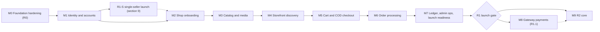

# Roadmap and Backlog

Status: Draft v1 (lite, 2026-09-30)

Reviewed: 2026-09-30 · consistency review 2026-09-30 to 2026-10-04

This document turns the reviewed documentation set into a delivery plan for a team of one or two developers [Confirmed Q1]. It defines the milestones M0 to M9 (ID, name, release, goal, scope, order and exit criteria), the order in which they depend on each other, the R2 and R3 backlog, and where the items other documents handed to planning land. It does not restate rules: every scope line points to the section that specifies the behaviour, and every exit criterion names test IDs from the [10 §6](10-testing-and-quality-gates.md#6-test-id-registry) registry. Capacity is unknown, so there are no calendar dates; effort is given in relative sizes.

Related documents: [00 Context](00-context-assumptions-and-questions.md) · [01 Requirements](01-product-requirements.md) · [02 Journeys](02-user-journeys-and-acceptance-criteria.md) · [03 Architecture](03-system-architecture.md) · [04 Domain model](04-domain-model-and-data-dictionary.md) · [04a Tables](04a-data-dictionary-tables.md) · [05 Lifecycles](05-order-payment-and-inventory-lifecycles.md) · [06 API](06-api-design.md) · [07 Security](07-security-threat-model-and-permissions.md) · [08 UI](08-ui-ux-and-design-system.md) · [09 Code standards](09-code-structure-and-engineering-standards.md) · [10 Testing](10-testing-and-quality-gates.md) · [11 Operations](11-deployment-and-operations.md) · [Risks and open decisions](risks-and-open-decisions.md) · [ADRs](adr/README.md)

Labels follow [00 §1.2](00-context-assumptions-and-questions.md#12-evidence-labels).

## 1. Scope and how to read this document

This lite version is enough to start M0 and to cut each milestone into tickets; [§8](#8-expanding-this-document) lists what the full version adds.

- **12 owns** the milestone definitions, the dependency order, the R2 and R3 backlog, the scheduling of work that other documents hand over, and the requirement-to-test traceability (FR and AC to test IDs, with the REG IDs of [01 §9](01-product-requirements.md#9-regulatory-and-compliance-requirements)); the traceability matrix is built in the full version ([§8](#8-expanding-this-document)). Other documents cite milestones by ID; this document defines them. Release scope belongs to [01 §5](01-product-requirements.md#5-release-phases-mvp-scope-and-non-goals), and the decision gates to [risks §5](risks-and-open-decisions.md#5-decisions-that-block-implementation-by-milestone), which this document follows.
- **Milestone names** are the ones the documents already use ([00 §7.3](00-context-assumptions-and-questions.md#73-what-blocks-which-milestone)). Where two documents disagreed about which milestone owns something, this document decides and records the decision in the Consistency notes.
- **Reading order for a developer:** §3 for the whole plan, §9 for the single-seller launch (R1-S), the next piece of work since 2026-11-23, and the milestone's subsection in §5 for the work each launch part draws from. §4 (M0) is done.

## 2. Planning principles

### 2.1 Dependency-ordered vertical slices

After M0, every milestone delivers whole journeys: the API operations, pages, jobs and tests for a set of FRs, on a schema the M0 baseline already created. The order follows the data: accounts, then shops, products, storefront, cart, orders, money and the gateway. Nothing is built as a layer for later use. With two developers, the next milestone's page work may overlap the current milestone's backend once the operations are fixed in [openapi.yaml](openapi.yaml) [Assumption].

### 2.2 Effort sizes

All sizes are estimates in ideal developer-weeks (focused work by one developer, before meetings and support) [Assumption: estimate; recalibrated after M0, §8].

| Size | Ideal developer-weeks | Typical content                                                    |
| ---- | --------------------- | ------------------------------------------------------------------ |
| S    | under 1               | One operation or job with its tests                                |
| M    | 1 to 3                | One journey on existing foundations                                |
| L    | 3 to 6                | Several journeys, new pages and jobs                               |
| XL   | 6 to 12               | A milestone with a new subsystem, or foundations used by all later |

### 2.3 Definition of ready

- **Milestone.** The previous milestone has exited, or the tech lead accepts named leftovers in writing. Every "blocks code" decision of [risks §5](risks-and-open-decisions.md#5-decisions-that-block-implementation-by-milestone) for it is Decided, or its safe default is recorded as accepted.
- **Ticket.** It cites the document section it implements (operation, table, job, page or check), the AC IDs it satisfies and the test IDs that prove it. An unknown carries an OD or VX pointer instead of a placeholder.

### 2.4 Definition of done

- **Ticket.** Merged through the required checks of [10 §5.1](10-testing-and-quality-gates.md#51-every-pull-request-ciyml); the named tests exist, pass and carry their AC IDs in the title ([10 §6.1](10-testing-and-quality-gates.md#61-naming-and-numbering-rules)); the pull request template is complete ([09 §11.5](09-code-structure-and-engineering-standards.md#115-pull-request-template-and-review-checklist)); a behaviour that differs from a document changes that document in the same pull request ([00 §1.5](00-context-assumptions-and-questions.md#15-how-a-decision-changes)).
- **Milestone exit review.** Held by the product owner and tech lead and recorded in the milestone's epic:
  1. Every exit criterion in this document is green on `main`.
  2. Every "blocks exit" item of risks §5 is resolved.
  3. ADR statuses match the OD and VX register ([ADR-0001](adr/0001-record-architecture-decisions.md)).
  4. The journeys the milestone completes pass the [02 §7](02-user-journeys-and-acceptance-criteria.md#7-journey-completion-checklist) checklist.
  5. Every leftover is moved to a named milestone or to §6 with an owner.

### 2.5 How decisions gate a milestone

Risks §5 is authoritative. "Blocks code" means decided before the milestone's first feature pull request merges ("M*n* start"); "blocks exit" means decided before its exit review ("M*n* exit"). These two events are the anchors for every latest responsible moment in [risks §1.6](risks-and-open-decisions.md#16-latest-responsible-moment-and-safe-defaults). At the weekly review ([risks §1.4](risks-and-open-decisions.md#14-review-cadence)) the tech lead names the next anchor and the decisions due before it.

### 2.6 From milestone to tickets

One epic per scope group (the E rows of §4 and the scope bullets of §5), keyed `M<n>-E<k>`. Tasks inside an epic are one operation, job, page, migration or CI check each; each task links its section and test IDs. A needed test without an ID is registered in [10 §6](10-testing-and-quality-gates.md#6-test-id-registry) in the same pull request. Business tasks (answers from counsel, the accountant or a provider) get their own tickets owned by the product owner.

### 2.7 Scope control

R1 scope is [01 §5.2](01-product-requirements.md#52-r1-mvp-scope), and the scope of the single-seller launch R1-S is [01 §5.5](01-product-requirements.md#55-single-seller-launch-r1-s). Adding anything to a milestone names what moves out (R-12). Findings from the monthly operations review ([11 §13.6](11-deployment-and-operations.md#136-monthly-operations-review)) enter §6 with an owner. When an FR, test or milestone assignment moves, this document changes with it ([risks §1.5](risks-and-open-decisions.md#15-recording-a-decision)).

## 3. Releases and milestones at a glance

| ID   | Name                                     | Release   | Goal                                                                                                                                                         | Depends on                                      | Blocking decisions (risks §5)                                                                                                                                                                                                          | Effort (estimate)              |
| ---- | ---------------------------------------- | --------- | ------------------------------------------------------------------------------------------------------------------------------------------------------------ | ----------------------------------------------- | -------------------------------------------------------------------------------------------------------------------------------------------------------------------------------------------------------------------------------------- | ------------------------------ |
| M0   | Foundation hardening                     | R0        | Every high RF closed or guarded; CI gate; schema re-baseline; safe bootstrap                                                                                 | —                                               | Exit: none open (OD-59 decided 2026-11-21, no development seeder in M0; OD-55 decided 2026-11-07, no import). OD-01, OD-12, OD-13, OD-23 and OD-25 were decided on 2026-09-30 (the OD-25 spike runs first); OD-56, OD-57 on 2026-11-05 | XL                             |
| M1   | Identity & accounts                      | R1        | Sign-up, verification, login, recovery, addresses; staff TOTP; user suspension                                                                               | M0                                              | Code: none open (OD-24, OD-50, OD-60 decided 2026-11-22). Exit: OD-08, OD-39, OD-62, VX-14, VX-10, VX-03                                                                                                                               | L                              |
| R1-S | Single-seller launch (§9)                | R1-S      | The product owner's own shop sells to the public: storefront, guest COD checkout at NCM's live rate, tracking, product editor, seller orders and NCM booking | M1 part 6b; the M1 exit items follow as §9 says | Code: OD-15 (part 2), VX-12 (part 3). Go-live: OD-63, OD-08, OD-09, OD-06 return window, OD-07, OD-11, OD-18, OD-26, VX-02, VX-03, VX-04, VX-09, VX-10, VX-14, VX-15, VX-16                                                            | 15 to 25 ideal developer-weeks |
| M2   | Shop onboarding & membership             | R1        | Existing users apply, admins review, approved shops set up profile, delivery, staff and payout account                                                       | M1                                              | Code: OD-16, OD-48, OD-49, OD-64 (OD-47 decided 2026-10-01); OD-22 if kit blocks are wanted. Exit: OD-04 rate, OD-05, OD-11, VX-02, VX-10, VX-13 before any kit file                                                                   | L                              |
| M3   | Catalog authoring & media                | R1        | Products with variants, images, disclosures and stock; moderation                                                                                            | M2                                              | Code: OD-15, OD-20, OD-21. Exit: VX-02                                                                                                                                                                                                 | XL                             |
| M4   | Storefront discovery                     | R1        | Server-rendered listings, search, product and shop pages within budgets                                                                                      | M3                                              | Code: VX-12; OD-22 if kit blocks are wanted. Exit: VX-13 if any kit file is used                                                                                                                                                       | L                              |
| M5   | Cart & COD checkout                      | R1        | Server cart and one idempotent multi-shop COD order without oversell                                                                                         | M4                                              | Code: OD-04 basis. Exit: OD-18, VX-15 FX route (before the staging server)                                                                                                                                                             | L                              |
| M6   | Order processing & fulfillment           | R1        | Accept, ship or book a courier, deliver, collect, return to origin; tracking; support cases and returns                                                      | M5                                              | Code: OD-17, OD-19, OD-45, VX-16 (adapter only). Exit: OD-06, OD-07, OD-26, OD-29, OD-30, OD-32, VX-03, VX-04                                                                                                                          | XL                             |
| M7   | Ledger, admin ops & launch readiness     | R1 (gate) | Ledger, remittances, refunds, admin operations, proven operations; the R1 launch gate passes                                                                 | M6                                              | Code: OD-05, OD-14, OD-33 to OD-35, OD-37, OD-38, OD-45, OD-46, OD-49. Exit: OD-09, OD-11, OD-26, OD-27 (COD), OD-43, OD-52, OD-07 published, VX-02, VX-04, VX-05, VX-08, VX-09, VX-15, VX-16                                          | XL                             |
| M8   | Gateway payments                         | R1.1      | One wallet gateway, gateway refunds, reconciliation, vendor payouts                                                                                          | M7                                              | Code: OD-02, OD-03, VX-01, VX-06 or VX-07, OD-28, OD-31, OD-33, OD-41, OD-42, OD-49. Exit: OD-27, OD-36, VX-05, OD-06 hold revision, OD-14 revisited, OD-30, OD-46                                                                     | L                              |
| M9   | Returns, reviews, wishlist, coupons, SMS | R2        | Self-serve returns, reviews, wishlist, platform coupons, SMS and phone OTP                                                                                   | M7 (M8 normally)                                | Code: OD-40, OD-51, OD-53, OD-54. Exit: VX-14 (SMS), VX-11 re-check; R-23 if the Nepali UI joins                                                                                                                                       | XL                             |

R1 (M0 to M7) is roughly 40 to 70 ideal developer-weeks [Assumption: estimate]. The R1 launch is the M7 exit; `checkout_enabled` stays off in production until then ([11 §2.5](11-deployment-and-operations.md#25-production)). Since 2026-11-23 the single-seller launch R1-S (§9) comes first: it is built after M1 part 6b from parts of M2 to M7 (the M1 exit items follow as §9 says), its own gates open the kill switch for the owner's shop ([01 §5.5](01-product-requirements.md#55-single-seller-launch-r1-s)), and the milestones then finish the rest of their scope for the full R1, which stays the target. Its effort, 15 to 25 ideal developer-weeks, is an [Assumption: estimate] from the part sizes of §9.

M9 normally follows M8 ([01 §5.1](01-product-requirements.md#51-release-phases)), but nothing in it needs the gateway: if OD-02 or OD-03 hold M8 back, M9 may start after the launch (the dotted edge).

## 4. M0 Foundation hardening (R0), ready to start

**Goal.** Make the repository safe to build on: close or guard every high finding, put a blocking CI gate and a real test database in place, replace the 26 exploratory migrations with the reviewed baseline, and remove the unsafe defaults, before the first feature pull request. The application code has not changed since the audited commit `0282605`: there is no `.github` directory, there are 26 migration files, and `package.json` still lists `D` and `better-sqlite3` [Verified-repo]. Evidence for each finding is in [00 §4.6](00-context-assumptions-and-questions.md#46-consolidated-repository-findings-rf-01--rf-47) and [research: repository-audit](research/repository-audit.md).

### 4.1 Epics and order

| Epic                                   | Scope                                                                                                                                                                                                                                                                                                                                                                                                                                                                                                                                                                                                                                                                                                                                                                                                                                                                                                                                                                                                                                                                                                                                                                                                                                                                                                                                                                                                                                                                                                     | Specified in                                                                                                                                                                                                                                                                                                                                                                                                                                                                                                                                                                                                                         | Tests                                                                                                                                                                                                        | Order                 |
| -------------------------------------- | --------------------------------------------------------------------------------------------------------------------------------------------------------------------------------------------------------------------------------------------------------------------------------------------------------------------------------------------------------------------------------------------------------------------------------------------------------------------------------------------------------------------------------------------------------------------------------------------------------------------------------------------------------------------------------------------------------------------------------------------------------------------------------------------------------------------------------------------------------------------------------------------------------------------------------------------------------------------------------------------------------------------------------------------------------------------------------------------------------------------------------------------------------------------------------------------------------------------------------------------------------------------------------------------------------------------------------------------------------------------------------------------------------------------------------------------------------------------------------------------------------- | ------------------------------------------------------------------------------------------------------------------------------------------------------------------------------------------------------------------------------------------------------------------------------------------------------------------------------------------------------------------------------------------------------------------------------------------------------------------------------------------------------------------------------------------------------------------------------------------------------------------------------------ | ------------------------------------------------------------------------------------------------------------------------------------------------------------------------------------------------------------ | --------------------- |
| E1 Decisions and spikes                | OD-25 Inertia upgrade spike, 2–3 days and time-boxed (OD-01, OD-12, OD-13 and OD-25 were decided on 2026-09-30); `T-ARCH-004` pg-boss transactional send, including the `pgboss` schema install under the migrator role and the queue policies of 03 §9 (keyed `stately` sends, a running job's successor accepted, a sweeper re-send refused while one is queued, `standard` queues with no `singletonKey`); `SELECT uuidv7()` on `postgres:18.4` and the managed cluster; the other M0 checks 09 lists (Bouncer or plain policies, Tuyau `validationErrorType`, `rawQuery` result shape, the no-model-in-response hook, update bot) Done 2026-11-20 for the OD-25 spike: it passed, and the app runs adapter 5 with Inertia 3 (note 39, [ADR-0020](adr/0020-inertia-3-adapter-5.md)).                                                                                                                                                                                                                                                                                                                                                                                                                                                                                                                                                                                                                                                                                                                   | [risks §5](risks-and-open-decisions.md#5-decisions-that-block-implementation-by-milestone), [09 §10.5](09-code-structure-and-engineering-standards.md#105-the-inertia-v5-upgrade-od-25), [03 §10.1](03-system-architecture.md#101-transactional-send-the-job-table-is-the-outbox), [03 §9](03-system-architecture.md#9-asynchronous-work), [11 §8.5](11-deployment-and-operations.md#85-overlap-and-singleton-rules), [ADR-0010](adr/0010-postgres-jobs-pg-boss-transactional-send.md), [04 §2.1](04-domain-model-and-data-dictionary.md#21-identifiers), [11 §6.1](11-deployment-and-operations.md#61-where-and-how-migrations-run) | `T-ARCH-004`                                                                                                                                                                                                 | First days            |
| E2 CI and quality gates                | `ci.yml` with the stages of 10 §5.1 and the subset of 10 §5.4 required on `main`; branch protection; PR template; ESLint rewrite clearing today's lint and typecheck errors; hooks; `release.yml` up to the image push. Built 2026-11-15 (note 32): the six `ci.yml` jobs that are the required checks, `release.yml` with the push switched off, the PR template, the lint rewrite, the hooks, and every listed test; branch protection is a setting the tech lead applies (10 §5.4). Deferred: `react/jsx-no-literals` to E10, the no-model-in-response hook to E1. Edited 2026-11-19: branch protection is applied, and GitHub secret scanning and push protection are on (note 34)                                                                                                                                                                                                                                                                                                                                                                                                                                                                                                                                                                                                                                                                                                                                                                                                                    | [10 §5](10-testing-and-quality-gates.md#5-ci-quality-gates), [11 §5.2](11-deployment-and-operations.md#52-workflows), [09 §11](09-code-structure-and-engineering-standards.md#11-lint-format-typecheck-and-review), [09 §4.5](09-code-structure-and-engineering-standards.md#45-ci-checks-that-keep-the-contracts-in-sync)                                                                                                                                                                                                                                                                                                           | `T-ARCH-001` (with `T-SEC-016`, its outbound-HTTP rule), `T-ARCH-016`, `T-ARCH-021`, `T-ARCH-029`, `T-ARCH-030`, `T-ARCH-033`, `T-UI-029`, `T-SEC-025`, `T-SEC-026`, `T-SEC-038`, `T-API-009` to `T-API-011` | Week 1 onward         |
| E3 Test harness and test database      | `dripnepal_test` with the boot guard (first), two roles, runner setup, `@japa/api-client`, Ajv, Playwright; factories rewritten; concurrency suite and its self-test; browser smoke                                                                                                                                                                                                                                                                                                                                                                                                                                                                                                                                                                                                                                                                                                                                                                                                                                                                                                                                                                                                                                                                                                                                                                                                                                                                                                                       | [10 §3](10-testing-and-quality-gates.md#3-test-layers-and-tooling), [09 §8.8](09-code-structure-and-engineering-standards.md#88-seeders-reference-data-versus-development-data)                                                                                                                                                                                                                                                                                                                                                                                                                                                      | `T-ARCH-031`, `T-ARCH-032`                                                                                                                                                                                   | Week 1 onward         |
| E4 Schema re-baseline                  | Tag `pre-baseline`; delete the 26 files; 14 baseline files in the foreign-key-safe order of 04 §20.2.2 (extensions, logistics reference, identity, platform, shops, media, catalog, cart, orders, inventory, payments, ledger, support and notifications, grants); `app/modules/` with `platform` and `audit` first ([09 §1.5](09-code-structure-and-engineering-standards.md#15-current-code--target-structure)); `schemaGeneration`; reference seeders; models and constants rewritten; int8 parser and `sumMinor`; migration-lock script; extension allow-list; the OD-56 and OD-57 tables (below)                                                                                                                                                                                                                                                                                                                                                                                                                                                                                                                                                                                                                                                                                                                                                                                                                                                                                                     | [04 §20.2](04-domain-model-and-data-dictionary.md#202-re-baseline-procedure-adr-0011-od-01), [ADR-0011](adr/0011-schema-rebaseline-before-production.md), [09 §8](09-code-structure-and-engineering-standards.md#8-migrations-and-seeders), [ADR-0007](adr/0007-money-integer-minor-units.md)                                                                                                                                                                                                                                                                                                                                        | `T-ARCH-010` to `T-ARCH-015`, `T-ARCH-017`, `T-ARCH-022`, `T-ARCH-034`                                                                                                                                       | After E1              |
| E5 Error contract and request IDs      | Exception handler rewrite, code registry, `toProblem()`, error pages showing `request_id`; `request_context` and `access_log` middleware; error-tracker hook. Built 2026-11-11 except the `T-API-001` hook, which comes with the first `/api/v1` operation in M1 (note 28)                                                                                                                                                                                                                                                                                                                                                                                                                                                                                                                                                                                                                                                                                                                                                                                                                                                                                                                                                                                                                                                                                                                                                                                                                                | [ADR-0018](adr/0018-error-contract-problem-details.md), [06 §5](06-api-design.md#5-error-contract), [06 §11](06-api-design.md#11-correlation-and-request-ids), [09 §5](09-code-structure-and-engineering-standards.md#5-error-handling), [09 §7.4](09-code-structure-and-engineering-standards.md#74-request-id-propagation)                                                                                                                                                                                                                                                                                                         | `T-API-001`, `T-API-005`, `T-API-012`, `T-SEC-027`, `T-ARCH-026`                                                                                                                                             | Week 1 onward         |
| E6 Configuration and logging           | Env schema and cross-field policy, `.env.example`, `.gitignore`, key ring; pino redaction; no `console`; SQL debug off; database TLS and pool; `trustProxy`; health endpoints; Dockerfile. Built 2026-11-11 except the base-image digest pin and the entrypoint change of 11 §4.2 (note 29)                                                                                                                                                                                                                                                                                                                                                                                                                                                                                                                                                                                                                                                                                                                                                                                                                                                                                                                                                                                                                                                                                                                                                                                                               | [09 §6](09-code-structure-and-engineering-standards.md#6-configuration-validation-and-secrets), [09 §7](09-code-structure-and-engineering-standards.md#7-structured-logging), [11 §3.4](11-deployment-and-operations.md#34-trusted-proxy-configuration-rf-31), [11 §4.2](11-deployment-and-operations.md#42-dockerfile), [11 §7.1](11-deployment-and-operations.md#71-endpoints)                                                                                                                                                                                                                                                     | `T-ARCH-023`, `T-ARCH-024`, `T-ARCH-025`, `T-OPS-010`                                                                                                                                                        | Week 1 onward         |
| E7 Sessions, rate limits and audit log | Database session store and `dripnepal_session` cookie; the per-request account check (status and `security_stamp`); remember-me removed; limiter database store (OD-10 Resolved); login limiters; multipart parsing off and the JSON body limit; `audit_logs` writer. Built 2026-11-11 (note 30); `rotateSessionId` and the other limiters of 06 §9.1 come with their operations in M1                                                                                                                                                                                                                                                                                                                                                                                                                                                                                                                                                                                                                                                                                                                                                                                                                                                                                                                                                                                                                                                                                                                    | [ADR-0005](adr/0005-session-auth-server-side-revocation.md), [07 §3.1](07-security-threat-model-and-permissions.md#31-guard-store-and-cookie), [07 §3.3](07-security-threat-model-and-permissions.md#33-the-per-request-account-check-and-the-suspension-decision), [07 §3.6](07-security-threat-model-and-permissions.md#36-login-throttling-and-generic-errors), [06 §9](06-api-design.md#9-rate-limits-and-request-size-limits), [04a §15.3](04a-data-dictionary-tables.md#153-audit_logs)                                                                                                                                        | `T-SEC-010` (stamp case), `T-SEC-011`, `T-SEC-101`, `T-SEC-102`, `T-MED-002`, `T-API-013`; `T-SEC-009` (store and cookie part)                                                                               | After E4              |
| E8 Safe bootstrap                      | `reference/` and `dev/` seeders with their guards; demo seeder deleted; `node ace platform:create-admin` (FR-ADM-005); release-check queries script; README development setup. Built 2026-11-11 (note 31): `platform:create-admin`, `node ace release:check`, the `APP_ENV` seeder guard and the README; the guards and the reference seeders came with E4 and the v1 demo seeder left with it. Built 2026-11-22 (note 48): the locations seeder (VX-10) with `data/locations.csv`, the zone-to-district mapping and `T-SHOP-108`. Open: `--recover` and the `/admin` enrolment gate with M1. OD-59, decided 2026-11-21 (note 47): no development demo seeder in M0; the milestone that first needs demo data builds it.                                                                                                                                                                                                                                                                                                                                                                                                                                                                                                                                                                                                                                                                                                                                                                                  | [09 §8.8](09-code-structure-and-engineering-standards.md#88-seeders-reference-data-versus-development-data), [09 §9](09-code-structure-and-engineering-standards.md#9-safe-production-initialization)                                                                                                                                                                                                                                                                                                                                                                                                                                | `T-ARCH-018` to `T-ARCH-020`, `T-OPS-019`; also `T-OPS-013`, `T-OPS-014`, `T-OPS-023`                                                                                                                        | After E4              |
| E9 Routes and the membership guard     | The `/shop/:shopSlug` routes move to `/seller/{shopSlug}` (OD-12, decided 2026-09-30), behind `seller_context` (owner or active member, else 404); storefront outside `guest()`; catch-all removed; development-only routes; the registration and cart hotfixes; development Compose and CORS fixes. Edited 2026-11-20 (note 37): the v1 routes, pages and controllers left with E4 (#176), so no `/shop/:shopSlug` route, storefront route under `guest()`, catch-all, registration or cart code was left to move or hotfix. Built: `seller_context` with the membership guard, the seller idle limit and `resolveSellerContext`; `start/routes/dev.ts`, imported outside production only, with the gallery at `/dev/design-system`; and the route rules of `scripts/check_routes.mjs` in the Contract stage, which keep the next routes in line. Built 2026-11-20 as part 2 (note 38): the development Compose fixes and the CORS allowlist of RF-43; the S3 server joined on 2026-11-25 (SeaweedFS, OD-65, note 77)                                                                                                                                                                                                                                                                                                                                                                                                                                                                                    | [ADR-0017](adr/0017-product-urls-public-id.md), [09 §12.4](09-code-structure-and-engineering-standards.md#124-seller_context-middleware), [08 §13](08-ui-ux-and-design-system.md#13-current-ui-remediation-list), [11 §4.3](11-deployment-and-operations.md#43-development-compose-rf-43-fix-list)                                                                                                                                                                                                                                                                                                                                   | `T-SEC-005`, `T-SEC-037`, `T-SHOP-001`, `T-UI-025`, `T-UI-026`; the seller idle case of `T-SEC-009`; `T-SEC-042`, `T-OPS-024`                                                                                | After E7              |
| E10 SSR and frontend foundation        | OD-25 outcome applied; SSR flags, `hydrateRoot`, SSR-only page glob, theme from a cookie; `<html lang="en">` and the `resources/lang/en` skeleton; devtools development-only; `ui/` clean-up; licence tracking file; progress-bar and `sonner` styles for CSP; the reduced-motion and toast-stacking checks of 08 §5.7 and §5.9; SSR memory measured ([11 §13.2](11-deployment-and-operations.md#132-droplet-sizing-4-gb--2-vcpu)) Part 1 built 2026-11-20 (note 40): the theme from the `dn_theme` cookie, `<html lang="en">`, and the SSR-only page glob with `errors/`. Part 2 built 2026-11-20 (note 41): the `resources/lang/en` skeleton with `t()` and the raw-text lint, the progress-bar and toast styles for the CSP, the reduced-motion rule, and the reduced-motion and toast-stacking checks. Part 3 built 2026-11-20 (note 42): the `ui/` clean-up, the `sonner` wrapper and the licence tracking file with `T-UI-024`. Part 4 built 2026-11-20 (note 43): the production-build checks (`T-UI-012`, `T-UI-013`, `T-ARCH-002`'s SSR bundle, image and hydration parts), the SSR memory measurement and the `theme-color` tags; the `T-ARCH-002` nonce check moves to E11. Left: the second review of the 35 `ui/` copies (32 rewritten in E10, `sidebar` and `table` added 2026-11-22, `alert-dialog` added 2026-11-22 with part 3b-i) with the 08 §12.3 checklist, recorded in `THIRD_PARTY_NOTICES.md` (08 §12.1; the other developer, or the product owner while there is one developer). | [ADR-0003](adr/0003-inertia-ssr-storefront-csr-dashboards.md), [09 §13.8](09-code-structure-and-engineering-standards.md#138-ssr-safety-rules), [08 §1.2](08-ui-ux-and-design-system.md#12-theme-policy-light-by-default-dark-supported), [08 §11.8](08-ui-ux-and-design-system.md#118-localization-ready-text-and-formatting), [08 §12](08-ui-ux-and-design-system.md#12-maintaining-copied-shadcn-and-kit-components)                                                                                                                                                                                                              | `T-ARCH-002`, `T-UI-001`, `T-UI-012`, `T-UI-013`, `T-UI-024`, `T-UI-022` (lint part), `T-UI-034`                                                                                                             | After the OD-25 spike |
| E11 CSP and headers                    | CSP in report-only mode with nonces and a `report-uri`; `encryptHistory` on authenticated surfaces. Part 1 built 2026-11-20 (note 44): the browser headers from the server stack on every answer, the target policy report-only beside an enforced one with inline styles allowed, `CSP_REPORT_URI` (proposed), and `T-ARCH-002`'s nonce check. Part 2 built 2026-11-21 (note 45): `encryptHistory` on the signed-in surfaces (`T-SEC-043`). E11 is done; the `clearHistory` backstop comes with M1's `logOut`                                                                                                                                                                                                                                                                                                                                                                                                                                                                                                                                                                                                                                                                                                                                                                                                                                                                                                                                                                                            | [07 §7.3](07-security-threat-model-and-permissions.md#73-csp-and-security-headers), [07 §3.11](07-security-threat-model-and-permissions.md#311-logout-and-inertia-history)                                                                                                                                                                                                                                                                                                                                                                                                                                                           | `T-SEC-035` (report-only part), `T-SEC-043` (encryption part)                                                                                                                                                | After E10             |
| E12 Removals and repository hygiene    | Remove `D`, `better-sqlite3`, the sqlite connection and the `@commercn` registry; untrack the third-party skills in `.agents/skills/` (the project skills stay tracked; two reviewed skills are tracked again since 2026-11-04 and a third, `ncm-integration`, since 2026-11-09, [09 §1.5](09-code-structure-and-engineering-standards.md#15-current-code--target-structure)) and `tsconfig.inertia.tsbuildinfo`; drop dead import aliases; set `"license"` in `package.json` to `"MIT"` to match `LICENSE`, keeping `"private": true` (OD-23, decided 2026-09-30)                                                                                                                                                                                                                                                                                                                                                                                                                                                                                                                                                                                                                                                                                                                                                                                                                                                                                                                                        | [09 §10.4](09-code-structure-and-engineering-standards.md#104-removals-decided-for-m0-rf-39), [09 §1.5](09-code-structure-and-engineering-standards.md#15-current-code--target-structure), [ADR-0015](adr/0015-ui-foundation-shadcn-and-kit-policy.md), [07 §7.1](07-security-threat-model-and-permissions.md#71-dependency-policy)                                                                                                                                                                                                                                                                                                  | `T-SEC-026`, `T-ARCH-027`, `T-ARCH-028`                                                                                                                                                                      | Week 1                |

Order in practice: E1 and E12 first; E3 starts with the test-database guard, because a test run today would reach the developer's database; E2, E5 and E6 in parallel; E4 as soon as the E1 spikes are done; then E7 and E8 on the baseline tables; E9, which moves the seller routes to `/seller/{shopSlug}` (OD-12); E10 once the OD-25 spike ends; E11 last. The baseline is the largest single item ([ADR-0011](adr/0011-schema-rebaseline-before-production.md) expects several days of writing and review). Edited 2026-11-07: the product owner let the baseline files be written before the `uuidv7()` and pg-boss spikes end ([risks §2.3](risks-and-open-decisions.md#23-decision-log), [04 §20.2.1](04-domain-model-and-data-dictionary.md#2021-preconditions)).

**E4 and OD-56, OD-57 (decided 2026-11-05).** The baseline also builds, as [04a](04a-data-dictionary-tables.md) specifies them: `logistics_providers` in file 2; `logistics_accounts`, `logistics_account_shops` and `shop_logistics_settings` in file 5, after `shops` and `shop_addresses`; `shipment_items` and the courier columns of `shipments` and `shipment_events` in file 9; and the verification columns of `orders` ([ADR-0019](adr/0019-courier-integration-in-r1.md)). The Nepal Can Move provider row comes from a reference seeder (A-53). Only tables and models: no operation, adapter or job is built in M0. OD-55 was decided on 2026-11-07 with no import, because v1 holds only seed data, so no v1 rows are mapped onto `orders` and `shop_orders` ([risks §2.3](risks-and-open-decisions.md#23-decision-log)).

**E4 staging (decided 2026-11-07).** The baseline is built on the integration branch `feat/e4-schema-baseline`, in small pull requests, each reviewed with the baseline's migration and constraint tests passing: the baseline files in the order of [04 §20.2.2](04-domain-model-and-data-dictionary.md#2022-baseline-files-and-their-order), the models and the constraint tests. `main` keeps the v1 store's code working meanwhile. The branch merges into `main` in one pull request once all 14 files are in and the v1 code that uses the old models is adapted or removed ([risks §2.3](risks-and-open-decisions.md#23-decision-log), [09 §8.1](09-code-structure-and-engineering-standards.md#81-the-m0-re-baseline-adr-0011-od-01)). Since the branch's first pull request, `ci.yml` also runs on pull requests into it ([10 §5](10-testing-and-quality-gates.md#5-ci-quality-gates)). Epics that need the baseline tables (E7, E8, E9) either branch from the integration branch or wait for its merge; that is chosen when each starts. Edited 2026-11-09: both conditions hold on the branch (all 14 files are in, and the v1 code was removed rather than adapted), and it has taken in `main`'s later commits; it merges into `main` in the pull request that follows this preparation. After that merge `main` has no working storefront: the storefront, seller dashboard and admin pages return as M1 to M7 rebuild them, and 404 and 500 answers use Adonis's default pages until E5. Edited 2026-11-11: E5 is built, so they render `errors/not_found` and `errors/server_error`. Still open for the M0 exit (§4.3): the locations seeder with `data/locations.csv` and `T-SHOP-108`, OD-59 (the demo seeder), E8's `platform:create-admin` with `T-OPS-019`, and the other epics (E1 to E3, E5 to E7, E9 to E12). Edited 2026-11-11: E5 to E8 are built; `platform:create-admin` and `T-OPS-019` are in (note 31). Edited 2026-11-22: the locations seeder, `data/locations.csv` and `T-SHOP-108` are in (note 48).

**Reference seeders without the locations dataset (decided 2026-11-09).** The product owner split the seeders of E4 and E8: the reference seeders that need no location data, the factories and the `DevSeeder` guard are built now on the integration branch, with `T-ARCH-018`, `T-ARCH-019`, `T-ARCH-020` and `T-ARCH-031` ([risks §2.3](risks-and-open-decisions.md#23-decision-log)). Still open for the M0 exit ([§4.3](#43-exit-criteria) item 6): the locations seeder with `data/locations.csv`, the zone-to-district mapping and `T-SHOP-108`, in their own pull request ([04 §21.4](04-domain-model-and-data-dictionary.md#214-locations-dataset-vx-10)); `platform:create-admin` and `T-OPS-019` (E8, item 6 of §4.3; built 2026-11-11, note 31); and the bootstrap row counts of [09 §9.3](09-code-structure-and-engineering-standards.md#93-bootstrap-checklist-first-deploy-of-an-environment) step 4, which need the locations. The development demo seeder `dev/01_demo_marketplace_seeder.ts`, which [09 §9.4](09-code-structure-and-engineering-standards.md#94-current-code--target-initialization) schedules in M0, creates shops, products and orders through the real actions ([04 §20.3](04-domain-model-and-data-dictionary.md#203-seeders-factories-and-schema-generation)), and those actions arrive in M1 to M6, so it is not built yet; whether M0 gets a smaller demo seeder or the item moves to a later milestone is [OD-59](risks-and-open-decisions.md#22-decision-table) (Open; safe default: M0 ships no development seeder). Edited 2026-11-22: the locations seeder, the zone mapping and `T-SHOP-108` are built, and the seeders now assert the step 4 row counts themselves (note 48).

### 4.2 Repository findings fixed in M0

Every RF whose fix column in [00 §4.6](00-context-assumptions-and-questions.md#46-consolidated-repository-findings-rf-01--rf-47) includes M0, with the part M0 does.

| RF    | M0 work                                                                                                                                                                                    | Where                                                                                                  | Epic |
| ----- | ------------------------------------------------------------------------------------------------------------------------------------------------------------------------------------------ | ------------------------------------------------------------------------------------------------------ | ---- |
| RF-01 | Membership guard on every seller route; permissions and status gates in M2. Built 2026-11-20 (note 37); no seller route exists yet                                                         | 09 §12.4                                                                                               | E9   |
| RF-02 | Storefront outside `guest()`; unknown paths render 404. The routes left with E4; `T-UI-025` keeps new ones out of `guest()` (note 37)                                                      | [08 §13](08-ui-ux-and-design-system.md#13-current-ui-remediation-list)                                 | E9   |
| RF-03 | Hotfix so registration stops answering 500; replaced by `/sell` in M2. Not needed: the registration code left with E4 (note 37)                                                            | [09 §3.14](09-code-structure-and-engineering-standards.md#314-current-code--target-layers)             | E9   |
| RF-04 | Database sessions, stamp check, remember-me removed                                                                                                                                        | [ADR-0005](adr/0005-session-auth-server-side-revocation.md)                                            | E7   |
| RF-05 | Demo seeder deleted; development-seeder guard; `platform:create-admin`                                                                                                                     | [09 §9.1](09-code-structure-and-engineering-standards.md#91-node-ace-platformcreate-admin)             | E8   |
| RF-06 | Baseline: no cascade into orders or payments; address snapshot                                                                                                                             | [04 §20.1](04-domain-model-and-data-dictionary.md#201-mapping-from-current-tables-to-the-baseline)     | E4   |
| RF-07 | Baseline: `orders`, `shop_orders`, `order_items`; checkout in M5                                                                                                                           | 04 §20.1                                                                                               | E4   |
| RF-08 | SSR build fixed, `hydrateRoot`, theme class from the server                                                                                                                                | [ADR-0003](adr/0003-inertia-ssr-storefront-csr-dashboards.md)                                          | E10  |
| RF-09 | `ci.yml`, branch protection, typecheck in hooks and CI                                                                                                                                     | [10 §5.4](10-testing-and-quality-gates.md#54-the-smallest-gate-before-the-first-feature-code-m0)       | E2   |
| RF-10 | One storefront layout provides the cart; server cart in M5. Not needed: the cart pages left with E4 (note 37)                                                                              | 08 §13                                                                                                 | E9   |
| RF-11 | Baseline: recipient phone no longer unique                                                                                                                                                 | 04 §20.1                                                                                               | E4   |
| RF-12 | Login limiters; non-credential errors rethrown; the rest in M1                                                                                                                             | 07 §3.6                                                                                                | E7   |
| RF-13 | Baseline: composite tenant foreign keys                                                                                                                                                    | 04 §20.1                                                                                               | E4   |
| RF-14 | Baseline: `inventory_items`, SKU per shop, unique combinations; screens in M3                                                                                                              | 04 §20.1                                                                                               | E4   |
| RF-15 | Baseline: idempotency and refund tables; used in M5 and M8                                                                                                                                 | 04 §20.1                                                                                               | E4   |
| RF-16 | Baseline: `bigint` paisa; server pricing in M5                                                                                                                                             | ADR-0007                                                                                               | E4   |
| RF-17 | Baseline: product names per shop, `draft` default, foreign keys; screens in M3                                                                                                             | 04 §20.1                                                                                               | E4   |
| RF-20 | Baseline: `platform_staff`, `shop_memberships`, roles in code; completed in M2                                                                                                             | [ADR-0006](adr/0006-authorization-platform-roles-shop-memberships.md)                                  | E4   |
| RF-23 | Baseline: status vocabularies with CHECKs                                                                                                                                                  | 04 §20.1                                                                                               | E4   |
| RF-24 | Baseline: soft-delete rules enforced                                                                                                                                                       | 04 §20.1                                                                                               | E4   |
| RF-25 | `<html lang="en">` and the catalog skeleton; formatters in M4 M0 half done 2026-11-20 (note 41)                                                                                            | 08 §13                                                                                                 | E10  |
| RF-26 | Page-prop logging and SQL-binding debug removed; `no-console`                                                                                                                              | [09 §7.5](09-code-structure-and-engineering-standards.md#75-no-console-rf-26)                          | E6   |
| RF-30 | Devtools development-only; duplicate CSS imports and Geist removed; images in M4 M0 half done 2026-11-20 (note 41)                                                                         | [08 §10.5](08-ui-ux-and-design-system.md#105-fonts)                                                    | E10  |
| RF-31 | `trustProxy`, database TLS and pool, health endpoints, Dockerfile; monitoring in M7                                                                                                        | 11 §3.4, §7.1                                                                                          | E6   |
| RF-32 | `dripnepal_test` with the boot guard                                                                                                                                                       | [10 §3.2](10-testing-and-quality-gates.md#32-the-test-database)                                        | E3   |
| RF-33 | Env schema complete, `.env.example`, env files ignored, build artefact untracked                                                                                                           | 09 §6                                                                                                  | E6   |
| RF-34 | CSP report-only and history encryption; CSP enforced in M7                                                                                                                                 | 07 §7.3                                                                                                | E11  |
| RF-35 | Multipart parsing off on every route                                                                                                                                                       | [ADR-0013](adr/0013-media-direct-upload-async-processing.md)                                           | E7   |
| RF-36 | Handler never sends raw messages; owner fields out of the shop transformer; signup M1                                                                                                      | [09 §5.5](09-code-structure-and-engineering-standards.md#55-never-leak-raw-messages-rf-36)             | E5   |
| RF-39 | `D`, `better-sqlite3`, sqlite connection and `@commercn` removed                                                                                                                           | 09 §10.4                                                                                               | E12  |
| RF-40 | Debug, mock and design-system routes development-only. Built 2026-11-20 (note 37)                                                                                                          | 08 §13                                                                                                 | E9   |
| RF-41 | Baseline: generated timestamps, no constant imports; lock script                                                                                                                           | [09 §8.4](09-code-structure-and-engineering-standards.md#84-applied-migrations-are-never-edited-rf-41) | E4   |
| RF-42 | README matches the code; `package.json` says MIT like `LICENSE` (OD-23); third-party skills in `.agents/skills/` untracked except the two reviewed ones (09 §1.5; the project skills stay) | [09 §9.4](09-code-structure-and-engineering-standards.md#94-current-code--target-initialization)       | E12  |
| RF-43 | Compose hardened and pinned; development CORS allowlist Built 2026-11-20 (note 38); SeaweedFS, in place of MinIO, built 2026-11-25 (OD-65, note 77)                                        | 11 §4.3                                                                                                | E9   |
| RF-45 | Baseline: indexes that match the query patterns                                                                                                                                            | 04 §20.1                                                                                               | E4   |
| RF-47 | Frontend CI checks only; dead UI removed in M4 (Consistency note 1)                                                                                                                        | 08 §13                                                                                                 | E2   |

### 4.3 Exit criteria

1. `main` is protected and `ci.yml` blocks on the [10 §5.4](10-testing-and-quality-gates.md#54-the-smallest-gate-before-the-first-feature-code-m0) gate: `T-ARCH-021`, `T-UI-029`, `T-ARCH-001`, `T-ARCH-016`, `T-ARCH-023`, `T-ARCH-029`, `T-ARCH-030`, `T-ARCH-033`, `T-SEC-025`, `T-SEC-026`, `T-SEC-038`, `T-API-009`, `T-API-010`, `T-API-011`, `T-SEC-014` (the email-template grep part, 09 §11.2; the rest of `T-SEC-014` is in the M3 exit) (kit and licence checks `T-ARCH-027`, `T-ARCH-028`, `T-UI-024` once their files exist). Done 2026-11-19 for the protection: `main` requires the six `ci.yml` jobs ([09 §11.6](09-code-structure-and-engineering-standards.md#116-branches-commits-and-merges)); the gate's checks not built yet are listed in [10 §5.4](10-testing-and-quality-gates.md#54-the-smallest-gate-before-the-first-feature-code-m0) and [10 note 49](10-testing-and-quality-gates.md#consistency-notes-for-editor), which also names the `T-SEC-014` email-template grep.
2. The baseline is merged after the review ADR-0011 requires, with `T-ARCH-010`, `T-ARCH-011`, `T-ARCH-012`, `T-ARCH-013`, `T-ARCH-014`, `T-ARCH-015`, `T-ARCH-022`, `T-ARCH-031` and `T-ARCH-034` green and the `T-ARCH-017` script running in file-name mode ([09 §8.4](09-code-structure-and-engineering-standards.md#84-applied-migrations-are-never-edited-rf-41)). Tests run on `dripnepal_test` with the two roles of [10 §3.2](10-testing-and-quality-gates.md#32-the-test-database); the boot guard and the other environment rules pass `T-ARCH-024`. The OD-56 and OD-57 tables pass their constraint tests `T-SHOP-111`, `T-SHOP-112`, `T-SHOP-113` (keys and CHECK), `T-ORD-109` and `T-FUL-101` to `T-FUL-106`.
3. The functional suite runs with the `T-API-001` hook and passes `T-API-005`, `T-API-012`, `T-SEC-027`, `T-ARCH-026`, `T-SEC-010` (stamp-mismatch case), `T-SEC-011`, `T-SEC-101`, `T-SEC-102`, `T-MED-002`, `T-API-013` and `T-SHOP-001`, and the Contract stage passes `T-SEC-005`, `T-SEC-037`, `T-UI-025` and `T-UI-026` (edited 2026-11-20, note 37); the report-only CSP header with nonces and `report-uri` passes the report-only part of `T-SEC-035`, and history encryption the encryption part of `T-SEC-043` (edited 2026-11-21, note 45). Edited 2026-11-11: the limiter cases of `T-SEC-011` and `T-SEC-101` run in the concurrency suite, because the limiter store commits on its own connection (10 §3.3).
4. The concurrency suite runs with `T-ARCH-032`.
5. Every pull request builds the image and passes `T-ARCH-002`, `T-OPS-010`, `T-ARCH-025`, `T-UI-001`, `T-UI-012` (first bundle size recorded) and `T-UI-013`, plus the browser smoke home → product → cart → checkout.
6. Seeders and bootstrap pass `T-ARCH-018`, `T-ARCH-019`, `T-ARCH-020` and `T-OPS-019`. Added 2026-11-09: the locations seeder of [04 §21.4](04-domain-model-and-data-dictionary.md#214-locations-dataset-vx-10) is merged with its committed `data/locations.csv`, and the zone-to-district mapping passes `T-SHOP-108`, because the reference seeders were split from the locations dataset (§4.1). Done 2026-11-22 (note 48), with `T-SHOP-117` for the dataset.
7. The `T-ARCH-004` result is recorded in [ADR-0010](adr/0010-postgres-jobs-pg-boss-transactional-send.md) (confirmed, or the `outbox_events` fallback adopted), together with the check that the `pgboss` schema step, run by the release step as the migrator, serves pg-boss instances started with migration disabled ([11 §6.1](11-deployment-and-operations.md#61-where-and-how-migrations-run)), the check of the 03 §9 queue policies that [11 §8.5](11-deployment-and-operations.md#85-overlap-and-singleton-rules) assumes (keyed `stately` sends, a running job's successor accepted, a sweeper re-send refused while one is queued, `standard` queues with no `singletonKey`), and the `uuidv7()` result in 04 §2.1. Done 2026-11-11 for CI: ADR-0010 records the confirmed transactional send, `node ace jobs:install` and the policies, and `T-ARCH-004` runs `SELECT uuidv7()` on `postgres:18.4`; the managed cluster's `uuidv7()` check waits for provisioning.
8. The 11 high findings are closed or guarded, and every row of §4.2 is done.
9. OD-01, OD-12, OD-13, OD-23 and OD-25 were decided on 2026-09-30; the OD-25 spike outcome is recorded in the register and in an ADR (done 2026-11-20: [ADR-0020](adr/0020-inertia-3-adapter-5.md)) ([risks §1.5](risks-and-open-decisions.md#15-recording-a-decision) step 2); ADR-0011 is Accepted and every ADR status matches the register.
10. A fresh clone completes the local setup of [11 §4.4](11-deployment-and-operations.md#44-local-setup-in-five-commands) and runs the suites green.
11. `T-ARCH-030` runs on every pull request and blocks from M0, in the Repository stage of [10 §5.1](10-testing-and-quality-gates.md#51-every-pull-request-ciyml) (10 §5.4 item 6). It only warns if the consistency review's final cross-document check still finds a local reference in `docs/` when M0 builds `ci.yml`, and only until that reference is gone.

### 4.4 Dependencies, blocking decisions, business track and effort

- **Depends on:** nothing; M0 is the first milestone and starts now.
- **Blocks code:** nothing open. OD-01 (re-baseline), OD-12 (`/seller/{shopSlug}`), OD-13 (snake_case) and OD-25 (upgrade spike in the first days, before RF-08) were decided on 2026-09-30, and OD-56 (courier tables) and OD-57 (verification columns) on 2026-11-05. **Blocks exit:** nothing open. OD-59 (when the demo seeder is built) was decided on 2026-11-21 as its safe default: M0 ships no development seeder; OD-23 (keep MIT) was decided on 2026-09-30 and OD-55 (no import) on 2026-11-07. OD-10 is Resolved. If the OD-25 spike fails, M0 stays on `@adonisjs/inertia` 4.2.0 ([risks §5](risks-and-open-decisions.md#5-decisions-that-block-implementation-by-milestone)). Edited 2026-11-20: the spike passed (note 39).
- **Business track (product owner):** book the counsel and accountant engagements that must happen before M2 ([risks §3.2](risks-and-open-decisions.md#32-question-packs-by-verifier)); start the VX-15 card and FX question with the bank, needed before the staging server in M5 ([11 §1.8](11-deployment-and-operations.md#18-paying-for-it-from-nepal-r-32-vx-15)); ask the VX-13 question only if kit blocks are wanted (OD-22).
- **Effort:** XL [Assumption: estimate 8 to 12 ideal developer-weeks]; E4 alone is L.

## 5. Milestones M1 to M9

Each subsection gives the goal, the scope with its FR IDs and pointers, what is out of scope, the dependencies, the decisions from risks §5, the exit criteria with test IDs, and the effort.

### 5.1 M1 Identity & accounts (R1)

**Goal.** Customers sign up, verify their email, log in and out, recover their account and keep a Nepal address book; platform staff sign in with mandatory TOTP; a suspension takes effect on the next request.

**Scope.**

- Accounts: FR-IAM-001 to FR-IAM-005, FR-IAM-013, and the deletion request of FR-IAM-009 (J-04, J-18; operations in [06 §13.3](06-api-design.md#133-auth-and-self)). Account emails FR-NOT-001 through the email port and the `notifications.*` and `identity.revoke_sessions` jobs ([03 §9](03-system-architecture.md#9-asynchronous-work)).
- Addresses: FR-IAM-012 on the location seeds of [04 §21](04-domain-model-and-data-dictionary.md#21-reference-data-proposals) (VX-10), with `AddressForm` and `NepalPhoneInput` ([08 §4.3](08-ui-ux-and-design-system.md#43-dripnepal-owned-composed-components)) and phone encryption with a blind index ([04 §2.9](04-domain-model-and-data-dictionary.md#29-sensitive-column-encryption-and-blind-indexes)).
- Staff and suspension: FR-IAM-006, FR-IAM-007, FR-ADM-002, FR-ADM-004 (J-17 user part); the MFA enrolment path of `platform:create-admin`; the admin user pages of [08 §2.6](08-ui-ux-and-design-system.md#26-admin-admin) (anonymisation follows in M7), with the staff contact reveal `revealUserContact` (proposed; [06 §13.8](06-api-design.md#138-proposed-operations), [07 §5.5](07-security-threat-model-and-permissions.md#55-encryption)).
- Legal pages: the terms of use and privacy notice pages (`/legal/{documentSlug}`, [08 §2.2](08-ui-ux-and-design-system.md#22-storefront-and-public-pages)) ship with draft versions, so the sign-up page links them and records the versions shown (AC-FR-IAM-001-6); their final texts follow in M7 (gate G4; cross-document check decision, 2026-10-01).
- RF halves: RF-12 (auth audit rows, 128-character passwords, label), RF-22 (email normalisation), RF-28 (auth-page labels, [08 §3.4](08-ui-ux-and-design-system.md#34-existing-repository-screens-and-what-happens-to-them)), RF-29 (77 districts, phone rule), RF-36 (no spread-payload sign-up), RF-37 (`forwardQueryString: false`, `return_to`), RF-38.
- Contract: `ApiSerializer` emits `meta` ([06 §3.4](06-api-design.md#34-envelopes-and-the-existing-apiserializer)); API route names equal `operationId`; the 403 page ([08 §8.3](08-ui-ux-and-design-system.md#83-errors)).
- Email (added 2026-11-16, note 32): re-add `@adonisjs/mail` on a release that allows a fixed `nodemailer`, or record advisory exceptions then (`T-SEC-038`), with the `SMTP_*`, `MAIL_FROM_ADDRESS` and `MAIL_FROM_NAME` variables of [09 §6.1](09-code-structure-and-engineering-standards.md#61-variable-catalogue) (OD-08). E2 removed it because no code sent email and `nodemailer` 9 had two high advisories.
- Checks left to M1: session tag after `login()` and the unknown-email dummy hash ([07 §3.1](07-security-threat-model-and-permissions.md#31-guard-store-and-cookie)), both confirmed in part 3 (`T-SEC-009`, `T-SEC-012`; [07 note 50](07-security-threat-model-and-permissions.md#consistency-notes-for-editor)); scrypt re-benchmark ([ADR-0005](adr/0005-session-auth-server-side-revocation.md)), still open: it needs the production VM.

**Out of scope.** Phone OTP and owner MFA (R2), social login (R3), executing an anonymisation (`anonymizeUser`, M7).

**Plan (2026-11-22).** The product owner asked on 2026-11-22 for M1 to start, with pull requests merged on green CI after a Fable review. M1 is built in parts, one pull request each: (1) email: (1a) `@adonisjs/mail`, its configuration and the `EmailSender` port, built 2026-11-22; (1b) the `notifications.dispatch` and `notifications.send_email` jobs and the email templates of the two tokens `platform:create-admin` issues (`password_reset` and `mfa_enrollment`), so its invitation is delivered, built 2026-11-22 with `T-NOT-101` and the handler part of `T-NOT-001`; (1c) the dead-letter redrive (`node ace jobs:redrive`) and the dead-letter part of `T-NOT-001`, split from 1b on 2026-11-22 and built 2026-11-23 with `T-OPS-025`, which completes part 1; (2) sign-up, email verification and the draft legal pages, split on 2026-11-23 into (2a) the operations `signUp`, `confirmEmail` and `resendEmailVerification` with their emails, limiters and the registry of the legal-document versions sign-up records, built 2026-11-23 with `T-IAM-001` and `T-IAM-002` (new) and the sign-up parts of other IDs ([10 note 74](10-testing-and-quality-gates.md#consistency-notes-for-editor)), and (2b) the `/signup` and `/verify-email` pages, the auth layout and the draft terms of use and privacy notice at `/legal/{documentSlug}`, built 2026-11-23 with the `RATE_LIMITED` wait of the forms and `T-UI-036` and `T-UI-037` (new), which completes part 2 ([10 note 75](10-testing-and-quality-gates.md#consistency-notes-for-editor)); (3) log in and out, and the `/login` page, built 2026-11-23: `logIn`, `logOut` and `getMe`, the page, a sign-out control in the public and admin headers, the history backstop and an interim home page at `/` until M4 (not an OD, [risks §2.3](risks-and-open-decisions.md#23-decision-log)), with `T-IAM-003` and `T-IAM-004` (new) and the sign-in parts of other IDs ([10 note 76](10-testing-and-quality-gates.md#consistency-notes-for-editor)); until part 5, staff who sign in with a password meet the admin surface's `MFA_REQUIRED` ([06 note 57](06-api-design.md#consistency-notes-for-editor)); (4) password reset and change, and revoking sessions, built 2026-11-23: `requestPasswordReset`, `resetPassword`, `changePassword` and `revokeAllSessions`, the `identity.revoke_sessions` job, the "password changed" email and the `/forgot-password` and `/reset-password` pages, with `T-IAM-005` and `T-IAM-006` (new) and the reset and session parts of other IDs ([10 note 77](10-testing-and-quality-gates.md#consistency-notes-for-editor)); after the Fable review it also sends the "sessions revoked" email from `revokeAllSessions` and the `reauth` lockout; not yet built: the `reauth` email after the 5th wrong password ([07 §3.6](07-security-threat-model-and-permissions.md#36-login-throttling-and-generic-errors)), left to part 8; (5) staff MFA: TOTP enrolment, `verifyMfaChallenge` and `/mfa`, and the code field in step-up dialogs, built 2026-11-23: `startTotpEnrollment`, `confirmTotpEnrollment` and `verifyMfaChallenge` with the `mfa_user` lock (OD-50) and the `mfa` limiter, TOTP on `node:crypto` ([09 §10.7](09-code-structure-and-engineering-standards.md#107-current-code--target-dependencies)), the `/admin` enrolment gate and the admin idle and 7-day staff limits of the `platform_staff` middleware, staff sent to `/mfa` after `logIn`, the "two-step verification turned on" email, the `/mfa` page without the QR code, which waits for a vetted library ([08 note 82](08-ui-ux-and-design-system.md#consistency-notes-for-editor)), and the TOTP field in the admin courier dialogs, with the MFA parts of `T-SEC-008`, `T-SEC-009`, `T-SEC-011`, `T-SEC-017`, `T-SEC-034`, `T-SEC-036`, `T-NOT-101` and `T-UI-036` ([10 note 78](10-testing-and-quality-gates.md#consistency-notes-for-editor)); not yet built: `platform:create-admin --recover`, the lost-authenticator reset of [11 §14.6](11-deployment-and-operations.md#146-recovery-procedures-that-need-host-access) (AC-FR-IAM-007-5), left to part 8, and the `mfa_lockout` email to the platform admin, which needs the admin-alert email path; (6) the account surface, split on 2026-11-23 into (6a) the profile (`updateMe`), the deletion request (`requestAccountDeletion`, with its "deletion request received" email and the last-admin rule) and the `/account` and `/account/security` pages, whose change-password and "sign out everywhere" operations part 4 built ([08 note 81](08-ui-ux-and-design-system.md#consistency-notes-for-editor)), with the account layout and a "Your account" link in the header, and, after the Fable review, the per-user limits `api_user`, `api_staff` and `profile_update` ([06 §9.1](06-api-design.md#91-rate-limits)), built 2026-11-23 with `T-IAM-007`, `T-IAM-008` and `T-UI-038` (new) and the deletion part of `T-IAM-110` ([10 note 79](10-testing-and-quality-gates.md#consistency-notes-for-editor)); the guest pages now send a signed-in user to `/account` (02 J-04); and (6b) the address book: FR-IAM-012 on the location seeds of [04 §21](04-domain-model-and-data-dictionary.md#21-reference-data-proposals), the address and location operations ([06 note 61](06-api-design.md#consistency-notes-for-editor)), `AddressForm`, `NepalPhoneInput` for the recipient phone and the `/account/addresses` page ([08 note 84](08-ui-ux-and-design-system.md#consistency-notes-for-editor)), built 2026-11-23 with `T-IAM-009` (new) and the address parts of `T-SEC-006`, `T-IAM-107` and `T-IAM-108` ([10 note 80](10-testing-and-quality-gates.md#consistency-notes-for-editor), note 67); (7) the admin user pages, suspension and `revealUserContact`, deferred on 2026-11-23 until after the single-seller launch (§9); (8) the remaining exit items, among them `platform:create-admin --recover` (part 5), the `reauth` email to the holder after the 5th wrong password re-entry, which needs a template added to [01 AC-FR-NOT-001-1](01-product-requirements.md#fr-not-001-account-emails) first and a dedupe rule (for example one per user per 15-minute window), because `T-SEC-011`, which checks it, is an exit criterion. The courier pages wait after part 3b-i (§5.6).

**Single-seller launch (2026-11-23).** The product owner decided to launch first as a single-seller store (R1-S, §9). The launch is built after part 6b without waiting for the M1 exit. Part 7 is deferred until after the launch. Of part 8 and the exit items, the launch needs `platform:create-admin --recover` (the owner is the only platform admin, so no one else can reset a lost authenticator), the scrypt re-benchmark on the production VM, OD-08 with VX-14, VX-03 and VX-10; the `reauth` email of `T-SEC-011`, the `mfa_lockout` email, OD-39 and OD-62 wait, on their safe defaults (§9, launch part 7). The M1 exit criteria below are unchanged and are met after the launch.

**Depends on.** M0. **Decisions.** Code: none open. OD-24 (18+ only, decided for the build), OD-50 (the per-account MFA lock) and OD-60 (a password reset keeps an unused enrolment token) were decided on 2026-11-22 with their recommended options ([risks §2.3](risks-and-open-decisions.md#23-decision-log)); counsel's VX-03 answer can reopen OD-24 before the exit. Exit: OD-08 with VX-14 (test mail reaches Gmail and a Nepali ISP mailbox, gate G9), VX-10, VX-03, OD-39 (login limiter), OD-62 (whether verifying an email must also prove the password, found 2026-11-23). Safe defaults: Mailpit, an unticked 18+ confirmation, the per-account `mfa_user` lock of 07 §3.9, the existing login limiters, the sign-up of part 2a as built (OD-62 (c)).

**Exit criteria.** `T-IAM-001` (sign-up), `T-IAM-002` (email verification), `T-IAM-003` (sign-in), `T-IAM-004` (`getMe`), `T-IAM-005` (password reset), `T-IAM-006` (password change), `T-IAM-007` (profile), `T-IAM-008` (deletion request), `T-IAM-009` (address book and location cascades), `T-SEC-003` (sign-up and profile fields), `T-SEC-006` (addresses), `T-SEC-008` (staff TOTP and admin gates), `T-SEC-009`, `T-SEC-010` (full), `T-SEC-011`, `T-SEC-012`, `T-SEC-013`, `T-SEC-017`, `T-SEC-034`, `T-SEC-036`, `T-SEC-043` (clearing part, with `logOut`), `T-IAM-103`, `T-IAM-104`, `T-IAM-105`, `T-IAM-107` to `T-IAM-110`, `T-IAM-112`, `T-API-002`, `T-API-006`, `T-API-008`, `T-ARCH-003`, `T-NOT-001`, `T-NOT-101`, `T-UI-005`, `T-UI-022`; J-04 passes 02 §7 except AC-J04-07, which needs `applyForShop` (M2) and `placeOrder` (M5) and passes at M5; J-18 passes 02 §7, and the J-17 user part passes it except the grievance contact of steps 2 and 4 (FR-ADM-011, M7), `adminCancelShopOrder` (M7) and the open-order listing (M5) of step 3, and the shop-owner case of AC-J17-10 (shops M2, orders M5), which pass at M6 or, for the M7 steps, at M7 (§5.6, §5.7).

**Effort.** L.

### 5.2 M2 Shop onboarding & membership (R1)

**Goal.** A verified user applies to open a shop (several per owner), an admin approves or rejects it, and the approved shop sets up its profile, delivery zones and rates, staff and payout account. No product can be listed yet.

**Scope.**

- Application and review: FR-SHOP-001, FR-SHOP-002, FR-SHOP-013, FR-SHOP-014 (J-08, J-16 shop part); the seller agreement stays a draft v0 until OD-04, OD-05 and OD-11 are Decided; the shop-application queue of FR-ADM-001. Before approval, the owner of a `pending_review` or `rejected` shop sets up delivery coverage and rates with `getShopShipping` and `replaceShopShipping` (OD-47, decided 2026-10-01) and uploads the logo and banner (`createMediaUpload` and `completeMediaUpload` with the `shop_logo` and `shop_banner` kinds; product owner decision 2026-10-01), as [07 §4.4](07-security-threat-model-and-permissions.md#44-status-gating) allows. The owner accepts a new seller agreement version with `acceptSellerAgreement` (proposed; [06 §13.8](06-api-design.md#138-proposed-operations)) from a banner on the seller overview ([08 §2.5](08-ui-ux-and-design-system.md#25-seller-dashboard-sellershopslug)).
- Shop settings: FR-SHOP-003, FR-SHOP-004 (coverage and zone rates), FR-SHOP-010 (capture and `verifyPayoutAccount`), FR-MED-003 (logo and banner). Finance verifies payout accounts on `/admin/payouts`, its own page, which opens here with `revealPayoutAccountForVerification` (proposed, OD-49) and `verifyPayoutAccount` under `platform.payouts.approve` ([07 §4.5](07-security-threat-model-and-permissions.md#45-operation--permission-condensed); cross-document check decision, 2026-10-01); payouts themselves stay in M8.
- Membership: FR-SHOP-005, FR-SHOP-006 (J-09); `seller_context` gains permissions and status gates ([07 §4.3](07-security-threat-model-and-permissions.md#43-shop-roles-and-permissions), [07 §4.4](07-security-threat-model-and-permissions.md#44-status-gating)); the `seller_shops` prop.
- Admin: FR-SHOP-007 (J-17 shop part), FR-SHOP-012, admin `closeShop` ([06 §13.8](06-api-design.md#138-proposed-operations); owner closure is R2).
- Media: the FR-MED-001 direct-upload pipeline ([ADR-0013](adr/0013-media-direct-upload-async-processing.md), [03 §7.5](03-system-architecture.md#75-media-upload-pipeline-j-10-fr-med-001-adr-0013)) is built here for KYC documents (FR-SHOP-014), logos and banners: `createMediaUpload`, `completeMediaUpload`, `media.process_upload` with `sharp` ≥ 0.35.4 ([09 §10.6](09-code-structure-and-engineering-standards.md#106-sharp--0354)), `media.cleanup_abandoned`, the private bucket and audited signed views; an S3 server in development (Consistency note 4; SeaweedFS since 2026-11-25, OD-65).
- UI: `DataTable`, `sidebar`, `ShopSwitcher` ([08 §4](08-ui-ux-and-design-system.md#4-component-inventory)). RF halves: RF-01, RF-03, RF-20, RF-21, RF-22 (slugs), RF-29 (shop form), RF-44.

**Out of scope.** Products (M3), payouts (M8), owner closure and ownership transfer (R2).

**Depends on.** M1. **Decisions.** Code: OD-16; OD-48 (suspended-shop routes) and OD-49 (the verification reveal); OD-64 (whether an approved vendor may change its business type and identifiers without review, which R1-S part 1b allows the owner's shop); OD-22 only if kit dashboard blocks are wanted. OD-47 (shipping before approval) was decided on 2026-10-01, option (a), and no longer blocks. Exit: OD-04 rate, OD-05 and OD-11 (all in the agreement text), VX-02, VX-10 (coverage), VX-13 before any kit file is committed. No vendor accepts an agreement before OD-04, OD-05 and OD-11 are Decided. Safe default for OD-48 and OD-49: 07 §4.4 and §5.5 as proposed. Business track: the first counsel and accountant engagements ([risks §3.2](risks-and-open-decisions.md#32-question-packs-by-verifier)); at least 10 target shops interviewed during onboarding to test problem P1 ([01 §2.2](01-product-requirements.md#22-the-problem-we-are-solving)).

**Exit criteria.** `T-SEC-001`, `T-SEC-005`, `T-SEC-007`, `T-SEC-019`, `T-SEC-030`, `T-SEC-031`, `T-SEC-032`, `T-SHOP-001`, `T-SHOP-101` to `T-SHOP-110`, `T-MED-102`, `T-MED-103`, `T-MED-003`, `T-MED-001` and `T-SEC-018` for the upload kinds M2 uses, `T-UI-006`, `T-UI-007`, `T-UI-018`, `T-SHOP-005` (verification-reveal case), `T-API-003` (the first cursor lists, [06 §6.2](06-api-design.md#62-cursors-everything-else)); J-08 passes 02 §7 except AC-J08-06, which needs `createProduct` (M3) and the public shop page `getPublicShop` (M4) and passes at M4; J-09 passes it except AC-J09-04, which needs `acceptShopOrder` (M6) and passes at M6; the J-17 shop part passes for a shop without open orders (its listing and order ACs pass at M6, §5.6).

**Effort.** L.

### 5.3 M3 Catalog authoring & media (R1)

**Goal.** Shop staff create products with 0 to 2 variant axes, images, legal disclosures and stock; moderators approve, reject or block them; a published product gets a listing row.

**Scope.**

- Reference data: FR-CAT-001 and FR-CAT-002 seeded ([04 §21](04-domain-model-and-data-dictionary.md#21-reference-data-proposals), OD-15); FR-CAT-008 brands (OD-21, brands `pending` until approved).
- Authoring: FR-CAT-003, FR-CAT-004, FR-CAT-007, FR-CAT-011, FR-CAT-012 and the compare-at validation of FR-PROMO-001 (J-10); the vertical slice of [09 §12](09-code-structure-and-engineering-standards.md#12-vertical-slice-vendor-product-creation-createproduct) is the template.
- Moderation: FR-CAT-005, FR-CAT-006, `unblockProduct`; the review mode of OD-20; the moderation queue of FR-ADM-001 (J-16 product part).
- Media: FR-MED-001 extended from M2 to product images with their derivative widths, and FR-MED-002 (`replaceProductMedia`: order, alt text, colour); image-processing memory measured ([11 §13.2](11-deployment-and-operations.md#132-droplet-sizing-4-gb--2-vcpu)).
- Inventory: FR-INV-001, FR-INV-003, FR-INV-005 (J-11) with `inventory.drift_check` ([05 §5.10](05-order-payment-and-inventory-lifecycles.md#510-drift-detection-and-repair)).
- Listing read model: `product_listings`, `catalog.refresh_listing`, `catalog.rebuild_listings` ([ADR-0014](adr/0014-postgres-search-and-listing-read-model.md)). RF halves: RF-14, RF-17, RF-18.
- Idempotency keys: `createProduct` is the first ⚷ operation, so the hourly `platform.purge_idempotency_keys` job ([03 §9](03-system-architecture.md#9-asynchronous-work), [06 §7.6](06-api-design.md#76-expiry-and-purge)) starts here.

**Out of scope.** Storefront pages (M4), reference-data admin UI (R2), bulk CSV and video (R3).

**Depends on.** M2. **Decisions.** Code: OD-15, OD-20, OD-21. Exit: VX-02 (the s6 listing fields, REG-06). Safe defaults: `pre` moderation for every shop.

**Exit criteria.** `T-CAT-001`, `T-CAT-002`, `T-CAT-007`, `T-CAT-101` to `T-CAT-106`, `T-CAT-108`, `T-CAT-109`, `T-MED-001` (product images), `T-MED-101`, `T-SEC-014`, `T-SEC-018`, `T-INV-001`, `T-INV-002`, `T-INV-005`, `T-INV-006`, `T-INV-101`, `T-API-004`, `T-API-007`; J-10 passes 02 §7 except the PDP check of AC-J10-03 and AC-J10-09, J-11 except AC-J11-04, and J-16 except the listing check of AC-J16-01 and AC-J16-03: the PDP and listing checks need the storefront reads `getProduct` and `listProducts` (R1·M4 in [06 §13.2](06-api-design.md#132-public)) and pass at M4 (until then the listing checks may be made on the `product_listings` row), and AC-J11-04 and AC-J16-03 need carts and `placeOrder` (M5) and pass at M5.

**Effort.** XL.

### 5.4 M4 Storefront discovery (R1)

**Goal.** Guests and customers browse category and navigation listings, filter, sort and search, open a product page with variant availability and visit shop pages, server-rendered and within the phone budgets.

**Scope.**

- FR-SRCH-001, FR-SRCH-002, FR-SRCH-003, FR-SRCH-004, FR-SRCH-005, FR-SRCH-007; display of the FR-CAT-012 disclosures and FR-PROMO-001 compare-at prices (J-01, J-02); pages of [08 §2.2](08-ui-ux-and-design-system.md#22-storefront-and-public-pages); URL state and variant rules ([08 §11.1](08-ui-ux-and-design-system.md#111-search-and-filter-url-state-and-back-navigation), [08 §11.2](08-ui-ux-and-design-system.md#112-product-variant-selection-and-unavailable-combinations)); `catalog.generate_sitemap`.
- Formatting: `formatNPR` and `formatDateTime` replace every ad-hoc call (RF-25; the "Rs" recommendation of [08 §5.11](08-ui-ux-and-design-system.md#511-money-and-numeral-display-vx-12)); the `lang="ne"` rule for vendor text; font fallback tuning; Devanagari search samples ([ADR-0014](adr/0014-postgres-search-and-listing-read-model.md)).
- Performance and accessibility: responsive images from the M3 derivatives and a light home page (RF-30), the budgets of [08 §10.1](08-ui-ux-and-design-system.md#101-budgets), axe in CI, query-plan checks; storefront fixes of RF-28.
- Clean-up: mocks deleted as pages get props (RF-27), `landing/**` and dead UI removed (RF-47), `zod` removed; shadcn CLI updated at M4 start ([00 §9.8](00-context-assumptions-and-questions.md#98-version-sensitive-decisions)).

**Out of scope.** Cart (M5), autocomplete and facet counts (R2), a search engine (R3).

**Depends on.** M3. **Decisions.** Code: VX-12 (formatter); OD-22 only if kit blocks are wanted. Exit: VX-13 if any kit file is used.

**Exit criteria.** `T-CAT-003` to `T-CAT-006`, `T-CAT-107`, `T-SEC-015`, `T-SEC-024`, `T-PERF-002`, `T-A11Y-001`, `T-UI-002`, `T-UI-003`, `T-UI-004`, `T-UI-010`, `T-UI-011`, `T-UI-014`, `T-UI-015`, `T-UI-020`, `T-UI-021`, `T-UI-023`, `T-UI-027`, `T-UI-028`, `T-UI-031`, `T-UI-032`; `T-UI-012` within budget; `T-PERF-003` reported; J-01 passes 02 §7 except AC-J01-08, which needs the launch catalogue and passes at M7 (its test is the `T-PERF-003` Lighthouse run, report only); J-02 passes it except step 6 and AC-J02-05, which need `addCartItem` (M5) and pass at M5; AC-J08-06 (§5.2), the PDP check of AC-J10-03, AC-J10-09 and the listing check of AC-J16-01 (§5.3) pass here.

**Effort.** L.

### 5.5 M5 Cart & COD checkout (R1)

**Goal.** A verified customer builds one server cart across shops, gets a quote and places one idempotent cash-on-delivery order split per shop, with no oversell and no duplicate order on a flaky network.

**Scope.**

- Cart: FR-CART-001, FR-CART-002, FR-CART-003 (J-03); guest merge at login; `cart.expire_abandoned`. RF-10, RF-19, RF-27 (cart), RF-28 (cart entry on phones).
- Checkout: FR-CHK-001, FR-CHK-002, FR-CHK-003, FR-CHK-004, FR-CHK-005, FR-CHK-007 (J-05); the `placeOrder` algorithm and lock order of [05 §4](05-order-payment-and-inventory-lifecycles.md#4-checkout-the-placeorder-algorithm); idempotency of [06 §7](06-api-design.md#7-idempotency); COD reservations committed at placement (FR-INV-002); the `checkout_enabled` check. The order-complete page reads `getMyOrder`, and the checkout recovery check of [08 §11.4](08-ui-ux-and-design-system.md#114-checkout-recovery-without-duplicate-orders) calls `listMyOrders`, so both reads ship here ([06 §13.4](06-api-design.md#134-customer)).
- Money: the commission snapshot of FR-LED-001 (OD-04 basis); server totals only (RF-07, RF-15, RF-16, RF-46). Order-placed email (FR-NOT-002).
- UI: `CartShopGroup`, `CheckoutStepper`, `OfflineBanner` and checkout recovery ([08 §11.3](08-ui-ux-and-design-system.md#113-cart-stock-and-price-changes), [08 §11.4](08-ui-ux-and-design-system.md#114-checkout-recovery-without-duplicate-orders)).
- Staging and its deploy jobs ([11 §2.4](11-deployment-and-operations.md#24-staging)); staging exists before M5 exits (Consistency note 7).

**Out of scope.** Gateway payment (M8), coupons (R2).

**Depends on.** M4 (and M1 addresses, M2 rates). **Decisions.** Code: OD-04 basis. Exit: OD-18 (limits are settings; the `T-CHK-007` refusal rule depends on it); VX-15 FX route, confirmed before the staging server is bought ([risks §5](risks-and-open-decisions.md#5-decisions-that-block-implementation-by-milestone), [11 §1.8](11-deployment-and-operations.md#18-paying-for-it-from-nepal-r-32-vx-15)). Safe default: items-only basis.

**Exit criteria.** `T-INV-003`, `T-INV-102`, `T-CART-002`, `T-CART-101`, `T-CART-102`, `T-CHK-001` to `T-CHK-010`, `T-SEC-002` (order-detail case), `T-SEC-003`, `T-SEC-006`, `T-API-007`, `T-ORD-008`, `T-ORD-101`, `T-ORD-102`, `T-ORD-104`, `T-ORD-106`, `T-ORD-107`, `T-ORD-108`, `T-UI-009`, `T-UI-016`, `T-UI-017`; the staging release step passes `T-OPS-013` and `T-OPS-014`, and staging passes `T-OPS-006` (RF-31); J-03 passes 02 §7, and J-05 passes it except AC-J05-13, whose load test `T-PERF-001` runs at M7 (G2, [10 §5.2](10-testing-and-quality-gates.md#52-release-gates)); the ACs deferred to M5 pass too: AC-J04-07 (§5.1), AC-J11-04 and AC-J16-03 (§5.3), and J-02 step 6 with AC-J02-05 (§5.4).

**Effort.** L. Business track: the VX-15 payment route is confirmed before the staging server is bought.

### 5.6 M6 Order processing & fulfillment (R1)

**Goal.** Vendors accept or reject orders, ship with tracking or book Nepal Can Move, and record delivery and the COD outcome; customers track and cancel; complaints and support-mediated returns have a register with deadlines.

**Scope.**

- Vendor: FR-ORD-003, FR-ORD-004 (J-12), FR-FUL-001, FR-FUL-002, FR-FUL-003, FR-PAY-001 (J-13 outcomes), FR-NOT-003; jobs `orders.acceptance_timeout`, `orders.acceptance_reminder`, `orders.cod_outcome_reminder`; customer-contact masking (FR-ORD-008, [07 §5.2](07-security-threat-model-and-permissions.md#52-vendor-visibility-of-customer-contact-data), OD-17).
- Customer: FR-ORD-001, FR-ORD-002, FR-ORD-006 (J-07) with `orders.auto_complete`; order emails FR-NOT-002.
- Shop suspension with open orders (J-17): `orders.handle_shop_suspension` ([05 §8.10](05-order-payment-and-inventory-lifecycles.md#810-shop-suspension-while-orders-remain-open)).
- Support cases: FR-ADM-009 with the 15-day clock (`platform.support_case_sla`) and its customer, seller and admin pages (J-19 up to the decision; admin cancellation and order notes of FR-ORD-005 and FR-RET-005, and the `/grievance` entry point, follow in M7; Consistency note 3).
- Support-mediated returns from request to receipt: FR-RET-006 (J-20 first half); `approveReturnRequest` sets the REG-09 refund due date. The rejection after inspection (`rejectReturnAfterInspection`, proposed in [06 §13.8](06-api-design.md#138-proposed-operations); `received` → `rejected_after_inspection` in [05 §6.6](05-order-payment-and-inventory-lifecycles.md#66-returnrequest-r1-support-created-r2-self-serve)) is built here too, because it changes no stock or money (02 AC-J20-09). The inspection close, which restocks and creates the refund (`closeReturnRequest`), follows in M7 (Consistency note 3).
- FR-ORD-007 only if OD-26 makes DripNepal the issuer of receipts or invoices (§7).
- Courier integration (OD-56, [ADR-0019](adr/0019-courier-integration-in-r1.md)): FR-FUL-004 with the `CourierProvider` port and the Nepal Can Move adapter (VX-16); management of shop-owned courier accounts, shop logistics settings and pickup addresses; booking and tracking, with the branch, booking-call and courier-event tables of [04a §9.12–§9.14](04a-data-dictionary-tables.md#912-logistics_branches) (specified 2026-11-11) in an M6 migration, and the capability rules and NCM mapping of [05 §6.3](05-order-payment-and-inventory-lifecycles.md#63-shipment-fulfillment). The `CourierProvider` port and the NCM adapter, tested on synthetic responses (`T-FUL-109`, the mapping part of `T-FUL-108`), were built ahead of M6 on 2026-11-11 ([risks §2.3](risks-and-open-decisions.md#23-decision-log)); M6 wires them to the booking and tracking jobs and checks them against NCM's sandbox. R1 offers a platform-owned NCM account to shops with no active account of their own (OD-58, re-decided 2026-11-22; decided 2026-11-21 as none): M6 builds the admin operations that create, re-key and share it and the `platform` mode, and live COD on it stays off (`platform_account_cod_enabled` (proposed) false) until OD-58's conditions are met; because every R1 order is COD, platform mode books nothing until then.
- Order verification flag (OD-57): FR-ORD-009, with its dispatch guard on courier booking and on `shipped`.

**Out of scope.** Ledger postings and refunds (M7), self-serve returns and partial shipments (R2), choosing between couriers, automated COD settlement and courier returns (OD-56).

**Depends on.** M5. **Decisions.** Code: OD-17, OD-19, OD-45 (staff-opened support cases), VX-16 (the NCM adapter only; without it M6 continues on the `manual` mode, and launch waits because FR-FUL-004 is Must, R-33). Exit: OD-06 values, OD-07, OD-26 (receipt or invoice at `delivered` and `collected`), OD-29 (unpaid COD parcels), OD-30 (lost parcels: state and reason) and OD-32 (returns with no exit), VX-03, VX-04. Decided for M6 on 2026-11-21: OD-61 (the courier reference sent to NCM without its hyphens) and OD-58 for R1 (no platform-owned account), re-decided on 2026-11-22 as option (b) (platform-owned accounts for shops without their own; live COD on them waits for counsel on REG-27 and VX-01, the accountant, VX-17 and VX-18, and the M7 ledger's treatment). Safe defaults: 30-day masking, 48 h acceptance SLA, 7-day windows, order receipt only; no staff-opened cases until OD-45; unpaid, lost or never-returned parcels stay open for support (05 §6.6, §8.9, §8.15).

**Exit criteria.** `T-ORD-001`, `T-ORD-002`, `T-ORD-003` (COD cases; the gateway refund in M8), `T-ORD-004` (COD full rejection; the gateway cases in M8), `T-ORD-005` to `T-ORD-007`, `T-ORD-009`, `T-ORD-010`, `T-FUL-001` (without the admin-cancel case, M7), `T-FUL-002`, `T-FUL-003`, `T-FUL-004` (state rules; posting once in M7), `T-FUL-005`, `T-FUL-101`, `T-INV-007` (RTO; the return path in M7), `T-SEC-002`, `T-SEC-033`, `T-PAY-102`, `T-RET-001` (without `received → closed`, M7), `T-RET-101`, `T-ADM-103`, `T-ORD-105`, `T-SEC-006` (support cases), `T-UI-008`, `T-UI-019`; for OD-56 and OD-57, `T-FUL-006` (without the admin-cancel cases, M7), `T-FUL-107`, `T-ORD-011`, `T-SHOP-113` (deactivation case), `T-SHOP-006`, `T-SEC-040`, `T-SEC-041`, `T-FUL-108`, `T-FUL-109`, `T-FUL-110`, `T-FUL-111`, `T-FUL-112`, `T-SHOP-114` and `T-SHOP-115`; J-12 and AC-J09-04 (§5.2) pass 02 §7; J-07 and J-19 pass it except their M7 steps (admin intervention, `/grievance`), and J-07 also except AC-J07-09 (R1.1, M8); J-13 and J-20 pass it except their M7 steps (the J-13 ledger postings and the admin COD correction; the J-20 `closeReturnRequest`, restock and refund) and the R1.1 clause of AC-J13-08 (M8); and J-17 passes it except its M7 steps (`adminCancelShopOrder`, `adminRecordFulfillmentEvent` and `adminRecordCodCollection` for a frozen shop's shipped parcels, and the grievance contact of FR-ADM-011) and AC-J17-08 (R1.1, M8).

**Progress (2026-11-21).** The courier part is built ahead of M1 to M5, as the product owner asked ("if M5 order work blocks you, implement the prerequisites M6 needs"):

- the tables of 04a §9.12–§9.14 and the M6 `shipments` columns;
- the prerequisites M6 needs: `withTx`, `jobTx`, `casStatus`, idempotency, field encryption, the `PortAdapter` guard, the jobs worker, and the seller and staff permission checks;
- the shop-owned account, settings, pickup-address and branch operations;
- the booking, tracking, poll and sweeper jobs;
- the callback receiver;
- the admin booking queue, resolution, status refresh, held readings and order verification.

The M6 courier exit tests run green on the job and HTTP level for the cases this part builds: `T-FUL-006` (without the admin-cancel cases), `T-FUL-107`, `T-ORD-011` (the booking case; the `shipped` case comes with `recordFulfillmentEvent`), `T-SHOP-113` (deactivation), `T-SHOP-006` (the archive-and-copy case; the purge case comes with `platform.retention_purge`), `T-SEC-040` (without page props, which come with the courier pages), `T-SEC-041`, `T-FUL-108`, `T-FUL-109`, `T-FUL-110`, `T-FUL-111` (without the `adminCancelShopOrder` case, M7), `T-FUL-112`, `T-SHOP-114` and `T-SHOP-115`, plus `T-SHOP-116`, `T-FUL-113` and `T-ORD-012`. The wired path booked and tracked a parcel on NCM's demo host (VX-16, 2026-11-21).

Still to come with M6's other work:

- placing and accepting orders (M5, M6), which the tests stand in for with fixtures;
- sign-in and MFA (M1), so the seller and admin courier operations cannot be used in production before M1;
- the seller and customer notices (M1 notifications; logged until then);
- `recordFulfillmentEvent` (M6's order work), which the courier path needs for the vendor's `returned_to_origin`;
- `adminRecordFulfillmentEvent` and `adminCancelShopOrder` (M7);
- the ledger effects of a delivery (M7);
- the support case on a second failed delivery;
- `orders.cod_outcome_reminder`.

VX-16 stays open: NCM has no cancellation API and cancels on a comment (product owner, 2026-11-22), but it has not confirmed callback authentication or rate limits, and no callback from NCM has reached DripNepal, which needs a public URL.

**Courier pages (planned 2026-11-22).** The product owner chose to build the courier screens of [08 §3.1](08-ui-ux-and-design-system.md#31-r1-mvp-m1m7) now, with a development-only sign-in under `/dev` until M1's sign-in exists, in five pull requests: (1) these screen specifications; (2) the seller and admin shells (layouts, the permission-filtered sidebar, `ShopSwitcher`, the shared props, the form error pattern), the development-only sign-in, which 07 and 09 specify with that pull request and `T-UI-026` keeps out of production, and the demo data the pages need, from a development seeder built with the factories (OD-59 amended 2026-11-22, [risks §2.3](risks-and-open-decisions.md#23-decision-log)); (3) the admin courier pages, starting with `/admin/logistics`, so staff can set up DripNepal's account; (4) the seller Courier section of `/shipping`; (5) `CourierBookingDialog`, mounted on the order detail when M6's order work builds `getShopOrder`. `T-UI-035` (proposed), `T-SEC-030`, `T-SEC-036`, `T-SEC-040` (page props) and `T-A11Y-001` cover them. Until the admin order detail exists (M7), no page records an order's verification (`adminRecordOrderVerification`), so the OD-57 dispatch hold is lifted through the operation only.

**Courier pages, regrouped (2026-11-22).** Pull request 2 holds only the development-only sign-in ([07 §3.13](07-security-threat-model-and-permissions.md#313-development-only-sign-in)) and the demo seeder ([09 §8.8](09-code-structure-and-engineering-standards.md#88-seeders-reference-data-versus-development-data)), built 2026-11-22. Each shell lands with its first page, so that no layout ships without a page that uses it: the admin layout and the shared props with `/admin/logistics` in pull request 3, the seller layout, `ShopSwitcher` and `current_shop` with the Courier section in pull request 4.

**Courier pages, phase 3 in parts (2026-11-22).** Pull request 3 is split, one part at a time: (3a) the admin layout, the shared props and `/admin/logistics` as a list; (3b) the account actions on that page (create and re-key DripNepal's account, allow and remove shops, suspend, resume and disable, a shop's booking switch), with `ConfirmDialog`, the form pattern and `apiCall`; (3c) `/admin/logistics/branches`, `/admin/courier-bookings` and `/admin/courier-events`. Part 3a is built. Part 3b is split again: (3b-i) the write path (`apiCall`, the form pattern, `ConfirmDialog` on `alert-dialog`), adding DripNepal's account, and suspend, resume and disable, built 2026-11-22; (3b-ii) re-key, allow and remove shops, and a shop's booking switch. **Release blocker:** before any courier page ships, every `ui/` copy it uses passes its [08 §12.3](08-ui-ux-and-design-system.md#123-review-checklist-for-copied-code) second review (product owner, 2026-11-22).

**Courier pages after the launch decision (2026-11-23).** Part 3b-ii (re-key, allow and remove shops, a shop's booking switch) and part 3c (`/admin/logistics/branches`, `/admin/courier-bookings`, `/admin/courier-events`) are paused until after the single-seller launch. Phases 4 (the seller Courier section of `/shipping`) and 5 (`CourierBookingDialog` on the order detail) fold into launch part 6 (§9), where the owner's shop books on its own NCM account in `vendor` mode, so platform mode's COD switch (OD-58) does not hold the launch back. The release blocker of 08 §12.3 applies to those pages too.

**Platform mode (2026-11-22).** Built after OD-58 was re-decided: the four platform-owned account operations with step-up, the `platform` mode of `replaceLogisticsSettings`, `getCourierBookingOptions` and `bookCourierShipment`, the `own_account_active` refusals, and `platform_account_cod_enabled` with its two migrations (the `NOT VALID` swap, then `VALIDATE`) and seeded `false`, under `T-SHOP-115`, `T-FUL-006` and `T-SEC-041`. Because every R1 order is COD, nothing is booked on a platform-owned account until that setting is turned on (OD-58's conditions). Still to come for it: a callback URL staff can register with NCM for a platform-owned account (until then its parcels are tracked by the status poll).

**Effort.** XL.

### 5.7 M7 Ledger, admin ops & launch readiness (R1 launch gate)

**Goal.** Money owed between vendors and DripNepal is posted and reconciled, staff can run the marketplace, operations are proven, and every R1 launch gate of [01 §5.3](01-product-requirements.md#53-r1-launch-gates) passes.

**Scope.**

- Ledger: FR-LED-001 (golden example), FR-LED-002 (postings wired into the M6 transitions), FR-LED-003, FR-LED-004 (remittance recording), FR-LED-005 (J-13 ledger, J-15); `ledger.integrity_check`, `ledger.availability_digest` ([05 §7](05-order-payment-and-inventory-lifecycles.md#7-vendor-ledger-and-settlement)).
- Refunds: FR-RET-001, FR-RET-007 with maker-checker (OD-14) and `refunds.sla_monitor`, which watches the REG-09 due dates set at return approval in M6 (J-14 manual); `closeReturnRequest` with restock and refund (J-20 second half).
- Admin: FR-ORD-005, FR-RET-005, FR-ADM-001 overview, FR-ADM-003, FR-ADM-007, FR-ADM-008, FR-ADM-010 (settings, kill switch, banner), FR-ADM-011 with the `/legal` disclosures and `/grievance` pages, and the final texts of the terms and privacy pages that M1 shipped as drafts; `anonymizeUser` (FR-IAM-009).
- Retention: `platform.retention_purge` with the Ephemeral purges and the never-approved application purge with its KYC files ([11 §8.7](11-deployment-and-operations.md#87-platformretention_purge-scope)); the hourly `identity.purge_sessions` job ([03 §9](03-system-architecture.md#9-asynchronous-work)); the weekly saved query over permanent notes ([11 §9.2](11-deployment-and-operations.md#92-logs)).
- Operations: production first deploy with `checkout_enabled` off ([09 §9.3](09-code-structure-and-engineering-standards.md#93-bootstrap-checklist-first-deploy-of-an-environment)); `database/migrations.lock` created at that deploy; backups and restore drills ([11 §11](11-deployment-and-operations.md#11-backup-policy-and-verified-restore)); alerts and dashboards ([11 §9](11-deployment-and-operations.md#9-observability-and-alerting)), with the `platform.heartbeat` cron and its uptime-monitor ping ([03 §9](03-system-architecture.md#9-asynchronous-work), [11 §7.2](11-deployment-and-operations.md#72-worker-liveness)); runbooks ([11 §10](11-deployment-and-operations.md#10-runbooks)); CSP enforced (RF-34); RF-31 completed; second-provider rebuild ([11 §1.9](11-deployment-and-operations.md#19-portability-check-adopts-the-03-53-assumption)); load test.
- Business track: gates G3 to G10; provider onboarding paperwork starts (R-31); hosting prices re-read ([ADR-0016](adr/0016-hosting-single-region-portable.md)).
- Ledger adjustments above Rs 10,000: the request and its second approval of [05 §7.8](05-order-payment-and-inventory-lifecycles.md#78-adjustments), stored in `ledger_adjustment_requests` ([04a §13.5](04a-data-dictionary-tables.md#135-ledger_adjustment_requests-proposed)) and handled by `approveLedgerAdjustment` and `cancelLedgerAdjustment` ([06 §13.8](06-api-design.md#138-proposed-operations)), all proposed; `T-LED-103` checks that an approved request posts exactly one entry. This answers the question of [11 Consistency note 62](11-deployment-and-operations.md#consistency-notes-for-editor).
- Metrics: the `web` page-view counters and their 60-second flush into `page_view_daily_totals` (proposed; [04a §15.6](04a-data-dictionary-tables.md#156-page_view_daily_totals-proposed), [11 §9.4](11-deployment-and-operations.md#94-where-sm-03-and-sm-05-page-view-totals-live)), live before the launch so that SM-03 and SM-05 have daily totals from the first day, for the week-8 review of [01 §10.1](01-product-requirements.md#101-measurement-principles). The table is created in baseline file 13 ([04 §20.2.2](04-domain-model-and-data-dictionary.md#2022-baseline-files-and-their-order)) if it is adopted before M0 ends, otherwise by a new migration in M7.
- Disclosure record: `node ace audit:record-disclosure` (proposed; [09 §9.6](09-code-structure-and-engineering-standards.md#96-disclosure-record-node-ace-auditrecord-disclosure-proposed), [07 §5.7](07-security-threat-model-and-permissions.md#57-audit-log-access)) writes one `user.disclosure` audit row for each data subject of a law-enforcement disclosure (REG-24), run by the runbook of [11 §10.1](11-deployment-and-operations.md#101-conventions-shared-by-every-runbook); it is in place before the launch, and `T-SEC-039` tests it.

**Out of scope.** Gateway payments and payouts (M8).

**Depends on.** M6. **Decisions.** Code: OD-05, OD-14; OD-33, OD-34, OD-35 (with OD-07) and OD-38 (refunds); OD-37 (admin order view); OD-45 (reports and export); OD-46 (remittances and small adjustments); OD-49 (`revealRefundRecipient`, with OD-38). Exit: OD-09, OD-11, OD-26, OD-27 (COD question), OD-43, OD-52 (before the CSP is enforced), published policies (OD-07), VX-02 (DoCSCP listing number), VX-04, VX-05, VX-08, VX-09, VX-15, VX-16 (FR-FUL-004 is Must). No safe default: launch waits. OD-44 was decided on 2026-11-23: option (b) with the `single_operator_mode` exception ([risks §2.3](risks-and-open-decisions.md#23-decision-log)).

**Exit criteria.** `T-LED-001`, `T-LED-002`, `T-LED-003`, `T-LED-005`, `T-LED-101`, `T-LED-103`, `T-LED-104`, `T-SEC-004`, `T-RET-002`, `T-RET-005`, `T-INV-007` (return path), the M7 cases of M6 tests (§5.6: the admin-cancel case of `T-FUL-001`, the posting-once case of `T-FUL-004` and `received → closed` in `T-RET-001`), `T-PAY-009`, `T-ADM-102`, `T-IAM-106`, `T-IAM-111`, `T-SHOP-002`, `T-SHOP-003`, `T-SHOP-004`, `T-SEC-029`, `T-SEC-039`, `T-ADM-011`, `T-ADM-012`, `T-ADM-104`, `T-OPS-021`, `T-UI-033`, `T-OPS-002`, `T-OPS-015`, `T-OPS-006` once in production, the first `T-OPS-005` staging rebuild; the launch rows of [10 §5.2](10-testing-and-quality-gates.md#52-release-gates): G1 (`T-SEC-001` to `T-SEC-004`, `T-SEC-006`, `T-SEC-010`, `T-INV-003`, `T-CHK-004`, as [01 §5.3](01-product-requirements.md#53-r1-launch-gates) lists them), G2 (`T-PERF-001`, `T-A11Y-001`, `T-OPS-001`), operations readiness (`T-OPS-003`, `T-OPS-004`, `T-OPS-007` to `T-OPS-009`, `T-OPS-012`, `T-OPS-016`, `T-OPS-017`, `T-OPS-018`, `T-OPS-020`, `T-SEC-019`, `T-SEC-035` with CSP enforced) and promotion (`T-OPS-011`, `T-OPS-013`, `T-OPS-014`, `T-UI-030`); G3 to G10 signed off; J-19, J-20, AC-J01-08 (§5.4) and AC-J05-13 (§5.5) pass 02 §7; J-07 passes it except AC-J07-09 (R1.1), and J-13 except the R1.1 clause of AC-J13-08; J-17 passes it except AC-J17-08 (R1.1), and J-14 and J-15 pass it except their R1.1 criteria (gateway refunds and payouts, M8).

**Effort.** XL.

### 5.8 M8 Gateway payments (R1.1)

**Goal.** Customers can pay with one wallet gateway, refunds go back through it, and vendors are paid by approved manual transfer.

**Scope.**

- Payment: FR-CHK-006, FR-PAY-002, FR-PAY-003, FR-PAY-004 (J-06): the `PaymentProvider` adapter for the OD-03 gateway with verify-by-lookup ([ADR-0012](adr/0012-payment-provider-isolation-verify-by-lookup.md), [03 §11](03-system-architecture.md#11-provider-isolation)), the return route ([06 §12.2](06-api-design.md#122-return-route-contract-get-paymentsproviderreturn)), held reservations with `inventory.expire_reservations`, and the `payments.*` jobs.
- Refunds: FR-RET-003 (J-14 gateway) with the `refunds.*` jobs; the `needs_review` queue ([05 §9.5](05-order-payment-and-inventory-lifecycles.md#95-manual-review-queue-needs_review)) and its operations; runbooks [11 §10.2](11-deployment-and-operations.md#102-payment-gateway-outage-r11) and [11 §10.3](11-deployment-and-operations.md#103-payments-and-refunds-in-needs_review).
- Payouts: the payout part of FR-LED-004 (J-15), `tax_withholding` per OD-27 ([05 §7.9](05-order-payment-and-inventory-lifecycles.md#79-tax_withholding-reserved-pending-od-27)), the hold revision of OD-06.
- Acceptance: provider contracts re-read at M8 start ([00 §9.8](00-context-assumptions-and-questions.md#98-version-sensitive-decisions)); provider UAT in the sandbox (VX-06 or VX-07) and the REG-17 licence check.

**Out of scope.** More gateways (R2), automated payouts (R3).

**Depends on.** M7 (R1 live). **Decisions.** Code: OD-02, OD-03, VX-01, and VX-06 or VX-07; OD-28 (hold cap), OD-31 (amount mismatch), OD-33 (provider-side partial reversals), OD-41 (unpaid orders per customer), OD-42 (replaced payout accounts), OD-49 (`revealPayoutAccount`). Exit: OD-27 (payout computation) with VX-05, and OD-36 with it; OD-06 hold revision, OD-14 revisited if staff grew; OD-30 (who pays for a lost gateway parcel); OD-46 (before remittances and small adjustments count toward a payout). Safe default: stay COD-only and move M8 out.

**Exit criteria.** The M8 row of [10 §5.2](10-testing-and-quality-gates.md#52-release-gates) (every T-PAY and T-RET test green, and the gateway fault injection): `T-PAY-001` to `T-PAY-008`, `T-PAY-010`, `T-PAY-101`, `T-RET-003`, `T-RET-004`, `T-RET-102`, `T-OPS-022`; also `T-SEC-021`, `T-SEC-028`, `T-ADM-010`, `T-LED-004`, `T-LED-006`, `T-LED-007`, `T-LED-102`, `T-INV-004`, `T-SHOP-005` (payout-reveal case), the gateway cases of `T-ORD-003` (the refund) and of `T-ORD-004` (the system refund; rejecting the rest, or an admin cancel, while the first refund is `processing`), split off in §5.6; provider UAT signed off; J-06, J-14, J-15, AC-J07-09, AC-J17-08 and the R1.1 clause of AC-J13-08 pass 02 §7.

**Effort.** L, plus the provider onboarding lead time (R-31).

### 5.9 M9 Returns, reviews, wishlist, coupons, SMS (R2)

**Goal.** The first growth release, planned in detail at R1 plus three months ([01 §5.1](01-product-requirements.md#51-release-phases)).

**Scope (committed core).** FR-RET-002 (self-serve returns), FR-REV-001 (reviews, REG-12), FR-WISH-001, FR-PROMO-002 (platform coupons, designed now in [07 TM-20](07-security-threat-model-and-permissions.md#tm-20-coupon-abuse-r2)), FR-NOT-004 (SMS) and FR-IAM-010 (phone OTP); `node ace data:retention` with its `auth.*` rule ([04 §19.3](04-domain-model-and-data-dictionary.md#193-retention-schedule)), which must ship before the second anniversary of launch. R2 planning pulls further R2 epics from §6 into M9 or schedules them after it.

**Out of scope.** Everything in §6 not pulled in.

**Depends on.** M7; normally M8. **Decisions.** Code: OD-40 and OD-54 (coupons); OD-51 and OD-53 (`node ace data:retention` rules). Exit: VX-14 (SMS part) and VX-11 re-check before OTP; the SMS provider [Open: owner decision, registered at M9 planning]; Nepali legal texts reviewed by counsel (R-23) if the Nepali UI joins M9. Safe defaults: coupon code waits for OD-40 and OD-54; `data:retention` follows the proposed OD-51 and OD-53.

**Exit criteria.** `T-SEC-022`, `T-SEC-023`, `T-CHK-011`; the other M9 tests are numbered in 10 §6 when written (Consistency note 11).

**Effort.** XL.

## 6. Backlog for R2 and R3

R2 epics not in the M9 core; R2 planning places each one.

| Epic                                    | FR IDs                   | Prerequisites                                                                                   |
| --------------------------------------- | ------------------------ | ----------------------------------------------------------------------------------------------- |
| Nepali UI                               | — (01 §5.4; A-10)        | Catalogs since M0; a Bikram Sambat date library; counsel review of texts (R-23)                 |
| Owner and staff MFA                     | FR-IAM-008               | TOTP (M1)                                                                                       |
| Owner closes a shop; ownership transfer | FR-SHOP-008, FR-SHOP-009 | Admin `closeShop` (M2) with the preconditions of A2-101, decided 2026-09-30                     |
| Curated collections                     | FR-CAT-009               | [04a §7.15](04a-data-dictionary-tables.md#715-collections-and-collection_products-r2) completed |
| Autocomplete and facet counts           | FR-SRCH-006, FR-SRCH-008 | Listing read model (M3, M4)                                                                     |
| Partial shipments                       | FR-FUL-005               | Shipments (M6)                                                                                  |
| Receipts and invoices                   | FR-ORD-007               | OD-26; moves to M6 if DripNepal issues them (§7)                                                |
| Disputes workflow                       | FR-RET-004               | Support cases (M6)                                                                              |
| Category commission rates               | FR-LED-006               | Ledger (M7)                                                                                     |
| Reference-data admin UI                 | FR-ADM-006               | Reference seeders (M3)                                                                          |
| Low-stock indicator                     | FR-INV-004               | Inventory (M3)                                                                                  |
| Notification preferences                | FR-NOT-005               | SMS (M9)                                                                                        |
| Additional gateways                     | FR-PAY-005               | The provider port (M8)                                                                          |

R3 epics start when the triggers of [01 §5.4](01-product-requirements.md#54-explicit-non-goals) fire. Courier integration left this list on 2026-11-05: OD-56 moved booking and tracking with one courier into M6, and choosing between couriers stays an R3 non-goal of 01 §5.4.

| Epic                                   | FR IDs       | Prerequisites or trigger                                                                                      |
| -------------------------------------- | ------------ | ------------------------------------------------------------------------------------------------------------- |
| Custom shop roles                      | FR-SHOP-011  | Three or more shops need a role the fixed set cannot express                                                  |
| Bulk CSV import and export             | FR-CAT-010   | Catalog (M3)                                                                                                  |
| Shop coupons                           | FR-PROMO-003 | Platform coupons (M9)                                                                                         |
| Automated payouts                      | FR-LED-007   | Over 150 active shops, or payout work over 4 hours a week; VX-01                                              |
| Multi-location inventory               | FR-INV-006   | Inventory (M3)                                                                                                |
| Social login                           | FR-IAM-011   | Identity (M1)                                                                                                 |
| Video and social embeds                | FR-MED-004   | Media pipeline (M3)                                                                                           |
| Dedicated search engine                | —            | Search p95 over 300 ms or over 200k listings ([ADR-0014](adr/0014-postgres-search-and-listing-read-model.md)) |
| Mobile app API tokens                  | —            | [ADR-0004](adr/0004-inertia-reads-json-api-writes.md) decision 5                                              |
| `node ace data:retention` 7-year rules | —            | Must ship before the first 7-year clock ends in 2033 (04 §19.3)                                               |

## 7. Items scheduled from the audits and other documents

| Item                                                                                               | Asked in                                                                         | Lands in                                                                                                                                                                                                                |
| -------------------------------------------------------------------------------------------------- | -------------------------------------------------------------------------------- | ----------------------------------------------------------------------------------------------------------------------------------------------------------------------------------------------------------------------- |
| Never-approved application purge with its KYC files, live before the first rejection is a year old | 04 §19.3; 04 "Deep audit 2" (A2-070, FU-100); 11 §8.7; 10 §7                     | M7, so it runs from the launch; `T-SHOP-003`, `T-SHOP-004`                                                                                                                                                              |
| `node ace data:retention` with its `auth.*` rule, before the second anniversary of launch          | Same                                                                             | M9 (R2)                                                                                                                                                                                                                 |
| `node ace data:retention` 7-year rules, before 2033                                                | Same                                                                             | R3 backlog (§6)                                                                                                                                                                                                         |
| Weekly saved query over permanent free-text notes                                                  | 11 §9.2; FU-100                                                                  | M7 operations work                                                                                                                                                                                                      |
| Requirement-to-test traceability (FR and AC to test IDs)                                           | 10 §1, §7, §8                                                                    | Owned here (§1); built in the full version of this document (§8), not in the lite version                                                                                                                               |
| Master matrix FR → journey → tables → operations → permissions → tests → milestone                 | 00 §1.4, §1.5; 02 §1, §2; 05 §10                                                 | §8                                                                                                                                                                                                                      |
| REG to FR to milestone map                                                                         | 01 §9.1 and its note 7                                                           | §8: a REG column in the traceability matrix and the REG and SM map (note 14); the milestone column of 01 §9.8 is confirmed (note 5)                                                                                     |
| Milestone IDs, names, releases and schedule                                                        | 00 §1.3, §2.4, §7.3; 01 §5.1; 05 and 06 headers; 06 §13.1; 07 §2.1; risks header | §3                                                                                                                                                                                                                      |
| RF fix milestones                                                                                  | 00 §4.6                                                                          | §4.2 and §5, with the RF-28 and RF-47 splits (notes 1, 2)                                                                                                                                                               |
| Blocking gates follow the register (OD-04 basis M5, rate M2; OD-27 COD question at launch)         | 00 note 6; risks notes 1 and 8                                                   | §3 and each milestone                                                                                                                                                                                                   |
| FR-ORD-007 if OD-26 makes DripNepal the issuer                                                     | 01 AC-FR-ORD-007-2 and note 1; risks OD-26                                       | M6 in that case (OD-26 already blocks the M6 exit); otherwise the R2 backlog                                                                                                                                            |
| J-19 and J-20 milestones                                                                           | 02 §2 and note 1                                                                 | J-19 M6 (cases) and M7 (intervention, `/grievance`); J-20 M6 (to receipt, and rejection after inspection) and M7 (close, restock, refund) (note 3)                                                                      |
| Support-case, return and settings operations and pages                                             | 06 §13.4 and note 28; 08 §3                                                      | Support cases and returns M6, including `rejectReturnAfterInspection`; `closeReturnRequest`, refunds, settings, `/legal` (disclosures and final texts), `/grievance` M7 (note 3); terms and privacy drafts M1 (note 16) |
| Milestone of `rejectReturnAfterInspection`                                                         | 06 §13.8 and note 33                                                             | M6, beside the other return operations (§5.6, note 3)                                                                                                                                                                   |
| Queue policies confirmed by the pg-boss spike                                                      | 11 §8.5 and note 105; 03 §9                                                      | M0 E1 (§4.1), recorded with the `T-ARCH-004` result (§4.3 item 7)                                                                                                                                                       |
| SM-03 and SM-05 page-view totals: `page_view_daily_totals` and the `web` counter flush             | 11 §9.4; 04a §15.6; 01 §10.1                                                     | M7, live before the launch (§5.7)                                                                                                                                                                                       |
| `node ace audit:record-disclosure`, the record of each law-enforcement disclosure (REG-24)         | 09 §9.6 and note 74 (b); 07 §5.7; 11 §10.1                                       | M7, before the launch (§5.7); `T-SEC-039`                                                                                                                                                                               |
| Terms of use and privacy pages linked and versioned at sign-up                                     | 01 AC-FR-IAM-001-6; 08 §2.2 and note 59                                          | M1 with draft versions; final texts M7, gate G4 (§5.1, §5.7, note 16)                                                                                                                                                   |
| `acceptSellerAgreement` and payout-account verification on `/admin/payouts`                        | 06 §13.8; 07 §4.5; 08 §2.5, §2.6 and note 59                                     | M2 (§5.2, note 16)                                                                                                                                                                                                      |
| `getMyOrder` and `listMyOrders` for the order-complete page and the checkout recovery check        | 06 §13.4 and note 37; 08 §11.4 and note 59                                       | M5 (§5.5, note 16)                                                                                                                                                                                                      |
| Jobs `platform.purge_idempotency_keys` and `platform.heartbeat`                                    | 03 §9 and note 17; 11 §7.2, §8.7 and note 107                                    | Purge M3, with `createProduct`, the first ⚷ operation; heartbeat M7 operations work (§5.3, §5.7, note 16)                                                                                                               |
| Staging start                                                                                      | 11 §2.4 and note 8                                                               | Exists before M5 exits (note 7)                                                                                                                                                                                         |
| Monthly operations review findings                                                                 | 11 §13.6                                                                         | §6 with an owner (§2.7)                                                                                                                                                                                                 |
| ADR statuses compared with the register at each milestone exit                                     | ADR-0001                                                                         | §2.4 item 3                                                                                                                                                                                                             |
| Latest responsible moments stated against milestone events; weekly review                          | risks §1.4, §1.6                                                                 | §2.5 (no calendar dates)                                                                                                                                                                                                |
| Traceability updated when scope moves; exit criteria against scope creep (R-12)                    | risks §1.5; R-12                                                                 | §2.4, §2.7                                                                                                                                                                                                              |
| Pointers that name 12 as owner only                                                                | 01, 03, 04, 06, 07, 09 and 10 headers; 04 §1.1; ADR-0001 and ADR-0011 "Related"  | Nothing to schedule                                                                                                                                                                                                     |

## 8. Expanding this document

The full version adds, in this order:

- **Traceability matrix**: FR → J → tables → `operationId` → permission → test IDs → milestone, generated where possible from `x-release` in [openapi.yaml](openapi.yaml), [07 §4.5](07-security-threat-model-and-permissions.md#45-operation--permission-condensed) and [10 §6](10-testing-and-quality-gates.md#6-test-id-registry), with a column per AC and a REG column naming the REG IDs whose statements in [01 §9](01-product-requirements.md#9-regulatory-and-compliance-requirements) list the FR.
- **REG and SM map**: each REG ID to its implementing FRs and NFRs (from its 01 §9 statement) and milestone, checked against the "needed by" column of [01 §9.8](01-product-requirements.md#98-sign-off-summary), and each success metric to the milestone that makes it measurable.
- **AC coverage per milestone**: which acceptance criteria are automated and at which layer, from the test titles (`T-ARCH-033` index).
- **Refined estimates**: sizes recalibrated from M0 actuals, then per-epic estimates and a capacity-based forecast once team capacity is known.
- **Issues**: each milestone is a Linear project in the drip-nepal team, and its epics and tasks are Linear issues (epics with sub-issues) that link back to the sections here ([09 §11](09-code-structure-and-engineering-standards.md#11-lint-format-typecheck-and-review)). The M0 tickets record what the audit of 2026-11-05 found already done on `main` and what is left.
- **R2 milestone plan**: the split of §6 after R2 planning; R3 trigger monitoring.
- **Risk burn-down**: the top risks of [risks §4.1](risks-and-open-decisions.md#41-top-risks-score--15) mapped to the milestone exits that retire them.

## 9. Single-seller launch (R1-S)

**Goal.** The product owner sells from their own shop to the public as soon as possible. Buyers browse, search and filter, choose a variant, build a cart, check out as a guest or signed in with cash on delivery at Nepal Can Move's live rate, and track the order by its number. The owner edits products on the web, accepts or cancels orders, confirms guest orders by phone, books and tracks NCM parcels, and records delivery, COD collection and returns. [01 §5.5](01-product-requirements.md#55-single-seller-launch-r1-s) owns the scope and the gates; the decisions of 2026-11-23 are in [risks §2.3](risks-and-open-decisions.md#23-decision-log).

**How it relates to M2 to M7.** R1-S is built after M1 part 6b, from parts of M2 to M7; the M1 exit items follow as the paragraph on M1 part 8 below says. Each part names the milestone work it draws from; what it builds counts toward that milestone's exit later, and the rest of each milestone (§5) follows the launch, so R1 (M0 to M7) stays the full target. Each part is one or more pull requests under the definitions of ready and done of §2.3 and §2.4: the owning documents change in the pull request that builds the behaviour, and a new test ID is registered in [10 §6](10-testing-and-quality-gates.md#6-test-id-registry) first. Names marked (proposed) are not approved.

**Parts, in build order.**

1. **The seller's shop and seller area** (S to M). The owner's shop, created by an operator command (proposed, beside `platform:create-admin` in [09 §9](09-code-structure-and-engineering-standards.md#9-safe-production-initialization)) with no application or review, as the seeders and the factory do ([04 §20.3](04-domain-model-and-data-dictionary.md#203-seeders-factories-and-schema-generation)): it inserts the shop `pending_review`, inserts a `shop_agreements` row for the current seller agreement version (the owner's own acceptance, a formality for the owner's shop while OD-04, OD-05 and OD-11 keep the text non-final; OD-63 may change who the seller is), then sets it `active`; its profile, policies and pickup address, with the business details of AC-FR-SHOP-013-2 (business type and identifiers, grievance contact, return policy text) entered in the profile; its delivery coverage, zone rates and estimates through `getShopShipping` and `replaceShopShipping` (FR-SHOP-004), which give the fallback fee of A-61, the delivery estimate of part 4 and the "shipping is configured" condition of the publish gate (AC-FR-CAT-005-2); the seller layout with the permission-filtered sidebar and `seller_context` permissions and status gates ([07 §4.3](07-security-threat-model-and-permissions.md#43-shop-roles-and-permissions), [§4.4](07-security-threat-model-and-permissions.md#44-status-gating)), which courier pull request 4 was to bring (§5.6). So the publish gate (AC-FR-CAT-005-2, AC-FR-SHOP-013-3) and the `shops_require_agreement` trigger (INV-18) stay unchanged. The part builds to OD-44, decided on 2026-11-23: the owner is both platform staff and the shop's owner, so a platform action on that shop answers 403 unless it is done under the exception, which runs under the `single_operator_mode` setting (A-20) and needs a fresh `totp_code` and writes a flagged audit row; R1-S runs with `single_operator_mode = true`, set at go-live (part 7). The check and its names are designed here and stay (proposed). Draws from M2: FR-SHOP-003, FR-SHOP-004, the business details of FR-SHOP-013, FR-MED-003 (logo and banner, if wanted), the seller shell. Documents when built: 09 §9 (the command), 06 §13.5 and `openapi.yaml` (the profile and shipping operations it uses), 07 §4.1 and §4.5 (the OD-44 check), 08 §2.5 (the seller pages that exist at launch), 10 (`T-SEC-001`, `T-SEC-005`). Depends on M1 part 6b. Blocked by: nothing open (OD-44 decided 2026-11-23). Built in three pull requests: **1a** the command (`platform:create-shop`, [09 §9.8](09-code-structure-and-engineering-standards.md#98-the-owners-shop-node-ace-platformcreate-shop-proposed)), `listMyShops` and `getSellerShop`, the seller layout with the permission-filtered sidebar, the shop switcher and the `seller_shops` and `current_shop` shared props, the overview `/seller/{shopSlug}` with the "before you can sell" items that can be read today, and the "Your shop" link in the public header; **1b** `/settings` with `updateShopProfile` and the business details; **1c** `/shipping` with `getShopShipping` and `replaceShopShipping`, and the OD-44 check, itself in two pull requests: **1c-i** the shipping (the coverage, zone rates and estimates, the live pickup addresses on `/shipping`, the Shipping link and the overview's "Shipping zones and rates set" item) and **1c-ii** the OD-44 check on the platform operations that act on a shop or its data, with the TOTP field in the admin dialogs. Logo and banner (FR-MED-003) wait for part 2's media pipeline; staff invitations, finance and the agreement UI follow the launch. 1a built 2026-11-23 (note 69); 1b built 2026-11-23 (note 70); 1c-i built 2026-11-23 (note 71); 1c-ii built 2026-11-24 (note 72), which completes part 1.
2. **Product editor with photos** (L). Drafts, 0 to 2 variant axes, prices and compare-at prices, SKUs, stock adjustments, listing disclosures, publish, unpublish, archive and restore; product images through the direct-upload pipeline with derivatives; the listing read model. The owner's shop is set to the `post` review mode, and no moderation queue ships (FR-CAT-006 waits). Draws from M3 (FR-CAT-001 and FR-CAT-002 seeded, FR-CAT-003 to FR-CAT-005, FR-CAT-007, FR-CAT-008 with seeded brands, FR-CAT-011, FR-CAT-012, FR-PROMO-001, FR-MED-001, FR-MED-002, FR-INV-001, FR-INV-003 (the stocktake, built with the adjustments in 2c), `product_listings`, `catalog.refresh_listing`, `platform.purge_idempotency_keys`) and M2's media pipeline (`createMediaUpload`, `completeMediaUpload`, `media.process_upload`, the development S3 server). Documents: the 04 §21 seeders (OD-15), 06 §13.5 and `openapi.yaml`, 08 §2.5, 10 (the M3 tests it covers). Depends on part 1. Blocked by: nothing: the product owner agreed on 2026-11-24 ("go ahead") to build on the safe defaults, which are OD-15's recommendation as the reference seeders hold it (audience men, women and kids; one size attribute per system; platform colours), with the values kept configurable; OD-15 is not decided, and checking the values against the owner's catalogue is a go-live item. Built in seven parts (2d in three pull requests, 2e in two): **2a** the drafts (`createProduct`, `getShopProduct`, `listShopProducts`, `updateProduct`, and `catalog.refresh_listing` for products that are not visible); **2b** the variants (`replaceProductVariants`); **2c** stock (`adjustInventory`, `stocktakeInventory`, `listInventory`); **2d** the photo pipeline, in three pull requests: **2d-i** the storage port and the uploads (`createMediaUpload`, `completeMediaUpload`), **2d-ii** the worker (`media.process_upload` with sharp, `media.cleanup_abandoned`), **2d-iii** `replaceProductMedia`; **2e** in two pull requests: **2e-i** the listing read model (`catalog.refresh_listing` for visible products, `catalog.rebuild_listings`), which publishing needs, then **2e-ii** publishing (`publishProduct`, `unpublishProduct`, `archiveProduct`, `restoreProduct`, the publish gate, the owner's shop in `post` mode); **2f** the seller product pages; **2g** photos in the editor. Images come before publishing because a listing needs a `ready` image. 2a built 2026-11-24 (note 73); 2b built 2026-11-24 (note 74); 2c built 2026-11-24 (note 75); 2d-i built 2026-11-24 (note 76); 2d-ii built 2026-11-25 (note 78); 2d-iii built 2026-11-26 (note 79), which completes 2d; 2e-i built 2026-11-26 (note 80).
3. **Storefront: listing, search, filters, product page** (M to L). Category and navigation listings, filters, sort and pagination in the URL, keyword search, the product page with variant choice, SEO and the sitemap, `formatNPR`, the phone budgets; the home page replaces the interim page of M1 part 3. Draws from M4 (FR-SRCH-001, FR-SRCH-002, FR-SRCH-004, FR-SRCH-005, FR-SRCH-007, the display of FR-CAT-012 and FR-PROMO-001, `catalog.generate_sitemap`). The product page shows the shop's return policy (FR-SHOP-003, AC-FR-CAT-012-2), while 01 AC-FR-SHOP-013-4 makes the return policy text, as an AC-FR-SHOP-013-2 business detail, visible only to the owner and reviewing staff, and `getSellerShop` follows it since 1a; this part reconciles the two in 01 before it shows the text. Documents: 08 §2.2 and §3.1 (which storefront pages ship with one shop; the shop page FR-SRCH-003 waits), 06 §13.2 and `openapi.yaml`, 10 (the M4 tests it covers). Depends on part 2. Blocked by: VX-12 (formatter); OD-22 only if kit blocks are wanted.
4. **Cart and guest COD checkout with the live NCM rate** (L). The server cart with revalidation and guest merge; `quoteCheckout` and `placeOrder` for guests and signed-in customers; the delivery fee from NCM's rate with the fallback of A-61; the COD limits and the guest limits of A-60; the order-placed emails (to a guest only when an email was given); the order-complete page for a guest. Draws from M5 (FR-CART-001 to FR-CART-003, FR-CHK-001 to FR-CHK-005, FR-CHK-007, FR-INV-002, the `placeOrder` algorithm of [05 §4](05-order-payment-and-inventory-lifecycles.md#4-checkout-the-placeorder-algorithm), the order-placed part of FR-NOT-002, staging) and the M6 courier adapter (a rate call on the `CourierProvider` port, proposed). Documents when built: a 04a migration for guest orders (`orders.customer_user_id` is NOT NULL today, and `orders_id_customer_user_id_key`, the foreign-key target of `return_requests` and `support_cases` (§11.7, §14.1), and `orders_cod_open_idx`, which counts open COD orders per account, change with it; the guest's name, phone with a blind index and optional email; `shop_orders.delivery_zone_code_snapshot` and the fee source; the A-60 setting in §15.1); 05 §3.3 (the fee from the rate, the fallback) and §4.1 (a guest's preconditions; the rate is fetched before the transaction, never inside it, as A-51 does for payment providers); 06 §13.4 and `openapi.yaml` (the guest contact and address in the body instead of `address_id`; the `place_order` limiter keyed by client network for a guest); 07 §4.6 and TM-23; the guest criteria of 01 FR-CHK-001 and FR-CHK-007 and 02 J-05; 08 `/checkout` and `/checkout/complete/{orderNumber}`, which reads `getMyOrder` today; for the guest's personal data held without an account (name, phone, optional email), [04 §19](04-domain-model-and-data-dictionary.md#19-data-classification-deletion-and-retention) (classification, retention, and anonymisation without FR-IAM-009), [07 §5](07-security-threat-model-and-permissions.md#5-privacy-and-data-protection) (encryption, masking, purpose) and the privacy notice of G4; 10 (new IDs for the guest placement, the limits and the fallback). Design points: which orders the per-phone limit of A-60 counts as open, with the recommendation to count only orders with a shop order not yet delivered, returned or cancelled, so that a repeat buyer is not blocked during the return window; whether a signed-in user whose email is not verified may use the guest path (FR-IAM-002); the delivery estimate still comes from the shop's zone settings, because the rate gives no days (E-Commerce Act s9(1)); the rate `type` that matches a door-to-door booking (`Pickup/Collect` on the demo host, VX-16); and mapping the address's district to a destination branch name. [04a §9.12](04a-data-dictionary-tables.md#912-logistics_branches) sets `logistics_branches.district_code` only when NCM's district name matches ours exactly, else by staff; spellings can differ (for example `DHANUSHA` against the seeded CBS spelling "Dhanusa", [04 §21.4](04-domain-model-and-data-dictionary.md#214-locations-dataset-vx-10)), and a district may have no branch or several, so this part decides the rule and what a district with no branch gets (the A-61 fallback, or no delivery). Depends on parts 2 and 3 and the M1 address book. Blocked by: nothing for the build (the VX-16 rate call was observed on the demo host on 2026-11-23; OD-04's basis does not apply with A-62); before go-live, VX-16 on production, OD-18 with A-60 and VX-10.
5. **Guest order tracking** (S to M). A public tracking page (route proposed) found by order number plus phone, with its own limiter and one answer for an unknown number and a wrong pair; the signed-token link in the confirmation email; the account order pages for signed-in customers (`listMyOrders`, `getMyOrder`). Draws from M5 and M6 (FR-ORD-001, the customer side of J-07, FR-NOT-002). Documents: 06 and `openapi.yaml` (a lookup operation, proposed), 07 (the threat of guessing numbers and phones, the token's lifetime and scope), 08 §2.2, 02 J-07, 10 (new IDs; `T-SEC-002` widened to the guest case). Depends on part 4.
6. **Seller orders and NCM logistics** (L). The seller's order list and detail (`listShopOrders`, `getShopOrder`), accept and reject, the phone confirmation of guest orders with its booking guard, the seller Courier section of `/shipping` (courier phase 4: the shop's own NCM account and pickup address, `vendor` mode), `CourierBookingDialog` on the order detail (phase 5), tracking, `recordFulfillmentEvent` for delivered, failed and returned, `recordCodCollection`, the return-to-origin restock, auto-complete after the return window (FR-ORD-006, `orders.auto_complete`), and the shop's order emails. In R1-S the delivery and collection transitions post nothing to the ledger: the call to `ledger.postDeliverySettlement` of [05 §7.3](05-order-payment-and-inventory-lifecycles.md#73-delivery-posting) waits for FR-LED-002, and when it ships a backfill posts the settlements of past shop orders, with zero commission (A-62). Who records the phone confirmation of a guest order is decided here, with two routes: a seller operation (proposed), which also works for later vendors who are not platform staff; or the platform action `adminRecordOrderVerification` under OD-44's exception, which needs `single_operator_mode` on and a fresh `totp_code` for each order, at most one per 30-second step (`mfa_last_used_step`). The recommendation is the seller operation. Draws from M6 (FR-ORD-003, FR-ORD-006, FR-ORD-008, FR-ORD-009, FR-FUL-001 to FR-FUL-004, FR-PAY-001, `T-INV-007`'s return-to-origin case) and the courier work already built (§5.6). Documents: 05 §6.3 (no booking while a guest order is `pending`) and §7.3 (no posting in R1-S, the backfill), 06 §13.5 and `openapi.yaml` (the phone confirmation), 07 §4.3 and §4.5 (its permission, or the OD-44 check), 08 §2.5 and §3.1, 02 J-12 and J-13, 10. Depends on parts 1 and 4. Blocked by: nothing for the build: OD-17 keeps its 30-day default, no acceptance timeout ships (OD-19), OD-58 and VX-17 do not apply on the shop's own account, and the cases of OD-29, OD-30 and OD-32 are handled by hand.
7. **Go-live** (M). Hosting and the domain (OD-09, VX-09, VX-15, [11 §2.5](11-deployment-and-operations.md#25-production)); the first production deploy with `checkout_enabled` off ([09 §9.3](09-code-structure-and-engineering-standards.md#93-bootstrap-checklist-first-deploy-of-an-environment)); backups and a restore drill (`T-OPS-001`, [11 §11](11-deployment-and-operations.md#11-backup-policy-and-verified-restore)); monitoring and alerts with the heartbeat ([11 §9](11-deployment-and-operations.md#9-observability-and-alerting)); the email provider and domain authentication (OD-08, VX-14); the NCM production account on the owner's shop, its callback URL and the production rate and branch checks (VX-16); the legal pages (final terms and privacy notice, the return and refund policy, `/legal` with the disclosures, the grievance contact; FR-ADM-011, G4); the DoCSCP listing (G3); the kill switch and its runbook rehearsed (G10); the scrypt re-benchmark on the production VM; `platform:create-admin --recover`; `single_operator_mode` set to `true`, which OD-44's exception runs under (no refund, payout or adjustment operation ships in R1-S, so OD-14's self-approval scope does not arise until they do); and the second review of the `ui/` copies the launch pages use ([08 §12.3](08-ui-ux-and-design-system.md#123-review-checklist-for-copied-code)). Draws from M7's operations work (§5.7). Blocked by: OD-63 and the go-live column of [risks §5](risks-and-open-decisions.md#5-decisions-that-block-implementation-by-milestone).

**M1 part 8 and the M1 exit items.** The launch needs `platform:create-admin --recover`, the scrypt re-benchmark, OD-08 with VX-14, VX-03 and VX-10 (part 7). The `reauth` email of `T-SEC-011`, the `mfa_lockout` email, OD-39 and OD-62 wait on their safe defaults, and part 7 (the admin user pages, suspension and `revealUserContact`) waits (§5.1).

**Deferred until after the launch** (not cancelled; [01 §5.5](01-product-requirements.md#55-single-seller-launch-r1-s) lists the FRs): from M2, vendor applications and review, the seller agreement, KYC, staff invitations and payout accounts; from M3, product moderation; from M6, support cases, support-mediated returns, customer cancellation and the acceptance timeout; from M7, the ledger, commission, remittances, refunds automation (refunds by hand at first), the admin order and user pages, reports and the audit log viewer; M1 part 7; the courier admin pages 3b-ii and 3c (§5.6); and M8 and M9 whole.

**Exit criteria.** The R1-S gates of [01 §5.5](01-product-requirements.md#55-single-seller-launch-r1-s) are signed off, OD-63 among them. The tests each part names are green on `main`, among them `T-SEC-001`, `T-SEC-002` (with the guest tracking case), `T-SEC-003`, `T-SEC-006`, `T-SEC-010`, `T-INV-003`, `T-CHK-004`, `T-A11Y-001` on the launch pages and `T-OPS-001`, which make the R1-S row of [10 §5.2](10-testing-and-quality-gates.md#52-release-gates); staging passes `T-OPS-011` with `T-UI-030` before promotion. J-01 to J-03 pass 02 §7, and J-05, J-07, J-12 and J-13 pass it for the launch path (guest and signed-in COD, the seller's orders, NCM booking) with their criteria as rewritten in parts 4 to 6. Before the kill switch opens, one real order is placed, booked on NCM's production host, delivered and its COD recorded.

**Effort.** 15 to 25 ideal developer-weeks [Assumption: estimate], from the part sizes above.

## Consistency notes for editor

1. **RF-47 milestone.** [00 §4.6](00-context-assumptions-and-questions.md#46-consolidated-repository-findings-rf-01--rf-47) gives M4 for the whole finding; [08 §13](08-ui-ux-and-design-system.md#13-current-ui-remediation-list) runs the frontend CI checks from M0 and removes dead UI in M4. Decided: the 08 split. Follow-up for 00 §4.6: RF-47 fix column "M0 (CI) / M4". Done in the consistency review, 2026-09-30: 00 §4.6 gives RF-47 "M0 (CI) / M4".
2. **RF-28 milestone.** 00 §4.6 says M4 / M5; 08 §3.4 fixes the auth-page labels in M1. Decided: M1 (auth pages), M4 (storefront), M5 (cart on phones). Follow-up for 00 §4.6. Done in the consistency review, 2026-09-30: 00 §4.6 gives RF-28 "M1 / M4 / M5".
3. **Support cases, returns, settings.** 02 placed J-19 in M7 and J-20 in M6/M7 as assumptions; 06 marked the support-case and return operations "R1" without a milestone. Decided: FR-ADM-009 in M6, because J-07 opens a case from the order page and J-20 starts from a `return_request` case; J-19 therefore spans M6 (the case flow) and M7 (admin intervention and notes of FR-ORD-005 and FR-RET-005, which 06 already places at R1·M7, and the `/grievance` entry point), and J-07 completes with it at M7; FR-RET-006 in M6 up to receipt, and `closeReturnRequest` (restock and refund) in M7; settings operations (already R1·M7 in 06), `/legal` and `/grievance` in M7. Follow-ups: 02 §2 journey index and the J-19 release row ("M6, M7"); 06 §13.4 to §13.6 and §13.8 release cells R1·M6 for the support-case and return operations, R1·M7 for `closeReturnRequest`, with the matching `x-release` in openapi.yaml; 08 §2.4 to §2.6 rows marked "milestone from 12"; 06 note 28 can close. Done in the consistency review, 2026-09-30: the 02 §2 journey index shows J-07, J-19 and J-20 at "M6, M7", which matches §5.6 (J-07 and J-19 pass 02 §7 at M6 except their M7 steps); 06 §13.4 to §13.6 and §13.8 follow this note, and 06 note 28 is closed (openapi.yaml does not yet describe these operations, so each takes its `x-release` from its 06 §13 row when it is written); the 08 §2.4 to §2.6 rows carry these milestones. Decided in the same review: `rejectReturnAfterInspection` (05 §6.6, `received` → `rejected_after_inspection`) stays in M6, where 06 §13.8 already places it. It is the other outcome of the inspection that `closeReturnRequest` closes in M7, but it changes no stock or money (02 AC-J20-09) and needs nothing from the ledger, so the M6/M7 line stays where restock and refunds start. `T-RET-001` (the return state table, an M6 exit test) covers the transition. Follow-up: 06 note 33 can close.
4. **Media upload start.** 06 §13.5 marks `createMediaUpload` and `completeMediaUpload` R1·M3, but FR-SHOP-014 (J-08, M2) and the 08 `/sell` and `/seller/{shopSlug}/settings` pages (M2) need them. Decided: the FR-MED-001 pipeline, including `media.process_upload`, `media.cleanup_abandoned` and `sharp`, ships in M2 for `kyc_document`, logo and banner (AC-FR-MED-003-1 puts logos and banners on that pipeline, and `T-MED-001` for KYC files needs the image checks); M3 extends it to product images and adds FR-MED-002. Follow-ups: 06 §13.5 and openapi.yaml `x-release` to R1·M2; [09 §10.6](09-code-structure-and-engineering-standards.md#106-sharp--0354) and the §10.2 `allowBuilds` list: `sharp` added in M2; [11 §2.2](11-deployment-and-operations.md#22-development) and §4.3 MinIO "required from M2"; 07 §2.2 TM-15 milestone "M2 / M3", since its upload controls apply to KYC files first. Done in the consistency review, 2026-09-30: 06 §13.5 gives both operations R1·M2 (`product_image` from M3), and openapi.yaml lists them among the operations it does not yet describe, so their `x-release` follows when they are written; 09 §10.2 and §10.6 add `sharp` in M2; 11 §2.2 and §4.3 require MinIO from M2; 07 TM-15 says "M2 / M3".
5. **01 §9.8 milestones confirmed.** "M6 (refund due dates)" holds: `approveReturnRequest` sets `refund_due_at` in M6 (02 J-20 step 4), and M7 adds the refunds and `refunds.sla_monitor`. M0 (audit log), M1 (field encryption), M7 (retention, runbook, restore drill) and M8 (REG-17 check) also hold. No change.
6. **M9 scope.** 01 §5.1, 08 §3.3, 04a §7.15 and risks §5 map all of R2 to M9. Decided: M9 is the R2 milestone with the committed core of §5.9; the other R2 epics wait in §6 and R2 planning pulls them into M9 or later R2 milestones. Nothing in those documents is wrong; 01 §5.1 may say "M9 and later". Done in the consistency review, 2026-09-30: 01 §5.1 says "M9 and later" for R2.
7. **Staging.** Confirms [11 §2.4](11-deployment-and-operations.md#24-staging): staging exists before M5 exits; 11 note 8 can close. Follow-up for [risks §3.2](risks-and-open-decisions.md#32-question-packs-by-verifier): the bank question "before the first paid plan, at the latest M7" becomes "before the staging server (M5 at the latest)", as 11 §1.8 already says. Done in the consistency review, 2026-09-30: 11 note 8 is closed, and the register's own pass of this review asks the risks §3.2 bank question before the staging server (M5 at the latest).
8. **00 §7.3 rows.** The M6 row omits VX-03 and VX-04, the M7 row VX-04, the M8 row "with VX-05" and "OD-14 revisited if staff grew", and the M9 row the R-23 counsel review, all of which risks §5 lists. This document follows risks §5. Follow-up for 00 §7.3. Done in the consistency review, 2026-09-30: 00 §7.3 lists VX-03 and VX-04 at M6, VX-04 at M7, "with VX-05" and "OD-14 revisited if staff grew" at M8, and R-23 at M9.
9. **Gates from the register.** §3 uses risks §5 throughout (OD-04 basis at M5 start and rate at M2 exit; OD-05 and OD-11 at M2 exit and launch; OD-06 at M6 exit and M8; OD-22 at M2 and M4; OD-26 at M6 exit and launch; OD-27 COD question at launch). 00 note 6 and risks notes 1 and 8 can close for 12. Done in the consistency review, 2026-09-30: 00 note 6 is closed, and the register's own pass of this review closes risks notes 1 and 8 for 12.
10. **Test placement decisions.** `T-SHOP-002` lands in M7, not with `closeShop` in M2, because it needs return and refund records; its preconditions were decided on 2026-09-30 (A2-101). `T-INV-004` lands in M8, because the expiry job serves gateway holds and COD reservations are committed at placement (A-09). `T-SEC-016` runs as a rule of `T-ARCH-001` from M0; `T-OPS-006` runs on staging (M5) and once in production (M7); the first quarterly `T-OPS-005` rebuild is part of launch readiness; `T-INV-007` is split by path (M6 RTO, M7 return); a vendor rejection releases reservations and restocks nothing, which `T-ORD-003` checks in M6 (note 16).
11. **For 10: checks without an ID.** (a) `placeOrder` refused and the banner shown while `checkout_enabled` is off (FR-ADM-010, gate G10); (b) the Ephemeral rows of `platform.retention_purge` (tokens, carts, archived addresses, invitations, notifications), since `T-SHOP-004` covers applications only; (c) the M0 `uuidv7()` check (04 §2.1), or fold it into the `T-ARCH-004` spike record; (d) the legal disclosures page showing every `platform_legal_disclosures` field (FR-ADM-011, gate G3); (e) `node ace data:retention` when it is built (M9); (f) the M9 features, at M9 planning; (g) the `web` page-view counters and their flush into `page_view_daily_totals` (11 §9.4, 04a §15.6; M7, §5.7), added in the consistency review, 2026-09-30. Done in the consistency review, 2026-09-30: [10 §6](10-testing-and-quality-gates.md#6-test-id-registry) numbers them: (a) `T-OPS-021`; (b) `T-ADM-011`; (c) recorded with the `T-ARCH-004` spike; (d) `T-UI-033`; (g) `T-ADM-012` for the counters and `T-ADM-104` for the table. (e) and (f) get numbers when they are built (M9). The NFR-AVAIL-003 gateway fault injection is `T-OPS-022`, in the M8 gate of 10 §5.2. The §5.7 M7 exit lists `T-OPS-021`, `T-UI-033`, `T-ADM-011`, `T-ADM-012` and `T-ADM-104`, and the §5.8 M8 exit lists `T-OPS-022`.
12. **ADR-0001.** Its "milestone exit checklist in 12" is §2.4 item 3; the proposed item can close.
13. **Open questions.** (a) Closed: the product owner decided A2-101, the `closeShop` preconditions, on 2026-09-30; (b) approval of `revealPayoutAccount` (`T-SHOP-005` joins M2 if approved), now OD-49 in the register; settled for `T-SHOP-005` by the cross-document check (decision of 2026-10-01): it covers both payout-account reveals, in the M2 exit (verification reveal) and the M8 exit (payout reveal), while OD-49 stays Proposed; (c) closed: the product owner accepted `identity.purge_sessions` on 2026-09-30, and it joins the M7 retention jobs (§5.7); (d) the SMS-provider decision gets its OD number at M9 planning; (e) the size ranges of §2.2 are recalibrated after M0.
14. **Consistency review, 2026-09-30.** This document already had no references to local files or to sources outside the repository, and it labels no base test IDs, so nothing needed relabelling. Changes in this pass: (a) **REG IDs in the traceability (01 note 7).** Decided: yes. The full version's traceability matrix gets a REG column, and the REG and SM map lists each REG ID with the FRs and NFRs its 01 §9 statement names and the milestone, checked against 01 §9.8 (§1, §7, §8). The map itself is still a full-version item. (b) **OD-47 decided** by the product owner on 2026-10-01, option (a), together with logo and banner uploads before approval: the §3 M2 row and §5.2 no longer list OD-47 as blocking, and §5.2 schedules both in M2 under 07 §4.4. Follow-up: the 00 §7.3 M2 row still lists OD-47 under "blocks code"; the risks §5 M2 row and its safe default follow in the register's own pass of this review. Done in the consistency review, 2026-09-30: the 00 §7.3 M2 row no longer lists OD-47 under "blocks code" and records that OD-47 (shipping before approval) was decided on 2026-10-01, the 00 §7.2 OD-47 row is marked Decided 2026-10-01 (a), and the risks §5 M2 row lists OD-47 as decided; its safe default no longer names it. (c) **Page-view totals.** The proposed `page_view_daily_totals` and the `web` counter flush of 11 §9.4 are scheduled in M7, live before the launch (§5.7), so SM-03 and SM-05 have daily totals for the week-8 review; their check had no ID yet (note 11 (g)). Later in the same review, 10 §6 numbered it: `T-ADM-012` (counters) and `T-ADM-104` (table), both in the M7 exit. (d) **pg-boss queue policies.** The M0 spike `T-ARCH-004` also checks the 03 §9 queue policies that 11 §8.5 assumes (§4.1 E1, §4.3 item 7; 11 note 105). (e) **G1** adds `T-SEC-006` in §5.7, as 01 §5.3 does (01 note 19 (a)). (f) **`T-ARCH-030`.** §4.3 item 11 follows 10 §5.1: it blocks once this review has removed the local references. Changed later in the same review, as 10 §5.1 and §5.4 item 6 now say: `T-ARCH-030` blocks from M0 in the Repository stage, and §4.3 item 1 lists it; it only warns if the review's final cross-document check still finds a local reference when M0 builds `ci.yml`. (g) **Ownership.** §1 states that 12 owns the requirement-to-test traceability (10 §1, §8); the A2-070 backlog items were already in §6 and §7. (h) **Ledger adjustments.** §5.7 names the request and approval of 05 §7.8 with the proposed operations of 06 §13.8, which answers the open question of 11 note 62. (i) The `closeShop` link in §5.2 now points at 06 §13.8.
15. **Leftover follow-ups (consistency review, 2026-09-30, with the decisions of 2026-10-01).** (a) **`T-ARCH-030`.** §4.3 item 1 lists it and item 11 follows 10 §5.1 and §5.4 item 6: it blocks from M0 (note 14 (f)). (b) **Note 11** is done; the §5.7 and §5.8 exit lists carry the numbers of 10 §6, and note 14 (c) is updated. (c) **Disclosure record.** `node ace audit:record-disclosure` (proposed; [09 §9.6](09-code-structure-and-engineering-standards.md#96-disclosure-record-node-ace-auditrecord-disclosure-proposed)) is scheduled in M7, before the launch, because REG-24 is signed off for the launch ([01 §9.8](01-product-requirements.md#98-sign-off-summary)) and the [11 §10.1](11-deployment-and-operations.md#101-conventions-shared-by-every-runbook) runbook runs it; `T-SEC-039` is its test (§5.7, §7). (d) **FR-ORD-008**, added to 01 by the product owner on 2026-10-01, states the 07 §5.2 masking rule; §5.6 lists it beside the masking it already schedules in M6, and `T-SEC-033` proves it. The 01 §9 statements of REG-13 and REG-24 name it, so the full version's REG and SM map (§8) lists it under both. (e) **pg-boss schema step.** §4.3 item 7 records the `T-ARCH-004` check that the `pgboss` schema step, run as the migrator, serves pg-boss instances started with migration disabled (03 §10.1 item 5, 11 §6.1; tech lead decision, 2026-10-01), which §4.1 E1 already schedules. (f) Note 14 (b) is done: 00 §7.2, 00 §7.3 and risks §5 record OD-47 as decided.
16. **Cross-document check, 2026-10-01.** Applied here, following the owners and the decisions of the check. (a) **OD-49 gates.** §3 and §5.7 add OD-49 (`revealRefundRecipient`, with OD-38) to the M7 code blockers and §3 and §5.8 OD-49 (`revealPayoutAccount`) to M8, as [risks §5](risks-and-open-decisions.md#5-decisions-that-block-implementation-by-milestone) now does; §5.2 keeps OD-49 for the verification reveal. (b) **`T-SHOP-005`** covers both reveals (decision of 2026-10-01): §5.2 lists its verification-reveal case and §5.8 its payout-reveal case (note 13 (b)). (c) **Test placement.** §4.3 item 1 adds the email-template grep part of `T-SEC-014`, which [10 §5.1](10-testing-and-quality-gates.md#51-every-pull-request-ciyml) runs in the Repository stage from M0; the rest of `T-SEC-014` stays in the M3 exit. `T-API-003` moves from the M4 exit, whose storefront uses page numbers ([06 §6.1](06-api-design.md#61-page-numbers-public-catalog-only)), to the M2 exit, because the first cursor lists ship in M1 and M2. `T-INV-007` is RTO in M6 and the return path in M7; a vendor rejection is not a restock path ([05 §5.2](05-order-payment-and-inventory-lifecycles.md#52-movement-kinds)). (d) **Scope.** §5.1 ships the terms of use and privacy pages with draft versions, because sign-up links them and records their versions (AC-FR-IAM-001-6; decision of 2026-10-01), and §5.7 keeps their final texts, the `/legal` disclosures and `/grievance` at M7; §5.1 also places the admin user pages and `revealUserContact` (proposed) with the M1 suspension work, as 08 §2.6 does. §5.2 lists `acceptSellerAgreement` (proposed; 06 §13.8, R1·M2) and the `/admin/payouts` page, where finance verifies payout accounts from M2 (decision of 2026-10-01; 07 §4.5); payouts stay in M8. §5.3 starts `platform.purge_idempotency_keys` with `createProduct`, the first ⚷ operation, and §5.7 adds `platform.heartbeat` to the operations work, so both jobs now have a milestone (03 note 17, 11 note 107 asked for it). §5.5 lists `getMyOrder` (06 §13.4 already gives R1·M5) and `listMyOrders` for the order-complete page and the checkout recovery check of 08 §11.4 (08 note 59), and its exit adds the order-detail case of `T-SEC-002`. (e) **Checked, no change needed.** §5.6 already says that staff open no cases until OD-45 (01 AC-FR-ADM-009-1) and lists FR-ORD-008; nothing here schedules an auto-close job for resolved support cases, which staff close by hand in R1 (decision of 2026-10-01). Checked in the same check: [06 §13.4](06-api-design.md#134-customer) gives `listMyOrders` R1·M5 and `openapi.yaml` lists it as pending for R1·M5; 06 §13.8 and the `openapi.yaml` pending list carry `revealUserContact` (proposed, R1·M1). Follow-ups: [03](03-system-architecture.md) note 17 and [11](11-deployment-and-operations.md) note 107 can record that 12 schedules both jobs.
17. **Leftovers of the cross-document check (consistency review, 2026-09-30).** The exit criteria of §5.1 to §5.8 now use the "pass it except" form of §5.6 for the ACs that need a later milestone's operations, as 02 note 18 asked: AC-J04-07 passes at M5 (§5.1); AC-J08-06 at M4, because besides `createProduct` (M3) it needs the public shop page `getPublicShop` (R1·M4 in [06 §13.2](06-api-design.md#132-public)), and AC-J09-04 at M6 (§5.2); AC-J11-04 and AC-J16-03 at M5 (§5.3); J-02 step 6 and AC-J02-05 at M5, and AC-J01-08, which needs the launch catalogue, at M7 (§5.4); the §5.5 exit lists the ACs deferred to M5, and the §5.6 exit adds AC-J09-04. J-17 follows its milestones in [02 §2](02-user-journeys-and-acceptance-criteria.md#2-journey-index): the user part at M1 except its M7 steps and the order and shop-owner cases (M6), the shop part for a shop without open orders at M2, the whole journey at M6 except its M7 steps (`adminCancelShopOrder`, `adminRecordFulfillmentEvent` and `adminRecordCodCollection` for a frozen shop's shipped parcels, the grievance contact of FR-ADM-011) and AC-J17-08, at M7 except AC-J17-08, and AC-J17-08 at M8 (R1.1). J-14 and J-15 pass at M7 except their R1.1 criteria and in full at M8. The §5.6 scope names J-17 beside `orders.handle_shop_suspension`. AC-J01-08 is measured by `T-PERF-003` (Lighthouse, report only), as [01 §8.2](01-product-requirements.md#82-performance-nfr-perf) NFR-PERF-001 and [10 §6](10-testing-and-quality-gates.md#6-test-id-registry) say, not by the load test `T-PERF-001`; 02 AC-J01-08 now cites it (02 note 20). In the final review of the consistency review, AC-J05-13 moved the same way: its load test `T-PERF-001` runs at M7 in G2, so J-05 passes at M5 except AC-J05-13, and the §5.7 exit adds it (note 18).
18. **Final review of the consistency review (2026-09-30, with the decisions of 2026-10-04).** Applied here, following the owners. (a) **Exit criteria checked against the operations' milestones.** §5.1: the J-17 user part passes at M1 except the grievance contact of steps 2 and 4 (FR-ADM-011, M7), `adminCancelShopOrder` (R1·M7 in [06 §13.6](06-api-design.md#136-admin)) and the open-order listing of step 3, and the shop-owner case of AC-J17-10, which need shops (M2) and orders (M5). §5.3: the PDP check of AC-J10-03, AC-J10-09 and the listing check of AC-J16-01 need `getProduct` and `listProducts` (R1·M4 in [06 §13.2](06-api-design.md#132-public)) and pass at M4, as AC-J08-06 does; until then the listing checks may be made on the `product_listings` row. §5.5: AC-J05-13 passes at M7 (note 17). §5.6: J-13 and J-20 get the "pass it except" form for their M7 steps; J-07 also excepts AC-J07-09, a gateway (R1.1) criterion whose lookup needs the M8 adapter, and J-13 the R1.1 clause of AC-J13-08 ("other methods remain available"); both stay excepted at M7 and pass at M8 (§5.7, §5.8). J-17's M7 steps include `adminRecordFulfillmentEvent` and `adminRecordCodCollection` (proposed, R1·M7 in [06 §13.8](06-api-design.md#138-proposed-operations)) for a frozen shop's shipped parcels, as [02](02-user-journeys-and-acceptance-criteria.md) J-17 step 3 says. (b) **Tests split by case**, as `T-INV-007` already was: `T-ORD-003` (COD cases in M6, the gateway refund in M8), `T-ORD-004` (the COD full rejection in M6; the system refund and the two follow-ups of [05 §8.7](05-order-payment-and-inventory-lifecycles.md#87-partial-vendor-rejection), rejecting the rest or an admin cancel while the first refund is `processing`, in M8, because 05 §8.7 runs both on a gateway order), `T-FUL-001` (the admin-cancel case of FU-086 in M7), `T-FUL-006` (its `adminCancelShopOrder` cases, OD-56), `T-FUL-004` (the 409 state rules in M6, the posting-once case in M7, because postings are FR-LED-002) and `T-RET-001` (`received → closed` in M7, with `closeReturnRequest`). The [10 §6](10-testing-and-quality-gates.md#6-test-id-registry) Notes column records each split. (c) **Shop-application decisions** (decision of 2026-10-04): `approveShopApplication` and `rejectShopApplication` become ⟳ on `shops.version` ([06 §8](06-api-design.md#8-concurrent-edits-etag-and-if-match)); the M2 exit already lists `T-SHOP-110`, which now covers the 412, so §5.2 needs no change. (d) **Local setup.** §4.3 item 10 depends on the [11 §4.4](11-deployment-and-operations.md#44-local-setup-in-five-commands) setup running the pg-boss schema step between the migrations and the seeders, because every pg-boss instance starts with its migration disabled (tech lead decision, 2026-10-01); 11 owns the commands, and the item needs no change here.
19. **Tickets in Linear (2026-11-05).** The "Issues" item of §8 now names Linear instead of GitHub Issues ([09 note 79](09-code-structure-and-engineering-standards.md#consistency-notes-for-editor)). An audit of the 54 open M0 tasks against `main` on 2026-11-05 found one done (the registration and cart hotfixes, RF-03 and RF-10), 23 partly done and 30 not started; each Linear ticket records its part.
20. **Courier integration and order verification (2026-11-05).** OD-56 and OD-57 are decided ([risks §2.3](risks-and-open-decisions.md#23-decision-log), [ADR-0019](adr/0019-courier-integration-in-r1.md)). Applied here: the M0 and M6 rows of §3 (the M0 row now also names the OD-55 exit gate of [risks §5](risks-and-open-decisions.md#5-decisions-that-block-implementation-by-milestone)), the E4 scope and the paragraph after §4.1, the §5.6 goal, scope, out-of-scope list and decisions, and the §6 R3 list, where the courier row is removed. No R1 item moved out to make room (R-12 fired, risks note 25), and VX-16 joins the M7 exit because FR-FUL-004 is Must. The data-model change added the OD-56 and OD-57 test IDs to the M0 exit (§4.3 item 2) and the M6 exit (§5.6), after [10 §6](10-testing-and-quality-gates.md#6-test-id-registry) registered them. Still open: the M6 effort estimate, revisited at M6 planning.
21. **v1 holds only seed data (2026-11-07).** The product owner confirmed that the project is not live: the web app is not hosted and every database row is seed data, so OD-55 is Decided with no import ([risks §2.3](risks-and-open-decisions.md#23-decision-log)). Applied here: the §3 M0 row no longer names OD-55 as an exit item, and §4.1 drops the import-script mapping of the v1 `orders` rows. The same day §4.1 adds the E4 staging rule: the baseline lands through the integration branch `feat/e4-schema-baseline`.
22. **E4 before the spikes, CI on the branch (2026-11-07).** §4.1 records that the baseline files are written before the M0 spikes end, and that `ci.yml` runs on pull requests into the integration branch since its first pull request.
23. **Reference seeders without the locations dataset (2026-11-09).** §4.1 records the product owner's split of the E4 and E8 seeders and what stays open for the M0 exit, which §4.3 item 6 now names (the locations seeder and `T-SHOP-108`, dated): the locations seeder and zone mapping, `platform:create-admin` with `T-OPS-019`, and the 09 §9.3 step 4 row counts. 09 §9.4 schedules the demo seeder in M0, but it calls actions that M1 to M6 deliver; the register holds this as [OD-59](risks-and-open-decisions.md#22-decision-table).
24. **Preparing the E4 merge (2026-11-09).** §4.1 "E4 staging" records that both conditions for merging the integration branch hold, that `main` has no working storefront after the merge, and what the M0 exit still waits for; it does not record the merge itself. The E12 row names the third reviewed skill, `ncm-integration` ([risks §2.3](risks-and-open-decisions.md#23-decision-log)).
25. **M6 courier tables specified (2026-11-11).** The §5.6 scope names the branch, booking-call and courier-event tables now specified in 04a §9.12 to §9.14, and the M6 exit adds their tests `T-FUL-108` to `T-FUL-111` and `T-SHOP-114` (10 §6). The product owner asked on 2026-11-11 for the M6 courier specifications, and then the courier adapter alone, to be written before M1 to M5 while NCM's demo token is broken; the adapter's place in the plan is recorded with its pull request. Effort for M6 is still revisited at M6 planning.
26. **The courier adapter built ahead of M6 (2026-11-11).** At the product owner's request the `CourierProvider` port and the NCM adapter were built before M1 to M5, while NCM's demo token does not work, as risks §2.3 logs. §5.6 now says so. It pulls no operation, page or migration forward: the adapter is unwired code with unit tests, and M6 still owns the booking, tracking and their exit tests.
27. **E1's pg-boss spike (2026-11-11).** §4.3 item 7 is done except the managed cluster's `uuidv7()` check, which waits for provisioning. E1's other part, the OD-25 Inertia upgrade spike, is still open.
28. **E5 built (2026-11-11).** The §4.1 E5 row is built ([09 note 89](09-code-structure-and-engineering-standards.md#consistency-notes-for-editor)): the handler, registry, `toProblem()`, error pages, both middleware and the tracker hook, with `T-API-005`, `T-API-011`, `T-API-012`, `T-SEC-027` and `T-ARCH-026`. RF-36's handler part is done; its shop-transformer and signup parts stay in M1. The `T-API-001` hook of §4.3 item 3 waits for the first `/api/v1` operation, because no operation of `openapi.yaml` exists to validate a response against (10 note 45). The access line's `ip_hash` and the tracker's hashed user reference come with E6's key ring.
29. **E6 built (2026-11-11).** The §4.1 E6 row is built ([09 note 90](09-code-structure-and-engineering-standards.md#consistency-notes-for-editor), [11 note 111](11-deployment-and-operations.md#consistency-notes-for-editor)): the env schema and cross-field policy, `.env.example`, `.gitignore`, the key ring, pino `base` and redaction, no `console`, SQL debug off, database TLS and pool, the readiness check and the image checks, with `T-ARCH-023`, `T-ARCH-024`, `T-ARCH-025` and `T-OPS-010`. RF-26, RF-31 (except monitoring, M7) and RF-33 are done. Still open from §4.2 of 11: the base-image digest pin and the removal of the migrate-on-start entrypoint, which go with the staging Compose files.
30. **E7 built (2026-11-11).** The §4.1 E7 row is built ([09 note 91](09-code-structure-and-engineering-standards.md#consistency-notes-for-editor), [07 note 30](07-security-threat-model-and-permissions.md#consistency-notes-for-editor)): the database session store wrapper and cookie, the account-status middleware, the limiter store with the `login_ip` and `login_acct_ip` limiters and the client-network helper, multipart refused and the 256 KB body limit, and the `recordAudit` writer, with `T-SEC-010`, `T-SEC-011`, `T-SEC-101`, `T-SEC-102`, `T-MED-002`, the new `T-API-013` and the store and cookie part of `T-SEC-009`. RF-04 and RF-35 are done, and RF-12's M0 part (the login limiters; a non-credential error is rethrown) is ready for M1's `logIn`. `T-SEC-010` covers more than the stamp case: the status rows and the 30-day limit are driven through a test-only sign-in route. Left to M1 with their callers: `rotateSessionId`, the `identity.revoke_sessions` job (its tests delete the session rows instead), and the other auth limiters of 06 §9.1.
31. **Safe bootstrap (E8, 2026-11-11).** The §4.1 E8 row says what is built: `node ace platform:create-admin` with `T-OPS-019` and the create-admin part of `T-IAM-112`; `node ace release:check` (proposed name) with `T-OPS-013`, `T-OPS-014` and the new `T-OPS-023`; the `APP_ENV` half of the development-seeder guard (`T-ARCH-019`); and the README setup ([09 note 92](09-code-structure-and-engineering-standards.md#consistency-notes-for-editor)). The E4 staging and reference-seeder paragraphs mark `platform:create-admin` done. Still open for the M0 exit, unchanged: the locations seeder and `T-SHOP-108` (VX-10, §4.3 item 6) and the demo seeder (OD-59, safe default: none in M0). Two parts of 09 §9.1 move to M1, which already schedules "the MFA enrolment path of `platform:create-admin`" (§5.1): `--recover` and the `/admin` enrolment gate of `T-OPS-019`; until M1's `notifications.dispatch` handler exists, the command's invitation and enrolment emails wait in their queue. After the review (2026-11-11): the fixes are recorded in [09 note 92](09-code-structure-and-engineering-standards.md#consistency-notes-for-editor); `T-ARCH-035` is new; and [OD-60](risks-and-open-decisions.md#22-decision-table) (the enrolment token and a password reset) is open and blocks M1's code.
32. **E2 built (2026-11-15).** The §4.1 E2 row is built ([10 note 49](10-testing-and-quality-gates.md#consistency-notes-for-editor), [09 note 93](09-code-structure-and-engineering-standards.md#consistency-notes-for-editor), [11 note 113](11-deployment-and-operations.md#consistency-notes-for-editor)): `ci.yml` with the Static, Repository, Supply chain, Contract, Tests and Docker image jobs; `release.yml` up to an image push that the unset repository variable `IMAGE_PUSH_ENABLED` keeps off; the PR template with the Fable review section; the lint rewrite; the hooks; and `T-ARCH-001` with `T-SEC-016`, `T-ARCH-016`, `T-ARCH-021`, `T-ARCH-029`, `T-ARCH-030`, `T-ARCH-033`, `T-UI-029`, `T-SEC-025`, `T-SEC-026`, `T-SEC-038` and `T-API-009` to `T-API-011`. Left for the tech lead: branch protection on `main` with those six checks required, and GitHub secret scanning. No advisory exception remains (2026-11-16): `shadcn` moved to the devDependencies, and `@adonisjs/mail` was removed until M1 (§5.1 scope), so the Supply chain job is green. Deferred: `react/jsx-no-literals` to E10 with the catalogs, and the no-model-in-response hook, which stays an E1 check. RF-09 is done in the repository; its branch-protection part waits for the tech lead to apply the setting.
33. **OD-60 in §3 (2026-11-19).** The §3 M1 row names OD-60 under Code, as [risks §5](risks-and-open-decisions.md#5-decisions-that-block-implementation-by-milestone) and this document's §5.1 have since OD-60 was opened on 2026-11-11 (note 31).
34. **`main` protected (2026-11-19).** Branch protection on `main` is applied with the six required checks, GitHub secret scanning and push protection are on, and the repository allows squash merges only (checked through the GitHub REST API on 2026-11-19; [09 note 95](09-code-structure-and-engineering-standards.md#consistency-notes-for-editor)). The items note 32 left for the tech lead are done, and with them RF-09, whose repository part was done on 2026-11-15. The §4.1 E2 row and §4.3 item 1 say so.
35. **M0 decisions in §4.4 (2026-11-19).** §4.4's "Blocks code" names OD-56 and OD-57, decided on 2026-11-05, as [risks §5](risks-and-open-decisions.md#5-decisions-that-block-implementation-by-milestone) and 00 §7.3 do. "OD-23 was decided the same day" now gives its date, because the sentence before it had come to end on OD-59's 2026-11-09, and "Blocks exit" names OD-55, decided on 2026-11-07, as risks §5 does. §4.3 item 1 points to 10 note 49 too, for the `T-SEC-014` grep that 10 §5.4 does not list.
36. **OD-61 (2026-11-19).** The §3 M6 row and the §5.6 decisions name OD-61 under Code, as [risks §5](risks-and-open-decisions.md#5-decisions-that-block-implementation-by-milestone) does: NCM's demo host takes a `vref_id` of at most 15 characters, and `merchant_reference` can be 17.
37. **E9 (2026-11-20).** The §4.1 E9 row and the RF-01, RF-02, RF-03, RF-10 and RF-40 rows of §4.2 say what was built and what E4 had already removed. `seller_context` is built with the membership guard and the seller idle limit of [07 §3.4](07-security-threat-model-and-permissions.md#34-idle-and-absolute-timeouts-per-surface), which `T-SEC-009`, an M1 exit test, already required; its `requirement` accepts only `shop.member`, so no route can declare a permission M0 does not enforce, and M2 adds the permissions and the status gate (§5.2). §4.3 item 3 now says the route rules run in the Contract stage, not the functional suite. The Compose and CORS fixes of RF-43 are still open in E9.
38. **E9 part 2 (2026-11-20).** The §4.1 E9 row and the RF-43 row of §4.2 say the development Compose fixes and the CORS allowlist are built ([11 §4.3](11-deployment-and-operations.md#43-development-compose-rf-43-fix-list) note 114), with `T-SEC-042` and `T-OPS-024`; MinIO waits for M2. With both parts merged, E9 is done.
39. **The OD-25 spike (2026-11-20).** The §4.1 E1 row and §4.3 item 9 say the spike passed and [ADR-0020](adr/0020-inertia-3-adapter-5.md) records it. E10 can start: it applies the outcome (RF-08 on adapter 5).
40. **E10 part 1 (2026-11-20).** The §4.1 E10 row records the theme cookie, `<html lang="en">` and the SSR-only page glob, with `T-UI-001`. Parts 2 to 4 follow: the `resources/lang/en` skeleton and the progress-bar, toast and motion checks; the `ui/` clean-up with its licence file and `T-UI-024`; the production-build checks `T-ARCH-002`, `T-UI-012` and `T-UI-013`, and the SSR memory measurement.
41. **E10 part 2 (2026-11-20).** The §4.1 E10 row and the RF-25 and RF-30 rows of §4.2 record the catalog skeleton, the raw-text lint, the CSP-safe progress-bar and toast styles, the reduced-motion rule and the two checks of 08 §5.7 and §5.9 ([08](08-ui-ux-and-design-system.md#consistency-notes-for-editor) note 69). The `sonner` wrapper moves to part 3 with the `ui/` clean-up.
42. **E10 part 3 (2026-11-20).** The §4.1 E10 row records the `ui/` clean-up, the `sonner` wrapper and `THIRD_PARTY_NOTICES.md` with `T-UI-024` ([08](08-ui-ux-and-design-system.md#consistency-notes-for-editor) note 70). Part 4 is left: the production-build checks, the SSR memory measurement and `theme-color`; so is the second review of the `ui/` copies, which falls to a person (08 §12.1).
43. **E10 part 4 (2026-11-20).** The §4.1 E10 row records the production-build checks, the SSR memory measurement ([11 §13.2](11-deployment-and-operations.md#132-droplet-sizing-4-gb--2-vcpu)) and the `theme-color` tags ([08](08-ui-ux-and-design-system.md#consistency-notes-for-editor) note 71, [10](10-testing-and-quality-gates.md#6-test-id-registry) note 59). E10's code is complete; its one open item is the second review of the `ui/` copies, which falls to a person. The `T-ARCH-002` nonce check on a `system` page joins E11, which puts Shield's headers on unknown URLs.
44. **E11 part 1 (2026-11-20).** The §4.1 E11 row records the browser headers and the two CSP policies of [07 §7.3](07-security-threat-model-and-permissions.md#73-csp-and-security-headers) ([07](07-security-threat-model-and-permissions.md#consistency-notes-for-editor) note 36, [10](10-testing-and-quality-gates.md#6-test-id-registry) note 60). RF-34's M0 half is the report-only target policy, as §4.2 says; an enforced policy with inline styles allowed runs beside it until M7. `encryptHistory` on the authenticated surfaces is part 2. Follow-up for M7: `sonner`'s runtime `<style>` breaks the target policy on every page, so it has to stop before the target is enforced (07 note 36).
45. **E11 part 2 (2026-11-21).** The §4.1 E11 row records `encryptHistory` on the Account surface (`/account`, `/sell`, `/invitations`), `/seller`, `/admin` and `/checkout` ([07](07-security-threat-model-and-permissions.md#consistency-notes-for-editor) note 37), which completes E11 and RF-34's M0 half. `T-SEC-043` joins the E11 row's tests and §4.3 item 3 for its encryption part, and §5.1's M1 exit criteria for its clearing part, which comes with `logOut`. Still open for the M0 exit: the locations seeder with `T-SHOP-108` and OD-59.
46. **M6 courier decisions and progress (2026-11-21).** The §3 M6 row and §5.6 drop OD-61 (decided) and OD-58, VX-17 and VX-18 (R1 offers no platform-owned account; OD-58 decided for R1). §5.6 records the courier progress and what remains. The §6 backlog adds platform-owned courier accounts. Note 36 stays as history.
47. **OD-59 decided (2026-11-21).** §3's M0 row, the §4.1 E8 row and §4.4's "Blocks exit" record the ruling of [risks §2.3](risks-and-open-decisions.md#23-decision-log): M0 ships no development seeder, and the demo seeder moves out of M0 to the milestone that first needs demo data. No open decision blocks the M0 exit; the remaining exit items are work, such as the locations seeder (§4.3 item 6).
48. **Locations seeder (2026-11-22).** The §4.1 E8 row, the E4 staging and reference-seeder paragraphs and §4.3 item 6 record what is built: `reference/01_locations_seeder.ts` with the generated `data/locations.csv`, the zone-to-district mapping of `02_delivery_zones_seeder.ts`, `T-SHOP-108` and the new `T-SHOP-117` ([04 §21.4](04-domain-model-and-data-dictionary.md#214-locations-dataset-vx-10)). The sources are the product owner's choice of 2026-11-22 ([risks §2.3](risks-and-open-decisions.md#23-decision-log)). §5.6 drops the locations seeder from M6's list of what is still to come. The M0 exit items of §4.3 are now all built; VX-10's cross-check still gates the M1 and M2 exits (§3).
49. **OD-58 re-decided (2026-11-22).** §5.6's scope paragraph, its decisions line and the list of what is still to come add platform mode to M6 ([risks §2.3](risks-and-open-decisions.md#23-decision-log)), and §6 drops the "Platform-owned courier accounts" backlog row, which moves into M6. §5.6 also records that NCM has no cancellation API.
50. **Platform mode built (2026-11-22).** §5.6 records the build and drops it from what is still to come; it notes that staff have no callback URL to register for a platform-owned account yet, so its parcels rely on the status poll.
51. **Courier pages planned (2026-11-22).** §5.6 records the product owner's plan for the courier screens: five pull requests, a development-only sign-in until M1, and the demo data OD-59 leaves to the milestone that first needs it, which is now M6. [08 note 74](08-ui-ux-and-design-system.md#consistency-notes-for-editor) specifies the screens.
52. **Courier pages, after review (2026-11-22).** §5.6's plan names the decisions now logged in [risks §2.3](risks-and-open-decisions.md#23-decision-log): the development-only sign-in, specified with pull request 2, and the factory-built demo data of OD-59's amendment. It also notes that no page records an order's verification before the admin order detail (M7).
53. **Courier pages regrouped (2026-11-22).** §5.6 records that pull request 2 is the development-only sign-in and the demo seeder, and that the admin and seller shells move to pull requests 3 and 4 with their first pages.
54. **Courier pages, phase 3 split (2026-11-22).** §5.6 splits pull request 3 into the admin shell with the accounts list, the account actions, and the remaining admin courier pages, and adds the release blocker of 08 §12.3's edit: the `ui/` copies a courier page uses pass their second review before it ships. The E10 row counts 34 `ui/` copies.
55. **Courier pages, part 3b split (2026-11-22).** §5.6 splits part 3b into the write path with the account's create and status dialogs (3b-i, built) and the re-key, shop and booking-switch actions (3b-ii). The E10 row counts 35 `ui/` copies with `alert-dialog` ([08 note 76](08-ui-ux-and-design-system.md#consistency-notes-for-editor)).
56. **M1 code unblocked (2026-11-22).** §3's M1 row and §5.1's decisions line record OD-24, OD-50 and OD-60 as decided with their recommended options ([risks §2.3](risks-and-open-decisions.md#23-decision-log)); no open decision blocks M1 code. OD-24 is decided for the build, and counsel's VX-03 answer, already an M1 exit item, can reopen it.
57. **M1 plan (2026-11-22).** §5.1 records the parts M1 is built in, and that part 1a, the email port, is built ([09 note 114](09-code-structure-and-engineering-standards.md#consistency-notes-for-editor)).
58. **M1 part 1b built (2026-11-22).** §5.1 records that part 1b, the notification jobs and the two token email templates, is built, and that it was split: part 1c holds the dead-letter redrive (`jobs:redrive`) and the dead-letter part of `T-NOT-001`. The other account email templates of FR-NOT-001 come with the operations that send them (parts 2 to 7) ([09 note 115](09-code-structure-and-engineering-standards.md#consistency-notes-for-editor)).
59. **M1 part 1c built (2026-11-23).** §5.1 records that part 1c, `node ace jobs:redrive` with the dead-letter part of `T-NOT-001` and the new `T-OPS-025`, is built, which completes part 1, email ([09 note 116](09-code-structure-and-engineering-standards.md#consistency-notes-for-editor)). Part 2 is next.
60. **M1 part 2 split; part 2a built (2026-11-23).** §5.1's plan splits part 2 into 2a, the sign-up and email-verification operations with their emails and limiters, built 2026-11-23, and 2b, their pages and the draft legal pages. The exit criteria add `T-IAM-001` and `T-IAM-002`, registered for J-04's sign-up and verification ACs ([10 note 74](10-testing-and-quality-gates.md#consistency-notes-for-editor)), which "J-04 passes 02 §7" already required. Part 2b inherits one requirement: the sign-up page must render the versions of `app/modules/platform/legal_documents.ts`, which `signUp` records ([09 note 117](09-code-structure-and-engineering-standards.md#consistency-notes-for-editor)). The open point on resending before sign-in was decided the same day (note 61).
61. **Part 2a review (2026-11-23).** The Fable review of part 2a led to two entries in the risks register ([risks note 51](risks-and-open-decisions.md#consistency-notes-for-editor)). §3's M1 row and §5.1's decisions add OD-62 as an exit blocker: verifying an email does not yet prove that the person who set the password holds the mailbox; the sign-up as built is the safe default, and part 2b's `/verify-email` page changes if OD-62 picks (a) or (b). The tech lead also ruled, not as an OD, that a new verification link is for signed-in users only, so part 2b builds `/verify-email` with "Sign in to get a new link" and no email field ([02 note 27](02-user-journeys-and-acceptance-criteria.md#8-consistency-notes-for-editor), [08 note 78](08-ui-ux-and-design-system.md#consistency-notes-for-editor)).
62. **M1 part 2b built (2026-11-23).** §5.1 records that part 2b is built: the `/signup` and `/verify-email` pages in the auth layout, the draft terms of use and privacy notice at `/legal/{documentSlug}`, read from the registry `signUp` records, and the `RATE_LIMITED` wait of the forms, with `T-UI-036` and `T-UI-037` (new) ([08 note 79](08-ui-ux-and-design-system.md#consistency-notes-for-editor), [09 note 118](09-code-structure-and-engineering-standards.md#consistency-notes-for-editor)). That completes part 2. The browser half of `T-UI-036` and `T-UI-037` waits for the browser suite. Part 3 (log in and out, `/login`) is next; it decides the redirect after a verified link and the target of a signed-in visit to `/signup`, which 02 J-04 puts at `/account` (part 6). The Fable review's fixes (2026-11-23) are recorded in [08 note 79](08-ui-ux-and-design-system.md#consistency-notes-for-editor) and [02 note 28](02-user-journeys-and-acceptance-criteria.md#8-consistency-notes-for-editor); links to `/` open the 404 page until M4.
63. **M1 part 3 built (2026-11-23).** §5.1 records that part 3 is built: `logIn`, `logOut` and `getMe`, the `/login` page, the sign-out control and the history backstop, and adds `T-IAM-003` and `T-IAM-004` (new) to the exit criteria ([10 note 76](10-testing-and-quality-gates.md#consistency-notes-for-editor)). Two of the three "checks left to M1" are closed: the session tag after `login()` and the unknown-email dummy hash ([07 note 50](07-security-threat-model-and-permissions.md#consistency-notes-for-editor)); the scrypt re-benchmark waits for the production VM. Part 2b's two questions are answered ([08 note 80](08-ui-ux-and-design-system.md#consistency-notes-for-editor)): a verified link offers "Sign in" with no redirect, prefill or `return_to` ([02 note 29](02-user-journeys-and-acceptance-criteria.md#8-consistency-notes-for-editor)), and a signed-in visit to `/signup` or `/login` goes to `/` until `/account` exists (part 6). The browser walk-through found that `/` had no route, so every sign-in ended on the 404 page; `/` now has an interim home page in the `storefront/home` component, which M4 replaces (not an OD, decided 2026-11-23 by the tech lead, [risks §2.3](risks-and-open-decisions.md#23-decision-log)). RF-37's M1 half is done: `forwardQueryString` is off and `return_to` is checked ([09 note 119](09-code-structure-and-engineering-standards.md#consistency-notes-for-editor)). Until part 5 builds `/mfa`, staff reach the admin pages in development through the development sign-in, which stays ([06 note 57](06-api-design.md#consistency-notes-for-editor)). The Fable review's fixes (2026-11-23) are in [07 note 50](07-security-threat-model-and-permissions.md#consistency-notes-for-editor) and [09 note 119](09-code-structure-and-engineering-standards.md#consistency-notes-for-editor); the most important is that `logIn`'s compare-and-set now also requires the stamp the check read, which part 4's `resetPassword` and `changePassword` rely on. Part 4 (password reset and change, revoking sessions) is next.
64. **M1 part 4 built (2026-11-23).** §5.1 records that part 4 is built: the four operations of [06 §13.3](06-api-design.md#133-auth-and-self) for password reset and change and "sign out everywhere", the `identity.revoke_sessions` job, the "password changed" email and the `/forgot-password` and `/reset-password` pages, and adds `T-IAM-005` and `T-IAM-006` (new) to the exit criteria ([10 note 77](10-testing-and-quality-gates.md#consistency-notes-for-editor)). Change password and "sign out everywhere" belong on `/account/security` ([08 §2.4](08-ui-ux-and-design-system.md#24-account-pages-customer)), an account page; part 6 builds the account surface, so that page moves to part 6 with the deletion request ([08 note 81](08-ui-ux-and-design-system.md#consistency-notes-for-editor)). Decided on the way, by the owners: a reset verifies a `pending_verification` account, as [02 J-18](02-user-journeys-and-acceptance-criteria.md#j-18-password-reset) step 3 assumed, and [07 §3.12](07-security-threat-model-and-permissions.md#312-user-status-transitions) now lists it ([07 note 51](07-security-threat-model-and-permissions.md#consistency-notes-for-editor)); the reset pages open signed in or not. After the Fable review (2026-11-23), the "sessions revoked" template of [01 AC-FR-NOT-001-1](01-product-requirements.md#fr-not-001-account-emails) is built and sent by `revokeAllSessions` and the `reauth` lockout ([06 note 58](06-api-design.md#consistency-notes-for-editor)). Left for part 8 (the remaining exit items), because no part schedules it: the `reauth` email to the holder after the 5th wrong password re-entry (07 §3.6), which needs a template in 01 AC-FR-NOT-001-1, added by its owner, and a dedupe rule such as one per user per 15-minute window; `T-SEC-011`, which checks it, is an M1 exit criterion, so part 8 builds it or the exit says why not. Part 5 (staff MFA) is next.
65. **M1 part 5 built (2026-11-23).** §5.1 records that part 5 is built: the three staff MFA operations of [06 §13.3](06-api-design.md#133-auth-and-self), the `/mfa` page, the step-up field of the admin dialogs, the `/admin` enrolment gate of [09 §9.1](09-code-structure-and-engineering-standards.md#91-node-ace-platformcreate-admin), and the admin idle and 7-day staff limits of [07 §3.4](07-security-threat-model-and-permissions.md#34-idle-and-absolute-timeouts-per-surface), which the `platform_staff` middleware did not check yet ([10 note 78](10-testing-and-quality-gates.md#consistency-notes-for-editor)). Two items of the part move to part 8: `platform:create-admin --recover`, which [09 §9.1](09-code-structure-and-engineering-standards.md#91-node-ace-platformcreate-admin) listed as open with the enrolment path and AC-FR-IAM-007-5 needs before the exit, and the `mfa_lockout` email to the platform admin of [11 §9.7](11-deployment-and-operations.md#97-alert-rules) (the alert line is built). The QR code of [08 §3.1](08-ui-ux-and-design-system.md#31-r1-mvp-m1m7) waits for a library the tech lead vets under [09 §10.1](09-code-structure-and-engineering-standards.md#101-adding-a-dependency); the page shows the setup key and an `otpauth://` link meanwhile.
66. **M1 part 6a built (2026-11-23).** Part 6 is split, as part 2 was: (6a) the profile, the deletion request and the account pages, built; (6b) the address book, next, because it brings the location seeds, `AddressForm` and the address operations, each large enough for its own pull request. §5.1 records that part 6a is built: `updateMe` and `requestAccountDeletion` ([06 note 60](06-api-design.md#consistency-notes-for-editor)), the `/account` and `/account/security` pages in an account layout ([08 note 83](08-ui-ux-and-design-system.md#consistency-notes-for-editor)), the "deletion request received" email, the proposed audit actions `user.consent_change` and `user.deletion_request` ([04 note 42](04-domain-model-and-data-dictionary.md#consistency-notes-for-editor)), and adds `T-IAM-007` and `T-IAM-008` (new) to the exit criteria ([10 note 79](10-testing-and-quality-gates.md#consistency-notes-for-editor)). The signed-in visit to `/signup` or `/login`, which went to `/` until `/account` existed (note 63), now goes to `/account`, as 02 J-04 asks. Left for later, because no part of M1 schedules it: changing the login email (no R1 operation, [11 §14.6](11-deployment-and-operations.md#146-recovery-procedures-that-need-host-access)); the admin deletion queue, reinstatement of a closed account and `suspendUser` (part 7); anonymisation (`anonymizeUser`, M7); staff MFA status or reset on `/account/security` (MFA reset is the host-access procedure of part 8; owner MFA is R2); the J-04 empty state's "No orders yet" (M6). `requestAccountDeletion` needs no limiter of its own for its email: it can succeed once per deactivation and ends its own session ([06 note 60](06-api-design.md#consistency-notes-for-editor)). After the Fable review (2026-11-23): `updateMe` takes the proposed `profile_update` limiter (20 per hour per user), because each consent change adds an insert-only audit row; the per-user `api_user` and `api_staff` limits of [06 §9.1](06-api-design.md#91-rate-limits), which no milestone had scheduled, are built in this part for every other authenticated `/api/v1` call; the deletion request no longer takes a free-text reason; a closed account's 403 and `/login` notice read "suspended or closed"; the deletion email prints the configured support contact.
67. **M1 part 6b built (2026-11-23).** §5.1 records that part 6b is built: the address book (`listAddresses`, `createAddress`, `updateAddress`, `deleteAddress`) and the location cascades (`listProvinces`, `listDistricts`, `listLocalLevels`) on the location seeds that M0 brought ([06 note 61](06-api-design.md#consistency-notes-for-editor)), the `/account/addresses` page with `AddressForm` ([08 note 84](08-ui-ux-and-design-system.md#consistency-notes-for-editor)), and adds `T-IAM-009` (new) to the exit criteria, with the address parts of `T-SEC-006`, `T-IAM-107` and `T-IAM-108` ([10 note 80](10-testing-and-quality-gates.md#consistency-notes-for-editor)). §5.1's "phone encryption with a blind index" is read with its owners: the recipient phone is encrypted with its last four digits in plaintext (AC-FR-IAM-012-5), and `user_addresses` has no blind-index column ([04a §5.5](04a-data-dictionary-tables.md#55-user_addresses)); the blind index of [04 §2.9](04-domain-model-and-data-dictionary.md#29-sensitive-column-encryption-and-blind-indexes) is the account phone's `users.phone_hash`, built with sign-up. The location data stays VX-10 [Verify-external], an M1 exit item. Left for later, because no part of M1 schedules it: the checkout address picker (M5) and the hard delete of archived addresses by `platform.retention_purge` (`T-ADM-011`, M7). Part 7 (the admin user pages) is next.
68. **Single-seller launch (2026-11-23).** New §9 plans the release stage R1-S that the product owner decided ([risks §2.3](risks-and-open-decisions.md#23-decision-log), [01 §5.5](01-product-requirements.md#55-single-seller-launch-r1-s)): seven parts in build order, each with the M2 to M7 work and FRs it draws from, the documents its pull requests change, its dependencies and its blockers; the M1 part 8 items it needs; the deferred list; its exit criteria and an effort estimate. It is §9, after §8, so that the linked anchors of §6 to §8 keep their numbers. §1, §2.7 and §3 (a row, the text and the diagram) point to it. §5.1 defers part 7 and says which part 8 items the launch needs; §5.6 pauses courier parts 3b-ii and 3c and folds phases 4 and 5 into launch part 6, where the owner's shop books on its own account in `vendor` mode. R1 (M0 to M7) stays the full target, and no milestone's exit criteria change. Round 2, after the Fable review: part 1 adds FR-SHOP-004 (`getShopShipping`, `replaceShopShipping`), the business details of AC-FR-SHOP-013-2 and the rule that the publish gate's agreement condition does not apply to the owner's own shop; parts 1 and 6 build to OD-44, decided 2026-11-23 (the phone confirmation goes through the single-operator exception); part 4 names `orders_id_customer_user_id_key` and `orders_cod_open_idx`, adds 04 §19, 07 §5 and the privacy notice for guest data, and the design points of the open-order count and the unverified signed-in user; part 6 adds FR-ORD-006 and says that delivery and collection post nothing to the ledger until FR-LED-002, with a backfill then (05 §7.3). The launch follows M1 part 6b, not the M1 exit (§3 row, §3 text, §9), and §3 and §5.7 drop OD-44 from the M7 exit. Round 3: part 1's operator command creates the shop as the seeders do (`pending_review`, an agreement row for the current version, then `active`), so the publish gate and INV-18 stay unchanged and the waiver is withdrawn; parts 1 and 7 say R1-S runs with `single_operator_mode = true` from go-live, which OD-44's exception needs, while OD-14 waits for the money operations; part 6 keeps both routes for the phone confirmation and recommends the seller operation.
69. **R1-S part 1 split, and 1a built (2026-11-23).** §9 part 1 is built in three pull requests, listed in its item: 1a (the operator command, the two shop reads, the seller shell with the switcher and the shared props, the overview and the header link), 1b (`/settings` and `updateShopProfile`) and 1c (`/shipping`, `getShopShipping`, `replaceShopShipping` and the OD-44 check). 1a is built: [09 §9.8](09-code-structure-and-engineering-standards.md#98-the-owners-shop-node-ace-platformcreate-shop-proposed) (09 note 123), [06 §13.5](06-api-design.md#135-seller) and `openapi.yaml` (06 note 63, `openapi.yaml` note 53), [08 §2.5](08-ui-ux-and-design-system.md#25-seller-dashboard-sellershopslug) (08 note 86), 03 §6.3 (03 note 39), 04a §6.1, §6.4 and §15.3 (04 note 44), 07 §4.4 and §5.5 (07 note 55) and [10 §6](10-testing-and-quality-gates.md#6-test-id-registry) (`T-SHOP-007`, `T-SHOP-008`, `T-UI-039`; 10 note 82). Of the documents the part names, 07 §4.1 and §4.5 change with 1c, which builds the OD-44 check. After the Fable review (round 2): `getSellerShop` gives every AC-FR-SHOP-013-2 business detail, the return policy included, to the owner only, so part 3 now says it must reconcile the return policy's public display on storefront pages (FR-SHOP-003, FR-CAT-012) with AC-FR-SHOP-013-4 before it shows the text; and the shop list is capped at 20 (A-63).
70. **R1-S part 1b built (2026-11-23).** §9 part 1 records that 1b is built: `/seller/{shopSlug}/settings` and `updateShopProfile` with the business details of AC-FR-SHOP-013-2, the return policy and the grievance contact ([06 §13.5](06-api-design.md#135-seller) and `openapi.yaml`, 06 note 64 and `openapi.yaml` note 54; [08 §2.5](08-ui-ux-and-design-system.md#25-seller-dashboard-sellershopslug), 08 note 87; 07 §4.3 to §4.5 and §5.5, 07 note 56; 04a §15.3, 04 note 45; [10 §6](10-testing-and-quality-gates.md#6-test-id-registry), `T-SHOP-009` and `T-UI-040`, 10 note 83). Decided 2026-11-23 for 1b: the business details and the return policy are read and written by the owner only, like the grievance contact, following 01 AC-FR-SHOP-013-4; in R1-S the owner changes them directly, audited, and whether an approved vendor may do the same is the new [OD-64](risks-and-open-decisions.md#22-decision-table), which §3 and §5.2 add to M2's code blockers (risks note 54). The shop name is not editable, so the listing refresh the 06 row named cannot fire; the logo and banner wait for part 2, the pickup addresses for 1c's `/shipping`, and the shop categories for the public shop page. Still in part 1: 1c (`/shipping`, `getShopShipping`, `replaceShopShipping` and the OD-44 check). The return policy's public display stays part 3's question.
71. **R1-S part 1c split, and 1c-i built (2026-11-23).** §9 part 1's 1c is built in two pull requests, listed in its item: 1c-i, the shipping, and 1c-ii, the OD-44 check, which touches the admin operations and dialogs rather than the seller pages, so each is reviewed on its own. 1c-i is built: `getShopShipping` and `replaceShopShipping` ([06 §13.5](06-api-design.md#135-seller), 06 note 65, `openapi.yaml` note 55), whose `configured` is the condition part 2's publish gate reads; `/seller/{shopSlug}/shipping` with the coverage by province, a rate and an estimate per zone and the live pickup addresses ([08 §2.5](08-ui-ux-and-design-system.md#25-seller-dashboard-sellershopslug), 08 note 88), the logistics settings and the courier accounts of its Courier section following in part 6; the gates of [07 §4.4](07-security-threat-model-and-permissions.md#44-status-gating) (07 note 57); the audit action `shop.shipping_replace` (proposed, [04a §15.3](04a-data-dictionary-tables.md#153-audit_logs)); tests `T-SHOP-010` and `T-UI-041` (new) with `T-SHOP-109`, `T-API-004`, `T-SEC-001`, `T-SEC-003`, `T-SEC-030`, `T-SEC-031` and `T-SEC-036` ([10 §6](10-testing-and-quality-gates.md#6-test-id-registry), 10 note 84).
72. **R1-S part 1c-ii built (2026-11-24), and part 1 complete.** §9 part 1 records that 1c-ii is built: OD-44's own-shop check on the seven admin operations that act on a shop or its orders, with the `totp_code` of the `single_operator_mode` exception and the flagged audit row ([07 §4.1](07-security-threat-model-and-permissions.md#41-principles) item 4 and §4.5, 07 note 58; [06 §4.3](06-api-design.md#43-admin-mfa-gating) and §13.8, 06 note 66, `openapi.yaml` note 56), and the code field in the courier account status dialog ([08 §7.3](08-ui-ux-and-design-system.md#73-dialogs-and-destructive-confirmations) rule 5, 08 note 89). Tests: `T-SEC-045` (new, 10 note 85). Of the operations the check covers, only the account status change has a dialog; the others get the field with courier parts 3b-ii and 3c, or with part 6's seller order pages. Part 6 still decides who records a guest order's phone confirmation: if it is `adminRecordOrderVerification`, the check built here already applies to it. `single_operator_mode` stays `false` until go-live (part 7) sets it; until then an admin write on the owner's shop answers 403. Next: part 2, the product editor, which OD-15 blocks.
73. **R1-S part 2 split, and 2a built (2026-11-24).** §9 part 2 is built in seven pull requests, listed in its item, with the photo pipeline (2d) before publishing (2e) because a product's listing row needs a `ready` image ([04a §7.12](04a-data-dictionary-tables.md#712-product_listings-read-model)). Its OD-15 blocker is lifted: the product owner agreed on 2026-11-24 ("go ahead") to build on the safe defaults, which are OD-15's recommendation as the reference seeders hold it, with the values kept configurable; OD-15 is not decided, and the check against the owner's catalogue moves to go-live ([risks §5](risks-and-open-decisions.md#5-decisions-that-block-implementation-by-milestone), risks note 56). 2a is built: `createProduct`, `getShopProduct`, `listShopProducts` and `updateProduct` ([06 §13.5](06-api-design.md#135-seller), 06 note 67, `openapi.yaml` note 57), the gates of [07 §4.4](07-security-threat-model-and-permissions.md#44-status-gating) (07 note 59), the audit actions `product.create` and `product.update` (proposed, [04a §15.3](04a-data-dictionary-tables.md#153-audit_logs), 04 note 48), the `catalog.refresh_listing` queue with a handler that removes the row of a product that is not visible, and the worked example of [09 §12](09-code-structure-and-engineering-standards.md#12-vertical-slice-vendor-product-creation-createproduct) as built (09 note 124). Tests: `T-CAT-008`, `T-CAT-009` and `T-CAT-010` (new, 10 note 86).
74. **R1-S part 2b built (2026-11-24).** `replaceProductVariants` is built ([06 §13.5](06-api-design.md#135-seller), 06 note 68, `openapi.yaml` note 58): the option axes and the whole variant set, with the default variant replaced on the first edit, a variant with history archived rather than deleted and kept with its options, axes fixed once a variant has history but reorderable, and a live product's required axes and positive prices ([04a §7.8–§7.10](04a-data-dictionary-tables.md#79-product_variants), 04 note 50). Tests: `T-CAT-011` (new) with `T-CAT-102`, `T-CAT-103`, `T-CAT-106` and `T-CAT-109` (10 note 87). Follow-ups: the hard delete of a never-stocked variant relies on the cart refusing a variant with no available stock (`cart_items_variant_fkey` is only a backstop, 04a §7.9), so part 4's `addCartItem` carries a test for it; SKUs are compared case-sensitively, as `product_variants_shop_sku_key` is, so `ABC-1` and `abc-1` may coexist, which is a product question, not a defect. Next: 2c, stock.
75. **R1-S part 2c built (2026-11-24).** `listInventory`, `adjustInventory` and `stocktakeInventory` are built ([06 §13.5](06-api-design.md#135-seller), 06 note 69, `openapi.yaml` note 59): the stock list by product, and the two vendor changes with their movement, audit row and listing refresh, locked inside the shop's scope ([05 §5.9](05-order-payment-and-inventory-lifecycles.md#59-adjustments-and-stocktake), 05 note 37). Tests: `T-INV-008` and `T-INV-009` (new) with `T-INV-002`, `T-SEC-001`, `T-SEC-003`, `T-SEC-030`, `T-SEC-031` and `T-CAT-106` (10 note 88). Follow-ups: the movement history of 02 J-11 step 4 is a page prop of the inventory page, built with the seller pages (2f), which also decide how a seller reaches an archived variant's stock; `low_stock` waits for R2 (FR-INV-004); `q` matches the SKUs of archived variants too, as `listShopProducts` does since 2a, so a product can be listed for a SKU none of its shown variants carries (decide with the seller pages). Next: 2d, the photo pipeline.
76. **R1-S part 2d split, and 2d-i built (2026-11-24).** Part 2d is built in three pull requests (§9 part 2). 2d-i builds the `ObjectStorage` port with its S3 adapter on the AWS SDK, the `S3_*` settings, and `createMediaUpload` and `completeMediaUpload` for `product_image`, the one kind R1-S needs ([06 note 70](06-api-design.md#consistency-notes-for-editor), `openapi.yaml` note 60). Tests: `T-MED-004` (new) with `T-ARCH-003`, `T-ARCH-024` and the T-SEC cases (10 note 89). Follow-ups:
    - **An S3 server for development and CI** ([OD-65](risks-and-open-decisions.md#22-decision-table)). MinIO no longer publishes container images (03 §3.5, 11 note 124); CI's service also needs a workflow change, which the repository token cannot push. Until then the photo operations answer 503 locally, the tests use the in-memory fake, and the browser PUT against a real store is untested; the staging smoke of 11 §5 is the latest check. Done 2026-11-25 (note 77): SeaweedFS, the `seaweedfs` Compose service, which CI's Tests job starts for `T-MED-005`; the browser PUT from the photo editor is still checked in 2g.
    - `media.process_upload` has no handler until 2d-ii, so a finished upload stays `processing`; nothing deploys in between. Done 2026-11-25 (note 78).
    - Logo and banner uploads (FR-MED-003, if wanted) and KYC documents join with their features.

    Next: 2d-ii, the worker.

77. **OD-65 settled before 2d-ii (2026-11-25).** The product owner took the tech lead's recommendation ([risks §2.3](risks-and-open-decisions.md#23-decision-log)): SeaweedFS for development and CI, set up in a small pull request before 2d-ii, so 2d-ii can test the worker's conditional read and its writes against a real S3 API; `T-MED-005` already holds the store to the stale-`If-Match` refusal ([10 note 90](10-testing-and-quality-gates.md#consistency-notes-for-editor)). Note 76's first follow-up, the §4.1 E9 row, the RF-43 row, §5.2's media line and part 2's list follow.
78. **R1-S part 2d-ii built (2026-11-25).** §9 part 2 records that 2d-ii is built: `media.process_upload` with sharp 0.35.5 (the magic bytes first, three loaders, 40 and 12 megapixels, WebP derivatives never wider than the image, the final key, `ready` or `rejected`, `media.ready`) and the daily `media.cleanup_abandoned`, with `T-MED-001`, `T-MED-003` and `T-SEC-018` ([10 note 91](10-testing-and-quality-gates.md#consistency-notes-for-editor), [03 note 42](03-system-architecture.md#consistency-notes-for-editor)). Next: 2d-iii, `replaceProductMedia`.
79. **R1-S part 2d-iii built (2026-11-26), and 2d complete.** §9 part 2 records that 2d-iii is built: `replaceProductMedia`, the ordered gallery with alt text and colours ([06 note 71](06-api-design.md#consistency-notes-for-editor), [10 note 92](10-testing-and-quality-gates.md#consistency-notes-for-editor)). Next: 2e, publishing and the listing read model.
80. **R1-S part 2e split, and 2e-i built (2026-11-26).** §9 part 2's 2e is built in two pull requests, the listing read model first, because `catalog.refresh_listing` failed on purpose for a visible product until it could build the row. 2e-i is built: the row of a visible product and the nightly `catalog.rebuild_listings` ([03 note 44](03-system-architecture.md#consistency-notes-for-editor), [10 note 93](10-testing-and-quality-gates.md#consistency-notes-for-editor)). Next: 2e-ii, publishing.
