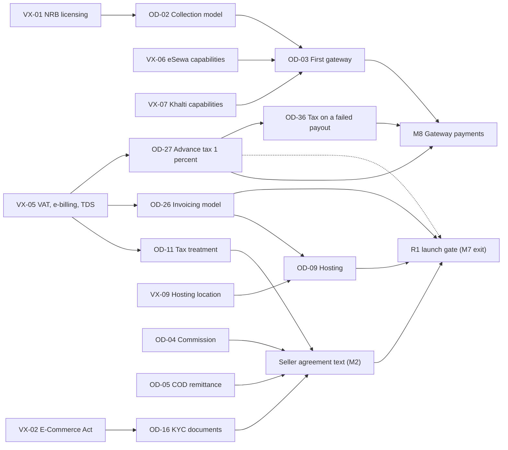

# DripNepal: Risks and Open Decisions

Status: Draft v1 (2026-09-25)

Reviewed: 2026-09-26 · consistency review 2026-09-30 to 2026-10-04

This document is the single source of truth for three registers:

- **Open decisions (OD-01 … OD-65).** Questions a named owner must answer before a milestone can start or finish.
- **External verifications (VX-01 … VX-18).** Legal, tax, provider and pricing facts that an authoritative party must confirm before the design relies on them.
- **Risks (R-01 … R-33).** Things that could go wrong for DripNepal specifically, with scores, mitigations, owners and early warnings.

Other documents cite these IDs and do not restate the content. When a decision is made, the ruling moves into the owning document (and an ADR where it is structural). This register keeps the date, the decision text and the links. Evidence labels ([Confirmed], [Verified-repo], [Verified-doc], [Assumption], [Open], [Verify-external]) are defined in [00 §1.2](00-context-assumptions-and-questions.md#12-evidence-labels). Assumptions A-xx live in [00](00-context-assumptions-and-questions.md), not here.

External facts below come from the [research notes](research/README.md) compiled on 2026-09-25. Each one carries its source URL, and every URL was accessed on 2026-09-25. Nothing in this register claims that DripNepal is compliant with any law; legal readings are [Verify-external] until the named verifier confirms them in writing. English texts of Nepali laws are translations and **the Nepali text prevails** (see R-23).

**Related documents**

| Doc                                                   | Owns                                                                                                      | Why this register links to it                             |
| ----------------------------------------------------- | --------------------------------------------------------------------------------------------------------- | --------------------------------------------------------- |
| [00](00-context-assumptions-and-questions.md)         | Context, repository findings (RF-xx), assumptions (A-xx)                                                  | Assumptions that ODs will replace                         |
| [01](01-product-requirements.md)                      | FR/NFR, scope, metrics                                                                                    | Requirements an OD or risk affects                        |
| [02](02-user-journeys-and-acceptance-criteria.md)     | Journeys J-xx, acceptance criteria                                                                        | Journeys that change when an OD is decided                |
| [03](03-system-architecture.md)                       | Modules, processes, jobs                                                                                  | Job, queue and hosting risks                              |
| [04](04-domain-model-and-data-dictionary.md)          | Tables, invariants, data classification, retention                                                        | Schema consequences of ODs                                |
| [05](05-order-payment-and-inventory-lifecycles.md)    | State machines, checkout, ledger postings                                                                 | Payment, refund and ledger decisions                      |
| [06](06-api-design.md) / [openapi.yaml](openapi.yaml) | API conventions, endpoint catalogue                                                                       | OD-13 casing, error codes                                 |
| [07](07-security-threat-model-and-permissions.md)     | Threats, permissions, privacy                                                                             | Breach, tenancy and privacy risks                         |
| [08](08-ui-ux-and-design-system.md)                   | UI/UX, design system                                                                                      | OD-22, VX-12, VX-13, accessibility                        |
| [09](09-code-structure-and-engineering-standards.md)  | Code structure, standards                                                                                 | OD-25 upgrade, dependency rules                           |
| [10](10-testing-and-quality-gates.md)                 | Test IDs, CI gates                                                                                        | Detective controls referenced by risks                    |
| [11](11-deployment-and-operations.md)                 | Deployment, runbooks                                                                                      | Hosting, backup, incident response                        |
| [12](12-roadmap-and-backlog.md)                       | Milestones M0–M9, backlog, traceability                                                                   | Milestone dates that set each "latest responsible moment" |
| [adr/](adr/README.md)                                 | [ADR-0001](adr/0001-record-architecture-decisions.md) … [ADR-0019](adr/0019-courier-integration-in-r1.md) | Where structural decisions are recorded                   |

---

## 1. How to use this register

### 1.1 What belongs here and what does not

An item belongs here if it is still undecided, still unverified, or still a live risk. A settled rule belongs in the owning document. For example, once OD-06 is decided, the numbers go into `platform_settings` defaults in [04](04-domain-model-and-data-dictionary.md) and the completion rule in [05](05-order-payment-and-inventory-lifecycles.md). The OD row here changes to Decided and records the date, the ruling and the links.

Writers of other documents must not invent new OD, VX or R numbers. They add a request under "Consistency notes for editor" in their own document, and the tech lead assigns the next free number here during the weekly review.

### 1.2 Owners

DripNepal has 1–2 developers and a small budget [Confirmed] (Q1), so "owner" means a role, and one person may hold several roles.

| Role                    | Who, in practice                                               | Decides or verifies                                                                                                                                                        |
| ----------------------- | -------------------------------------------------------------- | -------------------------------------------------------------------------------------------------------------------------------------------------------------------------- |
| **Product owner**       | The business owner of DripNepal, who also owns the repository  | Business policy ODs (commission, COD, returns, SLAs, moderation, brand policy, repo visibility). Approves every recommendation before it becomes Decided.                  |
| **Tech lead**           | The lead developer                                             | Technical ODs (OD-08, OD-09, OD-12, OD-13, OD-25). Runs the weekly review and maintains this file.                                                                         |
| **Legal counsel**       | An external Nepali lawyer engaged per question pack (§3.2)     | VX-01 … VX-04, VX-08, VX-09 and the legal side of OD-02, OD-07, OD-16, OD-17, OD-21, OD-24, OD-26, OD-35, OD-58. Must check the Nepali original of every clause relied on. |
| **Accountant**          | An external chartered accountant or tax adviser                | VX-05, and OD-11, OD-26, OD-27, OD-36, OD-58 (COD records). Signs off statement and payout formats.                                                                        |
| **Provider onboarding** | Whoever holds merchant relationships (the product owner in R1) | Written confirmations from eSewa, Khalti, Nepal Can Move, the email provider and hosting vendors (VX-06, VX-07, VX-14 to VX-18).                                           |

### 1.3 Status values

| Register | Status       | Meaning                                                                                                                                                 |
| -------- | ------------ | ------------------------------------------------------------------------------------------------------------------------------------------------------- |
| OD       | **Open**     | No recommendation yet, or the recommendation depends on an unresolved VX.                                                                               |
| OD       | **Proposed** | A recommendation is written below. The owning docs already use the recommended default, labelled [Assumption] or [Open]. The owner has not approved it. |
| OD       | **Decided**  | The owner approved a ruling. The date, ruling and ADR link are recorded in §2.3. The owning documents may still need updating.                          |
| OD       | **Resolved** | Decided, and every referencing document and any code have been updated. No [Open] label for this OD remains in the docs set.                            |
| VX       | **Open**     | No primary source yet, or the primary sources are silent or contradict each other on the point that matters.                                            |
| VX       | **Proposed** | Primary evidence has been gathered (listed in §3.1). The named verifier has not confirmed it in writing.                                                |
| VX       | **Resolved** | The verifier confirmed it in writing. The date and the reference to the written opinion or provider email are recorded.                                 |
| Risk     | **Open**     | Live risk. Mitigations are planned or in place.                                                                                                         |
| Risk     | **Resolved** | The cause is gone (for example, VX-01 answered favourably), or the owner formally accepted the residual risk.                                           |

### 1.4 Review cadence

- **Weekly during R0 and R1** (M0–M7): 30 minutes, product owner and tech lead. Fixed agenda:
  1. New evidence on any VX, and replies from counsel, the accountant or providers.
  2. Every OD whose latest responsible moment falls within the next two weeks, per the milestone plan in [12](12-roadmap-and-backlog.md). Decide it, or record the fallback in the table.
  3. Every risk scoring 12 or more, plus any risk whose trigger fired this week.
  4. Commit the changes to this file in the same session.
- **Fortnightly during R1.1** (M8), **monthly from R2**.
- **Event-driven reviews**, held within 3 working days of the event:
  - a new Finance Act (effective from Shrawan 1, the start of Nepal's fiscal year; see VX-05);
  - an NRB circular on payment aggregation;
  - a DoCSCP or IRD notice;
  - a change to eSewa or Khalti documentation;
  - a security incident;
  - a milestone slipping by more than two weeks.

Legal counsel and the accountant are not asked to attend. They receive a question pack (§3.2) and answer in writing, which keeps a small budget to one or two paid engagements before launch.

### 1.5 Recording a decision

When an OD becomes Decided:

1. Change the status in §2.2. Add an entry to §2.3 with the date (AD, Asia/Kathmandu), the ruling in one or two sentences, who decided, and links.
2. If the ruling is structural or expensive to reverse, write or supersede an ADR in [adr/](adr/README.md) and link it. Examples: collection model, hosting, invoicing, UI kit tier, framework upgrade. Settings values (COD limits, SLA hours) need no ADR; the §2.3 entry is enough.
3. Update the owning documents named in the [00 §1.4 ownership map](00-context-assumptions-and-questions.md#14-document-ownership-map), following [00 §1.5](00-context-assumptions-and-questions.md#15-how-a-decision-changes). Remove the `[Open] OD-xx` labels. Update traceability in [12](12-roadmap-and-backlog.md) if scope moved.
4. Commit with a message such as `docs: decide OD-18 COD limits`. The OD becomes Resolved when step 3 is complete.

The decision log entry has this format:

```text
OD-xx — Decided 2026-MM-DD by <role>
Ruling: <one or two sentences>
Evidence: <VX-xx resolved / opinion reference / data used>
ADR: <ADR-00NN link or "none (setting value)">
Docs updated: <list>  |  Status: Decided → Resolved on <date>
```

### 1.6 Latest responsible moment and safe defaults

The **latest responsible moment (LRM)** is the last point at which the decision can be made without rework or a slipped release. Milestone dates live in [12](12-roadmap-and-backlog.md), so LRMs here are stated relative to milestone events, for example "before the first M5 placeOrder PR merges".

Many ODs set **values stored in `platform_settings`** (COD limits, SLA hours, hold days). Code for these is not blocked: developers build against the default in [04a §15.1](04a-data-dictionary-tables.md#151-platform_settings) and the value changes later without a deploy. For those ODs the LRM is the launch gate, not the milestone start. Section 5 separates decisions that block **code** from decisions that block **launch**.

### 1.7 Risk scoring

Score = likelihood (L) × impact (I), each rated 1–5 on these DripNepal-specific scales:

| Rating | Likelihood (within the next 12 months) | Impact                                                                                                                    |
| ------ | -------------------------------------- | ------------------------------------------------------------------------------------------------------------------------- |
| 1      | Very unlikely                          | Cosmetic. No customer or vendor notices.                                                                                  |
| 2      | Unlikely                               | Rework under 1 week, or a minor cost (under about Rs 10,000 a month) [Assumption].                                        |
| 3      | Possible                               | A feature or milestone slips 1–4 weeks, or limited customer harm that is refundable and fixed within days.                |
| 4      | Likely                                 | Launch or R1.1 blocked, money lost or mis-posted, a regulator fine is possible, or an outage over 4 h (the proposed RTO). |
| 5      | Almost certain                         | Enforced shutdown, criminal exposure for staff, customer money held unlawfully, or a mass personal-data breach.           |

Bands: **15–25 High** (reviewed weekly until below 15), **8–14 Medium**, **1–7 Low**.

---

## 2. Open decisions (OD-01 … OD-54)

### 2.1 How the decisions depend on each other

Most ODs are independent settings. A few legal and tax decisions chain together and gate R1 launch or M8. The diagram shows only those chains. Solid arrows mean "must be answered first". The dotted arrow is the COD part of OD-27 (see §5).



Of the ODs registered from the deep audits (OD-28 … OD-54), a few depend on another decision. OD-36 needs OD-27's answer first (in the diagram). OD-35 is decided together with OD-07 and OD-05, because it is another way of paying COD refunds, and OD-46 together with OD-05 and OD-14. OD-32 takes the payer of a return lost on the way back from OD-30. The reveal part of OD-38 applies only if OD-49 approves the staff reveals. The others can be decided on their own. OD-58 (COD on platform-owned courier accounts) was re-decided for R1 on 2026-11-22 as option (b), which needs counsel's reading of REG-27 and VX-01, the accountant, and VX-17 and VX-18 before the first live COD shipment on such an account. OD-63 (the legal posture of the single-seller launch, 2026-11-23) needs counsel's reading of VX-02 and is answered with REG-01 and the DoCSCP listing of REG-03, before the launch goes live.

### 2.2 Decision table

"Blocks" gives the milestone whose start or exit cannot pass without the decision. Where one decision gates several milestones, each is listed with the part of the decision it needs. §5 lists the same gates by milestone, and [12 §2.5](12-roadmap-and-backlog.md#25-how-decisions-gate-a-milestone) follows §5.

OD-28 to OD-54 register the owner decisions that the three deep audits left open: Audit 1 of 05 (A1-xxx, [05 Consistency note 20](05-order-payment-and-inventory-lifecycles.md#consistency-notes-for-editor)), Audit 4 of 07 (A4-xxx, [07 Consistency notes 4, 7, 18, 20–24](07-security-threat-model-and-permissions.md#consistency-notes-for-editor)) and Audit 2 of 04 and 04a (A2-xxx, IN-xx, the [Deep audit 2 note of 04](04-domain-model-and-data-dictionary.md#deep-audit-2-2026-09-30)). Each row names its audit IDs, and the audit notes keep the detail. A row that asks to approve a departure the docs already use is Proposed, with the recommendation to approve. "Tech-lead lean" marks a first view on an Open row; it is not yet a recommendation the docs use.

| ID    | Question                                                                                                                                                                                                                                                                                                                                                                                                                                                                                                                                                                                                                                                                                                                                                                                                                                                                                                                                                                                                                                                                                                    | Options                                                                                                                                                                                                                                                                                                                                                                                                                                                                                                                                                                                                                                                                                                                                                                                                                                                                                                                                                           | Recommendation and reasoning                                                                                                                                                                                                                                                                                                                                                                                                                                                                                                                                                                                                                                                                                                                                                                                                                                                                                                                                                                                                                                                                          | Owner                                                                                                                                                                                                                                                                                                                                                                                                                                                                                                                                                                                                                                                                                                                                                                                                                                                                                                                                                                                                                                                                                                                                                          | Blocks                                                                                                                        | Latest responsible moment                                                                                                                                       | Status                                                                 |
| ----- | ----------------------------------------------------------------------------------------------------------------------------------------------------------------------------------------------------------------------------------------------------------------------------------------------------------------------------------------------------------------------------------------------------------------------------------------------------------------------------------------------------------------------------------------------------------------------------------------------------------------------------------------------------------------------------------------------------------------------------------------------------------------------------------------------------------------------------------------------------------------------------------------------------------------------------------------------------------------------------------------------------------------------------------------------------------------------------------------------------------- | ----------------------------------------------------------------------------------------------------------------------------------------------------------------------------------------------------------------------------------------------------------------------------------------------------------------------------------------------------------------------------------------------------------------------------------------------------------------------------------------------------------------------------------------------------------------------------------------------------------------------------------------------------------------------------------------------------------------------------------------------------------------------------------------------------------------------------------------------------------------------------------------------------------------------------------------------------------------- | ----------------------------------------------------------------------------------------------------------------------------------------------------------------------------------------------------------------------------------------------------------------------------------------------------------------------------------------------------------------------------------------------------------------------------------------------------------------------------------------------------------------------------------------------------------------------------------------------------------------------------------------------------------------------------------------------------------------------------------------------------------------------------------------------------------------------------------------------------------------------------------------------------------------------------------------------------------------------------------------------------------------------------------------------------------------------------------------------------- | -------------------------------------------------------------------------------------------------------------------------------------------------------------------------------------------------------------------------------------------------------------------------------------------------------------------------------------------------------------------------------------------------------------------------------------------------------------------------------------------------------------------------------------------------------------------------------------------------------------------------------------------------------------------------------------------------------------------------------------------------------------------------------------------------------------------------------------------------------------------------------------------------------------------------------------------------------------------------------------------------------------------------------------------------------------------------------------------------------------------------------------------------------------- | ----------------------------------------------------------------------------------------------------------------------------- | --------------------------------------------------------------------------------------------------------------------------------------------------------------- | ---------------------------------------------------------------------- | ----------- |
| OD-01 | Is it true that no production database with real users, shops or orders exists, so the 26 exploratory migration files (25 tables plus pgcrypto) can be replaced?                                                                                                                                                                                                                                                                                                                                                                                                                                                                                                                                                                                                                                                                                                                                                                                                                                                                                                                                            | (a) Re-baseline: one reviewed baseline migration ([ADR-0011](adr/0011-schema-rebaseline-before-production.md)). (b) Incremental ALTER migrations on top of the 26 files.                                                                                                                                                                                                                                                                                                                                                                                                                                                                                                                                                                                                                                                                                                                                                                                          | **Decided 2026-09-30: (a)** (§2.3). RF-06, RF-11, RF-13, RF-16, RF-17, RF-20, RF-23, RF-24 and RF-41 touch nearly every table: cascades into orders, decimal money, global uniques, missing tenant FKs. As ALTERs they would cost more than a clean baseline and keep broken history. The product owner confirmed on 2026-09-30 that no hosted instance holds real users, shops or orders. Only test data may be discarded: a hosted instance that holds only test data is exported with a one-off script and not migrated. If one is found to hold real orders (kept 7 years, [04 §19.3](04-domain-model-and-data-dictionary.md#193-retention-schedule)), or real accounts and shops the product owner decides to keep, the re-baseline stops and ADR-0011 is superseded by an incremental plan for the affected tables ([ADR-0011](adr/0011-schema-rebaseline-before-production.md#when-to-revisit), When to revisit). [ADR-0011](adr/0011-schema-rebaseline-before-production.md) uses the file order of [04 §20.2.2](04-domain-model-and-data-dictionary.md#2022-baseline-files-and-their-order). | Product owner                                                                                                                                                                                                                                                                                                                                                                                                                                                                                                                                                                                                                                                                                                                                                                                                                                                                                                                                                                                                                                                                                                                                                  | M0                                                                                                                            | Before the M0 baseline migration PR merges                                                                                                                      | **Decided**                                                            |
| OD-02 | Under which legal model may DripNepal accept gateway payments for vendors' goods and later pay vendors? Which entity holds the merchant account?                                                                                                                                                                                                                                                                                                                                                                                                                                                                                                                                                                                                                                                                                                                                                                                                                                                                                                                                                            | (a) Platform collects into its own merchant account and pays vendors off-gateway (Q3 as stated). (b) Merchant of record: DripNepal buys and resells, so list-based duties (E-Commerce Act s15) and VAT on the full sale apply. (c) One PSP merchant account per vendor, with one payment per shop order; this breaks one-payment checkout (Q2). (d) Stay COD-only until counsel clears (a).                                                                                                                                                                                                                                                                                                                                                                                                                                                                                                                                                                       | R1 is COD-only, so DripNepal holds no customer funds and R1 does not need this decision [Confirmed] (Q3, Q4). For R1.1, get a written opinion before M8. NRB describes third-party aggregators as not yet provided for (VX-01), so (a) carries the most regulatory uncertainty. Keep the ledger ([ADR-0009](adr/0009-multi-shop-orders-and-vendor-ledger.md)) and `payment_allocations` able to support (c). **Fallback:** if undecided at M8 start, defer M8 and continue COD. Never add store credit or wallet balances (e-money, VX-01).                                                                                                                                                                                                                                                                                                                                                                                                                                                                                                                                                           | Product owner + legal counsel                                                                                                                                                                                                                                                                                                                                                                                                                                                                                                                                                                                                                                                                                                                                                                                                                                                                                                                                                                                                                                                                                                                                  | M8                                                                                                                            | Before applying for a gateway merchant account (KYC lead time, R-31); at the latest, M8 start                                                                   | Open                                                                   |
| OD-03 | Which gateway comes first, eSewa or Khalti?                                                                                                                                                                                                                                                                                                                                                                                                                                                                                                                                                                                                                                                                                                                                                                                                                                                                                                                                                                                                                                                                 | (a) Khalti KPG-2. (b) eSewa ePay v2. (c) eSewa Intent (mobile deeplink; only development URLs published).                                                                                                                                                                                                                                                                                                                                                                                                                                                                                                                                                                                                                                                                                                                                                                                                                                                         | **(a) Khalti**, unless customer-reach data favours eSewa ([research: nepal-payments](research/nepal-payments.md)). Khalti documents a server-side initiate that returns `pidx` and `expires_at`, a lookup API and a refund API. eSewa ePay has no refund API and a 5-minute payment window (VX-06). Neither provider documents a webhook for these flows, so the reconciliation job is required either way. Khalti constraints: amount must exceed Rs 10, and payments above NPR 200 fail until merchant KYC is complete (VX-07). Ask launch vendors which wallet their customers use.                                                                                                                                                                                                                                                                                                                                                                                                                                                                                                                | Product owner (tech lead advises)                                                                                                                                                                                                                                                                                                                                                                                                                                                                                                                                                                                                                                                                                                                                                                                                                                                                                                                                                                                                                                                                                                                              | M8                                                                                                                            | Once OD-02 is settled; before starting merchant KYC                                                                                                             | Proposed                                                               |
| OD-04 | What is the default commission rate, and is it charged on items only or on items plus shipping?                                                                                                                                                                                                                                                                                                                                                                                                                                                                                                                                                                                                                                                                                                                                                                                                                                                                                                                                                                                                             | Basis (a) `line_total_minor` (items net of shop-funded discount), or (b) items + `shipping_fee_minor`. (b) is not a larger line `commission_base`: it needs a separate shop-order-level shipping commission snapshot (a new column and CHECK in 04a) with its own posting and reversal rules ([05 §3.5](05-order-payment-and-inventory-lifecycles.md#35-commission-allocation-per-item)). Rate: platform default `default_commission_rate_bp` with per-shop override `shops.commission_rate_bp`. Category rates come in R2 (FR-LED-006).                                                                                                                                                                                                                                                                                                                                                                                                                          | **Basis (a).** Shipping passes to the vendor, who pays its own courier (Q5), so commission on shipping would charge a margin on a cost the platform does not bear. The rate is a business number and a setting; docs use an illustrative 10% labelled OD-04, and the basis default is A-04. VAT on commission depends on OD-11.                                                                                                                                                                                                                                                                                                                                                                                                                                                                                                                                                                                                                                                                                                                                                                       | Product owner                                                                                                                                                                                                                                                                                                                                                                                                                                                                                                                                                                                                                                                                                                                                                                                                                                                                                                                                                                                                                                                                                                                                                  | M2 exit (rate, in the seller-agreement text); M5 code (basis: `placeOrder` step 9 writes the commission snapshot).            | Basis: before the first M5 placeOrder PR. Rate: before the seller agreement text is final (M2 exit).                                                            | Open                                                                   |
| OD-05 | How and when do vendors pay commission on COD orders, given that they hold the cash?                                                                                                                                                                                                                                                                                                                                                                                                                                                                                                                                                                                                                                                                                                                                                                                                                                                                                                                                                                                                                        | (a) Periodic statement plus bank or wallet transfer by a due date, recorded with `recordVendorRemittance`. (b) Prepaid vendor deposit drawn down by commission. (c) Weekly settlement. (d) Netting against gateway receipts (R1.1+ only).                                                                                                                                                                                                                                                                                                                                                                                                                                                                                                                                                                                                                                                                                                                         | **(a)** with the monthly statement of [05 §7.12](05-order-payment-and-inventory-lifecycles.md#712-statements-and-integrity-checks) (FR-LED-003), built from `ledger_entries`, payment due within 10 days of issue and a reminder at day 7 [Assumption: terms, [05 §7.5](05-order-payment-and-inventory-lifecycles.md#75-vendor-remittance-r1)]. A shop whose balance stays below −Rs 5,000 for more than 30 days is reviewed for suspension with `suspension_mode = fulfill_existing`. Add (d) once R1.1 payouts exist. Put the terms in the versioned seller agreement (`shop_agreements.agreement_version`). Avoid (b) until counsel confirms that a vendor deposit is not a regulated stored value.                                                                                                                                                                                                                                                                                                                                                                                                | Product owner (accountant on invoice and TDS)                                                                                                                                                                                                                                                                                                                                                                                                                                                                                                                                                                                                                                                                                                                                                                                                                                                                                                                                                                                                                                                                                                                  | M2 exit (agreement text); M7 code (remittance flow) and R1 launch.                                                            | Before the first launch vendor accepts the seller agreement                                                                                                     | Open                                                                   |
| OD-06 | What are the ledger hold (`ledger_hold_days`, default 7) and the return window (`return_window_days`, default 7)?                                                                                                                                                                                                                                                                                                                                                                                                                                                                                                                                                                                                                                                                                                                                                                                                                                                                                                                                                                                           | Return window 7 days (CPA s14 dissatisfaction return). Optionally 15 days for sealed goods (CPA s14(5)); this needs a second settings key (for example `sealed_return_window_days`) and a product-level sealed flag in [04a §15.1](04a-data-dictionary-tables.md#151-platform_settings), plus a matching precondition in 05 §6.6. Hold = return window, or return window + return transit.                                                                                                                                                                                                                                                                                                                                                                                                                                                                                                                                                                        | **Keep 7/7 for R1.** Under COD the vendor already holds the cash; the hold only sets when an entry counts as available. **Before M8 payouts**, raise the hold to at least return window + 7 days, so that a late-arriving return can be netted before money leaves. Counsel must confirm whether CPA s14 applies to online sales through E-Commerce Act s31 and whether the 15-day sealed-goods window binds DripNepal (VX-04). [Assumption A-49, [05 §7.2](05-order-payment-and-inventory-lifecycles.md#72-entry-types-and-posting-rules)] Ledger availability group rule: each delivery posting is one group, decided by its net. A group that nets positive (the platform owes the vendor), its commission debit included, waits `ledger_hold_days`; a group that nets zero or negative is available at once, as is every other entry.                                                                                                                                                                                                                                                             | Product owner + legal counsel                                                                                                                                                                                                                                                                                                                                                                                                                                                                                                                                                                                                                                                                                                                                                                                                                                                                                                                                                                                                                                                                                                                                  | M6 exit (values: shop orders complete after the window); M8 exit (hold revision before the first payout).                     | Values before R1 launch; hold revision before the first M8 payout                                                                                               | Proposed                                                               |
| OD-07 | Returns and refunds: who pays return shipping, which categories are excluded (innerwear, swimwear), and how are COD customers refunded?                                                                                                                                                                                                                                                                                                                                                                                                                                                                                                                                                                                                                                                                                                                                                                                                                                                                                                                                                                     | (a) Vendor pays for non-conforming goods; customer pays for change of mind. (b) Platform subsidises returns. (c) Free returns for all.                                                                                                                                                                                                                                                                                                                                                                                                                                                                                                                                                                                                                                                                                                                                                                                                                            | **(a) for non-conforming goods** (`not_as_described`, `damaged`, `wrong_item`): full refund including tax (E-Commerce Act s10). **Change of mind** within the window: refund without deduction from the price (CPA s14(2)). Counsel decides whether the customer may bear return transport (VX-04); Directive s8(3) bars charges after handover beyond the pre-agreed price and transport. Hygiene items are returnable only with the seal unbroken (CPA s14(4)–(5)). COD refunds go by `manual_transfer` to a bank or wallet account the customer names, never store credit. [Assumption A-48, 05 §7.4] The platform pays the COD refund within the 7-day deadline and recovers it from the vendor through the ledger, so the OD-05 terms must cover that recovery (R-03). The DoCSCP listing application needs a published return policy (Directive s4(3)).                                                                                                                                                                                                                                         | Product owner + legal counsel                                                                                                                                                                                                                                                                                                                                                                                                                                                                                                                                                                                                                                                                                                                                                                                                                                                                                                                                                                                                                                                                                                                                  | M6, M7 (FR-RET-006 support-mediated returns)                                                                                  | Before the M6 return flow and before the listing application                                                                                                    | Open                                                                   |
| OD-08 | Which transactional email provider?                                                                                                                                                                                                                                                                                                                                                                                                                                                                                                                                                                                                                                                                                                                                                                                                                                                                                                                                                                                                                                                                         | Any transport shipped with @adonisjs/mail 10.4.1: ses, smtp, brevo, resend, mailgun, sparkpost, cloudflare, postmark [Verified-doc] (https://registry.npmjs.org/@adonisjs/mail).                                                                                                                                                                                                                                                                                                                                                                                                                                                                                                                                                                                                                                                                                                                                                                                  | Shortlist two providers that have a first-party transport and support DKIM, SPF and DMARC. Run a one-day seeded-inbox test to Gmail, Outlook and at least two Nepali ISP mailboxes, measuring inbox placement and delay (VX-14). Choose on placement first, then on price as published. R1 sends transactional mail only; marketing needs recorded consent (Advertisement (Regulation) Act 2076 s10(1), [Verify-external VX-03]). Code is not blocked, because development uses Mailpit.                                                                                                                                                                                                                                                                                                                                                                                                                                                                                                                                                                                                              | Tech lead                                                                                                                                                                                                                                                                                                                                                                                                                                                                                                                                                                                                                                                                                                                                                                                                                                                                                                                                                                                                                                                                                                                                                      | M1 exit (FR-IAM-002: a verified email gates checkout)                                                                         | About 2 weeks before M1 exit, for DNS setup and domain warm-up [Assumption]                                                                                     | Open                                                                   |
| OD-09 | Which production hosting provider and region?                                                                                                                                                                                                                                                                                                                                                                                                                                                                                                                                                                                                                                                                                                                                                                                                                                                                                                                                                                                                                                                               | (a) DigitalOcean BLR1 + DO Managed PostgreSQL 18 + Cloudflare + R2 ([ADR-0016](adr/0016-hosting-single-region-portable.md), provisional). (b) The same in SGP1. (c) A DoIT-listed Nepal provider. (d) Split: app offshore, invoice data in Nepal (only if OD-26 makes DripNepal an e-invoice issuer).                                                                                                                                                                                                                                                                                                                                                                                                                                                                                                                                                                                                                                                             | Develop and stage on (a), and keep everything portable: Docker image, vanilla PostgreSQL, S3 API, no provider-only services. Decide production after the VX-09 opinion and a latency test from Nepali ISPs to BLR1 and SGP1; no published measurements exist (VX-15). If counsel reads DCCS Directive cl. 8(1) as binding private clients, move to (c) and rehearse the move with the restore drill T-OPS-001.                                                                                                                                                                                                                                                                                                                                                                                                                                                                                                                                                                                                                                                                                        | Tech lead + legal counsel                                                                                                                                                                                                                                                                                                                                                                                                                                                                                                                                                                                                                                                                                                                                                                                                                                                                                                                                                                                                                                                                                                                                      | M7 launch readiness (not development)                                                                                         | 4 weeks before launch, to leave time for the restore drill, DNS and monitoring on the chosen host                                                               | Proposed                                                               |
| OD-10 | Rate-limiter store: database or Redis?                                                                                                                                                                                                                                                                                                                                                                                                                                                                                                                                                                                                                                                                                                                                                                                                                                                                                                                                                                                                                                                                      | (a) @adonisjs/limiter `stores.database`. (b) Redis.                                                                                                                                                                                                                                                                                                                                                                                                                                                                                                                                                                                                                                                                                                                                                                                                                                                                                                               | **Resolved 2026-09-25: (a).** @adonisjs/limiter 3.0.1 ships `stores.database` [Verified-doc], so R1 needs no Redis ([03 §12.4](03-system-architecture.md#124-rate-limiting); [ADR-0010](adr/0010-postgres-jobs-pg-boss-transactional-send.md) context).                                                                                                                                                                                                                                                                                                                                                                                                                                                                                                                                                                                                                                                                                                                                                                                                                                               | Tech lead                                                                                                                                                                                                                                                                                                                                                                                                                                                                                                                                                                                                                                                                                                                                                                                                                                                                                                                                                                                                                                                                                                                                                      | M0                                                                                                                            | Passed                                                                                                                                                          | **Resolved**                                                           |
| OD-11 | Tax treatment: are prices VAT-inclusive, who invoices the customer, how is commission taxed, and does TDS apply to commission?                                                                                                                                                                                                                                                                                                                                                                                                                                                                                                                                                                                                                                                                                                                                                                                                                                                                                                                                                                              | (a) Vendors invoice customers; DripNepal invoices vendors for commission and computes no VAT on sales. (b) DripNepal invoices customers as merchant of record.                                                                                                                                                                                                                                                                                                                                                                                                                                                                                                                                                                                                                                                                                                                                                                                                    | **(a)** [Assumption pending OD-26] (00 A-16). Prices are tax-inclusive final prices (E-Commerce Act s6(b); CPA s6(2)(j)). `order_items.tax_minor` and `tax_rate_bp` stay nullable. PAN-only vendors must not show VAT (VAT Act s15). Questions for the accountant: DripNepal's own VAT registration (Rs 30 lakh threshold for services, VAT Rules r6); TDS by vendors on commission (s88: 15%, or 1.5% for VAT-registered service providers); whether apparel qualifies for the 10% VAT refund on e-payments (VAT Act s25(1kha)).                                                                                                                                                                                                                                                                                                                                                                                                                                                                                                                                                                     | Accountant                                                                                                                                                                                                                                                                                                                                                                                                                                                                                                                                                                                                                                                                                                                                                                                                                                                                                                                                                                                                                                                                                                                                                     | M2 exit (who invoices, in the seller-agreement text); R1 launch (M7 exit).                                                    | Before the seller agreement text is final                                                                                                                       | Open                                                                   |
| OD-12 | Seller dashboard prefix: `/seller/{shopSlug}` or the current `/shop/:shopSlug` [Verified-repo] (start/routes/shops.ts:27)?                                                                                                                                                                                                                                                                                                                                                                                                                                                                                                                                                                                                                                                                                                                                                                                                                                                                                                                                                                                  | (a) `/seller/{shopSlug}/…`. (b) Keep `/shop/:shopSlug/…`. (c) `/shops/:shopSlug/dashboard` (the title of commit 0282605).                                                                                                                                                                                                                                                                                                                                                                                                                                                                                                                                                                                                                                                                                                                                                                                                                                         | **Decided 2026-09-30: (a)** (§2.3); the current `/shop/:shopSlug` routes move in M0. The public storefront is `/shops/{shopSlug}`. A private namespace one letter away invites middleware-group mistakes of the RF-01 kind (authentication checked, membership not). This reverses a recent commit, but no users exist to break.                                                                                                                                                                                                                                                                                                                                                                                                                                                                                                                                                                                                                                                                                                                                                                      | Tech lead (product owner informed)                                                                                                                                                                                                                                                                                                                                                                                                                                                                                                                                                                                                                                                                                                                                                                                                                                                                                                                                                                                                                                                                                                                             | M0 (RF-01 guard)                                                                                                              | Before the M0 membership-guard PR                                                                                                                               | **Decided**                                                            |
| OD-13 | JSON field casing: snake_case or camelCase?                                                                                                                                                                                                                                                                                                                                                                                                                                                                                                                                                                                                                                                                                                                                                                                                                                                                                                                                                                                                                                                                 | (a) snake_case in JSON bodies, Inertia props and OpenAPI. (b) camelCase, with transformers mapping from DB names.                                                                                                                                                                                                                                                                                                                                                                                                                                                                                                                                                                                                                                                                                                                                                                                                                                                 | **Decided 2026-09-30: (a)** (§2.3). It matches column names, and transformers already build every shape explicitly, so no automatic mapping can go wrong. docs/openapi.yaml is hand-written (Adonis 7 has no OpenAPI generator), so one convention halves review effort. T-API-001 enforces it.                                                                                                                                                                                                                                                                                                                                                                                                                                                                                                                                                                                                                                                                                                                                                                                                       | Tech lead                                                                                                                                                                                                                                                                                                                                                                                                                                                                                                                                                                                                                                                                                                                                                                                                                                                                                                                                                                                                                                                                                                                                                      | M0                                                                                                                            | Before the first `/api/v1` endpoint or transformer merges                                                                                                       | **Decided**                                                            |
| OD-14 | Must a second person approve refunds and payouts (maker-checker), or can one operator approve their own?                                                                                                                                                                                                                                                                                                                                                                                                                                                                                                                                                                                                                                                                                                                                                                                                                                                                                                                                                                                                    | (a) Strict: DB CHECK `approved_by <> created_by`. (b) `platform_settings.single_operator_mode = true`: the same person approves after re-entering TOTP, and the approval is flagged in audit.                                                                                                                                                                                                                                                                                                                                                                                                                                                                                                                                                                                                                                                                                                                                                                     | **(b)**, but only while exactly one person holds `platform.refunds.approve` or `platform.payouts.approve`. The product owner reviews flagged approvals weekly. Switch to (a) the day a second finance-capable staff member exists. With one operator, (a) would block every refund and break the 7-day refund rule (Directive s9(3)). The shipped default stays `single_operator_mode = false` (A-20, [04a §15.1](04a-data-dictionary-tables.md#151-platform_settings)); the recommendation is to switch it on in production only under the condition above. [Assumption A-50, 05 §7.8] Ledger adjustments above Rs 10,000 need a second finance officer's approval in the same way; this decision covers them too.                                                                                                                                                                                                                                                                                                                                                                                   | Product owner                                                                                                                                                                                                                                                                                                                                                                                                                                                                                                                                                                                                                                                                                                                                                                                                                                                                                                                                                                                                                                                                                                                                                  | M7 code (approval rule); revisited at M8 exit if staff grew                                                                   | Before the first production refund or remittance                                                                                                                | Proposed                                                               |
| OD-15 | Which audience values, size systems and colours?                                                                                                                                                                                                                                                                                                                                                                                                                                                                                                                                                                                                                                                                                                                                                                                                                                                                                                                                                                                                                                                            | Audience {men, women, kids} or {men, women, boys, girls, unisex}. One size attribute per system. Length of the colour list.                                                                                                                                                                                                                                                                                                                                                                                                                                                                                                                                                                                                                                                                                                                                                                                                                                       | Audience **men, women, kids**, multi-valued; show "Unisex" when both men and women are set. `apparel_size` XS…3XL plus Free Size, `shoe_size_eu` 35–47, `waist_size_in` 26–40; `kids_age` in R2. Platform-controlled colours with `swatch_hex`; `color_family` in R2. Check against launch vendors' current catalogues before seeding. R1-S builds on this recommendation (go-ahead 2026-11-24, note 56); OD-15 is not decided.                                                                                                                                                                                                                                                                                                                                                                                                                                                                                                                                                                                                                                                                       | Product owner (merchandising)                                                                                                                                                                                                                                                                                                                                                                                                                                                                                                                                                                                                                                                                                                                                                                                                                                                                                                                                                                                                                                                                                                                                  | M3 code (reference seeders, which M4 navigation reads)                                                                        | Before the M3 reference seeders are written                                                                                                                     | Proposed                                                               |
| OD-16 | Which KYC documents must a vendor provide, and may unregistered individuals sell?                                                                                                                                                                                                                                                                                                                                                                                                                                                                                                                                                                                                                                                                                                                                                                                                                                                                                                                                                                                                                           | (a) Registration certificate + PAN/VAT certificate + authorised person's ID + proof of payout account. (b) (a) plus a tax clearance certificate. (c) A lighter set for `business_type = individual`.                                                                                                                                                                                                                                                                                                                                                                                                                                                                                                                                                                                                                                                                                                                                                              | **(a) as the minimum.** E-Commerce Act s16(b) requires evidence of business registration, full name and address, a grievance mechanism, return and refund details, and PAN/VAT details. That suggests an unregistered individual cannot sell; counsel to confirm (VX-02). Documents are stored as `media_assets.kind = kyc_document` in the private bucket. They are personal information (Privacy Act s2(c)) with restricted access ([07](07-security-threat-model-and-permissions.md)). For an application that is never approved, the files, addresses, configuration, grievance contact and an individual's business identifiers are purged 1 year after the last rejection, and its agreements and review decisions are kept [Assumption] (00 A-33, [04 §19.3](04-domain-model-and-data-dictionary.md#193-retention-schedule)).                                                                                                                                                                                                                                                                  | Legal counsel (product owner approves)                                                                                                                                                                                                                                                                                                                                                                                                                                                                                                                                                                                                                                                                                                                                                                                                                                                                                                                                                                                                                                                                                                                         | M2                                                                                                                            | Before the M2 shop application form is frozen                                                                                                                   | Open                                                                   |
| OD-17 | How long may vendors see a customer's name, phone and address after delivery or cancellation?                                                                                                                                                                                                                                                                                                                                                                                                                                                                                                                                                                                                                                                                                                                                                                                                                                                                                                                                                                                                               | (a) Only while the shop order is non-terminal. (b) Non-terminal plus 30 days, then masked (the default of 00 A-18 and [07 §5.2](07-security-threat-model-and-permissions.md#52-vendor-visibility-of-customer-contact-data)). (c) Indefinitely.                                                                                                                                                                                                                                                                                                                                                                                                                                                                                                                                                                                                                                                                                                                    | **(b)** [Assumption]. Thirty days covers the 7-day return window and RTO handling. Vendors never see the customer's email, account ID or other orders, and R1 has no export. E-Commerce Act s12 allows buyer, business and delivery provider to exchange transaction information; Privacy Act s12(3) limits use to the purpose of collection (VX-03).                                                                                                                                                                                                                                                                                                                                                                                                                                                                                                                                                                                                                                                                                                                                                 | Legal counsel (privacy)                                                                                                                                                                                                                                                                                                                                                                                                                                                                                                                                                                                                                                                                                                                                                                                                                                                                                                                                                                                                                                                                                                                                        | M6                                                                                                                            | Before masking in `getShopOrder` is built                                                                                                                       | Proposed                                                               |
| OD-18 | What are the COD risk limits: `cod_max_order_value_minor`, `cod_max_open_orders_per_customer` (default 3), and is the repeat-refuser rule adopted?                                                                                                                                                                                                                                                                                                                                                                                                                                                                                                                                                                                                                                                                                                                                                                                                                                                                                                                                                          | A value cap; 1–5 open orders; optionally a stricter cap on first orders. Repeat-refuser rule: adopt or not.                                                                                                                                                                                                                                                                                                                                                                                                                                                                                                                                                                                                                                                                                                                                                                                                                                                       | **Keep 3 open orders.** Set the value cap from launch vendors' typical and maximum basket values: no verified market data exists, and the COD-share figures found in blogs were unsourced. Review monthly against refusal data (R-02). The seeded cap is Rs 20,000 (A-08), below the Rs 25,000 cash-transaction limit (VX-05). **Adopt the repeat-refuser rule** as a rolling window: COD is refused after `cod_max_refusals` 2 `refused` delivery events within `cod_refusal_window_days` 90 ([05 §8.9](05-order-payment-and-inventory-lifecycles.md#89-cod-refusal-and-collection-reconciliation), [04a §15.1](04a-data-dictionary-tables.md#151-platform_settings)). No admin override or restore in R1; one would need a new operation in [06](06-api-design.md) and a column in 04a. These are settings, so code is not blocked.                                                                                                                                                                                                                                                                 | Product owner                                                                                                                                                                                                                                                                                                                                                                                                                                                                                                                                                                                                                                                                                                                                                                                                                                                                                                                                                                                                                                                                                                                                                  | M5 exit                                                                                                                       | Before checkout is enabled in production                                                                                                                        | Open                                                                   |
| OD-19 | Vendor acceptance SLA (`vendor_acceptance_sla_hours`, default 48)?                                                                                                                                                                                                                                                                                                                                                                                                                                                                                                                                                                                                                                                                                                                                                                                                                                                                                                                                                                                                                                          | 24, 48 or 72 hours; calendar hours or business hours.                                                                                                                                                                                                                                                                                                                                                                                                                                                                                                                                                                                                                                                                                                                                                                                                                                                                                                             | **48 calendar hours** in Asia/Kathmandu, with a reminder email at 24 h. On expiry the shop order is auto-cancelled with reason `acceptance_timeout`. Calendar hours keep the job simple. Revisit if Saturday closures (Nepal's weekly holiday [Assumption]) cause timeouts.                                                                                                                                                                                                                                                                                                                                                                                                                                                                                                                                                                                                                                                                                                                                                                                                                           | Product owner                                                                                                                                                                                                                                                                                                                                                                                                                                                                                                                                                                                                                                                                                                                                                                                                                                                                                                                                                                                                                                                                                                                                                  | M6                                                                                                                            | Before the acceptance-timeout job is enabled                                                                                                                    | Proposed                                                               |
| OD-20 | Must new shops' products be approved before they go live (pre-moderation)?                                                                                                                                                                                                                                                                                                                                                                                                                                                                                                                                                                                                                                                                                                                                                                                                                                                                                                                                                                                                                                  | (a) `product_review_mode = pre` for every shop. (b) `pre` for new shops, `post` after a track record. (c) `post` for every shop.                                                                                                                                                                                                                                                                                                                                                                                                                                                                                                                                                                                                                                                                                                                                                                                                                                  | **(b).** The default is `pre`. An admin switches a shop to `post` (`adminUpdateShop`) after 20 approved products with no rejection in the last 30 days [Assumption: thresholds]. Any counterfeit complaint sends the shop back to `pre`. Pre-moderation is the main counterfeit control (R-04).                                                                                                                                                                                                                                                                                                                                                                                                                                                                                                                                                                                                                                                                                                                                                                                                       | Product owner                                                                                                                                                                                                                                                                                                                                                                                                                                                                                                                                                                                                                                                                                                                                                                                                                                                                                                                                                                                                                                                                                                                                                  | M3                                                                                                                            | Before the M3 moderation queue is built                                                                                                                         | Proposed                                                               |
| OD-21 | Brand authenticity policy (counterfeit sneakers, watches, bags)?                                                                                                                                                                                                                                                                                                                                                                                                                                                                                                                                                                                                                                                                                                                                                                                                                                                                                                                                                                                                                                            | (a) Allow any brand. (b) A restricted-brand list that needs authorisation evidence. (c) Ban third-party branded goods.                                                                                                                                                                                                                                                                                                                                                                                                                                                                                                                                                                                                                                                                                                                                                                                                                                            | **(b).** New brands have `status = pending` until approved. Restricted brands (global sportswear, luxury watches and bags) need an invoice from an authorised distributor or a letter from the brand, stored as a private document. Moderation guidelines block "replica", "first copy" and "inspired by" wording. A complaint leads to `blockProduct` within 24 h [Assumption]. CPA s16(2) treats selling fake goods as an unfair trade practice (CPA s40: up to Rs 6 lakh and/or 5 years for the most serious clauses); counsel must confirm the platform's exposure (VX-04).                                                                                                                                                                                                                                                                                                                                                                                                                                                                                                                       | Product owner + legal counsel                                                                                                                                                                                                                                                                                                                                                                                                                                                                                                                                                                                                                                                                                                                                                                                                                                                                                                                                                                                                                                                                                                                                  | M3                                                                                                                            | Before brand reference data is seeded                                                                                                                           | Open                                                                   |
| OD-22 | Repository visibility and Shadcn UI Kit tier?                                                                                                                                                                                                                                                                                                                                                                                                                                                                                                                                                                                                                                                                                                                                                                                                                                                                                                                                                                                                                                                               | (a) Stay public; use free kit items only, after VX-13. (b) Go private and buy Pro ($79, 1 user) or Team ($199, 10 users), one-time sale prices as published on 2026-09-25 (https://shadcnuikit.com/pricing).                                                                                                                                                                                                                                                                                                                                                                                                                                                                                                                                                                                                                                                                                                                                                      | **(a) for R1**, unless the product owner wants a private repo for other reasons. All 59 ecommerce blocks are Pro, the admin templates are Next.js apps that must be ported, and DripNepal already has its own commerce components, so premium code saves little. If (b), buy Team, since Pro covers one user. Premium code is never committed while the repo is public (pricing FAQ).                                                                                                                                                                                                                                                                                                                                                                                                                                                                                                                                                                                                                                                                                                                 | Product owner                                                                                                                                                                                                                                                                                                                                                                                                                                                                                                                                                                                                                                                                                                                                                                                                                                                                                                                                                                                                                                                                                                                                                  | Seller dashboard UI (M2), if kit dashboard blocks are wanted; storefront UI (M4).                                             | Before M2 dashboard UI work starts                                                                                                                              | Open                                                                   |
| OD-23 | `LICENSE` says MIT but `package.json` says `"license": "UNLICENSED"` and `"private": true` [Verified-repo] (package.json:4,6; LICENSE:1). Which is right?                                                                                                                                                                                                                                                                                                                                                                                                                                                                                                                                                                                                                                                                                                                                                                                                                                                                                                                                                   | (a) Keep MIT: open source, anyone may fork, premium kit impossible. (b) Proprietary, source visible in a public repo. (c) Proprietary, private repo.                                                                                                                                                                                                                                                                                                                                                                                                                                                                                                                                                                                                                                                                                                                                                                                                              | **Decided 2026-11-26: (b)** (§2.3), replacing the ruling of 2026-09-30 (option (a), keep MIT). The code is proprietary, all rights reserved, and the repository stays public, so OD-22 (a) still holds. `LICENSE` is an all-rights-reserved notice and `package.json` says `"license": "UNLICENSED"`; `"private": true` stays, because it only stops accidental npm publishing.                                                                                                                                                                                                                                                                                                                                                                                                                                                                                                                                                                                                                                                                                                                       | Product owner                                                                                                                                                                                                                                                                                                                                                                                                                                                                                                                                                                                                                                                                                                                                                                                                                                                                                                                                                                                                                                                                                                                                                  | M0 (RF-42)                                                                                                                    | Before the M0 README and licence fix                                                                                                                            | **Decided**                                                            |
| OD-24 | Minimum customer age?                                                                                                                                                                                                                                                                                                                                                                                                                                                                                                                                                                                                                                                                                                                                                                                                                                                                                                                                                                                                                                                                                       | (a) 18+ only, with an unticked "I am 18 or older" confirmation at signup (`users.age_confirmed_at`). (b) Under-18 accounts with guardian consent (Privacy Act s33).                                                                                                                                                                                                                                                                                                                                                                                                                                                                                                                                                                                                                                                                                                                                                                                               | **Decided 2026-11-22 for the build (product owner):** (a); counsel's VX-03 answer, due before the M1 exit, can reopen it (§2.3). **(a).** R1 relies on self-declaration and sends no marketing to anyone who has not confirmed. (b) would need a consent flow and evidence rules designed by counsel. Whether minors can form contracts is part of VX-03.                                                                                                                                                                                                                                                                                                                                                                                                                                                                                                                                                                                                                                                                                                                                             | Legal counsel                                                                                                                                                                                                                                                                                                                                                                                                                                                                                                                                                                                                                                                                                                                                                                                                                                                                                                                                                                                                                                                                                                                                                  | M1                                                                                                                            | Before the signup form (FR-IAM-001) is frozen                                                                                                                   | **Decided**                                                            |
| OD-25 | Upgrade to @adonisjs/inertia 5 + @inertiajs/react 3 + @adonisjs/vite 6 during M0?                                                                                                                                                                                                                                                                                                                                                                                                                                                                                                                                                                                                                                                                                                                                                                                                                                                                                                                                                                                                                           | (a) Upgrade in M0. (b) Stay on 4.2.0 and Inertia 2 until after R1. Facts: 4.2.0 needs @inertiajs/react ^2.3.8 and @adonisjs/vite ^5.1.0. 5.0.1 (21 Aug 2026) needs @inertiajs/react ^3.4.0 and @adonisjs/vite ^6 and removes the `@adonisjs/inertia/vite` plugin. docs.adonisjs.com shows v5 APIs [Verified-doc] (https://github.com/adonisjs/inertia/releases).                                                                                                                                                                                                                                                                                                                                                                                                                                                                                                                                                                                                  | **Decided 2026-09-30: (a)** (§2.3), as a 2–3 day time-boxed spike at the start of M0, before the SSR fix (RF-08), because the SSR build configuration changes with the removed Vite plugin. Pass criteria: the SSR bundle builds and hydrates, the Tuyau client works, existing pages render, CI is green. If the spike fails, fall back to (b), pin versions, and keep every doc example on 4.2.0. The outcome is recorded in an ADR when the spike ends (§1.5 step 2).                                                                                                                                                                                                                                                                                                                                                                                                                                                                                                                                                                                                                              | Tech lead                                                                                                                                                                                                                                                                                                                                                                                                                                                                                                                                                                                                                                                                                                                                                                                                                                                                                                                                                                                                                                                                                                                                                      | M0; every UI code example in [08](08-ui-ux-and-design-system.md) and [09](09-code-structure-and-engineering-standards.md)     | Before the RF-08 SSR fix starts                                                                                                                                 | **Resolved** (2026-11-20, [ADR-0020](adr/0020-inertia-3-adapter-5.md)) |
| OD-26 | Who issues tax invoices and receipts for each sale, and must DripNepal operate IRD e-invoicing?                                                                                                                                                                                                                                                                                                                                                                                                                                                                                                                                                                                                                                                                                                                                                                                                                                                                                                                                                                                                             | (a) Vendors invoice from their own billing; DripNepal issues a non-tax order receipt. (b) DripNepal integrates an IRD-listed e-billing provider. (c) DripNepal builds IRD-listed billing software. (d) The IRD-provided billing system (the Finance Act 2083 booklet says IRD may provide one).                                                                                                                                                                                                                                                                                                                                                                                                                                                                                                                                                                                                                                                                   | **The accountant and counsel decide.** Engineering position: (c) is out of reach for 1–2 developers. It needs IRD listing, a security test report, a server located in Nepal and a tripartite agreement (Electronic Invoice Procedure 2082 s7). Keep invoice tables out of the R1 schema except the order receipt and snapshots, behind an `InvoiceIssuer` adapter boundary so that (b) or (d) can be added. The key question: does Directive 2082 s9(2) (e-invoice mandatory for cash payments) mean COD sales need e-invoices, and issued by whom? Current scope: 01 FR-ORD-007 (customer invoice) stays R2, and R1 sends a receipt email at COD `collected` (05 §6.5); vendors issue tax bills (A-16). If this OD picks (b) or (c), FR-ORD-007 and REG-07 move into R1 and 12 must move their milestone.                                                                                                                                                                                                                                                                                           | Accountant + legal counsel                                                                                                                                                                                                                                                                                                                                                                                                                                                                                                                                                                                                                                                                                                                                                                                                                                                                                                                                                                                                                                                                                                                                     | M6 exit (receipt or invoice at `delivered` and `collected`); R1 launch (M7 exit)                                              | Before the M6 `delivered` and COD `collected` events are wired, since that is where a receipt or invoice would be issued; at the latest the M7 launch checklist | Open                                                                   |
| OD-27 | The 1% advance tax an e-commerce operator must collect when paying platform sellers (Income Tax Act s95A(6e)): on what base, when, and does it apply to COD?                                                                                                                                                                                                                                                                                                                                                                                                                                                                                                                                                                                                                                                                                                                                                                                                                                                                                                                                                | Base: gross sale or net of commission; VAT-inclusive or exclusive. Scope: COD sales (where no payout happens) or gateway payouts only.                                                                                                                                                                                                                                                                                                                                                                                                                                                                                                                                                                                                                                                                                                                                                                                                                            | **The accountant decides.** Engineering has reserved `ledger_entries.entry_type = tax_withholding`; payouts compute it once confirmed, and statements show it. The tax is deemed collected even when it was not (s95A(8)). Operator and payee are jointly liable (s95A(11)), and returns and deposits are due within 25 days after month end (s95A(9)–(10)). So the COD question must be answered **before R1 launch**, not only before M8.                                                                                                                                                                                                                                                                                                                                                                                                                                                                                                                                                                                                                                                           | Accountant                                                                                                                                                                                                                                                                                                                                                                                                                                                                                                                                                                                                                                                                                                                                                                                                                                                                                                                                                                                                                                                                                                                                                     | M8 exit (payout computation); R1 launch gate (COD question)                                                                   | COD question: before R1 launch. Payout computation: before the first M8 payout.                                                                                 | Open                                                                   |
| OD-28 | Is `orders.placed_at + 90 min` a hard cap on how long a gateway order may hold stock across payment retries (A1-024; 05 §4.8, §5.3)?                                                                                                                                                                                                                                                                                                                                                                                                                                                                                                                                                                                                                                                                                                                                                                                                                                                                                                                                                                        | (a) Hard cap: after it the order expires, a late retry is refused and the customer checks out again. (b) A cap only on starting a new attempt; the holds then follow the provider session (`expires_at + 10 min`).                                                                                                                                                                                                                                                                                                                                                                                                                                                                                                                                                                                                                                                                                                                                                | **(a)**, which 05 §4.8 and §5.3 already use [Assumption]. It bounds how long one unpaid order keeps stock from other buyers (see OD-41). Under (b), a retry started just before the limit holds stock for one more provider session.                                                                                                                                                                                                                                                                                                                                                                                                                                                                                                                                                                                                                                                                                                                                                                                                                                                                  | Product owner (tech lead advises)                                                                                                                                                                                                                                                                                                                                                                                                                                                                                                                                                                                                                                                                                                                                                                                                                                                                                                                                                                                                                                                                                                                              | M8 code (held reservations, `startOrderPayment` retries)                                                                      | Before the M8 payment-retry path is built                                                                                                                       | Proposed                                                               |
| OD-29 | How does a shop order end when a delivered COD parcel was never paid, and the goods come back or the vendor writes them off (A1-040; 05 §6.6, §8.9)?                                                                                                                                                                                                                                                                                                                                                                                                                                                                                                                                                                                                                                                                                                                                                                                                                                                                                                                                                        | (a) `cancelled` with a new cancel reason (a CHECK change in 04a) and no delivery posting. (b) `completed` with no ledger posting. Either way: is commission charged, and does the order count against the customer's COD limits (OD-18)?                                                                                                                                                                                                                                                                                                                                                                                                                                                                                                                                                                                                                                                                                                                          | No recommendation yet. Today no transition ends such a shop order: it stays `accepted`, because completion needs COD `collected` and a return close has no collected amount to refund (05 §8.9, outcome (b)). Tech-lead lean: (a) with no commission, since no money reached the vendor; counting it against the COD limits is part of the OD-18 review.                                                                                                                                                                                                                                                                                                                                                                                                                                                                                                                                                                                                                                                                                                                                              | Product owner                                                                                                                                                                                                                                                                                                                                                                                                                                                                                                                                                                                                                                                                                                                                                                                                                                                                                                                                                                                                                                                                                                                                                  | M6 exit (COD outcomes, J-13)                                                                                                  | Before M6 exit                                                                                                                                                  | Open                                                                   |
| OD-30 | How is a parcel the courier lost recorded, and who pays a gateway customer's refund for it (A1-041; 05 §8.15)?                                                                                                                                                                                                                                                                                                                                                                                                                                                                                                                                                                                                                                                                                                                                                                                                                                                                                                                                                                                              | State: a new shipment state and cancel reason (for example `lost`, `lost_in_transit`), or none. Refund payer (R1.1): (a) the platform, (b) the vendor through a ledger adjustment, (c) case by case.                                                                                                                                                                                                                                                                                                                                                                                                                                                                                                                                                                                                                                                                                                                                                              | No recommendation yet. Today no transition ends the shop order, and recording a false `returned_to_origin` would record a return that never happened (05 §8.15), so the state and reason matter in R1 even though a COD customer has paid nothing. Tech-lead lean for the payer: (b), since the vendor picks and pays its own courier (Q5).                                                                                                                                                                                                                                                                                                                                                                                                                                                                                                                                                                                                                                                                                                                                                           | Product owner                                                                                                                                                                                                                                                                                                                                                                                                                                                                                                                                                                                                                                                                                                                                                                                                                                                                                                                                                                                                                                                                                                                                                  | M6 exit (state and reason); M8 exit (refund payer)                                                                            | State: before M6 exit. Payer: before the first M8 gateway order ships                                                                                           | Open                                                                   |
| OD-31 | How is a `needs_review` payment settled when the amount the provider received differs from the order total (A1-046; 05 §6.4)?                                                                                                                                                                                                                                                                                                                                                                                                                                                                                                                                                                                                                                                                                                                                                                                                                                                                                                                                                                               | (a) Overpaid: capture and refund the excess; underpaid: fail and refund what was received. (b) Fail and refund in both cases. Either way the provider amount is stored and `resolvePaymentReview` takes `received_amount_minor`.                                                                                                                                                                                                                                                                                                                                                                                                                                                                                                                                                                                                                                                                                                                                  | No recommendation yet; 05 §6.4 leaves the mismatch undecided. Tech-lead lean: (a), which honours the order whenever enough was paid; both options need the stored provider amount.                                                                                                                                                                                                                                                                                                                                                                                                                                                                                                                                                                                                                                                                                                                                                                                                                                                                                                                    | Product owner (tech lead advises)                                                                                                                                                                                                                                                                                                                                                                                                                                                                                                                                                                                                                                                                                                                                                                                                                                                                                                                                                                                                                                                                                                                              | M8 code (`needs_review` queue, `resolvePaymentReview`)                                                                        | Before the M8 `needs_review` queue is built                                                                                                                     | Open                                                                   |
| OD-32 | How does an approved return end when the customer never hands the parcel over, wants to withdraw, or the courier loses it on the way back (A1-049; 05 §6.6)?                                                                                                                                                                                                                                                                                                                                                                                                                                                                                                                                                                                                                                                                                                                                                                                                                                                                                                                                                | (a) A hand-over deadline after approval, in days. (b) The customer may withdraw an approved return. (c) A return lost on the way back is refunded in full, at the platform's or the vendor's cost. The answers combine.                                                                                                                                                                                                                                                                                                                                                                                                                                                                                                                                                                                                                                                                                                                                           | No recommendation yet. Today such a return stays `approved` or `in_transit`: its shop order cannot complete, its ledger entries stay held while they net positive, and `refunds.sla_monitor` keeps escalating it (05 §6.6). Tech-lead lean: a deadline and withdrawal, both closing the return with no refund, and a full refund for a lost return, with the payer chosen as in OD-30.                                                                                                                                                                                                                                                                                                                                                                                                                                                                                                                                                                                                                                                                                                                | Product owner                                                                                                                                                                                                                                                                                                                                                                                                                                                                                                                                                                                                                                                                                                                                                                                                                                                                                                                                                                                                                                                                                                                                                  | M6 exit (returns up to receipt)                                                                                               | Before M6 exit                                                                                                                                                  | Open                                                                   |
| OD-33 | Who bears a goodwill refund, is commission reversed on it, and how is a refund that is not whole units plus shipping recorded, including a partial reversal DripNepal did not start (A1-050; 05 §6.4, §6.7)?                                                                                                                                                                                                                                                                                                                                                                                                                                                                                                                                                                                                                                                                                                                                                                                                                                                                                                | Bearer: (a) the vendor, through the ledger; (b) the platform, with no vendor posting. Commission: reversed or kept. Recording: a free-amount refund with its own posting formula in 05 §7.4.                                                                                                                                                                                                                                                                                                                                                                                                                                                                                                                                                                                                                                                                                                                                                                      | No recommendation yet. Today such a refund cannot be recorded: a refund is whole units plus shipping, and 05 §7.4 has no posting formula for anything else (05 §6.7). Tech-lead lean: (b) for goodwill in R1, which needs no vendor posting; a provider-side partial reversal still needs a free-amount record before M8.                                                                                                                                                                                                                                                                                                                                                                                                                                                                                                                                                                                                                                                                                                                                                                             | Product owner (accountant on commission)                                                                                                                                                                                                                                                                                                                                                                                                                                                                                                                                                                                                                                                                                                                                                                                                                                                                                                                                                                                                                                                                                                                       | M7 code (refunds and postings); M8 code (provider-side partial reversals)                                                     | Before the M7 refund code                                                                                                                                       | Open                                                                   |
| OD-34 | How is a manual transfer that bounces after the refund was recorded handled (A1-054; 05 §6.7, §8.8)?                                                                                                                                                                                                                                                                                                                                                                                                                                                                                                                                                                                                                                                                                                                                                                                                                                                                                                                                                                                                        | (a) Mark a refund `succeeded` only once the bank confirms the credit. (b) Allow reopening a `succeeded` refund with reversing entries. Also: add the proposed `markRefundFailed` (`processing → failed`, manual methods only, reason required)?                                                                                                                                                                                                                                                                                                                                                                                                                                                                                                                                                                                                                                                                                                                   | No recommendation yet. Today the intended path, `failed` → corrected details → `retryRefund`, is unreachable: `markRefundSucceeded` ends at `succeeded`, which cannot be reopened, and no operation marks a `processing` refund `failed` (05 §8.8). Tech-lead lean: (a) with `markRefundFailed`, which keeps `succeeded` final; refunds then stay `processing` until the bank confirms.                                                                                                                                                                                                                                                                                                                                                                                                                                                                                                                                                                                                                                                                                                               | Product owner (tech lead advises)                                                                                                                                                                                                                                                                                                                                                                                                                                                                                                                                                                                                                                                                                                                                                                                                                                                                                                                                                                                                                                                                                                                              | M7 code (manual refunds)                                                                                                      | Before the M7 manual-refund operations are built                                                                                                                | Open                                                                   |
| OD-35 | Should vendors be able to pay COD refunds directly (a vendor-paid mode), instead of the platform paying and recovering from the vendor through the ledger (A1-063; 05 §7.4)?                                                                                                                                                                                                                                                                                                                                                                                                                                                                                                                                                                                                                                                                                                                                                                                                                                                                                                                                | (a) No: the platform always pays COD refunds by `manual_transfer` and recovers them through the ledger. (b) Yes, per shop; it needs `refunds.paid_by`, a per-shop setting, a `commission_reversal` rule, and 05 §7.12 check 2 limited to platform-paid refunds.                                                                                                                                                                                                                                                                                                                                                                                                                                                                                                                                                                                                                                                                                                   | **(a) for R1**, the default 05 §7.4 already uses [Assumption, OD-07, OD-05]: the intermediary must refund "notwithstanding any terms of the contract" (E-Commerce Act s14(f), [Verify-external VX-02]), and the 7-day deadline cannot depend on a vendor answering. The cost is credit risk on negative balances (R-03). Decide with OD-07 and OD-05.                                                                                                                                                                                                                                                                                                                                                                                                                                                                                                                                                                                                                                                                                                                                                 | Product owner + legal counsel (with OD-07)                                                                                                                                                                                                                                                                                                                                                                                                                                                                                                                                                                                                                                                                                                                                                                                                                                                                                                                                                                                                                                                                                                                     | M7 code (COD refunds and their postings)                                                                                      | With OD-07; before the M7 refund code                                                                                                                           | Proposed                                                               |
| OD-36 | When a payout fails (`markPayoutFailed`) or its transfer is returned after `paid`, is its linked `tax_withholding` entry reversed too (A1-069; 05 §7.7, §7.9)?                                                                                                                                                                                                                                                                                                                                                                                                                                                                                                                                                                                                                                                                                                                                                                                                                                                                                                                                              | (a) Yes: reverse it with the payout, so the next payout withholds once on the full amount. (b) No: then the carried-forward amount must be kept out of the next payout's tax base, or the same money is taxed twice (05 §7.9).                                                                                                                                                                                                                                                                                                                                                                                                                                                                                                                                                                                                                                                                                                                                    | **The accountant decides, after OD-27.** Engineering lean: (a), because the tax belongs to a payment that did not happen and the next payout's base stays simple. Whether tax already deposited can be reclaimed is part of the accountant's answer (s95A(9)–(10)).                                                                                                                                                                                                                                                                                                                                                                                                                                                                                                                                                                                                                                                                                                                                                                                                                                   | Accountant                                                                                                                                                                                                                                                                                                                                                                                                                                                                                                                                                                                                                                                                                                                                                                                                                                                                                                                                                                                                                                                                                                                                                     | M8 exit (payout computation, with OD-27)                                                                                      | With OD-27; before the first M8 payout                                                                                                                          | Open                                                                   |
| OD-37 | Should support and finance see an order recipient's phone and address unmasked on every admin order page, or only through an audited reveal like the admin user page (A4-006; 07 §5.5 `OrderAdminTransformer`)?                                                                                                                                                                                                                                                                                                                                                                                                                                                                                                                                                                                                                                                                                                                                                                                                                                                                                             | (a) Unmasked and not audited on the order page, as 07 §5.5 describes today. (b) Masked, with an audited reveal like the user page (01 AC-FR-ADM-002-1).                                                                                                                                                                                                                                                                                                                                                                                                                                                                                                                                                                                                                                                                                                                                                                                                           | No recommendation yet. (a) is faster for support calls about deliveries; (b) matches the user page and records who read contact data. Tech-lead lean: (b), if one extra step on delivery calls is acceptable.                                                                                                                                                                                                                                                                                                                                                                                                                                                                                                                                                                                                                                                                                                                                                                                                                                                                                         | Product owner                                                                                                                                                                                                                                                                                                                                                                                                                                                                                                                                                                                                                                                                                                                                                                                                                                                                                                                                                                                                                                                                                                                                                  | M7 code (`adminGetOrder`, FR-ORD-005)                                                                                         | Before the M7 admin order pages are built                                                                                                                       | Open                                                                   |
| OD-38 | Where do `manual_transfer` refund recipient details come from, and may a non-maker approver reveal them while the refund is still `requested` (A4-026; 07 TM-05, TM-19, §5.5)?                                                                                                                                                                                                                                                                                                                                                                                                                                                                                                                                                                                                                                                                                                                                                                                                                                                                                                                              | (a) Only from the signed-in customer, through a new authenticated step that `createRefund` references. (b) Support may keep entering them, for example from a phone call, with a documented out-of-band confirmation and a higher accepted residual risk.                                                                                                                                                                                                                                                                                                                                                                                                                                                                                                                                                                                                                                                                                                         | No recommendation yet. Today the staff maker enters them in `createRefund` and nothing ties them to the customer before approval (TM-19 Residual); account numbers never go through support messages (A4-112). Tech-lead lean: (a), since every buyer has an account with a verified email (FR-IAM-002). The reveal question applies only if OD-49 approves the reveals.                                                                                                                                                                                                                                                                                                                                                                                                                                                                                                                                                                                                                                                                                                                              | Product owner (tech lead advises)                                                                                                                                                                                                                                                                                                                                                                                                                                                                                                                                                                                                                                                                                                                                                                                                                                                                                                                                                                                                                                                                                                                              | M7 code (`createRefund` for `manual_transfer`, J-14)                                                                          | Before the M7 refund operations are built                                                                                                                       | Open                                                                   |
| OD-39 | Should `logIn` get an account-keyed limiter, and should concurrent password checks be capped per web process (A4-029; 07 TM-08)?                                                                                                                                                                                                                                                                                                                                                                                                                                                                                                                                                                                                                                                                                                                                                                                                                                                                                                                                                                            | (a) An account-keyed limiter (for example about 20 failures per hour on the normalised email, unknown emails included) that answers 429. (b) The same limiter triggering a challenge instead. (c) No account-keyed limiter. Also: a per-process cap on password checks, and whether the Cloudflare WAF clause leaves VX-15 for its own VX.                                                                                                                                                                                                                                                                                                                                                                                                                                                                                                                                                                                                                        | No recommendation yet. A hard per-account lock would let a rival vendor (AP-02) lock an owner out, while stuffing that tries each account once from many networks stays under every per-network limit today (TM-08 Residual). Tech-lead lean: (a) with a high threshold, the per-process cap, and a separate WAF item.                                                                                                                                                                                                                                                                                                                                                                                                                                                                                                                                                                                                                                                                                                                                                                                | Product owner (tech lead advises)                                                                                                                                                                                                                                                                                                                                                                                                                                                                                                                                                                                                                                                                                                                                                                                                                                                                                                                                                                                                                                                                                                                              | M1 exit (login limiters)                                                                                                      | Before M1 exit                                                                                                                                                  | Open                                                                   |
| OD-40 | Is every platform coupon limited to one redemption per customer, and is a redemption given back when the order is cancelled before payment or acceptance, or its payment expires (A4-048; 07 TM-20)?                                                                                                                                                                                                                                                                                                                                                                                                                                                                                                                                                                                                                                                                                                                                                                                                                                                                                                        | (a) One per customer (unique `(coupon_id, user_id)`), given back on those cancellations and expiries. (b) One per customer, never given back. (c) A per-coupon setting.                                                                                                                                                                                                                                                                                                                                                                                                                                                                                                                                                                                                                                                                                                                                                                                           | Coupons are R2; decide at M9 planning. TM-20 already fixes the counting rule (redemption counted in the `placeOrder` transaction). Tech-lead lean: (a), so that a customer whose payment expired can try again.                                                                                                                                                                                                                                                                                                                                                                                                                                                                                                                                                                                                                                                                                                                                                                                                                                                                                       | Product owner                                                                                                                                                                                                                                                                                                                                                                                                                                                                                                                                                                                                                                                                                                                                                                                                                                                                                                                                                                                                                                                                                                                                                  | M9 code (FR-PROMO-002)                                                                                                        | Before the M9 coupon design is frozen                                                                                                                           | Open                                                                   |
| OD-41 | How many unpaid `awaiting_payment` gateway orders may one customer hold at once, with which error, and do gateway orders also get per-variant or per-order caps like COD (A4-050; 07 TM-22)?                                                                                                                                                                                                                                                                                                                                                                                                                                                                                                                                                                                                                                                                                                                                                                                                                                                                                                                | (a) A limit in `platform_settings`, answered with 422 `VALIDATION_FAILED`. (b) The same limit with a new error code. Separately: per-variant or per-order caps for gateway orders, or none.                                                                                                                                                                                                                                                                                                                                                                                                                                                                                                                                                                                                                                                                                                                                                                       | No recommendation yet. From R1.1 one account can keep stock `held` with gateway orders it never pays, and no per-customer limit exists (TM-22 Residual); OD-28 limits how long each order holds. Tech-lead lean: (a) with a small default, since a 422 needs no new code in 06 and openapi.yaml.                                                                                                                                                                                                                                                                                                                                                                                                                                                                                                                                                                                                                                                                                                                                                                                                      | Product owner                                                                                                                                                                                                                                                                                                                                                                                                                                                                                                                                                                                                                                                                                                                                                                                                                                                                                                                                                                                                                                                                                                                                                  | M8 code (`placeOrder` for gateway payments)                                                                                   | Before the M8 gateway checkout is built                                                                                                                         | Open                                                                   |
| OD-42 | What does finance check before verifying a replaced payout account, and how long after the owner email must it wait (A4-056; 07 TM-28)?                                                                                                                                                                                                                                                                                                                                                                                                                                                                                                                                                                                                                                                                                                                                                                                                                                                                                                                                                                     | Checks, in any combination: a name match against proof of the account; a payout-proof `kyc_document` uploaded while the shop is `active`; a call to contact details from before the change, never the editable shop contact. Wait: (a) none, (b) a fixed period, for example 72 hours.                                                                                                                                                                                                                                                                                                                                                                                                                                                                                                                                                                                                                                                                            | No recommendation yet. Payouts already go only to a verified, current account, and the verifier is never the submitter (TM-28); the missing part is the evidence standard. Tech-lead lean: all three checks and (b), since R1 has no payouts and the wait delays only the first payout after a change.                                                                                                                                                                                                                                                                                                                                                                                                                                                                                                                                                                                                                                                                                                                                                                                                | Product owner (finance officer role)                                                                                                                                                                                                                                                                                                                                                                                                                                                                                                                                                                                                                                                                                                                                                                                                                                                                                                                                                                                                                                                                                                                           | M8 code (before the first payout to a replaced account)                                                                       | Before the first M8 payout                                                                                                                                      | Open                                                                   |
| OD-43 | May staff move a suspended account to `deactivated`, and later anonymise it, on the user's verified written request (A4-084; 07 §3.12)?                                                                                                                                                                                                                                                                                                                                                                                                                                                                                                                                                                                                                                                                                                                                                                                                                                                                                                                                                                     | (a) Yes, through a new staff transition `suspended → deactivated`. (b) No: the account stays suspended until the suspension is resolved.                                                                                                                                                                                                                                                                                                                                                                                                                                                                                                                                                                                                                                                                                                                                                                                                                          | No recommendation yet. 07 §3.12 has no such transition, so (b) applies today, and nothing in the docs is wrong meanwhile (07 note 24). Tech-lead lean: (a), unless the suspension belongs to an open fraud or legal case.                                                                                                                                                                                                                                                                                                                                                                                                                                                                                                                                                                                                                                                                                                                                                                                                                                                                             | Product owner                                                                                                                                                                                                                                                                                                                                                                                                                                                                                                                                                                                                                                                                                                                                                                                                                                                                                                                                                                                                                                                                                                                                                  | M7 exit (`anonymizeUser`, FR-IAM-009)                                                                                         | Before R1 launch                                                                                                                                                | Open                                                                   |
| OD-44 | May platform staff own or work in a shop, and if so, which platform actions on their own shop or its orders are refused with 403 or flagged (A4-085; 07 §4.1, §4.5)?                                                                                                                                                                                                                                                                                                                                                                                                                                                                                                                                                                                                                                                                                                                                                                                                                                                                                                                                        | (a) Not allowed. (b) Allowed, but actions on their own shop (application review, KYC view, moderation, shop updates and suspension, adjustments, remittances, payouts, account verification, refunds, returns) answer 403. (c) Allowed, with those actions flagged in audit. (b) or (c) may add a `single_operator_mode` exception with a fresh `totp_code` and a flagged audit row.                                                                                                                                                                                                                                                                                                                                                                                                                                                                                                                                                                              | No recommendation yet; nothing in the docs is wrong meanwhile (07 note 24). Tech-lead lean: (b) with the `single_operator_mode` exception, matching OD-14. The sub-question on small ledger adjustments is part of OD-46.                                                                                                                                                                                                                                                                                                                                                                                                                                                                                                                                                                                                                                                                                                                                                                                                                                                                             | **Decided 2026-11-23:** (b) with the `single_operator_mode` exception (§2.3). Platform staff may own or work in a shop; a platform action on their own shop or its orders answers 403 unless it is done under the single-operator exception, which needs a fresh `totp_code` and writes a flagged audit row, as OD-14's self-approval does. The single-seller launch needs it: the product owner is platform staff and owns the only shop (R1-S, [12 §9](12-roadmap-and-backlog.md#9-single-seller-launch-r1-s) parts 1 and 6). The exception runs under the `single_operator_mode` setting (A-20), so R1-S runs with `single_operator_mode = true`, set at go-live (part 7); no refund, payout or adjustment operation ships in R1-S, so OD-14's self-approval scope does not arise until they do. The operations, permission and audit action names are designed with those parts and stay (proposed). Built 2026-11-24 (R1-S part 1c-ii) on the seven admin operations that act on a shop or its orders ([07 §4.1](07-security-threat-model-and-permissions.md#41-principles) item 4, §4.5). The sub-question on small ledger adjustments is part of OD-46. | M7 exit (R1 launch); deciding before M2 avoids retrofitting the review and moderation actions                                 | Before a staff member joins a shop in production; at the latest R1 launch                                                                                       | Open                                                                   | **Decided** |
| OD-45 | Which operations and permissions serve the R1 reports, the CSV export and staff-opened support cases (A4-086; 01 FR-ADM-007, AC-FR-ADM-009-1)?                                                                                                                                                                                                                                                                                                                                                                                                                                                                                                                                                                                                                                                                                                                                                                                                                                                                                                                                                              | (a) In the app: `adminCreateSupportCase`, `getAdminReport` and `exportRecords`, with a permission per dataset, step-up and an `export.create` audit row (the 07 note 24 proposal). (b) Reports in the app; exports through the 11 §10 monthly procedure. Also: may `finance_officer` export support cases, through which permission, and are contact fields masked in exports?                                                                                                                                                                                                                                                                                                                                                                                                                                                                                                                                                                                    | No recommendation yet; 06 names none of these operations. Tech-lead lean: (a), with contact fields masked in exports, because an audited in-app export is easier to control than a procedure outside the app.                                                                                                                                                                                                                                                                                                                                                                                                                                                                                                                                                                                                                                                                                                                                                                                                                                                                                         | Product owner (tech lead advises)                                                                                                                                                                                                                                                                                                                                                                                                                                                                                                                                                                                                                                                                                                                                                                                                                                                                                                                                                                                                                                                                                                                              | M6 code (staff-opened support cases); M7 code (reports and export)                                                            | Before the M6 support-case operations are built                                                                                                                 | Open                                                                   |
| OD-46 | Should `recordVendorRemittance`, and ledger adjustments below Rs 10,000 summed per shop and per actor, need a second approver or a bank reconciliation by someone else before they count toward a payout, and above what amount (A4-097; 07 §4.7)?                                                                                                                                                                                                                                                                                                                                                                                                                                                                                                                                                                                                                                                                                                                                                                                                                                                          | (a) A second approver above a summed threshold. (b) A bank reconciliation by someone other than the recorder before the entries count toward a payout. (c) No extra check; every adjustment below Rs 10,000 goes into the OD-14 weekly review (A4-085).                                                                                                                                                                                                                                                                                                                                                                                                                                                                                                                                                                                                                                                                                                           | No recommendation yet. Both can cancel what a shop owes and, from R1.1, raise its next payout on one finance officer's word (07 §4.7). Tech-lead lean: (c) in R1, while nothing is paid out, and (a) or (b) before the first M8 payout; decide with OD-05 and OD-14.                                                                                                                                                                                                                                                                                                                                                                                                                                                                                                                                                                                                                                                                                                                                                                                                                                  | Product owner (accountant advises)                                                                                                                                                                                                                                                                                                                                                                                                                                                                                                                                                                                                                                                                                                                                                                                                                                                                                                                                                                                                                                                                                                                             | M7 code (remittance flow, with OD-05); M8 exit (before these entries count toward a payout)                                   | R1 part: with OD-05. Payout part: before the first M8 payout                                                                                                    | Open                                                                   |
| OD-47 | Approve the departure from 06 §4.4 that lets the owner of a `pending_review` or `rejected` shop use `getShopShipping` and `replaceShopShipping` (A4-091; 07 §4.4, note 20)?                                                                                                                                                                                                                                                                                                                                                                                                                                                                                                                                                                                                                                                                                                                                                                                                                                                                                                                                 | (a) Approve: shipping is set up before review. (b) Reject: then `applyForShop` must carry coverage and rates, or approval must stop requiring them (01 AC-FR-SHOP-002-2, AC-FR-SHOP-004-3).                                                                                                                                                                                                                                                                                                                                                                                                                                                                                                                                                                                                                                                                                                                                                                       | **Decided 2026-10-01: (a)** (§2.3). Approval requires delivery coverage with rates, `applyForShop` carries none and `replaceShopShipping` is the only way to set them, so without this no shop could be approved; the rows take effect only once the shop is `active`. 07 §4.4, 08 §2.5 and §3.1, 02 J-08, 00 §7.2 and §7.3, and 06 §4.4 and §13.5 follow (07 note 20). The same day the product owner also let that owner upload the shop logo and banner before approval (§2.3).                                                                                                                                                                                                                                                                                                                                                                                                                                                                                                                                                                                                                    | Product owner                                                                                                                                                                                                                                                                                                                                                                                                                                                                                                                                                                                                                                                                                                                                                                                                                                                                                                                                                                                                                                                                                                                                                  | M2 code (application and shipping setup)                                                                                      | Before the M2 shop application flow is built                                                                                                                    | **Decided**                                                            |
| OD-48 | Approve the departure in 07 §4.4 that widens the suspended-shop allowlist: the owner's staff exception and the status gate of the `shop.member` and `shop.owner` routes (A4-092; 07 note 4)?                                                                                                                                                                                                                                                                                                                                                                                                                                                                                                                                                                                                                                                                                                                                                                                                                                                                                                                | (a) Approve 07 §4.4 as written. (b) Keep suspended shops to the order, contact, finance and product-view permissions only.                                                                                                                                                                                                                                                                                                                                                                                                                                                                                                                                                                                                                                                                                                                                                                                                                                        | **(a), approve.** Owner-only `listMembers`, `removeMember` and `revokeInvitation` in both suspension modes let a suspended shop cut off a staff member. The route gate lets members read the shop and its shipping while it is suspended, keeps pending and rejected shops owner-only and refuses `closed` shops. 06 §4.4 and 08 §2.5 already carry the rule, labelled (proposed, OD-48); approval removes those labels (07 note 4).                                                                                                                                                                                                                                                                                                                                                                                                                                                                                                                                                                                                                                                                  | Product owner                                                                                                                                                                                                                                                                                                                                                                                                                                                                                                                                                                                                                                                                                                                                                                                                                                                                                                                                                                                                                                                                                                                                                  | M2 code (status gates in `seller_context`)                                                                                    | Before the M2 status gates are built                                                                                                                            | Proposed                                                               |
| OD-49 | Approve the audited staff reveals of payout accounts and refund recipients (`revealPayoutAccount`, `revealPayoutAccountForVerification`, `revealRefundRecipient`; 07 §5.5), which 01 AC-FR-SHOP-010-2 and AC-FR-RET-001-3, 02 AC-J14-10, 04a §6.7 and §12.4 and 06 §13.6 and §13.8 already carry, labelled [Open] OD-49 (A4-007; 07 note 18; IN-61)?                                                                                                                                                                                                                                                                                                                                                                                                                                                                                                                                                                                                                                                                                                                                                        | (a) Approve: members and every list or detail response show the last 4 digits only; the full value comes only from the audited reveals (step-up, `Cache-Control: no-store`). (b) Reject: no response to staff ever carries the full value; 01 (its note 19 (c)), 02, 04a, 06, openapi.yaml and 07 §5.5 revert to that rule, and the three reveals leave 06 §13.8.                                                                                                                                                                                                                                                                                                                                                                                                                                                                                                                                                                                                 | **(a), approve.** Finance cannot verify an account or make a manual transfer from the last 4 digits. The docs already carry the wording of 07 note 18, so approval only removes the [Open] OD-49 labels and lists 01 under "Docs updated" (01 note 19 (c)); the openapi.yaml `RefundRecipientDetails` description already carries option (a), labelled [Open OD-49] (its note 25). `T-SHOP-005` covers both payout-account reveals: the verification reveal in the M2 exit and the payout reveal in the M8 exit (cross-document check decision, 2026-10-01; 10 §6.5).                                                                                                                                                                                                                                                                                                                                                                                                                                                                                                                                 | Product owner                                                                                                                                                                                                                                                                                                                                                                                                                                                                                                                                                                                                                                                                                                                                                                                                                                                                                                                                                                                                                                                                                                                                                  | M2 code (`revealPayoutAccountForVerification` with `verifyPayoutAccount`); the other reveals in M7 (refunds) and M8 (payouts) | Before `verifyPayoutAccount` is built in M2                                                                                                                     | Proposed                                                               |
| OD-50 | Approve the per-account MFA lock (`mfa_user`, 07 §3.9) instead of the lock "for that session" that 01 AC-FR-IAM-007-4 first stated (A4-077; 07 note 7)?                                                                                                                                                                                                                                                                                                                                                                                                                                                                                                                                                                                                                                                                                                                                                                                                                                                                                                                                                     | (a) Approve: more than 5 wrong codes in 5 minutes block the account for 15 minutes, with the per-source `mfa` limiter as a second layer. (b) Keep the per-session lock: 01 AC-FR-IAM-007-4 (01 note 19 (c)), 06 §9.1 and 07 §3.9 revert, and the 11 §9.7 `mfa_lockout` condition becomes per session.                                                                                                                                                                                                                                                                                                                                                                                                                                                                                                                                                                                                                                                             | **Decided 2026-11-22:** (a), the per-account lock (§2.3). **(a), approve.** A lock per session or per source does not hold against someone who already has the password (AP-04). 01 AC-FR-IAM-007-4 ("for that account"), the 06 §9.1 `mfa_user` row and the 11 §9.7 `mfa_lockout` alert (any `auth.mfa_locked` audit row; platform admin by email and the alerts channel) already use it, labelled OD-50 (07 note 7). Approval only removes those labels and lists 01 under "Docs updated" (01 note 19 (c)).                                                                                                                                                                                                                                                                                                                                                                                                                                                                                                                                                                                         | Product owner                                                                                                                                                                                                                                                                                                                                                                                                                                                                                                                                                                                                                                                                                                                                                                                                                                                                                                                                                                                                                                                                                                                                                  | M1 code (staff TOTP, FR-IAM-007)                                                                                              | Before the M1 MFA challenge is built                                                                                                                            | **Decided**                                                            |
| OD-51 | Approve the `forbid_mutation()` retention exemption, including the `support_case_messages.body` redaction, instead of disabling the trigger during purges (A4-108; 07 §4.10, note 21; 04 §2.12)?                                                                                                                                                                                                                                                                                                                                                                                                                                                                                                                                                                                                                                                                                                                                                                                                                                                                                                            | (a) Approve: only `dripnepal_migrator`, only with `SET LOCAL dripnepal.retention_purge = 'on'` in short batches, only `DELETE` and the body-only `UPDATE`. (b) `DISABLE TRIGGER` during the purge. (c) As (a), but old message rows are deleted instead of redacted (04 §19.3 changes).                                                                                                                                                                                                                                                                                                                                                                                                                                                                                                                                                                                                                                                                           | **(a), approve.** `DISABLE TRIGGER` takes a `SHARE ROW EXCLUSIVE` lock that blocks every insert into the table, for example `audit_logs` or `ledger_entries`, until the purge ends. Every other `UPDATE` and every `TRUNCATE` stay forbidden, and `dripnepal_app` stays refused (`T-ARCH-012`). The M0 baseline already creates the trigger with the exemption (04 §2.12).                                                                                                                                                                                                                                                                                                                                                                                                                                                                                                                                                                                                                                                                                                                            | Product owner                                                                                                                                                                                                                                                                                                                                                                                                                                                                                                                                                                                                                                                                                                                                                                                                                                                                                                                                                                                                                                                                                                                                                  | M9 code (the first `node ace data:retention` rules)                                                                           | Before the first `data:retention` rule is built (M9); rejecting it later needs one migration that replaces `forbid_mutation()`                                  | Proposed                                                               |
| OD-52 | Approve `style-src-attr 'unsafe-inline'` in the CSP (07 §7.3) instead of the 08 §5.7 assumption that inline `style` attributes are blocked (07 note 23)?                                                                                                                                                                                                                                                                                                                                                                                                                                                                                                                                                                                                                                                                                                                                                                                                                                                                                                                                                    | (a) Approve, for attributes only; `<style>` elements, such as the one sonner injects, still need the nonce. (b) Reject: SSR pages carry no inline `style` attributes, so components use classes only.                                                                                                                                                                                                                                                                                                                                                                                                                                                                                                                                                                                                                                                                                                                                                             | **(a), approve.** Inertia SSR is on, React writes `style` props as attributes, and no nonce can allow an attribute. `T-SEC-035` checks an inline-styled component under the enforced policy, and 08's rule to prefer classes stays. If approved, 08 §5.7 and its note 7 cite 07 §7.3.                                                                                                                                                                                                                                                                                                                                                                                                                                                                                                                                                                                                                                                                                                                                                                                                                 | Product owner (tech lead advises)                                                                                                                                                                                                                                                                                                                                                                                                                                                                                                                                                                                                                                                                                                                                                                                                                                                                                                                                                                                                                                                                                                                              | M7 exit (CSP enforced, RF-34)                                                                                                 | Before the CSP is enforced in M7                                                                                                                                | Proposed                                                               |
| OD-53 | Approve keeping the other audit rows (reveals, `shop.kyc_view`, `audit_log.view`, `user.disclosure`, staff and setting changes) for 7 years (07 §5.4, note 22; 04 §19.3)?                                                                                                                                                                                                                                                                                                                                                                                                                                                                                                                                                                                                                                                                                                                                                                                                                                                                                                                                   | (a) 7 years, like financial and order actions. (b) 2 years, like `auth.*` rows. (c) Another period.                                                                                                                                                                                                                                                                                                                                                                                                                                                                                                                                                                                                                                                                                                                                                                                                                                                               | **(a), approve** [Assumption]. These rows are neither financial and order actions (7 years) nor `auth.*` rows (2 years), so the retention command needs a rule for them, and 07 §5.4 takes the longer period. 04 §19.3 carries the row "Audit log, access and administration actions" (proposed).                                                                                                                                                                                                                                                                                                                                                                                                                                                                                                                                                                                                                                                                                                                                                                                                     | Product owner                                                                                                                                                                                                                                                                                                                                                                                                                                                                                                                                                                                                                                                                                                                                                                                                                                                                                                                                                                                                                                                                                                                                                  | M9 code (`node ace data:retention` rules)                                                                                     | Before the M9 `data:retention` command is built                                                                                                                 | Proposed                                                               |
| OD-54 | May a platform coupon bring a shop order, or the whole order, to Rs 0 (A2-113; 04 Deep audit 2 note)?                                                                                                                                                                                                                                                                                                                                                                                                                                                                                                                                                                                                                                                                                                                                                                                                                                                                                                                                                                                                       | (a) Yes, with a rule for settling and posting an order that has no payment row. (b) No: the coupon is capped so that each shop order keeps at least 1 paisa.                                                                                                                                                                                                                                                                                                                                                                                                                                                                                                                                                                                                                                                                                                                                                                                                      | Stays Open until coupons are built (R2); decide at M9 planning. Tech-lead lean: (b), since (a) needs a settlement and posting path without a payment row; a gateway order's total must also stay above the provider minimum (Khalti requires more than Rs 10, 05 §4.3 step 7).                                                                                                                                                                                                                                                                                                                                                                                                                                                                                                                                                                                                                                                                                                                                                                                                                        | Product owner (accountant on posting)                                                                                                                                                                                                                                                                                                                                                                                                                                                                                                                                                                                                                                                                                                                                                                                                                                                                                                                                                                                                                                                                                                                          | M9 code (FR-PROMO-002)                                                                                                        | Before the M9 coupon design is frozen                                                                                                                           | Open                                                                   |
| OD-55 | How does the data of the single-seller v1 store move to the re-baselined schema of [ADR-0011](adr/0011-schema-rebaseline-before-production.md)? The product owner decided on 2026-11-03 to sell from a v1 deployed from the prototype line (§2.3), so it expected a hosted database with real users, a shop, products and orders before the baseline merge, which is ADR-0011's first revisit trigger.                                                                                                                                                                                                                                                                                                                                                                                                                                                                                                                                                                                                                                                                                                      | (a) A one-off export and import script from the v1 tables into the baseline tables, run once at cutover; ADR-0011's baseline is kept. (b) Supersede ADR-0011 with an incremental plan that alters the v1 schema table by table. (c) Start v2 empty and keep v1's orders as an archive.                                                                                                                                                                                                                                                                                                                                                                                                                                                                                                                                                                                                                                                                            | **Decided 2026-11-07:** option (a) with no import (§2.3). v1 was never hosted and every database row, local or hosted, is seed data, so the baseline is kept and no v1 data moves: no export or import script, no dry run and no cutover rehearsal. The premise of 2026-11-03 that a hosted database with real data would exist before the baseline merges did not come true.                                                                                                                                                                                                                                                                                                                                                                                                                                                                                                                                                                                                                                                                                                                         | Tech lead (product owner for (c))                                                                                                                                                                                                                                                                                                                                                                                                                                                                                                                                                                                                                                                                                                                                                                                                                                                                                                                                                                                                                                                                                                                              | M0 exit (E4 baseline merge)                                                                                                   | Before the E4 baseline is merged                                                                                                                                | **Decided**                                                            |
| OD-56 | Is courier integration an R1 capability instead of R3 (FR-FUL-004), and with what scope? Until now couriers stayed outside the system in R1 (Q5), and no courier publishes API documentation before merchant onboarding ([01 §5.4](01-product-requirements.md#54-explicit-non-goals)).                                                                                                                                                                                                                                                                                                                                                                                                                                                                                                                                                                                                                                                                                                                                                                                                                      | (a) Keep it in R3. (b) Specify the tables now and build them later. (c) Build it in R1: the tables in the E4 baseline, courier booking and tracking in M6.                                                                                                                                                                                                                                                                                                                                                                                                                                                                                                                                                                                                                                                                                                                                                                                                        | **Decided 2026-11-05: (c), with a reduced scope** (§2.3, [ADR-0019](adr/0019-courier-integration-in-r1.md)). In R1: a courier registry that depends on no one provider, with Nepal Can Move (NCM) first (A-53); logistics accounts owned by the platform or by a shop; the shops allowed to use each account; per-shop logistics settings (A-54); several pickup addresses per shop; shipments that keep the account and pickup address they used; shipment items; courier tracking events. Vendor-entered fulfilment (FR-FUL-001 to 003) stays as the `manual` mode. Out of R1: choosing between couriers, automated COD settlement, vendor payouts and courier returns. The ledger is not a prerequisite. That NCM serves pickups from many vendors on one account, or remits COD centrally, is not assumed (VX-17, VX-18); COD on platform-owned accounts waits for OD-58.                                                                                                                                                                                                                         | Product owner                                                                                                                                                                                                                                                                                                                                                                                                                                                                                                                                                                                                                                                                                                                                                                                                                                                                                                                                                                                                                                                                                                                                                  | M0 (E4 baseline tables); M6 (courier booking and tracking)                                                                    | Decided before the E4 baseline is written                                                                                                                       | **Decided**                                                            |
| OD-57 | Does the platform record a customer verification per order, and may it hold an order back from vendors? Today the check is on the account only: a verified email and a valid phone format (Q6); phone OTP is R2 (FR-IAM-010).                                                                                                                                                                                                                                                                                                                                                                                                                                                                                                                                                                                                                                                                                                                                                                                                                                                                               | (a) No order-level verification. (b) A staff check that holds COD orders before `awaiting_acceptance`. (c) A verification flag on `orders` with no hold.                                                                                                                                                                                                                                                                                                                                                                                                                                                                                                                                                                                                                                                                                                                                                                                                          | **Decided 2026-11-05: (c)** (§2.3). `orders` gets `verification_status` (`pending`, `verified`, `review_required`, `failed`), `verification_method` (A-55), `verified_at` and `verification_notes`, to be added to [04a §11.1](04a-data-dictionary-tables.md#111-orders) in the data-model change. Verification and vendor acceptance stay independent: a vendor sees, accepts and packs an order whatever its verification status, and there is no verification state machine. Future business rule: a shop order whose parent order is `review_required` or `failed` is not dispatched (no courier booking, no `shipped`) until the verification is resolved. The dispatch guard is built with the dispatch actions in M6, not with the schema.                                                                                                                                                                                                                                                                                                                                                     | Product owner                                                                                                                                                                                                                                                                                                                                                                                                                                                                                                                                                                                                                                                                                                                                                                                                                                                                                                                                                                                                                                                                                                                                                  | M0 (E4 baseline columns); M6 (dispatch rule)                                                                                  | Decided before the E4 baseline is written                                                                                                                       | **Decided**                                                            |
| OD-58 | For a COD shipment booked on a platform-owned logistics account, who receives the cash from the courier, how and when does the vendor get its share, and who bears the courier and return-to-origin fees? Until now the vendor always held COD cash (00 §3.3), and REG-27 bars collecting for vendors before VX-01 is answered.                                                                                                                                                                                                                                                                                                                                                                                                                                                                                                                                                                                                                                                                                                                                                                             | (a) The courier remits each shipment's COD to its vendor; the platform account only books (needs VX-18). (b) The courier remits to DripNepal, which reconciles by hand and pays each vendor (counsel on REG-27 and VX-01, accountant on the records). (c) Platform-owned accounts carry no COD shipment in R1.                                                                                                                                                                                                                                                                                                                                                                                                                                                                                                                                                                                                                                                    | **Decided 2026-11-22 for R1: (b)** (§2.3), replacing the ruling of 2026-11-21 (option (c), no platform-owned account). R1 offers a platform-owned NCM account to shops that have no active account of their own; staff allow each shop on it, and a shop's own active account wins, so `replaceLogisticsSettings` accepts `platform` only for a shop without one. On those parcels NCM remits the COD to DripNepal, which reconciles each parcel by hand and pays the vendor, net of NCM's charges, outside the ledger in R1 (product owner direction of 2026-11-05). Built in M6, but live COD on a platform-owned account stays off (`platform_account_cod_enabled` (proposed) false) until counsel clears REG-27 and VX-01, the accountant approves the records, NCM answers VX-17 and VX-18, and the M7 ledger's treatment of these parcels is set (ADR-0009).                                                                                                                                                                                                                                    | Product owner + legal counsel (accountant)                                                                                                                                                                                                                                                                                                                                                                                                                                                                                                                                                                                                                                                                                                                                                                                                                                                                                                                                                                                                                                                                                                                     | The first live COD booking on a platform-owned account (M6 exit for that mode)                                                | Before the first live COD shipment on a platform-owned account                                                                                                  | **Decided**                                                            |
| OD-59 | When is the development demo seeder `dev/01_demo_marketplace_seeder.ts` built? [09 §9.4](09-code-structure-and-engineering-standards.md#94-current-code--target-initialization) schedules it in M0, but [04 §20.3](04-domain-model-and-data-dictionary.md#203-seeders-factories-and-schema-generation) has it create shops, products and orders through the real actions, which arrive in M1 to M6 (found 2026-11-09, [12 §4.1](12-roadmap-and-backlog.md#41-epics-and-order)).                                                                                                                                                                                                                                                                                                                                                                                                                                                                                                                                                                                                                             | (a) Move it out of M0: build it in steps, each milestone adding what its actions can create (users in M1, shops in M2, products in M3, orders in M5). (b) Build a smaller M0 demo seeder that writes rows with the factories instead of the actions. (c) Keep it in M0 and pull the needed actions forward.                                                                                                                                                                                                                                                                                                                                                                                                                                                                                                                                                                                                                                                       | **Decided 2026-11-21:** the safe default (§2.3). M0 ships no development seeder: plain `db:seed` runs the reference seeders only, and tests use the factories. The demo seeder moves out of M0, the first part of option (a); its step plan is not adopted, and the seeder is built with the real actions when a milestone first needs demo data, and that milestone schedules it. Before the decision: (c) pulls later scope into M0, against [12 §2.7](12-roadmap-and-backlog.md#27-scope-control). (b) writes rows that bypass the action invariants 04 §20.3 asks the demo data to keep. `DevSeeder` and its guards are built (`T-ARCH-019`, `T-ARCH-020`), so either (a) or (b) only adds a subclass. Amended 2026-11-22 (§2.3): until the real actions exist, a development seeder may build demo rows with the test factories, under the DevSeeder guards; it moves to the real actions when they arrive.                                                                                                                                                                                      | Tech lead (product owner approves)                                                                                                                                                                                                                                                                                                                                                                                                                                                                                                                                                                                                                                                                                                                                                                                                                                                                                                                                                                                                                                                                                                                             | M0 exit (the 09 §9.4 row)                                                                                                     | Before the M0 exit                                                                                                                                              | **Decided**                                                            |
| OD-60 | Does a password reset or change consume a live `mfa_enrollment` token of an account with no MFA enrolled? [04a §5.2](04a-data-dictionary-tables.md#52-user_tokens) and [07 §3.8](07-security-threat-model-and-permissions.md#38-email-verification-reset-and-invitation-tokens) say a password change consumes it, but `platform:create-admin` issues both a `password_reset` and an `mfa_enrollment` token to the admin it invites ([09 §9.1](09-code-structure-and-engineering-standards.md#91-node-ace-platformcreate-admin)), so M1's `resetPassword` would kill the enrolment link the admin needs next (found in the E8 review, 2026-11-11).                                                                                                                                                                                                                                                                                                                                                                                                                                                          | (a) While `mfa_enabled_at` is null, a password reset or change leaves a live `mfa_enrollment` token alone. (b) A reset of such an account issues a new `mfa_enrollment` token and emails it.                                                                                                                                                                                                                                                                                                                                                                                                                                                                                                                                                                                                                                                                                                                                                                      | **Decided 2026-11-22:** (a), approved by the product owner (§2.3). (a), proposed by the tech lead and written into 04a §5.2, 07 §3.8 and 09 §9.1 as "(proposed)": it keeps one enrolment email per grant, and the token still needs the account's current password at `startTotpEnrollment`. (b) sends a second email and widens the reset path.                                                                                                                                                                                                                                                                                                                                                                                                                                                                                                                                                                                                                                                                                                                                                      | Tech lead (product owner approves)                                                                                                                                                                                                                                                                                                                                                                                                                                                                                                                                                                                                                                                                                                                                                                                                                                                                                                                                                                                                                                                                                                                             | M1 code (`resetPassword`, `changePassword`)                                                                                   | Before M1 starts                                                                                                                                                | **Decided**                                                            |
| OD-61 | How does DripNepal's courier reference fit NCM's `vref_id`? `shipments.merchant_reference` is `<shop order number>-S<n>` ([04a §11.5](04a-data-dictionary-tables.md#115-shipments)), 15 to 17 characters, and [05 §6.3](05-order-payment-and-inventory-lifecycles.md#63-shipment-fulfillment) sends it as `vref_id`. NCM's demo host refused a 16-character `vref_id` ("Vendor Reference ID Too Long") and accepted 15 (2026-11-19, VX-16), so a shop order numbered 10 or more within its order, or a tenth shipment row, could not be booked.                                                                                                                                                                                                                                                                                                                                                                                                                                                                                                                                                             | (a) The NCM adapter sends `merchant_reference` without its hyphens (`DN-4K7Q2M9-1-S1` becomes `DN4K7Q2M91S1`, at most 14 characters); the fixed 7-character code and the `S` keep it unique. There is no schema change; 05 §6.3's booking terms, 04a §11.5's wording, `T-FUL-109` and the adapter change, and staff search NCM's portal by the hyphenless form after an `unknown` booking. (b) Each number is written as one base-32 character, so every reference is 15 characters; the 04a CHECK changes in an M6 migration, and each number is capped at 32 values at most where the CHECK now allows 1 to 99. (c) A booking whose reference is longer than the courier takes is refused before the call, and staff book it by hand.                                                                                                                                                                                                                           | **Decided 2026-11-21: (a)** (§2.3). The NCM adapter sends `merchant_reference` without its hyphens as `vref_id` (at most 14 characters for an R1 reference) and refuses a longer one before the call; `merchant_reference` and its CHECK do not change.                                                                                                                                                                                                                                                                                                                                                                                                                                                                                                                                                                                                                                                                                                                                                                                                                                               | Tech lead (product owner approves)                                                                                                                                                                                                                                                                                                                                                                                                                                                                                                                                                                                                                                                                                                                                                                                                                                                                                                                                                                                                                                                                                                                             | M6 code (`orders.book_courier_shipment` and the adapter's booking)                                                            | Before M6 starts                                                                                                                                                | **Decided**                                                            |
| OD-62 | Should verifying an email also prove the password was set by whoever holds the mailbox? A stranger can sign up with someone else's address and a password of their own: the account stays `pending_verification` under that address, and if the holder follows the "Confirm your email" link, `confirmEmail` activates it without asking for the password and without rotating `security_stamp`, so the stranger can sign in to an `active` account under the holder's address until the holder resets the password. A repeat `signUp` for a still-pending account never touches the row, and the "account already exists" email is limited per sending network (`signup_ip`) only, not per holder (found in the Fable review of M1 part 2a, 2026-11-23; [07 TM-09](07-security-threat-model-and-permissions.md#tm-09-account-recovery-abuse-and-enumeration))                                                                                                                                                                                                                                              | (a) A repeat `signUp` for an address whose account is still `pending_verification` replaces the password hash and sends a new verification link instead of the account-exists email (the same 202), and `confirmEmail` rotates `security_stamp`, so a session signed in before verification ends. (b) As (a), and `confirmEmail` also requires the account's password: the link opens a page that asks for it, so activation proves both the mailbox and the password. (c) Accept and document: the verification email's "ignore" line is the only defence, and the holder recovers with a password reset. Costs of (a) and (b): anyone who knows the address can keep replacing a pending account's password hash and link until the holder verifies, limited only by `signup_ip` per network; and (b)'s password check in `confirmEmail` needs its own limiter. With any option, consider a per-holder cap on the account-exists email (for example one a day). | No recommendation yet. Tech-lead lean: (b). (a) alone moves the window to whoever signed up last before verification, because the replaced hash is the stranger's if the stranger signs up after the holder; only (b) makes activation prove the password too, and its replacement step lets the real holder take a pending account back by signing up again. Its cost is a password prompt on the link, which also works on another device. **Safe default while open: (c)**, the sign-up of M1 part 2a as built ([06 §13.3](06-api-design.md#133-auth-and-self)); (a) or (b) changes `signUp`, `confirmEmail` and the `/verify-email` page of part 2b.                                                                                                                                                                                                                                                                                                                                                                                                                                              | Tech lead (product owner approves)                                                                                                                                                                                                                                                                                                                                                                                                                                                                                                                                                                                                                                                                                                                                                                                                                                                                                                                                                                                                                                                                                                                             | M1 exit (sign-up and verification, J-04)                                                                                      | Before M1 part 2b builds `/verify-email`; at the latest the M1 exit                                                                                             | Open                                                                   |
| OD-63 | Under which legal posture does the single-seller launch (R1-S, [01 §5.5](01-product-requirements.md#55-single-seller-launch-r1-s)) sell? The product owner decided on 2026-11-23 to launch as the only seller, through their own shop (§2.3). [01 §5.4](01-product-requirements.md#54-explicit-non-goals) lists "DripNepal-owned stock" as a non-goal and [01 REG-01](01-product-requirements.md#reg-01-operate-as-an-intermediary-not-a-list-based-seller) requires DripNepal to operate only as an intermediary, because selling its own stock would make it a "list-based" entity with the extra duties of E-Commerce Act s15 [Verify-external VX-02]. Sub-questions: does the owner sell as a legal entity separate from the one that operates the platform; which registration applies to each (firm registration, PAN or VAT, the DoCSCP listing as intermediary or list-based, REG-02, REG-03); which s15 duties apply; and which intermediary duties (seller agreement REG-04, seller documents REG-05, complaint register REG-10) apply when the platform and its only seller have the same owner. | (a) A separately registered entity is the seller: it holds the shop and accepts a seller agreement, and DripNepal stays an intermediary, so REG-01 and the 01 §5.4 non-goal hold and later vendors change nothing. (b) DripNepal's operating entity sells its own stock as a list-based entity under s15: REG-01 and the non-goal are withdrawn or changed, `platform_legal_disclosures.entity_type` says list-based, and the posture changes again, with a re-filing (ECD s3(3)), when other vendors join. (c) Another structure counsel proposes.                                                                                                                                                                                                                                                                                                                                                                                                               | **No recommendation: a legal question for counsel (VX-02).** The build does not depend on the answer: the owner's shop is an ordinary `shops` row, and the disclosures page reads its entity type from `platform_legal_disclosures` ([04a §15.1](04a-data-dictionary-tables.md#151-platform_settings)). (a) leaves the documents and the later move to many vendors unchanged; (b) changes 01 REG-01, §5.4 and the disclosures text now and again when vendors join. Tax registration and invoicing for the owner's sales are asked with it (OD-11, OD-26).                                                                                                                                                                                                                                                                                                                                                                                                                                                                                                                                           | Product owner + legal counsel (accountant on registration and tax)                                                                                                                                                                                                                                                                                                                                                                                                                                                                                                                                                                                                                                                                                                                                                                                                                                                                                                                                                                                                                                                                                             | R1-S go-live (launch part 7, [12 §9](12-roadmap-and-backlog.md#9-single-seller-launch-r1-s)); not the build                   | Before the DoCSCP listing application for the launch (gate G3), which names the entity and says whether it is an intermediary or list-based                     | Open                                                                   |
| OD-64 | May the owner of an approved shop change its business type and business identifiers (registration number, registering authority, PAN/VAT number, VAT flag) directly with `updateShopProfile`, or does such a change need review? Staff review these details at application, with the repeat-seller match on the PAN/VAT and registration numbers ([07 TM-31](07-security-threat-model-and-permissions.md#tm-31-fraudulent-vendor-onboarding-and-counterfeit-listings)), and `approveShopApplication` approves what the reviewer saw. The single-seller launch enters them in the profile ([12 §9](12-roadmap-and-backlog.md#9-single-seller-launch-r1-s) part 1), and R1-S part 1b lets the owner change them on an `active` shop, audited, with the [04a §6.1](04a-data-dictionary-tables.md#61-shops) CHECKs checked on the result ([06 note 64](06-api-design.md#consistency-notes-for-editor)); with other vendors, an approved shop could then put identifiers in place that nobody reviewed (found while building R1-S part 1b, 2026-11-23).                                                          | (a) Keep the R1-S rule for every shop: a direct edit, audited (`shop.profile_update`), with the CHECKs on the result. (b) The owner of an approved shop (`active` or `suspended`) may not change them (403 with a reason); staff change them with `adminUpdateShop` after checking new documents, and the owner edits them freely only while the shop is `pending_review` or `rejected`. (c) A change is held as a request that staff approve before it takes effect (a new table and queue).                                                                                                                                                                                                                                                                                                                                                                                                                                                                     | No recommendation yet. Tech-lead lean: (b), the smallest change that keeps TM-31's review meaningful; (c) only if vendors change these details often enough to need a queue. The owner's own shop moves to the same rule, or keeps (a) under OD-44's exception. **Safe default while open: (a), the R1-S build**, which is safe only while the owner's shop is the only shop; it is no default for M2.                                                                                                                                                                                                                                                                                                                                                                                                                                                                                                                                                                                                                                                                                                | Product owner (tech lead advises)                                                                                                                                                                                                                                                                                                                                                                                                                                                                                                                                                                                                                                                                                                                                                                                                                                                                                                                                                                                                                                                                                                                              | M2 code (vendor onboarding: `updateShopProfile` and `adminUpdateShop`)                                                        | Before M2 approves the first shop other than the owner's                                                                                                        | Open                                                                   |
| OD-65 | Which S3-compatible server do development and CI run? The docs planned MinIO ([03 §3.5](03-system-architecture.md#35-object-storage-layout), [11 §2.2](11-deployment-and-operations.md), [ADR-0013](adr/0013-media-direct-upload-async-processing.md) decision 7), but MinIO stopped publishing its free container images in October 2025 and distributes its community edition as source only, as reported by Chainguard and Gigazine (03 §3.5, accessed 2026-11-24). Docker Compose had no S3 server and CI had none either; adding a CI service changes `.github/workflows/ci.yml`, which needs a token with the `workflow` scope (found while building R1-S part 2d-i, 2026-11-24).                                                                                                                                                                                                                                                                                                                                                                                                                     | (a) Pin the last published MinIO image by digest, if it can still be pulled: no further security updates, acceptable for a server bound to `127.0.0.1` and CI only. (b) A maintained rebuild of MinIO, such as Chainguard's free image (check its terms and tags). (c) Another S3-compatible server with published images, such as SeaweedFS or Garage (check licence, presigned-URL support and `Content-Type` signing). (d) A real R2 bucket for development and CI, with credentials in CI secrets.                                                                                                                                                                                                                                                                                                                                                                                                                                                            | **Decided 2026-11-25: (c), SeaweedFS** (§2.3), which passed the probe: it holds a presigned PUT to its signed `Content-Type` and refuses another type, as R2 does. Before the decision, the safe default was: the in-memory fake in the functional and concurrency suites and the S3 adapter's tests over a canned HTTP handler (10 §3.6, note 89); the photo operations answer 503 locally; the staging smoke of [11 §5](11-deployment-and-operations.md) checks a real upload against R2 before go-live.                                                                                                                                                                                                                                                                                                                                                                                                                                                                                                                                                                                            | Tech lead                                                                                                                                                                                                                                                                                                                                                                                                                                                                                                                                                                                                                                                                                                                                                                                                                                                                                                                                                                                                                                                                                                                                                      | The browser upload against a real store in development (R1-S part 2g) and in CI; not the build                                | Before R1-S part 2g's page check of a real upload; at the latest the staging smoke before go-live                                                               | **Decided**                                                            |

### 2.3 Decision log

Newest first. The entry format is in §1.5. A ruling that is not an OD but changes an owning document or an ADR is logged in the same format, headed "Not an OD".

```text
OD-23 — Re-decided 2026-11-26 by product owner (replaces the ruling of 2026-09-30)
Ruling: Option (b). DripNepal's code is proprietary, all rights reserved, and the repository
        stays public: LICENSE is an all-rights-reserved notice, package.json says "license":
        "UNLICENSED" (with "private": true), and openapi.yaml's info.license says the same.
        OD-22 (a) still holds, because the source is still public.
Evidence: The product owner's instruction of 2026-11-26: DripNepal is for their own use only,
          and the repository is public only for what GitHub gives public repositories free:
          CI minutes, branch protection on `main` and secret scanning. On GitHub Free a private
          repository loses the enforcement of `main`'s protection and has about 2,000 CI
          minutes a month (1,733 were used in the 30 days to 2026-11-26), and a paid plan is
          not possible for now. The change applies from the commit that records this ruling
          (2026-11-26): copies of earlier commits published under MIT keep that licence, and
          those commits stay in the public history (the repository had 0 forks and 0 stars on
          2026-11-26). Third-party code keeps its own licence (THIRD_PARTY_NOTICES.md and the
          LICENSE and NOTICE files in .agents/skills/). Making the repository private is to be
          revisited before go-live, or when a paid GitHub plan is possible.
ADR: ADR-0015 (dated note 2026-11-26; its revisit trigger fired, but no decision changed,
     because the kit's terms turn on the source being public).
Docs updated: §2.2, §3.1 (VX-13), §4.2 (R-15), §5, note 60, ADR-0015, 00, 01, 07, 08, 09, 12,
              README.md, openapi.yaml  |  Status: Decided → Resolved on 2026-11-26
```

```text
Not an OD — Decided 2026-11-26 by product owner: track the supabase-postgres-best-practices skill
Ruling: Supabase's supabase-postgres-best-practices skill is tracked as a fourth reviewed third-party
        skill, unchanged: .agents/skills/supabase-postgres-best-practices/ with a .claude/skills/
        symlink, ignored by Prettier, and listed in skills-lock.json and AGENTS.md. A NOTICE.md beside
        it records its source and where it disagrees with the documents, which win. It helps review
        SQL, indexes and locking; it decides nothing.
Evidence: Asked for by the product owner on 2026-11-26. Source: supabase/agent-skills, folder
          skills/supabase-postgres-best-practices/ at commit c9be0e9, copied verbatim (36 files).
          Licence: MIT, declared in its SKILL.md frontmatter and in the upstream repository's LICENSE
          (copyright 2026 Supabase), which is copied beside it because the folder has none.
          Read-through of all 36 files: Markdown only, no scripts, no `!` command run on load, no
          allowed-tools, no hooks and no instruction to fetch remote content; its URLs are PostgreSQL
          and Supabase documentation and GitHub compare and commit links in CHANGELOG.md. The
          `pnpm test` that references/_contributing.md mentions belongs to the upstream repository
          and is not copied. It is written for Supabase and disagrees with the documents on money
          (numeric, against ADR-0007), tenant isolation (row-level security, against 04 §2.5, 07 §1.5
          and ADR-0006), primary keys (bigint identity or the pg_uuidv7 extension, against 04 §2.1),
          pagination (cursors everywhere, against 06 §6), migrations (idempotent DO blocks, against
          09 §8), enum types (against 04 §2.4), queues (pg_cron, pgmq or a hand-made jobs table,
          against ADR-0010), connection settings (03 §3.4 and §8.2), roles and server settings
          (07 §4.10) and the search configuration (english, against ADR-0014's simple); NOTICE.md
          lists them. Its description asks to be loaded before any database change, so AGENTS.md
          names the first two. skills-lock.json's computedHash uses the algorithm of the 2026-11-09
          ncm-integration entry: SHA-256 over the code-point-sorted relative path, then content, of
          the 37 copied files (the 36 and LICENSE), NOTICE.md excluded.
ADR: none.
Docs updated: 09 (§1.5, note 133), 12 (E12, RF-42, note 83), AGENTS.md, note 59  |  Status: Decided
```

```text
OD-65 — Decided 2026-11-25 by product owner, on the tech lead's recommendation
Ruling: (c), SeaweedFS (Apache-2.0), pinned, in its all-in-one mini mode: the seaweedfs
        service of docker-compose.yml for development, which CI's Tests job also starts,
        so T-MED-005 runs the S3 adapter against a real S3 API. MinIO is not an option:
        it stopped publishing container images in October 2025, and its repository is
        reported archived in 2026 [Verify-external] (03 §3.5).
Evidence: A probe on 2026-11-25 against SeaweedFS 4.53: a presigned PUT is held to its
          signed Content-Type (another type or none: 403), as are its key and its expiry;
          a read with a stale If-Match is refused (412), also after the URL overwrote the
          object; HEAD gives the size, type and quoted ETag; a URL carrying the checksum
          of an empty body is refused for the real file; anonymous visitors read only the
          public buckets. T-MED-005 keeps these in CI. Behaviour that differs from R2 is
          still checked by the staging smoke.
ADR: none (a development and CI tool choice; ADR-0013 decision 7 and ADR-0016 carry dated
     edits).
Docs updated: 00 (§7.2, note 35), 03 (§3.5, §5.2, §11.1, note 41), 07 (§7.3, note 62),
              09 (§6.1, note 127), 10 (§3.2, §3.6, §6.5, §6.8, note 90), 11 (§1.9,
              §2.1–§2.3, §3.6, §4.3, §4.4, §5.2, §5.7, note 125), 12 (§4.1, §5.2, §9,
              note 77), ADR-0013, ADR-0016, risks (§2.2, §5, note 58)
              |  Status: Decided → Resolved on 2026-11-25
```

```text
OD-44 — Decided 2026-11-23 by product owner
Ruling: (b) with the single_operator_mode exception. Platform staff may own or work in a
        shop. A platform action on their own shop or its orders answers 403, unless it is
        done under the single-operator exception, which needs a fresh totp_code and writes
        a flagged audit row (as OD-14's self-approval). The operations, permission and audit
        action names that apply it are designed with R1-S parts 1 and 6 and stay (proposed).
Evidence: The tech-lead lean in §2.2, matching OD-14; the single-seller launch (entry below):
          the product owner is platform staff and owns the only shop, and the phone
          confirmation of a guest order on that shop goes through the exception.
ADR: none (an authorization rule within ADR-0006; 07 §4.1 and §4.5 own it).
Docs updated: 00 (§7.2, §7.3, note 30), 01 (FR-ORD-009, §5.5, note 36), 07 (§4.1, §4.5,
              note 54), 12 (§3, §5.7, §9, note 68), risks (§2.2, §5, note 53)
              |  Status: Decided; Resolved when R1-S parts 1 and 6 build it
Edited 2026-11-23 (review): the exception runs under the single_operator_mode setting
        (A-20), so R1-S runs with single_operator_mode = true, set at go-live (12 §9 part 7).
        No refund, payout or adjustment operation ships in R1-S, so OD-14's self-approval
        scope does not arise then; OD-14 is decided before those operations ship. The
        phone confirmation of a guest order is not settled by this ruling: part 6 chooses
        between a seller operation (proposed; recommended, and usable by later vendors who
        are not staff) and the platform action under the exception (a fresh totp_code per
        order). Docs updated: 00 (A-20, note 30), 01 (FR-ORD-009, note 36), 07 (§4.1, §4.5,
        note 54), 12 (§9, note 68), risks (§2.2, §5, note 53).
```

```text
Not an OD — Decided 2026-11-23 by product owner: launch first as a single-seller store (R1-S)
Ruling: DripNepal launches as soon as possible as a single-seller store, release stage R1-S
        (01 §5.5): the product owner is the only seller, through their own shop, and adds
        features and later other vendors after launch. The data model stays multi-vendor
        and R1 (M0 to M7) stays the full target. In scope: the storefront (browse, category
        listings, search, filters, product details with variant choice, cart), guest
        checkout with cash on delivery (entry below), tracking an order by its number; the
        owner's shop and seller area, a web product editor (products, variants, prices,
        stock, photos, publish), the order list and detail, accept and cancel, Nepal Can
        Move booking and tracking, and delivered, COD collected and returned. Deferred until
        after launch, not cancelled: vendor applications and review, KYC, other shops'
        onboarding, payouts, commission and the ledger, vendor remittances, product
        moderation, refunds automation (manual at first), support cases (phone and email at
        first), reviews, wishlist, coupons, the wallet gateway (M8), M1 part 7 (admin user
        pages, suspension, revealUserContact) and the courier admin pages 3b-ii and 3c. The
        courier phases 4 and 5 (the seller Courier section and the booking dialog) fold
        into the launch's seller logistics part. Selling the owner's own goods conflicts
        with the 01 §5.4 non-goal "DripNepal-owned stock" and REG-01; OD-63 asks counsel for
        the legal posture, and it blocks go-live, not the build.
Evidence: R1 is 40 to 70 ideal developer-weeks (12 §3), and M1 parts 1 to 6b and the courier
          path of M6 are built. An earlier single-seller v1 (entry of 2026-11-03 below) was
          a separate prototype line never hosted; this launch is built on main, to these
          documents.
ADR: none (release scope and schedule; no structural change).
Docs updated: 00 (§1.3, §2.1, §2.3, §2.4, §3.2, §3.4, §6, §7.1 to §7.3, §8, note 30),
              01 (§1.3, §3.1, §4.7, §5.1 to §5.5, §6, §11.1, FR-CHK-001, FR-CHK-007,
              FR-ORD-001, FR-ORD-009, REG-01, note 36), 02 (§3, J-05, note 30),
              03 (D7, note 38), 04 (note 43), 04a (§7.6, §11.1), 05 (§3.3, §4.1, §7.3,
              note 35), 06 (§13.4, note 62), 07 (TM-23, §4.6, note 54), 08 (§2.2, note 85), 10 (§5.2, note 81),
              12 (§1, §2.7, §3, §5.1, §5.6, §9, note 68), risks (introduction, §2.1,
              §2.2 OD-63, §3.1 VX-16, §3.2, §4.2 R-02, R-12 and R-21, §5, note 53)
              |  Status: Decided
```

```text
Not an OD — Decided 2026-11-23 by product owner: guest checkout with cash on delivery (revises Q6)
Ruling: A guest may place a COD order with a name, a required Nepal mobile number and an
        optional email; signed-in checkout stays. This revises the Q6 answer of 2026-09-25
        ("checkout requires sign-in with a verified email and a Nepal mobile number").
        Fraud controls: a limit on open orders per phone number and on guest orders per
        client network [Assumption A-60, values configurable]; and the seller confirms each
        guest order by phone before booking the courier, recorded with
        orders.verification_status and verification_method = phone_call (OD-57, A-55).
        A buyer tracks an order on a public page with the order number plus the phone
        number, because order numbers alone can be guessed; the confirmation email, when an
        email was given, may carry a link with a signed token instead. The detailed rules
        (05 placeOrder, the 04a guest columns, the 06 operations, the 07 ownership and limit
        rules, the 10 test IDs) are written with launch parts 4 and 5 (12 §9).
Evidence: The product owner wants buyers to order without creating an account. Phone OTP
          stays R2 (FR-IAM-010), so the phone confirmation before booking is the check on
          a guest's number (R-02).
ADR: none.
Docs updated: as the entry above  |  Status: Decided
```

```text
Not an OD — Decided 2026-11-23 by product owner: the delivery fee is Nepal Can Move's live rate
Ruling: Checkout charges NCM's live rate for the buyer's address, from the shop's pickup
        branch to the destination branch that serves the address's district. When NCM does
        not answer with a usable rate, checkout uses a fallback fee the seller sets
        [Assumption A-61]: proposed as the shop's existing zone rates (FR-SHOP-004), fixed
        at placement like every fee (05 §3.3), which the phone confirmation never raises.
        An "estimate the phone call settles" would change an order total after placement,
        which 05 §3.3 and Directive 2082 s8(3) [Verify-external VX-02] do not allow today;
        the owner may choose it, with a 05 and 04a change. Mapping the buyer's district to
        an NCM destination branch name is the open design point of launch part 4.
Evidence: The rate call was observed on NCM's demo host on 2026-11-23 (VX-16 row, §3.1):
          its shape and failure modes are known, production rates and branches are not.
ADR: none.
Docs updated: as the first entry of 2026-11-23 above  |  Status: Decided
```

```text
Not an OD — Decided 2026-11-23 by tech lead: interim home page until M4
Ruling: GET / (route name home) renders the storefront/home component as an interim page
        until M4 builds the storefront home in the same component: it says the store is
        being built, with no date; a guest gets links to sign up and sign in; a signed-in
        user gets a greeting by first name and the sign-out button, and staff whose role
        may open /admin/logistics, in a session with MFA from the last 12 hours, a link to
        it. Its one prop is admin_link (T-SEC-036).
Evidence: The browser walk-through of M1 part 3: every redirect after sign-in (the logIn
          default redirect_to), after a verified link ("Continue to DripNepal"), away
          from the guest pages and the brand link land on /, which had no route, so a
          user who had just signed in saw the 404 page (in development, the "Cannot GET"
          overlay) and seemed stuck on /login.
ADR: none (a page).
Docs updated: 08 (§2.2's / row, §2.3's /login row, note 80), 09 (§1.2 tree, note 119),
              10 (T-UI-036 widened, note 76), 12 (§5.1, note 63), risks (note 52)  |  Status: Decided
```

```text
Not an OD — Decided 2026-11-23 by tech lead (safe default; the product owner may revisit):
        a new verification link for signed-in users only
Ruling: resendEmailVerification stays an operation for a signed-in pending_verification user
        (06 §13.3 wins over 02 J-04). The /verify-email page shown after sign-up and the
        page of an expired or replaced link say "Sign in to get a new link" and link
        /login?return_to=/verify-email; neither has an email field. No guest resend is added.
Evidence: The Fable review of M1 part 2a (2026-11-23): a guest resend would be a new
          unauthenticated operation that sends email, with enumeration and mail-bombing
          surface to guard; signUp creates no session, a pending_verification user may sign
          in, and the 2a email already says "sign in to get a new one".
ADR: none (a page flow).
Docs updated: 01 (AC-FR-IAM-002-4, note 32), 02 (J-04 step 3 and the Recovery and
              provider-failure rows, note 27), 08 (§2.3, §3.1, note 78), 12 (note 60,
              note 61), risks (note 51)  |  Status: Decided
```

```text
OD-24 — Decided 2026-11-22 by product owner, for the build (legal counsel confirms)
Ruling: (a) 18+ only: an unticked "I am 18 or older" confirmation at signup, stored as
        users.age_confirmed_at; no guardian flow. Counsel's VX-03 answer, due before the
        M1 exit, can reopen it; until then (a) is built as the safe default.
Evidence: The recommendation of §2.2 and A-26; the product owner's go of 2026-11-22 to start
          M1 on the recommended options.
ADR: none (a signup rule).
Docs updated: 00 (§7.2, §7.3, note 28), 01 (§4.1, REG-25, note 30), 02 (J-04, note 26),
              04 (note 36), 04a (users), 07 (§5.3, note 43), 12 (§3, §5.1, note 56),
              risks (§2.2, §5, note 50)
              |  Status: Decided; Resolved when counsel's VX-03 answer confirms it and the M1
              signup is built
```

```text
OD-50 — Decided 2026-11-22 by product owner
Ruling: (a) Approve the per-account MFA lock: more than 5 wrong TOTP codes in 5 minutes block
        the account's TOTP checks for 15 minutes, whatever the session or IP address
        (mfa_user), with the per-source mfa limiter as a second layer.
Evidence: 07 §3.9 (AP-04: a lock per session or source does not hold against someone with
          the password); the product owner's go of 2026-11-22.
ADR: none (a limiter scope).
Docs updated: 00 (§7.2, §7.3, note 28), 01 (AC-FR-IAM-007-4, note 30), 06 (§9.1, §13.3,
              note 55), 07 (TM-08 in §2.3, §3.9, notes 7 and 43), 11 (§9.7, note 120),
              12 (§3, §5.1, note 56), openapi.yaml, risks (§2.2, §5, note 50)
              |  Status: Decided; Resolved when the M1 MFA challenge is built
```

```text
OD-60 — Decided 2026-11-22 by tech lead, approved by product owner
Ruling: (a) While mfa_enabled_at is null, a password reset or change leaves a live
        mfa_enrollment token alone, so an admin invited by platform:create-admin can set a
        password and still enrol; the token still needs the current password at
        startTotpEnrollment.
Evidence: The E8 review of 2026-11-11 (risks note 33); the product owner's go of 2026-11-22.
ADR: none (a token rule).
Docs updated: 00 (§7.2, §7.3, note 28), 04 (note 36), 04a (§5.2), 07 (§3.8, notes 31 and 43),
              09 (§9.1, note 113), 12 (§3, §5.1, note 56), risks (§2.2, §5, note 50)
              |  Status: Decided; Resolved when M1's resetPassword and changePassword are built
```

```text
Not an OD — Decided 2026-11-22 by product owner: review-pending ui/ copies on pages built before M1
Ruling: Pages built ahead of M1 may use ui/ copies whose second review is pending, because no one
        outside development reaches them before M1's sign-in exists; every copy a page uses
        passes its 08 §12.3 second review before that page is released.
Evidence: The product owner's answer of 2026-11-22 ("Allow before release"), when the admin
          courier accounts page needed sidebar, table and other copies still under review.
ADR: none (ADR-0015's review policy is applied, not changed).
Docs updated: 08 (§12.1, §12.3, note 75), 12 (§5.6, note 54), note 49  |  Status: Decided
```

```text
Not an OD — Decided 2026-11-22 by product owner: courier pages before M1, a development-only
        sign-in, and OD-59 amended for factory-built demo data
Ruling: The M6 courier screens of 08 §3.1 are built now in five pull requests (12 §5.6), with a
        development-only sign-in under /dev until M1's exists (never registered in production,
        T-UI-026; 07 and 09 specify it with the pull request that builds it). OD-59 is amended:
        until the real actions exist, a development seeder may build demo rows with the test
        factories under the DevSeeder guards (04 §20.3, 09 §8.8).
Evidence: The product owner's answers of 2026-11-22 ("Pages now, dev sign-in"; "Dev seeder with
          factories"). The actions OD-59 relies on are not built: no sign-up in identity, no
          shop application or approval in shops, no placeOrder in orders.
ADR: none.
Docs updated: §2.2 (OD-59), 04 (§20.3, note 34), 09 (§1.4, §6.1, §8.8, notes 108, 109), 08 (§2.5, §2.6, §3.1,
              §4.3, §7.3, §7.5, note 74), 07 (§4.5, §5.5, notes 40, 41), 06 (§2.1, §2.3, note 53), 10 (§6.9,
              notes 66, 67), 12 (§5.6, notes 51, 52), note 47; with the sign-in built: ADR-0004 (decision 6), 07 (§3.13, note 42),
              09 (§3.2, §3.3, §8.8, note 110), 06 (note 54), 10 (note 68), 11 (§4.4, note 119),
              12 (note 53), 04 (note 35), note 48  |  Status: Decided
```

```text
OD-58 — Re-decided 2026-11-22 by product owner, for R1 (replaces the ruling of 2026-11-21)
Ruling: Option (b). R1 offers a platform-owned NCM account to shops that have no active
        account of their own: staff allow each shop on it, and a shop's own active account
        wins (`replaceLogisticsSettings` accepts `platform` only for a shop without one).
        NCM remits the COD of those parcels to DripNepal, which reconciles each parcel by hand
        and pays the vendor, net of NCM's charges, outside the ledger in R1. Platform mode is
        built in M6, but live COD on a platform-owned account stays off
        (`platform_account_cod_enabled` (proposed) false) until counsel clears REG-27 and VX-01,
        the accountant approves the records, NCM answers VX-17 and VX-18, and the M7 ledger's
        treatment of these parcels is set.
Evidence: The product owner's instruction of 2026-11-22 ("we will allow vendors to use platform
          ncm account if they don't have their own ncm while supporting their own ncm key as
          well") and answers to the follow-up questions (COD to DripNepal; staff allow each
          shop; own account wins). Owner answers on VX-16 (no cancellation API; a comment asks
          NCM to cancel), VX-17 (one account serves many vendors) and VX-18 (COD to DripNepal).
ADR: ADR-0019 (dated note 2026-11-22; decision 8 and the revisit trigger for ADR-0009).
Docs updated: §2.1, §2.2, §3.1 (VX-16, VX-17, VX-18), §4.2 (R-33), §5, note 45, ADR-0019,
              ADR-0009, 00, 01, 02, 03, 04, 04a, 05, 06, 07, 10, 12, openapi.yaml,
              research (ncm-reference-integration)
              |  Status: Decided
```

```text
Not an OD — Decided 2026-11-22 by product owner: Nepali location names after the MoFAGA cross-check
Ruling: Correct only the clear typos in the Nepal Post text, to MoFAGA's spelling (12 local
        levels, as name_ne rows of locations_overrides.csv). Keep Nepal Post's spelling
        conventions elsewhere, and keep the names where MoFAGA has other words or disagrees with
        Nepal Post, the CBS list and the Survey Department; they stay open under VX-10.
Evidence: Internet Archive copies of MoFAGA's directory (102 page snapshots, 2026-01-12 to
          2026-10-05, 87 of them listing local levels) name 734 of 753 local levels:
          572 match, 118 differ in spelling convention, 44 otherwise
          (research/locations-mofaga-cross-check.md). No type differs.
ADR: none.
Docs updated: 04 (§21.4, note 30), 00 (§8, §9.6, note 26), research (new file and README),
              VX-10, §3.2, note 44  |  Status: Decided
```

```text
Not an OD — Decided 2026-11-22 by product owner: the sources of the locations dataset
Ruling: The locations seeder is built from Nepal Post's federal postal-code list as the Postal
        Directorate Biratnagar publishes it in HTML (codes, ward counts, types, Nepali names), the
        Central Bureau of Statistics' "Geographical Codes for States, Districts and Local Bodies"
        on Open Data Nepal (English names, joined by the same codes), and the Survey Department's
        boundaries on HDX for local levels renamed since the CBS list. A hand-checked corrections
        file holds the renames and fixes, and the owner accepted the judgement calls listed to
        them (Jaimini, Limchungbung, Manang Ngisyang, Dodhara Chandani, CBS district spellings,
        Nepal Post's Nepali spellings).
Evidence: The Nepal Post PDF host closed the connection and mofaga.gov.np timed out or refused it
          from the build session, by two network routes (2026-11-22). The HTML list matches every
          count of 04 §21.4; all 753 codes and 77 district codes match the CBS list; 50 Nepali
          names differ, 37 of them local levels renamed since the CBS list.
ADR: none.
Docs updated: 04 (§20.3, §21.4, §21.5, note 29), 09 (§1.2, §1.4, §8.8, note 107), 10 (§6.2,
              note 63), 12 (§4.1, §4.3, §5.6, note 48), 00 (§8, §9.6, note 25), 01 (§11.1, note 28), VX-10,
              note 43  |  Status: Decided
```

```text
OD-61 — Decided 2026-11-21 by product owner
Ruling: Option (a). The NCM adapter sends `merchant_reference` without its hyphens as `vref_id`
        (`DN-4K7Q2M9-1-S1` becomes `DN4K7Q2M91S1`); the fixed 7-character order code and the `S`
        keep it unique, and an R1 reference is at most 14 characters. A reference longer than 15
        characters is refused before the call. `shipments.merchant_reference` and its CHECK do not
        change; staff search NCM's portal by the hyphenless form after an `unknown` booking.
Evidence: VX-16 demo-host observations of 2026-11-19 (16 characters refused, 15 accepted) and of
          2026-11-21 (the longest R1 shape, 14 characters, booked; a 16-character reference refused
          before any call).
ADR: none (an adapter detail; ADR-0019 decision 6 unchanged).
Docs updated: §2.2, §5, 00 (§7.2, §7.3), 04a (§11.5), 05 (§6.3), 06 (§13.8 `courier_reference`),
              10 (T-FUL-109), 12 (§3, §5.6), openapi.yaml
              |  Status: Decided → Resolved on 2026-11-21
```

```text
OD-58 — Decided 2026-11-21 by product owner, for R1
Ruling: Option (c), and further: R1 offers no platform-owned courier account. Shops book Nepal Can
        Move on accounts they own (`vendor` mode) or ship their parcels themselves (`manual`);
        `replaceLogisticsSettings` refuses `platform`, and the admin operations that create,
        re-key or share a platform-owned account are not built. So no COD shipment is booked on a
        platform-owned account. The schema keeps both ownership models (ADR-0019, edited
        2026-11-21), and the question of who receives that COD returns, with VX-17 and VX-18, in
        the release that offers platform-owned accounts.
Evidence: The product owner's M6 instruction of 2026-11-21 ("For R1, use shop-owned NCM accounts
          only and keep platform-owned COD disabled"). VX-17 and VX-18 are unanswered by NCM.
ADR: ADR-0019 (dated note 2026-11-21; the schema decisions stand).
Docs updated: §2.2, §3.1 (VX-17, VX-18), §4.2 (R-33), §5, ADR-0019, ADR-0009, 00, 01, 02, 03,
              04a, 05, 06, 07, 10, 12  |  Status: Decided → Resolved on 2026-11-21; superseded on 2026-11-22 (entry above)
```

```text
OD-59 — Decided 2026-11-21 by product owner, adopting the safe default
Ruling: M0 ships no development seeder. Plain `db:seed` runs the reference seeders only, tests use the
        factories, and a developer creates the first admin with `node ace platform:create-admin`. The
        demo seeder `dev/01_demo_marketplace_seeder.ts` moves out of M0 (the first part of option (a);
        its step plan is not adopted): it is built with the real actions, as 04 §20.3 asks, when a
        milestone first needs demo data, and that milestone schedules it. Options (b) and (c) are not
        taken.
Evidence: The product owner approved recording the safe default as the ruling on 2026-11-21. (c) would
          pull the actions of M1 to M6 into M0, against 12 §2.7, and (b) would write rows that bypass the
          action invariants 04 §20.3 asks demo data to keep. `DevSeeder` and its guards are built
          (`T-ARCH-019`, `T-ARCH-020`), so the later seeder only adds a subclass.
ADR: none.
Docs updated: §2.2, §5, note 42, 00 (§7.2, §7.3, note 24), 04 (§20.3, note 28), 09 (§9.4, note 106),
              11 (§2.2), 12 (§3, §4.1, §4.4, note 47), README.md, database/README.md, the
              dripnepal-run skill  |  Status: Decided
```

```text
Not an OD — Decided 2026-11-11 by product owner: specify M6's courier work and build the NCM adapter now
Ruling: While NCM's demo token does not work, the courier work that does not need it is done before
        M1 to M5: the M6 courier specifications, and the CourierProvider port with an unwired Nepal Can
        Move adapter tested on synthetic responses; M6 still builds the rest and checks the adapter
        against NCM's sandbox.
Evidence: The product owner asked on 2026-11-11 to "work on what we can and finish integration"
          while the NCM key is missing, chose "specs, then adapter" over specs only or finishing M0
          first, and asked for the pull requests to be reviewed and merged without them. The
          adapter follows NCM's API document v2 as the ncm-integration skill records it; none of
          its facts is verified (VX-16).
ADR: ADR-0019 (decision 6 stays Proposed until VX-16 closes).
Docs updated: 12 (§5.6, note 26), 09 (§1 tree, note 87), 04 (§18.1, note 22), 10 (§3.1, §6, note 43),
              03 (§11.1, note 21)  |  Status: Decided
```

```text
Not an OD — Decided 2026-11-09 by product owner: commit the reviewed ncm-integration skill
Ruling: The ncm-integration skill that commit bd23da5 added to main under .claude/skills/ is tracked as
        a third-party skill, unchanged: it moves to .agents/skills/ncm-integration/ with a
        .claude/skills/ symlink, is ignored by Prettier, and is listed in skills-lock.json and AGENTS.md.
        A NOTICE.md beside it records its source and that the documents win where it disagrees. It
        guides the M6 NCM adapter; it decides nothing.
Evidence: Licence: MIT (its LICENSE, copyright 2026 harublank0-0). Read-through of SKILL.md and the four
          references/*.md files: no scripts, no `!` command run on load, no allowed-tools, no hooks, and
          no instruction to fetch remote content; its URLs are NCM's demo host and an example domain.
          Its API facts cite NCM documents (an API PDF dated 251222, a webhook doc v1.1) and one
          production integration, none of which is in this repository, and label them [doc],
          [observed], [reported], [inferred] or [unknown]. They are not verified here: VX-16 stays
          open and ADR-0019 decision 6 stays Proposed. Where it differs from the documents (its stage
          names against 05 §6.3, decimal-string money against ADR-0007, its decisions D1 to D11
          against OD-56, OD-58 and ADR-0019), the documents win. skills-lock.json records this
          repository as its source, because no upstream repository is known, and NOTICE.md names
          commit bd23da5; its
          computedHash is SHA-256 over the sorted relative paths and contents of the six skill files,
          which may not be the algorithm of the two older entries (never checked, 2026-11-04 entry).
ADR: none.
Docs updated: 09 (§1.5, note 85), 12 (E12, note 24), AGENTS.md, note 28  |  Status: Decided
Edited 2026-11-11: the skill is no longer unchanged. At the product owner's request its NCM API facts
        follow NCM's API Documentation v2 (a 32-page PDF NCM sent to the product owner, kept out of the
        repository), which replaces the PDF dated 251222: new limits, webhook registration and test,
        assigned branches, ticket detail and reply, customers, the cross-NCM customer rating, label
        data, and a new decision D12 on that rating. Its NOTICE.md lists the changes. The facts are
        still unverified: the demo token NCM issued answered "Invalid token." on 2026-11-11, so VX-16,
        VX-17 and VX-18 stay open, and the documents still win. skills-lock.json's computedHash is
        recomputed with the algorithm above. Docs updated: 09 (§1.5, note 86), note 30.
Edited 2026-11-16: the product owner's repository harublank0-0/ncm-integration-skill is now the
        skill's upstream. Its skills/ncm-integration/ folder at commit a1d6ba3 is copied verbatim over
        this copy: SKILL.md and the four existing references change, and references/open-questions.md
        is added. The local v2 changes of 2026-11-11 are in the upstream, so none remain.
        skills-lock.json names the upstream as source, and its computedHash is recomputed with the
        algorithm above (now seven files). Read-through of all seven copied files: no scripts, no `!`
        command run on load, no allowed-tools, no hooks and no instruction to fetch remote content;
        open-questions.md mentions the upstream's scripts/build_reference.py, which is not copied.
        As a verbatim copy, the skill still calls the production host unknown; the read-only
        observation of the same day is recorded in the VX-16 row (§3.1) and belongs in the upstream
        next. VX-16, VX-17 and VX-18 stay open, and the documents still win.
        Docs updated: 09 (§1.5, note 94), VX-16, note 34.
Edited 2026-11-19: the copy is refreshed, verbatim, from the upstream at commit 72a6ce4 (its pull
        requests #2 to #4, merged 2026-11-16): SKILL.md and the five references change, and no file
        is added or removed. They add a label [observed 2026-11-16] for what 26 read-only calls to
        NCM's production API returned that day (the production host, the branch-list and rate
        shapes, `vendor_return` sent as the string "False", money as strings and as a JSON number,
        no rate-limit headers), and [reported] findings from the reference integration's production
        data (undocumented callback events, repeated vref_id values accepted, comment ids).
        Read-through of the changes: no scripts, no `!` command run on load, no allowed-tools, no
        hooks and no instruction to fetch remote content. skills-lock.json's computedHash is
        recomputed with the algorithm above. NCM has confirmed none of it, nothing that books or
        changes data was called, and the demo token was not reissued: VX-16, VX-17 and VX-18 stay
        open, and the documents still win. Docs updated: 09 (§1.5, note 96), VX-16, note 37.
```

```text
Not an OD — Decided 2026-11-09 by product owner: the reference seeders land without the locations dataset
Ruling: The E4 and E8 reference seeders that need no location data (zones, shop categories,
        categories, attributes, category rules, brands, settings, the ncm courier row), the factories
        and the DevSeeder guard are built now. The locations seeder, data/locations.csv, the
        zone-to-district mapping and its 77-district assertion follow in their own pull request.
Evidence: database/seeders/reference/data/locations.csv does not exist; its sources (the Nepal Post PDF
          on giwmscdnone.gov.np and the MoFAGA pages) could not be fetched from the building session;
          VX-10 is open. Nothing else in the seeders depends on the locations.
ADR: none.
Docs updated: 04 (§20.3, §21.4, §21.5, §21.6, note 20), 09 (§1.2, §8.8, §9.3, note 84), 10 (§3.4,
              note 39), 12 (§4.1, note 23)  |  Status: Decided
```

```text
Not an OD — Decided 2026-11-07 by product owner: the baseline files are written before the M0 spikes end
Ruling: The E4 baseline files are written before the uuidv7() and pg-boss spikes (T-ARCH-004) end,
        which 04 §20.2.1 item 3 had made a precondition. uuidv7() is checked on postgres:18.4 in CI;
        the managed-cluster check runs when the cluster is provisioned. If the pg-boss spike fails,
        the outbox_events fallback of ADR-0010 is one new table in a later file.
Evidence: No managed cluster exists (the project is not hosted). Neither spike can change the tables
          of the files already written.
ADR: none.
Docs updated: 04 (§20.2.1, note 13), 12 (§4.1, note 22)  |  Status: Decided
```

```text
Not an OD — Decided 2026-11-07 by product owner: the E4 baseline lands through an integration branch
Ruling: The E4 baseline is built on the integration branch `feat/e4-schema-baseline`. Its parts (the
        baseline files, the models and the constraint tests) arrive there in small pull requests, each
        reviewed with the baseline's migration and constraint tests passing; the full CI gate applies
        to the merge into `main`. `main` keeps the v1 store's code working until the branch is
        complete: all 14 baseline files, and the v1 code that uses the old models adapted or removed.
        The branch then merges into `main` in one pull request. This answers the staging question of
        the 2026-11-04 entry and note 24.
Evidence: The baseline deletes the v1 migrations and replaces the models under the same names, and over
          60 files import `#models`, so a partial baseline on `main` would break the v1 store and its CI.
          The team has reached Linear's free-tier issue limit, so the baseline has no Linear issues and its
          branches are named outside the Linear rule (09 §11.6).
ADR: none.
Docs updated: the 2026-11-04 entry (dated note), notes 24 and 26, 09 (§8.1, §11.6, note 80), 12 (§4.1,
              note 21), AGENTS.md  |  Status: Decided
Edited 2026-11-09: both conditions now hold on the branch. The 14 baseline files are in (#166 to #172),
        and the v1 code was removed rather than adapted: the store in #166, the files it left without
        importers before the merge. The branch also took in main's two later commits (#165 and the
        ncm-integration skill). It merges into `main` in the next pull request, after which `main` has
        no working storefront until M1 to M7 rebuild the flows. The rest of M0 is in 12 §4.1 and §4.3.
```

```text
OD-55 — Decided 2026-11-07 by product owner, adopting the tech lead's option (a)
Ruling: Option (a) with no import. ADR-0011's baseline is kept and no v1 data moves to it: the v1 store
        was never hosted, and every row in any database, local or hosted, is seed data. No v1 export or
        import script, no dry run on a copy and no cutover rehearsal are built. A database is rebuilt
        from the baseline and the seeders. M0 exit no longer waits on an import.
Evidence: The product owner confirmed on 2026-11-07 that the project is not live, that the web app is not
          hosted, and that there are no real users, shops or orders to preserve. A-01 holds again.
ADR: ADR-0011 (dated note, 2026-11-07): no import and no cutover rehearsal; its first revisit trigger did
     not fire.
Docs updated: §2.2, §5, the 2026-11-04 and 2026-11-03 entries (dated notes), notes 22, 24 and 26, 00 (A-01,
              §7.2, §7.3, note 12), 04 (§20.2.1, note 12), ADR-0011, ADR-0019, 12 (§3, §4.1, note 21),
              DEPLOY.md  |  Status: Decided
```

```text
OD-57 — Decided 2026-11-05 by product owner
Ruling: Option (c). Platform-level customer verification is a flag on `orders`: `verification_status`
        (`pending`, `verified`, `review_required`, `failed`), `verification_method`, `verified_at` and
        `verification_notes`. There is no verification state machine and no hold: vendors see, accept
        and pack an order whatever its verification status. Future business rule: a shop order whose
        parent is `review_required` or `failed` is not dispatched (no courier booking, no `shipped`)
        until verification is resolved; the guard is built with the M6 dispatch actions.
Evidence: Q6 checks the account only; phone OTP stays R2 (FR-IAM-010). Fake COD orders cost vendors a
          courier trip both ways (R-02).
ADR: none (a column set and a business rule).
Docs updated: §2.2, 00 (A-55, §7.2, §7.3), 01 (FR-ORD-009, §4.7, §5.2, §6), 12 (§4.1 E4, §5.6)  |  Status: Decided
              Data model, same day: 04a §11.1 (columns, `orders_guard` list), 04 (INV-33), 05 §6.3
              (dispatch rule), 07 (permission map), 02 (AC-J12-21), 10 §6 (T-ORD-011, T-ORD-109)
```

```text
OD-56 — Decided 2026-11-05 by product owner
Ruling: Option (c) with a reduced scope. Logistics is an R1 capability. R1 has a courier registry that
        depends on no one provider (Nepal Can Move first), logistics accounts owned by the platform or
        by a shop, the shops allowed to use each account, per-shop logistics settings, several pickup
        addresses per shop, shipments that keep the account and pickup address used, shipment items
        and courier tracking events. The tables join the E4 baseline; booking and tracking through the
        courier API are built in M6, and vendor-entered fulfilment stays as the `manual` mode. One
        shipment per shop order stays in R1. Out of R1: choosing between couriers, automated COD
        settlement, vendor payouts and courier returns; the ledger is not a prerequisite. COD on
        platform-owned accounts is reconciled by hand and waits for OD-58. NCM's support for pickups
        from many vendors on one account and for central COD remittance is not assumed (VX-17, VX-18).
        Credentials are stored encrypted in the database (ADR-0019). FR-FUL-004 is Must, so the R1
        launch waits for the NCM adapter (VX-16) unless the product owner records here a change of
        FR-FUL-004 to Should with a dated plan (01 §1.3). The product owner moved nothing out of R1
        for this addition; the M6 effort grows instead (R-12 fired, R-33 added).
Evidence: The product owner treats delivery as essential to the first marketplace release. NCM has an
          API for registered vendors, but its documentation is private (VX-16).
ADR: ADR-0019 (Accepted for the schema; Proposed for the adapter until VX-16 closes); dated note on
     ADR-0009.
Docs updated: §1.2, §2.2, §3.1, §3.2, §4.2 (R-12, R-33), §5, 00 (§2.1, §2.3, §3.2, §3.3, §3.4, A-28,
              A-53, A-54, §7.2, §7.3, §8), 01 (§2.4, §2.5, §4.1, §4.3, §4.5, §5.1, §5.2, §5.4, §6,
              FR-FUL-004, §11.1), 03 (§1.1, §2, §4.4, §11.1, §14), 12 (§3, §4.1, §5.6, §6), AGENTS.md,
              ADR-0019, adr/README  |  Status: Decided
              Data model, same day: 04a (§6.6, §9.8 to §9.11, §11.5, §11.6, §11.9), 04 (INV-28 to
              INV-32, §16.4, §19.3, §20.2.2, §21.6), 05 (§6.3, §7.12), 07 (TB-11, TM-32, two proposed
              permissions), 02 (J-12, J-13), 06 and openapi.yaml (`ShipmentStatus`), 10 §6 (test
              IDs), 12 (M0 and M6 exits)
```

```text
Not an OD — Decided 2026-11-05 by product owner: tickets move from GitHub Issues to Linear
Ruling: Work is tracked in Linear's drip-nepal team (keys DRIP-NN), not GitHub Issues. Each milestone of 12
        is a Linear project; epics are parent issues with their tasks as sub-issues, labelled by release
        and area. Branches take Linear's branch name; a pull request names its issue with `Closes DRIP-NN`.
        The GitHub issues were imported with their bodies; the open ones were closed with a comment
        linking the Linear ticket that holds them. The closed issues and merged pull requests of the
        prototype and the v1 store became Done tickets.
Evidence: On 2026-11-05 the product owner, who had created the drip-nepal team in Linear, asked for all
          finished and open tickets there.
ADR: none.
Docs updated: 09 §11.6 and note 79, 12 §8 and note 19, AGENTS.md  |  Status: Decided
```

```text
Not an OD — Decided 2026-11-04 by product owner: a Fable code review before every pull request
Ruling: Before a pull request is opened, a Fable-model reviewer reviews the commit it proposes. The author
        checks each finding, fixes the real ones (fix commits are reviewed too) and lists the findings and
        their outcome in the description. A Claude Code PreToolUse hook (.claude/settings.json and
        .claude/hooks/) blocks the GitHub create_pull_request tool and `gh pr create` until a review of
        that commit is recorded in the clone's git directory.
Evidence: A Fable review of the v1 store on 2026-11-04 found defects that the tests and CI had not, among
          them a lost stock update on product edit and the buyer's contact details on order tracking.
ADR: none.
Docs updated: 09 §11.5 and note 78, AGENTS.md  |  Status: Decided
```

```text
Not an OD — Decided 2026-11-04 by product owner: production deploys from main, by release tag
Ruling: PR #142 merged the v1 branch into main, so main now carries the single-seller v1 store as well as
        the documents. Production deploys from main: a release is a commit on main with green CI, tagged
        vMAJOR.MINOR.PATCH, and the server checks out the tag. M0 continues on main in pull requests that
        keep the store working; the steps that cannot (the E4 baseline of ADR-0011 with the OD-55 data
        import) land together at one planned cutover release. The v1 branch is retired. This replaces
        the branch split of the 2026-11-03 entry below.
Evidence: #142 merged v1 into main on 2026-11-04; DEPLOY.md already cloned and pulled the default branch.
ADR: ADR-0011 (dated note, 2026-11-04): its baseline merge is also the live store's cutover.
Docs updated: DEPLOY.md (Releasing, Updating), .github/workflows/ci.yml, 10 §5 and note 30, ADR-0011
              Status, the dripnepal-testing skill, risks note 24  |  Status: Decided
Edited 2026-11-07: there is no live store to cut over. v1 was never hosted and every database row is seed
        data (OD-55 entry above), so the baseline release carries no data import, and "the live store's
        cutover" above describes a store that never went live. M0 pull requests still keep the v1 store's
        code on `main` working: the baseline lands through an integration branch (entry above, 2026-11-07).
Edited 2026-11-09: the integration branch removed the v1 store's code (#166). When it merges into
        `main`, `main` carries no store and nothing to release until M1 to M7 rebuild the flows; DEPLOY.md
        says so, and the release path is 11 §5.
```

```text
Not an OD — Decided 2026-11-04 by product owner: commit reviewed agent skills and load them in Claude Code
Ruling: Every tracked skill in .agents/skills/ is symlinked from .claude/skills/, where Claude Code loads
        project skills. New project skills dripnepal-testing and dripnepal-run join dripnepal-docs. Two
        third-party skills are tracked again after a licence check and a read-through: shadcn (MIT),
        patched to the pinned CLI and ADR-0015's registry rules, and vercel-react-best-practices (MIT),
        unchanged. web-design-guidelines (fetches remote instructions at run time), ui-ux-pro-max
        (ships Python scripts) and the design-opinion skills stay untracked.
Evidence: Teammates and cloud sessions had no skills: a fresh clone has only the tracked ones, Claude Code
          did not see .agents/skills/, and restoring from skills-lock.json was never checked (09 §1.5).
ADR: none; partly reverses the RF-42 removal of 09 §1.5.
Docs updated: 09 §1.5 and note 77, 12 §4.1 (E12) and §4.2 (RF-42), AGENTS.md  |  Status: Decided
```

```text
Not an OD — Decided 2026-11-03 by product owner: sell from a single-seller v1 before M0
Ruling: A v1 store is deployed from the prototype line (branch `v1`, the marketplace MVP of draft PR #136
        plus a hardening pass), with the product owner as the only seller and cash on delivery only.
        main stays the documented system (v2) and M0 continues there. v1 is not built to these documents.
Evidence: The product owner wants to start selling before R1 (40 to 70 ideal developer-weeks, 12 §3).
ADR: ADR-0011's first revisit trigger fires when v1 holds real data; OD-55 decides how that data moves.
Docs updated: risks §2.2 (OD-55), §5 (M0 exit), ADR-0011 Status, 00 A-01  |  Status: Decided
Edited 2026-11-07: v1 was never hosted and holds only seed data (OD-55 entry above). A-01 did not stop
        holding, ADR-0011's first revisit trigger did not fire, and no v1 data moves to the baseline.
```

```text
Not an OD — Decided 2026-10-04 by product owner and tech lead: shop-application decisions and owner edits during review
Ruling: approveShopApplication and rejectShopApplication become ⟳ on shops.version. listShopApplications returns
        each application's version (the review page its ETag), and the decision sends If-Match: "<version>". If
        the owner changed the profile, shipping, logo or banner after the reviewer loaded the application, the
        decision answers 412 VERSION_CONFLICT with current and the reviewer reviews again. Resubmission stays
        rejected-only (ruling 4 of 2026-10-01); a concurrent second decision still gets 409.
Evidence: 07 §4.4 lets the owner of a pending_review shop edit the profile, the shipping (OD-47) and the logo and
          banner, while the decision took no version, so an edit made after the reviewer opened the application
          was approved unseen (final review of the consistency review, finding 1).
ADR: ADR-0004 decision 3 (dated note, 2026-10-04): two POST state transitions are ⟳.
Docs updated: 01 AC-FR-SHOP-002-5, 02 J-08, 04a §6.1, 05 §6.10, 06 §8, §13.4 and §13.6, 08 (shop-review page),
              10 §6.5 T-SHOP-110, openapi.yaml (pending operations, note only), ADR-0004 (2026-10-04)  |
              Status: Decided; Resolved when the M2 review page and both decisions are built
```

```text
Not an OD — Decided 2026-10-01 by product owner and tech lead: cross-document check, tests and milestones
Ruling: (1) T-SHOP-005 covers both payout-account reveals refusing a retired or replaced account:
        revealPayoutAccountForVerification in the M2 exit and revealPayoutAccount in the M8 exit. OD-49 itself stays
        Proposed. (17) The /legal terms of use and privacy pages ship in M1 with draft versions, so that sign-up can
        link them and record the versions shown (AC-FR-IAM-001-6); their final texts come in M7 (gate G4).
Evidence: T-SHOP-005 named an M8 operation but sat in the M2 exit; M1 sign-up linked pages that 08 and 12 scheduled
          in M7.
ADR: none (test scope and scheduling).
Docs updated: (1) 00 §7.2, 06 §13.8, 10 §6.5, 12 §5.2 and §5.8, this register (OD-49, §5); (17) 01, 08 §2.2, §3 and
              §3.1, 12 §5.1, §5.7 and §7 (2026-10-01)  |  Status: Decided
```

```text
Not an OD — Decided 2026-10-01 by product owner and tech lead: cross-document check, shops and catalog
Ruling: (3) replaceProductVariants and replaceProductMedia are refused while the product is pending_review, archived
        or blocked (409 INVALID_STATE_TRANSITION), like updateProduct. (4) resubmitShopApplication accepts only a
        rejected application; a pending_review shop answers 409 INVALID_STATE_TRANSITION. (10) product_listings gains
        the derived columns primary_image_alt and brand_slug, so the listing card still needs no join.
Evidence: 06 §13.5 gave the variant and media edits no status gate while 01 and 02 refused them; 02 and 06 disagreed
          on resubmission; the openapi.yaml ListingCard needed values that product_listings did not hold (A2-143).
ADR: none (operation rules and a read-model column).
Docs updated: (3) 01, 02 J-10, 04 §3.4, §3.7 and INV-19, 05 §6.10, 06 §13.5, openapi.yaml; (4) 02 J-08, 04 §3.1 and
              INV-01, 04a §6.1, 05 §4.4 and §6.10, 06 §13.4; (10) 04 §2.8, 04a §7.12, 06 §13.2, openapi.yaml
              (2026-10-01)  |  Status: Decided
```

```text
Not an OD — Decided 2026-10-01 by product owner and tech lead: cross-document check, cart, checkout and addresses
Ruling: (2) addCartItem answers 409 OUT_OF_STOCK with available when the variant has no available stock, and 404
        NOT_FOUND for an unknown, unpublished or archived variant, as the storefront treats unpublished products. (5)
        quoteCheckout answers 200 and reports a shop that does not deliver to the district as the per-shop problem
        delivery_not_available; 422 DELIVERY_NOT_AVAILABLE stays on placeOrder only. (7) The address validator
        answers 422 VALIDATION_FAILED before the insert; a 23503 from the location chain is a backstop and answers
        500 INTERNAL, because those keys are not on the constraint allowlist.
Evidence: 02 and 08 used 409 and 404 where 06 used 422 for addCartItem; 02 and 05 reported an uncovered shop inside a
          200 quote where 06 answered 422; 04a and 10 mapped a 23503 to 422 that the 06 §5.3 allowlist does not
          cover.
ADR: none (error mapping, owned by 06 §5).
Docs updated: (2) 02 J-02, 04a §10.2, 06 §5.2 and §13.4, 08 §8.3 and §11.2, openapi.yaml; (5) 02 J-05, 04a §9.6, 05
              §3.3, §4.1 and §4.3, 06 §5.2 and §13.4, openapi.yaml; (7) 04a §5.5, 06 §13.4, 09 §5.4, 10 §6.4
              (2026-10-01)  |  Status: Decided
```

```text
Not an OD — Decided 2026-10-01 by product owner and tech lead: cross-document check, refunds, payouts and stock journal
Ruling: (6) The server computes every refund line amount (05 §3.3, §7.4); clients send lines and quantities, never
        line amounts. (9) createRefund takes an optional internal note (at most 2,000 characters), stored in
        refunds.note. (11) Stock movements are never deleted row by row: after the retention period they are
        compacted into checkpoints (04 §19.3), which R1 does not build. (12) retryRefund keeps its request
        transaction (failed → processing, attempts + 1) and also sends refunds.execute with the attempt number; that
        job calls the provider only for that attempt and runs once, with no job-level retry. (13) createPayout, and
        the approvePayout re-check, refuse a frozen shop with 409 CONFLICT and errors[0].code shop_frozen (proposed).
Evidence: refund line amounts, the refunds.note writer, the journal's retention, the owner of the retried provider
          call and the frozen-shop payout code differed between 02, 03, 04a, 05 and 06 (A2-118).
ADR: none (lifecycle rules owned by 05 §6.7, §6.8, §5.11 and §8.8).
Docs updated: (6) 04a §12.5, 05 §6.7, 06 §13.6 and §13.8, openapi.yaml; (9) 02 J-14, 04a §12.4, 06 §13.6,
              openapi.yaml; (11) 04 §19.3, 04a §8.2 and §8.3, 05 §5.11; (12) 02 J-14, 03 §7.4 and §9, 04a §12.4, 05
              §6.7 and §8.8, 06 §13.6, 11 §8.2; (13) 02, 05 §6.8, §6.10 and §8.10, 06 §5.2 and §13.6, openapi.yaml
              (2026-10-01)  |  Status: Decided; shop_frozen stays proposed until the product owner approves it
```

```text
Not an OD — Decided 2026-10-01 by product owner and tech lead: cross-document check, support cases and staff
Ruling: (8) The server derives support_cases.subject (for example '<category> – <order number>'); no client sends it.
        (14) In R1 staff close resolved support cases by hand; no job closes them. (15) Finance verifies payout
        accounts on /admin/payouts, its own page, under platform.payouts.approve from M2; finance gets no shops
        permission. (16) In R1 a lost staff authenticator is reset only by the host-access procedure of 11 §14.6, for
        any number of admins; an in-app reset can come later.
Evidence: no operation supplied support_cases.subject (A2-167); 02 J-19 auto-closed cases that no job closes; the
          finance officer could not open /admin/shops, where verification sat; 01, 07, 09 and 11 described different
          R1 resets of a lost authenticator.
ADR: none (operation inputs, page placement and an operations procedure).
Docs updated: (8) 02, 04a §14.1, 05 §6.3 and §6.5, 06 §13.4; (14) 02 J-19, 03 §9; (15) 01, 02 J-08, 07 §4.5, 08 §2.6
              and §3.1, 12 §5.2; (16) 01 AC-FR-IAM-007-5, 06 §13.6, 07 §3.9, 09 §9.1, 11 §14.6 (2026-10-01)  |
              Status: Decided
```

```text
Not an OD — Decided 2026-10-01 by product owner: the "I did not receive this" page (A4-057)
Ruling: Not in R1. The customer's delivered, delivery_failed and returning emails get no link to an authenticated
        "I did not receive this / I paid for this" page; the idea is kept for a later release.
Evidence: an optional Audit 4 proposal (A4-057) that would add a page and email links to R1 (05 note 23,
          08 note 58).
ADR: none (scope).
Docs updated: 05 note 23, 08 note 58 (2026-10-01)  |  Status: Decided
```

```text
Not an OD — Decided 2026-10-01 by product owner: a requirement for the vendor view of customer contact
Ruling: 01 gets FR-ORD-008, which states the rule of 07 §5.2 as a requirement without changing it: a shop sees a
        shop order only from awaiting_acceptance, the recipient's contact only through getShopOrder with
        shop.customer_contact.view, and masked data after the visibility window. The window stays OD-17.
Evidence: 07 §5.2 owned the rule with no FR behind it (07 note 3).
ADR: none (a requirement; the rule stays owned by 07 §5.2).
Docs updated: 01 §1.3 and FR-ORD-008, 07 §5.2, 02 AC-J12-02, 10 §6.4 T-SEC-033, 12 §5.6 (2026-10-01)  |
              Status: Decided
```

```text
Not an OD — Decided 2026-10-01 by tech lead: SQLSTATE 22001 (value too long)
Ruling: Every 22001 maps to 422 VALIDATION_FAILED with one errors[] item whose field is null, logged at warn as
        validator drift. A 22001 carries no constraint name, so it cannot be mapped per constraint.
Evidence: the pg DatabaseError fields (09 §5.4); validators mirror every length CHECK (06 §9.2).
ADR: ADR-0018 decision 4 (dated note, 2026-10-01).
Docs updated: 04 §2.8, 04a §15.4, 06 §5.3 and §9.2, 09 §5.4 and note 19, ADR-0018 (2026-10-01)  |  Status:
              Decided; Resolved when the M0 exception handler follows it
```

```text
Not an OD — Decided 2026-10-01 by tech lead: who owns and migrates the pgboss schema
Ruling: dripnepal_migrator owns the pgboss schema. pg-boss's own schema install or upgrade runs in the release
        container as the migrator, which re-grants USAGE on pgboss and DML on its tables to dripnepal_app after
        every install or upgrade. Both pg-boss instances run as dripnepal_app (the worker's and the web send-only
        one) and start with pg-boss's migration disabled; dripnepal_app has DML only.
Evidence: 07 §4.10 gives dripnepal_app no DDL, while pg-boss creates and upgrades its schema at start unless told
          not to (11 note 32). The pg-boss 12 option and the schema-step call stay pseudocode until the M0 spike
          T-ARCH-004 (proposed) confirms them (03 §10.1 item 5).
ADR: ADR-0010 decision 1 and ADR-0011 decision 2 (dated notes, 2026-10-01).
Docs updated: 03 §3.4, §5.4 and §10.1, 04a §15.5, 07 §4.10, 09 §2.3, §6.1, §8.8 and §9.3, 10 §3.2, 11 §6.1,
              ADR-0010, ADR-0011 (2026-10-01)  |  Status: Decided; Resolved when the M0 release step and the
              pg-boss start follow it
Edited 2026-11-11: T-ARCH-004 confirmed both. The runtime instances start with migrate, createSchema,
        persistQueueStats and reindex off; the step is node ace jobs:install, which installs or upgrades the
        schema, waits for the upgrade's out-of-transaction commands, then grants (ADR-0010). Note 32.
```

```text
Not an OD — Decided 2026-10-01 by tech lead: strong ETags for versioned resources
Ruling: Versioned resources return the strong tag ETag: "<version>" (no W/ prefix). If-Match uses strong
        comparison (RFC 9110 §13.1.1): only "<version>" equal to the current version passes; a weak tag or any
        other value gives 412 VERSION_CONFLICT with the current representation; a missing header, * or a list
        stays 428 PRECONDITION_REQUIRED. The version is treated as a strong validator of the resource's editable
        state [Assumption].
Evidence: RFC 9110 §13.1.1 requires strong comparison for If-Match (06 note 11).
ADR: ADR-0004 decision 3 (dated note, 2026-10-01).
Docs updated: 01 AC-FR-CAT-011-1, 02 J-10, 06 §3.6, §8, §14.2 and §15, 09 §4.1 and §12, 10 §6.3 T-API-004,
              openapi.yaml (the ETag header, the IfMatch parameter, the 412 and 428 responses and the examples;
              its note 22), ADR-0004 (2026-10-01)  |  Status: Decided; Resolved when the first versioned
              endpoint is built
```

```text
OD-47 — Decided 2026-10-01 by product owner
Ruling: (a) Approve: the owner of a pending_review or rejected shop uses getShopShipping and replaceShopShipping
        before review, because approval requires delivery coverage with rates and replaceShopShipping is the only
        way to set them. The rows take effect only once the shop is active.
        Related ruling of the same day (not an OD): that owner may also upload the shop logo and banner before
        approval (createMediaUpload and completeMediaUpload with kind shop_logo or shop_banner, under
        shop.profile.manage), because updateShopProfile takes their media IDs and an upload is the only way to
        obtain them.
Evidence: 01 AC-FR-SHOP-002-2 and AC-FR-SHOP-004-3 (approval needs coverage with rates); applyForShop carries
          none (A4-091; 07 note 20).
ADR: none (a status-gate rule, owned by 07 §4.4).
Docs updated: 07 §4.4 and note 20, 08 §2.5 and §3.1 (08 notes 53 and 54), 02 J-08 (steps 7 and 10, the
              Permission row), 12 §3 and §5.2, 00 §7.2 and §7.3, 06 §4.4 and §13.5 (both rulings), this register
              (2026-10-01)  |  Status: Decided; Resolved when the M2 status gates are built
```

```text
OD-01 — Decided 2026-09-30 by product owner (accepting the tech-lead recommendation)
Ruling: (a) Re-baseline. No hosted instance holds real users, shops or orders, so the 26 exploratory migration
        files are replaced by one reviewed baseline migration.
Evidence: the product owner's confirmation of 2026-09-30, recorded here, that no hosted instance holds real users,
          shops or orders (replaces Assumption A-01).
ADR: ADR-0011 (adr/0011-schema-rebaseline-before-production.md)
Docs updated: 00, 01, 03, 04, 05, 09, 11, 12, ADR-0011, adr/README (2026-09-30)  |  Status: Decided; Resolved when
              the M0 baseline migration has replaced the 26 files (§1.3: docs and code)
```

```text
OD-12 — Decided 2026-09-30 by product owner (accepting the tech-lead recommendation)
Ruling: (a) The seller dashboard prefix is /seller/{shopSlug}/…; the current /shop/:shopSlug routes move in M0.
Evidence: RF-01 (membership not checked) and a private namespace one letter away from the public /shops/{shopSlug};
          no users exist whose links would break.
ADR: none of its own (route naming); ADR-0017 decision 7 describes the /seller namespace.
Docs updated: 00, 01, 03, 08, 09, 12, ADR-0006, ADR-0017, adr/README (2026-09-30)  |  Status: Decided; Resolved
              when the M0 routes have moved to /seller/{shopSlug}
```

```text
OD-13 — Decided 2026-09-30 by product owner (accepting the tech-lead recommendation)
Ruling: (a) snake_case in JSON bodies, Inertia props and openapi.yaml, enforced by T-API-001.
Evidence: keys match column names; transformers build every shape explicitly; openapi.yaml is hand-written.
ADR: none (an API convention, owned by 06 §3.2).
Docs updated: 00, 06, 09, 12, openapi.yaml, ADR-0004, ADR-0017, ADR-0018 (2026-09-30)  |  Status: Decided;
              Resolved when today's camelCase transformers are rewritten with snake_case keys (09 §4.6)
```

```text
OD-23 — Decided 2026-09-30 by product owner (replaced by the ruling of 2026-11-26 above)
Ruling: (a) Keep MIT: the repository stays public and open source, consistent with OD-22 (a) (free kit items
        only). M0 changes package.json "license" to "MIT" so that it agrees with LICENSE; "private": true stays,
        because it only stops accidental npm publishing.
Evidence: LICENSE:1 says MIT and package.json:6 says UNLICENSED [Verified-repo]; the repository is public (Q7).
ADR: none (licence metadata).
Docs updated: 00, 01, 08, 09, 12, ADR-0015 (2026-09-30); openapi.yaml info.license changed from
              "Proprietary (internal draft)" to MIT (consistency review, 2026-09-30)  |  Status: Decided;
              Resolved when M0 has changed package.json
```

```text
OD-25 — Decided 2026-09-30 by product owner (accepting the tech-lead recommendation)
Ruling: (a) Upgrade to @adonisjs/inertia 5 + @inertiajs/react 3 + @adonisjs/vite 6 as a 2–3 day time-boxed spike
        at the start of M0, before the SSR fix (RF-08), with the pass criteria of the §2.2 row. If the spike
        fails, fall back to (b): pin versions and keep doc examples on 4.2.0.
Evidence: the @adonisjs/inertia 5.0.1 peer ranges and the removed Vite plugin [Verified-doc,
          https://github.com/adonisjs/inertia/releases]; the spike outcome is added here when it ends.
ADR: ADR-0020 (2026-11-20), recording the outcome (a framework upgrade, §1.5 step 2).
Outcome 2026-11-20: the spike passed every criterion. The upgrade also moved Vite 8, @vitejs/plugin-react 6,
         @adonisjs/core 7.7 and @adonisjs/assembler 8.6, which @adonisjs/vite 6 requires (ADR-0020).
Docs updated: 00, 01, 03, 08, 09, 12, ADR-0003, ADR-0004 (2026-09-30; ADR-0002 and ADR-0015 checked, still
              accurate); 2026-11-20: 00, 01, 03, 06, 07, 08, 09, 10, 11, 12, ADR-0002, ADR-0003, ADR-0004 (note 40)
              |  Status: Decided → Resolved on 2026-11-20
```

```text
OD-10 — Decided 2026-09-25 by tech lead
Ruling: Rate limiting uses @adonisjs/limiter 3.0.1 with stores.database; Redis is not required in R1.
Evidence: limiter 3.0.1 source exposes stores.database({ connectionName?, tableName, ... }) [Verified-doc,
          https://registry.npmjs.org/@adonisjs/limiter]. Limiter tables count toward the 22-connection budget of
          the smallest DO Managed PostgreSQL plan (see R-13).
ADR: none of its own (reversible tech choice); consistent with ADR-0010 "no Redis requirement".
Docs updated: 03 (process/containers), 07 (rate limits), 11 (no Redis in production)  |  Status: Resolved 2026-09-25
```

OD-01, OD-12, OD-13, OD-23 and OD-25 were Decided on 2026-09-30, and the documents named in their entries were updated the same day. OD-47 was Decided on 2026-10-01, and the documents named in its entry follow it. Five rulings of the same day that are not ODs are logged above it, and above those the 17 rulings that the product owner and the tech lead accepted in the cross-document check of the same day, numbered as in that check and grouped in five entries by area; each entry names any document that still has to follow. The entry of 2026-10-04 comes from the final review of the consistency review: shop-application decisions are checked against the version the reviewer loaded. Each OD stays Decided until the work named in its "Resolved when" clause is done, because Resolved (§1.3) also needs the code updated. Later decisions are logged above these entries, newest first. Rows marked Proposed are already used as defaults across the docs set, so approving one only means changing its status and adding its log entry.

---

## 3. External verification register (VX-01 … VX-15)

### 3.1 Register

Evidence is quoted from the [research notes](research/README.md). Every URL was accessed on 2026-09-25. **Contradictions** found in the sources are marked as such; each must be settled by the verifier, not by picking the more convenient source.

| ID    | Fact to verify                                                                                                                                                                                                                                                                                                                                                                                                                     | Current evidence (sources accessed 2026-09-25)                                                                                                                                                                                                                                                                                                                                                                                                                                                                                                                                                                                                                                                                                                                                                                                                                                                                                                                                                                                                                                                                                                                                                                                                                                                                                                                                                                                                                                                                                                                                                                                                                                                                                                                                                                                                                                                                                                                                                                                                                                                                                                                                                                                                                                                                                                                                                                                                                                                                                                                                                                                                                                                                                                                                                                                                                                                                                                                                                                                                                                                                                                                                                                                                                                                                                                                                                                                                                                                                                                                                                                                                                                                                                                                                                                                                                                                                                                                                                                                                                                                                                                                                                                                                                                                                                                                                                                                                                                                                                                                                                                                                                                                                                                                                                                                                                                                                                                                                                                                                                                                                                                                                                                                                                                                                                                                                                                                                                                                                                                                                                                                                                                                                                                                                                                                                                                                                                                                                                                                                                                                                                                                                                                                                                                                                                                                                                                                                                                                                                                                                                                                                                                                                                                                                                                                                                                                                                                                                                                                                  | Why it matters (design impact)                                                                                                                                                                                                                                                                                                                                                                                                                                                                                                                                                                                                                                                                                                                                                                                                                                                                                                                                                                                   | Verifier                                                                                                                                                                                                                                         | Blocks                                                                                                                                  | Status                                                                                     |
| ----- | ---------------------------------------------------------------------------------------------------------------------------------------------------------------------------------------------------------------------------------------------------------------------------------------------------------------------------------------------------------------------------------------------------------------------------------- | ----------------------------------------------------------------------------------------------------------------------------------------------------------------------------------------------------------------------------------------------------------------------------------------------------------------------------------------------------------------------------------------------------------------------------------------------------------------------------------------------------------------------------------------------------------------------------------------------------------------------------------------------------------------------------------------------------------------------------------------------------------------------------------------------------------------------------------------------------------------------------------------------------------------------------------------------------------------------------------------------------------------------------------------------------------------------------------------------------------------------------------------------------------------------------------------------------------------------------------------------------------------------------------------------------------------------------------------------------------------------------------------------------------------------------------------------------------------------------------------------------------------------------------------------------------------------------------------------------------------------------------------------------------------------------------------------------------------------------------------------------------------------------------------------------------------------------------------------------------------------------------------------------------------------------------------------------------------------------------------------------------------------------------------------------------------------------------------------------------------------------------------------------------------------------------------------------------------------------------------------------------------------------------------------------------------------------------------------------------------------------------------------------------------------------------------------------------------------------------------------------------------------------------------------------------------------------------------------------------------------------------------------------------------------------------------------------------------------------------------------------------------------------------------------------------------------------------------------------------------------------------------------------------------------------------------------------------------------------------------------------------------------------------------------------------------------------------------------------------------------------------------------------------------------------------------------------------------------------------------------------------------------------------------------------------------------------------------------------------------------------------------------------------------------------------------------------------------------------------------------------------------------------------------------------------------------------------------------------------------------------------------------------------------------------------------------------------------------------------------------------------------------------------------------------------------------------------------------------------------------------------------------------------------------------------------------------------------------------------------------------------------------------------------------------------------------------------------------------------------------------------------------------------------------------------------------------------------------------------------------------------------------------------------------------------------------------------------------------------------------------------------------------------------------------------------------------------------------------------------------------------------------------------------------------------------------------------------------------------------------------------------------------------------------------------------------------------------------------------------------------------------------------------------------------------------------------------------------------------------------------------------------------------------------------------------------------------------------------------------------------------------------------------------------------------------------------------------------------------------------------------------------------------------------------------------------------------------------------------------------------------------------------------------------------------------------------------------------------------------------------------------------------------------------------------------------------------------------------------------------------------------------------------------------------------------------------------------------------------------------------------------------------------------------------------------------------------------------------------------------------------------------------------------------------------------------------------------------------------------------------------------------------------------------------------------------------------------------------------------------------------------------------------------------------------------------------------------------------------------------------------------------------------------------------------------------------------------------------------------------------------------------------------------------------------------------------------------------------------------------------------------------------------------------------------------------------------------------------------------------------------------------------------------------------------------------------------------------------------------------------------------------------------------------------------------------------------------------------------------------------------------------------------------------------------------------------------------------------------------------------------------------------------------------------------------------------------------------------------------------------------------------------------------------- | ---------------------------------------------------------------------------------------------------------------------------------------------------------------------------------------------------------------------------------------------------------------------------------------------------------------------------------------------------------------------------------------------------------------------------------------------------------------------------------------------------------------------------------------------------------------------------------------------------------------------------------------------------------------------------------------------------------------------------------------------------------------------------------------------------------------------------------------------------------------------------------------------------------------------------------------------------------------------------------------------------------------- | ------------------------------------------------------------------------------------------------------------------------------------------------------------------------------------------------------------------------------------------------ | --------------------------------------------------------------------------------------------------------------------------------------- | ------------------------------------------------------------------------------------------ |
| VX-01 | Is it NRB-licensed activity for a marketplace to collect customer payments for third-party vendors into its own merchant account and pay them later? Is a delayed vendor settlement or any held balance e-money?                                                                                                                                                                                                                   | Payment and Settlement Act 2075 s5: no PSO or PSP activity without an NRB licence. This is quoted in NRB's NPS Master Reference Document (Oct 2025, https://www.nrb.org.np/contents/uploads/2025/10/National-Payment-Switch-NPS-and-the-National-Payment-Ecosystem-Master-Reference-Document-2025.pdf). The same document says third-party aggregators "aggregate all of their clients' transactions into a single merchant account" and that NRB "may make" provisions for them, so they are not yet provided for. The NRB Oversight Report 2024/25 flags a "PSP … offering e-commerce platform services through its wallet" (https://www.nrb.org.np/contents/uploads/2026/08/Payment-Oversight-Report-2024-25-1.pdf). Under the Unified Directive on Payment Systems 2082, e-money is issued only against a settlement account. eSewa and Khalti are licensed PSPs (NRB list as of 2083/03/32, https://www.nrb.org.np/psd/licensed-list-of-payment-system-operator-pso-and-payment-service-provider-psp-9/). Neither documents a split-payment or sub-merchant feature. **Gap:** no official English text of PSA s5 (the NRB PDF is a scan).                                                                                                                                                                                                                                                                                                                                                                                                                                                                                                                                                                                                                                                                                                                                                                                                                                                                                                                                                                                                                                                                                                                                                                                                                                                                                                                                                                                                                                                                                                                                                                                                                                                                                                                                                                                                                                                                                                                                                                                                                                                                                                                                                                                                                                                                                                                                                                                                                                                                                                                                                                                                                                                                                                                                                                                                                                                                                                                                                                                                                                                                                                                                                                                                                                                                                                                                                                                                                                                                                                                                                                                                                                                                                                                                                                                                                                                                                                                                                                                                                                                                                                                                                                                                                                                                                                                                                                                                                                                                                                                                                                                                                                                                                                                                                                                                                                                                                                                                                                                                                                                                                                                                                                                                                                                                                                                                                                                                                                                                                                                                                                                                                                                                                                                                                                                                                                                                                                  | Decides OD-02 and whether R1.1 ships as planned. Rules out store credit and wallet balances. Shapes payout design ([ADR-0009](adr/0009-multi-shop-orders-and-vendor-ledger.md), [ADR-0012](adr/0012-payment-provider-isolation-verify-by-lookup.md)).                                                                                                                                                                                                                                                                                                                                                                                                                                                                                                                                                                                                                                                                                                                                                            | Legal counsel                                                                                                                                                                                                                                    | M8                                                                                                                                      | Open                                                                                       |
| VX-02 | Which E-Commerce Act 2081 and Directive 2082 obligations bind DripNepal as an intermediary? Sub-questions: does a one-way salted password hash (scrypt, 01 REG-14) meet the Directive s8(1) "encrypted form" wording? When does the 7-day refund deadline of Directive s9(3) start?                                                                                                                                                | Act in force from the 31st day after assent on 16 Mar 2025 (English translation, https://giwmscdnone.gov.np/media/files/E-Commerce%20Act%2C%202081_yr7k9o5.pdf). The Act covers: s4(2) disclosures incl. listing number, updated within 48 h; s5 DoCSCP listing; s6 per-listing disclosures; s14 intermediary duties (seller agreement before listing, seller neutrality, returns regardless of contract); s16 seller documents; s33 complaint decided within 15 days; s22 fines Rs 20,000–1,00,000 and s23 fines Rs 50,000–5,00,000 or 6 months–3 years. Directive 2082 (https://giwmscdnone.gov.np/media/pdf_upload/ecommerce-directives_8errkt4.pdf) covers: s4(3) listing attachments (privacy and return policies, domain proof, e-invoice permission, test report); s8(1)–(3); s9(1)–(3); s14 records for ≥ 5 years. Enforcement is active (DoCSCP Notice 06/083-84, https://doc.gov.np/content/470/urgent-notice-regarding-mandatory-listing-e-commerce-2083-05-01/). **Open points:** must each vendor list separately; labelling of sponsored listings (s14(d)); s8(1) says passwords are stored "encrypted", while the research fact-check recommends a one-way hash; s9(3) gives no start point for the 7-day refund (the design uses approval + 7 days, 05 §11).                                                                                                                                                                                                                                                                                                                                                                                                                                                                                                                                                                                                                                                                                                                                                                                                                                                                                                                                                                                                                                                                                                                                                                                                                                                                                                                                                                                                                                                                                                                                                                                                                                                                                                                                                                                                                                                                                                                                                                                                                                                                                                                                                                                                                                                                                                                                                                                                                                                                                                                                                                                                                                                                                                                                                                                                                                                                                                                                                                                                                                                                                                                                                                                                                                                                                                                                                                                                                                                                                                                                                                                                                                                                                                                                                                                                                                                                                                                                                                                                                                                                                                                                                                                                                                                                                                                                                                                                                                                                                                                                                                                                                                                                                                                                                                                                                                                                                                                                                                                                                                                                                                                                                                                                                                                                                                                                                                                                                                                                                                                                                                                                                                                                                                                                                                    | FR-SHOP-013/014, FR-CAT-012, FR-ADM-009/010/011. Drives `support_cases.due_at`, `refunds.due_at`, the `checkout_enabled` kill switch, `shop_agreements`, password storage, and the launch checklist (R-27). Closes 01 REG-01 to REG-19.                                                                                                                                                                                                                                                                                                                                                                                                                                                                                                                                                                                                                                                                                                                                                                          | Legal counsel                                                                                                                                                                                                                                    | M2 (agreement, KYC), M3 (listing fields), R1 launch (listing number)                                                                    | Proposed                                                                                   |
| VX-03 | What do the Privacy Act 2075 and the Advertisement (Regulation) Act 2076 require for consent, purpose, disclosure to vendors, minors and retention, and for marketing email or SMS (consent, advertiser identification)? Do push, Viber or WhatsApp messages count as email or SMS advertising? Widened in A4.4 instead of adding a new VX, so that citations of VX-03 in 01 REG-26, FR-IAM-013 and 04a §5.1 and §14.3 stay valid. | Privacy Act 2075 (English, http://giwmscdnone.gov.np/media/app/public/275/posts/1721034328_44.pdf): s12 consent and purpose limitation; s23(1) broad wording, unclear for private companies; s26 disclosure only with consent; s33 guardian consent under 18; s29 up to 3 years and/or Rs 30,000. No retention, transfer or breach-notice clause, per secondary sources (DLA Piper, updated 20 Mar 2026, https://www.dlapiperdataprotection.com/?t=law&c=NP). **Gap:** full text of Privacy Regulation 2077 not found. Directive 2082 s8(1) requires phones, addresses and DOB to be stored encrypted. Advertisement (Regulation) Act 2076 (Nepali consolidated text, https://lawcommission.gov.np/content/13398/ad--regulation--act-act--2076/): s10(1) no advertising email or SMS without the recipient's consent, s10(2) exempts government notices; s9(1) ads state the advertiser's name and address, s9(2) any required warning; s25(3) fine up to Rs 1 lakh for breaching ss7–12; the text includes the Some Nepal Laws Amendment Act 2082. **Gap:** no English translation checked; channels other than email and SMS are not addressed.                                                                                                                                                                                                                                                                                                                                                                                                                                                                                                                                                                                                                                                                                                                                                                                                                                                                                                                                                                                                                                                                                                                                                                                                                                                                                                                                                                                                                                                                                                                                                                                                                                                                                                                                                                                                                                                                                                                                                                                                                                                                                                                                                                                                                                                                                                                                                                                                                                                                                                                                                                                                                                                                                                                                                                                                                                                                                                                                                                                                                                                                                                                                                                                                                                                                                                                                                                                                                                                                                                                                                                                                                                                                                                                                                                                                                                                                                                                                                                                                                                                                                                                                                                                                                                                                                                                                                                                                                                                                                                                                                                                                                                                                                                                                                                                                                                                                                                                                                                                                                                                                                                                                                                                                                                                                                                                                                                                                                                                                                                                                                                                                                                                                                                                                                                                                                                                                                               | `phone_enc` and the address `*_enc` columns with a blind index; consent timestamps (FR-IAM-013, `users.marketing_email_consent_at`); unsubscribe and sender identity in marketing mail; OD-17, OD-24; the 1-year purge of never-approved shop applications (00 A-33); the privacy policy needed for listing. Closes 01 REG-13, REG-14 and REG-23 to REG-26.                                                                                                                                                                                                                                                                                                                                                                                                                                                                                                                                                                                                                                                      | Legal counsel                                                                                                                                                                                                                                    | M1 (signup consent, encryption), M6 (vendor visibility)                                                                                 | Proposed                                                                                   |
| VX-04 | How do Consumer Protection Act 2075 return and price rules apply to online fashion sales?                                                                                                                                                                                                                                                                                                                                          | CPA 2075 (FAOLEX mirror https://faolex.fao.org/docs/pdf/NEP225788.pdf; official https://lawcommission.gov.np/content/12167/12167-the-consumer-protection-act-2/): s14 7-day dissatisfaction return with no deduction (s14(2)); sealed goods 15 days (s14(5)); exclusions for used, altered or opened goods (s14(4)); s6(2)(j) MRP including taxes; s16(2) fake goods and misleading prices are unfair trade; s40 penalties. E-Commerce Act s31 applies consumer law "mutatis mutandis", and s10 covers non-conforming goods. **Gap:** how the two Acts interact.                                                                                                                                                                                                                                                                                                                                                                                                                                                                                                                                                                                                                                                                                                                                                                                                                                                                                                                                                                                                                                                                                                                                                                                                                                                                                                                                                                                                                                                                                                                                                                                                                                                                                                                                                                                                                                                                                                                                                                                                                                                                                                                                                                                                                                                                                                                                                                                                                                                                                                                                                                                                                                                                                                                                                                                                                                                                                                                                                                                                                                                                                                                                                                                                                                                                                                                                                                                                                                                                                                                                                                                                                                                                                                                                                                                                                                                                                                                                                                                                                                                                                                                                                                                                                                                                                                                                                                                                                                                                                                                                                                                                                                                                                                                                                                                                                                                                                                                                                                                                                                                                                                                                                                                                                                                                                                                                                                                                                                                                                                                                                                                                                                                                                                                                                                                                                                                                                                                                                                                                                                                                                                                                                                                                                                                                                                                                                                                                                                                                                | OD-06, OD-07, OD-21. FR-PROMO-001: compare-at prices must be genuine reference prices. Return reason codes. Closes 01 REG-20 to REG-22.                                                                                                                                                                                                                                                                                                                                                                                                                                                                                                                                                                                                                                                                                                                                                                                                                                                                          | Legal counsel                                                                                                                                                                                                                                    | M6, M7                                                                                                                                  | Open                                                                                       |
| VX-05 | VAT rate and registration, invoices, e-billing thresholds, TDS and advance tax. Sub-question: how is reverse-charge VAT (VAT Act s8(2)) assessed and filed on USD or EUR invoices for hosting, email and SaaS bought from abroad (see VX-15, R-32)?                                                                                                                                                                                | VAT 13%, with multiple rates up to 13% allowed by Finance Act 2083 (IRD booklet https://ird.gov.np/content/13632/economic-act--2083---information-booklet-on/). Registration thresholds Rs 50 lakh for goods, Rs 30 lakh for services or mixed (VAT Rules r6(1); VAT Act s11, https://ird.gov.np/content/13407/value-added-tax-act--2052--as-amended/). Unregistered sellers may not show tax (s15). Tax fraction 13/113 (r18(7); the official text prints "×" where "+" is meant). **Contradiction:** mandatory e-invoicing starts above Rs 20 crore turnover (IRD notice, 4 Baishakh 2083, https://ird.gov.np/content/13488/cbms-notice-01-04/), but a Rs 10 crore threshold is reported for the FY 2083/84 budget (secondary, https://english.clickmandu.com/2026/05/9187/). Treat Rs 20 crore as operative until IRD issues a notice. Electronic Invoice Procedure 2082 s6–s7: append-only records, server in Nepal (https://ird.gov.np/category/electronic-invoice/). Income Tax Act (https://ird.gov.np/content/13405/income-tax-act--2058--as-amended-by/): s95A(6e) 1% advance tax; s88 TDS 15% or 1.5%; s89 1.5% on contracts over Rs 50,000. VAT s8(2) reverse charge on foreign services; s25(1kha) 10% VAT refund on e-payments. Cash transaction limit Rs 25,000 (Finance Act 2083).                                                                                                                                                                                                                                                                                                                                                                                                                                                                                                                                                                                                                                                                                                                                                                                                                                                                                                                                                                                                                                                                                                                                                                                                                                                                                                                                                                                                                                                                                                                                                                                                                                                                                                                                                                                                                                                                                                                                                                                                                                                                                                                                                                                                                                                                                                                                                                                                                                                                                                                                                                                                                                                                                                                                                                                                                                                                                                                                                                                                                                                                                                                                                                                                                                                                                                                                                                                                                                                                                                                                                                                                                                                                                                                                                                                                                                                                                                                                                                                                                                                                                                                                                                                                                                                                                                                                                                                                                                                                                                                                                                                                                                                                                                                                                                                                                                                                                                                                                                                                                                                                                                                                                                                                                                                                                                                                                                                                                                                                                                                                                                                                                                                                                                                                               | OD-11, OD-26, OD-27; `tax_withholding` entries; payouts by bank only; reverse-charge VAT in the infrastructure budget (VX-15, R-32). Closes 01 REG-28 to REG-31.                                                                                                                                                                                                                                                                                                                                                                                                                                                                                                                                                                                                                                                                                                                                                                                                                                                 | Accountant                                                                                                                                                                                                                                       | R1 launch (M7 exit), M8 exit (payout withholding)                                                                                       | Open                                                                                       |
| VX-06 | eSewa capabilities: verification, webhooks, refunds, expiry, credentials.                                                                                                                                                                                                                                                                                                                                                          | Sources: https://developer.esewa.com.np/pages/Epay, …/pages/Intent, …/pages/Test-credentials. ePay v2 is a browser form POST with an HMAC-SHA256 signature over `total_amount,transaction_uuid,product_code` and a signed Base64 redirect; **gap:** the query parameter name is not documented. The status API returns `COMPLETE`, `PENDING`, `FULL_REFUND`, `PARTIAL_REFUND`, `AMBIGUOUS`, `NOT_FOUND` or `CANCELED`, or the error "Service is currently unavailable". No webhook, no refund API. The payment fails if not paid within 5 minutes of login. The Intent flow has a signed server callback, but only development URLs are published. **Contradictions:** the test password is `Nepal@123` on the Epay page but `Test@123` on the Test Credentials page; the production status host is `esewa.com.np` in the docs but `epay.esewa.com.np` in a third-party plugin. Live credentials are issued only after successful test transactions. Merchant documents: https://blog.esewa.com.np/documents-required-esewa-merchant-api-integration                                                                                                                                                                                                                                                                                                                                                                                                                                                                                                                                                                                                                                                                                                                                                                                                                                                                                                                                                                                                                                                                                                                                                                                                                                                                                                                                                                                                                                                                                                                                                                                                                                                                                                                                                                                                                                                                                                                                                                                                                                                                                                                                                                                                                                                                                                                                                                                                                                                                                                                                                                                                                                                                                                                                                                                                                                                                                                                                                                                                                                                                                                                                                                                                                                                                                                                                                                                                                                                                                                                                                                                                                                                                                                                                                                                                                                                                                                                                                                                                                                                                                                                                                                                                                                                                                                                                                                                                                                                                                                                                                                                                                                                                                                                                                                                                                                                                                                                                                                                                                                                                                                                                                                                                                                                                                                                                                                                                                                                                                                                                                                                                                                                                                                                                                                                                                                                                                                                                                                                            | The reconciliation job is mandatory. Refunds use `gateway_manual`. Reservation TTL. Test credentials go in a runbook, never hard-coded. The checkout UI warns about the 5-minute window.                                                                                                                                                                                                                                                                                                                                                                                                                                                                                                                                                                                                                                                                                                                                                                                                                         | Tech lead, via provider onboarding (UAT)                                                                                                                                                                                                         | M8, if OD-03 picks eSewa                                                                                                                | Proposed                                                                                   |
| VX-07 | Khalti capabilities: initiate, lookup, refunds, expiry, limits.                                                                                                                                                                                                                                                                                                                                                                    | Sources: https://docs.khalti.com/khalti-epayment/, https://github.com/khalti/docs.khalti.com/blob/master/content/khalti-epayment.md, https://docs.khalti.com/api/refund/, https://docs.khalti.com/getting-started/, https://khalti.com/info/terms/merchant/. A server-side initiate returns `pidx`, `payment_url`, `expires_at` and `expires_in`. The `return_url` redirect is unsigned. For the lookup API, "only Completed" counts as success; Pending means hold. No webhook. The amount must exceed Rs 10. Payments above NPR 200 fail until merchant KYC is complete. Refunds are netted against future collections. **Contradictions:** link expiry is "60 minutes in production (default)", but the sample shows `expires_in` 1800 (30 min), so use `expires_at` from each response. The refund page gives no HTTP method or auth header, and its example "50.00" conflicts with "paisa". **Gap:** handling of a duplicate `purchase_order_id` is undocumented.                                                                                                                                                                                                                                                                                                                                                                                                                                                                                                                                                                                                                                                                                                                                                                                                                                                                                                                                                                                                                                                                                                                                                                                                                                                                                                                                                                                                                                                                                                                                                                                                                                                                                                                                                                                                                                                                                                                                                                                                                                                                                                                                                                                                                                                                                                                                                                                                                                                                                                                                                                                                                                                                                                                                                                                                                                                                                                                                                                                                                                                                                                                                                                                                                                                                                                                                                                                                                                                                                                                                                                                                                                                                                                                                                                                                                                                                                                                                                                                                                                                                                                                                                                                                                                                                                                                                                                                                                                                                                                                                                                                                                                                                                                                                                                                                                                                                                                                                                                                                                                                                                                                                                                                                                                                                                                                                                                                                                                                                                                                                                                                                                                                                                                                                                                                                                                                                                                                                                                                                                                                                          | Reservation TTL = `expires_at` + 10 min. Refund adapter (`gateway_api`). Merchant-balance reconciliation. KYC on the launch checklist (R-31).                                                                                                                                                                                                                                                                                                                                                                                                                                                                                                                                                                                                                                                                                                                                                                                                                                                                    | Tech lead, via provider onboarding (sandbox)                                                                                                                                                                                                     | M8, if OD-03 picks Khalti                                                                                                               | Proposed                                                                                   |
| VX-08 | How long must order, financial and complaint records be retained?                                                                                                                                                                                                                                                                                                                                                                  | VAT Rules r23(7): 6 years. Income Tax Act s81(2): 5 years after the income year. Directive 2082 s14: at least 5 years. Electronic Invoice Procedure: backups per fiscal year. The Privacy Act is silent (secondary sources). A draft IT Bill's 30-day destruction rule is not enacted (https://www.dlapiperdataprotection.com/?t=collection-and-processing&c=NP).                                                                                                                                                                                                                                                                                                                                                                                                                                                                                                                                                                                                                                                                                                                                                                                                                                                                                                                                                                                                                                                                                                                                                                                                                                                                                                                                                                                                                                                                                                                                                                                                                                                                                                                                                                                                                                                                                                                                                                                                                                                                                                                                                                                                                                                                                                                                                                                                                                                                                                                                                                                                                                                                                                                                                                                                                                                                                                                                                                                                                                                                                                                                                                                                                                                                                                                                                                                                                                                                                                                                                                                                                                                                                                                                                                                                                                                                                                                                                                                                                                                                                                                                                                                                                                                                                                                                                                                                                                                                                                                                                                                                                                                                                                                                                                                                                                                                                                                                                                                                                                                                                                                                                                                                                                                                                                                                                                                                                                                                                                                                                                                                                                                                                                                                                                                                                                                                                                                                                                                                                                                                                                                                                                                                                                                                                                                                                                                                                                                                                                                                                                                                                                                                               | Design approximation: [04 §19.3](04-domain-model-and-data-dictionary.md#193-retention-schedule) keeps records **7 years** after the closing event, because "6 years after the end of the fiscal year" needs a Bikram Sambat calendar that Node 24 lacks, and 7 years is always at least as long (cost: up to one extra year of storage). 05 §5.11 rule 5 cites this schedule too. `audit_logs` and financial tables follow that schedule, and the audit rows of access and administration actions are kept 7 years like financial actions (proposed; 00 A-34); the retention command purges append-only tables through the proposed `forbid_mutation()` retention exemption, which needs the product owner's approval (00 A-35, [07 §4.10](07-security-threat-model-and-permissions.md#410-database-roles-and-grants)); no hard deletes before the retention period ends; anonymisation of non-transactional PII (FR-IAM-009); archives beyond DigitalOcean's 7-day backups (R-29). Closes 01 REG-18 and REG-31. | Legal counsel + accountant                                                                                                                                                                                                                       | M7                                                                                                                                      | Proposed                                                                                   |
| VX-09 | May DripNepal host outside Nepal?                                                                                                                                                                                                                                                                                                                                                                                                  | DCCS Directive 2081 (translation https://giwmscdnone.gov.np/media/pdf_upload/data%20center%20translation_bhnhhri.pdf): cl. 3(1) providers must be DoIT-listed; cl. 8(1) "any client shall only obtain" services from listed providers, and **"client" is undefined**; cl. 8(3) notify NCSC. Law firms find no explicit offshore ban but say clients must use DoIT-enrolled providers (https://www.pradhanlaw.com/publications/data-center-and-cloud-service-operation-and-management-directive-2081-2025-ad; https://www.dlapiperdataprotection.com/?t=transfer&c=NP). The Electronic Invoice Procedure 2082 s7 requires invoice servers to be in Nepal.                                                                                                                                                                                                                                                                                                                                                                                                                                                                                                                                                                                                                                                                                                                                                                                                                                                                                                                                                                                                                                                                                                                                                                                                                                                                                                                                                                                                                                                                                                                                                                                                                                                                                                                                                                                                                                                                                                                                                                                                                                                                                                                                                                                                                                                                                                                                                                                                                                                                                                                                                                                                                                                                                                                                                                                                                                                                                                                                                                                                                                                                                                                                                                                                                                                                                                                                                                                                                                                                                                                                                                                                                                                                                                                                                                                                                                                                                                                                                                                                                                                                                                                                                                                                                                                                                                                                                                                                                                                                                                                                                                                                                                                                                                                                                                                                                                                                                                                                                                                                                                                                                                                                                                                                                                                                                                                                                                                                                                                                                                                                                                                                                                                                                                                                                                                                                                                                                                                                                                                                                                                                                                                                                                                                                                                                                                                                                                                        | [ADR-0016](adr/0016-hosting-single-region-portable.md), OD-09, OD-26; the portability requirement (R-08). Closes 01 REG-32.                                                                                                                                                                                                                                                                                                                                                                                                                                                                                                                                                                                                                                                                                                                                                                                                                                                                                      | Legal counsel                                                                                                                                                                                                                                    | R1 launch (M7)                                                                                                                          | Open                                                                                       |
| VX-10 | Which location dataset is authoritative for provinces, districts, local levels and wards?                                                                                                                                                                                                                                                                                                                                          | MoFAGA lists 7 provinces and 77 districts (https://mofaga.gov.np/local-contact/dcc-prov-1). The Nepal Post federal code list (https://giwmscdnone.gov.np/media/pdf_upload/Postal%20Code_wteggid.pdf) gives 753 local levels (6 metropolitan, 11 sub-metropolitan, 276 municipalities, 460 rural municipalities) and 6,743 wards, with up to 33 wards per local level (Pokhara). Nawalparasi and Rukum are split across provinces. Some codes are special counters, not wards. Imported 2026-11-22 (04 §21.4, §2.3): Nepal Post's list as the Postal Directorate Biratnagar publishes it, with English names from the Central Bureau of Statistics under the same codes and hand-checked corrections (45 at import, 54 after the MoFAGA cross-check); every count above holds. Cross-checked 2026-11-22 against Internet Archive copies of MoFAGA's 2026 directory: 734 of 753 local levels covered, 572 Nepali names identical, 12 clear Nepal Post typos corrected (research/locations-mofaga-cross-check.md).                                                                                                                                                                                                                                                                                                                                                                                                                                                                                                                                                                                                                                                                                                                                                                                                                                                                                                                                                                                                                                                                                                                                                                                                                                                                                                                                                                                                                                                                                                                                                                                                                                                                                                                                                                                                                                                                                                                                                                                                                                                                                                                                                                                                                                                                                                                                                                                                                                                                                                                                                                                                                                                                                                                                                                                                                                                                                                                                                                                                                                                                                                                                                                                                                                                                                                                                                                                                                                                                                                                                                                                                                                                                                                                                                                                                                                                                                                                                                                                                                                                                                                                                                                                                                                                                                                                                                                                                                                                                                                                                                                                                                                                                                                                                                                                                                                                                                                                                                                                                                                                                                                                                                                                                                                                                                                                                                                                                                                                                                                                                                                                                                                                                                                                                                                                                                                                                                                                                                                                                                                 | `logistics` seeders; ward validation against `local_levels.ward_count` (RF-29); delivery coverage.                                                                                                                                                                                                                                                                                                                                                                                                                                                                                                                                                                                                                                                                                                                                                                                                                                                                                                               | Tech lead: the 19 local levels the archived MoFAGA copies miss (absent from all 301 copies read on 2026-11-22; they need a check from Nepal), the four possible renames and four split spellings of 04 §21.4, and a process for boundary changes | M1 exit (addresses), M2 exit (coverage)                                                                                                 | Proposed                                                                                   |
| VX-11 | Mobile and landline numbering.                                                                                                                                                                                                                                                                                                                                                                                                     | NTA National Numbering Allocation Plan (https://www.nta.gov.np/uploads/contents/National%20Numbering%20Allocation%20Plan.pdf): mobile numbers are 10 digits, system code 96/97/98 + operator digit + 7 digits; landlines are 8 digits; 90 is IoT. Secondary sources conflict on whether the Smart and UTL ranges are active; the article claiming they are is out of date.                                                                                                                                                                                                                                                                                                                                                                                                                                                                                                                                                                                                                                                                                                                                                                                                                                                                                                                                                                                                                                                                                                                                                                                                                                                                                                                                                                                                                                                                                                                                                                                                                                                                                                                                                                                                                                                                                                                                                                                                                                                                                                                                                                                                                                                                                                                                                                                                                                                                                                                                                                                                                                                                                                                                                                                                                                                                                                                                                                                                                                                                                                                                                                                                                                                                                                                                                                                                                                                                                                                                                                                                                                                                                                                                                                                                                                                                                                                                                                                                                                                                                                                                                                                                                                                                                                                                                                                                                                                                                                                                                                                                                                                                                                                                                                                                                                                                                                                                                                                                                                                                                                                                                                                                                                                                                                                                                                                                                                                                                                                                                                                                                                                                                                                                                                                                                                                                                                                                                                                                                                                                                                                                                                                                                                                                                                                                                                                                                                                                                                                                                                                                                                                                      | Validation `^9[678]\d{8}$`, E.164 storage, landlines accepted for shop contacts, no operator allow-list.                                                                                                                                                                                                                                                                                                                                                                                                                                                                                                                                                                                                                                                                                                                                                                                                                                                                                                         | Tech lead                                                                                                                                                                                                                                        | M1 (resolved); M9 re-check before OTP                                                                                                   | Resolved 2026-09-25 for R1 pattern validation (primary source). Reopen before R2 OTP (M9). |
| VX-12 | How should NPR amounts be displayed?                                                                                                                                                                                                                                                                                                                                                                                               | ISO 4217: NPR, 524, 2 minor units (https://www.six-group.com/dam/download/financial-information/data-center/iso-currrency/lists/list-one.xml). Node 24 / ICU 78.3, run locally (https://nodejs.org/api/intl.html): `en-IN` narrowSymbol gives "Rs 12,34,567.50"; `en-NP` uses Western grouping; `ne-NP` uses Devanagari digits. IRD invoice formats use "रु.". **Two positions, undecided:** "Rs 12,34,567.50" (Intl `narrowSymbol`, no period), used by 00 A-11, 02 AC-J00-05, 03 §6, 04 §18.1, [ADR-0007](adr/0007-money-integer-minor-units.md) and recommended by [08 §5.11](08-ui-ux-and-design-system.md#511-money-and-numeral-display-vx-12); "Rs." with a period, which the regulatory research suggests for English text and invoices ([research: nepal-regulatory-locale](research/nepal-regulatory-locale.md)). The decision belongs to [08](08-ui-ux-and-design-system.md) (with [ADR-0007](adr/0007-money-integer-minor-units.md)); the prefix is one constant in the shared formatter either way.                                                                                                                                                                                                                                                                                                                                                                                                                                                                                                                                                                                                                                                                                                                                                                                                                                                                                                                                                                                                                                                                                                                                                                                                                                                                                                                                                                                                                                                                                                                                                                                                                                                                                                                                                                                                                                                                                                                                                                                                                                                                                                                                                                                                                                                                                                                                                                                                                                                                                                                                                                                                                                                                                                                                                                                                                                                                                                                                                                                                                                                                                                                                                                                                                                                                                                                                                                                                                                                                                                                                                                                                                                                                                                                                                                                                                                                                                                                                                                                                                                                                                                                                                                                                                                                                                                                                                                                                                                                                                                                                                                                                                                                                                                                                                                                                                                                                                                                                                                                                                                                                                                                                                                                                                                                                                                                                                                                                                                                                                                                                                                                                                                                                                                                                                                                                                                                                                                                                                                                                                                 | One shared formatter for SSR and client (no hydration mismatch); fixes RF-25.                                                                                                                                                                                                                                                                                                                                                                                                                                                                                                                                                                                                                                                                                                                                                                                                                                                                                                                                    | Product owner (display preference) + tech lead                                                                                                                                                                                                   | M4                                                                                                                                      | Proposed                                                                                   |
| VX-13 | May free Shadcn UI Kit items be committed to a public repository whose own code is all rights reserved (MIT until 2026-11-26, OD-23)?                                                                                                                                                                                                                                                                                              | Sources: https://shadcnuikit.com/pricing, https://shadcnuikit.com/components, https://github.com/bundui/shadcn-admin-dashboard-free. The pricing FAQ bars premium code in public source. `/license` returns 404, and the terms page grants no licence. Free items are "free to copy and use in personal and commercial projects" but carry no OSS licence, and the free repo has no LICENSE file. The registry serves three Pro-labelled blocks without authentication (`promo-section`, `store-navigation`, `sidebar-layout`); being downloadable does not make them licensed.                                                                                                                                                                                                                                                                                                                                                                                                                                                                                                                                                                                                                                                                                                                                                                                                                                                                                                                                                                                                                                                                                                                                                                                                                                                                                                                                                                                                                                                                                                                                                                                                                                                                                                                                                                                                                                                                                                                                                                                                                                                                                                                                                                                                                                                                                                                                                                                                                                                                                                                                                                                                                                                                                                                                                                                                                                                                                                                                                                                                                                                                                                                                                                                                                                                                                                                                                                                                                                                                                                                                                                                                                                                                                                                                                                                                                                                                                                                                                                                                                                                                                                                                                                                                                                                                                                                                                                                                                                                                                                                                                                                                                                                                                                                                                                                                                                                                                                                                                                                                                                                                                                                                                                                                                                                                                                                                                                                                                                                                                                                                                                                                                                                                                                                                                                                                                                                                                                                                                                                                                                                                                                                                                                                                                                                                                                                                                                                                                                                                 | Whether `inertia/components/kit/` may exist while the repo is public ([ADR-0015](adr/0015-ui-foundation-shadcn-and-kit-policy.md), OD-22).                                                                                                                                                                                                                                                                                                                                                                                                                                                                                                                                                                                                                                                                                                                                                                                                                                                                       | Product owner: written email to contact@shadcnuikit.com, reply stored with the ADR                                                                                                                                                               | First commit of any kit file (M2 or M4)                                                                                                 | Open                                                                                       |
| VX-14 | Email and SMS deliverability in Nepal.                                                                                                                                                                                                                                                                                                                                                                                             | Email transports: see OD-08. Sparrow SMS (https://docs.sparrowsms.com/sms/outgoing_sendsms/) assigns the sender identity, and its error 1001 "Invalid IP Address" implies IP allow-listing. Aakash SMS: https://aakashsms.com/documentation/. **Gap:** no published inbox-placement or SMS delivery data for Nepal; NTA bulk-SMS rules (sender ID, sending hours, DND) not researched.                                                                                                                                                                                                                                                                                                                                                                                                                                                                                                                                                                                                                                                                                                                                                                                                                                                                                                                                                                                                                                                                                                                                                                                                                                                                                                                                                                                                                                                                                                                                                                                                                                                                                                                                                                                                                                                                                                                                                                                                                                                                                                                                                                                                                                                                                                                                                                                                                                                                                                                                                                                                                                                                                                                                                                                                                                                                                                                                                                                                                                                                                                                                                                                                                                                                                                                                                                                                                                                                                                                                                                                                                                                                                                                                                                                                                                                                                                                                                                                                                                                                                                                                                                                                                                                                                                                                                                                                                                                                                                                                                                                                                                                                                                                                                                                                                                                                                                                                                                                                                                                                                                                                                                                                                                                                                                                                                                                                                                                                                                                                                                                                                                                                                                                                                                                                                                                                                                                                                                                                                                                                                                                                                                                                                                                                                                                                                                                                                                                                                                                                                                                                                                                          | Email verification gates checkout (FR-IAM-002). R2 OTP and SMS (FR-IAM-010, FR-NOT-004). A static egress IP affects hosting (OD-09).                                                                                                                                                                                                                                                                                                                                                                                                                                                                                                                                                                                                                                                                                                                                                                                                                                                                             | Tech lead (seeded test); provider onboarding for SMS                                                                                                                                                                                             | M1 exit (email); M9 (SMS)                                                                                                               | Open                                                                                       |
| VX-15 | Hosting prices, limits, latency and billing feasibility. Sub-question (card and FX): can DripNepal pay USD or EUR invoices for hosting, email and SaaS from Nepal within NRB foreign-exchange rules and card limits, and by what route?                                                                                                                                                                                            | As published on 2026-09-25: DigitalOcean Droplets $12/mo (2 GB) and $24/mo (4 GB) (https://www.digitalocean.com/pricing/droplets). **Contradiction:** DO Managed PostgreSQL 1 GiB is $15.15/mo on the pricing page (https://www.digitalocean.com/pricing/managed-databases) but "begins at $15.00" in the docs (https://docs.digitalocean.com/products/databases/postgresql/details/pricing/). That plan allows 22 connections, with daily backups and PITR both limited to 7 days (https://docs.digitalocean.com/products/databases/postgresql/details/limits/). R2: $0.015/GB-month, free egress, `r2.dev` rate-limited (https://developers.cloudflare.com/r2/pricing/). Cloudflare lists a Kathmandu data centre (https://www.cloudflare.com/network/), **but** whether Nepali ISPs are routed to it is unverified. Latency from Nepali ISPs to BLR1 or SGP1 is unmeasured. All providers bill in USD or EUR by card; paying from Nepal under NRB foreign-exchange limits and dollar-card caps is unconfirmed ([research: infra-ops](research/infra-ops.md), 2026-09-25). **Gap:** no NRB source on the applicable limit was researched.                                                                                                                                                                                                                                                                                                                                                                                                                                                                                                                                                                                                                                                                                                                                                                                                                                                                                                                                                                                                                                                                                                                                                                                                                                                                                                                                                                                                                                                                                                                                                                                                                                                                                                                                                                                                                                                                                                                                                                                                                                                                                                                                                                                                                                                                                                                                                                                                                                                                                                                                                                                                                                                                                                                                                                                                                                                                                                                                                                                                                                                                                                                                                                                                                                                                                                                                                                                                                                                                                                                                                                                                                                                                                                                                                                                                                                                                                                                                                                                                                                                                                                                                                                                                                                                                                                                                                                                                                                                                                                                                                                                                                                                                                                                                                                                                                                                                                                                                                                                                                                                                                                                                                                                                                                                                                                                                                                                                                                                                                                                                                                                                                                                                                                                                                                                                                                                                                                     | [ADR-0016](adr/0016-hosting-single-region-portable.md) budget; connection budget ([03 §3.4](03-system-architecture.md#34-postgresql-layout-and-connection-budget): web 8, worker 4, pg-boss 4, admin 2, send-only pg-boss 1, headroom 3); backup design (R-29); VX-05 reverse charge adds VAT to USD bills; FX route (R-32).                                                                                                                                                                                                                                                                                                                                                                                                                                                                                                                                                                                                                                                                                     | Tech lead (benchmarks, prices in the control panel) + product owner (card and FX, with the company's bank)                                                                                                                                       | M7 launch readiness; the FX route before the first paid plan, the staging server (M5 at the latest)                                     | Proposed for prices and limits; Open for latency and the FX route                          |
| VX-16 | Nepal Can Move merchant API: how it authenticates (token per merchant account?), whether it books a shipment and returns a waybill or tracking number, how status updates arrive (signed callback or polling only), whether it cancels a booking, what it needs to identify the pickup and destination (branch codes?), its rate limits and whether a sandbox exists.                                                              | No public documentation. A third-party guide says NCM vendors generate a production API token in the NCM portal under Resources → API Integration (https://www.blanxer.com/resources/ncm-integration); portal paths such as /api/docs/ returned 404 ([research: nepal-regulatory-locale](research/nepal-regulatory-locale.md), accessed 2026-09-25). Edited 2026-11-11: NCM's API document v2 (a PDF NCM gave the product owner, kept out of the repository) and webhook document v1.1 describe token authentication (`Authorization: Token`), an order create that returns NCM's order ID, status reads, booking by branch name, unsigned callbacks that are never retried, and daily limits; they offer no cancellation and no lookup by our reference. The `ncm-integration` skill records them. None is verified: the demo token NCM issued answered "Invalid token." on 2026-11-11. **Gap:** the production host, cancellation, callback authentication beyond a URL secret, the branch-list and rate response shapes, and a working demo token. Edited 2026-11-16: observed by the product owner's session, not confirmed by NCM. Read-only calls with the product owner's production token answered HTTP 200 on `https://portal.nepalcanmove.com` with `Authorization: Token <key>`: `GET /api/v2/vendor/staffs` (a paged object whose items carry `pk`, not the documented `id`) and `GET /api/v2/branches` (a plain list of branches with `pk`, `code`, `name`, `district_name`, `province_name`, `areas_covered`, `branch_type`, `surcharge` and contact fields). This narrows the production-host and branch-list gaps. Cancellation, callback authentication, the rate response shape, rate limits and booking stay unverified, and the demo token was not reissued. Edited 2026-11-19: the `ncm-integration` skill, at upstream commit `72a6ce4`, records 26 read-only calls of 2026-11-16 with one vendor's production token, observed and not confirmed by NCM: the rate answers `{"charge": "<decimal string>"}`, takes branch names only and fails with HTTP 200 (an HTML page, or `"0"` for an unknown `type`); the order detail sends `vendor_return` as the string `"False"`; responses carry no rate-limit headers. This narrows the rate-shape gap. Cancellation, callback authentication, rate limits and booking stay unverified, and the demo token was not reissued. Edited 2026-11-19, later: NCM issued a working demo token, and the unwired adapter was run against `https://demo.nepalcanmove.com`, observed and not confirmed by NCM. Its reads answered as the adapter expects (assigned branches, bulk statuses, parcel detail, status history), except that branch rows carry `district_name` and `areas_covered`, as on production, which the adapter did not read until `T-FUL-109`'s branch case was added. One booking succeeded: `POST /api/v1/order/create` answered 200 with `Message` and `orderid` plus undocumented `weight`, `delivery_charge` (a JSON number), `regular_delivery_charge`, `delivery_discount` and `delivery_type` (`"Pickup/Collect"` for a `Door2Door` booking); `cod_charge` `"100.00"` was accepted; a `vref_id` of 16 characters was refused with `400 {"Message": {}, "Error": {"vref_id": …}}` ("Vendor Reference ID Too Long"; `Message` is a string on success) and 15 accepted, which [OD-61](#22-decision-table) takes up; `orderid` and `weight` came as JSON numbers. The parcel's detail and history matched the production shapes. This narrows the booking gap; cancellation, callback authentication, rate limits and NCM's confirmation stay open. Edited 2026-11-20: the product owner sent NCM the open questions and recorded, in [research: ncm-reference-integration](research/ncm-reference-integration.md), what the NCM integration of another platform of theirs reports from production, not confirmed by NCM: webhooks carry no signature (only `User-Agent: NCM-Webhook/1.0`), parcels keep moving after a cancel comment, nothing finds a parcel by `vref_id` or refuses a repeated one, and `vendor_return` was always a string. VX-16 stays open until NCM answers. Edited 2026-11-21: the wired M6 path was run against the demo host, observed and not confirmed by NCM. The account's test call (assigned branches: `TINKUNE`) made it `active`; the branch sync read 6 branches with their districts; the booking job decrypted the delivery address and booked order 6302 as `DN-0000006-1-S1` (sent as `DN00000061S1`), and an adapter-level booking of the longest R1 shape, `DN-VX16803-12-S10` (14 characters without hyphens), was accepted as order 6301; a 16-character reference was refused by the adapter before any call. The history (`Pickup Order Created`), parcel detail (COD and delivery charge in two-decimal strings, `vendor_return` false) and bulk statuses parsed as the adapter expects; the poll stored the label once and nothing on a second run. Still unverified: cancellation, callback authentication, rate limits, a callback from NCM itself (it needs a public URL), production booking, and NCM's confirmation of all of it. Edited 2026-11-22: the product owner confirms that NCM has no cancellation API: DripNepal leaves a comment on the order and NCM's staff cancel it [Confirmed]. A comment is a request, not a stop: another integration saw parcels keep moving after one ([research: ncm-reference-integration](research/ncm-reference-integration.md)), so how quickly NCM acts, and how to stop a pickup, stay open with callback authentication, rate limits, a callback from NCM itself, production booking and NCM's confirmation of the rest. Edited 2026-11-23: the rate call was observed on NCM's demo host on 2026-11-23, read-only with the demo token; it stays [Verify-external VX-16] until NCM confirms it and it is checked on production. `GET /api/v1/shipping-rate?creation=&destination=&type=` takes branch **names** (the demo has 6: `BUTWAL`, `DAMAK`, `JANAKPUR`, `POKHARA`, `SANKHU`, `TINKUNE`; the account's assigned pickup branch is `TINKUNE`) and answers JSON in about 0.35 s: `TINKUNE` to `POKHARA` gave `{"charge": "170.00"}` for `Pickup/Collect` and for `Send`, and `"120.00"` for `D2B` and for `B2B`; `TINKUNE` to `TINKUNE` gave `"99.00"` for `Pickup/Collect`. Failure modes: an invalid type (`B2D`) answers 200 `{"charge": "0"}`, so a zero charge is a failed quote; an unknown branch name answers HTTP 500 `text/plain`, which **contradicts** the 200 HTML page of the 2026-11-19 note above, so any reply that is not 2xx JSON is a failed quote. The rate's shape is no longer a reason to wait before building the launch's checkout (launch part 4, [12 §9](12-roadmap-and-backlog.md#9-single-seller-launch-r1-s)); production rates, the production branch list and NCM's confirmation are still needed before that checkout goes live, and mapping a buyer's district to a destination branch name is a design point, not a VX. | The `CourierProvider` port of [ADR-0019](adr/0019-courier-integration-in-r1.md) and the tables M6 adds for booking and tracking (booking attempts, a courier event inbox, branch codes). The E4 schema does not depend on it: it stores the courier's identifiers and raw statuses without assuming their shape.                                                                                                                                                                                                                                                                                                                                                                                                                                                                                                                                                                                                                                                                                                 | Tech lead, via provider onboarding (merchant account)                                                                                                                                                                                            | M6 code (NCM adapter); R1-S go-live (production rate and branches, booking); R1 launch (M7 exit, FR-FUL-004 is Must); ADR-0019 Accepted | Open                                                                                       |
| VX-17 | Can one NCM merchant account owned by DripNepal book pickups from many vendors' addresses, and how does NCM tell the pickup points apart?                                                                                                                                                                                                                                                                                          | No source found. NCM's own merchant terms were not researched. Edited 2026-11-20, reported by another production integration and not confirmed by NCM ([research: ncm-reference-integration](research/ncm-reference-integration.md) §9): a booking carries no pickup address, only `fbranch`, which NCM does not check, so that integration tells NCM each shop's address in a Pickup ticket, one per shop. The question went to NCM on 2026-11-20. Edited 2026-11-22: the product owner answers yes, one DripNepal account books pickups for many vendors [Confirmed], and R1 offers it to shops without their own (OD-58). NCM's written answer is still awaited.                                                                                                                                                                                                                                                                                                                                                                                                                                                                                                                                                                                                                                                                                                                                                                                                                                                                                                                                                                                                                                                                                                                                                                                                                                                                                                                                                                                                                                                                                                                                                                                                                                                                                                                                                                                                                                                                                                                                                                                                                                                                                                                                                                                                                                                                                                                                                                                                                                                                                                                                                                                                                                                                                                                                                                                                                                                                                                                                                                                                                                                                                                                                                                                                                                                                                                                                                                                                                                                                                                                                                                                                                                                                                                                                                                                                                                                                                                                                                                                                                                                                                                                                                                                                                                                                                                                                                                                                                                                                                                                                                                                                                                                                                                                                                                                                                                                                                                                                                                                                                                                                                                                                                                                                                                                                                                                                                                                                                                                                                                                                                                                                                                                                                                                                                                                                                                                                                                                                                                                                                                                                                                                                                                                                                                                                                                                                                                             | Decides whether platform-owned accounts work for R1 shops (OD-56, OD-58). If not, each shop uses its own account or the `manual` mode.                                                                                                                                                                                                                                                                                                                                                                                                                                                                                                                                                                                                                                                                                                                                                                                                                                                                           | Product owner, with NCM                                                                                                                                                                                                                          | Before the first live booking on a platform-owned account (OD-58, re-decided 2026-11-22)                                                | Open                                                                                       |
| VX-18 | How does NCM remit COD: to whom, how often, net of which fees, with what per-shipment statement, and can COD collected on one merchant account be remitted to different vendors?                                                                                                                                                                                                                                                   | No source found. Upaya advertises COD settlement up to twice daily for its own vendors ([research: nepal-regulatory-locale](research/nepal-regulatory-locale.md)); nothing comparable was found for NCM. Edited 2026-11-20 ([research: ncm-reference-integration](research/ncm-reference-integration.md) §10): NCM's documents give no payout schedule, fee list or statement; the order detail and, undocumented, the `delivery_completed` webhook carry each parcel's `cod_charge` and `delivery_charge`, and `rtv_delivery` suggests a return charge. Reported, not confirmed by NCM; the question went to NCM on 2026-11-20. Edited 2026-11-22: the product owner's answer for R1 is that NCM remits the COD of platform-account parcels to DripNepal, the account owner [Confirmed] (OD-58 option (b)). The schedule, fees and per-parcel statement are still asked of NCM.                                                                                                                                                                                                                                                                                                                                                                                                                                                                                                                                                                                                                                                                                                                                                                                                                                                                                                                                                                                                                                                                                                                                                                                                                                                                                                                                                                                                                                                                                                                                                                                                                                                                                                                                                                                                                                                                                                                                                                                                                                                                                                                                                                                                                                                                                                                                                                                                                                                                                                                                                                                                                                                                                                                                                                                                                                                                                                                                                                                                                                                                                                                                                                                                                                                                                                                                                                                                                                                                                                                                                                                                                                                                                                                                                                                                                                                                                                                                                                                                                                                                                                                                                                                                                                                                                                                                                                                                                                                                                                                                                                                                                                                                                                                                                                                                                                                                                                                                                                                                                                                                                                                                                                                                                                                                                                                                                                                                                                                                                                                                                                                                                                                                                                                                                                                                                                                                                                                                                                                                                                                                                                                                                                | Input to OD-58: option (a) needs per-vendor remittance, option (b) needs a statement DripNepal can reconcile by hand per shipment.                                                                                                                                                                                                                                                                                                                                                                                                                                                                                                                                                                                                                                                                                                                                                                                                                                                                               | Product owner, with NCM (accountant on the statement)                                                                                                                                                                                            | OD-58: before the first live COD shipment on a platform-owned account                                                                   | Open                                                                                       |

### 3.2 Question packs by verifier

Paid advice is the scarcest resource, so questions are batched into one pack per verifier. Each pack asks for a written answer per item that cites the section of the **Nepali** original.

- **Legal counsel (one engagement before M2, one follow-up before launch):**
  - VX-01, VX-02, VX-03, VX-04, VX-09, and the legal part of VX-08.
  - Legal parts of OD-02, OD-07 (with OD-35, vendor-paid COD refunds), OD-16, OD-17, OD-21, OD-24 and OD-26.
  - Advertisement (Regulation) Act 2076 under VX-03: consent wording and records for marketing email and SMS, advertiser identification (s9), and whether push, Viber or WhatsApp messages count.
  - Under VX-02: does a one-way salted hash (scrypt) meet Directive 2082 s8(1) "encrypted form" for passwords (01 REG-14)? When does the s9(3) 7-day refund deadline start? Under VX-04: does the CPA s14(5) 15-day sealed-goods window apply (OD-06)?
  - Plus: does Directive 2082 s8(2) allow a halt limited to the affected function (R-10)? Does ETA s43 intermediary protection reach a marketplace (R-04)? Must each vendor list on the DoCSCP portal (VX-02)?
- **Accountant (one engagement before M2, statement sign-off before launch):**
  - VX-05 (including reverse-charge VAT on foreign-currency invoices, R-32) and the tax part of VX-08, including whether the 7-year approximation is acceptable.
  - OD-04 (VAT on commission), OD-05 (commission invoice and TDS), OD-11, OD-26, OD-27 and OD-36 (tax on a failed or returned payout).
  - Sign-off of the vendor statement format produced from `ledger_entries`.
- **Provider onboarding (start at M7, see R-31):**
  - VX-06 and VX-07 confirmations in writing: production hosts, the redirect parameter name, session expiry, refund method, auth and amount unit, handling of duplicate merchant IDs, whether server-to-server notification is available on request, and whether the merchant agreement allows selling third-party vendors' goods.
  - For VX-14: SMS sender-ID and IP allow-list rules.
- **Provider onboarding, Nepal Can Move (when DripNepal's merchant account is opened, before M6 code starts):**
  - VX-16, VX-17 and VX-18: the API documentation and sandbox, pickups from many vendors on one account, and how COD is remitted and reported (R-33).
  - For the single-seller launch (R1-S), before its checkout goes live: the rate call and the branch list on production, the rate `type` that matches a door-to-door booking, and how NCM spells district names in its branch list (VX-16).
- **Product owner with the company's bank (before the staging server, M5 at the latest):**
  - VX-15 card and FX part: the route and limits for paying USD or EUR invoices from Nepal (R-32). The staging server is the first paid plan ([11 §1.8](11-deployment-and-operations.md#18-paying-for-it-from-nepal-r-32-vx-15)).
- **Tech lead (in-house):**
  - VX-10: the local levels and names the MoFAGA cross-check of 2026-11-22 left open (04 §21.4), and the boundary-change process.
  - VX-11 re-check before M9.
  - VX-12 formatter, with the product owner.
  - VX-14 seeded-inbox test.
  - VX-15 latency benchmark from at least three Nepali ISPs (for example via friends' home connections or RIPE Atlas probes) and control-panel prices.

---

## 4. Risk register

### 4.1 Top risks (score ≥ 15)

| Rank | ID   | Risk                                         | Score | Next action                                                 |
| ---- | ---- | -------------------------------------------- | ----- | ----------------------------------------------------------- |
| 1    | R-04 | Counterfeit goods                            | 16    | Decide OD-20 and OD-21 before M3                            |
| 1    | R-07 | Small-team bus factor                        | 16    | Every runbook executed once by its non-author before launch |
| 1    | R-12 | Scope creep vs 1–2 developers                | 16    | Hold the R1 list; each addition names what moves out        |
| 4    | R-01 | Platform-collects model needs an NRB licence | 15    | Legal pack before any merchant application (VX-01)          |
| 4    | R-24 | Cross-tenant data exposure                   | 15    | RF-01 guard in M0; T-SEC-001 on every seller endpoint       |

### 4.2 Register

L = likelihood, I = impact, S = score (§1.7). Every risk's status is Open as of 2026-09-26 (R-32 added in the review of 2026-09-26). The owner reports at the weekly review when a trigger fires.

| ID   | Risk (cause → consequence)                                                                                                                                                                                                                                                                                                                                                                         | L   | I   | S   | Preventive mitigations                                                                                                                                                                                                                                                                                                                                                                                                                                                                                                                                                                                      | Detective controls; trigger or early warning                                                                                                                                                                                                                                                                                                                                                                                                                                                                           | Owner                                               | Links                                                                                                                                                                                              |
| ---- | -------------------------------------------------------------------------------------------------------------------------------------------------------------------------------------------------------------------------------------------------------------------------------------------------------------------------------------------------------------------------------------------------- | --- | --- | --- | ----------------------------------------------------------------------------------------------------------------------------------------------------------------------------------------------------------------------------------------------------------------------------------------------------------------------------------------------------------------------------------------------------------------------------------------------------------------------------------------------------------------------------------------------------------------------------------------------------------- | ---------------------------------------------------------------------------------------------------------------------------------------------------------------------------------------------------------------------------------------------------------------------------------------------------------------------------------------------------------------------------------------------------------------------------------------------------------------------------------------------------------------------- | --------------------------------------------------- | -------------------------------------------------------------------------------------------------------------------------------------------------------------------------------------------------- |
| R-01 | **Legality of the platform-collects model.** Counsel or NRB treats collecting gateway payments for vendors into DripNepal's merchant account as unlicensed PSP or aggregator activity (PSA 2075 s5) → R1.1 blocked, or enforcement.                                                                                                                                                                | 3   | 5   | 15  | R1 is COD-only with no platform custody [Confirmed]. OD-02 opinion before any merchant application. Ledger and `payment_allocations` also fit per-vendor merchant accounts. No store credit or wallet balances. Refunds go to the original method or a bank account.                                                                                                                                                                                                                                                                                                                                        | Monthly check of NRB circulars for aggregator (TPA) rules. Review merchant agreements at onboarding. **Trigger:** a negative or ambiguous opinion, or a PSP refusing marketplace use.                                                                                                                                                                                                                                                                                                                                  | Product owner                                       | VX-01, OD-02, [ADR-0009](adr/0009-multi-shop-orders-and-vendor-ledger.md), [ADR-0012](adr/0012-payment-provider-isolation-verify-by-lookup.md), [05](05-order-payment-and-inventory-lifecycles.md) |
| R-02 | **Fake or refused COD orders.** Customers refuse at the door or give fake addresses → vendors pay courier fees both ways, stock is tied up, vendors leave. Directive s8(3) bars charging fees at the door.                                                                                                                                                                                         | 4   | 3   | 12  | Verified email and a valid Nepal mobile before signed-in checkout (Q6). From the single-seller launch (R1-S, 2026-11-23), guests check out with a required Nepal mobile instead, under the per-phone and per-network limits of A-60, and the seller confirms each guest order by phone before booking the courier (§2.3). COD limits (OD-18). Confirmation email. Customer can cancel before acceptance (FR-ORD-002). Vendor sees the phone number and can call. At most 3 delivery attempts per shipment [Assumption A-47, 05 §6.3]. Repeat-refuser rule if OD-18 adopts it. Phone OTP in R2 (FR-IAM-010). | `not_collected` and RTO counts per customer and per shop (FR-ADM-007). Suspend repeat refusers (FR-IAM-006). **Trigger:** weekly RTO share above 10% of COD shipments [Assumption].                                                                                                                                                                                                                                                                                                                                    | Product owner                                       | OD-18, J-13, [05](05-order-payment-and-inventory-lifecycles.md)                                                                                                                                    |
| R-03 | **Vendors do not remit COD commission.** Vendors hold the cash, and the platform pays COD refunds first and recovers them from the vendor [Assumption A-48, 05 §7.4] → negative balances grow, and there is nothing to net against until R1.1.                                                                                                                                                     | 3   | 4   | 12  | Terms in the versioned seller agreement (OD-05). Monthly statements (FR-LED-003, [05 §7.12](05-order-payment-and-inventory-lifecycles.md#712-statements-and-integrity-checks)), payment due 10 days after issue (05 §7.5). Remittances recorded with `recordVendorRemittance`. A `fulfill_existing` suspension review when the balance stays below −Rs 5,000 for more than 30 days. Netting against gateway receipts from R1.1.                                                                                                                                                                             | Aged negative-balance report, reviewed weekly. **Trigger:** any shop more than 14 days past its due date, that is 24 days after the statement [Assumption].                                                                                                                                                                                                                                                                                                                                                            | Product owner (finance officer role)                | OD-05, J-15, [ADR-0009](adr/0009-multi-shop-orders-and-vendor-ledger.md)                                                                                                                           |
| R-04 | **Counterfeit goods.** Fake branded sneakers, watches or bags are listed → CPA s16(2) unfair trade (s40: up to Rs 6 lakh and/or 5 years for the most serious clauses), brand-owner complaints, reputational damage. ETA s43 intermediary protection may not cover a marketplace, and E-Commerce Act s20 requires the platform to handle complaints.                                                | 4   | 4   | 16  | Restricted-brand policy (OD-21). Pre-moderation for new shops (OD-20). KYC (OD-16). Authenticity warranty in the seller agreement. Moderation guidelines block "replica" and "first copy" wording.                                                                                                                                                                                                                                                                                                                                                                                                          | `product_complaint` support cases. Takedown timestamps in `audit_logs` (`product.block`). **Trigger:** a brand-owner notice, or 2 or more complaints about one shop within 30 days.                                                                                                                                                                                                                                                                                                                                    | Product owner + catalog moderator                   | OD-20, OD-21, VX-04, J-16                                                                                                                                                                          |
| R-05 | **Unreliable vendor fulfilment.** Vendors accept late, ship late or send wrong items → customers blame DripNepal. Late delivery obliges a refund (E-Commerce Act s16(d), s16(g)) that the platform must honour (s14(f)).                                                                                                                                                                           | 4   | 3   | 12  | Acceptance SLA with auto-cancel (OD-19, FR-ORD-004). Delivery estimate per zone shown before purchase (FR-CAT-012). Shop review before activation. Suspension modes (FR-SHOP-007).                                                                                                                                                                                                                                                                                                                                                                                                                          | Per-shop acceptance timeouts, accepted-to-shipped hours, `delivery_failed` rate, complaints per 100 orders. **Trigger:** 2 or more timeouts for one shop within 7 days.                                                                                                                                                                                                                                                                                                                                                | Product owner (support lead)                        | OD-19, J-12, [05](05-order-payment-and-inventory-lifecycles.md)                                                                                                                                    |
| R-06 | **pg-boss has a single maintainer.** The README says it "is maintained by one person" (https://github.com/timgit/pg-boss). PostgreSQL 18 support is evidenced only by its test harness. Abandonment or a breaking bug would stall emails, reconciliation and timeouts.                                                                                                                             | 2   | 3   | 6   | [ADR-0010](adr/0010-postgres-jobs-pg-boss-transactional-send.md): pg-boss sits behind a small internal job interface (send in transaction, work, schedule). Version pinned. Idempotent handlers. Documented fallback from the M0 spike: own `outbox_events` table + relay, or @adonisjs/queue once it reaches 1.0.                                                                                                                                                                                                                                                                                          | Quarterly check of releases and open critical issues. Alerts on dead-letter depth and oldest job age. **Trigger:** 12 months without a release while data-loss bugs are open, or a Node or PostgreSQL upgrade breaks it.                                                                                                                                                                                                                                                                                               | Tech lead                                           | [ADR-0010](adr/0010-postgres-jobs-pg-boss-transactional-send.md), [03](03-system-architecture.md)                                                                                                  |
| R-07 | **Small-team bus factor.** With 1–2 developers [Confirmed], only one person may be able to deploy, restore, rotate secrets or reconcile payouts → illness or departure stops launch or operations.                                                                                                                                                                                                 | 4   | 4   | 16  | This docs set, ADRs and runbooks ([11](11-deployment-and-operations.md)). One-command deploys through CI. Secrets in the host secret store plus a password manager, with the product owner as break-glass custodian. Infrastructure described in the repo.                                                                                                                                                                                                                                                                                                                                                  | A quarterly drill in which the person who did not write a runbook executes it (deploy, T-OPS-001 restore). **Trigger:** a step only one person can do; the key person unavailable for more than 5 working days.                                                                                                                                                                                                                                                                                                        | Product owner                                       | [11](11-deployment-and-operations.md), [09](09-code-structure-and-engineering-standards.md)                                                                                                        |
| R-08 | **Hosting location rule.** Counsel reads DCCS Directive cl. 8(1) as binding private clients, or OD-26 puts invoice data in Nepal → forced migration near or after launch.                                                                                                                                                                                                                          | 3   | 4   | 12  | Portability: Docker, vanilla PostgreSQL 18, S3 API, Cloudflare in front, no provider-only features. OD-09 decided 4 weeks before launch, after VX-09.                                                                                                                                                                                                                                                                                                                                                                                                                                                       | Watch the DoIT list and notices. Run the T-OPS-001 restore once on a second provider. **Trigger:** counsel's opinion or a regulator notice.                                                                                                                                                                                                                                                                                                                                                                            | Tech lead + product owner                           | VX-09, OD-09, [ADR-0016](adr/0016-hosting-single-region-portable.md)                                                                                                                               |
| R-09 | **E-invoicing obligations.** Directive s9(2) may require e-invoices for COD cash sales. The Electronic Invoice Procedure 2082 needs listed software and a server in Nepal, and e-invoice issuers who breach it face Rs 1–5 lakh penalties (Finance Act 2083 booklet). The mandatory threshold is falling (VX-05).                                                                                  | 3   | 4   | 12  | Decide OD-26 before launch. `InvoiceIssuer` adapter boundary. DripNepal generates no document titled "tax invoice" in R1. Vendor PAN and VAT details captured (FR-SHOP-013).                                                                                                                                                                                                                                                                                                                                                                                                                                | Watch IRD notices (event-driven review). Monthly GMV against the threshold. **Trigger:** the accountant requires platform invoicing, or turnover comes within 25% of the threshold.                                                                                                                                                                                                                                                                                                                                    | Accountant                                          | OD-26, VX-05, VX-09                                                                                                                                                                                |
| R-10 | **Data breach and the s8(2) halt.** Customer phones, addresses or vendor KYC scans leak → Directive s8(2) requires stopping transactions until recovery and informing the public; Privacy Act s29 criminal exposure; notice to NCSC if forensics are needed (DCCS cl. 8(3)).                                                                                                                       | 2   | 5   | 10  | App-level encryption (`*_enc`). Private KYC bucket with signed URLs. Log redaction (RF-26). Staff TOTP. Least-privilege permissions. CSP. `checkout_enabled` kill switch (FR-ADM-010). Incident runbook with a public notice template. Whether a partial halt is acceptable is asked in the legal pack.                                                                                                                                                                                                                                                                                                     | Error monitoring. Audit review of staff access to KYC files. Alert on abnormal read volume. T-SEC-001 and T-SEC-010. T-OPS-021 checks the `checkout_enabled` kill switch ([10 §6.8](10-testing-and-quality-gates.md#68-notifications-administration-and-operations-t-not-t-adm-t-ops)).                                                                                                                                                                                                                                | Tech lead (incident); product owner (public notice) | [07](07-security-threat-model-and-permissions.md), [11](11-deployment-and-operations.md)                                                                                                           |
| R-11 | **Gateway downtime, no webhooks.** eSewa's status API can return "Service is currently unavailable", and neither ePay nor KPG-2 has a webhook. Customers close tabs on slow networks → orders paid but unconfirmed, or stock held for abandoned payments.                                                                                                                                          | 4   | 3   | 12  | Return handler plus server-to-server lookup. Reconciliation every minute for 30 min, then back-off ([05 §9.4](05-order-payment-and-inventory-lifecycles.md#94-reconciliation-schedule)). TTL = provider expiry + 10 min. Provider calls time out after 10 s [Assumption A-51, 05 §9.1, 03 §11.4]. Stock for a `needs_review` payment is held at most 24 h after `expires_at`, then released [Assumption A-46, 05 §5.4]. `needs_review` state. COD stays available. `PROVIDER_UNAVAILABLE` error.                                                                                                            | Alert when a payment is `pending` for more than 30 min or enters `needs_review`. Provider error-rate panel. T-PAY-005, T-PAY-008.                                                                                                                                                                                                                                                                                                                                                                                      | Tech lead                                           | VX-06, VX-07, OD-28, OD-31, [ADR-0012](adr/0012-payment-provider-isolation-verify-by-lookup.md)                                                                                                    |
| R-12 | **Scope creep vs 1–2 developers.** R2 items (reviews, coupons, OTP, self-serve returns, Nepali UI) or courier APIs get pulled into R1 → launch slips.                                                                                                                                                                                                                                              | 4   | 4   | 16  | Release lists fixed in [01 §5.1](01-product-requirements.md#51-release-phases). Every addition names what moves out. Milestone exit criteria ([12](12-roadmap-and-backlog.md)). Reuse shadcn primitives instead of bespoke design.                                                                                                                                                                                                                                                                                                                                                                          | Weekly comparison of planned and done work. **Trigger:** a milestone slips by more than 2 weeks, or unplanned work exceeds 20% of a milestone [Assumption]. Fired 2026-11-05: OD-56 moved courier booking into R1 and nothing moved out. 2026-11-23: the single-seller launch (R1-S, [12 §9](12-roadmap-and-backlog.md#9-single-seller-launch-r1-s)) moves the multi-vendor, money and support scope after the first launch, and adds guest checkout and the live NCM rate (§2.3).                                     | Product owner                                       | [01](01-product-requirements.md), [12](12-roadmap-and-backlog.md), OD-56, R-33                                                                                                                     |
| R-13 | **SEO and performance on slow networks.** SSR is not built for production (RF-08), the client is heavy (RF-30), images are unoptimised, and it is unverified whether Nepali users are served from Cloudflare's Kathmandu PoP. The 22-connection database plan fails if pools are mis-sized.                                                                                                        | 3   | 3   | 9   | SSR for the storefront only ([ADR-0003](adr/0003-inertia-ssr-storefront-csr-dashboards.md)). Targets: JS ≤ 250 KB gzip per route and LCP p75 ≤ 2.5 s [Assumption, NFR-PERF]. WebP derivatives via CDN ([ADR-0013](adr/0013-media-direct-upload-async-processing.md)). Pools sized per [03 §3.4](03-system-architecture.md#34-postgresql-layout-and-connection-budget): web 8, worker 4, pg-boss 4, admin 2, send-only pg-boss 1.                                                                                                                                                                            | T-PERF-001; bundle-size check in CI; real-user LCP sampling; alert at 80% of DB connections. **Trigger:** p75 LCP above 2.5 s for a week.                                                                                                                                                                                                                                                                                                                                                                              | Tech lead                                           | [08](08-ui-ux-and-design-system.md), [10](10-testing-and-quality-gates.md), VX-15                                                                                                                  |
| R-14 | **Accessibility debt.** The RF-28 defects exist, and custom swatches, steppers, galleries and kit blocks have no conformance statement → costly retrofits. Nepali legal accessibility duties were not researched and are not claimed.                                                                                                                                                              | 4   | 2   | 8   | WCAG 2.2 AA as the design target (https://www.w3.org/TR/WCAG22/): 2.5.8 target size 24×24 CSS px, 2.4.11 focus not obscured, 3.3.8 accessible authentication, 3.3.4 checkout review step. Radix primitives. `<html lang>`.                                                                                                                                                                                                                                                                                                                                                                                  | T-A11Y-001 (axe) in CI; a manual keyboard pass per milestone. **Trigger:** any serious or critical axe violation on a core page.                                                                                                                                                                                                                                                                                                                                                                                       | Tech lead                                           | [08](08-ui-ux-and-design-system.md), [10](10-testing-and-quality-gates.md)                                                                                                                         |
| R-15 | **UI kit licence.** Premium code, or free code without a clear licence, is committed to the public repo → breach of vendor terms or licensing uncertainty.                                                                                                                                                                                                                                         | 2   | 3   | 6   | Free items only, after VX-13. `SHADCNUIKIT_API_KEY` never committed. A provenance note on each file in `inertia/components/kit/`. No kit-based page builder for vendors, since the licence bars builder tools.                                                                                                                                                                                                                                                                                                                                                                                              | PR checklist item. CI grep for kit provenance outside the kit folder. **Trigger:** a negative reply from the vendor, or OD-22 moving to private + paid.                                                                                                                                                                                                                                                                                                                                                                | Product owner                                       | OD-22, OD-23, VX-13, [ADR-0015](adr/0015-ui-foundation-shadcn-and-kit-policy.md)                                                                                                                   |
| R-16 | **Migration re-baseline mistakes.** The squashed baseline drops a CHECK, keeps a cascade or diverges from [04](04-domain-model-and-data-dictionary.md), or unnoticed real data is lost (OD-01). After the first deploy, fixes need expand/contract migrations.                                                                                                                                     | 3   | 4   | 12  | The product owner's confirmation for OD-01 (2026-09-30). Line-by-line review against the invariants in docs/04 (RESTRICT FKs, composite tenant FKs, CHECKs). `database/schema.ts` regenerated, never hand-edited.                                                                                                                                                                                                                                                                                                                                                                                           | CI migrates from empty and seeds. Schema tests assert CHECKs and FKs. T-SEC-001 exercises the tenant FKs. **Trigger:** a database with real sign-ups is found.                                                                                                                                                                                                                                                                                                                                                         | Tech lead                                           | OD-01, [ADR-0011](adr/0011-schema-rebaseline-before-production.md), [04](04-domain-model-and-data-dictionary.md)                                                                                   |
| R-17 | **Stock drift.** Vendors also sell in their physical shops and forget to adjust stock, or code writes stock outside the inventory module → oversell, rejections (`stock_unavailable_after_payment`), angry customers.                                                                                                                                                                              | 4   | 3   | 12  | Only the inventory module writes stock ([ADR-0008](adr/0008-inventory-reservations-and-ledger.md), T-ARCH-001). Conditional reservation update (T-INV-003). CHECK `reserved <= on_hand`. Stocktake (FR-INV-003). Item-level rejection.                                                                                                                                                                                                                                                                                                                                                                      | Drift-detection job (FR-INV-005). Stock-reason rejection rate per shop. **Trigger:** any non-zero drift, or more than 3% of a shop's items rejected for stock in a week [Assumption].                                                                                                                                                                                                                                                                                                                                  | Tech lead (job); product owner (vendor coaching)    | [ADR-0008](adr/0008-inventory-reservations-and-ledger.md), J-11                                                                                                                                    |
| R-18 | **Manual payout and refund errors.** COD refunds (R1) and payouts (R1.1) are manual transfers → mistyped accounts, double payments, wrong amounts.                                                                                                                                                                                                                                                 | 3   | 4   | 12  | Amounts come from ledger and refund records, never retyped. Payout account `verified_at` plus last-4 display. Maker-checker (OD-14). Unique `payout_entries.ledger_entry_id`. Refund CHECKs (T-SEC-004).                                                                                                                                                                                                                                                                                                                                                                                                    | Monthly bank-statement reconciliation against `paid_reference`. Failed payouts reversed with `payout_reversal`. **Trigger:** any unmatched bank line.                                                                                                                                                                                                                                                                                                                                                                  | Finance officer role                                | OD-14, OD-34, OD-38, OD-42, J-14, J-15                                                                                                                                                             |
| R-19 | **Statutory deadlines missed.** Complaints must be decided and answered within 15 days (E-Commerce Act s33; unresolved ones can go to DoCSCP, Directive s12). Refunds for non-conforming goods are due within 7 days (Directive s9(3)). A tiny team and slow vendors let cases age.                                                                                                                | 3   | 4   | 12  | `support_cases.due_at` = creation + 15 calendar days (Asia/Kathmandu). Queue sorted by due date. `awaiting_shop` status with a vendor deadline. Refund recipient details captured at approval. Single-operator mode (OD-14) so approval never waits.                                                                                                                                                                                                                                                                                                                                                        | Daily alert for cases due within 3 days and refunds 5 days after approval (FR-RET-007). **Trigger:** any overdue case or refund.                                                                                                                                                                                                                                                                                                                                                                                       | Product owner (support lead)                        | FR-ADM-009, FR-RET-007, [11](11-deployment-and-operations.md)                                                                                                                                      |
| R-20 | **Image storage and transformation costs.** Large uploads grow storage. On-the-fly transform quotas (Cloudflare Images free plan: 5,000 unique transformations a month, after which new ones fail with error 9422, https://developers.cloudflare.com/images/pricing/) could break images.                                                                                                          | 2   | 2   | 4   | The worker creates a fixed set of WebP derivatives ([ADR-0013](adr/0013-media-direct-upload-async-processing.md)) instead of on-demand transforms. Limits of 10 MB and 40 MP. R2 at $0.015/GB-month with free egress, as published on 2026-09-25. Originals of rejected or deleted uploads purged.                                                                                                                                                                                                                                                                                                          | Monthly bucket size and cost report. **Trigger:** 80% of the budget line.                                                                                                                                                                                                                                                                                                                                                                                                                                              | Tech lead                                           | [ADR-0013](adr/0013-media-direct-upload-async-processing.md), VX-15                                                                                                                                |
| R-21 | **Email deliverability in Nepal.** Verification and order emails go to spam or arrive late → customers cannot verify, so cannot check out with an account (FR-IAM-002); from R1-S guests check out without one (§2.3).                                                                                                                                                                             | 3   | 4   | 12  | Seeded-inbox test (OD-08). SPF, DKIM and DMARC on a dedicated sending subdomain. Plain transactional templates. Resend limit 3/h. The seller new-order indicator uses polling (FR-NOT-003), so vendors do not depend on email.                                                                                                                                                                                                                                                                                                                                                                              | `notification_deliveries` failure rate; signup-to-verified funnel. **Trigger:** under 70% of new sign-ups verify within 1 h [Assumption].                                                                                                                                                                                                                                                                                                                                                                              | Tech lead                                           | OD-08, VX-14, J-04                                                                                                                                                                                 |
| R-22 | **Inertia major upgrade.** Staying on @adonisjs/inertia 4.2.0 while the docs and ecosystem move to 5.x → examples do not compile, and a later upgrade touches every page. Upgrading may break SSR or Tuyau.                                                                                                                                                                                        | 3   | 3   | 9   | Time-boxed M0 spike (OD-25). Versions pinned. Docs state the target version. **Resolved 2026-11-20:** the spike passed and the app runs adapter 5 with Inertia 3 ([ADR-0020](adr/0020-inertia-3-adapter-5.md)).                                                                                                                                                                                                                                                                                                                                                                                             | CI build plus SSR smoke test. **Trigger:** a security fix released only in 5.x, or a needed API (e.g. `useHttp`) that exists only in 5.x.                                                                                                                                                                                                                                                                                                                                                                              | Tech lead                                           | OD-25, [09](09-code-structure-and-engineering-standards.md)                                                                                                                                        |
| R-23 | **Unverified legal translations.** Research used English translations, and the Nepali text prevails. Example: the ETA s48 penalty is Rs 10,000 in the old TEPC translation but up to Rs 1 lakh in the current Nepali text → the wrong obligations get designed.                                                                                                                                    | 3   | 4   | 12  | Counsel checks each relied-on clause against the Nepali original (§3.2). Docs cite clause numbers labelled [Verify-external]. Counsel drafts the customer-facing legal pages.                                                                                                                                                                                                                                                                                                                                                                                                                               | Event-driven review on amendments (the ETA was amended in 2072, 2074 and 2082). Annual legal review.                                                                                                                                                                                                                                                                                                                                                                                                                   | Legal counsel                                       | VX-02 … VX-05, VX-08, VX-09                                                                                                                                                                        |
| R-24 | **Cross-tenant data exposure (BOLA).** The dashboard checks authentication only (RF-01) and no tenant FKs exist (RF-13) → Vendor A reads Vendor B's orders or customer contacts (Privacy Act s26 exposure).                                                                                                                                                                                        | 3   | 5   | 15  | Resolution algorithm on every seller request; `shop_id` in every query; composite FKs; 404 rather than 403; allow-listed transformers.                                                                                                                                                                                                                                                                                                                                                                                                                                                                      | T-SEC-001, T-SEC-002 and T-SEC-003 in CI for every seller and customer endpoint. Audit logs. Alert on bursts of 404s from one session.                                                                                                                                                                                                                                                                                                                                                                                 | Tech lead                                           | [ADR-0006](adr/0006-authorization-platform-roles-shop-memberships.md), [07](07-security-threat-model-and-permissions.md)                                                                           |
| R-25 | **Duplicate orders or oversell under retries.** Double taps or retries on slow networks (RF-15), or two customers racing for the last unit.                                                                                                                                                                                                                                                        | 3   | 3   | 9   | `Idempotency-Key` on `placeOrder`, with the key row inserted first. Conditional reservation update. Checkout review step.                                                                                                                                                                                                                                                                                                                                                                                                                                                                                   | T-CHK-004, T-INV-003. Admin report of orders with the same customer and cart within 10 min. **Trigger:** any production duplicate.                                                                                                                                                                                                                                                                                                                                                                                     | Tech lead                                           | [ADR-0004](adr/0004-inertia-reads-json-api-writes.md), [ADR-0008](adr/0008-inventory-reservations-and-ledger.md)                                                                                   |
| R-26 | **Tax withholding or VAT misapplied.** The 1% advance tax is deemed collected even when it was not (ITA s95A(8)), with joint liability (s95A(11)). s88 TDS on commission. Reverse-charge VAT on foreign SaaS (VAT Act s8(2)) → back tax and penalties.                                                                                                                                             | 3   | 4   | 12  | OD-11 and OD-27 decided before launch. `tax_withholding` entry type reserved. Statement format signed off by the accountant.                                                                                                                                                                                                                                                                                                                                                                                                                                                                                | Monthly accountant review of the ledger export. Review each Shrawan (new Finance Act). **Trigger:** the accountant flags a gap, or rates change.                                                                                                                                                                                                                                                                                                                                                                       | Accountant                                          | OD-11, OD-27, VX-05                                                                                                                                                                                |
| R-27 | **DoCSCP listing or disclosures missing at launch.** Enforcement is active. Fines are Rs 20,000–1,00,000 (s22), and an unlisted platform can be ordered to list within 7 days and then cancelled (Directive s5). Listing needs privacy and return policies and domain proof (Directive s4(3)).                                                                                                     | 3   | 4   | 12  | A launch-checklist item. FR-ADM-011 disclosures page, editable with audit to meet the 48-h update rule. Policies drafted early (OD-07).                                                                                                                                                                                                                                                                                                                                                                                                                                                                     | Pre-launch compliance review with counsel. **Trigger:** a launch date set without a listing number.                                                                                                                                                                                                                                                                                                                                                                                                                    | Product owner + legal counsel                       | VX-02, FR-ADM-011                                                                                                                                                                                  |
| R-28 | **Unverified listing and invoice data shown to customers.** Vendors enter wrong s6 disclosures (producer, origin, material, delivery estimate) → the platform breaches s14(a) accuracy duties and faces fines under s22.                                                                                                                                                                           | 3   | 3   | 9   | Required fields enforced (FR-CAT-012). Moderation checklist includes disclosure plausibility. The seller agreement makes vendors warrant accuracy.                                                                                                                                                                                                                                                                                                                                                                                                                                                          | Complaints tagged `not_as_described`. Moderation rejection reasons trended per shop. **Trigger:** a shop with more than 5% of orders returned as not as described.                                                                                                                                                                                                                                                                                                                                                     | Catalog moderator                                   | FR-CAT-012, VX-02, OD-20                                                                                                                                                                           |
| R-29 | **Backup or restore failure.** DO Managed PostgreSQL keeps backups and PITR for 7 days, a restore creates a new cluster, and destroying a cluster destroys its backups (https://docs.digitalocean.com/products/databases/postgresql/how-to/restore-from-backups/) → orders and ledger history that must be kept 6 years (7 in the design, VX-08) could be lost.                                    | 2   | 5   | 10  | Independent, encrypted daily `pg_dump` to storage under another account or provider. Deletion protection. RPO ≤ 15 min and RTO ≤ 4 h [Assumption].                                                                                                                                                                                                                                                                                                                                                                                                                                                          | T-OPS-001 before launch and quarterly, plus a monthly dump-restore check ([11 §11.6](11-deployment-and-operations.md#116-restore-drills-t-ops-001)). Backup heartbeat alert. **Trigger:** a missed heartbeat, or a drill that exceeds the RTO.                                                                                                                                                                                                                                                                         | Tech lead                                           | [11](11-deployment-and-operations.md), VX-08, VX-15                                                                                                                                                |
| R-30 | **Staff or vendor account takeover.** Credential stuffing or phishing → payout account changed, catalogue defaced, customer data read. Vendor MFA arrives only in R2 (FR-IAM-008).                                                                                                                                                                                                                 | 3   | 4   | 12  | Staff TOTP with 12-h re-verification. Login limits of 5/min per account+IP. `security_stamp` revocation. Payout account changes are owner-only, reset `verified_at` and email the owner.                                                                                                                                                                                                                                                                                                                                                                                                                    | Failed-login alerts. Payout-account changes reviewed before each payout. T-SEC-010. **Trigger:** a payout account changed within 7 days before a payout.                                                                                                                                                                                                                                                                                                                                                               | Tech lead                                           | OD-39, OD-42, OD-50, [ADR-0005](adr/0005-session-auth-server-side-revocation.md), [07](07-security-threat-model-and-permissions.md)                                                                |
| R-31 | **Provider onboarding lead time.** eSewa issues live credentials only after test transactions and needs company documents. Khalti caps payments at NPR 200 until KYC → R1.1 slips if paperwork starts at M8.                                                                                                                                                                                       | 4   | 3   | 12  | Company documents (registration, PAN/VAT, tax clearance) gathered during R1. Sandbox accounts opened at M7. OD-02 and OD-03 settled first.                                                                                                                                                                                                                                                                                                                                                                                                                                                                  | Onboarding checklist tracked in the weekly review. **Trigger:** M8 starts with no KYC in progress.                                                                                                                                                                                                                                                                                                                                                                                                                     | Product owner                                       | OD-02, OD-03, VX-06, VX-07                                                                                                                                                                         |
| R-32 | **Paying foreign-currency infrastructure invoices.** Every provisional provider (DigitalOcean, Cloudflare R2, email, error tracking) bills in USD or EUR by card. NRB foreign-exchange rules or card limits may stop DripNepal paying from Nepal, and reverse-charge VAT (VAT Act s8(2)) adds 13% → the staging server (M5) or M7 launch readiness blocked, or an unpaid bill suspends production. | 3   | 4   | 12  | Confirm the payment route and limits with the company's bank before the first paid plan, the staging server (M5 at the latest; VX-15 card and FX part, [11 §1.8](11-deployment-and-operations.md#18-paying-for-it-from-nepal-r-32-vx-15)). Budget reverse-charge VAT (VX-05). Stay on free tiers during development. Keep portability ([ADR-0016](adr/0016-hosting-single-region-portable.md)) so that OD-09 option (c), a DoIT-listed Nepal provider, stays a fallback; whether such a provider bills in NPR is [Assumption] until checked.                                                                | Billing and card-decline emails go to two people. Monthly check of each provider's billing status. **Trigger:** a declined card, a provider suspension warning, or the bank refusing the route.                                                                                                                                                                                                                                                                                                                        | Product owner (accountant on VAT)                   | VX-15, VX-05, OD-09, [ADR-0016](adr/0016-hosting-single-region-portable.md), [01 §11.1](01-product-requirements.md#111-external-dependencies)                                                      |
| R-33 | **One courier with private API documentation.** R1 books and tracks parcels through Nepal Can Move (OD-56), whose API documentation, sandbox and COD terms are available only after merchant onboarding (VX-16 to VX-18) → M6 slips, or platform-owned accounts cannot be used.                                                                                                                    | 3   | 3   | 9   | The courier registry and the `CourierProvider` port depend on no one provider ([ADR-0019](adr/0019-courier-integration-in-r1.md)). The `manual` mode (vendor-entered tracking, FR-FUL-001 to 003) needs no courier and stays available to every shop. Open the NCM merchant account and ask VX-16 to VX-18 before M6 code starts.                                                                                                                                                                                                                                                                           | **Trigger:** no NCM API documentation or sandbox by M5 exit: M6 continues on the `manual` mode, and launch waits for the adapter (FR-FUL-004 is Must) unless the product owner records in §2.3 a change of FR-FUL-004 to Should, with a dated plan (01 §1.3), and a launch on the `manual` mode. Edited 2026-11-22: R1 offers platform-owned accounts to shops without their own (OD-58, re-decided), so VX-17 and VX-18 gate their first live booking; a "no" to VX-17 takes platform-owned accounts out of R1 again. | Product owner (onboarding), tech lead (adapter)     | OD-56, OD-58, VX-16, VX-17, VX-18, R-12, [ADR-0019](adr/0019-courier-integration-in-r1.md)                                                                                                         |

---

## 5. Decisions that block implementation, by milestone

This matrix answers "what must be decided before we can start or finish this milestone?". **Blocks code** means developers would build the wrong thing without the decision. **Blocks exit** means code can proceed on the safe default of the last column, but the milestone (or launch) cannot close. An OD or VX not listed for a milestone does not block it.

| Milestone                                                                                                                                                | Blocks code (decide before start)                                                                                                                                                                                                                                                                                                                                                                                                                                                                                                                                                                                                                                                                                                                                                                                                                                                           | Blocks exit (decide or resolve before the milestone closes)                                                                                                                                                                                                                                                                                                                                                                                                                                                                                                                                                                                                                                                                                                                                                                                                                                                                                                                                                                                                                          | Safe default while open                                                                                                                                                                                                                                                                                                                                                                                                                                                                      |
| -------------------------------------------------------------------------------------------------------------------------------------------------------- | ------------------------------------------------------------------------------------------------------------------------------------------------------------------------------------------------------------------------------------------------------------------------------------------------------------------------------------------------------------------------------------------------------------------------------------------------------------------------------------------------------------------------------------------------------------------------------------------------------------------------------------------------------------------------------------------------------------------------------------------------------------------------------------------------------------------------------------------------------------------------------------------- | ------------------------------------------------------------------------------------------------------------------------------------------------------------------------------------------------------------------------------------------------------------------------------------------------------------------------------------------------------------------------------------------------------------------------------------------------------------------------------------------------------------------------------------------------------------------------------------------------------------------------------------------------------------------------------------------------------------------------------------------------------------------------------------------------------------------------------------------------------------------------------------------------------------------------------------------------------------------------------------------------------------------------------------------------------------------------------------ | -------------------------------------------------------------------------------------------------------------------------------------------------------------------------------------------------------------------------------------------------------------------------------------------------------------------------------------------------------------------------------------------------------------------------------------------------------------------------------------------- |
| **M0** Foundation hardening (R0)                                                                                                                         | None open. Decided 2026-09-30: OD-01 (baseline), OD-25 (spike in the first days, before RF-08), OD-12 (before the RF-01 guard), OD-13 (before the first endpoint). Decided 2026-11-05: OD-56 and OD-57 (logistics tables and verification columns in the baseline)                                                                                                                                                                                                                                                                                                                                                                                                                                                                                                                                                                                                                          | None open: OD-59 Decided 2026-11-21 (no development seeder in M0). OD-55 Decided 2026-11-07 (no import: v1 holds only seed data). OD-23 Decided 2026-09-30 (M0 sets `package.json` `"license"` to `"MIT"`); re-decided 2026-11-26 as all rights reserved, `"UNLICENSED"` (§2.3). OD-10 Resolved.                                                                                                                                                                                                                                                                                                                                                                                                                                                                                                                                                                                                                                                                                                                                                                                     | Not needed: the rulings are `/seller/{shopSlug}`, snake_case and MIT (all rights reserved since 2026-11-26); if the OD-25 spike fails, its fallback applies (stay on Inertia 4.2.0, versions pinned); edited 2026-11-20: the spike passed (note 40). OD-59 was decided as its safe default (no development seeder in M0)                                                                                                                                                                     |
| **M1** Identity and accounts                                                                                                                             | None open: OD-24, OD-50 and OD-60 were decided on 2026-11-22 (§2.3)                                                                                                                                                                                                                                                                                                                                                                                                                                                                                                                                                                                                                                                                                                                                                                                                                         | OD-08 and VX-14 (email) · VX-10 (address seeds) · VX-03 (consent and encryption wording) · OD-39 (login limiter) · OD-62 (verification that proves the password) · VX-11 Resolved · VX-03 also confirms OD-24's 18+ rule                                                                                                                                                                                                                                                                                                                                                                                                                                                                                                                                                                                                                                                                                                                                                                                                                                                             | Mailpit in development; unticked 18+ confirmation; the per-account `mfa_user` lock of 07 §3.9; the existing login limiters; the sign-up of M1 part 2a as built (OD-62 (c))                                                                                                                                                                                                                                                                                                                   |
| **R1-S** Single-seller launch ([12 §9](12-roadmap-and-backlog.md#9-single-seller-launch-r1-s)), after M1 part 6b; the M1 exit items follow as 12 §9 says | Part 2: none open: the product owner agreed on 2026-11-24 ("go ahead") to build R1-S part 2 on the safe defaults, which are OD-15's recommendation as the reference seeders hold it, with the values kept configurable; OD-15 is not decided (note 56). OD-65 (the development and CI S3 server) was decided on 2026-11-25: SeaweedFS (notes 57 and 58). Part 3: VX-12 (formatter); OD-22 only if kit blocks are wanted. Part 4: none open: OD-04's basis does not apply while the owner's shop snapshots a zero commission (A-62), and the VX-16 rate call was observed on the demo host on 2026-11-23. Do not apply to a single seller: OD-16, OD-20, OD-21 (no applications, KYC or moderation; brands as seeded), OD-47, OD-48, OD-49, OD-19 and OD-45 (no acceptance timeout or support cases at launch), OD-58 and VX-17 (the owner's shop books on its own account in `vendor` mode) | Before go-live (part 7): **OD-63** (legal posture) · OD-15's seeded audiences, sizes and colours checked against the owner's catalogue · OD-08 and VX-14 (email, G9) · OD-09 and VX-09 (hosting, G8) · VX-15 (paying for hosting) · VX-02 (DoCSCP listing number, in the posture OD-63 picks, G3) · VX-03 (privacy notice and consent, G4) · OD-06 return window, OD-07 and VX-04 (the published return and refund policy, G4) · OD-11 (tax-inclusive display) and OD-26 (who bills the buyer; e-invoicing for COD), with OD-63 · OD-18 with A-60 (COD and guest limits) · VX-10 (addresses and the branch-to-district mapping) · VX-16 (production rate, branches and booking). Wait for the full R1: OD-04 rate, OD-05, OD-14 (no refund, payout or adjustment operation ships in R1-S, so its self-approval scope does not arise under the `single_operator_mode = true` that R1-S runs with; it is decided before those operations ship), OD-27, OD-29, OD-30 and OD-32 (handled by hand at launch), OD-33 to OD-38, OD-43, OD-46, OD-52 (unless the CSP is enforced at go-live) | `checkout_enabled` stays off in production until the R1-S gates of [01 §5.5](01-product-requirements.md#55-single-seller-launch-r1-s) pass. OD-44 was decided on 2026-11-23, (b) with the single-operator exception, and parts 1 and 6 build to it; `single_operator_mode` is set to `true` at go-live (part 7). The M1 safe defaults (OD-39, OD-62 (c)); 30-day masking (OD-17); the zone-rate fallback of A-61 when NCM gives no usable rate; a zero commission on the owner's shop (A-62) |
| **M2** Shop onboarding                                                                                                                                   | OD-16 (application form and KYC upload); OD-22 only if kit dashboard blocks are wanted; OD-48 (suspended-shop routes), OD-49 (the verification reveal, `revealPayoutAccountForVerification`), OD-64 (business identifiers of an approved shop). Decided 2026-10-01: OD-47 (shipping before approval)                                                                                                                                                                                                                                                                                                                                                                                                                                                                                                                                                                                        | OD-04 rate, OD-05, OD-11 "who invoices": all three go into the seller-agreement text, beside the gateway-fee rule of 00 A-36 · VX-02 · VX-10 (delivery coverage) · VX-13 before any kit file is committed                                                                                                                                                                                                                                                                                                                                                                                                                                                                                                                                                                                                                                                                                                                                                                                                                                                                            | Agreement v0 marked draft; **no vendor accepts an agreement until OD-04, OD-05 and OD-11 are Decided** (edited 2026-11-23: except the owner's own shop in R1-S, whose acceptance of the current draft is a formality that keeps the publish gate and INV-18 unchanged, [12 §9](12-roadmap-and-backlog.md#9-single-seller-launch-r1-s) part 1; other vendors still wait); 07 §4.4 and §5.5 as proposed (OD-48, OD-49)                                                                         |
| **M3** Catalog and media                                                                                                                                 | OD-15 (seeders), OD-20 (moderation mode), OD-21 (brand statuses and guidelines)                                                                                                                                                                                                                                                                                                                                                                                                                                                                                                                                                                                                                                                                                                                                                                                                             | VX-02: the s6 listing fields confirmed                                                                                                                                                                                                                                                                                                                                                                                                                                                                                                                                                                                                                                                                                                                                                                                                                                                                                                                                                                                                                                               | `pre` moderation for every shop; brands `pending` until approved                                                                                                                                                                                                                                                                                                                                                                                                                             |
| **M4** Storefront discovery                                                                                                                              | OD-22 if storefront kit blocks are wanted; VX-12 (formatter)                                                                                                                                                                                                                                                                                                                                                                                                                                                                                                                                                                                                                                                                                                                                                                                                                                | VX-13 if any kit file is used                                                                                                                                                                                                                                                                                                                                                                                                                                                                                                                                                                                                                                                                                                                                                                                                                                                                                                                                                                                                                                                        | shadcn core plus DripNepal-owned components only; formatter uses `en-IN` grouping with the "Rs" prefix of A-11 as one constant until 08 decides (VX-12)                                                                                                                                                                                                                                                                                                                                      |
| **M5** Cart and COD checkout                                                                                                                             | OD-04 **basis** (commission snapshot at `placeOrder`)                                                                                                                                                                                                                                                                                                                                                                                                                                                                                                                                                                                                                                                                                                                                                                                                                                       | OD-18 (COD limit values) · VX-15 FX route (before the staging server, the first paid plan, [11 §1.8](11-deployment-and-operations.md#18-paying-for-it-from-nepal-r-32-vx-15))                                                                                                                                                                                                                                                                                                                                                                                                                                                                                                                                                                                                                                                                                                                                                                                                                                                                                                        | Items-only basis; limits read from `platform_settings`; local, CI and free tiers only until the FX route is confirmed                                                                                                                                                                                                                                                                                                                                                                        |
| **M6** Order processing                                                                                                                                  | OD-17 (masking in `getShopOrder`), OD-19 (timeout job), OD-45 (staff-opened support cases); VX-16 (the NCM adapter only)                                                                                                                                                                                                                                                                                                                                                                                                                                                                                                                                                                                                                                                                                                                                                                    | OD-07 (return policy), OD-06 values, OD-26 (receipt or invoice at `delivered` and `collected`) · OD-29, OD-30 (state and reason) and OD-32 (orders and returns with no exit) · VX-03 (vendor visibility, with OD-17) · VX-04 (return rules)                                                                                                                                                                                                                                                                                                                                                                                                                                                                                                                                                                                                                                                                                                                                                                                                                                          | 30-day masking, 48 h SLA, 7/7 days, order receipt only; no staff-opened cases until OD-45; unpaid, lost or never-returned parcels stay open for support (05 §6.6, §8.9, §8.15); without VX-16 M6 continues on the `manual` mode and launch waits (R-33); platform-owned accounts for shops without their own, with live COD on them off (`platform_account_cod_enabled` (proposed) false) until OD-58's conditions are met (re-decided 2026-11-22)                                           |
| **M7** Ledger, admin ops, **R1 launch gate**                                                                                                             | OD-14 (approval rule), OD-05 (remittance flow); OD-33, OD-34, OD-35 (with OD-07) and OD-38 (refunds); OD-37 (admin order view); OD-45 (reports and export); OD-46 (remittances and small adjustments); OD-49 (`revealRefundRecipient`, with OD-38)                                                                                                                                                                                                                                                                                                                                                                                                                                                                                                                                                                                                                                          | OD-09 · OD-11 · OD-26 · OD-27 (COD question) · OD-43 · OD-52 (before the CSP is enforced) · VX-02 (listing number obtained) · VX-04 · VX-05 · VX-08 · VX-09 · VX-15 (prices, limits and latency; the FX route by M5, R-32) · VX-16 (FR-FUL-004 is Must) · policies published (OD-07)                                                                                                                                                                                                                                                                                                                                                                                                                                                                                                                                                                                                                                                                                                                                                                                                 | **None: launch waits.** The `checkout_enabled` kill switch stays off in production until the gate passes.                                                                                                                                                                                                                                                                                                                                                                                    |
| **M8** Gateway payments (R1.1)                                                                                                                           | OD-02, OD-03, VX-01, and VX-06 or VX-07 (whichever gateway OD-03 picks); OD-28 (hold cap), OD-31 (amount mismatch), OD-33 (provider-side partial reversals), OD-41 (unpaid orders per customer), OD-42 (replaced payout accounts), OD-49 (`revealPayoutAccount`)                                                                                                                                                                                                                                                                                                                                                                                                                                                                                                                                                                                                                            | OD-27 (payout computation) with VX-05, and OD-36 with it; OD-06 hold revision; OD-14 revisited if staff grew; OD-30 (who pays for a lost gateway parcel); OD-46 (before remittances and small adjustments count toward a payout)                                                                                                                                                                                                                                                                                                                                                                                                                                                                                                                                                                                                                                                                                                                                                                                                                                                     | Stay COD-only; M8 moves out                                                                                                                                                                                                                                                                                                                                                                                                                                                                  |
| **M9** R2 features                                                                                                                                       | OD-40 and OD-54 (coupons); OD-51 and OD-53 (`node ace data:retention` rules)                                                                                                                                                                                                                                                                                                                                                                                                                                                                                                                                                                                                                                                                                                                                                                                                                | VX-14 (SMS part) and VX-11 re-check before OTP. Nepali UI legal texts reviewed by counsel (R-23).                                                                                                                                                                                                                                                                                                                                                                                                                                                                                                                                                                                                                                                                                                                                                                                                                                                                                                                                                                                    | Coupon code waits for OD-40 and OD-54; `data:retention` follows the proposed OD-51 and OD-53. An SMS-provider OD is opened at M9 planning, when the options can be evaluated                                                                                                                                                                                                                                                                                                                 |

This matrix is authoritative for decision gates. [12 §3](12-roadmap-and-backlog.md#3-releases-and-milestones-at-a-glance) and each milestone of 12, [00 §7.3](00-context-assumptions-and-questions.md#73-what-blocks-which-milestone) and [01 §11.1](01-product-requirements.md#111-external-dependencies) follow it. Several ODs gate more than one milestone, for the reasons given in their §2.2 rows: OD-04 (rate at M2 exit, basis at M5 start), OD-05 (M2 exit for the seller-agreement text, M7 code for the remittance flow, and launch), OD-11 (M2 exit for the seller-agreement text, and launch), OD-06 (values at M6 exit, hold revision at M8 exit), OD-22 (M2 if kit dashboard blocks are wanted, M4 if storefront kit blocks are), OD-26 (M6 exit and launch), OD-27 (its COD question at the R1 launch gate, the payout computation at M8 exit), OD-49 (M2 code for the verification reveal, M7 code for the refund-recipient reveal, M8 code for the payout reveal), and OD-56 and OD-57 (M0 baseline tables, M6 operations); see Consistency notes 1, 8, 20 and 25. The R1-S row lists the gates of the single-seller launch (2026-11-23), which is built after M1 part 6b from parts of M2 to M7 (the M1 exit items follow as 12 §9 says); the milestone rows keep their gates for the full R1 (note 53).

**Reading the matrix for the next four weeks.** The M0 code blockers OD-01, OD-12, OD-13 and OD-25 and the M0 exit item OD-23 were decided on 2026-09-30, the code blockers OD-56 and OD-57 on 2026-11-05, and the exit item OD-55 on 2026-11-07 (§2.3), so no open decision blocks M0 code, and OD-59 (the demo seeder) was decided on 2026-11-21 as its safe default, so no open decision blocks the M0 exit either; the OD-25 spike still runs in the first days, and its outcome is recorded when it ends. OD-24, OD-50 and OD-60 were decided on 2026-11-22, so no open decision blocks M1 code; counsel's VX-03 answer can still reopen OD-24 before the M1 exit. The first engagements with counsel and the accountant (§3.2) must be booked during M0–M1: their answers feed the M2 seller agreement, which is the first point where legal and tax questions block real vendors. Since 2026-11-23 the next work is the single-seller launch (R1-S): OD-15 must be decided before its part 2 and VX-12 before its part 3, and OD-63, with OD-11 and OD-26, should go to counsel and the accountant now, because go-live waits for them.

---

## Consistency notes for editor

1. **OD-04 timing.** The commission snapshot is written at `placeOrder` step 9 ([05 §4.3](05-order-payment-and-inventory-lifecycles.md#43-step-by-step)), which is M5, and the rate goes into the seller agreement. This register therefore requires the **basis** before the first M5 `placeOrder` PR and the **rate** before the seller agreement is final (M2 exit). Done in the consistency review, 2026-09-30: [12 §3](12-roadmap-and-backlog.md#3-releases-and-milestones-at-a-glance) and each milestone follow §5 (12 note 9); 05 owns no milestones, so it needs no change.
2. **OD-27 scope.** [05 §7.9](05-order-payment-and-inventory-lifecycles.md#79-tax_withholding-reserved-pending-od-27) and 01 mark OD-27 as blocking M8 payouts. Income Tax Act s95A(8) deems the 1% collected even when it was not, with joint liability (s95A(11)). COD sales in R1 have no payout, so whether the tax applies to them must be answered before R1 launch. §5 lists this as an R1 launch-gate item. Done in the consistency review, 2026-09-30: 00 §7.2 and 12 §3 (M7 exit, "OD-27 (COD)") follow.
3. **Refund method vocabulary.** This document uses the three values of `refunds_method_check` ([04a §12.4](04a-data-dictionary-tables.md#124-refunds)): `gateway_api`, `gateway_manual` and `manual_transfer`. Done in the consistency review, 2026-09-30: 04a, 05 §6.7 and the openapi.yaml `RefundMethod` enum use the same three values.
4. **"Rs" or "Rs." prefix (open, owner 08).** "Rs 12,34,567.50" without a period: 00 A-11, 02 AC-J00-05, 03 §6, 04 §18.1, [ADR-0007](adr/0007-money-integer-minor-units.md) and the [08 §5.11](08-ui-ux-and-design-system.md#511-money-and-numeral-display-vx-12) recommendation. "Rs." with a period: suggested by the regulatory research for English text and invoices ([research: nepal-regulatory-locale](research/nepal-regulatory-locale.md)). This register's M4 safe default follows A-11 ("Rs"). [08](08-ui-ux-and-design-system.md) decides under VX-12, and the other docs change to match. Updated in the consistency review, 2026-09-30: no planning document uses "Rs." for the UI (08 notes 1 and 48); the prefix stays [Verify-external VX-12].
5. **OD-06 default.** The default `ledger_hold_days = 7` ([04a §15.1](04a-data-dictionary-tables.md#151-platform_settings)) equals the return window. This register recommends raising the hold to at least the return window + 7 days before M8 payouts. Doc 04 may want a note next to the default. If OD-06 adopts the CPA s14(5) 15-day sealed-goods window, 04a §15.1 needs a second key and a product flag, and 05 §6.6 a precondition.
6. **OD-16 vs `shops.business_type`.** [04a §6.1](04a-data-dictionary-tables.md#61-shops) allows `business_type` `individual` or `registered_business` (`shops_business_type_check`). E-Commerce Act s16(b) asks sellers for evidence of business registration, which may rule out unregistered individuals. The `individual` value should stay, labelled [Open] OD-16, until counsel answers.
7. **Current route prefix.** The repository's dashboard prefix is `/shop/:shopSlug` (start/routes/shops.ts:27), although the title of commit 0282605 says `/shops/:shopSlug/dashboard`. 00 and this document describe the current state as `/shop/:shopSlug`, which matches the code. Done in the consistency review, 2026-09-30: OD-12 (Decided 2026-09-30) moves these routes to `/seller/{shopSlug}` in M0, so nothing is left to align.
8. **Milestone gates set by this register (register is authoritative; target [12](12-roadmap-and-backlog.md)).** OD-04: M2 exit (rate) and M5 code (basis). OD-05 and OD-11: M2 exit (seller-agreement text) besides launch. OD-06: M6 exit (values) and M8 exit (hold revision). OD-22: M2 (only if kit dashboard blocks are wanted) and M4. OD-26: M6 exit and launch. OD-27: the R1 launch gate for the COD question besides M8. 00 §7.3 and 01 §11.1 follow §5. Done in the consistency review, 2026-09-30: 12 §3 and each milestone follow §5 (12 note 9), and 00 note 6 is closed (00 §7.3 now also lists VX-03 and VX-04 at M6, VX-04 at M7, "with VX-05" and "OD-14 revisited if staff grew" at M8, R-23 at M9 and VX-10 at M2).
9. **VX-03 widened to the Advertisement (Regulation) Act 2076 (resolved here).** 01 REG-26 and FR-IAM-013 and 04a §5.1 and §14.3 cite VX-03 for marketing consent, so VX-03 was widened instead of adding a new VX. 00 §9.5 and 04a `users.marketing_email_consent_at` labelled the Act [Verified-doc] with no VX. Updated in the consistency review, 2026-09-30: 04a now adds "obligations [Verify-external VX-03]"; the 00 §9.5 source row may still add VX-03 (optional).
10. **Foreign-currency invoices (resolved here).** VX-15 now asks the card and FX question explicitly, VX-05 asks about reverse-charge VAT, and R-32 is the risk row. Updated in the consistency review, 2026-09-30: the bank question is due before the staging server (M5 at the latest), as [11 §1.8](11-deployment-and-operations.md#18-paying-for-it-from-nepal-r-32-vx-15) and 12 note 7 say; §3.2, VX-15, R-32 and the §5 M5 exit follow, and the §5 M7 exit keeps VX-15 for prices, limits and latency. Done in the consistency review, 2026-09-30: 00 §7.3 adds the VX-15 FX route to the M5 exit and keeps VX-15 at M7 for prices, limits and latency (the FX route by M5, R-32), the 00 §8 VX-15 row blocks the M5 exit and M7, and 12 §3 and §5.5 list the FX route as an M5 exit item.
11. **Assumptions from 05 not yet in 00's A-register (target [00 §6](00-context-assumptions-and-questions.md#6-proposed-defaults-and-assumptions-register)).** Recorded here as [Assumption] against the rows they affect: the 24 h needs-review stock hold (R-11); the delivery reattempt limit of 3 (R-02); the platform paying COD refunds and recovering them from the vendor (OD-07, R-03); the ledger availability group rule, decided per delivery-posting group by its net (OD-06); second approval for ledger adjustments above Rs 10,000 (OD-14); the 10 s provider timeout (R-11). None is a separate decision, so no new OD was opened; 00 §6 should add A-xx entries for them. Updated in the consistency review, 2026-09-30: 00 now registers A-36 (the platform bears gateway (MDR) fees from R1.1, and they never enter the vendor ledger, 05 §7.1); the seller-agreement text states it at the M2 exit beside OD-04 and OD-05 (§5), and no OD was opened. The six assumptions above are still not in 00 §6 (00 note 9). Checked again in the consistency review, 2026-09-30: 00 note 9 is only partly done, because the new A-37 to A-45 cover the 04 assumptions, not these six. Done in the consistency review, 2026-09-30: [00 §6](00-context-assumptions-and-questions.md#6-proposed-defaults-and-assumptions-register) registers the six as A-46 (the 24 h needs-review stock hold), A-47 (at most 3 delivery attempts), A-48 (COD refunds paid by the platform and recovered through the ledger), A-49 (the ledger availability group rule), A-50 (second approval above Rs 10,000) and A-51 (the 10 s provider timeout), and the R-02, R-03 and R-11 rows and the OD-06, OD-07 and OD-14 rows cite them; [ADR-0008](adr/0008-inventory-reservations-and-ledger.md) cites A-46 for the 24-hour hold (cross-document check, 2026-10-01).
12. **Retention years.** 04 §19.3 and 04a use "7 years after closing" as an approximation of VAT Rules r23(7) (6 years after the fiscal year), explained in VX-08. 05 §5.11 rule 5 still says "at least 6 years" and should cite the 04 §19.3 schedule. Checked in the consistency review, 2026-09-30: still open, because 05 §5.11 is unchanged. Done in the consistency review, 2026-09-30: 05 §5.11 rule 5 and the 05 §11 retention row now cite the 7-years-after-closing schedule of 04 §19.3 (05 note 24).
13. **Connection budget.** [03 §3.4](03-system-architecture.md#34-postgresql-layout-and-connection-budget) adds a send-only pg-boss pool of 1 and leaves headroom 3. VX-15 and R-13 follow 03. Done in the consistency review, 2026-09-30: 11 uses the same split, and no repo document gives another headroom.
14. **OD-14 default versus recommendation.** 00 A-20 and 04a §15.1 ship `single_operator_mode = false`; the recommendation (b) is to switch it on only while one finance-capable person exists. Both are consistent: the default is the safe setting, and switching it on is an operational step recorded in §2.3 when OD-14 is Decided.
15. **Migration count.** OD-01 now says 26 files (25 tables plus pgcrypto), as 00 A-01, 04 §20.2.3 and [ADR-0011](adr/0011-schema-rebaseline-before-production.md) do. Done in the consistency review, 2026-09-30: the ADR-0011 row of [adr/README](adr/README.md) gives no count, and no repo document still gives 25 files.
16. **REG IDs.** VX-02 to VX-05, VX-08 and VX-09 now name the 01 REG IDs they close (01 consistency note 7).
17. **[ADR-0016](adr/0016-hosting-single-region-portable.md) blockers.** R-08 and R-09 tie hosting to OD-26 (invoice servers in Nepal). [ADR-0016](adr/0016-hosting-single-region-portable.md)'s Status table names only VX-09 and OD-09; its owner may add OD-26. Done in the consistency review, 2026-09-30: the ADR-0016 Status table lists OD-26 (e-invoicing) among its related open items, and the [adr/README](adr/README.md) blockers name OD-26 for invoice data.
18. **ODs from the deep audits (2026-09-30).** OD-28 to OD-54 register the owner decisions that Audit 1 (05 note 20), Audit 4 (07 notes 4, 7, 18 and 20–24) and Audit 2 (04 "Deep audit 2") left open; each row keeps the audit IDs. Merged: 07 note 18, Audit 2's IN-61 and the `revealPayoutAccount` approval that 12 note 13 (b) waits for are one decision, OD-49; A4-085's question on small ledger adjustments is part of OD-46. Not registered: Audit 2's optional hardening (A2-060, A2-045, IN-01), which stays in 04's note as an engineering choice, and the SMS provider, which gets its OD at M9 planning. Follow-ups, done on 2026-09-30: 05 note 20, 07 notes 4, 7, 18, 20–24, 04's "Deep audit 2" note and their markers cite these OD numbers; 12 lists them in its milestone decision lines, including M9; 00 §7.2 and §7.3 list them. Done in the consistency review, 2026-09-30: the §2 heading now says "(OD-01 … OD-54)"; no document linked its old anchor.
19. **Consistency review (2026-09-30, with the product owner decisions of 2026-10-01).**
    - **Applied here.** Every reference to a source outside the repository now points to the owning repo section or to the [research notes](research/README.md) (§1.3, §1.6, §2.2 intro, OD-03, OD-04, OD-05, OD-06, OD-10, OD-11, OD-12, OD-17, OD-22, OD-27, VX-12, VX-15, R-11, R-12, §5 and notes 1 to 15). OD-04 option (b) needs its own shipping-commission snapshot (A1-007). OD-05 and R-03 use the monthly terms of 05 §7.5; the R-03 trigger of 14 days past due fits the 10-day terms (A1-064). OD-06 cites 05 §7.2 and describes the per-group net (A1-092). OD-47 is Decided 2026-10-01, option (a), with the logo and banner uploads of the same day (§2.2, §2.3, §5 M2). The OD-49 and OD-50 rows record that 01, 02, 04a, 06 and 11 already carry option (a). The OD-23 entry lists openapi.yaml. The bank question is due before the staging server (§3.2, VX-15, R-32, and the §5 M5 and M7 rows). R-11 links OD-28 and OD-31, R-18 links OD-34, OD-38 and OD-42, and R-30 links OD-39, OD-42 and OD-50, which fit takeover better than OD-34 and OD-38. R-10 said that the kill-switch check had no test ID yet; it now cites T-OPS-021. The §2 heading names OD-54 (note 18), R-29 adds the monthly dump-restore check of 11 §11.6, and §2.3 logs the five rulings of 2026-10-01 that are not ODs (two by the product owner, three by the tech lead); the tech lead rulings carry dated notes in ADR-0004, ADR-0010, ADR-0011 and ADR-0018. The A4-057, FR-ORD-008 and strong-ETag entries list 05 note 23, 12 §5.6 and openapi.yaml among the documents updated, and the OD-49 row records that openapi.yaml already carries option (a) (openapi.yaml notes 25 and 39).
    - **Checked.** This document labels no test ID as a base ID, so the base (10 §6) relabel changes nothing here. Every test ID it cites is in the [10 §6](10-testing-and-quality-gates.md#6-test-id-registry) registry, and none is affected by the 10 §6 renumbering.
    - **For other documents.** [06](06-api-design.md) §4.4 and §13.5: OD-47 is decided, so drop "proposed" from the shipping rows, and add the logo and banner uploads to the `pending_review`/`rejected` row of §4.4. [00](00-context-assumptions-and-questions.md) §7.2 and §7.3: OD-47 is decided and leaves the M2 code blockers, and the §7.3 M5 row adds the VX-15 FX route as §5 does. [12](12-roadmap-and-backlog.md) §3 and §5.2 already follow OD-47; its §3 M5 row and §5.5 Decisions may add the VX-15 FX route as an M5 exit item. [07](07-security-threat-model-and-permissions.md) note 20 and [08](08-ui-ux-and-design-system.md) notes 53 and 54: this register now records OD-47 as Decided. [10](10-testing-and-quality-gates.md) §6: an ID for the `checkout_enabled` kill-switch check (12 note 11 (a)); T-ARCH-030 moves from warning to blocking once every document is relabelled. Done in the consistency review, 2026-09-30: 06 §4.4 and §13.5 give OD-47 as decided, with the logo and banner uploads; 00 §7.2 and §7.3 record OD-47 as decided and outside the M2 code blockers, and add the FX route to the M5 exit (note 10); 12 §3 and §5.5 list the FX route as an M5 exit item; 07 note 20 and 08 notes 53 and 54 record OD-47 as decided; 10 §6.8 registers T-OPS-021 for the kill switch, which R-10 now cites, and T-ARCH-030 blocks from M0 (10 §5.1). 02 J-08 follows both rulings (steps 7 and 10, the Permission row). Still open: [04](04-domain-model-and-data-dictionary.md#28-text-normalisation-and-lengths) §2.8 maps 22001 by constraint name; it should map every 22001 to 422 `VALIDATION_FAILED` with a null field, and use the allowlist only for 23505 and 23514 (tech lead ruling of 2026-10-01, §2.3). Done in the consistency review, 2026-09-30: 04 §2.8 maps every 22001 to 422 `VALIDATION_FAILED` with a null field, and 04a §15.4 follows; the §2.3 entry lists both under "Docs updated" and no longer has a "Still to align" clause.
20. **Cross-document check, 2026-10-01.** Applied here, following the owners and the rulings of the check. §2.3 logs the 17 rulings that the product owner and the tech lead accepted in the check, in five "Not an OD" entries numbered as in the check, each with the documents it changed. The SQLSTATE 22001 entry lists 04 §2.8 and 04a §15.4 under "Docs updated" and drops its "Still to align" clause (note 19). OD-49 joins the §5 code blockers of M7 (`revealRefundRecipient`, with OD-38) and M8 (`revealPayoutAccount`) beside M2 (the verification reveal), as its §2.2 row already said, and the paragraph under §5 lists it among the ODs that gate several milestones. The OD-49 row says that `T-SHOP-005` covers both payout-account reveals (ruling 1) instead of joining M2, and the §5 M2 row names the verification reveal instead of "`T-SHOP-005` if approved"; OD-49 stays Proposed. The OD-48 row says that 06 §4.4 and 08 §2.5 already carry its rule, labelled (proposed, OD-48), so approval only removes the labels. The R-02, R-03 and R-11 rows and the OD-06, OD-07 and OD-14 rows cite A-46 to A-51 of 00 §6 (note 11). Checked, no change needed: the OD-47 row already says that 06 §4.4 and §13.5 follow; the OD-49 row already says that `openapi.yaml` carries option (a), and option (b) lists it among the documents that would revert; the VX-08 row and note 12 already cite the 05 §5.11 schedule; R-10 cites `T-OPS-021`; the A4-057 entry lists 05 note 23 and 08 note 58, the FR-ORD-008 entry cites 07 note 3 only, and the strong-ETag entry lists `openapi.yaml`, and each of those documents carries the change. Follow-ups: [12](12-roadmap-and-backlog.md) §3, §5.7 and §5.8 add OD-49 (done in the same check); [00 §7.3](00-context-assumptions-and-questions.md#73-what-blocks-which-milestone) adds OD-49 to its M7 and M8 rows, and 00 §7.2 says that `T-SHOP-005` covers both reveals. Done in the consistency review, 2026-09-30: the five cross-document-check entries of §2.3 match the committed documents they list for 00, 01, 02 and `openapi.yaml`: the 00 §7.2 OD-49 row (ruling 1); 01 AC-FR-IAM-001-6 (17), AC-FR-CAT-005-1 (3), AC-FR-IAM-007-5 (16) and AC-FR-SHOP-010-3, which names no page (15); 02 J-02 (2), J-05 (5), J-08 (4, 15), J-10 (3), J-14 (9, 12), J-15 (13) and J-19 (8, 14); and in `openapi.yaml` the `addCartItem` 409 `OUT_OF_STOCK` (2), the `quoteCheckout` `delivery_not_available` problem (5), the `replaceProductVariants` status gate (3), `RefundItemInput` without `amount_minor` (6), the `createRefund` `note` (9), the derived `ListingCard` fields (10) and `shop_frozen` (13). No entry needs a "Still to align" clause.
21. **Final review of the consistency review (2026-09-30, with the decision of 2026-10-04).** §2.3 logs, as a "Not an OD" entry, the product owner and tech lead decision of 2026-10-04 that `approveShopApplication` and `rejectShopApplication` are ⟳ on `shops.version`, with the documents it changes and the dated note on [ADR-0004](adr/0004-inertia-reads-json-api-writes.md) decision 3. The five ADR notes of 2026-10-01 that align an ADR with its owning document (ADR-0006 Risks, ADR-0012 decisions 5 and 9, ADR-0013 decision 3 and the ADR-0018 503 row) are relabelled "Edited 2026-10-01 (cross-doc check)", because none of them is one of the 17 rulings logged here; they need no entry. Checked, no change needed: the OD-48 row already says that 06 §4.4 and 08 §2.5 carry the rule, labelled (proposed, OD-48), as 06 note 37 asks.
22. **v1 launch (2026-11-03).** The product owner decided to sell from a single-seller v1 before M0 (§2.3). OD-55 is new and blocks the M0 exit (§5). A-01 in [00 §6](00-context-assumptions-and-questions.md#6-proposed-defaults-and-assumptions-register) and ADR-0011's Status now say that A-01 stops holding when v1 goes live. Still open: OD-55, and whether R1's launch gate (12 §5.7) treats v1 customers as existing users. Done 2026-11-07 (note 26): OD-55 is Decided with no import, A-01 holds again, and v1 has no customers, so the launch-gate question does not arise.
23. **Agent skills (2026-11-04).** §2.3 logs the product owner's decision to commit reviewed agent skills and load them in Claude Code through `.claude/skills/`. It partly reverses the RF-42 removal in [09 §1.5](09-code-structure-and-engineering-standards.md#15-current-code--target-structure), which 09 note 77 records; no OD was open on it.
24. **Deploying from `main` (2026-11-04).** §2.3 logs that production deploys release tags cut from `main`, after #142 merged `v1` into `main`. The 2026-11-03 entry stays in the log as history; its "main stays the documented system (v2) and M0 continues there" no longer holds, because `main` is also the live store. Open on 2026-11-04, for E4 with OD-55: how the breaking M0 steps are staged before the cutover release. 2026-11-07 (note 26): `main` carries the v1 store's code but no live store, and the release that carries the baseline moves no data, because v1 was never hosted. Done 2026-11-07: the baseline is built on the integration branch `feat/e4-schema-baseline` and merges into `main` once it is complete (§2.3). 2026-11-09: the integration branch no longer carries the v1 store's code (#166 and the merge preparation), so its merge removes the store from `main`; nothing is released from `main` until M1 to M7 rebuild the flows (§2.3, the 2026-11-04 and 2026-11-07 entries).
25. **Courier integration and order verification (2026-11-05).** §2.3 logs OD-56 (courier integration in R1, reduced scope) and OD-57 (a verification flag on `orders`, no hold), and §2.2 opens OD-58 (COD on platform-owned courier accounts). §3.1 adds VX-16 to VX-18 for Nepal Can Move, §4.2 adds R-33, and §5 adds the M6 items. The §2 and §3 headings keep their old ranges (OD-54, VX-15) because other documents link to their anchors; the intro gives the current ranges. R-12 fired: the product owner moved nothing out of R1 for this addition, which the OD-56 entry records; the M6 effort in [12 §5.6](12-roadmap-and-backlog.md#56-m6-order-processing--fulfillment-r1) grows instead. FR-FUL-004 is Must, so VX-16 is also an M7 launch-gate item. Still open: (a) the M6 effort estimate, revisited at M6 planning. (b) Done the same day in the data-model change: the data model (04, 04a), the shipment machine and dispatch rule (05 §6.3), the permission and credential rules (07, with the proposed `shop.courier_accounts.manage` and `platform.logistics.manage`), the journeys (02 J-12, J-13) and the test IDs (10 §6). Still open: the operations, jobs and courier inbox, which M6 specifies.
26. **v1 holds only seed data (2026-11-07).** The product owner confirmed that the project is not live: the web app is not hosted and every row in any database is seed data. §2.3 logs OD-55 as Decided, option (a) with no import, and adds dated notes to the 2026-11-04 and 2026-11-03 entries, whose "live store" and "real data" premise did not come true. §2.2 and §5 follow: the M0 exit no longer waits on an import. Notes 22 and 24 record the outcome. Other documents updated in the same change: 00 (A-01, §7.2, §7.3), 04 (§20.2.1: no hosted database to export), ADR-0011 (dated note: no import, no cutover rehearsal), ADR-0019 (dated note), 12 (§3, §4.1) and DEPLOY.md. The same day §2.3 logs that the baseline lands through the integration branch `feat/e4-schema-baseline`, which closes the staging question of note 24; 09 §8.1 and §11.6 and AGENTS.md follow.
27. **Reference seeders without the locations dataset (2026-11-09).** §2.3 logs the product owner's split of the E4 and E8 seeders. VX-10 stays open and still blocks the M1 and M2 exits as §5 says; the locations seeder it feeds is now a separate pull request, and the M0 exit waits for it and `T-SHOP-108` through [12 §4.3](12-roadmap-and-backlog.md#43-exit-criteria) item 6. §2.2 opens OD-59 for the demo seeder that 09 §9.4 schedules in M0 but that calls M1 to M6 actions, and §5 lists it under the M0 exit with its safe default.
28. **The `ncm-integration` skill (2026-11-09).** §2.3 logs the product owner's decision to track the skill that commit `bd23da5` added to `main`, after the licence check and read-through that [AGENTS.md](../AGENTS.md) requires. It changes no OD, VX or risk: the skill's NCM API facts are unverified, so VX-16, VX-17 and VX-18 stay open and R-33 is unchanged.
29. **Preparing the E4 merge (2026-11-09).** §2.3 adds dated notes to the 2026-11-07 integration-branch entry (both of its conditions hold) and the 2026-11-04 entry (the merge removes the v1 store from `main`), and note 24 follows. Nothing here says the merge into `main` has happened. Outside this register the same change updates DEPLOY.md, README.md, `database/README.md`, the `dripnepal-run` and `dripnepal-testing` skills, 10 (§3.1, §5, notes 29, 31, 33, 40) and 12 (§4.1, note 24).
30. **The `ncm-integration` skill follows NCM's API doc v2 (2026-11-11).** §2.3 adds a dated note to the 2026-11-09 skill entry. It changes no OD, VX or risk: the v2 document answers some VX-16 questions on paper, but nothing is verified against NCM's API, and the production host, cancellation and webhook authentication are still missing from it. Recording the v2 facts in VX-16's evidence, and any new question for NCM, is left to the pull request that verifies them on the demo host.
31. **The courier adapter ahead of M6 (2026-11-11).** §2.3 logs the product owner's decision to specify M6's courier work and build the NCM adapter now. It changes no OD, VX or risk: VX-16, VX-17 and VX-18 stay open, R-33's trigger is unchanged, and ADR-0019 decision 6 stays Proposed.
32. **The pg-boss spike (2026-11-11).** §2.3 adds a dated note to the 2026-10-01 entry on the `pgboss` schema: `T-ARCH-004` confirmed the runtime options and the schema step, `node ace jobs:install`. It changes no OD, VX or risk.
33. **OD-60 (2026-11-11).** §2.2 adds OD-60, found in the review of epic E8: whether a password reset or change consumes the live `mfa_enrollment` token of an account with no MFA enrolled. The proposed default (a), written as "(proposed)" in 04a §5.2, 07 §3.8 and 09 §9.1, keeps the token. §5 lists it under M1's code blockers. No VX or risk changes.
34. **The `ncm-integration` skill's upstream (2026-11-16).** §2.3 adds a dated note to the 2026-11-09 skill entry: the product owner's `ncm-integration-skill` repository is the upstream, copied verbatim at commit `a1d6ba3`, with no local changes. The VX-16 row in §3.1 gains a dated note: read-only calls with the production token were observed to answer on `portal.nepalcanmove.com` (not confirmed by NCM), which narrows its production-host and branch-list gaps. VX-16, VX-17 and VX-18 stay open; no OD or risk changes.
35. **OD-60 in the introduction and §5 (2026-11-19).** The introduction's range now runs to OD-60. §5's "Reading the matrix" paragraph names OD-60 among the M1 code blockers, as the matrix's M1 row has since note 33, and no longer says that no open decision blocks M0: OD-59 is open for the M0 exit, with its safe default (note 27). The §2 heading keeps its range (note 25). [00](00-context-assumptions-and-questions.md) §7.2 and §7.3 and [12](12-roadmap-and-backlog.md) §3 add OD-60 in the same change.
36. **M0 code blockers decided in November (2026-11-19).** §5's "Reading the matrix" paragraph now also names OD-56 and OD-57, decided on 2026-11-05, among the M0 code blockers it lists as decided, and the exit item OD-55, decided on 2026-11-07, as the §5 M0 row does. Found in the Fable review of note 35's change. No decision changed.
37. **The `ncm-integration` skill refreshed (2026-11-19).** §2.3 adds a dated note to the 2026-11-09 skill entry: the copy follows the upstream at commit `72a6ce4`, verbatim. The VX-16 row in §3.1 gains a dated note: the skill's read-only calls of 2026-11-16 also observed the rate response shape (not confirmed by NCM), which narrows its rate-shape gap. VX-16, VX-17 and VX-18 stay open; no OD or risk changes.
38. **OD-61 and the demo checks (2026-11-19).** §2.2 adds OD-61: NCM's demo host takes a `vref_id` of at most 15 characters, and DripNepal's `merchant_reference` can be 17. §5's M6 row names it under Code, and the introduction's range runs to OD-61. The VX-16 row gains a dated note on the working demo token: the adapter's reads and one booking, observed on the demo host and not confirmed by NCM. VX-16 stays open.
39. **NCM findings from a production integration (2026-11-20).** The product owner sent NCM the open questions, and answered them meanwhile from the NCM integration another platform of theirs runs in production. [research: ncm-reference-integration](research/ncm-reference-integration.md) records that reply, tagged `[ncm-doc]`, `[reported]` or `[inferred]`, without naming the platform; the research README lists it. VX-16, VX-17 and VX-18 gain dated notes and stay Open, because none of it is NCM's answer. No OD or risk changes.
40. **OD-25 resolved (2026-11-20).** The M0 spike passed every criterion of the §2.2 row and 09 §10.5, so the app runs `@adonisjs/inertia` 5 with Inertia 3; [ADR-0020](adr/0020-inertia-3-adapter-5.md) records it. The §2.2 row is Resolved, the §2.3 entry gains the outcome, and R-22 is resolved. The upgrade had to move more than the three named packages, because `@adonisjs/vite` 6 requires Vite 8 and `@adonisjs/core` 7.5 or later.
41. **OD-58 and OD-61 (2026-11-21).** OD-58 was decided for R1 and OD-61 decided (§2.2, §2.3). §2.1's dependency text, the VX-17 and VX-18 rows, R-33's trigger and the §5 M6 row follow. VX-16 gets the evidence of the wired run on NCM's demo host. Note 38 stays as history.
42. **OD-59 decided (2026-11-21).** §2.2's OD-59 row and §5's M0 row record the ruling, the safe default: M0 ships no development seeder, and the demo seeder moves out of M0 to the milestone that first needs demo data (§2.3). No open decision blocks the M0 exit now; its remaining items are work, such as the locations seeder.
43. **Locations dataset sources (2026-11-22).** §2.3 logs the product owner's choice of sources for the locations seeder, and VX-10's row records the import. Its status stays Proposed: the MoFAGA cross-check and the boundary-change process are still open and gate the M1 and M2 exits (§5). The tech lead's question pack keeps the cross-check only.
44. **MoFAGA cross-check (2026-11-22).** §2.3 logs the product owner's ruling on the Nepali names, and VX-10's row records the cross-check against archived copies of MoFAGA's directory ([research](research/locations-mofaga-cross-check.md)). The status stays Proposed: the uncovered rows, the possible renames and the boundary-change process still gate the M1 and M2 exits (§5).
45. **OD-58 re-decided (2026-11-22).** The product owner replaced the R1 ruling of 2026-11-21: platform-owned NCM accounts are offered to shops without their own, with COD remitted to DripNepal (option (b)), built in M6 and kept off for live COD behind `platform_account_cod_enabled` (proposed) until counsel, the accountant, NCM (VX-17, VX-18) and the M7 ledger allow it. §2.2, §2.3, §2.1's dependency text, the VX-17 and VX-18 rows, R-33 and §5's M6 row follow; VX-16 records that NCM has no cancellation API and cancels on a comment. The documents that restate OD-58 follow in the same pull request.
46. **VX-10 second archive search (2026-11-22).** VX-10's owner action notes that the 19 uncovered local levels are absent from all 301 archived MoFAGA copies (278 of them listing local levels), so they need a check from Nepal ([research](research/locations-mofaga-cross-check.md)).
47. **Courier pages and OD-59 amended (2026-11-22).** §2.3 logs the product owner's ruling: the courier pages are built before M1 with a development-only sign-in, and OD-59 allows a factory-built development seeder until the real actions exist; §2.2's OD-59 row records the amendment.
48. **Development-only sign-in built (2026-11-22).** The §2.3 entry of 2026-11-22 lists the documents the built sign-in and demo seeder changed: ADR-0004 decision 6 gains its one exception, the sign-in's two `POST` routes, and 07 §3.13 specifies the sign-in.
49. **Review-pending copies on early pages (2026-11-22).** §2.3 logs the product owner's ruling that pages built before M1 may use `ui/` copies whose second review is pending, with the review a release blocker for each page that uses them.
50. **OD-24, OD-50 and OD-60 decided (2026-11-22).** §2.2 marks the three Decided with the recommended options, §2.3 logs them, and §5's M1 row and its reading paragraph show no open decision blocking M1 code. OD-24 is decided for the build: counsel's VX-03 answer, already an M1 exit item, can reopen it. The restating documents drop their `[Open]` and "proposed" labels for these rules.
51. **OD-62 and the signed-in resend (2026-11-23, M1 part 2a review).** §2.2 registers OD-62, found in the Fable review of M1 part 2a: verifying an email does not prove that whoever set the password holds the mailbox, so a stranger's sign-up with someone else's address can become an `active` account when the holder clicks the link. It blocks the M1 exit, not code, with the sign-up as built as its safe default; §5's M1 row, [12 §3 and §5.1](12-roadmap-and-backlog.md#51-m1-identity--accounts-r1), [00 §7.2 and §7.3](00-context-assumptions-and-questions.md#72-remaining-open-decisions) and [07 TM-09](07-security-threat-model-and-permissions.md#tm-09-account-recovery-abuse-and-enumeration) list it. §2.3 logs the tech lead's ruling, not an OD, that a new verification link is for signed-in users only, which closes [02 note 27](02-user-journeys-and-acceptance-criteria.md#8-consistency-notes-for-editor).
52. **Interim home page (2026-11-23, M1 part 3).** §2.3 logs, as a "Not an OD" entry, the tech lead's ruling that `/` gets an interim home page in the `storefront/home` component until M4, because every redirect after sign-in and after a verified link lands there and found no route in the browser walk-through ([08 note 80](08-ui-ux-and-design-system.md#consistency-notes-for-editor)).
53. **Single-seller launch (2026-11-23).** §2.3 logs three product-owner decisions as "Not an OD" entries: the single-seller launch R1-S with its scope and deferrals, guest checkout (revising Q6), and Nepal Can Move's live rate as the delivery fee with the [Assumption A-61] fallback. §2.2 registers OD-63, the legal posture of the owner selling their own goods, which conflicts with the 01 §5.4 non-goal "DripNepal-owned stock" and REG-01; it blocks R1-S go-live, not the build, and is not decided here. §2.1 and the introduction follow. VX-16 records the rate call observed on NCM's demo host, read-only, on 2026-11-23, including an unknown branch answering 500 `text/plain` where the 2026-11-19 note had a 200 HTML page (marked as a contradiction), and its Blocks cell adds R1-S go-live; the NCM question pack adds the production checks. §5 adds the R1-S row (code blockers by part, go-live items, what does not apply to a single seller, what waits) and its reading paragraph. R-02, R-12 and R-21 follow the decisions. Round 2, after the Fable review: §2.2 and §2.3 record OD-44 as decided by the product owner, (b) with the `single_operator_mode` exception, and §5 drops it from the M7 and R1-S rows; the VX-16 note uses plain words under [Verify-external VX-16] instead of a label that 00 §1.2 does not define; the R1-S row and its paragraph say the launch follows M1 part 6b; the first 2026-11-23 entry uses "their own shop". Round 3: the OD-44 row and a dated edit of its §2.3 entry say the exception runs under `single_operator_mode`, set `true` at go-live, and that the phone confirmation's route is left to part 6; §5's R1-S row keeps OD-14 under "wait for the full R1" with the reason.
54. **OD-64 registered (2026-11-23, R1-S part 1b).** §2.2 registers OD-64, found while building the shop profile edit: R1-S part 1b lets the owner change the business type and identifiers of an `active` shop directly ([06 note 64](06-api-design.md#consistency-notes-for-editor)), because 12 §9 enters them in the profile and the owner's shop is the only shop, while the multi-vendor flow has staff review them at application (07 TM-31). It blocks M2 code, where `updateShopProfile` and `adminUpdateShop` take the rule, and not R1-S, whose build is its safe default; §5's M2 row lists it, and [00 §7.2 and §7.3](00-context-assumptions-and-questions.md#72-remaining-open-decisions) and [12 §3 and §5.2](12-roadmap-and-backlog.md#52-m2-shop-onboarding--membership-r1) follow.
55. **OD-44 built (2026-11-24, R1-S part 1c-ii).** The OD-44 row of §2.2 notes that the check is built on the seven admin operations that act on a shop or its orders, as [07 §4.1](07-security-threat-model-and-permissions.md#41-principles) item 4 and §4.5 record (07 note 58). The decision itself is unchanged; `single_operator_mode` stays `false` until go-live.
56. **OD-15 for R1-S (2026-11-24).** The product owner agreed ("go ahead") to build R1-S part 2 on the safe defaults, with the values kept configurable. The safe defaults are OD-15's recommendation, as the tech lead reads it. The reference seeders already hold it ([04 §21](04-domain-model-and-data-dictionary.md)): audience men, women and kids, multi-valued; `apparel_size`, `shoe_size_eu` and `waist_size_in`; platform colours with swatches. So §5's R1-S row lists no code blocker for part 2. The recommendation's own condition, a check against the launch catalogue before seeding, becomes a go-live item, because the owner's catalogue is the launch catalogue; that is the tech lead's reading too. OD-15 is not decided and stays open for the full R1 (M3), where other vendors' catalogues count. The OD-15 row of §2.2 points here.
57. **OD-65 registered (2026-11-24, R1-S part 2d-i).** §2.2 registers OD-65, found while building the uploads: the development and CI S3 server, since MinIO no longer publishes container images and CI's service needs a workflow change. It blocks no code; its safe default is the in-memory fake and the canned-HTTP adapter tests ([10 note 89](10-testing-and-quality-gates.md#consistency-notes-for-editor)), with the staging smoke as the latest real check. §5's R1-S row lists it under part 2, and [00 §7.2](00-context-assumptions-and-questions.md#72-remaining-open-decisions), [03 note 40](03-system-architecture.md#consistency-notes-for-editor), [11 note 124](11-deployment-and-operations.md#consistency-notes-for-editor) and [12 note 76](12-roadmap-and-backlog.md#consistency-notes-for-editor) follow.
58. **OD-65 decided (2026-11-25).** §2.2 marks OD-65 decided and §2.3 logs it: SeaweedFS for development and CI, after a probe showed it holds a presigned PUT to its signed `Content-Type` and refuses a stale `If-Match`, as R2 does. §5's R1-S row follows. [00 §7.2](00-context-assumptions-and-questions.md#72-remaining-open-decisions), [03 §3.5](03-system-architecture.md#35-object-storage-layout), [07 §7.3](07-security-threat-model-and-permissions.md#73-csp-and-security-headers), [09 §6.1](09-code-structure-and-engineering-standards.md#61-variable-catalogue), [10 §3.6](10-testing-and-quality-gates.md#36-provider-fakes-email-storage-and-jobs), [11 §2.2](11-deployment-and-operations.md#22-development), [12 §9](12-roadmap-and-backlog.md#9-single-seller-launch-r1-s), ADR-0013 and ADR-0016 follow.
59. **The `supabase-postgres-best-practices` skill (2026-11-26).** §2.3 logs the product owner's decision to track Supabase's PostgreSQL skill, after the licence check and read-through that [AGENTS.md](../AGENTS.md) requires. It changes no OD, VX or risk: where the skill disagrees with the documents (money, tenant isolation, primary keys, pagination, migrations, enum types, queues, connection settings, roles and server settings, search), the documents win, and its `NOTICE.md` lists the differences.
60. **OD-23 re-decided (2026-11-26).** The product owner replaced the MIT ruling of 2026-09-30 with option (b): the code is proprietary, all rights reserved, and the repository stays public for GitHub's free CI, branch protection and secret scanning. §2.2 and §2.3 record it; the VX-13 question, R-15 and §5's M0 row no longer call the repository MIT, and ADR-0015 has a dated note: its revisit trigger fired, but OD-22 (a) and its decisions are unchanged, because the source is still public. The documents that restate OD-23 follow in the same pull request.
